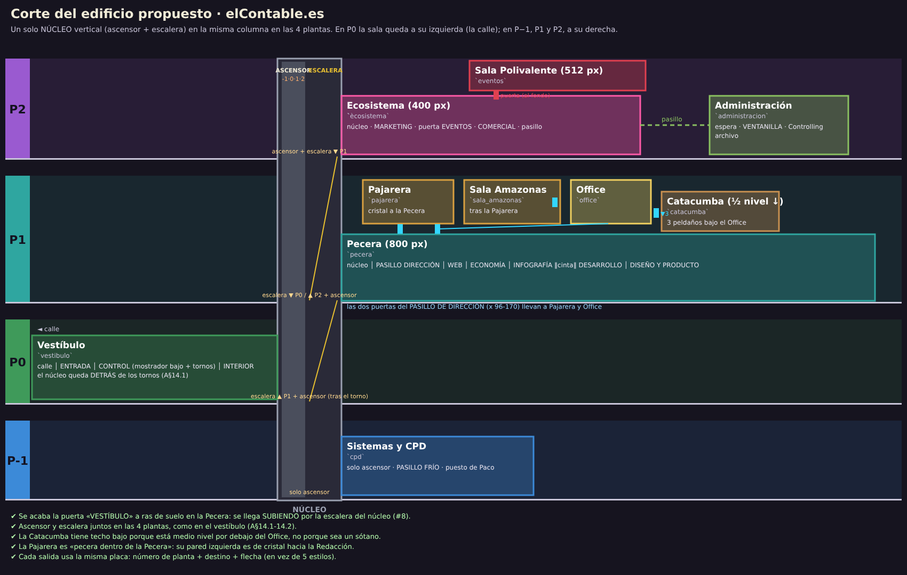

# GUÍA DEL REDISEÑO VISUAL — contrato para los cuatro paquetes de salas

**Estado:** REDISEÑO TERMINADO e integrado (fase 1, los cuatro paquetes y el cierre). Las tablas de §3-§10 describen
lo CONSTRUIDO; donde la guía original decía otra cosa, manda lo de aquí. El cierre añadió tres órdenes de dirección más
(§2 iii-v: «Vending», la Redacción de papel al lado de la Redacción y la Secretaría de Custodia en la Redacción), que anulan
la decisión D6 de la propuesta (la Catacumba «a medio nivel»). Esta guía fue **vinculante** para los cuatro artistas que
repintaron las 10 salas en paralelo. Desarrolla la propuesta aprobada (`docs/informes/propuesta/PROPUESTA_ALTERNATIVA.md`, «la
propuesta», decisiones D1–D8 = **sí**) y la auditoría (`docs/informes/INFORME_AJUSTE_VISUAL.md`, problemas **#n**).
**Encargo de dirección posterior (vestíbulo de planta, Despachos, Nemesio):** la Redacción mide **1270 px**; su arranque es
un VESTÍBULO DE PLANTA con un hueco y una placa por acceso (§6, orden vi); la sala `pajarera` se llama **«Despachos»** en
todo lo visible (orden i, revisada); el desarrollador del kanban es **Nemesio Backlog** (id `nerea_backlog` sin cambiar);
el Ecosistema mide **432 px** (aire entre la placa de Eventos, el rótulo de Comercial y la de Administración, §7).
**Orden de prioridad si algo choca:** 1) las dos órdenes de dirección (§2), 2) esta guía, 3) la propuesta, 4) la biblia.

Contenido: [1 Paquetes y archivos](#1-paquetes-y-archivos) · [2 Órdenes de dirección](#2-órdenes-de-dirección) ·
[3 El edificio y el núcleo](#3-el-edificio-y-el-núcleo-d1) · [4 Nombres visibles y señalética](#4-nombres-visibles-y-señalética) ·
[5 Sala Amazonas](#5-sala-amazonas-orden-ii) · [6 Pecera](#6-la-pecera-d2) · [7 Ecosistema](#7-ecosistema-a-400-px-d3) ·
[8 Catacumba a medio nivel](#8-catacumba-a-medio-nivel-d6) · [9 Anchos, salidas y entradas](#9-anchos-salidas-y-entradas-que-cambian) ·
[10 Puesta en escena de los PNJ](#10-puesta-en-escena-de-los-pnj) · [11 Estados](#11-la-regla-de-los-estados) ·
[12 Texto pintado](#12-texto-pintado) · [13 Kit y motor](#13-kit-y-motor-qué-hay-y-cómo-se-usa) ·
[14 Preguntas abiertas resueltas](#14-lo-que-la-propuesta-dejó-abierto-resuelto) · [15 Lista por sala](#15-lista-de-comprobación-por-sala) ·
[16 Herramientas](#16-herramientas)

---

## 1. Paquetes y archivos

Cada archivo tiene **un solo dueño**. Nadie toca los archivos compartidos (motor, kit, contrato, herramientas, docs
comunes). Si necesitas algo de un archivo compartido, **no lo edites**: escríbelo en tu informe final (archivo, qué,
por qué) y resuélvelo mientras tanto en tu propio archivo.

| paquete | salas | archivos que posee (lógica + arte + extras) |
|---|---|---|
| **P1** | `vestibulo`, `cpd` | `content/rooms/vestibulo.js`, `content/rooms/art/vestibulo.art.js`, `content/rooms/cpd.js`, `content/rooms/art/cpd.art.js`, `content/rooms/art/lib-vestibulo-micro.js`, `content/escenas/final.js` (epílogo 7.5, poscréditos) |
| **P2** | `pecera`, `pajarera` | `content/rooms/pecera.js`, `pecera.dialogos.js`, `pecera.escenas.js`, `pecera.voces.js`, `content/rooms/art/pecera.art.js`, `content/rooms/pajarera.js`, `content/rooms/art/pajarera.art.js`, `content/rooms/art/lib-oficina.js` (*) |
| **P3** | `office`, `catacumba`, `administracion` | `content/rooms/office.js`, `art/office.art.js`, `content/rooms/catacumba.js`, `art/catacumba.art.js`, `art/lib-catacumba-util.js`, `content/rooms/administracion.js`, `administracion.dialogos.js`, `art/administracion.art.js` |
| **P4** | `sala_amazonas`, `ecosistema`, `eventos` | `content/rooms/sala_amazonas.js`, `art/sala_amazonas.art.js`, `content/escenas/climax.js`, `content/escenas/planta_noble.js` (**), `content/rooms/ecosistema.js`, `ecosistema.dialogos.js`, `art/ecosistema.art.js`, `content/rooms/eventos.js`, `eventos.dialogos.js`, `art/eventos.art.js` |

(*) `lib-oficina.js` lo importan también `sala_amazonas.art.js` (P4) y `office.art.js`/otros: P2 es su dueño y **no
puede cambiar ni quitar** lo que ya exporta (solo añadir). Para cosas nuevas usad el kit (§13).
(**) `planta_noble.js` lo importa `administracion.js` (P3): P4 no cambia la firma de `sello`, `flash`, `gong`, `rota`, `SFX`.

**Compartidos (solo lectura para los cuatro):** `engine/*`, `content/lib/*` (incluidos el **kit** `content/lib/kit.js` y
el **contrato** `content/lib/edificio.js`), `content/game.js`, `items.js`, `actors.js`, `duelo.js`, `flags.js`,
`index.js`, `music.js`, `tools/*`, `docs/*`. Las pruebas `tools/test-paquete-*.mjs` también son compartidas: si un
cambio de tu sala rompe una aserción que la guía ya prevé (p. ej. una coordenada), dilo en tu informe con la línea.

**Dependencias cruzadas (lo que otro paquete LEE de tu archivo: no lo rompas):**

| lee | de | qué |
|---|---|---|
| `final.js` (P1) | `pecera.art.js` (P2) | `layout.yoli_tendencias.at`, `layout.silla_ramirez.walkTo` (epílogo y poscréditos en la Pecera) |
| `climax.js` (P4) | `administracion.art.js` (P3) | `layout.begona_triplicado.at` (Begoña vuelve a su ventanilla) |
| `eventos.dialogos.js` (P4) | `ecosistema.art.js` (P4) | coordenadas del Ecosistema (mismo paquete) |
| `pecera.escenas.js` (P2) | `pecera.art.js` (P2) | `pecera_a_vestibulo.walkTo`, `inigo_sinergia.at`, `pecera_a_pajarera.walkTo`; además supone el ascensor a la derecha (`x > 300` → fundido): **P2 lo cambia** al mover el núcleo a la izquierda |
| `catacumba.js` (P3) | — | coloca a Íñigo en `[26, 118]` (entrada desde la Redacción, por la puerta doble): revísalo si mueves la puerta |
| `cpd.js` (P1) | `cpd.art.js` (P1) | `ascensor_cpd.walkTo`, `ruben.positions.dentro` |
| `tools/smoke.mjs` | todas | la geografía de §3 (escaleras y entradas): está escrita para valer antes y después del rediseño |

---

## 2. Órdenes de dirección

Mandan sobre la propuesta.

**(i) «Pajarera» no se enseña nunca: es «Despachos».** El apodo no se entiende, y «Dirección» tampoco se entendía (la
sala es la antesala de los despachos que lleva a la Sala de Reuniones). En **todo lo visible** (placas, rótulos, botonera
del ascensor, nombre de la salida en la línea de frase, nombre de la sala en las ranuras de guardado y frases dichas) la
sala se llama **Despachos** (placa en la Redacción «1 DESPACHOS / SALA DE REUNIONES >»; en la Sala Amazonas «1 DESPACHOS ◄»).
La reunión sigue siendo la **«Reunión de Dirección»** y la pantalla de métricas puede seguir diciendo «PANTALLA DE
DIRECCIÓN»: lo que cambia es el nombre de la SALA. `tools/text-audit.mjs` falla si «Dirección» sale como nombre de sala. El id interno `pajarera` **no cambia** (ni ids de hotspots, ni
`entries`, ni flags). Los otros apodos (**Pecera, Catacumba, Ecosistema**) pueden seguir en boca de los personajes,
pero **toda placa o rótulo lleva el nombre llano**: Redacción, Cierre / Redacción de papel, Marketing y Comercial
(tabla de §4, que está en `content/lib/edificio.js` `SALA`).
*Aplicado:* `pajarera.js` (nombre de sala «Despachos», cuatro frases), `pecera.js` (salida «Despachos», su Mirar),
`sala_amazonas.js` («puerta de los Despachos»), `cpd.js` (murmullo «(Despachos)»), `content/lib/ascensor.js` (botonera
«Planta 1 · Redacción · Despachos · Vending», en una línea), `content/lib/edificio.js` `SALA.pajarera.placa`, `kit.DEPTO.direccion.nombre`.

**(ii) El Lector Medio NO preside.** En la Sala Amazonas, el cartón «Lector Medio» **nunca** está en la cabecera de la
mesa ni junto a ninguna placa de «presidencia», en ningún estado: no debe leerse como «el jefe es un cartón» (en este
juego no hay director de periódico). **Gervasio preside**. El Lector Medio es un **expositor de Marketing aparcado al
lado de la pantalla de proyección**, iluminado y a la vista, y **cae delante de la mesa**, como ahora. No se pinta
ninguna placa «PRESIDENCIA» en la mesa.
*Ya aplicado en el juego actual:* `sala_amazonas.art.js` (`LECTOR_AT = [238, 108]`, a la derecha de la pantalla,
delante de la mesa, con foco propio; Gervasio **sentado** presidiendo en la cabecera —la silla roja, extremo
izquierdo— en los Actos I-II y de pie en el rincón bajo «SALIDA» en el Acto III; Íñigo presenta en `[118, 118]`),
`climax.js` (sitios de Rubén, Begoña y Bruno tras el empujón, para no tapar el cartón caído), `sala_amazonas.js`
(«Junto a la pantalla, el Lector Medio…»), `tools/test-paquete-d.mjs` (la aserción ya exige «junto a la pantalla, no
en la cabecera»). El clímax se ha vuelto a comprobar (§5).

---

**(iii) La sala del café se llama «VENDING», no «Office».** En todo lo visible y lo dicho (placas, botonera, línea de
frase, ranuras de guardado, frases): «el Vending», «la sala de Vending». El id `office` y los flags `office_*` no cambian.
`tools/text-audit.mjs` falla si «Office» u «Pajarera» aparecen en algo que el jugador ve u oye.

**(iv) La Redacción de papel (`catacumba`, «Redacción de papel» / «Cierre») está AL LADO de la Redacción web**, en la
misma planta y al mismo nivel: una puerta doble abierta en la pared de la Redacción (`pecera_a_catacumba`, x 490-550),
con la placa «1 REDACCIÓN / DE PAPEL · CIERRE» y, por dentro, «1 REDACCIÓN ◄ / REDACCIÓN WEB». El umbral de latón es la
frontera de la guerra fría papel/web (moqueta y clic a un lado, parqué y tinta al otro). Sin peldaños y sin puerta entre
el Vending y la Redacción de papel: el Vending solo tiene su arco (sin puerta) a la Redacción. La placa esmaltada «TALLERES» cuelga
ahora dentro de la Redacción de papel. Anula la D6 (§8).

**(v) La Secretaría de Redacción (Custodia Precinto) vive en la Redacción**, en la bisagra entre las dos redacciones: el
ventanuco con la persiana (x 370-406, en su propio hueco con la placa «SECRETARÍA / DE REDACCIÓN»; el cartel, a su derecha), el timbre «NO», el cartel «EL MATERIAL NO SE PIDE. SE MERECE.» y la cajonera
(x 176-218), junto a la puerta doble. Ids, líneas y árbol sin cambios (`content/rooms/pecera.secretaria.js`, dibujo en
`content/rooms/art/lib-secretaria.js`). En el Vending, su hueco lo ocupa la máquina de vending (`maquina_vending`).

## 3. El edificio y el núcleo (D1)



Un solo **NÚCLEO** vertical: ascensor + escalera juntos, **con el mismo dibujo y las mismas medidas en las cuatro
plantas** (kit `nucleo()`; geometría en `content/lib/edificio.js` `nucleoGeom()`). Es una banda de **96 px** en un
extremo de la sala; en P0 la sala queda a su izquierda (la calle), en las demás a su derecha.

| planta | sala con el núcleo | banda | escalera (desde la pared exterior 4-46) | ascensor (puertas 54-84) |
|---|---|---|---|---|
| **2** | `ecosistema` | x 0-96 (izquierda) | `ecosistema_a_pecera`: tramo que **BAJA** (placa «1 REDACCIÓN ▼») rect `[4, 30, 42, 64]` | `ascensor_ecosistema` rect `[50, 28, 42, 66]`, indicador «2» |
| **1** | `pecera` | x 0-96 (izquierda) | `pecera_a_ecosistema` **SUBE** (placa «2 MARKETING ▲») rect `[4, 30, 42, 30]` encima; `pecera_a_vestibulo` **BAJA** (placa «0 VESTÍBULO ▼») rect `[4, 62, 42, 32]` debajo | `ascensor_pecera` rect `[50, 28, 42, 66]`, indicador «1» |
| **0** | `vestibulo` | x 224-320 (derecha, detrás de los tornos) | `vestibulo_a_redaccion` **SUBE** (placa «1 REDACCIÓN ▲») rect `[274, 30, 42, 64]` | `ascensor_vestibulo` rect `[232, 28, 42, 66]`, indicador «0» |
| **−1** | `cpd` | x 0-96 (izquierda) | **caja de escalera cerrada** (persiana «SOLO EVACUACIÓN», sin hotspot): la planta −1 solo tiene ascensor | `ascensor_cpd` rect `[50, 28, 42, 66]`, indicador «−1» |

Valores para **FL = 94** (línea pared/suelo **obligatoria en las cuatro salas con núcleo**, para que el núcleo sea
idéntico). `walkTo` del ascensor `[69, 108]` (vestíbulo `[251, 108]`), cara `up`; `walkTo` de la escalera `[25, 108]`
(vestíbulo `[295, 108]`). **Entradas:** `ascensor` = `[69, 110, 'down']` (vestíbulo `[251, 110]`); la de la escalera
= `[31, 112, 'right']` (vestíbulo `[289, 112, 'left']`). Úsalas así, sin copiar números:

```js
import * as kit from '../../lib/kit.js';
import { nucleoGeom } from '../../lib/edificio.js';
const N = nucleoGeom('pecera', 94);                       // en draw(): kit.nucleo(g, 'pecera', 94) pinta y devuelve lo mismo
layout.ascensor_pecera = { rect: N.ascensor.rect, walkTo: N.ascensor.walkTo, face: 'up' };
layout.pecera_a_ecosistema = { rect: N.escaleras.sube.rect, walkTo: N.escaleras.sube.walkTo, face: N.escaleras.sube.face };
layout.pecera_a_vestibulo = { rect: N.escaleras.baja.rect, walkTo: N.escaleras.baja.walkTo, face: N.escaleras.baja.face };
entries: { ascensor: N.ascensor.entrada, vestibulo: N.escaleras.baja.entrada, ecosistema: N.escaleras.sube.entrada, … }
```

Conexiones (construidas; cada salida declara su `tipo` y `tools/check.mjs` exige el mismo en los dos lados, ver `docs/CONTENT_SCHEMA.md`): P2 `ecosistema` ─puerta doble entornada con ojos de buey (igual desde los dos lados)─ `eventos`; `ecosistema` ─boca de pasillo, sin puerta (igual desde los dos lados)─ `administracion`. P1 `pecera` ─
vestíbulo de planta: frente de cristal a `pajarera` (Despachos) y arco abierto a `office` (Vending, sin más salidas; por dentro, el MISMO arco sin hoja, por el que se ve el vestíbulo de planta); zona de papel:
puerta doble a `catacumba` (Redacción de papel, mismo nivel, sin más salidas, orden iv); `pajarera` ─puerta (abierta con cuña desde los dos lados; cerrada solo en el Acto III hasta el clímax)─
`sala_amazonas`. P0 `vestibulo`: tornos → núcleo (con el torno cerrado, el núcleo queda al otro lado: walkbox `when`).
P−1 `cpd`: solo ascensor. Mapa completo: `docs/CONTENT_SCHEMA.md` §2.6.
Las reglas del ascensor (`content/lib/ascensor.js`) no cambian.

---

## 4. Nombres visibles y señalética

### 4.1 Tabla de nombres (fuente: `content/lib/edificio.js` `SALA`; el kit la usa en `placaSala()`)

| sala (id) | placa (fuente del juego) | 2.ª línea (3×5) | planta | departamento (color) | apodo permitido en boca de personajes |
|---|---|---|---|---|---|
| `vestibulo` | VESTÍBULO | — | 0 | — | — |
| `pecera` | REDACCIÓN | REDACCIÓN WEB | 1 | redacción | la Pecera |
| `office` | **VENDING** (orden iii) | — | 1 | office (amarillo) | — |
| `catacumba` | REDACCIÓN | DE PAPEL · CIERRE | 1 (al lado de la Redacción, mismo nivel) | papel | la Catacumba |
| `pajarera` | **DESPACHOS** (en la Redacción, sub «SALA DE REUNIONES >») | — | 1 | dirección | **ninguno** (orden i) |
| `sala_amazonas` | AMAZONAS | SALA DE REUNIONES | 1 | dirección | — |
| `ecosistema` | MARKETING | Y COMERCIAL | 2 | marketing | el Ecosistema |
| `eventos` | EVENTOS | SALA POLIVALENTE | 2 | eventos | — |
| `administracion` | ADMINISTRACIÓN | — | 2 | administración | la Ventanilla |
| `cpd` | SISTEMAS | CPD | −1 | sistemas | — |

Placa de destino = **una sola** para todo el edificio (`kit.placa` / `kit.placaSala`): fondo tinta, marco claro, banda
con el número y el color de la **planta** (P−1 azul, P0 verde, P1 verde agua, P2 lila), nombre, flecha si cambia de
planta o de dirección (◄ ► ▲ ▼). Sobre el dintel; dos puertas juntas → placas apiladas a dos alturas. Debajo, el
**umbral** (`kit.umbral`) con el color del destino y el **marco** común (`kit.marcoPuerta`); la hoja la pinta la sala.

### 4.2 Rótulos pintados que hay que rehacer (estado actual → objetivo)

| paquete | sala | qué hay pintado hoy | qué debe decir |
|---|---|---|---|
| P1 | vestibulo | «REDAC. 1» en la escalera | placa «1 REDACCIÓN ▲» (núcleo); el cartel «REDACCIÓN → / ASCENSOR →» se conserva |
| P1 | vestibulo | carril delantero «NO» | cinta + cartel «AVERIADO» legible |
| P1 | cpd | «SALA FRÍA» sobre el ascensor | núcleo con placas del kit; rótulo de zona «SISTEMAS» |
| P2 | pecera | puerta acristalada «VESTÍBULO» a ras de suelo; escalera «PLANTA 2» a la derecha | núcleo a la izquierda (§3); la puerta acristalada desaparece |
| P2 | pecera | vinilo «DIRECCIÓN» en el cristal | **hecho (vestíbulo de planta):** placa «1 DESPACHOS / SALA DE REUNIONES >» sobre el frente de cristal |
| P2 | pecera | «PANTONE», «DANA», pancarta «BIENVENIDO», torre «PRE», «HERMINI», «BRU/PEL», «DESARR.», «ACCESO DENEG/REVOC», tazas «DEV/NO» | quitar los cuatro primeros; los demás, enteros (§12) |
| P2 | pajarera | «COSTE» cortado («STE»); Titulator ilegible | «COSTE» entero; pantalla del Titulator 30×18 con 3 líneas 3×5 |
| P2 | pajarera | — (la puerta de la Sala no dice nada) | placa «1 AMAZONAS / SALA DE REUNIONES» sobre `puerta_sala` |
| P3 | office | placa «PECERA» en la puerta izquierda | **hecho**: placa «1 REDACCIÓN ◄ / REDACCIÓN WEB» (los apodos, nunca en placas) |
| P3 | office | placa esmaltada «TALLERES» y la puerta a la Catacumba | **cierre**: la puerta ya no existe (orden iv); en su sitio, la fuente de agua; la placa «TALLERES» cuelga dentro de la Redacción de papel |
| P3 | catacumba | «TALLERES»/«VENDING» colgado | **cierre**: puerta doble abierta con placa «1 REDACCIÓN ◄ / REDACCIÓN WEB», sin peldaños |
| P3 | administracion | «PASILLO», «EJEMPLARE…» | placa «2 MARKETING ◄ / Y COMERCIAL»; «EJEMPLARES» entero; el aviso del 26 % lo firma «ADMINISTRACIÓN (TAMBIÉN RECORTADA)» |
| P4 | sala_amazonas | ninguna placa | placa «1 DESPACHOS ◄» sobre la puerta; **ninguna** «PRESIDENCIA» |
| P4 | ecosistema | neón «ECOSISTEMA», placa verde «EVENTOS», «P1▼», «TODO ES…» | rótulos de zona MARKETING y COMERCIAL; placa «2 EVENTOS» en la puerta; núcleo del kit; el neón dice «MARKETING» (cierre: los apodos, solo en boca de los personajes); lema entero en 4 líneas 3×5 |
| P4 | eventos | «◄ MKT», «ACREDIT» | placa «2 MARKETING ◄ / Y COMERCIAL»; «ACREDITACIÓN» entero |

### 4.3 Rótulos de zona (departamentos)

`kit.rotuloZona(g, cx, y, depto)`: bandera colgada del techo y centrada sobre la zona, con el filete del color del
departamento. Van **en la franja de techo y 14-30** (no tapan pistas). Colores en `kit.DEPTO`: Web verde agua,
Economía/Redacción azul, Infografía naranja, Desarrollo violeta, Diseño blanco, Dirección nogal y latón, Vending amarillo,
Papel/Cierre ámbar, Marketing fucsia, Eventos granate, Comercial naranja, Administración verde oliva, Sistemas azul.

---

## 5. Sala Amazonas (orden ii)

(La disposición provisional de la fase 1 —cabecera a la izquierda, Lector a la derecha de la pantalla— ya no existe.)

**Construido (P4, sobre la prueba pintada `docs/informes/propuesta/arte/sala_amazonas.propuesta.art.js`):**
la mesa cruza la sala y la **cabecera queda a la DERECHA**, contra el ventanal y bajo el foco: **es de Gervasio**.

| quién | acto | pies `at` | pose | Bruno habla desde | nota |
|---|---|---|---|---|---|
| Gervasio | I-II | `[286, 101, 'left']` | `sentado` (preside) | `[256, 124]` | con figurantes enfrente (0,92; uno «Zzz», uno con barba) |
| Gervasio | III | `[304, 112, 'left']` | de pie | `[278, 124]` | junto a SU silla vacía (la cabecera queda vacía) |
| Lector Medio | III | `[100, 120, 'down']` | expositor | empuje desde `[76, 124]` | a la IZQUIERDA de la pantalla (x 118-246), delante del pie de la mesa, foco propio, `luz: 1` |
| Lector caído | III | centro ≈ `[137, 124]` | variante `caido` | — | cae hacia la derecha, delante de la mesa; botellines por el aire |
| Íñigo | III | `[222, 122, 'left']` | de pie | `[198, 124]` | presenta bajo la pantalla |
| Rubén / Begoña | clímax | `[276, 130]` / `[250, 132]` | de pie | — | a la derecha del cartón caído, sin taparlo (`climax.js` `SITIO_RUBEN` / `SITIO_BEGONA`) |
| Bruno tras el ¡PLOF! | clímax | `[76, 128]` | — | — | a la izquierda del cartón |

Prohibido en cualquier estado: el Lector a menos de **60 px** de la cabecera; una placa o rótulo «PRESIDENCIA»; el
Lector dentro del haz del proyector. P4 actualiza a la vez `LECTOR_AT` y los `SITIO_*` de `climax.js`. La aserción de
`tools/test-paquete-d.mjs` ya vale para las dos disposiciones: el Lector a **≥ 60 px** de la posición `preside` de
Gervasio, a **≤ 40 px** de un borde de `orden_del_dia` (la pantalla) y con los pies en **y ≥ 104**.

---

## 6. La Pecera (D2)

**1270 px** (800 + la zona de papel de las órdenes iv-v + el VESTÍBULO DE PLANTA, orden vi + 60 px de Desarrollo). Zonas de
izquierda a derecha (`content/lib/edificio.js` `PECERA_ZONAS`). Cada zona tiene **las cuatro capas**: suelo propio con canto
de goma (`kit.zonaSuelo`), filete de pared de su color (`kit.filete`, y≈66), pilastra en el cambio (`kit.pilastra`) y rótulo
colgado centrado (`kit.rotuloZona`). De Web a Desarrollo, el arte está escrito en las coordenadas de la sala de 800 px y se
pinta corrido `PECERA_DESPLAZ` = 410 px; Diseño y Producto, `PECERA_DESPLAZ_DISENO` = 470 (`desplazado` / `mover` en
`pecera.art.js`); las escenas que usan coordenadas literales suman lo mismo.

**(vi) Orden del director: el VESTÍBULO DE PLANTA («queda fatal el acceso a las distintas estancias, una pegada a otra,
sin espacio ni nada, sin aire»).** Cada acceso tiene su propio hueco con pared lisa a los dos lados (≥ 24 px entre
huecos), UNA placa por acceso a la misma altura (y 16, nunca apiladas), un felpudo del color del destino y una lengua en
el suelo que lleva de la franja guía del vestíbulo a cada hueco; y cada hueco ENSEÑA lo que hay detrás:

| hueco | x (hueco) | qué se ve sin leer la placa | placa (y 16) |
|---|---|---|---|
| tótem-directorio `directorio_planta` | 100-148 | tótem de pie: «PLANTA 1» y la lista con el punto de color de cada felpudo, «AQUÍ» | — |
| DESPACHOS `pecera_a_pajarera` | 168-224 | frente de CRISTAL con puerta de cristal: el sofá blanco, la pared de pósits, una lámpara cálida y, al fondo, la puerta de la Sala de Reuniones con su piloto verde | «1 DESPACHOS / SALA DE REUNIONES >» |
| VENDING `pecera_a_office` | 260-316 | ARCO ABIERTO, sin puerta: el azulejo crema, el resplandor de la máquina de vending y la silueta cromada de Gertrudis con su LCD verde | «1 VENDING» |
| SECRETARÍA (Custodia) | 370-406 | el ventanuco con persiana y las manos, el timbre «NO», la cajonera; el cartel «EL MATERIAL…» a la derecha (414-460); sitio para Bruno al lado (`[376, 108]`) | «SECRETARÍA / DE REDACCIÓN» |
| REDACCIÓN DE PAPEL `pecera_a_catacumba` | 490-550 | puerta doble abierta: galeradas colgadas, lámpara de banquero, el reloj parado; umbral de latón con aire a los dos lados | «1 REDACCIÓN / DE PAPEL · CIERRE» |

| zona | x | ancho | pared | suelo | rótulo | contenido |
|---|---|---|---|---|---|---|
| NÚCLEO | 0-96 | 96 | `#3a3e4a` | terrazo | (placas del núcleo) | escalera ▲ P2 / ▼ P0 + ascensor «1» (§3) |
| VESTÍBULO DE PLANTA | 96-344 | 248 | yeso `#4c5260`, zócalo de piedra | linóleo claro + franja guía y lenguas de color | — (placas por hueco) | tótem, Despachos, Vending (tabla de arriba); un foco por hueco; ficus en primer plano en 336 |
| PAPEL (bisagra) | 344-580 | 236 | nogal viejo `#5a3e26` con friso | parqué de tablilla | — (placas) | Secretaría y puerta doble (tabla de arriba) |
| WEB | 580-720 | 140 | `#2c6a66` | moqueta azul pizarra | WEB | pantalla de métricas, enchufe con cinta en el zócalo, sillas con chaqueta, figurantes, mesa de Yoli |
| ECONOMÍA | 720-796 | 76 | `#3a5a6c` | moqueta azul | ECONOMÍA | mesa de Bruno SIN silla, pósit «BRUNO / PELLIZCO», silla y chaqueta de Ramírez en el plano medio, taza |
| INFOGRAFÍA | 796-890 | 94 | `#7a6448` | moqueta cálida | INFOGRAFÍA | mesa de dibujo con flexo, portátil «HERMINIA», cartel «SOLO CÓDIGO» en la pilastra de 890 |
| (cinta) | 890 | — | — | cinta beige EN EL SUELO sobre el cambio de moqueta | — | `frontera_carrocero` (recta / doble / lazo a Infografía) |
| DESARROLLO | 890-1150 | 260 | `#3e3656` | moqueta violeta | DESARROLLO | kanban EXENTO, pósit 1998, calendario, semáforo, coro de espaldas, taza «NO», pantalla de Anselmo y, en 1090-1150, un rincón DECORADO sin hotspots: póster «FUNCIONA EN MI MÁQUINA», balda con el patito de goma, manuales sin abrir y un cactus, pizarrita «DÍAS SIN CAÍDAS: 0» |
| DISEÑO Y PRODUCTO | 1150-1270 | 120 | `#c8c8c0` | moqueta gris | DISEÑO Y PRODUCTO (entero) | ventanal (Rubén, Acto III; amanecer en el epílogo), bandeja ENTREGAS, monitor de Valentín, Valentín de pie |

El plano de hotspots es la tabla de la propuesta §4.2 (posiciones x, y, an, al): sus **ids no cambian** y las cajas son
intención; la geometría final la fija el artista respetando los rangos de zona, el mínimo de 12×10 y los solapes ≤ 30 %.
Se quitan del dibujo «PANTONE», «DANA», «BIENVENIDO» y la torre «PRE». Ningún hotspot a menos de 4 px del borde de la
cámara cuando la cámara está quieta en el centro de su zona.

---

## 7. Ecosistema a 432 px (D3)

`content/lib/edificio.js` `ECOSISTEMA_ZONAS` (ancho `ANCHO.ecosistema = 432`: Comercial ganó 32 px de pared para que la placa de Eventos, el rótulo de Comercial y la placa de Administración no se peguen; las tres en la misma fila, y 2; la cámara se desplaza):

| zona | x | contenido |
|---|---|---|
| NÚCLEO | 0-96 | escalera ▼ P1 (`ecosistema_a_pecera`) + ascensor «2» (`ascensor_ecosistema`); los **pufs** siguen delante del ascensor (gag A§14.2) sin tapar la botonera |
| MARKETING | 96-190 | embudo, pizarra SINERGIA sobre la mesa vacía de Tadeo, portátil de Tadeo, Borja |
| puerta de EVENTOS | 190-242 | `ecosistema_a_eventos` (194-238) con ojos de buey, piloto «5 MIN», placa «2 EVENTOS», umbral granate |
| COMERCIAL | 242-384 | roll-up, termómetro, lema entero en 4 líneas, Maripaz en su mesa |
| PASILLO | 384-432 | `ecosistema_a_administracion` (boca de 46 px, dibujada en coordenadas de 400 px + 32) con la impresora de la tercera ENTERA dentro y, en el suelo delante de su bandeja (x 377-396), la piel de plátano 16×8 amarilla con canto vivo |

---

## 8. Catacumba a medio nivel (D6) — ANULADA

La orden de dirección (iv) la anula: la Redacción de papel está **al lado** de la Redacción web, al mismo nivel, y se
entra por una puerta doble abierta en la pared de la Redacción (zona de papel, x 490-550). No hay peldaños ni puerta al
Vending. Desde dentro, la misma puerta doble (x 6-40) con la placa «1 REDACCIÓN ◄ / REDACCIÓN WEB» y, por el hueco, lo
que hay de verdad al otro lado: el nogal con friso y el parqué de la bisagra, el cartel de la Secretaría y, al fondo, el
resplandor de las pantallas. `kit.peldanos` queda en el kit, sin uso. Los conductos viejos del techo se
quedan (el edificio es de 1987); la gotera y su cubo, no (no es un sótano).

## 9. Anchos, salidas y entradas que cambian

**Ningún id cambió en el repintado**; el cierre (orden iv) cambió UNA salida: `catacumba_a_office` / `office_a_catacumba`
→ `catacumba_a_pecera` / `pecera_a_catacumba`, con sus entradas. El resto, coordenadas y anchos:

| sala | ancho | lo que se mueve | entradas (`entries`, nombradas como la sala de origen) |
|---|---|---|---|
| `vestibulo` | 320 | `ascensor_vestibulo`, `vestibulo_a_redaccion` → núcleo derecho (§3); el carril del torno es un walkbox condicional (`paso_torno`, `when: 'torno_abierto'`) | `pecera` = `[289, 112, 'left']`; `ascensor`/`cpd` = `[251, 110, 'down']`; `inicio` `[38, 118, 'right']` |
| `cpd` | 320 | `ascensor_cpd` de x 4 → núcleo (puertas 54-84) | `ascensor` y `vestibulo` = `[69, 110, 'down']` |
| `pecera` | **1270** | núcleo izquierdo; vestíbulo de planta: `directorio_planta` 100-148, `pecera_a_pajarera` x 168-224, `pecera_a_office` x 260-316; zona de papel: Secretaría 370-406, `pecera_a_catacumba` x 490-550; de Web a Desarrollo +410 px, Diseño +470 (§6) | `vestibulo` y `ecosistema` = `[31, 112, 'right']`; `ascensor` = `[69, 110, 'down']`; `pajarera` = `[196, 110, 'down']`; `office` = `[288, 110, 'down']`; `catacumba` = `[520, 110, 'down']` |
| `pajarera` | 320 | pared izquierda de cristal hacia la Redacción (por él se ve el vestíbulo de planta: yeso, tótem, ficus); Titulator en atril propio | sin cambio de ids |
| `office` (Vending) | 320 | sin la puerta a la Catacumba ni el ventanuco de Custodia (órdenes iv-v): máquina de vending (88-130) y fuente de agua (286-306); la salida a la Redacción es el ARCO abierto (x 6-38, sin hoja), con el vestíbulo de planta al otro lado | solo `pecera` = `[30, 112, 'right']` (se quita `catacumba`) |
| `catacumba` | 320 | `catacumba_a_office` → **`catacumba_a_pecera`** (puerta doble x 6-40, sin peldaños) | `office` → **`pecera`** = `[32, 116, 'right']` |
| `sala_amazonas` | 320 | mesa en U con cabecera a la derecha (§5) | `pajarera` sin cambio |
| `ecosistema` | **432** | §7: `ascensor_ecosistema` → núcleo; `ecosistema_a_eventos` → 194-238; `ecosistema_a_administracion` → 402-430 | `pecera` = `[31, 112, 'right']`; `ascensor` = `[69, 110, 'down']`; `eventos` = `[216, 114, 'down']`; `administracion` = `[404, 116, 'left']` |
| `eventos` | 512 | `focos` es el foco tres de la barra (`[113, 3, 20, 20]`); álbum 20×12 | sin cambios |
| `administracion` | 320 | Begoña y Evaristo sentados | sin cambios |

Convenciones: entrada = donde aparece Bruno **dentro del walkbox**, 2-6 px delante de la salida, mirando hacia la sala;
`walkTo` de una salida = en el suelo frente a ella; la escalera `face` hacia la pared exterior.

---

## 10. Puesta en escena de los PNJ

Reglas: cabeza y torso a la vista **≥ 80 %** (también con Bruno en su punto de conversación); Bruno habla **siempre
desde un lado, a ≥ 24 px en horizontal, nunca delante** (pon `walkTo` explícito en cada PNJ: el motor, si no hay, usa
22 px); mostradores a la cintura; cabezas ≥ 10 px (escala ≥ 0,88 al fondo); PNJ oscuro delante de fondo claro. Pose
con el motor: `at: [x, y, dir], pose: 'sentado'` (o `'tras_mesa'`, §13.1).

| PNJ | sala | pies `at` | pose | Bruno habla desde | detrás | nota |
|---|---|---|---|---|---|---|
| Celestino | vestibulo | `[170, 97]` | de pie tras mostrador BAJO | `[138, 122]` | pared verde con monitor | #3 |
| Yoli | pecera | `[719, 116]` (`[309, 116]` + 410) | de pie | `[694, 126]` | pared Web | epílogo: Bruno a su izquierda |
| Leoncio | pecera | `[844, 114]` | de pie | `[820, 126]` | pared crema | no tapa a Herminia |
| Nemesio (id `nerea_backlog`) | pecera | `[1008, 114]` | de pie | `[1034, 126]` | pared violeta | #7 |
| Anselmo | pecera | `[1082, 118]` | de pie | `[1106, 128]` | rincón de Desarrollo (póster, balda del patito) | |
| Valentín | pecera | `[1240, 112]` (`[770, 112]` + 470) | **de pie** junto a su mesa | `[1216, 126]` | pared blanca | cameo |
| Rubén (A III) | pecera | `[1258, 114]` (`[788, 114]` + 470) | de pie, de cara a la ventana | `[1234, 126]` | ventanal | |
| Gertrudis | office (Vending) | `[164, 96]` | máquina de 66 px (`scale: 1.5` en `actors.js`) | `[134, 110]` | azulejo | #13 |
| Gervasio (A III) | office (Vending) | `[170, 119]` | delante de Gertrudis | `[136, 128]` | LCD por encima de su cabeza | |
| Teodoro | catacumba | `[94, 104]` | **sentado** frente al fax | `[66, 124]` | cortina del camastro | #4; en 7.3a de pie al teléfono (`positions.telefono` `[152, 113]`) con el auricular en la mano |
| Aurora | catacumba | `[232, 108]` | de pie | `[206, 124]` | cartel «NO HABLO…» | |
| Íñigo (I-II) | pajarera | `[92, 98]` | **sentado** en el sofá | `[66, 126]` | pósits | #16 |
| Lector Medio | pajarera | `[50, 106]` | expositor | `[26, 124]` | pósits | junto a la puerta, nunca tras la mesa de Gervasio |
| Gervasio (II) | pajarera | `[262, 97]` | **sentado** en su mesa (`tras_mesa`) | `[236, 126]` | pared nogal | |
| Custodia | pecera (Secretaría) | — (presencia: manos bajo la persiana, objeto `custodia_precinto`) | — | `[376, 108]` | ventanuco 370-406 | orden v |
| Gervasio / Lector / Íñigo | sala_amazonas | §5 | §5 | §5 | | orden ii |
| Borja | ecosistema | `[118, 112]` | de pie | `[94, 124]` | embudo | |
| Maripaz | ecosistema | `[328, 104]` | de pie junto a su mesa | `[302, 124]` | lema | |
| Pilar | eventos | `[128, 124]` | de pie | `[104, 127]` | photocall | se conserva |
| Begoña | administracion | `[196, 98]` | **sentada** tras el cristal (`tras_mesa`) | `[158, 120]` | estantería | el agujerito 14 px a SU IZQUIERDA (#14); en el clímax, `[250, 132]` en la Sala |
| Evaristo | administracion | `[256, 99]` | **sentado** con lupa | `[226, 126]` | cristal de Controlling | sale a la puerta (`positions.puerta` `[238, 107]`, de pie; Bruno le habla desde `[212, 114]`) |
| Paco | cpd | `[277, 96]` | **sentado** | `[246, 126]` | mampara gris «SISTEMAS» | #17 |
| Rubén (III) | cpd | dentro `[187, 93]`, fuera `[186, 106]` | dentro del 27 abierto | `[214, 118]` | luz verde del armario | #2; los armarios 22 y 23 ya no caben junto al núcleo (quedan 24-30) |

Coordenadas CONSTRUIDAS (`node tools/sala.mjs <sala>` las enseña; la auditoría comprueba las reglas, §16).

---

## 11. La regla de los estados

1. **Se dibuja por el ESTADO DEL OBJETO** (`sprites: { <estado>: fn }` o `view.state`), **nunca por un flag que llega
   al final de una escena** (#2: el armario 27 se abría con `ruben_encontrado`, que se pone al acabar). Si hace falta un
   flag, que sea el que la lógica pone **antes** de la línea que lo comenta.
2. Cada cambio de estado con guion cambia **al menos dos de: forma, color, luz**, y ocupa **≥ 30 px²** (torno: alas
   recogidas + LED verde + franja verde en el suelo).
3. Estados mínimos a dibujar: torno (cerrado/abierto), organigrama (sin/con foto 6×8), pantalla de métricas
   (encendida/apagada), enchufe (enchufado/cable colgando), silla de Ramírez (con chaqueta/arrimada), ordenador de Bruno
   (texto/correo), cinta (recta/doble/lazo), kanban (BAJA RUBÉN / AQUÍ RUBÉN), semáforo, fax (sin/con papel), teléfono
   rojo (colgado/**descolgado** con auricular en la mano y cordón rizado), tipómetro (mesa/mano), Titulator (rotando /
   AYÚDAME…), `puerta_sala` (EN CURSO / LIBRE / OCUPADO HASTA 2031), proyector, botellines (fila/volando/tumbados),
   armario 27 (cerrado/**abierto**/vacío), papel continuo (asoma/tensa/recogida), roll-up, gong, dispensador (0/1),
   ventanas y cristal de la calle (noche/**amanecer** en el epílogo).
4. Lo **interactivo** lleva **canto vivo** (`kit.cantoVivo`) y silueta propia ≥ 12×10; lo decorado, no, y menos
   contraste.

---

## 12. Texto pintado

* Rótulos y placas: **fuente del juego** (`label`, caja de 7 px, ≤ 12 caracteres en placas). Secundarios: **3×5**
  (`kit.micro`, 4 px por carácter, ≤ 9 caracteres por línea en 36 px). Prohibido: < 3×5, texto cortado por el borde o
  por otro objeto, marcas reales, «¿/¡» en 3×5.
* Para que **nunca** salga cortado usa `kit.texto(g, 'ACREDITACIÓN', x, y, w, h, { color })`: elige fuente del juego o
  3×5, parte por palabras y, si no cabe, lo apunta en `kit.registro.problemas` (la auditoría falla en una sala
  rediseñada). `kit.cabe(texto, w, h)` dice de antemano si cabe.
* Las pistas de puzle van **fuera de la franja de globos (y < 45)**; si un remate necesita leerse grande, es un
  **plano detalle** (§13.3).
* Textos a dejar enteros (lista de la auditoría §5.3): «VESTÍBULO», «HERMINIA», «BRUNO / PELLIZCO», «DESARROLLO»,
  «DENEGADO», «NO», «COSTE», carteles en guerra de la Sala, «EJEMPLARES», el lema de Comercial, «AVERIADO»,
  «ACREDITACIÓN», el LCD de Gertrudis en reposo («PRECALENTANDO RENCOR»), «ADMINISTRACIÓN (TAMBIÉN RECORTADA)» (antes firmaba
  «la Dirección»: se quitó, el juego no alude a ninguna dirección de periódico).

---

## 13. Kit y motor: qué hay y cómo se usa

### 13.1 Motor (ya disponible)

| función | cómo | notas |
|---|---|---|
| **Pose sentada** | arte: `at: [x, y, dir], pose: 'sentado' \| 'tras_mesa'` (también en `positions`); guion: `api.pose(id, 'sentado' \| 'tras_mesa' \| 'de_pie' \| null)` | `y` = pies en el suelo (ordena igual). `sentado`: el tronco baja ~8 px, regazo y pantorrillas; de perfil, muslo hacia delante. `tras_mesa`: solo de la cadera arriba, sin sombra: el mueble DELANTE (objeto `layer: 'sorted'` con `zy` > pies, o `foreground`) tapa el resto. Al andar se levanta solo; vuelve a su pose al quedarse en su sitio. La pose explícita se guarda |
| **Plano detalle** | `await api.detalle({ draw(g, r, t, k), w, h, x?, y?, titulo, texto?, lines, ms, oscurecer }, async (api) => {…}?)` | Inserto con marco y rótulo; los globos salen debajo. Se cierra al acabar sus líneas/cuerpo, con un clic (sin líneas), Esc, modo rápido (instantáneo) y al cargar, pero nunca antes del tiempo de lectura de `titulo` + `texto` (lo que pinta). Ejemplo real: el portátil del Titulator en 7.2 (`pecera.escenas.js`) |
| **Penumbra y focos** | arte: `penumbra(view, t) → { color, alpha, spots: [[cx, cy, rx, ry], { rect }], actor: 0.78, actores: { id: k } } \| null`; layout del PNJ `luz: k`; guion `api.luz(id, k)` | Oscurece fondo, muebles y primer plano MENOS los focos; los actores solo el 22 % (exención 0,78) salvo que digas otra cosa. **No oscurezcas con `overlay`**: ya no hay hologramas. Ejemplo: Acto III de la Sala |
| **Walkbox con forma** | varios polígonos (la unión es el suelo): en U, con muescas, con franja detrás de un mueble | El camino rodea el mueble; ordena con `layer: 'sorted'` + `zy` del mueble. Ejemplo: `tools/demo-rediseno.js` |
| **Escala por zona** | `walkboxes: [{ id, poly, scale: { yFar, far, yNear, near } \| número }]` | Para tarimas o fondos con otra perspectiva |
| **Oclusores** | `foreground(g)` (siempre delante, cacheado) · objeto `layer: 'front'` · objeto `layer: 'sorted', zy` (delante o detrás según los pies) · `prop: true` (mueble que se pinta aunque el hotspot esté oculto) | Un oclusor nunca tapa una cara ni más del 20 % de cabeza+torso de quien habla |
| **Ver hotspots** | botón del ojo del panel, «Ver objetos de la sala (H)» del menú de pausa, tecla **H**, mantener **Espacio**, **pulsación larga** en zona vacía (táctil) | Pinta el canto vivo y el nombre de todo lo interactivo 1,5 s. Los rótulos no se pisan nunca: se colocan de los pequeños a los grandes probando posiciones cada vez más lejos (encima, dentro, debajo, a los lados) y, si quedan despegados de su caja, una línea guía los une |
| **Objetivos mínimos** | automático | un clic que no cae en nada acierta un objeto pequeño hasta **12×10** px (ratón) / **16×12** px (táctil); filas de diálogo de **14 px** al tacto |
| **Objeto en la mano** | `api.sostener(id, 'cafe' \| { draw(g, x, y, s, dir) } \| null)` | icono a media escala en la mano; se suelta al acabar el guion; no se guarda |

### 13.2 Kit (`content/lib/kit.js`; ejemplo completo en `tools/demo-rediseno.js`)

`PLANTA`, `DEPTO` (colores) · `micro`, `microW`, `microLineas` (3×5 canónica) · `texto`, `cabe` · `placa`, `placaSala`,
`placaW`, `flechaPx` · `rotuloDepto`, `rotuloZona` · `umbral`, `marcoPuerta`, `huecoAbierto`, `peldanos` · `ascensor`,
`escalera`, `nucleo` · `zonaSuelo`, `sueloZona`, `filete`, `pilastra`, `mampara` · `cantoVivo` · `registro`.
Las tres microfuentes viejas (`lib-oficina.js tiny`, `lib-vestibulo-micro.js micro`, `lib-catacumba-util.js miniText`)
siguen funcionando, pero lo nuevo se escribe con `kit.micro`.

### 13.3 Planos detalle que el guion pide (D5)

| momento | paquete | contenido |
|---|---|---|
| 7.2 el Titulator gira el portátil | P2 | **hecho** (`pecera.escenas.js`); P2 puede repintarlo |
| 7.3a Teodoro descuelga el teléfono rojo | P3 (catacumba) | auricular en la mano + cordón rizado (`actors.js` exporta `auricularRojo`, `cableRizado`) |
| 7.4 la pegatina «Atrezo – Focus group 2014» | P4 | el reverso del cartón caído, a 3× |
| 7.5 la página 7 | P1 (`final.js`) | titular en tipografía de periódico |

---

## 14. Lo que la propuesta dejó abierto, resuelto

| pregunta (propuesta §8 y §6.3) | decisión |
|---|---|
| Solo dos pruebas pintadas; el resto en greybox | Las maquetas (`docs/informes/propuesta/img/maqueta-*.png`) son el plano de intención: ids, zonas y escenificación obligan; las cajas exactas las fija cada artista con las reglas de §16 |
| Cajas de PNJ y rótulos que se pisan en las maquetas | Manda la auditoría automática: solapes ≤ 30 %, rótulos del kit enteros, PNJ ≥ 80 % visibles |
| Pose sentada y caída simuladas | Pose sentada **real en el motor** (§13.1). La caída del Lector usa los fotogramas `cae1-3` y `caido` que ya están en `actors.js` (no hace falta `api.caer`) |
| Amanecer del epílogo solo bocetado | Flag de lectura: `juego_terminado` NO (llega tarde); el epílogo pinta el amanecer con el **estado** de los objetos de ventana/cristal (`puerta_calle`, `ventana` de la Pecera) que `final.js` (P1) pone al empezar la escena con `api.setState`. P1 coordina con P2 el nombre del estado: **`amanecer`** |
| Menús de diálogo y duelo sin rediseñar | Filas de 14 px al tacto (hecho); el duelo usa las mismas filas. Rediseño de menús: fuera del alcance |
| Ecosistema a 400 px y Pecera reordenada tocan `width` y `entries` | Acordado en §7 y §9 (este documento): lo cambia el dueño de la sala en su arte; la lógica de las escenas del mismo paquete, también |
| Audio y animaciones no probados | Animaciones de 2-4 fotogramas en `animate` o en el `draw` de un objeto (por `t`); nada que parpadee en la franja de globos; `tools/sala.mjs` saca los fotogramas para revisarlas |
| Rendimiento en iPhone | Todo lo estático en `draw` (se pinta una vez); objetos estáticos con `cache: true`; la penumbra es un solo lienzo por fotograma |
| Desequilibrio de estilo durante la transición | El kit se aplica desde la primera entrega de cada sala (núcleo, placas, umbrales) |
| ¿Quién preside? / el Lector en la cabecera | Orden (ii): Gervasio; el Lector junto a la pantalla (§5) |
| ¿«Pajarera» en las placas? | Orden (i): «DESPACHOS» (antes «DIRECCIÓN», §4) |
| ¿Dónde está la escalera en la planta −1? | No hay: caja cerrada «SOLO EVACUACIÓN» en el mismo sitio del núcleo (§3) |
| ¿Qué línea de suelo tiene el núcleo? | FL = 94 en las cuatro salas con núcleo (§3) |

---

## 15. Lista de comprobación por sala

Copia esta lista en tu informe y marca cada punto:

- [ ] Arte con `rediseno: true` (activa las reglas estrictas de la auditoría para tu sala).
- [ ] Solo he tocado mis archivos (§1) y no he cambiado ningún id ni lo que leen otros paquetes.
- [ ] Núcleo con `kit.nucleo` y `nucleoGeom` (si mi sala lo tiene), FL = 94.
- [ ] Placas del kit con el nombre llano de §4 en todas las salidas; ninguna «Pajarera»; umbral y marco comunes.
- [ ] Zonas con suelo, filete, pilastra y rótulo (si mi sala tiene departamentos).
- [ ] Walkboxes que rodean los muebles; mueble exento con `layer: 'sorted'` y `zy`; ningún pie dentro de un mueble.
- [ ] PNJ según §10: poses, Bruno a ≥ 24 px y nunca delante, ≥ 80 % visibles, `walkTo` explícito.
- [ ] Estados según §11 (forma+color o luz; por estado del objeto, no por flag tardío).
- [ ] Textos enteros (`kit.texto`), nada importante en y < 45, sin marcas reales.
- [ ] Interactivo ≥ 12×10 con canto vivo; solapes ≤ 30 %; nada a < 4 px del borde.
- [ ] Penumbras con `penumbra` (nunca un `overlay` que oscurezca actores).
- [ ] `node tools/sala.mjs <sala>` sin errores; capturas revisadas a 1× y a 3×.
- [ ] `node tools/test-all.mjs --sala=<sala>` en verde; antes de entregar, `node tools/test-all.mjs --rapido`.

---

## 16. Herramientas

| orden | para qué |
|---|---|
| `node tools/sala.mjs <sala> [--actos=a1,a3] [--escala=3] [--estricto]` | **la vista previa del artista**: la sala en todos sus actos (a0 a3b) —limpia, depuración (walkboxes, hotspots, rombo del punto de conversación, línea y=45) y «ver hotspots»—, panorámica entera en las anchas, hoja de contactos y el informe de PNJ (visibilidad sola / con Bruno hablándole) y de reglas. `tools/shots/sala/<sala>/` |
| `node tools/test-all.mjs --sala=<sala>` | lo que toca a tu sala (check, motor, vista previa, geometría, fuzz de objetos de tu sala, walkthroughs, extras, el test de paquete antiguo, textos y contraste), en paralelo y con tabla de resumen |
| `node tools/test-all.mjs --rapido` / sin opciones | muestra rápida (≈ 2-3 min) / todo |
| `node tools/play-mouse.mjs --solo=geometria [--sala=x] [--estricto] [--avisos]` | la auditoría de geometría; `--avisos` enseña las infracciones de las reglas del rediseño en salas aún no rediseñadas |
| `node tools/test-motor.mjs` | prueba del motor y del kit sobre la sala de demostración (`tools/demo-rediseno.js`) |
| `node tools/shot.mjs <sala> [--debug] [--x=] [--flags=]` | una captura suelta |
| `node tools/contactos.mjs [--actos=a1] [--hotspots]` | (cierre) las 10 salas en cada acto y los cuatro núcleos lado a lado → `tools/shots/rediseno/final/` |
| `node tools/escenas.mjs [--pasos=8,46]` | (cierre) una captura por línea dicha en cada escena; avisa si quien habla está fuera de cámara o tapado |
| `node tools/play-mouse.mjs --solo=conexiones` | (cierre) cada salida del edificio en los dos sentidos con clic real: llegada, entrada y salida de vuelta |
| `node tools/perf.mjs` | (cierre) fps en un móvil medio emulado (CPU ×4, iPhone en horizontal) cruzando cada sala ancha |

Todas las herramientas levantan su servidor en un **puerto libre**: varios agentes pueden lanzarlas a la vez.
**Reglas que la auditoría aplica a una sala con `rediseno: true`** (errores; en las demás, avisos): R1 interactivo
≥ 12×10 · R2 solapes entre hotspots ≤ 30 % del menor · R3 Bruno habla desde ≥ 24 px en horizontal · R4 placas, rótulos
y textos del kit enteros y dentro de la sala · R5 ningún hotspot fuera de la sala. Y siempre (errores en todas): suelo
y alcance de cada `walkTo` desde cada entrada, ningún hotspot tapado entero, PNJ ≥ 80 % visibles (también con Bruno en
su punto de conversación) y con zona de clic propia.
