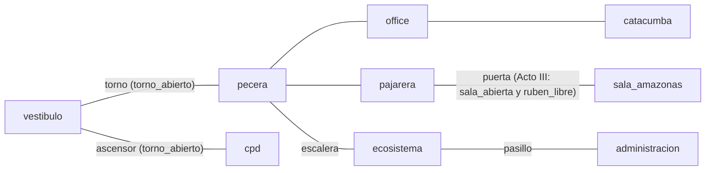
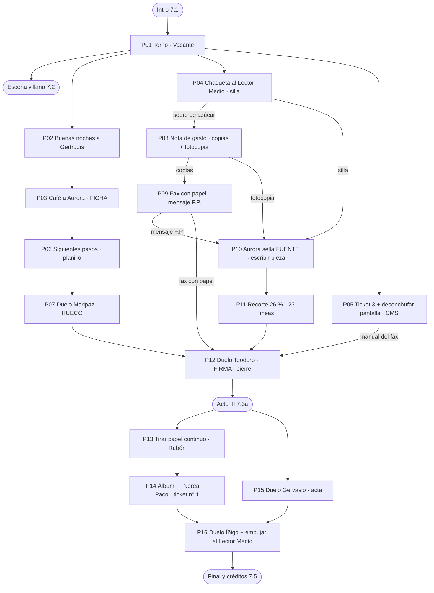

# FE DE ERRATAS — Biblia de producción

> *Una aventura de cierre.*
> Documento canónico del jefe de guion. Si algo de los pitches o las críticas contradice este documento, **manda este documento**.
> Autores de sala: os coordináis **solo** mediante los ids (salas, PNJ, objetos, hotspots) y los **flags** de la sección 5.5. No inventéis flags nuevos que crucen de sala sin añadirlos a esa tabla.
>
> **Ver también `GUION_ADENDA.md`:** guiños de la casa (personajes, hotspots, micro-puzles y refuerzos opcionales). Todo lo de la adenda es aditivo; no cambia el grafo, los ids ni el walkthrough de este documento.

### Registro de cambios

| Versión | Cambios |
|---|---|
| v1 | Biblia original. |
| v2 | **Reloj real:** la partida va del viernes a las **18:30** al cierre de las **21:00** (antes 19:00-23:59); el Plan Cero Papel se aprueba a las 21:00; relojes parados en las **20:59** (antes 21:47); ventanilla de Begoña de **19:00 a 19:15**, siempre «a las 19:07» (antes 22:00-22:15 y 22:07; los «ocho minutos» se mantienen); el fax está atascado **desde las seis** (antes, las siete); la radio de Celestino retransmite la bolsa de las cinco y media (el Ibex cierra a las 17:30). Epílogo de las 6:00 y web a las 00:01, sin cambios. **Gag oficial «la redacción de las 18:30»** (1.4b y 8.7). **Cifras de años recontadas** para 2026: Teodoro, 29 años en el edificio (antes 27); ticket nº 3, nueve años esperando (antes siete). **El medio pasa a llamarse elContable.es** (ya no hay ningún nombre real; gags en 8.8). **Fuera el director de cartón pluma:** su función mecánica la cumple **el Lector Medio**, el *buyer persona* de cartón de Marketing que la consultora ha ascendido a autoridad. La segunda fuente de la opa pasa a ser **una comida del Consejo firmada por Gervasio**. |

**Tabla de renombrados (v2).** Única excepción a «no se renombra nada»: el código usa los antiguos y hay que sustituirlos tal cual.

| Tipo | Antiguo | Nuevo |
|---|---|---|
| PNJ / hotspot (objeto con carácter) | `director_carton` | `lector_medio` |
| flag | `chaqueta_en_director` | `chaqueta_en_lector` |
| flag | `director_derribado` | `lector_derribado` |
| hotspot (catacumba) | `fotos_directores` | `fotos_jefes_cierre` |

---

## 0. Convenciones para todos los autores

- **Ids:** todo en `snake_case`, sin tildes ni eñes (`begona_triplicado`, no `begoña`). Un id es único en todo el juego.
- **Quién habla:** si una línea no lleva nombre, la dice **Bruno**. `BRUNO (al jugador):` es cuarta pared.
- **Longitud:** ninguna intervención pasa de **80 caracteres**. Cuando en este documento una respuesta tiene ` // `, es que son **dos intervenciones seguidas** (dos globos). No las juntéis.
- **Colores de texto:** cada PNJ tiene su color en la ficha (sección 2). Los textos de pantallas, LCD y faxes van con el color del objeto, indicado en su hotspot.
- **Hora:** toda la partida transcurre la tarde-noche del **viernes**, de **18:30** al cierre de las **21:00** (la hora límite del Plan Cero Papel), más un epílogo a las 6:00 del sábado. A las 18:30 se ha ido casi todo el mundo (gag oficial, 1.4b). Los relojes del edificio están parados en las **20:59**: siempre falta un minuto para el cierre (es un chiste de fondo, no un puzle).
- **Sin muertes ni callejones:** nada se gasta antes de su último uso; los duelos se pueden perder y repetir sin coste; el café es infinito.
- **Los 9 verbos** son: Dar, Abrir, Cerrar, Coger, Mirar, Hablar, Usar, Empujar, Tirar. No hay más. Nadie añade verbos, minijuegos ni contadores ocultos.
- **Marcas:** no hay ningún nombre real. El medio es **elContable.es** («el Contable», en coloquial), un periódico económico inventado. Todas las empresas son inventadas: **Hidrovoltia** (energética), **Banco Robledal** (el banco opado), **Optimal Brains & Partners** (la consultora), **Colchones Siestatón** (anunciante), **Ferretería Hermanos Tornillo** (el calendario), **Ibersideral** (valor del Ibex en las narraciones de Celestino). No se nombra ninguna app, red social ni marca de comida real.

### Índice
1. Sinopsis, tono, running gags y decisiones de dirección
2. Reparto
3. Salas (y mapa)
4. Inventario
5. Grafo de puzles, walkthrough y flags
6. Duelo verbal: «Responder a Todos»
7. Escenas clave y árboles de diálogo
8. Banco de gags
9. Reparto del trabajo en 4 paquetes
10. Verificación del walkthrough

---

## 1. Sinopsis, tono y running gags

### 1.1 Logline
Un becario web con seis años de prácticas tiene una noche de cierre para que mañana ponga **«Por Bruno Pellejo»** en la edición de papel, la única que su abuela considera periodismo. El problema: un consultor quiere apagar la rotativa a las 21:00, la hora de cierre, con una «inteligencia artificial» que, en realidad, es otro becario.

### 1.2 Sinopsis por actos (45-75 min)

**ACTO I — «Vacante» (≈12 min).** Viernes, 18:30: la redacción está medio vacía y el cierre es a las 21:00. La abuela Remedios llama a Bruno: ya ha dicho en el pueblo que mañana sale «en el de papel, en el de verdad, el que mancha». El torno del vestíbulo no reconoce a Bruno («USUARIO NO CONSTA EN ORGANIGRAMA») y él entra pegando su foto en la casilla VACANTE del organigrama; desde ese momento todo el edificio le llama **Vacante**. En la Pecera (redacción web) irrumpe **Íñigo Sinergia**, de Optimal Brains & Partners, con el **Titulator 3000**: a las 21:00, con el cierre, el Consejo aprobará el **Plan Cero Papel** y la rotativa se apagará para siempre. Bruno libera una silla (la chaqueta de Ramírez, que bajó a desayunar en 2019, acaba vistiendo al **Lector Medio**, el lector de cartón pluma al que todo el mundo consulta), consigue que Gertrudis, la cafetera, le dé café a cambio de unas buenas noches, y con ese café ablanda a Aurora, la correctora. Aurora le da la **Ficha de la página 7**: para firmar en papel hay que rellenar tres casillas de maquetación, **HUECO, FUENTE y FIRMA**.

**ACTO II — «Hueco, fuente, firma» (≈30-40 min, tres ramas en cualquier orden, con cruces).**
- **HUECO:** la página 7 (impar, cara, se ve mucho) está vendida a Colchones Siestatón «pendiente de confirmar desde marzo». Bruno disuelve la reunión infinita de la Sala Amazonas preguntando por los siguientes pasos, se lleva el planillo de maqueta y gana a Maripaz (Comercial) un hilo de «Responder a Todos» para que sea ella quien llame al cliente un viernes por la noche.
- **FUENTE:** Bruno presenta a Begoña (Administración) la peor nota de gasto de la historia, justificada con un sobre de azúcar. Indignada, Begoña le enseña «una bien hecha»: la comida del Consejo con Hidrovoltia, firmada por Gervasio, y se la fotocopia por las dos caras. En el reverso, a boli: «OPA ROBLEDAL — jueves — NO PUBL.». Con las copias rechazadas de su nota, Bruno da papel al fax de la Catacumba, que escupe un fax atascado desde las seis firmado por **F.P.**: la OPA de Hidrovoltia sobre Banco Robledal es verdad. Dos fuentes: Aurora sella. Bruno escribe la pieza: 31 líneas para un faldón de 23. Begoña aplica el **recorte estándar del 26 %**, por abajo, sin leer. Cuadra.
- **FIRMA:** Teodoro Cuerpodoce, jefe de cierre, no habla con la web: solo escribe faxes, aunque esté a dos metros. Bruno arregla el CMS (lo tumbaba la pantalla de métricas, que lo consulta cada segundo), Paco (Sistemas) le da el manual del fax, y gana a Teodoro un duelo por fax rematándolo con la **respuesta automática**: «Estoy fuera de la oficina hasta que el papel deje de existir». Teodoro, emocionado, escribe bien el nombre de Bruno por primera vez y sella la firma.

**ACTO III — «Cierre» (≈15-20 min).** Con la página cerrada, Íñigo se encierra con el «Consejo» en la Sala Amazonas: OCUPADO – hasta 2031. Bruno sigue el papel continuo del fax de F.P. hasta el armario 27 del CPD y descubre la verdad: el Titulator es **Rubén**, el becario del verano pasado, al que nadie dio de baja; la consultora factura 48.000 € al mes en «licencia de IA» y a él le paga en bocadillos de máquina. Rubén es también F.P. Para sacarlo hay que «descopear» su baja del tablero de Desarrollo con las fotos de Borja, en las que siempre sale al fondo yendo al baño, y que Paco cierre por fin el **ticket nº 1**. Bruno gana a Gervasio el marrón de redactar el acta del último Consejo (la primera en 19 años: «1. Pedir más café. 2. Ninguno más.») y entra en la Sala. Duelo final por correo con toda la empresa en copia: Íñigo cae con el ticket nº 1, con el acta y, por último, cuando Bruno **empuja al Lector Medio**, el cartón pluma que llevaba tres semanas «validando» 400 diapositivas: era el único dato del plan.

**EPÍLOGO (6:00).** La rotativa del polígono tira. La página 7 dice «Por Bruno Pellejo», bien escrito por primera vez en la historia. Bruno llama a la abuela: dejó el papel en 2011 porque le manchaba el sofá; le lee todo en el móvil y le pone un corazoncito, hasta a lo del Euríbor. Yoli lo confirma: una lectora, 47 minutos de permanencia, comenta «abrígate» en todo. Créditos sobre la fe de erratas del día siguiente: **«Lamentamos el acierto.»**

### 1.3 Tono: las 5 reglas de la casa

| # | Regla | SÍ | NO |
|---|---|---|---|
| 1 | **Seriedad absoluta ante lo absurdo.** Nadie se ríe de sus propias reglas. Begoña cree en el triplicado; Teodoro quiere a la rotativa. | BEGOÑA: «No existe el CUADRUPLICADO.» // «La cuarta copia siempre acaba en un juzgado.» | BEGOÑA: «Jaja, qué locura de empresa, ¿eh?» |
| 2 | **El blanco es el sistema, no las personas.** Sátira cariñosa. Nada de chistes de suicidio, de parejas cosificadas, de físicos ni de edad. Hasta Íñigo es buena gente: es escalable. | «Claro. Y la carta de despido es una newsletter personalizada.» | «Igual que tirarse por la ventana es una bajada en valor.» |
| 3 | **Oficio verdadero: el dato tiene que estar bien.** Un periodista que juegue no debe pillarnos. Las impares son caras; la rotativa está en el polígono; las cuentas de caracteres cuadran. | TEODORO: «Bruno Pellejo. Trece con espacios. Cabe.» | «La peseta caducó en 1987.» / «Nadie lee la página 7.» |
| 4 | **Una línea, un chiste. No se explica el remate.** Si el chiste necesita una segunda frase para entenderse, se reescribe. Máx. 80 caracteres. | BEGOÑA: «Es intangible, hijo. Si la ves, no es esa.» | «Busco la bandeja 2. No hay. Me miro las manos: yo tampoco tengo bandeja 2.» |
| 5 | **Ni memes ni camisetas.** Si el chiste existe en una taza de oficina, no entra. Lista negra abajo. | CELESTINO: «Dale las buenas noches. Nadie se las da.» | «¿Has probado a apagarlo y encenderlo?» |

**Lista negra (prohibido en todo el juego, en cualquier boca, aunque sea de pasada):** «¿has probado a apagarlo y encenderlo?» y cualquier variante de «reiniciar» como chiste o solución · «no es un bug, es una feature» · story points / puntos de historia / sprints como chiste · «esto podría haber sido un email» · «nunca despliegues en viernes» · «en mi máquina funciona» · la patada a la máquina · «Keep calm» · chistes de «mi exmujer» · el número 404 o cualquier otro número de culto recurrente · marcas reales.

### 1.4 Running gags oficiales (6)

Cada gag sale **al menos tres veces**: se presenta, se repite y la última vez se tuerce o resuelve algo.

| # | Gag | Cómo escala | Dónde remata |
|---|---|---|---|
| G1 | **El nombre de Bruno.** Nadie lo escribe bien y, tras el torno, todos le llaman «Vacante». Variante: «¿Tú eres el nuevo?» | Tarjeta: «Bruno Pellizco». Torno: «Bienvenido, Vacante». Íñigo: «Vacante, mi cuadrante favorito». Campo «Asignado a:» de los duelos: «B. Pellizco», «Pollejo», «Vacante (becario)». Celestino: «¿Tú eres el nuevo?» (lleva seis años). | 1) Teodoro es el primero que lo escribe bien («Trece con espacios. Cabe.»). 2) Rubén: «Yo llevo cuatro meses. Entonces el nuevo soy yo. Qué ilusión.» 3) La fe de erratas: «Lamentamos el acierto.» |
| G2 | **Gertrudis, la cafetera con LCD.** Si le pides café, error; si le das las buenas noches, café y un chisme (que enseña réplicas). | Errores al pedir sin saludar: E-47 LLAMAR A SISTEMAS → E-48 SISTEMAS NO CONTESTA → E-49 YA SÉ QUE ERES TÚ OTRA VEZ → E-50 ESTOY EN UNA REUNIÓN. En el Acto II, evasivas: E-51 ESTAMOS ANALIZANDO TODAS LAS OPCIONES. En el Acto III: **E-27: AYÚDAME. NO ES UN ERROR.** (Rubén está conectado a todo lo que tenga pantalla.) | Créditos: «E-00: HOY SÍ. DISFRUTADLO, QUE NO SE REPITE.» |
| G3 | **Celestino narra el Ibex como un partido.** Cada vez que Bruno pasa por el vestíbulo, una línea nueva. | Acto I: «¡Ibersideral entra por la banda! ¡Sube un 0,2! ¡Qué técnica!» Acto II: «¡Penalti a las eléctricas! ¡Eso no era! ¡Árbitro, que mire el supervisor!» / «Cierre plano. Empate a cero. Como la vida.» | Epílogo: canta la exclusiva de Bruno como un gol: «¡Hidrovoltia se lanza a por el Robledal! ¡Eso es opa, árbitro!» // BRUNO: «Celestino, que la noticia es mía.» // CELESTINO: «¿Tú eres el nuevo?» |
| G4 | **El Titulator titula lo que hace Bruno.** La pantalla del Titulator (Pajarera) publica en clickbait cada cosa que Bruno acaba de hacer. | «BECARIO SE PEGA A UN ORGANIGRAMA. EL ORGANIGRAMA, EN SHOCK» → «UN JOVEN DA LAS BUENAS NOCHES A UNA CAFETERA. LA CAFETERA, VIRAL» → … y la tercera vez que se mira, medio segundo: «AYÚDAME ESTOY EN EL ARMARIO 27» (ÍÑIGO: «Alucinaciones. Es normal en modelos tan avanzados.») | Revelación: RUBÉN: «Te he titulado toda la noche. Perdona. Eras lo único que pasaba.» |
| G5 | **El Lector Medio.** Recortable de cartón pluma a tamaño real del *buyer persona* que Marketing encargó en 2014 y que la consultora ha ascendido a autoridad («43 años. Le interesa "la economía" y "ahorrar"»). Lleva un altavocito pegado con celo con una frase del focus group. Todo el mundo lo consulta como a una persona: «¿Y esto el Lector Medio lo entiende?» | Bucle: GRABACIÓN: «A mí lo que me interesa es la economía. Y ahorrar.» // GERVASIO: «Lo que diga el Lector Medio.» // GERVASIO: «...Pues ya está decidido.» Lleva la chaqueta de Ramírez desde el Acto I. Íñigo le presenta las 400 diapositivas: «Muy buen feedback no verbal, el Lector Medio.» | Clímax: Bruno lo **empuja**, cae de cara (pegatina: «Atrezo – Focus group 2014») y el Plan Cero Papel se queda sin su único dato. La lectora de verdad es la abuela: 47 minutos de permanencia. |
| G6 | **El contador de tickets de Paco.** Todo problema tiene número; el contador del CPD sube con cada cosa que hace Bruno. El ticket nº 1, «Alta becario Rubén», está «pendiente» desde julio. | 48.211 → 48.212 («Tu problema ya tiene número. Tiene más identidad que tú.») → 48.530 tras arreglar el CMS («me han abierto un ticket para saber cómo se arregló») → … | Paco cierra el **ticket nº 1**: «El primer ticket que cierro en mi vida.» Y ese papel tumba al consultor. |

### 1.4b Gag de ambiente oficial: «la redacción de las 18:30»

La partida empieza un viernes a las 18:30 y **a esa hora ya se ha ido casi todo el mundo**. La redacción está medio vacía: sillas vacías con la chaqueta colgada (la chaqueta «ficha» por su dueño), pantallas encendidas sin nadie delante, tuppers huérfanos en la cola del microondas. Eso explica por qué solo queda este reparto: **los de guardia** (los dos de la web, Paco, Desarrollo con el CMS caído), **los que viven aquí** (Teodoro), **los que no se van nunca** (Celestino, Aurora, Begoña, Gervasio y su reunión infinita) y **los que vienen de fuera a facturar** (Íñigo). Nadie lo dice como queja: se constata como un dato más. Líneas aprobadas en 8.7.

### 1.5 Decisiones de dirección (las polémicas, con su porqué)

| Decisión | Por qué (una línea) |
|---|---|
| Villano: **Íñigo Sinergia** (no Ulises). | Dos de tres críticos lo eligen, y «Íñigo» suena a consultor sin explicarlo. |
| Estructura central: **la Ficha de página con tres casillas (HUECO / FUENTE / FIRMA)**, no «tres pruebas». | Es un requisito de maquetación real, no un maestro que pone exámenes: la burocracia de la casa es la que marca el camino. |
| Duelo: **«Responder a Todos»** con contador `RE:` y campo **«Asignado a:»**; réplicas que se aprenden **cotilleando**, no perdiendo; jefes que se rematan con **objeto o acción**. Sin «traducciones» de ataques. | Es la única forma de que el duelo sea nuestro; además el chiste satírico es que todo el edificio usa las mismas frases. |
| Fuera el **tablero de cinco casillas** del Duelo de Marrones. | El motor tiene un duelo por puntos; el «Asignado a:» conserva su idea (gana quien no se queda el marrón) sin código nuevo. |
| La exclusiva es **la OPA de Hidrovoltia sobre Banco Robledal**, confirmada por F.P. + el reverso del ticket. | Es lo más «periódico económico» y obliga a contrastar dos fuentes, que es el oficio. Lo de Rubén va a la fe de erratas. |
| Fuera el **Canutazo**, el hotel, el bar, Rocío y Nicanor. | Con 9 salas no caben dos localizaciones externas; las mejores evasivas pasan a la boca de Íñigo. |
| La rotativa **está en el polígono** y Teodoro le habla por un teléfono rojo. | Hace décadas que no se imprime en el edificio de la redacción; un periodista lo nota. |
| Teodoro **sigue en el edificio** (vive en la Catacumba desde 1997) pero solo se comunica **por fax**. | Conserva el duelo por fax y lo vuelve absurdo: está a dos metros. |
| Fuera **la tarta de cumpleaños**; la reunión infinita se queda. | Hacen lo mismo y «¿Y cuáles son los siguientes pasos?» lo hace en una línea. |
| Fuera **el giro de Ulises/Íñigo becario de 1998** como giro; queda como **una línea** de Celestino en el epílogo y un pósit de fondo. | Dos giros de «el villano era becario» se pisan; Rubén es el giro, lo del 98 es un guiño. |
| Fuera **«reiniciar»** como solución de la rotativa: arranca cuando Teodoro, por el teléfono rojo, la llama por su nombre («Goyita, tira»). | Cliché número uno; además casa con el arco de Bruno: alguien llama a algo por su nombre correcto. |
| Fuera **USAR → UTILIZAR** en la barra de verbos. | Los libros de estilo prefieren «usar»; una correctora no puede equivocarse en lo suyo. Se sustituye por «Nueve verbos y ni un subjuntivo». |
| Fuera **Jacinto Cortapega**; su «titula lo que hace Bruno» lo absorbe Rubén/Titulator. | 13 PNJ como máximo, y así el gag se convierte en la pista del giro. |
| Fuera la **profecía de la página perdida** como puzle; queda como hotspot opcional en el CPD. | Bonito anticlímax, pero no sostiene puzle; vale como premio para quien lo toque todo. |
| La abuela es el **sistema de pistas** (Usar móvil). | Es diegético, nunca rompe el tono y da a la abuela presencia en todo el juego antes del final. |
| Fuera **el director de cartón pluma**; entra **el Lector Medio** (v2). | El director del periódico no sale en el juego. El *buyer persona* de cartón cumple la misma función y el chiste mejora: el plan se apoya en un lector que no existe. |
| El medio se llama **elContable.es** (v2). | Un nombre inventado; y un periódico económico que se llama el Contable da chistes solo (8.8). |

### 1.6 Arreglos de realismo periodístico (obligatorios)

1. **La página 7 es impar y por eso es cara** y está vendida; nunca «nadie la lee».
2. **Una nota de prensa embargada no es una exclusiva**: no se usa. La exclusiva es una OPA confirmada con **dos fuentes** (una anónima documental, otra documental con IVA).
3. **Nadie escribe «asunto OPA – no publicar» en el concepto de una nota de gasto**: el concepto es «Comida Hidrovoltia» a secas; la anotación está **a boli en el reverso del ticket**, y Begoña solo mira el anverso.
4. **La exclusiva se guarda para el papel y la web la publica a las 00:01** (lo dice Aurora). Es práctica real con las exclusivas de fin de semana.
5. **La rotativa está en el polígono**; se habla con ella por teléfono.
6. **Cuentas bien hechas:** «Bruno Pellejo» = 13 con espacios. «Hidrovoltia lanza una opa sobre Banco Robledal» = 46 con espacios. 31 líneas × 0,74 = 22,94 → 23. Quien escriba una cifra nueva la cuenta dos veces.
7. **«Opa» va en minúscula** (está en el diccionario); en el titular se escribe «opa». En diálogo, Aurora lo recuerda una vez.
8. **Ventanilla de Administración:** horario «19:00 a 19:15»; como los relojes están parados, Begoña está siempre «a las 19:07». Nada de horarios de mañana en una noche de cierre.
11. **Horario real de la casa:** el cierre es a las 21:00 y a las 18:30 ya se ha ido casi todo el mundo. El Ibex cierra a las 17:30: lo que narra Celestino es la repetición.
9. **La peseta** no se menciona con fechas. Línea aprobada: «La palabra de honor dejó de ser moneda de curso legal con la peseta.»
10. **Teodoro sabe lo que es un móvil**; su chiste es ser lento, no ignorante.

---

## 2. Reparto

13 PNJ (12 en pantalla + la abuela por teléfono), el protagonista y dos «objetos con carácter» que no cuentan como PNJ. Un nombre por persona; ningún nombre ni apellido se repite.

| Departamento obligatorio | Personaje |
|---|---|
| Redacción web | Yoli Tendencias |
| Papel | Teodoro Cuerpodoce, Aurora Galerada |
| Jefes | Gervasio Acta |
| Administración | Begoña Triplicado |
| Marketing | Borja Engagement |
| Sistemas | Paco Ticket |
| Desarrollo | Nerea Backlog |
| Comercial | Maripaz Remitido |
| Otros | Celestino (conserje), Íñigo Sinergia (villano), Rubén (la «IA»), abuela Remedios (teléfono); y el Lector Medio, de cartón (no es PNJ) |

### 2.0 Protagonista — `bruno`
- **Nombre:** Bruno Pellejo. 29 años. «Becario senior», cargo que solo existe en su perfil profesional. Seis años de prácticas encadenadas, 4.112 piezas en la web, cero en papel.
- **Aspecto:** flaco, pelo castaño con un remolino imposible, camisa azul cielo arrugada y por fuera, lanyard rojo con la tarjeta, mochila con chapas de eventos, zapatillas gastadas. **Color de texto: `#FFFFFF`**.
- **Voz/tic:** ingenuo, bocazas, cree en el sistema y por eso nunca acierta. Habla con objetos y con el jugador cuando se agobia. Se presenta con un «elevator pitch» aunque no haya ascensor.
- **Muestras:**
  - «Tranquilo, tengo un plan. Bueno, tengo un titular. Es casi lo mismo.»
  - «Bruno Pellejo, becario senior. Senior en becario, no en nada más.»
  - (al jugador) «Si me miras así, me pongo nervioso. Así no. Así tampoco.»
  - «Seis años en la web. Mi abuela cree que trabajo de algo con el móvil.»
- **Quiere:** firmar una vez en papel para que la abuela le crea. **En el fondo:** que alguien escriba bien su nombre.

### 2.1 `celestino` — Celestino
- **Departamento / sala:** Conserjería y seguridad · `vestibulo` (y en el epílogo).
- **Aspecto:** sesenta y tantos, bigote canoso, uniforme gris con galón, bufanda de hincha verde y roja con la palabra «IBEX», radio de bolsillo con auricular. **Color: `#E8C170`**.
- **Voz/tic:** narra la bolsa como si fuera un partido de fútbol. A todo el mundo le pregunta «¿Tú eres el nuevo?».
- **Muestras:**
  - «¿Tú eres el nuevo?» // BRUNO: «Llevo seis años.» // «Pues no te ha visto ni el torno.»
  - «El torno se fía más del organigrama que de mí. Y llevo aquí treinta años.»
  - «¡Ibersideral entra por la banda! ¡Sube un 0,2! ¡Qué técnica!»
  - «Cierre plano. Empate a cero. Como la vida.»
- **Sabe:** cómo se le saca café a Gertrudis («Dale las buenas noches. Nadie se las da.»); un cotilleo de ascensor (réplica `rep_05`).
- **Da:** `chicle`. Pista de Gertrudis. Réplica `rep_05`.
- **Quiere:** que alguien le pregunte por el Ibex. Nadie lo hace.

### 2.2 `yoli_tendencias` — Yoli Tendencias
- **Departamento / sala:** Redacción web, jefa de SEO y audiencias · `pecera`.
- **Aspecto:** treinta y pocos, coleta alta con mechas fucsia, gafas de pasta, sudadera con «KPI» bordado, un colirio siempre en la mano; le tiembla un párpado cuando baja la gráfica. **Color: `#FF4FA3`**.
- **Voz/tic:** saluda en palabras clave de cola larga y lo mide todo, también las emociones.
- **Muestras:**
  - «Hola Bruno, Bruno becario, becario elContable, cuánto cobra un becario 2026.» // «Perdona, me sale solo.»
  - «Eso que sientes no es tristeza, Bruno. Es una caída del CTR.»
  - «¡Estamos ciegos! ¿Hay alguien leyendo? ¿HAY ALGUIEN AHÍ FUERA?»
  - «Una lectora. Pero se lo lee TODO. La tengo como KPI.»
- **Sabe:** que el CMS está caído; que hay una cuenta que solo comenta «abrígate» («será un bot»); un hilo con Maripaz (réplica `rep_08`).
- **Da:** réplica `rep_08` (tras `cms_vivo`). En el epílogo, la revelación de la lectora.
- **Quiere:** que la gráfica suba. Si no puede ser, que alguien la mire.

### 2.3 `nerea_backlog` — Nerea Backlog
- **Departamento / sala:** Desarrollo · rincón de Desarrollo de la `pecera`.
- **Aspecto:** cuarenta y tantos, pelo rizado recogido con un lápiz, chaleco de punto mostaza, pósits pegados en la manga, rotulador sin capuchón detrás de la oreja. **Color: `#7FE08A`**.
- **Voz/tic:** si algo no está en el tablero, no existe. Siente un cariño maternal por los pósits viejos. Solo se fía del calendario de papel de una ferretería.
- **Muestras:**
  - «Si vienes a pedirme algo, está en el tablero.» // «Si no está en el tablero, no existe.»
  - «El CMS no es nuestro, es de Sistemas.» (y Paco dice lo contrario)
  - «Un pósit solo sale del tablero de dos formas: hecho o muerto.»
  - «Diles que en nuestros corazones está en Hecho.»
- **Sabe:** dónde está la baja de Rubén (un pósit en POR HACER desde julio); un hilo con Yoli (réplica `rep_09`).
- **Da:** `posit_baja_ruben` (al descopearlo). Réplica `rep_09`.
- **Quiere:** pruebas. De todo. Por escrito y pegadas en una columna.

### 2.4 `teodoro_cuerpodoce` — Teodoro Cuerpodoce
- **Departamento / sala:** Papel, jefe de cierre · `catacumba`.
- **Aspecto:** sesenta y largos, tirantes, camisa blanca con manchas de tinta en los puños, visera verde de contable, un tipómetro asomando del bolsillo como un crucifijo, zapatillas de casa (vive aquí desde 1997). **Color: `#D9CFA6`** (sus líneas aparecen como fax impreso).
- **Voz/tic:** **no habla: escribe faxes**, aunque estés a dos metros. Lo mide todo en caracteres con espacios. Llama a la rotativa «Goyita» y habla con ella por el teléfono rojo.
- **Muestras (por fax):**
  - «En internet una errata se corrige, chaval. En papel se enmarca.»
  - «En mis tiempos una errata costaba una cena.» // «Ahora cuesta un tuit y nadie paga la cena.»
  - «Me sobran ocho líneas. No recorto: yo solo mido.»
  - «Ella y yo nos entendemos.» // «No me pide likes. Solo papel, tinta y que no la llame impresora.»
- **Sabe:** que si firma uno de la web «el papel se acaba» (es su miedo); cuánto cabe en cada hueco.
- **Da:** la casilla FIRMA (tras el duelo). Cierra la página 7 (inicio del Acto III). En el clímax arranca la rotativa.
- **Quiere:** que no se acabe el papel. Descubre que el enemigo no era la web sino un PowerPoint.

### 2.5 `aurora_galerada` — Aurora Galerada
- **Departamento / sala:** Papel, correctora · `catacumba`.
- **Aspecto:** sesenta y tantos, moño gris atravesado por un bolígrafo rojo, gafas de media luna con cadena, rebeca burdeos, taza vacía con un cartel delante. **Color: `#E04848`**.
- **Voz/tic:** corrige todo lo que oye, a todo el mundo, y lo llama «criatura». No habla antes del café.
- **Muestras:**
  - «Se dice "detrás de mí", criatura. "Detrás mío" se lo dejas a la web.»
  - «Para firmar en papel hacen falta tres cosas: hueco, fuente y firma.»
  - «Una anónima y otra con IVA. Me vale.»
  - (mirando la barra de verbos) «Nueve verbos y ni un subjuntivo. Así no se cierra un periódico.»
- **Sabe:** cómo se termina una reunión; que Teodoro solo habla por fax; un viejo hilo con Teodoro (réplica `rep_02`).
- **Da:** `ficha_pagina_7` (a cambio de un café). La casilla FUENTE. Réplica `rep_02`. Pista de «siguientes pasos».
- **Quiere:** que alguien escriba bien una sola cosa en esta casa. Cuando pasa, se desmaya.

### 2.6 `gervasio_acta` — Gervasio Acta
- **Departamento / sala:** Jefes, adjunto a Dirección y secretario del Consejo · `sala_amazonas` (Actos I-II, hasta `reunion_terminada`), `pajarera` (Acto II tras la reunión), `office` (Acto III) y `sala_amazonas` (clímax).
- **Aspecto:** cincuenta y tantos, calvo con cortinilla, traje gris marengo, corbata granate, tres móviles en el bolsillo de la chaqueta y una carpeta vacía bajo el brazo. **Color: `#8FA8C8`**.
- **Voz/tic:** lleva 19 años sin quedarse un marrón. Toda conversación con él acaba en «Lo hablamos». Es el secretario del Consejo y nunca ha escrito un acta.
- **Muestras:**
  - «Eso lo coges tú, que tienes la agenda más limpia. Y la conciencia.»
  - «Lo que diga el Lector Medio.»
  - «Diecinueve años sin un marrón. Y ahora me toca el acta.»
  - «Lo hablamos.»
- **Sabe:** que el último Consejo solo acordó pedir café. Su carpeta de Enviados (réplica `rep_07`) está abierta en su ordenador.
- **Da:** `planillo` (indirectamente: la reunión se disuelve). `acta_consejo` (al perder el duelo). Acceso a la Sala en el Acto III.
- **Quiere:** no coger nada. Nunca.

### 2.7 `begona_triplicado` — Begoña Triplicado
- **Departamento / sala:** Administración · `administracion`.
- **Aspecto:** sesenta y tantos, pelo cardado color caoba, gafas de pasta roja, manguitos de oficina, tres sellos en la mano derecha, tres tazas vacías delante. **Color: `#A884E0`**.
- **Voz/tic:** sella todo lo que toca. Todo va por triplicado. Aplica a todo el «recorte estándar del 26 %». Siempre son las 19:07.
- **Muestras:**
  - «Sin ticket no hay gasto. Sin gasto no hay ticket. Es un ecosistema.»
  - «Yo no creo en los tickets, niño. Los tickets creen en mí.»
  - «...Correcta. Aprobada. Vete. Me has hecho daño.»
  - «Recorto por abajo, como manda la pirámide invertida. Se pierde la conclusión.»
- **Sabe:** que las notas de Dirección son «de manual»; dónde guarda los EJEMPLARES.
- **Da:** `copias_rechazadas` y `fotocopia_nota_direccion` (P08). El recorte de la pieza (P11). En el clímax, rechaza la factura de la consultora.
- **Quiere:** que alguien haga un trámite mal **a propósito**, para poder enseñarle cómo se hace.

### 2.8 `borja_engagement` — Borja Engagement
- **Departamento / sala:** Marketing (Event Manager & Brand Experience Lead) · `ecosistema`.
- **Aspecto:** treinta y tantos, tupé engominado, americana azul eléctrico con zapatillas blancas, nueve acreditaciones de eventos colgadas del cuello, cámara réflex con flash. **Color: `#4FD8E8`**.
- **Voz/tic:** saca una foto con flash cada vez que alguien entra («¡Gracias! ¡Eso es contenido!»). Todo lo que no sale en el photocall no ha ocurrido.
- **Muestras:**
  - «Lo que no está en el photocall no ha ocurrido.»
  - «No es un evento, es una experiencia de marca con canapé.»
  - «Hemos descopeado la ética del Q3. Por si te sirve.»
  - «¿Mi álbum? Es contenido. Te lo presto si lo compartes.»
- **Sabe:** nada útil, y sin embargo tiene la prueba más importante del juego: en el fondo de todas sus fotos sale Rubén yendo al baño. Dice la palabra «descopear».
- **Da:** `album_borja` y el flag `oyo_descopear` (Acto III).
- **Quiere:** contenido. De lo que sea.

### 2.9 `maripaz_remitido` — Maripaz Remitido
- **Departamento / sala:** Comercial · `ecosistema`.
- **Aspecto:** cincuenta y pocos, melena rubia de peluquería, traje chaqueta coral, auricular de diadema, pulseras que suenan, mazo de gong en la mano. **Color: `#FF8C5A`**.
- **Voz/tic:** lo patrocina todo y llama «cariño» a todo el mundo. Toca el gong por cada venta y por cada promesa de venta.
- **Muestras:**
  - «¿Esa lágrima? Te la patrocino. "Llorar, con Pañuelos Suavín".»
  - «No vendemos anuncios, cariño. Vendemos contenido que paga.»
  - «¿Desde marzo sin confirmar? Eso no es un cliente, es un exnovio.»
  - «Te pongo un "contenido ofrecido por" tan pequeño que solo lo verá el supervisor.»
- **Sabe:** que la página 7 es de Colchones Siestatón «pendiente de confirmar desde marzo».
- **Da:** la casilla HUECO (si pierde el duelo y le toca llamar a ella).
- **Quiere:** no llamar a un cliente un viernes por la noche.

### 2.10 `paco_ticket` — Paco Ticket
- **Departamento / sala:** Sistemas · `cpd`.
- **Aspecto:** cuarenta y tantos, pálido de sótano, barba larga, forro polar gris con «SISTEMAS» bordado, gafas sujetas con cinta, manojo de llaves al cinto. **Color: `#6FA8FF`**.
- **Voz/tic:** a todo responde con un número de ticket. Vive en el sótano y nadie le ha visto bajo luz natural.
- **Muestras:**
  - «Tu problema ya tiene número: el 48.212. Tiene más identidad que tú.»
  - «No, el wifi no se ha caído. Has dejado de merecerlo.»
  - «Lo único de esta empresa que contesta a todo el mundo sin cabrearse...» // «...es la respuesta automática. Es mi mejor empleada.»
  - «Un pósit. En papel. Me repugna, pero es reglamentario.»
- **Sabe:** en su registro, el ticket nº 3 (2017) explica por qué se cae el CMS; el fax de la Catacumba tiene respuesta automática; la matricial del armario 27 imprime sola; un cotilleo de Íñigo (réplica `rep_12`).
- **Da:** `manual_fax` (tras `cms_vivo`). Réplica `rep_12`. `ticket_n1` (al recibir la baja de Rubén).
- **Quiere:** cerrar un ticket. Uno. Antes de jubilarse.

### 2.11 `inigo_sinergia` — Íñigo Sinergia (villano)
- **Departamento / sala:** Senior Partner de Optimal Brains & Partners · `pecera` (presentación), `pajarera` (Actos I-II, en el sofá), `sala_amazonas` (Acto III).
- **Aspecto:** cuarenta y tantos, traje azul marino entallado sin corbata, zapatillas blancas impolutas, raya al lado perfecta, bloc de pósits de cuatro colores en la mano, portátil plateado con una pegatina sonriente (el «Titulator»). **Color: `#FFD23F`**.
- **Voz/tic:** lo dibuja todo en una matriz 2x2. Cada color de pósit es un estado de ánimo. No es malvado: es escalable.
- **Muestras:**
  - «No vengo a despedir a nadie. Vengo a reimaginar el perímetro.»
  - «Amarillo, facturación. Verde, oportunidades. Rosa, emociones. Azul, excusas.»
  - «Alucinaciones. Es normal en modelos tan avanzados.»
  - «No os despido: os desapalanco del organigrama.» (solo la dice una vez, en la presentación)
- **Sabe:** que el Titulator es Rubén. Que su único dato es un cartón (no lo sabe: nadie se lo ha dicho).
- **Da:** nada. Pone a Bruno en su matriz, cuadrante «Ideal: coste cero, disponibilidad total».
- **Quiere:** apagar la rotativa a las 21:00, con el cierre, y facturarlo.

### 2.12 `ruben` — Rubén (el Titulator 3000)
- **Departamento / sala:** becario del verano pasado, encerrado en el armario 27 · `cpd` (Acto III); tras liberarlo, junto a la ventana de la `pecera`.
- **Aspecto:** 22 años, pálido casi verde, sudadera gris con capucha, auriculares al cuello, ojeras de cuatro meses, migas de bocadillo de máquina en la pechera. **Color: `#B6FF4D`**.
- **Voz/tic:** cuando se pone en «modo Titulator» habla en MAYÚSCULAS y en cebo de clics; cuando se le pasa, susurra.
- **Muestras:**
  - «BECARIO DETECTADO. LO QUE PASÓ DESPUÉS TE SORPRENDERÁ.»
  - (en voz baja) «...Rubén. Becario de verano. Del verano pasado.»
  - «¿Tú eres el nuevo?» // BRUNO: «Llevo seis años.» // «Yo, cuatro meses. Entonces el nuevo soy yo.»
  - (al ver el amanecer) «¿Sigue gobernando el mismo?»
- **Sabe:** todo lo que Íñigo imprime (incluido el dossier de la OPA). Es **F.P.** (Fuentes Próximas). Escribió los discursos de Íñigo (réplica `rep_13`).
- **Da:** réplica `rep_13`. Su liberación desbloquea el final.
- **Quiere:** salir. Y un táper.

### 2.13 `abuela_remedios` — Abuela Remedios (solo teléfono)
- **Departamento / sala:** fuera de pantalla. Se oye al **Usar `movil`** (sistema de pistas), en la intro y en el epílogo. Si el artista hace retrato para la llamada: ochenta y pocos, moño blanco, bata de flores, móvil con funda de purpurina. **Color: `#FFC2D9`**.
- **Voz/tic:** corta a Bruno a mitad de frase para darle consejos que no ha pedido. Siempre se despide con «Abrígate».
- **Muestras:**
  - «¿Has comido? Se te nota en la voz que no has comido.»
  - «En el de papel, digo. En el de verdad. El que mancha.»
  - «Ay, hijo, el papel lo dejé en 2011, que me manchaba el sofá.»
  - «Hasta lo del Euríbor. No lo entiendo, pero lo escribes muy bonito.»
- **Da:** pistas (sección 5.6). **Quiere:** que coma. Y que se abrigue.

### 2.14 Objetos con carácter (no son PNJ)

**`gertrudis` — Gertrudis, la cafetera** (`office`). Máquina de espresso cromada de 2009, enorme, con un display LCD verde de una línea y un pósit: «Servicio técnico: CELESTINO, ext. 0». **Color del LCD: `#39FF14`**, siempre en MAYÚSCULAS. Solo da café si la saludas; con cada café, un chisme en el LCD (enseña réplicas).

**`lector_medio` — El Lector Medio** (`pajarera`; en el Acto III, `sala_amazonas`). Recortable de cartón pluma a tamaño real del *buyer persona* que encargó Marketing en 2014 y que Íñigo ha recuperado como autoridad: una ilustración genérica de banco de imágenes (sonrisa de anuncio, ropa de catálogo, un periódico doblado que nunca abre; **sin rasgos de nadie real**) y, pegada al pecho, una ficha: «LECTOR MEDIO · 43 años · Le interesa "la economía" y "ahorrar" · Fuente: Marketing, 2014». En el hombro, un altavocito pegado con celo reproduce una frase del focus group. Desde P04 lleva puesta la chaqueta beige de Ramírez. **Color de la grabación: `#CCCCCC`**. Solo dice: «A mí lo que me interesa es la economía. Y ahorrar.» Todo el edificio pregunta, muy en serio: «¿Y esto el Lector Medio lo entiende?»

**Figurantes sin diálogo** (solo arte y, como mucho, un murmullo al pasar el ratón): tres redactores de Mercados en la reunión infinita (`sala_amazonas`), dos redactores tecleando al fondo de la `pecera` (son la guardia: los únicos de la web que quedan a las 18:30). **Ramírez, el de Bolsa**, solo aparece en la escena poscréditos.

---

## 3. Salas

### 3.0 Mapa de conexiones

```
                    PLANTA 2
          [ecosistema] ──pasillo── [administracion]
                |
             escalera
                |
 PLANTA 0       |            PLANTA 1
[vestibulo] ──torno── [pecera] ──puerta── [office] ──puerta── [catacumba]
     |                   |
  ascensor            puerta de cristal
     |                   |
 PLANTA -1           [pajarera] ──puerta── [sala_amazonas]
   [cpd]
```



| Sala | Tamaño | Salidas (hotspot de salida → destino) | Bloqueos |
|---|---|---|---|
| `vestibulo` | 320×144 | `torno` → `pecera`; `ascensor_vestibulo` → `cpd` | Ambas exigen `torno_abierto`. |
| `pecera` | **640×144 (scroll)** | `pecera_a_vestibulo` → `vestibulo`; `pecera_a_office` → `office`; `pecera_a_pajarera` → `pajarera`; `pecera_a_ecosistema` → `ecosistema` | Ninguno. |
| `office` | 320×144 | `office_a_pecera` → `pecera`; `office_a_catacumba` → `catacumba` | Ninguno. |
| `catacumba` | 320×144 | `catacumba_a_office` → `office` | Ninguno. |
| `pajarera` | 320×144 | `pajarera_a_pecera` → `pecera`; `puerta_sala` → `sala_amazonas` | `puerta_sala` en el Acto III exige `sala_abierta` y `ruben_libre` (y llevar `acta_consejo` y `ticket_n1`). |
| `sala_amazonas` | 320×144 | `sala_a_pajarera` → `pajarera` | En el Acto III, al entrar empieza el clímax: no se puede salir hasta ganar. |
| `ecosistema` | 320×144 | `ecosistema_a_pecera` → `pecera`; `ecosistema_a_administracion` → `administracion` | Ninguno. |
| `administracion` | 320×144 | `administracion_a_ecosistema` → `ecosistema` | Ninguno. |
| `cpd` | 320×144 | `ascensor_cpd` → `vestibulo` | Ninguno. |

**Mirar de los hotspots de salida** (los implementa el paquete de la sala donde están):

| id | Mirar |
|---|---|
| `pecera_a_vestibulo` | «El vestíbulo. Desde aquí se ve el torno. Ya no me da miedo. Un poco.» |
| `pecera_a_office` | «El Office. Ahí vive Gertrudis.» |
| `pecera_a_pajarera` | «La Pajarera. Despacho de cristal: se ven las broncas, pero no se oyen.» |
| `pecera_a_ecosistema` | «Escalera a la planta 2. La moqueta engorda dos centímetros: ahí está el dinero.» |
| `office_a_pecera` | «La Pecera. Se oye teclear "pensiones".» |
| `office_a_catacumba` | «Una puerta de madera: "TALLERES". Huele a tinta y a 1994.» |
| `catacumba_a_office` | «Vuelta al Office. Al siglo XXI, con escalas.» |
| `pajarera_a_pecera` | «La Pecera, a través del cristal. Desde aquí parecen peces de verdad.» |
| `sala_a_pajarera` | ver tabla de la Sala |
| `ecosistema_a_pecera` | «La escalera de bajada. A Redacción, donde la moqueta es de verdad.» |
| `ecosistema_a_administracion` | «Pasillo a Administración. Al fondo, una ventanilla brilla como un faro.» |
| `administracion_a_ecosistema` | «Vuelta al Ecosistema. Se oye un gong.» |

**Estados por acto (quién está dónde):**

| Sala | Acto I | Acto II | Acto III | Epílogo |
|---|---|---|---|---|
| `vestibulo` | Celestino | Celestino | Celestino | Celestino, Rubén, Íñigo (con su caja), Gervasio |
| `pecera` | Yoli, Nerea (+ Íñigo en la presentación) | Yoli, Nerea | Yoli, Nerea; Rubén en la ventana si `ruben_libre` | Yoli, Bruno |
| `office` | Gertrudis | Gertrudis | Gertrudis, **Gervasio** | — |
| `catacumba` | Teodoro, Aurora | Teodoro, Aurora | Teodoro, Aurora | Aurora (créditos) |
| `pajarera` | Íñigo (sofá), Lector Medio | Íñigo, Lector Medio; Gervasio en su mesa si `reunion_terminada` | vacía (todos en la Sala) | — |
| `sala_amazonas` | Gervasio + 3 figurantes (reunión) | ídem hasta `reunion_terminada`; luego vacía con `planillo_mesa` | Íñigo, Lector Medio, Gervasio (clímax) | — |
| `ecosistema` | Borja, Maripaz | Borja, Maripaz | Borja, Maripaz | — |
| `administracion` | Begoña | Begoña | Begoña (entra en la Sala en el clímax) | — |
| `cpd` | Paco | Paco | Paco; Rubén en el armario 27 hasta `ruben_libre` | — |

> **Nota para todos:** en cada hotspot, las respuestas a verbos no listados usan las **respuestas por defecto** de la sección 8.2. Solo se listan las especiales.

---

### 3.1 `vestibulo` — Vestíbulo y torno

**Fondo (320×144):** noche. A la izquierda, puertas de cristal a la calle con el naranja de las farolas y lluvia fina. En la pared izquierda, un **organigrama** enorme enmarcado: un árbol de treinta casillas con fotos diminutas; abajo del todo, una casilla con borde discontinuo que pone **VACANTE** y no tiene foto. En el centro, un **torno** de cristal de dos hojas con una pantallita LED roja. Encima, el logo del medio en letras metálicas (a la «e» le falta un tornillo). A la derecha, el **mostrador** de Celestino: un monitor con el Ibex en verde y rojo, una radio de bolsillo y un buzón de sugerencias con polvo. Al fondo derecha, el **ascensor** de acero con su botonera (2, 1, 0, −1) y, a su lado, un ficus **de plástico**. Suelo de mármol gastado justo en la línea del torno.

**PNJ:** `celestino` (tras el mostrador).
**Ambiente:** cada vez que Bruno entra, Celestino suelta una línea del Ibex (G3, sección 8.4).

| id | Mirar | Interacciones especiales |
|---|---|---|
| `torno` | «Un torno con pantallita. Me mira como si yo fuera un ticket sin IVA.» | **Usar `tarjeta_becario`** sin `foto_en_organigrama`: LED «USUARIO NO CONSTA EN ORGANIGRAMA.» // «Consto en la web. 4.112 veces.» · **Usar `tarjeta_becario`** con `foto_en_organigrama`: LED «BIENVENIDO, VACANTE.» → `torno_abierto`. «...Vacante. Bueno. Es un cargo.» · Con `torno_abierto`, Usar/caminar = salida a `pecera` (la primera vez dispara la escena del villano, 7.2). · **Empujar:** «Empujar un torno es pedir permiso a gritos.» · **Tirar:** «Tirar de un torno es pedir perdón a gritos.» · **Hablar:** «Le explico quién soy. Parpadea en rojo. Como Recursos Humanos.» |
| `organigrama` | 1.ª vez: «Un árbol genealógico en el que todos son primos y nadie sabe quién es el abuelo.» · Siguientes: «Abajo hay una casilla que pone VACANTE. Sin cara. Con hueco de becario.» · Con `foto_en_organigrama`: «Ahí estoy, en VACANTE. Es la primera vez que salgo en un organigrama.» | **Usar `tarjeta_becario`** sin `tarjeta_con_chicle`: «La pongo en la casilla. Se cae. Ni mi foto quiere estar en el organigrama.» · **Usar `tarjeta_becario`** con `tarjeta_con_chicle`: Bruno despega la foto de la tarjeta y la pega en VACANTE. «Ya consto. Pegado con chicle, como todo en esta casa.» → `foto_en_organigrama`. · **Coger:** «Es de la empresa. Y la empresa es del organigrama.» |
| `pantalla_ibex` | «Rojo, verde, rojo, verde. Es un semáforo que te debe dinero.» | **Usar:** «No se toca. Celestino la tiene como la tele del bar.» |
| `planta_plastico` | «Es de plástico. Aun así, es la que más tiempo lleva en plantilla.» | **Hablar:** «Le cuento lo de la firma. No me juzga. No me pide ticket.» · **Coger:** «No. Es la única que ha sobrevivido a todos los ERE.» · **Dar `cafe`:** «No bebe. Por eso dura tanto.» |
| `ascensor_vestibulo` | «Botones: 2, 1, 0 y −1. El −1 está gastadísimo: Sistemas no sube nunca.» | **Usar/Abrir** con `torno_abierto` → `cpd`. Sin él: «El ascensor está al otro lado del torno. Como todo lo bueno.» |
| `puerta_calle` | «La calle. Ahí fuera hay gente que lee el periódico. Dicen.» | **Abrir/Usar:** «Si salgo ahora, mi abuela se entera por otro.» |
| `radio_celestino` | «Una radio de bolsillo. Retransmite la bolsa de las cinco y media. En diferido.» | **Coger:** CELESTINO: «Esa radio no se toca. Es la del Mundial del 82.» |
| `buzon_sugerencias` | «Buzón de sugerencias. Tiene polvo en la ranura.» | **Abrir:** «Dentro hay una sola sugerencia: "Más sugerencias". Firmado: el buzón.» |
| `logo_pared` | 1.ª vez: «Letras de metal: "elContable.es". A la "e" le falta un tornillo.» · Siguientes: ver 8.8. | — |
| `celestino` (PNJ) | «Celestino, el conserje. Lleva bufanda del Ibex. Es el único hincha que tiene.» | **Hablar:** árbol 7.7.1. · **Dar `tarjeta_becario`:** «¿Pellizco? Aquí pone Pellizco.» // BRUNO: «Es Pellejo.» // «Pues díselo al torno, que es el que manda.» · **Dar `cafe`:** «Gracias, pero el café me lo traigo en termo. Desde 1994.» |

---

### 3.2 `pecera` — La Pecera (Redacción Web y rincón de Desarrollo)

**Fondo (640×144, scroll horizontal):** de izquierda a derecha.
- **0-80 px:** puerta de cristal de vuelta al vestíbulo (se ve el torno al otro lado).
- **80-260 px:** filas de mesas con monitores dobles llenos de gráficas, casi todas **vacías**: sillas con la chaqueta colgada y pantallas encendidas sin nadie (1.4b); dos figurantes al fondo tecleando. En la pared, una **pantalla gigante** «LECTORES CONCURRENTES: 3.418» con una línea roja que baja. Debajo, en el zócalo, una regleta y un **enchufe** con cinta de carrocero: «NO DESENCHUFAR – PANTALLA DE DIRECCIÓN».
- **260-420 px:** la mesa de **Yoli** (tres monitores, un colirio, pósit «KEYWORD DEL DÍA»); al lado, la **mesa de Bruno** (monitor viejo con un pósit «Bruno Pellizco», **sin silla**); pegada a ella, la mesa vacía de Ramírez con **la única silla libre**, que tiene colgada una **chaqueta beige**. Una taza abandonada en una mesa. Al fondo, en el centro, la **puerta de cristal de la Pajarera** (se ven las persianas a media altura) y la puerta con letrero «OFFICE».
- **420-640 px:** **rincón de Desarrollo**: la mesa de Nerea; una **pizarra kanban** con ruedas (columnas POR HACER · EN CURSO · BLOQUEADO · HECHO · HECHO (PERO NO)), con un pósit amarillísimo y viejo en la última columna; un **calendario de papel** de «Ferretería Hermanos Tornillo» en la pared; al fondo, la **ventana** con la ciudad de noche; en el extremo derecho, una **escalera** que sube con el cartel «PLANTA 2 – COMERCIAL · MARKETING · ADMINISTRACIÓN».

**PNJ:** `yoli_tendencias`, `nerea_backlog`; `ruben` junto a la ventana cuando `ruben_libre`.
**Escena:** la primera entrada con `torno_abierto` dispara la presentación del villano (7.2).

| id | Mirar | Interacciones especiales |
|---|---|---|
| `pantalla_metricas` | Sin `cms_vivo`: «Lectores concurrentes: 3.418. Se refresca cada segundo. Igual que Yoli.» · Con `cms_vivo`: «Apagada. La Pecera trabaja a ciegas. Y publica. Es un milagro.» | **Usar:** «No sé usarla. Ni ella a mí.» |
| `enchufe_pantalla` | «Cinta de carrocero: "NO DESENCHUFAR – PANTALLA DE DIRECCIÓN".» | **Tirar** sin `vio_ticket_3`: «Pone NO DESENCHUFAR. Cuando algo lo pone, me da por obedecer.» // «Necesitaría un motivo. Por escrito.» · **Tirar** con `vio_ticket_3` y sin `cms_vivo`: **P05** (ver 5.2) → `cms_vivo`. · **Empujar** (volver a enchufar) con `cms_vivo`: «Ni hablar. El ticket nº 3 tenía razón. Nueve años esperando.» |
| `ordenador_bruno` | Sin `silla_libre`: «Mi ordenador. De pie no se ve. Sin silla soy un becario de pie.» · Con `silla_libre`: «Bandeja de entrada. Un hilo de 2019.» // «Ramírez: "Quedo a la espera de tus comentarios".» // «Respuesta: "Espera sentado. Si encuentras silla". Me la apunto.» → `rep_11`. // «Y una autorrespuesta de Rubén, de Sistemas:» // «"Estoy fuera de la oficina desde julio".» // «"Bueno, fuera no. Dentro. Muy dentro".» | **Usar** sin `silla_libre`: «Sin silla no hay ordenador. Lo dice la ergonomía y lo dice Begoña.» · Con `silla_libre` y sin `casilla_fuente`: «Abro un documento en blanco. Me mira. Sin fuentes no escribo.» · Con `casilla_fuente` y sin `pieza_escrita`: **P10b** → `pieza_opa` (31 líneas), `pieza_escrita`. «Lo escribo fuera del CMS: ahí dentro vive el Titulator.» // «Treinta y una líneas. Sin adjetivos. Bueno, con uno.» · Con `pieza_escrita`: «Ya está escrita. Si la toco más, le salen adjetivos.» |
| `silla_ramirez` | Con chaqueta: «La única silla libre. Tiene una chaqueta: Ramírez, el de Bolsa.» // «Bajó a desayunar en 2019. No ha vuelto.» · Sin chaqueta: «Una silla. Libre. Me tiembla algo que no sabía que tenía.» | **Usar** con la chaqueta puesta: «No. Chaqueta en silla es propiedad privada. Lo sabe todo el mundo.» · Con `chaqueta_ramirez` en el inventario: «Si me siento con su chaqueta en la mano, Ramírez vuelve. Es tradición.» · Con `silla_libre`: «La arrimo a mi mesa. Primera silla en seis años. Huele a 2019.» |
| `chaqueta_ramirez_hotspot` (solo mientras está en la silla) | «Chaqueta beige de entretiempo. Del bolsillo asoma un sobre de azúcar.» | **Coger:** YOLI: «¡Quieto! Una chaqueta en una silla es propiedad.» // YOLI: «Si la quitas, que sea para dejarla en un sitio con más autoridad.» → Bruno la coge igual: `chaqueta_ramirez` y `sobre_azucar` al inventario, `chaqueta_cogida`. «Del bolsillo cae un sobre de azúcar. Me lo quedo. Todo aquí es de 2019.» |
| `kanban` | «Columnas: POR HACER, EN CURSO, BLOQUEADO, HECHO y HECHO (PERO NO).» · Acto III, antes de `posit_descopeado`: «En POR HACER, desde julio: "Baja becario Rubén".» · Después: «En el hueco, un pósit nuevo: "Aquí estuvo Rubén. Descopeado con amor".» | **Coger** (cualquier pósit): NEREA: «Ni se te ocurra. Un pósit solo sale del tablero hecho o muerto.» |
| `posit_1998` | «Un pósit amarillísimo: "Contratar al becario de marzo – 1998".» // «Está en HECHO (PERO NO). Nadie lo hizo.» | — (siembra del guiño del epílogo) |
| `calendario_ferreteria` | «Calendario de Ferretería Hermanos Tornillo. Nerea solo se fía de este.» // «Trae santoral, fases de la luna y una oferta de tacos del 8.» | **Tirar:** NEREA: «¡Quieto! Es la única fuente fiable de este departamento.» |
| `ventana` | «Ahí fuera hay un mundo real. Bajísimo tiempo de permanencia.» | **Abrir:** «No se abre. El aire acondicionado lo consideraría una amenaza.» |
| `taza_abandonada` | «Una taza con costra de café de la crisis de la deuda. Debería cotizar.» | **Coger:** «Es de alguien. O de algo que ahora vive en ella.» |
| `figurantes_web` | «Dos redactores. Teclean desde las tres. Uno escribe "pensiones" en bucle.» | **Hablar:** «Ni me miran. Están en directo desde 2020.» |
| `yoli_tendencias` (PNJ) | «Yoli, audiencias. Le tiembla el párpado al ritmo de la gráfica.» | **Hablar:** árbol 7.7.2. |
| `nerea_backlog` (PNJ) | «Nerea, Desarrollo. Mueve pósits con precisión de cirujana.» | **Hablar:** árbol 7.6.3. · **Dar `album_borja`:** entra en el nodo N_ALBUM del árbol. |
| `ruben` (PNJ, si `ruben_libre`) | «Rubén mira por la ventana. Espera al sol como quien espera una nómina.» | **Hablar:** «Estoy esperando a que salga el sol. Me han dicho que existe.» |

---

### 3.3 `office` — El Office

**Fondo (320×144):** cocina pequeña con fluorescente que parpadea. A la izquierda, la puerta a la Pecera. En el centro, **Gertrudis**: cafetera de espresso cromada, gigantesca, con un display LCD verde de una línea y un pósit «Servicio técnico: CELESTINO, ext. 0». A su lado, una **nevera** con imanes y el cartel «ETIQUETAD VUESTROS TUPPERS», y un **microondas** con nueve tuppers en fila esperando turno. En la pared, un **tablón de corcho** con un hilo de correo impreso larguísimo y una hoja de firmas; un cartel a mano: «EL CORTADO SUBE A 1,20 €». Fregadero con tazas de eventos. A la derecha, una **puerta de madera vieja** con placa esmaltada «TALLERES» y líneas de olor a tinta: lleva a la Catacumba. Es el único sitio donde la web y el papel se cruzan.

**PNJ:** `gertrudis` (objeto). En el Acto III, `gervasio_acta`, plantado delante de Gertrudis, que no le sirve.

| id | Mirar | Interacciones especiales |
|---|---|---|
| `gertrudis` | «Gertrudis. Cafetera de 2009. Tiene pantalla y carácter. Lo segundo, más.» // «Un pósit: "Servicio técnico: CELESTINO, ext. 0".» | **Hablar:** árbol 7.7.3 (pedir café = error; «Buenas noches» = café + chisme). · **Usar `cafe` con gertrudis:** LCD «NO SE ADMITEN DEVOLUCIONES. NI SENTIMIENTOS.» · **Empujar/Tirar:** «No pienso pegar a una cafetera. Es la única que trabaja de noche.» · **Coger:** «Pesa como un convenio colectivo.» · **Abrir:** «Dentro hay posos de 2009 y un tornillo de la Ferretería Hermanos Tornillo.» |
| `tablon` | «Un hilo impreso: "RE: RE: RE: ¿De quién es el yogur?". 214 respuestas.» // «Uno: "Como ya comenté en mi anterior correo, que parece que nadie ha leído..."» // «Respuesta: "Lo leímos todos. Por eso no contestó nadie". Me la apunto.» → `rep_01`. | — |
| `hoja_firmas` | «Curso obligatorio de prevención de riesgos. No lo ha hecho nadie.» // «Hay una sola firma: "Rubén (todavía aquí)".» | — (siembra) |
| `nevera` | «Nevera con imanes y un cartel: "ETIQUETAD VUESTROS TUPPERS". Nadie lo hace.» | **Abrir:** «Un yogur de 2019 con nombre: "RAMÍREZ". Lo respetan más que a la chaqueta.» · **Cerrar:** «La cierro con la delicadeza de un jefe de cierre.» |
| `microondas` | «Nueve tuppers en cola. El primero lleva ahí desde la hora de comer.» | **Usar:** «Hay cola. Colarse en el microondas es lo único que aquí es despido procedente.» |
| `cartel_cortado` | «"El cortado sube a 1,20 €". Escrito a mano. La noticia más leída del edificio.» | **Coger:** «Si me lo llevo, el precio sube igual. Lo dice el IPC.» |
| `fregadero` | «Tazas de eventos. La del "Foro de Innovación 2017" tiene moho innovador.» | **Usar:** «Si friego una taza, mañana me toca fregar todas. Así empezó Celestino.» |
| `gervasio_acta` (PNJ, Acto III) | «Gervasio, delante de Gertrudis. Ella no le sirve. Él no la saluda.» | **Hablar:** árbol 7.7.6 (Acto III) → duelo D3. |

---

### 3.4 `catacumba` — La Catacumba (Redacción de Papel)

**Fondo (320×144):** techo bajo con tuberías, luz amarillenta, olor a 1994. **Galeradas** colgadas de un cordel como jamones. En la pared del fondo, un **reloj** parado en las **20:59**, **fotos** en blanco y negro de jefes de cierre con bigote y un **fax enmarcado**. A la izquierda, la mesa de **Teodoro**: un **fax beige de 1992** con la bandeja de papel vacía, un **teléfono rojo** sin teclas, un **tipómetro** y un cenicero convertido en lapicero; detrás de una cortina entreabierta, un **camastro** con manta de cuadros. A la derecha, la mesa de **Aurora**: bolígrafos rojos, una taza vacía, un **cartel** de cartulina y el **Libro de Estilo** (novecientas páginas, calzando media mesa). Puerta a la izquierda, de vuelta al Office.

**PNJ:** `teodoro_cuerpodoce` (sentado frente al fax), `aurora_galerada`.
**Regla de Teodoro:** nunca habla. Sus líneas salen del fax en papel continuo, con su color `#D9CFA6` y prefijo «TEODORO (fax):». **Sin `fax_con_papel` no puede contestar**: escribe, el fax pita y no sale nada.

| id | Mirar | Interacciones especiales |
|---|---|---|
| `fax` | Sin `fax_con_papel`: «Un fax beige de 1992. Pantallita: "SIN PAPEL". Y sin ganas.» · Con: «Tiene papel. Teodoro lo mira como quien mira un micrófono.» | **Usar `copias_rechazadas`** sin `fax_con_papel`: **P09** → `fax_con_papel`, `mensaje_fp`. «Meto el duplicado y el triplicado. El fax los traga con ansia.» // «Empieza a imprimir un fax atascado desde las seis.» · **Usar `ficha_pagina_7`:** «La ficha no se faxea. Se sella.» · **Usar `planillo`:** «Es de Comercial. Si lo faxeo, me lo facturan.» |
| `telefono_rojo` | «Línea directa con la rotativa, en el polígono.» // «Teodoro la usa para hablar de sentimientos.» | **Usar/Coger:** TEODORO (fax, si hay papel): «Ese teléfono no se toca. Es nuestro.» · Sin papel: Teodoro le da una palmada a Bruno en la mano. |
| `reloj_2147` | «Parado en las 20:59 desde 2019. Siempre falta un minuto para el cierre.» | **Usar:** «No. Si lo arreglo, aquí alguien se jubila de golpe.» |
| `libro_estilo` | «Libro de estilo. Novecientas páginas. Pesa como una conciencia.» // «Página 1: "No se dice a nivel de". Página 2: "A nivel de comas, ver pág. 3".» | **Coger:** AURORA: «Ese libro no se mueve. Es lo único que sostiene esta mesa.» |
| `fax_enmarcado` | «Un fax enmarcado de 2003: "¿Esto lo has contrastado?".» // «Debajo, a mano: "Con dos fuentes y media. La media dijo «yo no te he dicho nada»".» // «Me la apunto.» → `rep_06`. | — |
| `galeradas` | «Galeradas colgadas como jamones. Curadas en tinta.» | **Coger:** «Si descuelgo una, Teodoro me mide. Con la regla.» |
| `fotos_jefes_cierre` | «Jefes de cierre en blanco y negro. Todos con bigote.» // «El bigote también era de plantilla.» | — |
| `cartel_aurora` | «"NO HABLO ANTES DEL CAFÉ. NI DESPUÉS, PERO ANTES MENOS."» | — |
| `tipometro` | «Un tipómetro: la regla de medir texto. Teodoro la lleva como otros el rosario.» | **Coger:** TEODORO (fax): «Toca eso y te mido a ti.» (sin papel: palmada) |
| `camastro` | «Detrás de la cortina, un camastro. Teodoro no sale del edificio desde 1997.» | **Usar:** «No. Si me tumbo aquí, mañana soy de papel.» |
| `teodoro_cuerpodoce` (PNJ) | «Teodoro Cuerpodoce, jefe de cierre.» // «Tirantes, visera y veintinueve años sin ver la calle.» | **Hablar** sin `fax_con_papel`: Teodoro teclea en el fax; pita; no sale nada. AURORA: «Sin papel no habla. Lleva así desde las seis.» // AURORA: «Ha sido la tarde más tranquila de mi vida.» → `aurora_hablo_fax`. · Con papel: árbol 7.7.5 (duelo D2 y cierre). · **Dar `pieza_opa`** (31 líneas): TEODORO (fax): «Me sobran ocho líneas. No recorto: yo solo mido.» // AURORA: «Ojalá alguien recortara sin leer.» · **Dar `ficha_pagina_7`:** ver P12 (5.2). |
| `aurora_galerada` (PNJ) | «Aurora, correctora. Tiene un boli rojo clavado en el moño. Por si acaso.» | **Hablar:** árbol 7.6.1. · **Dar `cafe`:** P03. · **Dar `fotocopia_nota_direccion` o `mensaje_fp`:** P10a. |

---

### 3.5 `pajarera` — La Pajarera (Dirección)

**Fondo (320×144):** despacho de cristal, con las persianas a media altura desde 2015; a través del cristal izquierdo se intuye la Pecera. En el centro, una mesa enorme con placa «DIRECCIÓN» y un informe encima y, detrás, de pie, **el Lector Medio**: recortable de cartón pluma a tamaño real, sonrisa de anuncio, una ficha pegada al pecho y un altavocito pegado con celo en el hombro. A su lado, un **perchero** vacío. A la izquierda, un **sofá** blanco de cuero: ahí está **Íñigo** con las piernas cruzadas; delante, en un atril, su **portátil plateado** con una pegatina sonriente: es la **pantalla del Titulator**, que rota titulares. La pared de la izquierda está forrada de **pósits** de cuatro colores; en una pizarra blanca, una **matriz 2x2** (COSTE / DISPONIBILIDAD) con nombres diminutos y un pósit rosa «VACANTE» en el cuadrante «IDEAL». A la derecha, la mesa de Gervasio con su **ordenador** (sesión abierta) y tres móviles cargando. Puerta derecha a la Sala Amazonas, con una **pantallita de estado** encima.

**PNJ:** `inigo_sinergia` (Actos I-II), `gervasio_acta` (Acto II, solo con `reunion_terminada`), `lector_medio` (Actos I-II).

| id | Mirar | Interacciones especiales |
|---|---|---|
| `lector_medio` | «El Lector Medio. Cartón pluma a tamaño real. Lo encargó Marketing en 2014.» // «Ficha: "43 años. Le interesa la economía. Y ahorrar".» // «Aquí se le consulta todo. No ha leído nada. Siempre está de acuerdo.» · Con `chaqueta_en_lector`: «Con la chaqueta de Ramírez parece más medio. Y más de Bolsa.» | **Usar `chaqueta_ramirez`:** **P04** → `chaqueta_en_lector`, `silla_libre`; quita `chaqueta_ramirez`. «Le pongo la chaqueta de Ramírez. Le queda mejor que a Ramírez.» // YOLI (desde la Pecera): «¿El Lector Medio lleva la chaqueta de Ramírez? ¡Que nadie la toque!» // «La silla de Ramírez queda libre. La tradición me ampara.» · **Hablar / Dar cualquier cosa:** GRABACIÓN: «A mí lo que me interesa es la economía. Y ahorrar.» · **Empujar:** «No. Es la única autoridad de esta planta. Si se cae, se cae todo.» · **Tirar:** «Si tiro, se dobla. Un lector doblado ya no se endereza.» · **Coger:** «No puedo llevármelo. Es el único lector que nunca se da de baja.» |
| `perchero` | «El perchero de la Pajarera. Vacío.» // «Colgar algo aquí le quitaría autoridad a la chaqueta.» | **Usar `chaqueta_ramirez`:** «En el perchero se vería. Encima del Lector Medio, se respetaría.» (pista) |
| `sofa` | «Un sofá blanco en el que nunca se sentó nadie. Ahora se sienta el consultor.» | **Usar:** ÍÑIGO: «Este sofá es un espacio de alto valor. Tú eres bajo coste.» |
| `pantalla_titulator` | Rota titulares (lista en 8.3). Contador `titulator_mirar_n`. En la **3.ª vez**, medio segundo: «AYÚDAME ESTOY EN EL ARMARIO 27» → ÍÑIGO: «Alucinaciones. Es normal en modelos tan avanzados.» → `vio_armario_27`. Si hay un flag de «hazaña de Bruno» sin titular aún, sale antes ese (G4). | **Usar:** ÍÑIGO: «No toques el modelo. Se enfría.» |
| `postits` | «Pósits de cuatro colores. Amarillo, facturación. Verde, oportunidades.» // «Rosa, emociones. Azul, excusas. El azul es el que más se gasta.» | **Coger:** ÍÑIGO: «Eso es propiedad intelectual. Y adhesiva.» |
| `matriz_2x2` | «Matriz 2x2: COSTE contra DISPONIBILIDAD. Toda la plantilla en "Prescindible".» // «En "Ideal" hay un solo pósit: "VACANTE". Soy el empleado perfecto. No existo.» | — |
| `ordenador_gervasio` | Si Gervasio **no** está en la Pajarera: «Sesión abierta. Enviados.» // «Gervasio a Teodoro: "Me consta que esto ya lo hablamos".» // «Teodoro, por fax escaneado: "A ti te consta. A mí me consta que hablabas tú".» // «Me la apunto.» → `rep_07`. · Si está: «Con Gervasio delante, leerle el correo sería periodismo de investigación.» | — |
| `mesa_direccion` | «Una mesa enorme. Encima, un informe: "Lo que quiere el Lector Medio".» // «Lo abro. Está en blanco. Se nota que lo ha validado.» | — |
| `persiana` | «Persiana a media altura desde 2015. Nadie sabe si sube o baja. Como el Ibex.» | **Tirar:** «No. Si sube, se ve todo. Si baja, se sospecha todo.» |
| `puerta_sala` | Antes de `reunion_terminada`: «Pantallita: "REUNIÓN EN CURSO – DESDE MARZO".» · Después: «"LIBRE". Es la primera vez que lo veo.» · Acto III: «"OCUPADO – hasta 2031".» | **Usar** en Actos I-II → `sala_amazonas`. · Acto III sin `sala_abierta`: «OCUPADO hasta 2031. Llamar a esta puerta es pedir una prórroga.» · Con `sala_abierta` pero sin `ruben_libre` o sin `ticket_n1`: «Tengo el acta. Pero sin lo de Rubén, Íñigo me desapalanca.» · Con todo: entra → clímax (7.4). |
| `inigo_sinergia` (PNJ) | «Íñigo Sinergia. Traje de dos mil euros y zapatillas de trescientos.» // «El uniforme oficial de quien dice "disruptivo" sin mover la cara.» | **Hablar:** árbol 7.7.7. |
| `gervasio_acta` (PNJ, Acto II) | «Gervasio, en su mesa. Tres móviles y ninguna tarea.» | **Hablar:** árbol 7.7.6 (nodo Pajarera). |

---

### 3.6 `sala_amazonas` — Sala de Reuniones «Amazonas»

**Fondo (320×144):** mesa larga con doce sillas, una pantalla en la pared con el **orden del día**, una bandeja de **mini-cruasanes** (quedan migas y medio), **botellines** de agua sin abrir. Junto a la puerta, por dentro, un cartel: **«SALIDA: AL TERMINAR EL ORDEN DEL DÍA»**.
- **Actos I-II (antes de `reunion_terminada`):** Gervasio preside; tres **figurantes de Mercados** desplomados, uno con barba de varios meses.
- **Acto II (después):** sala vacía, sillas desordenadas, el **planillo** olvidado en la mesa.
- **Acto III:** penumbra; proyector encendido con la **diapositiva 247 de 400**: «SINERGIAS EXPONENCIALES: EL VIAJE». En la cabecera, **el Lector Medio** con la chaqueta de Ramírez; Íñigo de pie con el portátil; Gervasio en un rincón; catorce botellines alineados.

| id | Mirar | Interacciones especiales |
|---|---|---|
| `orden_del_dia` | «ORDEN DEL DÍA: 1. Previsión. 2. Previsión de la previsión. 3. Siguientes pasos.» // «El punto 3 lleva sin tocarse desde marzo. Nadie se atreve.» · Tras `reunion_terminada`: «Todo tachado. Hasta "Siguientes pasos". Alguien lloraba.» | — |
| `cartel_salida` | «"SALIDA: AL TERMINAR EL ORDEN DEL DÍA". La puerta está abierta y nadie sale.» | — |
| `minicruasanes` | «Ochenta mini-cruasanes para cuarenta periodistas.» // «Las matemáticas nunca fallan: no llegan.» | **Coger:** «Queda medio. Es de Mercados: lo tienen en cartera.» |
| `figurantes_mercados` | «Tres redactores de Mercados. Aquí desde marzo. Uno tiene barba de consejero.» | **Hablar:** «Me miran como a un dividendo. Con esperanza y sin fe.» |
| `planillo_mesa` (solo con `reunion_terminada` y sin `planillo`) | «El planillo de maqueta. Alguien lo ha soltado al huir.» | **Coger** → `planillo`. |
| `botellines` | «Catorce botellines sin abrir. En un Consejo nadie bebe: se nota que se piensa.» | **Coger:** «Si abro uno, me lo imputan como gasto de representación.» |
| `proyector` (Acto III) | «Diapositiva 247 de 400: "Sinergias exponenciales: el viaje". No hay vuelta.» | — |
| `lector_medio` (Acto III) | «En la cabecera, el Lector Medio, con la chaqueta de Ramírez. Asiente.» | **Empujar** solo con `duelo_inigo_ganado` → **final de P16** (7.4). Antes: «Todavía no. Primero, por escrito.» |
| `gervasio_acta` (PNJ, Actos I-II) | «Gervasio preside. Lleva en el punto 3 desde marzo.» | **Hablar:** árbol 7.7.6 (nodo Reunión) → P06. |
| `sala_a_pajarera` | «La puerta. Abierta. Nadie la usa: el orden del día no lo permite.» | En el Acto III no se puede salir hasta el final. |

---

### 3.7 `ecosistema` — El Ecosistema (Marketing y Comercial)

**Fondo (320×144):** planta diáfana con moqueta más gruesa que en Redacción. A la izquierda, la escalera que baja a la Pecera. Un **photocall** con treinta logos y un hueco en medio: «ESPACIO PREMIUM PARA TU CARA»; delante, un **aro de luz**. **Pufs** de colores; sobre uno, el **álbum** de fotos de Borja. En el centro-derecha, la mesa de **Maripaz** con un **gong** enorme, auricular de diadema y, enmarcado, el **lema** «TODO ES UNA OPORTUNIDAD SI TIENE UN MÓDULO AL LADO». Una **pizarra** con «SINERGIA» escrito en tres colores. **Cajas** de lanyards y tazas con logo. A la derecha, el pasillo hacia Administración y, en él, **la impresora de la tercera** con su pantalla «ATASCO EN BANDEJA 2».

**PNJ:** `borja_engagement` (junto al photocall), `maripaz_remitido` (en su mesa).
**Ambiente:** al entrar, ¡FLASH! BORJA: «¡Gracias! ¡Eso es contenido!» (cada vez).

| id | Mirar | Interacciones especiales |
|---|---|---|
| `photocall` | «Treinta logos y un hueco en medio: "Espacio premium para tu cara".» | **Usar:** Bruno se pone. ¡FLASH! BORJA: «¡Eso es contenido!» |
| `aro_luz` | «Un aro de luz. Te pone cara de haber dormido. Mentira institucional.» | — |
| `album_borja_hotspot` | «El álbum de eventos de Borja. En todas las fotos sale al fondo un chico pálido.» // «Siempre yendo al baño. Con un táper. Borja lo llama "el extra".» | **Coger** sin `ruben_encontrado`: BORJA: «¡Eh! Eso es contenido. Pídemelo con un motivo.» · Con `ruben_encontrado`: «Mejor se lo pido. Borja es de los que denuncian a un puf.» |
| `gong` | «Un gong. Suena por cada venta. Y por cada promesa de venta.» | **Usar/Empujar:** «¡GOOONG! La planta entera aplaude: creen que he vendido algo.» // MARIPAZ: «¡Ese gong es mío, cariño! Bueno, da igual: lo facturo.» |
| `lema_enmarcado` | «"TODO ES UNA OPORTUNIDAD SI TIENE UN MÓDULO AL LADO."» | — |
| `pizarra_sinergia` | «Pone SINERGIA en tres colores. Si la miras fijamente, aparece un velero.» | — |
| `impresora_tercera` | «Pantalla: "ATASCO EN BANDEJA 2". No tiene bandeja 2.» // «Empiezo a dudar de la bandeja 1.» | **Abrir:** «Dentro hay un folio de 2016 que pone "PRUEBA". Superada.» · **Usar** cualquier papel: «"ATASCO EN BANDEJA 2". Le da igual lo que le dé.» |
| `cajas_lanyards` | «Lanyards para acreditar dos veces a la ONU.» | **Coger:** «Si me pongo uno más, Borja me cobra la entrada.» |
| `pufs` | «Pufs. Aquí nadie se sienta: se "ubica".» | **Usar:** «Me ubico. Me hundo. Me desubico.» |
| `borja_engagement` (PNJ) | «Borja Engagement. Nueve acreditaciones al cuello y ningún evento hoy.» | **Hablar:** árbol 7.7.8. |
| `maripaz_remitido` (PNJ) | «Maripaz, Comercial. Lleva el mazo del gong como otros el bolso.» | **Hablar:** árbol 7.7.9. · **Dar `planillo`:** P07 (abre el duelo D1). |

---

### 3.8 `administracion` — Administración, «La Ventanilla»

**Fondo (320×144):** una oficina pequeña y, dentro de ella, una **ventanilla**: una cabina de cristal con un agujerito a la altura de la boca. Detrás, **Begoña** con tres sellos, tres bolis y tres tazas vacías. En la pared del fondo, la **pared de notas rechazadas**: notas de gasto enmarcadas como trofeos de caza. Un **cartel** grande: «TODA PIEZA O NOTA SUFRE EL RECORTE ESTÁNDAR (26 %). SIN EXCEPCIONES. — La Dirección (también recortada)». Otro, pequeño: «ATENCIÓN: 19:00 A 19:15». Un **dispensador de turnos** que marca 0. A la derecha, un **archivador** con la etiqueta «EJEMPLARES». Puerta a la izquierda, al pasillo del Ecosistema.

**PNJ:** `begona_triplicado`.

| id | Mirar | Interacciones especiales |
|---|---|---|
| `ventanilla` | «Una ventanilla dentro de una oficina.» // «Nadie sabe por qué. Begoña la defiende igual.» | — |
| `pared_rechazadas` | Rota una por cada Mirar: «"Comida con fuente. Motivo: las fuentes no comen".» · «"Cena con el ministro. Motivo: el ministro pagó".» · «"Taxi a un canutazo. Motivo: un canutazo no es una dirección".» · «"Paraguas. Motivo: la lluvia no es gasto de empresa".» · «"Doble fila durante exclusiva. Motivo: la exclusiva no salió".» · «"Flores para una fuente. Motivo: las fuentes no se riegan".» | — |
| `cartel_recorte` | «"TODA PIEZA O NOTA SUFRE EL RECORTE ESTÁNDAR (26 %). SIN EXCEPCIONES".» // «"Firmado: la Dirección (también recortada)".» | — (pista de P11) |
| `cartel_horario` | «"ATENCIÓN: 19:00 A 19:15". Según Begoña son las 19:07.» // «Llevan siéndolo toda la tarde.» | — |
| `dispensador_turnos` | «Dispensador de turnos. Marca 0. Si no hay cola, no hay control.» | **Coger:** «Cojo número. El 1. Begoña me mira como a un milagro.» |
| `archivador_ejemplares` | «"EJEMPLARES". Aquí guarda Begoña las notas bien hechas. Como reliquias.» | **Abrir:** BEGOÑA: «Las notas son confidenciales. Como las nóminas y la receta de la tortilla.» |
| `sellos` | «ORIGINAL, DUPLICADO, TRIPLICADO. Y uno escondido: RECHAZADO. Es el que más usa.» | **Coger:** BEGOÑA: «Toca un sello y te sello la mano. Y la mano no desgrava.» |
| `tazas_begona` | «Tres tazas vacías. Una por copia.» | — |
| `begona_triplicado` (PNJ) | «Begoña Triplicado. Manguitos, gafas rojas y tres sellos.» // «Uno por mano y otro por si acaso.» | **Hablar:** árbol 7.6.2. · **Dar `pieza_opa`:** nodo B_RECORTE (P11). · **Dar `cafe`:** «¿Tiene ticket?» // BRUNO: «Es de Gertrudis.» // «Entonces este café no ha existido.» · **Dar `sobre_azucar`** fuera del árbol: «¿Un sobre de azúcar? Sin nota de gasto, esto es azúcar.» |

---

### 3.9 `cpd` — Sistemas y CPD (planta −1)

**Fondo (320×144):** luz azul fría, suelo técnico, filas de **armarios de servidores** negros e idénticos, numerados (en primer plano del 24 al 30). Del **armario 27** sale por debajo de la puerta una tira de **papel continuo** con borde perforado, y se oye un «ñiiic, ñiiic». A la derecha, la mesa de **Paco** con un archivador gordo «REGISTRO DE TICKETS» y, encima, un **contador** LED rojo «TICKETS ABIERTOS: 48.211». Una caja llena de **ratones de bola**. Un **ventilador** de pie con una cuña de papel doblado. Un **libro de visitas** en un atril. A la izquierda, la puerta del ascensor.

**PNJ:** `paco_ticket`; `ruben` (dentro del armario 27 desde `ruben_encontrado` hasta `ruben_libre`; luego se va a la Pecera).
**Contador `paco_tickets`:** empieza en 48.211 y suma +1 cada vez que Bruno entra en el CPD; +318 al poner `cms_vivo`.

| id | Mirar | Interacciones especiales |
|---|---|---|
| `registro_tickets` | «Registro de tickets. Nadie lo lee. Por eso es tan sincero.» // «Ticket nº 3, 2017: "CMS lento con la pantalla de la Pecera encendida".» // «Estado: no prioritario.» → `vio_ticket_3`. // «Ticket nº 1, julio: "Alta becario Rubén". Pendiente.» // «Ticket nº 0, 1997: "Alta jefe de cierre, Teodoro C.". No ha salido nunca.» | — |
| `contador_tickets` | «TICKETS ABIERTOS: [paco_tickets]. Sube cada vez que respiro. Lo he comprobado.» | — |
| `armarios` | «Cuarenta armarios iguales. Zumban en mi bemol.» | **Abrir:** «Cerrados. Todos. Como las plazas de redactor.» |
| `armario_27` | Actos I-II: «Armario 27. Hace "ñiiic, ñiiic". Por debajo asoma papel continuo.» · Acto III: «...Y alguien teclea dentro. Rápido. Con faltas.» · Tras `ruben_encontrado`: «Rubén asoma la cabeza. Tiene más ojeras que el armario.» | **Abrir:** «Pegatina: "PROPIEDAD DE OPTIMAL BRAINS. NO ABRIR: SE ENFRÍA EL MODELO".» // PACO: «Lo alquiló el consultor. Yo ahí no entro, que me factura.» |
| `papel_continuo` | «Papel continuo con borde perforado.» (con `vio_borde_perforado`: «...Como el del fax de F.P.») | **Tirar** sin `acto_3_iniciado`: «No tiro de algo que imprime solo. Igual es la nómina.» · **Tirar** con `acto_3_iniciado` y sin `ruben_encontrado`: **P13** → escena de la revelación (7.3) → `ruben_encontrado`. · Después: «Ya no hace falta. Ahora Rubén me abre él.» |
| `libro_visitas` | «Libro de visitas del CPD: "Rubén. Entrada: julio. Salida: —".» | — |
| `cementerio_ratones` | «Una caja de ratones de bola. Paco no los tira. Dice que aún ruedan por dentro.» | — |
| `ventilador` | «Un ventilador con una cuña de papel. Hace un ruido como de prosa.» | **Tirar** (opcional, 1 vez): «Es una página perdida del Libro de Estilo.» // «"El día que firme en papel uno de la web, el periódico saldrá igual".» // «"(Nota del autor: tengo sueño)." La vuelvo a poner. El ventilador la necesita.» → `profecia_leida`. |
| `ascensor_cpd` | «El ascensor. Sube. Es lo único que sube aquí sin abrir ticket.» | **Usar** → `vestibulo`. |
| `paco_ticket` (PNJ) | «Paco Ticket. No le da la luz natural desde que había fax en cada mesa.» | **Hablar:** árbol 7.6.4. · **Dar `posit_baja_ruben`:** nodo P_BAJA (P14). |
| `ruben` (PNJ, en el armario) | «Rubén, alias Titulator 3000. Sudadera, ojeras y migas de bocadillo de máquina.» | **Hablar:** árbol 7.7.10. |

---

## 4. Inventario (18 objetos)

**Inventario inicial:** `tarjeta_becario`, `libreta_replicas`, `movil`.
**Regla anti-callejón:** ningún objeto desaparece antes de su último uso. `cafe` es infinito (Gertrudis da otro siempre que Bruno no lleve uno). Si el jugador combina un objeto con algo que no es su uso, el objeto **no se gasta** nunca.

| # | id | Nombre en pantalla | Dónde se consigue | Mirar | Usos (y si se gasta) |
|---|---|---|---|---|---|
| 1 | `tarjeta_becario` | Tarjeta de becario | Inicial | Normal: «Tarjeta de becario: "Bruno Pellizco". La foto es de cuando tenía 23 años.» // «Y esperanza.» · Con `tarjeta_con_chicle`: «Con chicle detrás. Es lo primero que se me pega en esta empresa.» · Con `foto_en_organigrama`: «Sin foto. Ya no la necesito: mi cara está en el organigrama.» | Usar `chicle` con ella (P01). Usar con `organigrama` (P01). Usar con `torno` (P01). No se gasta. |
| 2 | `libreta_replicas` | Libreta de réplicas | Inicial | «Mi libreta de réplicas: [N] de 14. En otra empresa esto sería un máster.» (y lista las aprendidas) | Es el menú del duelo. No se usa como objeto. |
| 3 | `movil` | Móvil | Inicial | «Mi móvil. Una llamada perdida de la abuela. Siempre hay una.» | **Usar** (sin objetivo) = llamar a la abuela → pista (5.6). Usar con cualquier cosa: «No le hago fotos. Luego me pide derechos de imagen.» No se gasta. |
| 4 | `chicle` | Chicle | Celestino (árbol 7.7.1, opción C2) | «Chicle de Celestino. "Para los nervios del cierre. Y para lo que surja".» | Usar con `tarjeta_becario` (P01). **Se gasta.** |
| 5 | `cafe` | Café | Gertrudis («Buenas noches»), infinito | «Un café de Gertrudis. Pone "cortado". No especifica de qué.» | Dar a `aurora_galerada` (P03). **Se gasta** (se repone en Gertrudis). |
| 6 | `chaqueta_ramirez` | Chaqueta de Ramírez | Coger `chaqueta_ramirez_hotspot` (Pecera) | «La chaqueta de Ramírez. Huele a 2019 y a sala de prensa.» | Usar con `lector_medio` (P04). **Se gasta.** |
| 7 | `sobre_azucar` | Sobre de azúcar | Sale del bolsillo de la chaqueta al cogerla | «Sobre de azúcar caducado en 2021. Pone "Cafetería". Es casi un ticket.» | Justificante en el árbol de Begoña (P08). **Se gasta** («Me lo quedo. Es una prueba.»). |
| 8 | `ficha_pagina_7` | Ficha de la página 7 | Aurora, a cambio de un café (P03) | «Ficha de la página 7. HUECO [ ] · FUENTE [ ] · FIRMA [ ].» (cada casilla sale como [✓] si su flag está puesto) // «Sin las tres, Teodoro no cierra.» · Las tres: «Tres casillas llenas. Es lo más parecido a un contrato que he tenido.» | Maripaz (P07), Aurora (P10a) y Teodoro (P12) la sellan sin que salga del inventario. Dar a `teodoro_cuerpodoce` con las tres casillas y la pieza recortada = cierre (P12). **Se gasta en el cierre.** |
| 9 | `planillo` | Planillo de maqueta | Coger `planillo_mesa` en la Sala Amazonas (P06) | «Planillo. Página 7: COLCHONES SIESTATÓN. Faldón, 23 líneas.» // «"Pendiente de confirmar desde marzo".» | Dar a `maripaz_remitido` (P07). **Se gasta** al ganar el duelo. |
| 10 | `copias_rechazadas` | Duplicado y triplicado | Begoña (P08) | «Duplicado y triplicado de mi nota de gasto. Sello: RECHAZADA. Dos veces.» | Usar con `fax` (P09). **Se gasta.** |
| 11 | `fotocopia_nota_direccion` | Fotocopia de la nota del Consejo | Begoña (P08) | «Fotocopia de la nota del Consejo: "Comida Hidrovoltia. 312,00 €".» // «Por detrás, a boli: "OPA ROBLEDAL — jueves — NO PUBL." Begoña no mira reversos.» | Dar a `aurora_galerada` junto con `mensaje_fp` (P10a). **Se gasta.** |
| 12 | `mensaje_fp` | Fax de F.P. | Sale del `fax` al darle papel (P09) | «Fax de F.P.: "La opa de Hidrovoltia sobre Banco Robledal es verdad".» // «"Falta la segunda fuente: mira los gastos de Dirección. — F.P."» // «Borde perforado. Esto no viene de un fax: viene de una matricial.» → `vio_borde_perforado` | Dar a `aurora_galerada` junto con la fotocopia (P10a). **Se gasta.** |
| 13 | `manual_fax` | Manual del fax | Paco, con `cms_vivo` (árbol 7.6.4) | «Manual del fax de la Catacumba. Página 9: "Respuesta automática".» // «Las demás páginas son fotos del fax. Posando.» | **[Usar objeto]** en el remate del duelo D2 (P12). No se gasta. |
| 14 | `pieza_opa` | Mi exclusiva | `ordenador_bruno` (P10b) | Sin `pieza_recortada`: «Mi exclusiva. Treinta y una líneas. El faldón tiene veintitrés.» · Con: «Veintitrés líneas exactas. Begoña ha quitado la conclusión.» // «Y una coma que le caía mal.» | Dar a `begona_triplicado` (P11). Dar a `teodoro_cuerpodoce` junto con la ficha (P12). **Se gasta en el cierre.** |
| 15 | `album_borja` | Álbum de Borja | Borja, con `ruben_encontrado` (árbol 7.7.8) | «En todas las fotos, al fondo, Rubén. Cena de Navidad, presentación, photocall.» // «Siempre yendo al baño. Siempre con un táper.» | Dar a `nerea_backlog` (P14). **Se gasta** («Se lo devuelvo yo a Borja. Es contenido.»). |
| 16 | `posit_baja_ruben` | Pósit «Baja becario Rubén» | Nerea, al descopear (P14) | «"Baja becario Rubén". Descopeado. Es el pósit más importante de mi vida.» | Dar a `paco_ticket` (P14). **Se gasta.** |
| 17 | `ticket_n1` | Ticket nº 1 | Paco, al cerrar la baja (P14) | «Ticket nº 1: "Alta becario Rubén". Asignado a: Titulator 3000.» // «Estado: CERRADO. El primer ticket que cierra Paco en su vida.» | **[Usar objeto]** en el remate A del duelo D4 (P16). |
| 18 | `acta_consejo` | Acta del último Consejo | Gervasio, al perder el duelo D3 (P15) | «Acta del último Consejo: "1. Pedir más café. 2. Ninguno más".» // «La primera acta en diecinueve años. Tiene dos faltas. Aurora lloraría.» | **[Usar objeto]** en el remate B del duelo D4 (P16). |

---

## 5. Grafo de puzles

### 5.1 Resumen

16 puzles. Acto I: P01-P05 (P01 obligatorio primero; P02, P04 y P05 en cualquier orden; P03 cierra el acto). Acto II: tres ramas abiertas a la vez, con cruces deliberados (la silla de P04 hace falta para escribir; el fax de P09 sirve a FUENTE y a FIRMA; el CMS de P05 da el manual del fax). Acto III: tres hilos (Rubén, acta, puerta) que convergen en el clímax.

### 5.2 Lista de puzles

**P01 · El torno** — `vestibulo`
- **Precondiciones:** ninguna (tras la intro).
- **Acciones:** (a) Hablar `celestino` → opción C2 «¿Tiene algo para los nervios?» → `chicle`. (b) **Usar `chicle` con `tarjeta_becario`** → `tarjeta_con_chicle`; se gasta el chicle. (c) **Usar `tarjeta_becario` con `organigrama`** → `foto_en_organigrama`. (d) **Usar `tarjeta_becario` con `torno`** → `torno_abierto`.
- **Resultado:** `celestino_dio_chicle`, `tarjeta_con_chicle`, `foto_en_organigrama`, `torno_abierto`. Desde aquí, todos llaman a Bruno «Vacante».
- **Pista justa:** CELESTINO: «El torno se fía más del organigrama que de mí.» La 2.ª mirada al organigrama: «Una casilla VACANTE. Sin cara. Con hueco de becario.» Usar la tarjeta sin chicle: «Se cae.»

**P02 · Las buenas noches de Gertrudis** — `office`
- **Precondiciones:** `torno_abierto`.
- **Acción:** Hablar `gertrudis` → opción «Buenas noches, Gertrudis.»
- **Resultado:** `cafe`; `gertrudis_saludada`; chisme nº 1 en el LCD → `rep_03`; `chisme_indice` = 1. Cada nuevo saludo da otro chisme (nº 2 → `rep_04`, nº 3 → `rep_10`, nº 4 → `rep_14`, después chismes de relleno) y café si Bruno no lleva.
- **Pista justa:** CELESTINO (opción C3): «Dale las buenas noches. Nadie se las da.» Pedir café sin saludar da errores que suben de tono (G2).

**P03 · El café de Aurora** — `catacumba`
- **Precondiciones:** `cafe` en el inventario.
- **Acción:** **Dar `cafe` a `aurora_galerada`**.
- **Resultado:** se gasta el café; `ficha_pagina_7`; `aurora_conto_pasos`; `acto_2_iniciado`. Rótulo: «ACTO II: HUECO, FUENTE, FIRMA».
- **Pista justa:** `cartel_aurora` («NO HABLO ANTES DEL CAFÉ»). Hablar sin café: silencio y golpecito al cartel.

**P04 · La silla de Ramírez** — `pecera` + `pajarera`
- **Precondiciones:** `torno_abierto`.
- **Acciones:** (a) **Coger `chaqueta_ramirez_hotspot`** → `chaqueta_ramirez` + `sobre_azucar`; `chaqueta_cogida`. (b) **Usar `chaqueta_ramirez` con `lector_medio`**.
- **Resultado:** se gasta la chaqueta; `chaqueta_en_lector`; `silla_libre`.
- **Pista justa:** YOLI, al cogerla: «Si la quitas, que sea para dejarla en un sitio con más autoridad.» Usar la chaqueta con el `perchero`: «En el perchero se vería. Encima del Lector Medio, se respetaría.»

**P05 · La pantalla que tumba el CMS** — `cpd` + `pecera`
- **Precondiciones:** `torno_abierto`.
- **Acciones:** (a) **Mirar `registro_tickets`** (CPD) → `vio_ticket_3`. (b) **Tirar de `enchufe_pantalla`** (Pecera).
- **Resultado:** `cms_vivo`. La pantalla gigante se apaga; YOLI: «¡Estamos ciegos! ¿Hay alguien leyendo? ¿HAY ALGUIEN AHÍ FUERA?» // YOLI: «...Ha entrado una pieza. Y otra. ¿El CMS va?» `paco_tickets` +318. Paco pasa a atender (árbol 7.6.4), Yoli y Nerea abren opciones nuevas.
- **Pista justa:** PACO (sin `cms_vivo`): «¿Por qué no va? Si lo supiera, tendría 311 tickets.» // «Está todo en el registro. Nadie lo lee.» Mirar la pantalla: «Se refresca cada segundo.»

**P06 · La reunión infinita** — `sala_amazonas`
- **Precondiciones:** `aurora_conto_pasos`.
- **Acciones:** (a) Hablar `gervasio_acta` (en la Sala) → opción «Bueno... ¿y cuáles son los siguientes pasos?» → escena: todos se levantan a la vez y salen como palomas. (b) **Coger `planillo_mesa`**.
- **Resultado:** `reunion_terminada`; `planillo`. Gervasio pasa a su mesa de la Pajarera.
- **Pista justa:** AURORA (P03): «En treinta años he visto acabar una reunión de una sola manera...» // «...alguien pregunta por los siguientes pasos. Y salen todos corriendo.» El `orden_del_dia`: «3. Siguientes pasos. Nadie se atreve.»

**P07 · El hueco: duelo con Maripaz** — `ecosistema`
- **Precondiciones:** `planillo`, `ficha_pagina_7`.
- **Acción:** **Dar `planillo` a `maripaz_remitido`** → duelo **D1** (sección 6). Ganarlo.
- **Resultado:** se gasta el planillo; `duelo_maripaz_ganado`; `casilla_hueco`. MARIPAZ: «Hueco libre. Faldón de 23 líneas. Impar, cariño: que se vea.»
- **Pista justa:** el planillo dice «pendiente de confirmar desde marzo»; MARIPAZ: «Eso no es un cliente, es un exnovio.» Perder no cuesta nada: «Asignado a: Vacante» y se repite con Hablar.

**P08 · La peor nota de gasto** — `administracion`
- **Precondiciones:** `sobre_azucar`.
- **Acción:** Hablar `begona_triplicado` → «Quiero presentar una nota de gasto.» → concepto **«Café para entender el capitalismo.»** → cualquier importe → justificante **«Aquí tiene. Un sobre de azúcar. Es casi un ticket.»** → **«Pues enséñeme cómo es una nota bien hecha.»** (o «Lo siento. En la universidad no dimos tickets.»).
- **Resultado:** se gasta el sobre; `fotocopia_nota_direccion`; `copias_rechazadas`; `nota_gasto_presentada`.
- **Pista justa:** BEGOÑA (opción B4 de su menú): «Las de Dirección son de manual.» // «Algún día enmarcaré una, para que se vea la diferencia.» Hacerla bien sale mal: «...Correcta. Aprobada. Vete. Me has hecho daño.» // BRUNO: «He hecho el trámite bien. Ese ha sido mi error.» El fax de F.P. también dice «mira los gastos de Dirección».

**P09 · El fax sin papel** — `catacumba`
- **Precondiciones:** `copias_rechazadas`.
- **Acción:** **Usar `copias_rechazadas` con `fax`**.
- **Resultado:** se gastan las copias; `fax_con_papel`; `mensaje_fp`. Desde ahora Teodoro puede «hablar».
- **Pista justa:** Mirar `fax`: «SIN PAPEL». AURORA: «Sin papel no habla. Lleva así desde las seis.» Begoña al darlas: «Duplicado y triplicado, para su archivo personal.» // BRUNO: «¿Y qué hago yo con dos copias de un rechazo?»

**P10 · Dos fuentes y la pieza** — `catacumba` + `pecera`
- **Precondiciones:** `mensaje_fp`, `fotocopia_nota_direccion`, `ficha_pagina_7`; para (b), `silla_libre`.
- **Acciones:** (a) **Dar `fotocopia_nota_direccion` a `aurora_galerada`** (o Dar `mensaje_fp`; vale cualquiera de las dos si lleva ambas). (b) **Usar `ordenador_bruno`**.
- **Resultado:** (a) se gastan ambas; `casilla_fuente`. (b) `pieza_opa` (31 líneas); `pieza_escrita`.
- **Pista justa:** AURORA (P03): «Fuente: una noticia contrastada. Dos fuentes.» Con una sola: «Con una fuente se hace un rumor. Con dos, una noticia.» Tras sellar: «Ahora escríbela. En tu ordenador, fuera del CMS.»

**P11 · El recorte estándar del 26 %** — `administracion`
- **Precondiciones:** `pieza_escrita`.
- **Acción:** **Dar `pieza_opa` a `begona_triplicado`**.
- **Resultado:** `pieza_recortada` (la pieza pasa a 23 líneas; no sale del inventario).
- **Pista justa:** TEODORO (fax), al darle la pieza larga: «Me sobran ocho líneas. No recorto: yo solo mido.» // AURORA: «Ojalá alguien recortara sin leer.» El `cartel_recorte`: «TODA PIEZA O NOTA SUFRE EL RECORTE ESTÁNDAR (26 %)».

**P12 · La firma por fax y el cierre** — `catacumba`
- **Precondiciones:** duelo: `fax_con_papel`; remate: `manual_fax`; sello: `ficha_pagina_7`; cierre: `casilla_hueco`, `casilla_fuente`, `casilla_firma`, `pieza_recortada`.
- **Acciones:** (a) Hablar `teodoro_cuerpodoce` → «Quiero firmar en tu página 7.» → duelo **D2**; en el remate, **[Usar objeto] `manual_fax`**. (b) **Dar `ficha_pagina_7` a `teodoro_cuerpodoce`**.
- **Resultado:** (a) `duelo_teodoro_ganado` y, si lleva la ficha, `casilla_firma` en el acto (si no, se sella al darle la ficha). (b) Con todo: se gastan ficha y pieza; `pagina_cerrada`; `acto_3_iniciado`; escena 7.3a (inicio del Acto III). Si falta algo, Teodoro dice qué (árbol 7.7.5).
- **Pista justa:** PACO: «Lo único que contesta a todo el mundo sin cabrearse es la respuesta automática.» // «El fax de la Catacumba la tiene. Menú 9.» La autorrespuesta de Rubén en el correo de Bruno siembra la idea. El remate de Teodoro dice literalmente «no tiene respuesta».

**P13 · El armario 27** — `cpd`
- **Precondiciones:** `acto_3_iniciado`.
- **Acción:** **Tirar de `papel_continuo`**.
- **Resultado:** `ruben_encontrado`; escena de la revelación (7.3). Hablar `ruben` → `rep_13`.
- **Pista justa:** el borde perforado de `mensaje_fp` («viene de una matricial»); PACO: «La única matricial que queda está en el 27. Imprime sola.»; el titular «AYÚDAME ESTOY EN EL ARMARIO 27»; `libro_visitas`; `hoja_firmas`; Gertrudis «E-27: AYÚDAME».

**P14 · Descopear a Rubén** — `ecosistema` + `pecera` + `cpd`
- **Precondiciones:** `ruben_encontrado`.
- **Acciones:** (a) Hablar `borja_engagement` → «¿Me prestas el álbum?» → `album_borja`, `oyo_descopear`. (b) **Dar `album_borja` a `nerea_backlog`** → opción **«¿Y si... lo descopeamos?»** → `posit_baja_ruben`, `posit_descopeado`. (c) **Dar `posit_baja_ruben` a `paco_ticket`** → `ticket_n1`, `ruben_libre`.
- **Resultado:** se gastan álbum y pósit; Rubén sale del armario y se va a la ventana de la Pecera.
- **Pista justa:** RUBÉN: «Nerea no mueve un pósit sin pruebas de que el becario existió.» // «Nadie me ha hecho nunca una foto. Bueno, el de Marketing. Pero salgo al fondo.» NEREA: «Un pósit solo sale hecho o muerto.» BORJA, al prestar el álbum: «Hemos descopeado la ética del Q3.»

**P15 · El acta: duelo con Gervasio** — `office`
- **Precondiciones:** `acto_3_iniciado`.
- **Acción:** Hablar `gervasio_acta` (en el Office) → «Necesito el acta del último Consejo.» → duelo **D3**. Ganarlo.
- **Resultado:** `duelo_gervasio_ganado`; `acta_consejo`; `sala_abierta`.
- **Pista justa:** AURORA (Acto III): «El Consejo no decide nada sin acta. Y Gervasio no ha escrito un acta en su vida.» GERVASIO: «Diecinueve años sin un marrón.»

**P16 · El Consejo: duelo final y empujón** — `pajarera` + `sala_amazonas`
- **Precondiciones:** `sala_abierta`, `ruben_libre`, `acta_consejo`, `ticket_n1`.
- **Acciones:** (a) **Usar `puerta_sala`** → escena 7.4 → duelo **D4**: remate A **[Usar objeto] `ticket_n1`**, remate B **[Usar objeto] `acta_consejo`**. (b) **Empujar `lector_medio`**.
- **Resultado:** `duelo_inigo_ganado`; `lector_derribado`; escena final y epílogo (7.5); `juego_terminado`.
- **Pista justa:** el Lector Medio se ha mirado toda la noche («Aquí se le consulta todo»; «Asiente»). Tras el duelo, ÍÑIGO: «¡El Lector Medio lleva tres semanas asintiendo a mis diapositivas!» Empujarlo antes: «Todavía no. Primero, por escrito.»

### 5.3 Diagrama de dependencias



### 5.4 Walkthrough completo (base del test automático)

Formato: `VERBO objeto [con/a objeto]`. Las elecciones de diálogo van entre comillas. En los duelos, el orden de ataques es **determinista** (sección 6.2) y se indica la réplica correcta de cada uno.

| # | Sala | Acción | Resultado esperado |
|---|---|---|---|
| 1 | — | (Intro automática, 7.1) | `intro_vista` |
| 2 | vestibulo | Hablar celestino → «¿Tiene algo para los nervios?» | `chicle`, `celestino_dio_chicle` |
| 3 | vestibulo | Hablar celestino → «¿Dónde hay café en esta casa?» | `celestino_pista_gertrudis` |
| 4 | vestibulo | Hablar celestino → «¿Algún cotilleo?» | `rep_05` |
| 5 | vestibulo | Usar chicle con tarjeta_becario | `tarjeta_con_chicle`; −`chicle` |
| 6 | vestibulo | Usar tarjeta_becario con organigrama | `foto_en_organigrama` |
| 7 | vestibulo | Usar tarjeta_becario con torno | `torno_abierto` |
| 8 | pecera | (entrar) | Escena 7.2 → `inigo_presentado` |
| 9 | pecera | Coger chaqueta_ramirez_hotspot | `chaqueta_ramirez`, `sobre_azucar`, `chaqueta_cogida` |
| 10 | pajarera | Usar chaqueta_ramirez con lector_medio | `chaqueta_en_lector`, `silla_libre`; −`chaqueta_ramirez` |
| 11 | pajarera | Mirar ordenador_gervasio (Gervasio está en la reunión) | `rep_07` |
| 12 | pajarera | Mirar pantalla_titulator ×3 | 3.ª vez: `vio_armario_27` |
| 13 | pecera | Mirar ordenador_bruno | `rep_11` |
| 14 | office | Hablar gertrudis → «Buenas noches, Gertrudis.» | `cafe`, `gertrudis_saludada`, `rep_03`, `chisme_indice`=1 |
| 15 | office | Mirar tablon | `rep_01` |
| 16 | catacumba | Dar cafe a aurora_galerada | `ficha_pagina_7`, `aurora_conto_pasos`, `acto_2_iniciado`; −`cafe` |
| 17 | catacumba | Hablar aurora_galerada → «¿Por qué no se hablan usted y Teodoro?» | `rep_02` |
| 18 | catacumba | Hablar aurora_galerada → «¿Cómo convenzo a Teodoro?» | `aurora_hablo_fax` |
| 19 | catacumba | Mirar fax_enmarcado | `rep_06` |
| 20 | office | Hablar gertrudis → «Buenas noches, Gertrudis.» (×3) | `rep_04`, `rep_10`, `rep_14`; `chisme_indice`=4; `cafe` |
| 21 | cpd | Mirar registro_tickets | `vio_ticket_3` |
| 22 | pecera | Tirar enchufe_pantalla | `cms_vivo` |
| 23 | pecera | Hablar yoli_tendencias → «¿Algún hilo bueno esta noche?» | `rep_08` |
| 24 | pecera | Hablar nerea_backlog → «¿Qué tal con Yoli?» | `rep_09` |
| 25 | cpd | Hablar paco_ticket → «¿Sabes algo del fax de la Catacumba?» | `manual_fax`, `paco_dio_manual` |
| 26 | cpd | Hablar paco_ticket → «¿Algún cotilleo del consultor?» | `rep_12` |
| 27 | sala_amazonas | Hablar gervasio_acta → «Bueno... ¿y cuáles son los siguientes pasos?» | `reunion_terminada` |
| 28 | sala_amazonas | Coger planillo_mesa | `planillo` |
| 29 | ecosistema | Dar planillo a maripaz_remitido → duelo D1: R08 → «Y yo te leo desde el más absoluto modo avión.» · R04 → «Y tú el que mejor delega. Cada uno con su don.» · R11 → «Espera sentado. Si encuentras silla.» | `duelo_maripaz_ganado`, `casilla_hueco`; −`planillo` |
| 30 | administracion | Hablar begona_triplicado → «Quiero presentar una nota de gasto.» → «Café para entender el capitalismo.» → «Lo que sea.» → «Aquí tiene. Un sobre de azúcar. Es casi un ticket.» → «Pues enséñeme cómo es una nota bien hecha, si tan lista es.» | `fotocopia_nota_direccion`, `copias_rechazadas`, `nota_gasto_presentada`; −`sobre_azucar` |
| 31 | catacumba | Usar copias_rechazadas con fax | `fax_con_papel`, `mensaje_fp`; −`copias_rechazadas` |
| 32 | catacumba | Mirar mensaje_fp | `vio_borde_perforado` |
| 33 | catacumba | Dar fotocopia_nota_direccion a aurora_galerada | `casilla_fuente`; −`fotocopia_nota_direccion`, −`mensaje_fp` |
| 34 | pecera | Usar ordenador_bruno | `pieza_opa`, `pieza_escrita` |
| 35 | catacumba | Hablar teodoro_cuerpodoce → «Quiero firmar en tu página 7.» → duelo D2: R06 → «Con dos fuentes y media...» · R02 → «Gracias por avisar antes de faltármelo.» · R03 → «Ayer estaba con lo de anteayer...» · REMATE → [Usar objeto] manual_fax | `duelo_teodoro_ganado`, `casilla_firma` |
| 36 | administracion | Dar pieza_opa a begona_triplicado | `pieza_recortada` |
| 37 | catacumba | Dar ficha_pagina_7 a teodoro_cuerpodoce | `pagina_cerrada`, `acto_3_iniciado`; −`ficha_pagina_7`, −`pieza_opa`; escena 7.3a |
| 38 | cpd | Tirar papel_continuo | `ruben_encontrado`; escena 7.3 |
| 39 | cpd | Hablar ruben → «¿Escribiste tú los discursos de Íñigo?» | `rep_13` |
| 40 | ecosistema | Hablar borja_engagement → «¿Me prestas el álbum?» | `album_borja`, `oyo_descopear` |
| 41 | pecera | Dar album_borja a nerea_backlog → «¿Y si... lo descopeamos?» | `posit_baja_ruben`, `posit_descopeado`; −`album_borja` |
| 42 | cpd | Dar posit_baja_ruben a paco_ticket | `ticket_n1`, `ruben_libre`; −`posit_baja_ruben` |
| 43 | office | Hablar gervasio_acta → «Necesito el acta del último Consejo.» → duelo D3: R07 → «A ti te consta. A mí me consta que hablabas tú.» · R01 → «Lo leímos todos. Por eso no contestó nadie.» · R14 → «O en un correo de una línea. Este. De nada.» | `duelo_gervasio_ganado`, `acta_consejo`, `sala_abierta` |
| 44 | pajarera | Usar puerta_sala | Escena 7.4 (entrada) |
| 45 | sala_amazonas | Duelo D4: R10 → «O sea, que no sabéis qué hacer, pero en tabla dinámica.» · R12 → «Las pongo, pero el coche es de empresa y no pasa la ITV.» · REMATE A → [Usar objeto] ticket_n1 · R13 → «Claro. Y la carta de despido es una newsletter personalizada.» · R05 → «Tranquilo: de aquí no sale ni el wifi.» · REMATE B → [Usar objeto] acta_consejo | `duelo_inigo_ganado` |
| 46 | sala_amazonas | Empujar lector_medio | `lector_derribado`; escenas 7.4 (final) y 7.5 → `juego_terminado` |

**Variante de orden válida (para el test de no linealidad):** los pasos 21-26 (CMS y Paco) pueden ir antes del 9; los pasos 30-34 (FUENTE) pueden ir antes del 27-29 (HUECO); el 36 puede ir antes del 35; el 43 puede ir antes del 38. El test debe probar al menos el orden de la tabla y el orden «FUENTE → FIRMA → HUECO».

### 5.5 Tabla de FLAGS globales

Todos booleanos salvo los marcados `int`. **Paquete** = quién lo implementa (sección 9). Un flag solo se pone en un sitio.

| Flag | Tipo | Lo pone (paquete · sala · cuándo) | Lo leen |
|---|---|---|---|
| `intro_vista` | bool | A · vestibulo · fin de la intro 7.1 | A (no repetir intro) |
| `celestino_dio_chicle` | bool | A · vestibulo · Celestino C2 | A (ocultar C2) · pistas |
| `celestino_pista_gertrudis` | bool | A · vestibulo · Celestino C3 | pistas (A) |
| `tarjeta_con_chicle` | bool | A · vestibulo · Usar chicle con tarjeta (en cualquier sala: lo implementa el inventario común, A) | A (organigrama, Mirar tarjeta) |
| `foto_en_organigrama` | bool | A · vestibulo · P01c | A (torno, Mirar organigrama y tarjeta) |
| `torno_abierto` | bool | A · vestibulo · P01d | A (ascensor) · B (escena villano) · pistas |
| `inigo_presentado` | bool | B · pecera · fin de la escena 7.2 | B (no repetir) · B (árbol de Íñigo) |
| `chaqueta_cogida` | bool | B · pecera · P04a | B (ocultar hotspot de la chaqueta, sprite de la silla) |
| `chaqueta_en_lector` | bool | B · pajarera · P04b | B (sprite y Mirar del Lector Medio) · D (sprite del Lector Medio en la Sala, Acto III) · D (poscréditos) |
| `silla_libre` | bool | B · pajarera · P04b | B (`ordenador_bruno`, `silla_ramirez`) · pistas |
| `vio_ticket_3` | bool | A · cpd · Mirar registro_tickets | B (`enchufe_pantalla`) · pistas |
| `cms_vivo` | bool | B · pecera · P05b | A (árbol de Paco, contador) · B (Yoli, Nerea, pantalla) · pistas |
| `gertrudis_saludada` | bool | C · office · primer «Buenas noches» | C · pistas |
| `chisme_indice` | int | C · office · +1 por saludo | C |
| `gertrudis_error_indice` | int | C · office · +1 por «Un café, por favor» | C |
| `aurora_conto_pasos` | bool | C · catacumba · P03 | D (opción de «siguientes pasos» de Gervasio en la Sala) · pistas |
| `acto_2_iniciado` | bool | C · catacumba · P03 | todos (líneas de ambiente por acto) · pistas |
| `aurora_hablo_fax` | bool | C · catacumba · Aurora A2 o Hablar a Teodoro sin papel | pistas |
| `reunion_terminada` | bool | D · sala_amazonas · P06a | D (Sala vacía, `planillo_mesa`) · B (Gervasio en la Pajarera; `ordenador_gervasio`; `puerta_sala` «LIBRE») |
| `duelo_maripaz_ganado` | bool | D · ecosistema · fin D1 | D (árbol de Maripaz) |
| `casilla_hueco` | bool | D · ecosistema · fin D1 | A (Mirar ficha) · C (cierre con Teodoro) · pistas |
| `nota_gasto_presentada` | bool | D · administracion · P08 | D (árbol de Begoña) · pistas |
| `bruno_sellado_frente` | bool | D · administracion · concepto «Varios.» (opcional) | todos, opcional: un comentario por PNJ («Llevas RECHAZADO en la frente.») |
| `fax_con_papel` | bool | C · catacumba · P09 | C (Teodoro habla, duelo D2) · pistas |
| `vio_borde_perforado` | bool | A · (inventario) · Mirar mensaje_fp | A (Mirar `papel_continuo`) |
| `casilla_fuente` | bool | C · catacumba · P10a | B (`ordenador_bruno`) · A (Mirar ficha) · C (cierre) · pistas |
| `pieza_escrita` | bool | B · pecera · P10b | D (Begoña, recorte) · C (Teodoro) · B · pistas |
| `pieza_recortada` | bool | D · administracion · P11 | C (cierre) · A (Mirar pieza) · pistas |
| `paco_dio_manual` | bool | A · cpd · Paco P2 | A (ocultar opción) · C (remate D2 disponible) · pistas |
| `duelo_teodoro_ganado` | bool | C · catacumba · fin D2 | C (sellar FIRMA al dar la ficha; árbol de Teodoro) |
| `casilla_firma` | bool | C · catacumba · fin D2 con ficha, o Dar ficha tras ganar | A (Mirar ficha) · C (cierre) · pistas |
| `pagina_cerrada` | bool | C · catacumba · P12b | C · pistas |
| `acto_3_iniciado` | bool | C · catacumba · P12b | A (`papel_continuo`, `armario_27`) · B (`puerta_sala` OCUPADO; Pajarera vacía) · C (Gervasio en el Office; Aurora A6) · D (Sala del clímax) · pistas |
| `vio_armario_27` | bool | B · pajarera · 3.ª Mirar a `pantalla_titulator` | B (Íñigo I4) · pistas |
| `titulator_mirar_n` | int | B · pajarera · +1 por Mirar | B |
| `ruben_encontrado` | bool | A · cpd · P13 | A · D (Borja ofrece el álbum; `album_borja_hotspot`) · B (Nerea N4) · pistas |
| `oyo_descopear` | bool | D · ecosistema · Borja B2 | B (opción «¿Y si... lo descopeamos?» de Nerea) |
| `posit_descopeado` | bool | B · pecera · P14b | B (Mirar kanban) |
| `ruben_libre` | bool | A · cpd · P14c | B (Rubén en la Pecera; `puerta_sala`) · A (armario vacío) · D (escena 7.4) · pistas |
| `duelo_gervasio_ganado` | bool | C · office · fin D3 | C |
| `sala_abierta` | bool | C · office · fin D3 | B (`puerta_sala`) · pistas |
| `duelo_inigo_ganado` | bool | D · sala_amazonas · fin D4 | D (`lector_medio` Empujar) |
| `lector_derribado` | bool | D · sala_amazonas · P16b | D (escena final) |
| `juego_terminado` | bool | D · fin de créditos | todos (bloqueo de input) |
| `profecia_leida` | bool | A · cpd · Tirar ventilador (opcional) | C (una línea opcional de Teodoro, 7.7.5) |
| `abuela_llamadas` | int | A · cualquier sala · Usar móvil | A (variantes de saludo) |
| `celestino_ibex_n` | int | A · vestibulo · +1 por entrada | A |
| `paco_tickets` | int | A · cpd · +1 por entrada; +318 cuando `cms_vivo` pasa a true (lo suma A al entrar al CPD la primera vez tras `cms_vivo`) | A (`contador_tickets`) |
| `rep_01` … `rep_14` | bool | ver tabla 6.3 (cada una en su sala) | módulo de duelo (común, A) · `libreta_replicas` |

**Convención de nombres de réplicas** (exacta): `rep_01`, `rep_02`, …, `rep_14`. Cuando una réplica se aprende, el juego muestra «Réplica apuntada en la libreta.» y suena el sfx `good`. Si ya estaba aprendida, no se repite el aviso.

### 5.6 Pistas de la abuela (Usar `movil`)

La abuela da **la primera pista cuya condición se cumpla**, de arriba abajo. Siempre empieza con un saludo (rota) y acaba con «Abrígate.»

Saludos (rotan según `abuela_llamadas`, que suma 1 por llamada): «¿Bruno? ¿Has comido?» · «Hijo, ¿ya sales en el periódico?» · «Te llamo porque no me llamas.» · «¿Sigues en el Contable? Que te cuenten bien las horas, hijo.»

| Condición (primera que se cumpla) | Pista |
|---|---|
| sin `torno_abierto` | «En el pueblo, el que no sale en la foto no existe. Ponte en la foto, hijo.» // «Y masca chicle, que relaja.» |
| sin `gertrudis_saludada` | «¿Has saludado a todo el mundo? A las máquinas también. Son las que trabajan.» |
| sin `acto_2_iniciado` | «A la señora que corrige llévale un café.» // «Los que corrigen siempre están cansados.» |
| sin `silla_libre` | «¿Estás de pie? Siéntate. Y si hay una chaqueta, que la lleve alguien importante.» |
| sin `reunion_terminada` | «Las reuniones se acaban cuando alguien pregunta qué hay que hacer.» // «Por eso tu tío no pregunta nunca.» |
| sin `casilla_hueco` | «Si alguien tiene algo apartado desde marzo, ya no es suyo. Díselo por escrito.» |
| sin `cms_vivo` | «A veces las cosas no van porque hay otra cosa mirándolas todo el rato.» |
| sin `nota_gasto_presentada` | «¿Has hecho la cuenta de gastos? Hazla mal. Así te enseñan una bien hecha.» |
| sin `fax_con_papel` | «Las máquinas viejas son como yo: sin papel no dicen nada.» |
| sin `casilla_fuente` | «Lo que me cuenta una vecina no me lo creo hasta que me lo cuenta otra.» |
| sin `pieza_escrita` | «¿Y has escrito ya? Siéntate en tu silla y escribe. Sin palabras raras.» |
| sin `paco_dio_manual` | «Pregúntale al de los ordenadores por ese fax. Esos saben de cacharros viejos.» |
| sin `casilla_firma` | «El que no contesta, contesta solo. Como el contestador de tu tío.» |
| sin `pieza_recortada` | «Si te sobra, recorta por abajo. Como los pantalones.» |
| sin `pagina_cerrada` | «¿Y a qué esperas para darle los papeles a ese señor del fax?» |
| sin `ruben_encontrado` | «Si de un armario sale papel, es que alguien escribe dentro, hijo.» |
| sin `ruben_libre` | «Para que dejen irse a alguien, hay que demostrar que estuvo. Busca fotos.» |
| sin `sala_abierta` | «En una reunión manda el que escribe el acta. Haz que la escriba otro.» |
| sin `juego_terminado` | «A los que nunca dicen nada, hijo, un empujoncito. Con educación.» |

---

## 6. Duelo verbal: «RESPONDER A TODOS»

### 6.1 Concepto (en una frase)
En esta casa los conflictos no se resuelven a gritos: alguien dice **«Te lo pongo por escrito»**, la pantalla se convierte en un cliente de correo con toda la empresa en copia, y gana quien consigue que el campo **«Asignado a:»** acabe con el nombre del otro.

### 6.2 Reglas finales

1. **Arranque.** El rival dice «Te lo pongo por escrito» (Teodoro: lo escribe). Se abre la ventana de correo: `De:` rival · `Para: Todos` · `Asunto: RE: [tarea]` · **`Asignado a: [nombre mal escrito de Bruno]`**. La tarea en disputa es el marrón (tabla 6.4).
2. **Solo ataca el rival.** No hay fase de ataque de Bruno. Cada turno, el rival suelta una frase de su mazo y Bruno elige una respuesta de su libreta.
3. **El menú de respuestas** muestra **todas** las réplicas aprendidas (flags `rep_XX`, en orden de número), más las **tres flojas** y el **comodín** (6.6). Nunca se filtran por rival: elegir bien es el juego.
4. **Acierto** (la réplica emparejada con ese ataque): +1 punto. En el hilo aparece una respuesta de `planta.vestibulo@`: «+1. Totalmente de acuerdo con Bruno.» El ataque sale del mazo.
5. **Fallo:** el asunto gana un `RE:` y el ataque pasa **al final** del mazo. El rival suelta su pulla (`taunt`).
6. **Derrota:** al **tercer fallo** el asunto pasa a `RV: RE: RE: RE:` y entra «Dirección» en copia. RESPUESTA AUTOMÁTICA DE DIRECCIÓN: «Lo que diga Gervasio.» El campo queda «Asignado a: Vacante». **No hay castigo**: se cierra la ventana, el rival dice su línea de victoria y Bruno puede volver a intentarlo hablando con él. Los puntos vuelven a cero.
7. **Orden determinista:** el rival ataca con su mazo **en el orden de la tabla 6.4**. Tras un acierto, sigue el siguiente; tras un fallo, el fallado va al final. (Así el walkthrough y el test son reproducibles.)
8. **Victoria en duelos normales (D1, D3):** al llegar a 3 puntos, el campo cambia a «Asignado a: [rival]», suena el sfx `good` y se ejecuta el script de victoria.
9. **Jefes (D2, D4): el remate.** Al llegar al umbral de puntos, el rival lanza un **REMATE**: una frase sin réplica posible. El menú de réplicas se pone en gris y solo queda **[Usar objeto]** (abre el inventario) y **[Retirarse del hilo]**.
   - Objeto correcto → script del remate (y, en D4, el duelo continúa hasta el remate B).
   - Objeto equivocado → línea propia del rival (tabla 6.7); **no** cuenta como fallo.
   - [Retirarse del hilo] → cuenta como derrota sin castigo (para que no haya callejón si falta el objeto).
10. **Aviso justo antes de empezar:** si Bruno conoce menos réplicas del mazo del rival que puntos necesita, al arrancar dice: «Aún no tengo con qué contestarle. Debería cotillear más.» El duelo empieza igual.
11. **Se aprende cotilleando, no perdiendo.** Ninguna réplica se aprende en un duelo. Las 14 se aprenden mirando, escuchando y leyendo por el edificio (tabla 6.3).

### 6.3 Las 14 parejas ataque / réplica

| id | Ataque (lo dice el rival) | Réplica correcta (la dice Bruno) | Flag | Cómo se aprende | Sala | Rivales que la usan |
|---|---|---|---|---|---|---|
| R01 | «Como ya comenté en mi anterior correo, que parece que nadie ha leído...» | «Lo leímos todos. Por eso no contestó nadie.» | `rep_01` | Mirar `tablon`: el hilo impreso del yogur | office | D3, D4 |
| R02 | «Con el debido respeto...» | «Gracias por avisar antes de faltármelo.» | `rep_02` | Aurora, opción A3: su viejo hilo con Teodoro | catacumba | D2 |
| R03 | «Esto lo necesitaba para ayer.» | «Ayer estaba con lo de anteayer. Pídeselo a mañana, que está libre.» | `rep_03` | Gertrudis, chisme nº 1 | office | D2, D3 |
| R04 | «Es que tú eres el que mejor escribe.» | «Y tú el que mejor delega. Cada uno con su don.» | `rep_04` | Gertrudis, chisme nº 2 | office | D1 |
| R05 | «Que esto no salga de aquí.» | «Tranquilo: de aquí no sale ni el wifi.» | `rep_05` | Celestino, opción C4: cotilleo de ascensor | vestibulo | D3, D4 |
| R06 | «¿Esto lo has contrastado?» | «Con dos fuentes y media. La media dijo "yo no te he dicho nada".» | `rep_06` | Mirar `fax_enmarcado` | catacumba | D2 |
| R07 | «Me consta que esto ya lo hablamos.» | «A ti te consta. A mí me consta que hablabas tú.» | `rep_07` | Mirar `ordenador_gervasio` (Enviados) | pajarera | D3, D4 |
| R08 | «Te escribo desde el más absoluto cariño.» | «Y yo te leo desde el más absoluto modo avión.» | `rep_08` | Yoli, opción Y2 (con `cms_vivo`) | pecera | D1 |
| R09 | «Ese dato está sacado de contexto.» | «Dame el contexto y lo pongo en el subtítulo, que ahí no lo lee nadie.» | `rep_09` | Nerea, opción N3 (con `cms_vivo`) | pecera | D2 |
| R10 | «Estamos analizando todas las opciones.» | «O sea, que no sabéis qué hacer, pero en tabla dinámica.» | `rep_10` | Gertrudis, chisme nº 3 | office | D4 |
| R11 | «Quedo a la espera de tus comentarios.» | «Espera sentado. Si encuentras silla.» | `rep_11` | Mirar `ordenador_bruno` (con `silla_libre`) | pecera | D1 |
| R12 | «Hay que poner las luces largas.» | «Las pongo, pero el coche es de empresa y no pasa la ITV.» | `rep_12` | Paco, opción P3 (con `cms_vivo`) | cpd | D4 |
| R13 | «No es un despido: es una salida en valor.» | «Claro. Y la carta de despido es una newsletter personalizada.» | `rep_13` | Rubén, opción R2 (Acto III) | cpd | D4 |
| R14 | «Esto lo podemos ver en una reunión rápida.» | «O en un correo de una línea. Este. De nada.» | `rep_14` | Gertrudis, chisme nº 4 | office | D1, D3 |

> El chiste satírico de fondo: **todo el edificio usa las mismas frases**. Por eso un ataque que oyes en el Office te lo suelta luego el consultor. No hay «traducciones» ni dialectos: son literalmente las mismas palabras.

**Textos de los chismes de Gertrudis** (LCD, MAYÚSCULAS, color `#39FF14`; dos pantallas cada uno):

| nº | Pantalla 1 | Pantalla 2 | Aprende |
|---|---|---|---|
| 1 | «CHISME: EL DE BOLSA A YOLI: "ESTO LO NECESITABA PARA AYER".» | «YOLI: "AYER ESTABA CON LO DE ANTEAYER. PÍDESELO A MAÑANA, QUE ESTÁ LIBRE".» | `rep_03` |
| 2 | «CHISME: GERVASIO A NEREA: "ES QUE TÚ ERES LA QUE MEJOR ESCRIBE".» | «NEREA: "Y TÚ EL QUE MEJOR DELEGA. CADA UNO CON SU DON".» | `rep_04` |
| 3 | «CHISME: ÍÑIGO A PACO: "ESTAMOS ANALIZANDO TODAS LAS OPCIONES".» | «PACO: "O SEA, QUE NO SABÉIS QUÉ HACER, PERO EN TABLA DINÁMICA".» | `rep_10` |
| 4 | «CHISME: MARIPAZ A BORJA: "ESTO LO PODEMOS VER EN UNA REUNIÓN RÁPIDA".» | «BORJA: "O EN UN CORREO DE UNA LÍNEA. ESTE. DE NADA".» | `rep_14` |
| 5+ (rotan) | «CHISME: EL MICROONDAS Y YO NO NOS HABLAMOS. ÉL SABE POR QUÉ.» · «CHISME: LA PLANTA DEL VESTÍBULO ES DE PLÁSTICO. NO SE LO DIGÁIS.» · «CHISME: TEODORO DUERME AQUÍ. LA ROTATIVA LO SABE Y CALLA.» | — | — |

Tras cada chisme con réplica, Bruno: «Me lo apunto.»

### 6.4 Rivales y mazos

| Duelo | Rival | Sala | Cuándo | Asunto / marrón en disputa | «Asignado a:» inicial | Mazo (orden) | Objetivo | Remates |
|---|---|---|---|---|---|---|---|---|
| **D1** | `maripaz_remitido` | ecosistema | Acto II (P07) | «RE: Llamar a Colchones Siestatón para pasarlos a la web (viernes, 19:07)» | «B. Pollejo» | R08, R04, R11, R14 | 3 puntos | — |
| **D2** | `teodoro_cuerpodoce` (por fax) | catacumba | Acto II (P12), con `fax_con_papel` | «RE: Firma de la web en papel. Asignado a: quien se atreva» | «EL DE LA WEB» | R06, R02, R03, R09 | 3 puntos → **remate** | T: `manual_fax` |
| **D3** | `gervasio_acta` | office | Acto III (P15) | «RE: Redactar el acta del último Consejo» | «Vacante (becario)» | R07, R01, R14, R03, R05 | 3 puntos | — |
| **D4** | `inigo_sinergia` | sala_amazonas | Acto III (P16) | «RE: Plan Cero Papel – Llamar a la rotativa para apagarla» | «Vacante (perfil ideal)» | R10, R12, R13, R05, R01, R07 | 2 puntos → **remate A** → 2 puntos más → **remate B** | A: `ticket_n1` · B: `acta_consejo` |

En D4 los fallos se acumulan durante todo el duelo (incluidas ambas fases): tres fallos en total = derrota y se vuelve a empezar desde 0 puntos.

### 6.5 Líneas de cada rival

**D1 · Maripaz**
- Intro: «¿Llamar yo a Siestatón un viernes a estas horas?» // «Te lo pongo por escrito, cariño.»
- Al recibir un acierto (`hurt`, rotan): «Uy. Eso tiene tarifa.» · «Me lo apunto para un patrocinio.»
- Al ganar un fallo de Bruno (`taunt`, rotan): «Eso no lo patrocina nadie, cariño.» · «Muy bonito. Cero euros.»
- Si pierde Maripaz (gana Bruno): «Vale, llamo yo.» // (al teléfono) «¿Siestatón? Os paso a la web. Con un banner que respira.» // «Hueco libre. Faldón de 23 líneas. Impar, cariño: que se vea.» → `duelo_maripaz_ganado`, `casilla_hueco`, −`planillo`. ¡GONG!
- Si gana Maripaz: «Asignado a ti, cariño. El teléfono de Siestatón es este. Suerte.» // BRUNO (al jugador): «No pienso llamar a un colchón a estas horas.»

**D2 · Teodoro (por fax)** — todas sus líneas salen del fax.
- Intro: «¿Tú? ¿El de la web? ¿En mi página? Te lo pongo por escrito, chaval.»
- `hurt`: «Hum. Cabe.» · «Eso, en mis tiempos, era una portada.»
- `taunt`: «Treinta y ocho caracteres de nada.» · «Eso, en papel, es un ladrillo.»
- Si Bruno usa el comodín: «Enviado desde mi fax. Disculpa la longitud.» (el papel tarda en salir; no cuenta)
- **REMATE T:** «Esto está cerrado. Y lo que está cerrado no tiene respuesta.»
  - [Usar `manual_fax`]: BRUNO: «Página 9: respuesta automática.» (pulsa botones del fax de Teodoro) // el fax contesta solo a cada fax de Teodoro: «ESTOY FUERA DE LA OFICINA HASTA QUE EL PAPEL DEJE DE EXISTIR.» // «PARA CUALQUIER URGENCIA, CONTACTE CON USTED MISMO.» // Teodoro manda otro; otra respuesta; otro; otra. El rollo de papel se agota. // TEODORO (último trozo de papel): «...Es lo más bonito que me han escrito en veintinueve años.» → `duelo_teodoro_ganado`.
  - Y a continuación, si lleva `ficha_pagina_7`: TEODORO: «Dame tu ficha.» // «Bruno Pellejo. Trece con espacios. Cabe.» // ¡SELLO! → `casilla_firma`. // BRUNO (bajito): «...Lo ha escrito bien.» // TEODORO: «En mi página no hay erratas, chaval. Ni en los nombres.» (Sin ficha: «Tráeme la ficha y te la sello.»)
- Si gana Teodoro: «Lo que está cerrado no se abre. Vuelve cuando sepas escribir.»

**D3 · Gervasio**
- Intro: «Ah, Vacante. El acta del Consejo hay que redactarla. Te lo pongo por escrito.»
- `hurt`: «Eso habría que hablarlo.» · «Lo hablamos. Bueno, no.»
- `taunt`: «Lo hablamos. O no.» · «Eso lo coges tú, que tienes la agenda limpia.»
- Si pierde Gervasio: «Diecinueve años sin un marrón. Y ahora me toca el acta.» // (escribe, despacio, con la lengua fuera) // «Acuerdos del último Consejo: uno, pedir más café. Dos, ninguno más.» // «Toma. Entra tú. Yo voy a ver si esta máquina me saluda.» → `acta_consejo`, `sala_abierta`, `duelo_gervasio_ganado`.
- Si gana Gervasio: «Asignada a ti. El acta, digo. Tráemela mañana. Lo hablamos.»

**D4 · Íñigo** (con toda la empresa en copia)
- Intro: ver escena 7.4.
- `hurt`: «Ese input no lo tenía en el framework.» · «Interesante. Lo pongo en azul.»
- `taunt`: «Ese input no escala.» · «Rosa. Emociones. Siguiente.»
- **REMATE A** (al llegar a 2 puntos): «El Titulator es una inversión de 48.000 € al mes. Perfectamente auditada.»
  - [Usar `ticket_n1`]: BRUNO: «¿Auditada por quién? Para Sistemas, tu IA es un becario. Alta: julio.» // (se abre la puerta. Entra Rubén, con una capucha y un táper vacío) // RUBÉN: «Hola. Soy la inversión.» // ÍÑIGO: «...Eso es una alucinación.» // RUBÉN: «No. Es un becario. Es más barato, pero se nota.» → sigue el duelo.
- **REMATE B** (al llegar a 4 puntos): «Esto ya lo ha decidido el Consejo.»
  - [Usar `acta_consejo`]: BRUNO: «Acta del último Consejo. Acuerdos: uno, pedir más café. Dos, ninguno más.» // GERVASIO (desde el rincón): «Es la única que hay. Las demás no las escribí.» → `duelo_inigo_ganado` → sigue la escena 7.4 (final).
- Si gana Íñigo: «Asignado a Vacante. Llama tú a la rotativa. Es un perfil ideal para despedir.» // BRUNO: «Ni hablar. Lo vuelvo a intentar.» (el duelo vuelve a empezar: Íñigo regresa a la diapositiva 247)

### 6.6 Respuestas flojas (siempre en el menú, siempre fallan)

| Respuesta de Bruno | Lo que contesta cualquier rival (Teodoro, por fax) |
|---|---|
| «Te lo miro y te digo.» | «Ya. Como lo del trimestre pasado.» |
| «¿Eso no lo llevaba otro departamento?» | «Lo llevaba. Ahora lo llevas tú.» |
| «¿Me lo pones por escrito?» | «Te lo estoy poniendo por escrito. Es un correo.» (Teodoro: «Es un fax, chaval. Más por escrito, imposible.») |

**Comodín (una vez por duelo):** «Enviado desde mi móvil, disculpa la brevedad.» → el rival: «Te espero.» y repite el mismo ataque; **no suma ni resta**. La segunda vez en el mismo duelo cuenta como fallo: «Llevas toda la noche con el móvil. Ya no te creo.» (Teodoro, la primera vez: «Enviado desde mi fax. Disculpa la longitud.»)

### 6.7 Objetos equivocados en un remate (no cuentan como fallo)

| Objeto | Teodoro (remate T) | Íñigo (remates A y B) |
|---|---|---|
| `movil` | «¿Me vas a llamar? Estoy aquí. A dos metros.» | «Si me grabas, te facturo los derechos de imagen.» |
| `tarjeta_becario` | «Una tarjeta sin foto. Como tu firma.» | «Sin foto no estás en mi matriz. Ah, sí: en "Ideal".» |
| `libreta_replicas` | «Ya te he leído las réplicas. No caben.» | «Bonito cuaderno. Low-cost.» |
| `ticket_n1` (en el remate B) | — | «Eso ya me lo has enseñado. No escala dos veces.» |
| `acta_consejo` (en el remate A) | — | «Un acta. Muy analógico. Luego la leemos.» |
| `manual_fax` (en D4) | — | «¿Un manual? Yo no leo manuales: los facturo.» |
| cualquier otro | «Eso no se faxea.» | «Ese input no escala.» |

### 6.8 Notas para quien implemente el módulo de duelo (`engine/duel.js`)

El módulo actual tiene una fase de ataque del jugador, aprendizaje por derrota y elección aleatoria. **Para este juego:**
- Desactivar la fase de ataque del jugador (siempre ataca el rival).
- No aprender nada en el duelo: `state.duel.replies` se rellena **solo** a partir de los flags `rep_XX`.
- Mazo en orden fijo (regla 7), no `pick` aleatorio.
- Victoria a `winScore` aciertos; derrota a **3 fallos** (independiente de `winScore`).
- HUD: en lugar de pips, mostrar el asunto con sus `RE:` y el campo «Asignado a:».
- Remates: datos `{ atScore, text, object, script, wrongObject: {id: línea} }`; el duelo admite terminar o continuar por script.
- Flags de resultado: el motor ya pone `duel:<id>:won`; **además** cada script de victoria pone los flags de la tabla 5.5 (`duelo_maripaz_ganado`, etc.). Ids de duelo: `maripaz`, `teodoro`, `gervasio`, `inigo`.

---

## 7. Escenas clave y árboles de diálogo

Formato de escenas: `PERSONAJE: línea`. Entre paréntesis, acotaciones (no se muestran como texto salvo que digan «(rótulo)»). Cada línea es una intervención.

### 7.1 Intro (cutscene inicial)

```
(Negro. Rótulo, letra de máquina de escribir:)
(rótulo) Viernes, 18:30. Cierre de la edición del sábado: 21:00.
(rótulo) A las 18:30 ya se ha ido casi todo el mundo.
(rótulo) Bruno Pellejo. Seis años de becario. 4.112 piezas en la web.
(rótulo) Cero en papel.
(Fundido al vestíbulo. Llueve fuera. Bruno entra sacudiéndose. Le suena el móvil.)
ABUELA: ¿Bruno? ¿Has comido? Se te nota en la voz que no has comido.
BRUNO: He comido, abuela. Un café.
ABUELA: Eso es una bebida, hijo. ¿Y mañana sales en el periódico?
BRUNO: Salgo todos los días, abuela. En la web.
ABUELA: En el de papel, digo. En el de verdad. El que mancha.
BRUNO: ...
BRUNO: Mañana. Mañana salgo en el de papel. Te lo prometo.
ABUELA: ¡Ay, qué ilusión! Se lo digo a la del quiosco. Y a la del pan.
BRUNO: No hace falta que se lo digas a todo el...
ABUELA: Ya está. Lo he dicho en el grupo del pueblo. Abrígate.
(Cuelga.)
BRUNO (al jugador): Vale. Tengo hasta las nueve para firmar en papel.
BRUNO (al jugador): Y a todo un pueblo esperando en el quiosco.
(Bruno pasa la tarjeta por el torno. Pitido.)
TORNO (LED rojo): USUARIO NO CONSTA EN ORGANIGRAMA.
CELESTINO: ¿Tú eres el nuevo?
BRUNO: Llevo seis años.
CELESTINO: Pues no te ha visto ni el torno.
(Control al jugador. → intro_vista)
```

### 7.2 Presentación del villano (primera entrada en la Pecera con `torno_abierto`)

```
(La Pecera. La pantalla gigante marca 3.418 y baja. Yoli se echa colirio.)
YOLI: ¡No entra nada! ¡El CMS lleva dos horas en "Guardando borrador"!
(Las luces parpadean. Entra Íñigo con un portátil plateado bajo el brazo.)
ÍÑIGO: Buenas noches, equipo. Íñigo Sinergia, de Optimal Brains & Partners.
ÍÑIGO: Tranquilos. No vengo a despedir a nadie.
ÍÑIGO: Vengo a reimaginar el perímetro.
YOLI: Eso es despedir con diapositivas.
ÍÑIGO: Os presento al Titulator 3000. Inteligencia artificial de titulares.
(Gira el portátil. En pantalla: "EL IBEX ABRE PLANO. PLANO. ¿POR QUÉ NADIE HABLA DE ESTO?")
ÍÑIGO: Esta tarde lleva trescientos titulares. La redacción humana, cero.
YOLI: ¡Porque se nos ha caído el CMS!
ÍÑIGO: Exacto. El Titulator no necesita CMS. Ni silla. Ni convenio.
ÍÑIGO: A las nueve, con el cierre, el Consejo aprobará el Plan Cero Papel.
ÍÑIGO: Sin edición impresa. Sin rotativa. Sin costes. Solo clics.
ÍÑIGO: No os despido: os desapalanco del organigrama.
BRUNO: ¿Sin papel? Pero si mañana firmo yo en papel.
ÍÑIGO: (lo mira de arriba abajo) ¿Y tú eres...?
BRUNO: Bruno Pellejo. Becario senior. Senior en becario.
ÍÑIGO: (apunta en un pósit rosa) Coste cero, disponibilidad total.
ÍÑIGO: Te tengo en la matriz, Vacante. Cuadrante "Ideal". No te muevas.
(Íñigo sale hacia la Pajarera.)
YOLI: ¿Pósit rosa? El rosa es "emociones". Te ha clasificado como emoción.
NEREA (desde su rincón): El CMS no es nuestro, es de Sistemas.
YOLI: ¡Paco dice que es vuestro!
NEREA: Paco dice muchas cosas. Por ticket.
(→ inigo_presentado)
```

### 7.3a Inicio del Acto III (P12b: Teodoro recibe la ficha completa)

```
(Teodoro coge la ficha y la pieza. Las mide con el tipómetro. Dos veces.)
TEODORO (fax): Veintitrés líneas. Hueco, fuente y firma.
TEODORO (fax): Página 7 cerrada.
(Descuelga el teléfono rojo. Por primera vez se le oye la voz: ronca, bajita.)
TEODORO: Goyita. Página 7 cerrada. Esta noche firma un chaval.
AURORA: (se quita las gafas) Ha hablado. En voz alta. Desde 1996 no...
(Se abre la puerta. Entra Íñigo con dos pósits azules.)
ÍÑIGO: Qué bonito. Una página. Lástima que no se vaya a imprimir.
ÍÑIGO: El Consejo se reúne ahora en la Sala Amazonas.
ÍÑIGO: A las nueve aprueba el Plan Cero Papel. Y la Goyita, al desguace.
TEODORO (fax): Lo que está cerrado no se abre.
ÍÑIGO: Lo que está cerrado se reimagina. (sale)
TEODORO (fax): Chaval. Si no hay rotativa, no hay firma.
TEODORO (fax): Haz algo. Y hazlo rápido.
AURORA: Y con buena letra, criatura.
(rótulo) ACTO III: CIERRE
(→ pagina_cerrada, acto_3_iniciado. La puerta de la Sala pasa a "OCUPADO – hasta 2031".)
```

### 7.3 La revelación de Rubén (P13: Tirar de `papel_continuo` en el Acto III)

```
(Bruno tira de la tira de papel continuo. Sale un metro. Dos. Tres.)
VOZ (dentro del armario 27): ¡EH! ¡QUE ES MI BORRADOR!
(La puerta del armario se abre hacia fuera. Dentro, entre cables y envoltorios
 de bocadillo de máquina, un chico pálido con capucha y un teclado.)
RUBÉN: BECARIO DETECTADO. LO QUE PASÓ DESPUÉS TE SORPRENDERÁ.
BRUNO: ...¿Tú eres el Titulator?
RUBÉN: (se baja la capucha; en voz baja) Rubén. Becario de verano.
RUBÉN: Del verano pasado.
BRUNO: ¿Y qué haces en un armario?
RUBÉN: Nadie cerró mi alta. Para Sistemas sigo activo.
RUBÉN: Para Íñigo, soy una licencia. Factura 48.000 euros al mes.
BRUNO: ¿Y a ti cuánto te paga?
RUBÉN: Bocadillos de máquina. De los de atún. Los de chorizo son para socios.
BRUNO: Los titulares sobre mí... ¿eras tú?
RUBÉN: Te he titulado toda la noche. Perdona. Eras lo único que pasaba.
BRUNO: ¿Y el fax de F.P.?
RUBÉN: Fuentes Próximas. Muy próximas: la impresora de Íñigo sale aquí.
RUBÉN: Íñigo también asesora a Hidrovoltia. Lo imprime todo. Lo leo todo.
RUBÉN: Alguien tenía que saber lo de la opa. Te tocó a ti.
RUBÉN: ¿Tú eres el nuevo?
BRUNO: Llevo seis años.
RUBÉN: Ah. Yo, cuatro meses. Entonces el nuevo soy yo.
RUBÉN: (pausa) Qué ilusión. Nunca había sido el nuevo de nada.
BRUNO: Sal de ahí. Vámonos.
RUBÉN: No puedo. Mi baja es un pósit en el tablero de Nerea. Desde julio.
RUBÉN: Si salgo sin baja, Íñigo me factura las horas de sol.
RUBÉN: Y Nerea no mueve un pósit sin pruebas de que el becario existió.
RUBÉN: Nadie me ha hecho nunca una foto.
RUBÉN: (pausa) Bueno. El de Marketing. Pero salgo al fondo. Yendo al baño.
RUBÉN: ¿Me traes un táper, ya que vas?
(→ ruben_encontrado. Rubén se queda asomado al armario: Hablar abre su árbol, 7.7.10.)
```

### 7.4 El clímax (P16: Sala Amazonas)

**Entrada (Usar `puerta_sala` con todo):**
```
(Penumbra. Proyector: diapositiva 247 de 400, "SINERGIAS EXPONENCIALES: EL VIAJE".
 En la cabecera, el Lector Medio con la chaqueta de Ramírez. Íñigo, de pie.
 Gervasio en un rincón, con un café que no le han servido.)
ÍÑIGO: ...y en la fase 3, el papel pasa a ser un recuerdo de marca.
ÍÑIGO: (sin girarse) ¿Vacante? Esto es un Consejo. Los becarios no tienen voz.
BRUNO: Pero tienen correo.
(Bruno saca el móvil.)
BRUNO: Respondo a todos.
ÍÑIGO: (sonríe por primera vez) Perfecto. Te lo pongo por escrito.
(Se abre el duelo D4: "RE: Plan Cero Papel – Llamar a la rotativa para apagarla".
 Asignado a: Vacante (perfil ideal). En copia: toda la empresa.)
```

**Tras ganar D4 (`duelo_inigo_ganado`):**
```
ÍÑIGO: Eso es un acta de hace un mes. Me da igual el acta.
ÍÑIGO: ¡El Lector Medio lleva tres semanas asintiendo a mis diapositivas!
ÍÑIGO: Ni un gesto en contra. Ni una pregunta. El mejor lector que he tenido.
(Control al jugador, solo en esta sala. Empujar lector_medio.)
```

**Empujar `lector_medio`:**
```
(Bruno le da un toquecito al Lector Medio. Se inclina. Se inclina más.
 Cae de cara sobre la mesa. ¡PLOF! Vuelan catorce botellines.
 Por detrás: cartón pluma, celo y una pegatina: "Atrezo – Focus group 2014".)
GRABACIÓN: A mí lo que me interesa es la economía. Y ahorrar.
GERVASIO: Lo que diga el Lector Medio.
(Silencio.)
ÍÑIGO: ...¿Y quién ha validado la fase 1?
(Silencio largo. Alguien en la Pecera deja de teclear.)
GERVASIO: Diecinueve años y nadie lo había preguntado.
ÍÑIGO: Sin Lector Medio no hay plan. Era mi único dato.
(Íñigo saca su matriz 2x2. Se busca. Se encuentra.)
ÍÑIGO: "Prescindible. Caro."
ÍÑIGO: Es la primera vez que la matriz me pone en algún sitio.
(Entra Begoña con una factura cogida con dos dedos: Rubén se la ha bajado del armario.)
BEGOÑA: Factura de Optimal Brains. 48.000 euros. Concepto: "IA".
BEGOÑA: ¿Qué es una IA? ¿Un taxi?
(¡SELLO!) BEGOÑA: Rechazada. Va a la pared. Al lado del ministro.
(Por los altavoces del edificio, la voz ronca de Teodoro por el teléfono rojo.)
TEODORO: Goyita. Tira.
(Lejos, en el polígono, arranca la rotativa. En la Sala tiemblan los botellines.)
RUBÉN: (con la cara pegada a la ventana) ¿Eso que suena es el papel?
BRUNO: Eso es el papel.
(→ lector_derribado. Fundido a blanco.)
```

### 7.5 Final y créditos

```
(rótulo) Sábado, 6:00.
(Vestíbulo. Amanece. Rubén está en la puerta de la calle, guiñando los ojos.)
RUBÉN: ¿Sigue gobernando el mismo?
CELESTINO: ¿Tú eres el nuevo?
RUBÉN: (sonríe) Sí.
(Pasa Íñigo con una caja de cartón: pósits, matriz y un portátil sin pegatina.)
CELESTINO: ¿Íñigo? ¿El becario de marzo del 98? ¡Te dejaste la taza!
(Celestino le da una taza: "MEJOR BECARIO DEL MUNDO (SEGÚN MI MADRE)".)
ÍÑIGO: ...Me la quedo.
GERVASIO: Íñigo. Hay una beca en Mercados. Lo hablamos.
ÍÑIGO: ¿Cuándo?
GERVASIO: Ahora. Lo estamos hablando, ¿no?
(Celestino deja un fardo de periódicos en el mostrador.)
CELESTINO: Ha llegado la furgoneta del polígono. Recién salidos.
(Bruno abre uno. Página 7. Faldón. Primer plano:)
(rótulo, en tipografía de periódico) Hidrovoltia lanza una opa sobre Banco Robledal
(rótulo, más pequeño) Por Bruno Pellejo
BRUNO: (al jugador) Bien escrito. Bruno. Pellejo. Con las dos eles.
CELESTINO: (narrando) ¡Hidrovoltia se lanza a por el Robledal! ¡Eso es opa, árbitro!
BRUNO: Celestino, que la noticia es mía.
CELESTINO: ¿Tú eres el nuevo?
(Bruno llama. Suena dos veces.)
ABUELA: ¿Bruno? ¿Has comido?
BRUNO: Abuela. Salgo en el papel. Página 7. Con mi nombre bien escrito.
ABUELA: Ay, hijo. El papel lo dejé en 2011, que me manchaba el sofá.
BRUNO: ...
ABUELA: Yo te leo todas las mañanas en el móvil. Te pongo un corazoncito.
BRUNO: ¿En todo?
ABUELA: En todo. Hasta en lo del Euríbor.
ABUELA: No lo entiendo, pero lo escribes muy bonito.
ABUELA: Y te pongo "abrígate". Que nunca contestas.
(Corte a la Pecera. Yoli, con los ojos rojos de no dormir, mira una gráfica.)
YOLI: Bruno. Esa cuenta que comenta "abrígate" en todo...
YOLI: Tiempo medio de permanencia: cuarenta y siete minutos.
YOLI: Es el récord de la historia del medio.
BRUNO: ¿Cuántos lectores?
YOLI: Una. Pero se lo lee TODO. La tengo como KPI.
YOLI: Y desde esta noche, otro. Comenta "gracias por sacarme". En mayúsculas.
BRUNO: (al jugador) Si has llegado hasta aquí...
BRUNO: (al jugador) ...tu tiempo de permanencia es mejor que el de la portada.
(Fundido a negro. → juego_terminado)
```

**Créditos** (sobre una página de periódico que sube despacio; al principio, en un recuadro):
```
FE DE ERRATAS
En la edición de ayer, donde decía «inteligencia artificial»
debía decir «Rubén».
Donde decía «Por Bruno Pellejo»
debía decir «Por Bruno Pellejo».
Lamentamos el acierto.
```
- Plano de la Catacumba: Aurora lee la fe de erratas, se quita las gafas y se desmaya sobre el Libro de Estilo, que por fin sostiene algo.
- Durante los créditos, el LCD de Gertrudis en una esquina: «E-00: HOY SÍ. DISFRUTADLO, QUE NO SE REPITE.»
- Créditos con los cargos en formato «Asignado a:» («Guion — Asignado a: el equipo de guion»; «Duelos — Asignado a: quien no se escaqueó»).
- **Poscréditos:** la Pecera, vacía. Entra **Ramírez**, el de Bolsa, con un cruasán. Quita su chaqueta al Lector Medio caído, se la pone, se sienta en la silla de Bruno.
  - RAMÍREZ: «¿Me he perdido algo?»
  - TODA LA REDACCIÓN (fuera de plano): «No.»
- Último plano: la impresora de la tercera, sola, imprime una hoja: «BANDEJA 2 INSTALADA».

---

### 7.6 Árboles de diálogo completos de los 4 PNJ principales

Formato: `[NODO] condición` · opciones numeradas · `→` salto · `{efecto}`. Una opción ya usada que no cambia nada desaparece salvo que se indique «(se queda)».

#### 7.6.1 `aurora_galerada` — Aurora (catacumba)

```
[A_SIN_CAFE] si !acto_2_iniciado y Bruno no le ha dado café
  AURORA: (golpecito con el boli al cartel. Silencio.)
  1. «Buenas noches, Aurora.»
     AURORA: (otro golpecito al cartel)
     BRUNO (al jugador): Necesito un café. Para ella. Yo ya voy servido de nervios.  → FIN
  2. «¿Usted es la correctora?»
     AURORA: (señala el cartel. Señala a Bruno. Señala el cartel.)  → FIN
  3. «Nada, ya me voy.»  → FIN

[A_CAFE] al Dar cafe (P03) {−cafe}
  AURORA: (bebe) Gracias, criatura. Este café está mal escrito, pero se entiende.
  BRUNO: Aurora, quiero firmar en papel. Mañana.
  AURORA: ¿Tú? ¿El de la web? Siéntate. Bueno, no, que no hay silla.
  AURORA: Para firmar en papel hacen falta tres cosas: hueco, fuente y firma.
  AURORA: Hueco: una página libre. Fuente: una noticia contrastada. Dos fuentes.
  AURORA: Firma: que Teodoro acepte tu nombre en su página.
  AURORA: Las dos primeras son difíciles. La tercera no ha pasado nunca.
  AURORA: Toma. La ficha de la página 7. Impar: se ve mucho.
  {+ficha_pagina_7}
  AURORA: Por eso está vendida. A unos colchones. Desde marzo.
  BRUNO: ¿Y cómo se libera una página vendida?
  AURORA: Eso se decide en la reunión de la Sala Amazonas. Empezó en marzo.
  AURORA: En treinta años he visto acabar una reunión de una sola manera...
  AURORA: ...alguien pregunta por los siguientes pasos. Y salen todos corriendo.
  {aurora_conto_pasos, acto_2_iniciado} (rótulo) ACTO II: HUECO, FUENTE, FIRMA  → A_MENU

[A_MENU] si acto_2_iniciado
  AURORA: ¿Qué quieres, criatura?
  1. «¿Qué noticia puedo traer?» (se queda)
     AURORA: Una que no tenga nadie. Y que aguante hasta mañana.
     AURORA: Una exclusiva se guarda para el papel. La web la tiene a las 00:01.  → A_MENU
  2. «¿Cómo convenzo a Teodoro?»
     AURORA: Teodoro no habla. Escribe faxes. Aunque estés a dos metros.
     AURORA: Y el fax no tiene papel desde las seis.
     AURORA: Ha sido la tarde más tranquila de mi vida.  {aurora_hablo_fax}  → A_MENU
  3. «¿Por qué no se hablan usted y Teodoro?»
     AURORA: En 1996 me escribió "Con el debido respeto...".
     AURORA: Le contesté: "Gracias por avisar antes de faltármelo".
     AURORA: No me ha vuelto a dirigir la palabra. Han sido treinta años muy buenos.
     {rep_02}  → A_MENU
  4. [lleva mensaje_fp Y fotocopia_nota_direccion] «Tengo dos fuentes.»  → A_FUENTE
  5. [lleva solo una de las dos] «Tengo una fuente.» (se queda)
     AURORA: Con una fuente se hace un rumor. Con dos, una noticia.
     AURORA: Con tres, un libro. No te pases.  → A_MENU
  6. [casilla_fuente Y !pieza_escrita] «¿Y ahora qué?» (se queda)
     AURORA: Ahora escríbela. En tu ordenador, fuera del CMS.
     AURORA: Ahí dentro vive el Titulator. Y sin adjetivos.  → A_MENU
  7. [acto_3_iniciado] «Íñigo dice que el Consejo va a apagar la rotativa.» (se queda)
     AURORA: El Consejo no decide nada sin acta.
     AURORA: Y Gervasio no ha escrito un acta en su vida.  → A_MENU
  8. «¿Qué le parecen los verbos de abajo?» (se queda)
     AURORA: Nueve verbos y ni un subjuntivo. Así no se cierra un periódico.  → A_MENU
  9. «Nada, Aurora. Gracias.»
     AURORA: Lo has dicho bien. Me has descolocado.  → FIN

[A_FUENTE] (también al Dar cualquiera de los dos documentos si lleva ambos)
  AURORA: A ver. (lee) Un fax anónimo de un tal F.P. Y una nota de gasto.
  AURORA: "OPA ROBLEDAL, jueves, NO PUBL." A boli, en el reverso.
  AURORA: ¿Esto lo has contrastado?
  BRUNO: Son dos fuentes.
  AURORA: Una anónima y otra con IVA. Me vale.
  (¡GRAPA! Grapa los dos papeles a la ficha y la sella.)
  {casilla_fuente, −mensaje_fp, −fotocopia_nota_direccion}
  AURORA: Y "opa" en minúscula, que ya está en el diccionario.
  AURORA: Ahora escríbela. En tu ordenador, fuera del CMS.  → A_MENU
```

#### 7.6.2 `begona_triplicado` — Begoña (administracion)

```
[B0]
  BEGOÑA: Son las 19:07. Te quedan ocho minutos de existencia administrativa.
  1. «Quiero presentar una nota de gasto.» [!nota_gasto_presentada]  → B_NOTA
  2. «Llevan siendo las 19:07 toda la tarde.»
     BEGOÑA: Por eso sigo abierta. El horario se cumple.  → B0
  3. «¿Me deja ver la nota de gasto de Dirección?»
     BEGOÑA: Las notas son confidenciales. Como las nóminas y la receta de la tortilla.
     → B0 (la opción desaparece)
  4. «Vengo a ver la pared. Dicen que es el Prado de las facturas.»
     BEGOÑA: (halagada, sin que se note) Mi favorita: "Cena con el ministro".
     BEGOÑA: "Motivo de rechazo: el ministro pagó".
     BEGOÑA: Las de Dirección, en cambio, son de manual.
     BEGOÑA: Algún día enmarcaré una, para que se vea la diferencia.  → B0
  5. [lleva pieza_opa Y !pieza_recortada] «Necesito recortar ocho líneas.»  → B_RECORTE
  6. [nota_gasto_presentada] «¿Usted ha sido feliz alguna vez?» (se queda)
     BEGOÑA: Rellene el F-1 de Felicidad. Por triplicado. Se lo contesto en marzo.  → B0
  7. «Nada. Me iba.»
     BEGOÑA: Es lo más eficiente que ha hecho hoy.  → FIN

[B_NOTA]
  BEGOÑA: Concepto, importe y justificante.
  BEGOÑA: Y como me escribas "varios", te sello la frente.
  1. «Nada. Importe cero. No he gastado nada.»
     BEGOÑA: (lo revisa todo. Busca un fallo. No lo encuentra. Le tiembla el labio.)
     BEGOÑA: ...Correcta. Aprobada. Vete. Me has hecho daño.
     BRUNO: (al jugador) He hecho el trámite bien. Ese ha sido mi error.  → B0
  2. «Café para entender el capitalismo.»  → B_IMPORTE
  3. «Varios.»
     BEGOÑA: Te lo he avisado. (¡SELLO! en la frente de Bruno: RECHAZADO)
     {bruno_sellado_frente}  → B0
  4. «Representación. Me represento a mí mismo.»
     BEGOÑA: Eso no es representación. Es autoestima. Y no desgrava.  → B_NOTA

[B_IMPORTE]
  BEGOÑA: "Café para entender el capitalismo". (se le hincha una vena) ¿Importe?
  1. «Lo que sea.»  → B_JUST
  2. «1,40 €, más IVA espiritual.»  → B_JUST
  3. «Cero. Me lo invitó la máquina.»  → B_JUST
  (todas: BEGOÑA: Ajá. (la vena crece))

[B_JUST]
  BEGOÑA: ¿Y el justificante?
  1. [lleva sobre_azucar] «Aquí tiene. Un sobre de azúcar. Es casi un ticket.»  → B_INSULTO
  2. «Mi palabra de honor.» (se queda)
     BEGOÑA: La palabra de honor dejó de ser moneda de curso legal con la peseta.  → B_JUST
  3. «Una foto mental. ¿Se la describo?» (se queda)
     BEGOÑA: Las fotos mentales solo se aceptan a consejeros.  → B_JUST
  4. «¿Usted cree en los tickets, Begoña? Pero de verdad.» (se queda)
     BEGOÑA: Yo no creo en los tickets, niño. Los tickets creen en mí.  → B_JUST
  5. [!sobre_azucar] «Lo busco y vuelvo.»
     BEGOÑA: Aquí estaré. A las 19:07.  → FIN

[B_INSULTO]
  BEGOÑA: (coge el sobre con dos dedos, como una prueba en un juicio)
  BEGOÑA: Un sobre de azúcar. Caducado en 2021. Del bolsillo de Ramírez, por el olor.
  BEGOÑA: Cuarenta años en esta ventanilla. He visto un ticket en sánscrito.
  BEGOÑA: Pero esto... esto es un insulto a la contabilidad.
  1. «Pues enséñeme cómo es una nota bien hecha, si tan lista es.»  → B_EJEMPLAR
  2. «Lo siento. En la universidad no dimos tickets.»  → B_EJEMPLAR
  3. «¿Me la aprueba o no?» (se queda)
     BEGOÑA: Se la apruebo el día que el CMS no se caiga.  → B_INSULTO
  4. «Esto es un puzle, ¿verdad? Lo noto en el aire.» (se queda)
     BEGOÑA: Aquí no hay puzles. Hay procedimientos.
     BEGOÑA: Para usted es lo mismo, pero con multa.  → B_INSULTO

[B_EJEMPLAR]
  (Begoña se levanta. Abre el archivador "EJEMPLARES". Saca una hoja como un Picasso.)
  BEGOÑA: Esto. Esto es una nota de gasto. Del Consejo.
  BEGOÑA: Concepto claro. Importe con céntimos. NIF. Firma.
  BEGOÑA: "Comida Hidrovoltia. 312,00 euros. Gervasio, por el Consejo."
  BRUNO: ¿El Consejo come?
  BEGOÑA: El Consejo no come. Come Gervasio en su nombre.
  BEGOÑA: Te la fotocopio, para que aprendas. Por las dos caras: yo todo así.
  {+fotocopia_nota_direccion}
  BEGOÑA: Y la tuya, por triplicado.
  (¡PAM!) BEGOÑA: Original. (¡PAM!) Duplicado. (¡PAM!) Triplicado.
  BEGOÑA: Rechazadas las tres. El original, para mí.
  BEGOÑA: Duplicado y triplicado, para tu archivo personal.
  BEGOÑA: Y el sobre me lo quedo. Es una prueba.
  {+copias_rechazadas, −sobre_azucar, nota_gasto_presentada}
  1. «¿Y qué hago yo con dos copias de un rechazo?»
     BEGOÑA: Nadie lo sabe. Llevo cuarenta años dándolas y nadie vuelve a decírmelo.  → B0
  2. «¿Me hace una cuarta copia, para mi abuela?»
     BEGOÑA: No existe el CUADRUPLICADO.
     BRUNO: ¿Por qué?
     BEGOÑA: Porque la cuarta copia siempre acaba en un juzgado.  → B0
  3. «Gracias, Begoña.»
     BEGOÑA: No me dé las gracias. Las gracias no se pueden sellar.  → FIN

[B_RECORTE] (también al Dar pieza_opa sin recortar)
  BEGOÑA: Toda pieza sufre el recorte estándar del 26 %. Sin excepciones.
  BEGOÑA: Recorto por abajo, como manda la pirámide invertida.
  BEGOÑA: Se pierde la conclusión, que no la lee nadie.
  (Pulsa Suprimir. Con rencor contable.)
  {pieza_recortada}
  BRUNO: Treinta y una por cero setenta y cuatro... veintitrés. Exacto.
  BEGOÑA: Ni una línea más. Ni un céntimo menos.  → FIN
  (Si se le da la pieza ya recortada: BEGOÑA: Recortar dos veces es de Marketing.)
```

#### 7.6.3 `nerea_backlog` — Nerea (pecera, rincón de Desarrollo)

```
[N0]
  si !cms_vivo:
    NEREA: El CMS no es nuestro, es de Sistemas. Y no, no tengo un momento.  → FIN
  si cms_vivo:
    NEREA: Si vienes a pedirme algo, está en el tablero.
    NEREA: Si no está en el tablero, no existe.
  1. «¿Qué es ese pósit tan amarillo?»
     NEREA: "Contratar al becario de marzo, 1998". Alguien lo movió a HECHO (PERO NO).
     NEREA: Nadie lo hizo. Le tenemos cariño.  → N0
  2. «¿Por qué un calendario de ferretería?»
     NEREA: El del ordenador miente. Este no: trae santoral y tacos del 8.  → N0
  3. «¿Qué tal con Yoli?»
     NEREA: Me dijo que mi dato de tráfico estaba "sacado de contexto".
     NEREA: Le contesté: "Dame el contexto y lo pongo en el subtítulo".
     NEREA: "Que ahí no lo lee nadie". No hemos vuelto a comer juntas.
     NEREA: Bueno, ella no come. Mide.  {rep_09}  → N0
  4. [ruben_encontrado Y !album_borja Y !posit_descopeado] «Necesito la baja de Rubén.»
     NEREA: ¿Rubén? (busca) Ah. "Baja becario Rubén". Por Hacer. Desde julio.
     NEREA: Un pósit solo sale del tablero de dos formas: hecho o muerto.
     NEREA: Y para darlo por hecho necesito pruebas de que el becario existió.
     NEREA: No sale en ninguna foto, ninguna acta, ningún sitio. Es como tú.  → N0
  5. [lleva album_borja] «Mira este álbum.»  → N_ALBUM
  6. «Nada, ya me voy.»
     NEREA: Cierra la puerta al salir. No hay puerta. Ciérrala igual.  → FIN

[N_ALBUM] (también al Dar album_borja)
  NEREA: (hojea) Al fondo... en todas. Un chico pálido. Con un táper.
  NEREA: En la cena de Navidad, yendo al baño. En el photocall, yendo al baño.
  NEREA: Existió. Existe. Va mucho al baño.
  NEREA: Pero sigue sin estar hecho. Y muerto no está. Creo.
  1. «¿Y si lo damos por hecho?» (se queda)
     NEREA: Hecho sería que alguien le hubiera dado de baja. Nadie lo ha hecho.  → N_ALBUM
  2. «¿Y si le hacemos un funeral? Con flores. Y diapositivas.» (se queda)
     NEREA: No me tientes. Ya tengo la plantilla.  → N_ALBUM
  3. [oyo_descopear] «¿Y si... lo descopeamos?»  → N_DESCOPE
  4. «Lo pienso y vuelvo.»
     NEREA: Eso dijo Rubén en julio.  → FIN

[N_DESCOPE]
  (Nerea se queda quieta. De su ordenador salen violines que nadie ha puesto.)
  NEREA: Nadie... nadie se había atrevido a decirlo en voz alta.
  NEREA: Descopear. Es lo más bonito que me han dicho delante del tablero.
  (Despega el pósit con dos dedos, como quien retira una medalla.)
  {+posit_baja_ruben, −album_borja, posit_descopeado}
  NEREA: El álbum se lo devuelvo yo a Borja. Es contenido.
  1. «Prometo cuidarlo.»
     NEREA: No lo cuides. Llévaselo a Paco. Es lo que Rubén habría querido.  → FIN
  2. «¿Le digo algo a la familia?»
     NEREA: Diles que en nuestros corazones está en Hecho.  → FIN
```

#### 7.6.4 `paco_ticket` — Paco (cpd)

```
[P0] si !cms_vivo
  PACO: No atiendo. Tengo 312 tickets que dicen "el CMS no va".
  PACO: Y uno que dice "el CMS no va, URGENTE". Es el mismo con mayúsculas.
  1. «¿Y por qué no va?»
     PACO: Si lo supiera, tendría 311.
     PACO: Está todo en el registro. Nadie lo lee.  → FIN
  2. «¿Tú eres el de Sistemas?»
     PACO: Tu problema ya tiene número: el 48.212. Tiene más identidad que tú.  → FIN
  3. «¿Qué hay en el armario 27?»  → P_27
  4. «Me voy.»
     PACO: Cierra. No, esa no. Esa es un servidor.  → FIN

[P1] si cms_vivo
  PACO: Se ha arreglado el CMS. Nadie sabe cómo.
  PACO: Ya me han abierto un ticket para saberlo.
  1. [!paco_dio_manual] «¿Sabes algo del fax de la Catacumba?»
     PACO: ¿El de Teodoro? Ese fax tiene más años que tú y más paciencia que yo.
     PACO: Lo único de esta empresa que contesta a todo el mundo sin cabrearse...
     PACO: ...es la respuesta automática. Es mi mejor empleada.
     PACO: Ese fax la tiene. Menú 9. Nadie la ha tocado desde 1999.
     PACO: Toma el manual. Página 9. Lo demás son fotos del fax. Posando.
     {+manual_fax, paco_dio_manual}  → P1
  2. «¿Algún cotilleo del consultor?»
     PACO: Íñigo me dijo: "Hay que poner las luces largas".
     PACO: Le dije: "Las pongo, pero el coche es de empresa y no pasa la ITV".
     PACO: Me ha puesto en azul. Excusas.  {rep_12}  → P1
  3. «¿Qué hay en el armario 27?» (se queda)  → P_27
  4. [lleva posit_baja_ruben] «Te traigo una baja.»  → P_BAJA
  5. «¿Se ha caído el wifi?» (se queda)
     PACO: No, el wifi no se ha caído. Has dejado de merecerlo.  → P1
  6. «Me voy.»
     PACO: Cierra. No, esa no. Esa es un servidor.  → FIN

[P_27]
  PACO: Lo alquiló el consultor. Dice que dentro "se enfría el modelo".
  PACO: Hace ruido de matricial. La única matricial que queda está ahí.
  PACO: Imprime sola desde julio. Por respeto, nadie la apaga.  → (vuelve a P0 o P1)

[P_BAJA] (también al Dar posit_baja_ruben)
  PACO: (lo coge con unas pinzas) Un pósit. Descopeado. En papel.
  PACO: Me repugna, pero es reglamentario.
  PACO: Ticket nº 1: "Alta becario Rubén". Abierto en julio.
  PACO: Asignado a: Titulator 3000. Optimal Brains.
  (Teclea. Una impresora escupe una hoja.)
  PACO: Estado: CERRADO.
  PACO: (se le quiebra la voz) El primer ticket que cierro en mi vida.
  PACO: Toma el justificante. Enmárcalo. O úsalo contra alguien.
  {+ticket_n1, −posit_baja_ruben, ruben_libre}
  (Rubén sale del armario 27, se estira, cruje.)
  RUBÉN: Gracias. Voy a buscar una ventana.  → FIN
```

---

### 7.7 Árboles de los PNJ secundarios (mínimos obligatorios)

#### 7.7.1 `celestino` (vestibulo)
```
[C0] CELESTINO: ¿Tú eres el nuevo?  (con torno_abierto: ¡Hombre, Vacante!)
  1. «El torno no me deja pasar.» [!torno_abierto]
     CELESTINO: El torno se fía más del organigrama que de mí.
     CELESTINO: Y llevo aquí treinta años.  → C0
  2. [!celestino_dio_chicle] «¿Tiene algo para los nervios?»
     CELESTINO: Chicle. Para los nervios del cierre. Y para lo que surja.
     {+chicle, celestino_dio_chicle}  → C0
  3. «¿Dónde hay café en esta casa?»
     CELESTINO: En el Office. Gertrudis. Pero no te lo dará así como así.
     CELESTINO: Dale las buenas noches. Nadie se las da.
     {celestino_pista_gertrudis}  → C0
  4. «¿Algún cotilleo?»
     CELESTINO: En el ascensor, Gervasio le dijo a uno: "Que esto no salga de aquí".
     CELESTINO: Y el otro: "Tranquilo: de aquí no sale ni el wifi".
     CELESTINO: Llevan tres años sin hablarse. Por el wifi.  {rep_05}  → C0
  5. «¿Cómo va el Ibex?» (se queda)
     CELESTINO: (línea del Ibex según acto, 8.4)  → C0
  6. «Nada, Celestino.»
     CELESTINO: Nada es lo que más entra por ese torno.  → FIN
```

#### 7.7.2 `yoli_tendencias` (pecera)
```
[Y0] si !cms_vivo:
  YOLI: ¡No entra nada! El CMS no va. Paco dice que es de Desarrollo.
  NEREA (de fondo): El CMS no es nuestro, es de Sistemas.  → FIN
[Y0] si cms_vivo:
  YOLI: Hola Bruno, Bruno becario, becario elContable, cuánto cobra un becario.
  YOLI: Perdona, me sale solo.
  1. «¿Qué tal la audiencia?» (se queda)
     YOLI: Eso que sientes no es tristeza, Bruno. Es una caída del CTR.  → Y0
  2. «¿Algún hilo bueno esta noche?»
     YOLI: Maripaz me escribió "desde el más absoluto cariño".
     YOLI: Le contesté: "Y yo te leo desde el más absoluto modo avión".
     YOLI: Me ha puesto en copia a mi madre.  {rep_08}  → Y0
  3. «¿Quién comenta mis piezas?»
     YOLI: Una cuenta que solo pone "abrígate". En todo. Será un bot.  → Y0
  4. [acto_3_iniciado] «Íñigo va a cerrar el papel.» (se queda)
     YOLI: Si cierra el papel, ¿quién me va a odiar con criterio?  → Y0
  5. «Me voy.»
     YOLI: Vuelve cuando tengas un titular con número.  → FIN
```

#### 7.7.3 `gertrudis` (office)
```
[G0] LCD: (si acto_3_iniciado y gertrudis_saludada, primero: "E-27: AYÚDAME. NO ES UN ERROR.")
  1. «Un café, por favor.» (se queda)
     LCD: error según gertrudis_error_indice (+1 cada vez):
       0 "E-47: LLAMAR A SISTEMAS." · 1 "E-48: SISTEMAS NO CONTESTA."
       2 "E-49: YA SÉ QUE ERES TÚ OTRA VEZ." · 3+ "E-50: ESTOY EN UNA REUNIÓN."
       (con acto_2_iniciado, a partir de 4: "E-51: ESTAMOS ANALIZANDO TODAS LAS OPCIONES."
        y "E-52: ESE CAFÉ ESTÁ SACADO DE CONTEXTO.", alternando)
     BRUNO (solo la 1.ª vez con E-51): Hasta la cafetera tiene gabinete de prensa.  → FIN
  2. «Buenas noches, Gertrudis.» (se queda)
     LCD: 1.ª vez "NADIE ME SALUDABA DESDE 2019." · después "BUENAS NOCHES, VACANTE."
     {+cafe si no lleva; gertrudis_saludada; chisme según chisme_indice (6.3); chisme_indice+1}
     → FIN
  3. «Nada, solo miraba.»
     LCD: "ESO DICEN TODOS."  → FIN
```

#### 7.7.4 `lector_medio` (pajarera / sala_amazonas)
```
Hablar (siempre): GRABACIÓN: A mí lo que me interesa es la economía. Y ahorrar.
Si Gervasio está en la misma sala, a continuación:
  GERVASIO: Lo que diga el Lector Medio.
  GERVASIO: ...Pues ya está decidido.
```

#### 7.7.5 `teodoro_cuerpodoce` (catacumba) — todo por fax, con `fax_con_papel`
```
[T0] TEODORO (fax): ¿Qué quieres, chaval?
  1. [!duelo_teodoro_ganado] «Quiero firmar en tu página 7.»  → duelo D2
  2. «¿Por qué solo habla por fax?» (se queda)
     TEODORO (fax): Lo que se dice se lo lleva el aire. Lo que se faxea, se archiva.  → T0
  3. «¿Con quién habla por el teléfono rojo?»
     TEODORO (fax): Con la Goyita. La rotativa. Vive en el polígono.
     TEODORO (fax): No me pide likes. Solo papel, tinta y que no la llame impresora.  → T0
  4. «¿Qué le pasa con la web?»
     TEODORO (fax): En internet una errata se corrige, chaval. En papel se enmarca.
     TEODORO (fax): Si firma uno de la web, el papel se acaba. Lo sé. Lo noto.  → T0
  5. [profecia_leida] «He encontrado una página perdida del Libro de Estilo.»
     TEODORO (fax): ¿"Nota del autor: tengo sueño"? La escribí yo. En 1998.
     TEODORO (fax): No se lo digas a Aurora.  → T0
  6. «Me voy.»
     TEODORO (fax): Cierra al salir. Y no toques el reloj.  → FIN

Dar ficha_pagina_7 (en este orden de comprobación):
  - duelo_teodoro_ganado y !casilla_firma: sella → {casilla_firma} («Trece con espacios. Cabe.»)
  - !duelo_teodoro_ganado: «Una ficha no es una firma. Gánatela.»
  - falta casilla_hueco: «Sin hueco no hay página. Hay un deseo.»
  - falta casilla_fuente: «Sin fuentes, eso es una columna de opinión.»
  - !pieza_escrita: «Sin texto, eso es una esquela con firma.»
  - !pieza_recortada: «Me sobran ocho líneas. No recorto: yo solo mido.»
  - todo: escena 7.3a.
```

#### 7.7.6 `gervasio_acta`
```
[GV_REUNION] (sala_amazonas, !reunion_terminada)
  GERVASIO: Estamos en el punto tres. Llevamos en el punto tres desde marzo.
  1. «¿Qué se decide aquí?»
     GERVASIO: Lo que diga el Lector Medio.  → GV_REUNION
  2. «¿Me deja la página 7?»
     GERVASIO: Eso lo coges tú, que tienes la agenda más limpia. Lo hablamos.  → GV_REUNION
  3. [aurora_conto_pasos] «Bueno... ¿y cuáles son los siguientes pasos?»
     (Silencio. Los tres de Mercados levantan la cabeza a la vez.)
     GERVASIO: Los... siguientes...
     (Se levantan todos a la vez, como palomas. Sillas al suelo. Uno se deja el abrigo.
      Gervasio sale el último, con la carpeta vacía.)
     GERVASIO: (desde la puerta) Lo hablamos.
     {reunion_terminada} (el planillo queda en la mesa)  → FIN
  4. «Me voy.»
     GERVASIO: Lo hablamos.  → FIN

[GV_PAJARERA] (pajarera, reunion_terminada, !acto_3_iniciado)
  GERVASIO: Vacante. Te iba a llamar. Bueno, no. Lo hablamos.
  1. «¿Quién decide lo del Plan Cero Papel?»
     GERVASIO: Lo que diga el Lector Medio.
     GRABACIÓN: A mí lo que me interesa es la economía. Y ahorrar.
     GERVASIO: ...Pues ya está decidido.  → FIN
  2. «¿Cuántos marrones lleva este año?»
     GERVASIO: Cero. Diecinueve años en cero. Es mi único dato bueno.  → FIN

[GV_OFFICE] (office, acto_3_iniciado, !duelo_gervasio_ganado)
  GERVASIO: Esta máquina no me reconoce. Diecinueve años y no me reconoce.
  1. «¿Ha probado a darle las buenas noches?»
     GERVASIO: ¿A una máquina? Yo no saludo a lo que no está en el organigrama.  → GV_OFFICE
  2. «Necesito el acta del último Consejo.»  → duelo D3
  3. «Me voy.»
     GERVASIO: Lo hablamos.  → FIN
```

#### 7.7.7 `inigo_sinergia` (pajarera, Actos I-II)
```
[I0] ÍÑIGO: Vacante. Mi cuadrante favorito.
  1. «¿Qué es esa matriz?»
     ÍÑIGO: Todo cabe en una matriz 2x2. Las personas, las emociones, el pádel.  → I0
  2. «¿De qué color soy yo?»
     ÍÑIGO: Rosa. Emociones. No te lo tomes como algo personal: es un pósit.  → I0
  3. «¿El Titulator escribe solo?»
     ÍÑIGO: Es generativo, autónomo y escalable. Y no pide vacaciones.  → I0
  4. [vio_armario_27] «¿Qué es eso del armario 27?»
     ÍÑIGO: Alucinaciones. Es normal en modelos tan avanzados.
     ÍÑIGO: Lo estamos analizando con todas las opciones.  → I0
  5. «¿Y si el Consejo dice que no?» (se queda)
     ÍÑIGO: El Lector Medio nunca dice que no. Lleva tres semanas asintiendo.  → I0
  6. «Me voy.»
     ÍÑIGO: Te tengo en la matriz.  → FIN
```

#### 7.7.8 `borja_engagement` (ecosistema)
```
[BJ0] (¡FLASH!) BORJA: ¡Gracias! ¡Eso es contenido!
  1. «¿Para qué es el photocall?» (se queda)
     BORJA: Lo que no está en el photocall no ha ocurrido.  → BJ0
  2. «¿Qué evento hay hoy?»
     BORJA: Ninguno. Pero lo estamos montando. Es una experiencia de marca con canapé.  → BJ0
  3. [ruben_encontrado Y !oyo_descopear] «¿Me prestas el álbum?»
     BORJA: ¿Mi álbum? Es contenido. Te lo presto si lo compartes.
     BORJA: Por cierto: hemos descopeado la ética del Q3. Por si te sirve.
     BRUNO (al jugador): Descopear. Me lo apunto.
     {+album_borja, oyo_descopear}  → FIN
  4. «Me voy.»
     (¡FLASH!) BORJA: ¡Salida de escena! ¡Contenido!  → FIN
```

#### 7.7.9 `maripaz_remitido` (ecosistema)
```
[M0] MARIPAZ: ¿Esa cara? Te la patrocino. "Agobio, con Tilas Calmín".
  1. «¿Qué vende Comercial?» (se queda)
     MARIPAZ: No vendemos anuncios, cariño. Vendemos contenido que paga.  → M0
  2. [lleva planillo Y !duelo_maripaz_ganado] «La página 7 está pendiente desde marzo.»
     MARIPAZ: ¿Desde marzo sin confirmar? Eso no es un cliente, es un exnovio.
     MARIPAZ: Vale, los paso a la web. Pero alguien tiene que llamar a Siestatón.
     → duelo D1  (Dar planillo hace lo mismo)
  3. [duelo_maripaz_ganado] «¿Qué tal con Siestatón?» (se queda)
     MARIPAZ: Encantados. Ahora la web respira. El banner, digo.  → M0
  4. «Me voy.»
     (¡GONG!) MARIPAZ: Eso ha sido una despedida. La facturo.  → FIN
```

#### 7.7.10 `ruben` (cpd, Acto III)
```
[R0] RUBÉN: ¿Me traes un táper? (con ruben_libre, en la Pecera: ver 3.2)
  1. «¿Cómo te encerró aquí Íñigo?»
     RUBÉN: No me encerró. Me dio una silla y wifi. Yo pensé que era un contrato.  → R0
  2. «¿Escribiste tú los discursos de Íñigo?»
     RUBÉN: Todos. "No es un despido: es una salida en valor". Mía.
     RUBÉN: Le escribí también la respuesta. Por si un día alguien se la decía.
     RUBÉN: "Claro. Y la carta de despido es una newsletter personalizada".
     {rep_13}  → R0
  3. «¿Qué es lo primero que vas a hacer al salir?»
     RUBÉN: Mirar el sol. Y preguntar quién gobierna.  → R0
  4. «Ahora vuelvo.»
     RUBÉN: SEGUIREMOS INFORMANDO. Perdón. Se me escapa.  → FIN
```

---

## 8. Banco de gags aprobados (no ligados a puzle)

Todo lo de esta sección está aprobado: se puede usar tal cual. Lo que no esté aquí ni en las salas, no se improvisa sin pasar el filtro de la sección 1.3.

### 8.1 Combinaciones tontas («Usar X con Y» / «Dar X a Y»)

| Combinación | Respuesta | Implementa |
|---|---|---|
| Usar `cafe` con `ordenador_bruno` | «Tentador. Pero el teclado de al lado ya lo probó en 2017.» // «Sigue escribiendo en negrita.» | B |
| Usar `cafe` con `fax` | «Teodoro me mira. El fax me mira. Los dos han visto cosas peores.» | C |
| Dar `cafe` a `yoli_tendencias` | YOLI: «¿Café? Llevo cuatro. El quinto lo mido.» | B |
| Dar `cafe` a `paco_ticket` | PACO: «¿Tiene número de ticket? Pues no es un café: es un rumor.» | A |
| Dar `cafe` a `inigo_sinergia` | ÍÑIGO: «Yo solo tomo agua con gas y sinergias.» | B |
| Dar `cafe` a `teodoro_cuerpodoce` | TEODORO (fax): «Café de la web. Sabe a clic.» | C |
| Usar `chicle` con `torno` | «Pegar un chicle en el torno es vandalismo. Pegarlo en el organigrama, gestión.» | A |
| Usar `chicle` con `lector_medio` | «No. Ya lleva celo. Dos adhesivos en un lector es golpe de Estado.» | B |
| Dar `tarjeta_becario` a `begona_triplicado` | BEGOÑA: «"Pellizco". ¿Viene a justificarse? Usted no tiene ticket. Ni foto.» | D |
| Dar `tarjeta_becario` a `inigo_sinergia` | ÍÑIGO: «Perfecto. Con esto te doy de baja más rápido.» | B |
| Usar `libreta_replicas` con `gertrudis` | LCD: «NO ACEPTO RÉPLICAS. SOLO SALUDOS.» | C |
| Dar `ficha_pagina_7` a `yoli_tendencias` | YOLI: «¿Una ficha de papel? ¿Tiene keyword?» // BRUNO: «Tiene casillas.» // YOLI: «Qué vintage.» | B |
| Dar `ficha_pagina_7` a `maripaz_remitido` (ya con hueco) | MARIPAZ: «Ya te he firmado, cariño. Firmar dos veces es un contrato.» | D |
| Usar `planillo` con `impresora_tercera` | «"ATASCO EN BANDEJA 2". Ni el planillo la convence.» | D |
| Dar `planillo` a `gervasio_acta` | GERVASIO: «Eso lo coges tú. Ah, que ya lo tienes. Pues eso.» | B/D |
| Usar `copias_rechazadas` con `impresora_tercera` | «Le doy papel. Dice "ATASCO EN BANDEJA 2". Le da igual: es de principios.» | D |
| Dar `fotocopia_nota_direccion` a `gervasio_acta` | GERVASIO: «Eso es confidencial.» // «Además, no me acuerdo de esa comida. Había vino.» | B |
| Dar `mensaje_fp` a `inigo_sinergia` | ÍÑIGO: «¿Un fax? Qué entrañable. Te lo pongo en la matriz: "Vintage".» | B |
| Dar `pieza_opa` a `yoli_tendencias` | YOLI: «¿Sin número en el titular? ¿Sin "lo que nadie te cuenta"? Valiente.» | B |
| Dar `pieza_opa` a `aurora_galerada` | AURORA: «Tiene un adjetivo. Lo dejo. Hoy estoy de buenas.» | C |
| Usar `manual_fax` con `impresora_tercera` | «El manual es del fax. La impresora no se deja ayudar por un fax.» | D |
| Dar `manual_fax` a `teodoro_cuerpodoce` (fuera del duelo) | TEODORO (fax): «Ese manual lo escribí yo. Hay una errata en la página 9. Déjala.» | C |
| Dar `album_borja` a `yoli_tendencias` | YOLI: «¿Fotos de eventos? Eso no lo ve nadie.» // «Bueno. Uno. El del fondo.» | B |
| Dar `ticket_n1` a `begona_triplicado` | BEGOÑA: «Un ticket cerrado. Lo sello por emoción. (¡SELLO!) Sigue cerrado.» | D |
| Dar `acta_consejo` a `aurora_galerada` | AURORA: «Dos faltas en dos líneas. Para ser la primera acta, prometedora.» | C |
| Usar `movil` con `pantalla_titulator` | «No le hago fotos. Luego me titula: "BECARIO FOTOGRAFÍA UNA IA. LA IA, INCÓMODA".» | B |
| Usar `sobre_azucar` con `cafe` | «Echarle azúcar al café de Gertrudis es corregirla. No me atrevo.» | común (A) |
| Usar `tarjeta_becario` con `gertrudis` | LCD: «NO ACEPTO TARJETAS. NI SOBORNOS. SOLO MODALES.» | C |
| Empujar `figurantes_mercados` | «No reaccionan. Están en modo "a la espera de resultados".» | D |

### 8.2 Respuestas por defecto (5 por verbo, rotan en orden)

Las dice Bruno cuando un verbo no tiene respuesta especial en ese hotspot u objeto. Implementa: paquete A (común).

| Verbo | 1 | 2 | 3 | 4 | 5 |
|---|---|---|---|---|---|
| **Mirar** | «Es exactamente lo que parece. En esta casa, eso ya es noticia.» | «Lo miro con intensidad de periodista sin cenar. No descubro nada.» | «Nada que contrastar.» | «Si lo miro más, Yoli me lo cuenta como tiempo de permanencia.» | «Visto. Ni una errata. Sospechoso.» |
| **Coger** | «Está inventariado. Aquí todo está inventariado menos yo.» | «Si lo cojo, alguien me pedirá una nota de gasto por tocarlo.» | «No es mío. Aquí nada es mío. Ni la silla, hasta hace poco.» | «Mejor no. Luego desaparece algo y el becario es el primero en la lista.» | «No me cabe. Mi mochila ya va llena de chapas de eventos.» |
| **Usar** | «No veo cómo. El manual lo tiene alguien que se jubiló en 2011.» | «Usarlo así sería innovación. Y la innovación la cobra la consultora.» | «No funciona. Como casi todo lo que se enchufa en esta planta.» | «No se me ocurre para qué. Y eso que he hecho un máster.» | «Mejor no lo toco. Si se rompe, abren un ticket con mi nombre mal escrito.» |
| **Dar** | «No creo que lo quiera. Y si lo acepta, luego hay que declararlo.» | «Aquí si das algo sin acta, te lo devuelven con tareas.» | «Lo rechazaría. Tiene cara de quien ya tiene uno.» | «Regalar cosas en una redacción se considera soborno o despedida.» | «No. Si le doy eso, me pide factura.» |
| **Hablar** | «No contesta. O es un objeto o está en una videollamada.» | «Le hablo. No me contesta. Es lo más parecido a una fuente oficial.» | «Hablarle a eso sería como responder a todos: posible, pero imperdonable.» | «Silencio. Al menos no me ha dicho "lo hablamos".» | «No me contesta. Bueno, no me ha llamado Pellizco. Algo es algo.» |
| **Abrir** | «No se abre. Como las plazas de redactor.» | «Cerrado. Como el plazo. Como el cierre. Como mi futuro.» | «No tiene por dónde. Es un diseño muy de Dirección.» | «Si lo abro, me hacen responsable de lo que salga.» | «No se abre. Lo dejo así: está en su derecho.» |
| **Cerrar** | «Ya está cerrado. Aquí lo único que no cierra a tiempo es la edición.» | «Cerrarlo no cierra nada. Bueno, cerraría el tema, que aquí es lo difícil.» | «No hay nada que cerrar. Salvo un ticket. Y eso es cosa de Paco.» | «Lo cierro. No pasa nada. Igual que en las reuniones.» | «Prefiero dejarlo abierto. Como mi contrato.» |
| **Empujar** | «Lo empujo. No se mueve. Como un correo pidiendo aumento de sueldo.» | «No pienso empujar eso. Saldría en el próximo comité. En diapositiva.» | «Ni se inmuta. Tiene más estabilidad laboral que yo.» | «Empujo. Nada. Es como empujar la prima de riesgo con la mirada.» | «No, que luego se cae y el becario es el último que lo tocó.» |
| **Tirar** | «Tiro. Nada. Tiene más resistencia que el papel.» | «Aquí el que tira de algo se convierte en el responsable.» | «No pienso tirar de eso. En esta empresa ya tira siempre el becario.» | «Tiro. Se resiste. Como Teodoro a la web.» | «Mejor no. Si viene con cable, Paco me lo factura.» |

### 8.3 Titulares falsos para pantallas

**Titulator 3000** (`pantalla_titulator`, MAYÚSCULAS, color `#B6FF4D`). Regla de rotación (B): cada Mirar suma `titulator_mirar_n`. Si `titulator_mirar_n` = 3 → «AYÚDAME ESTOY EN EL ARMARIO 27» (y `vio_armario_27`). Si no, primero sale el **titular de hazaña** más reciente que no se haya mostrado; si no hay, el siguiente genérico de la lista.

Titulares de hazaña (G4):

| Flag que lo activa | Titular |
|---|---|
| `torno_abierto` | «BECARIO SE PEGA A UN ORGANIGRAMA. EL ORGANIGRAMA, EN SHOCK» |
| `chaqueta_en_lector` | «UN BECARIO VISTE AL LECTOR MEDIO: LA CHAQUETA QUE LO CAMBIÓ TODO» |
| `gertrudis_saludada` | «UN JOVEN DA LAS BUENAS NOCHES A UNA CAFETERA. LA CAFETERA, VIRAL» |
| `cms_vivo` | «ALGUIEN DESENCHUFA UNA PANTALLA. LO QUE PASÓ DESPUÉS TE DEJARÁ CIEGO» |
| `reunion_terminada` | «UN BECARIO PREGUNTA POR LOS SIGUIENTES PASOS. HAY HERIDOS» |
| `nota_gasto_presentada` | «ADMINISTRACIÓN, EN ALERTA: UN BECARIO JUSTIFICA CON AZÚCAR» |
| `casilla_hueco` | «UN COLCHÓN SE MUDA A INTERNET. LOS EXPERTOS NO LO ENTIENDEN» |

Genéricos (rotan en este orden):
1. «EL IBEX ABRE PLANO. PLANO. ¿POR QUÉ NADIE HABLA DE ESTO?»
2. «UN EMPRESARIO SE HACE RICO CON ESTE SENCILLO TRUCO: HEREDAR»
3. «LA PRIMA DE RIESGO SUBE TRES PUNTOS: ASÍ AFECTA A TU PERRO»
4. «LOS 7 ERRORES CON TU PLAN DE PENSIONES. EL 4 ES TENER PLAN»
5. «¿CUÁNTO COBRA UN BECARIO EN 2026? TE LO CONTAMOS CUANDO COBRE»
6. «EL VALOR REFUGIO DE 2026: TENER PISO Y CALLARSE»
7. «10 RAZONES POR LAS QUE EL PAPEL HA MUERTO. LA 7 ES LA 3 OTRA VEZ»

La primera vez que sale el titular 7, Bruno: «Son nueve razones. La séptima está repetida. Escribe como un becario.» (siembra del giro, sin explicarla).

**La Pecera** (monitores de fondo; texto pequeño, sin interacción, o en Mirar `figurantes_web`):
- «Pensiones: lo que debes saber si cobras, vas a cobrar o conoces a alguien»
- «Última hora del Ibex 35 hoy, en directo: sigue el directo del directo»
- «Calendario laboral 2027: todos los puentes (y cómo pedir el lunes)»

**La Catacumba** (galerada colgada; Mirar `galeradas` 2.ª vez):
- «El supervisor abre expediente sancionador al sector de los áridos» // «en el marco normativo»
- BRUNO: «Ochenta y siete caracteres con espacios.» // TEODORO (fax): «Has contado. Sin que te lo pida. Hijo mío.»

> Cuenta verificada: «El supervisor abre expediente sancionador al sector de los áridos en el marco normativo» = 87 caracteres con espacios.

### 8.4 Celestino narra el Ibex (G3) — una al entrar en el vestíbulo, rotan dentro de cada acto según `celestino_ibex_n`

| Acto | Líneas |
|---|---|
| I | «¡Ibersideral entra por la banda! ¡Sube un 0,2! ¡Qué técnica!» · «¡Las eléctricas tocan, tocan, tocan... y nada! ¡Plano!» · «¡Banco Robledal se duerme en el área! ¡Así no, chaval!» |
| II | «¡Penalti a las eléctricas! ¡Eso no era! ¡Árbitro, que mire el supervisor!» · «¡Hidrovoltia calienta en la banda! ¡Algo trama el míster!» · «Cierre plano. Empate a cero. Como la vida.» |
| III | «¡Prórroga! ¡El mercado americano mete presión! ¡Aguanta, Ibex, aguanta!» · «¡El Robledal pide la hora! ¡No quiere que acabe el partido!» |
| Epílogo | «¡Hidrovoltia se lanza a por el Robledal! ¡Eso es opa, árbitro!» (escena 7.5) |

### 8.5 Murmullos de ambiente por PNJ (al pasar el ratón o al quedarse quieto 20 s en su sala)

| PNJ | Murmullos (rotan) |
|---|---|
| `celestino` | «Treinta años en este mostrador. El mostrador, cuarenta.» · «Si me preguntan por el Ibex, digo que va.» |
| `yoli_tendencias` | «Precio café hoy, precio café 2026, precio café por qué...» · «Si baja otra vez, me pongo colirio en el alma.» |
| `nerea_backlog` | «Esto a POR HACER. Esto a BLOQUEADO. Esto a la basura, pero con cariño.» · «Mañana es sábado. Lo dice la ferretería.» |
| `teodoro_cuerpodoce` | (el fax escupe solo) «CUERPO 9. INTERLINEADO 10. CORAZÓN 12.» · «GOYITA, ¿ME OYES? TÚ AGUANTA.» |
| `aurora_galerada` | «"Detrás mío". Ha dicho "detrás mío". En esta planta.» · «Una tilde. Solo pido una tilde.» |
| `gervasio_acta` | «Eso, en todo caso, lo hablamos.» · «Diecinueve años. Ni un marrón. Ni uno.» |
| `begona_triplicado` | «Original. Duplicado. Triplicado. Original. Duplicado...» · «Las 19:07. Qué rápido pasa la tarde. No pasa.» |
| `borja_engagement` | (al teléfono) «Sí, el photocall en el baño también. La marca empieza donde empieza.» · «Esto es contenido. Aquello es contenido. ¿Tú eres contenido?» |
| `maripaz_remitido` | (al teléfono) «Te pongo un "ofrecido por" tan pequeño que solo lo verá el supervisor.» · «¿Y una portada desplegable con olor a chorizo? Piénsalo.» |
| `paco_ticket` | «48.213... 48.214... Esto no para.» · (al teléfono) «No, mamá, el wifi no se ha caído. Has dejado de merecerlo.» |
| `inigo_sinergia` | «Esto en verde. Esto en rosa. Esto en azul, que es excusa.» · «Diapositiva 248: "El viaje continúa".» · «¿Y esto el Lector Medio lo entiende? Perfecto: asiente.» |
| `lector_medio` (grabación, sin interacción) | «A mí lo que me interesa es la economía. Y ahorrar.» |
| `ruben` (en el armario) | «UN BECARIO ENCUENTRA UN ARMARIO. EL ARMARIO, OCUPADO.» · (bajito) «¿Hay alguien? ¿Traéis táper?» |
| `gertrudis` (LCD, sin interacción) | «PRECALENTANDO RENCOR...» · «LIMPIEZA AUTOMÁTICA: NADIE ME LIMPIA.» |
| `figurantes_mercados` | «¿Sigue siendo marzo?» · «Yo propongo una reunión para ver el punto tres.» |

### 8.6 Cuarta pared y ventanas del sistema (coste cero)

- **Inactividad 60 s:** BRUNO (al jugador): «Tranquilo. Yo también me quedo así en las reuniones.»
- **Combinar 10 cosas seguidas sin éxito:** BRUNO: «¿Estás probando todo con todo? Así trabajan en Administración. Y no funciona.»
- **Guardar partida:** «Guardando...» aparece **tres veces** (original, duplicado, triplicado). BEGOÑA (voz en off, 1.ª vez): «Por triplicado, como debe ser.»
- **Menú de dificultad** (decorativo, no cambia nada): «Normal» · «Difícil» · «Cierre en viernes».
- **Salir del juego:** ventana: «¿Seguro que quiere salir? [ Sí ] [ Lo hablamos ]». «Lo hablamos» cancela.
- **Mirar a Bruno** (el propio sprite): «Soy yo. Joven, prometedor y sin contrato. Como una startup.»
- **Usar `tarjeta_becario` con Bruno:** «Me identifico. Me reconozco. Es más de lo que hace el torno.»

### 8.7 La redacción de las 18:30 (gag de ambiente oficial, 1.4b)

Líneas aprobadas. «Mirar (2.ª)» = sustituye al Mirar de la biblia a partir de la segunda vez; «murmullo» = se añade a la rotación de 8.5; «entrada» = Bruno la dice la primera vez que entra en la sala en el Acto I (tras la escena 7.2 en la Pecera).

| Sala | Dónde | Línea | Implementa |
|---|---|---|---|
| `vestibulo` | murmullo de `celestino` | «A las seis y media sale todo el mundo. A las seis y treinta y uno, silencio.» | A |
| `vestibulo` | murmullo de `celestino` | «A estas horas quedan los de guardia, los que viven aquí y los que no se van.» | A |
| `pecera` | entrada | «Las seis y media. Se ha ido todo el mundo. Las pantallas no se han enterado.» | B |
| `pecera` | Mirar (2.ª) de `figurantes_web` | «Los dos únicos que quedan. Están de guardia. Lo demás son chaquetas.» | B |
| `office` | Mirar (2.ª) de `microondas` | «Sus dueños se fueron a las seis y media. Los tuppers siguen en la cola.» | C |
| `ecosistema` | entrada | «La planta 2 a las seis y media: moqueta, pufs y nadie. Bueno, un gong.» | D |
| `administracion` | murmullo de `begona_triplicado` | «Se ha ido todo el mundo. Yo cierro a las 19:15. Por principios.» | D |
| `cpd` | murmullo de `paco_ticket` | «A las seis y media se va la gente. Los tickets se quedan. Como yo.» | A |

### 8.8 El nombre de la casa: elContable.es

| Sala | Dónde | Línea | Implementa |
|---|---|---|---|
| `vestibulo` | Mirar (2.ª) de `logo_pared` | «Un periódico económico que se llama el Contable.» // «Es lo más honesto que ha hecho nunca un periódico económico.» | A |
| `pecera` | murmullo de `yoli_tendencias` | «Busco "el Contable" y salen gestorías. Nos ganan en SEO.» | B |
| `administracion` | murmullo de `begona_triplicado` | «Esto es el Contable, niño. Aquí cuadra todo menos las nóminas.» | D |
| cualquiera | inactividad 60 s, alterna con la de 8.6 | BRUNO (al jugador): «Seis años en el Contable. Y nadie me ha contado.» | A |
| — | saludo de la abuela (5.6) | «¿Sigues en el Contable? Que te cuenten bien las horas, hijo.» | A |

---

## 9. Reparto del trabajo: 4 paquetes en paralelo

Cada autor implementa **sus salas completas** (fondo descrito, hotspots, Mirar, interacciones, PNJ que están en ellas en cada acto, sus árboles, sus duelos y sus escenas). Los paquetes **solo se tocan** mediante los objetos y flags de la tabla 9.2. Si un PNJ aparece en salas de dos paquetes (Gervasio, Íñigo, el Lector Medio, Rubén), cada paquete implementa su nodo de diálogo de la sección 7 para su sala, **con el mismo color, nombre e id**.

### 9.1 Los paquetes

| Paquete | Salas | PNJ / objetos con carácter | Puzles | Duelos | Escenas | Además (común) |
|---|---|---|---|---|---|---|
| **A · «Puerta, sótano y común»** | `vestibulo`, `cpd` | `celestino`, `paco_ticket`, `ruben` (en el CPD), `abuela_remedios` | P01, P05a (registro), P13, P14c | — | 7.1 Intro, 7.3 Revelación de Rubén, **7.5 Final + créditos + poscréditos** (vestíbulo y el tramo de la Pecera) | Inventario completo (sección 4: ids, nombres, Mirar con estados), respuestas por defecto (8.2), pistas de la abuela (5.6), datos comunes del duelo (6.3 parejas, 6.6 flojas y comodín, 6.7 «cualquier otro»), cuarta pared (8.6), aviso «Réplica apuntada» |
| **B · «La web y el poder»** | `pecera` (640 px), `pajarera` | `yoli_tendencias`, `nerea_backlog`, `inigo_sinergia` (Actos I-II), `gervasio_acta` (nodo Pajarera), `lector_medio` (Pajarera), `ruben` (en la Pecera, tras `ruben_libre`) | P04, P05b (enchufe), P10b (escribir), P14b (descopear) | — | 7.2 Presentación del villano | Rotación del Titulator (8.3) |
| **C · «El papel y el café»** | `office`, `catacumba` | `gertrudis`, `aurora_galerada`, `teodoro_cuerpodoce`, `gervasio_acta` (nodo Office) | P02, P03, P09, P10a, P12, P15 | **D2** Teodoro, **D3** Gervasio | 7.3a Inicio del Acto III | Chismes y errores de Gertrudis (6.3, 7.7.3) |
| **D · «Planta noble y Consejo»** | `ecosistema`, `administracion`, `sala_amazonas` | `borja_engagement`, `maripaz_remitido`, `begona_triplicado`, `gervasio_acta` (nodo Reunión y clímax), `inigo_sinergia` y `lector_medio` (Acto III en la Sala) | P06, P07, P08, P11, P14a (álbum), P16 | **D1** Maripaz, **D4** Íñigo | 7.4 Clímax (entrada, duelo, empujón, Begoña con la factura, «Goyita, tira») | — |

**Carga estimada:** A ≈ 2 salas + común + final; B ≈ 2 salas (una doble) + villano; C ≈ 2 salas + 6 puzles + 2 duelos; D ≈ 3 salas + 6 puzles + 2 duelos + clímax.

### 9.2 Lo que cruza entre paquetes

**Objetos** (quien lo **da** → quien lo **consume**):

| Objeto | Lo da | Lo consume / lo lee |
|---|---|---|
| `sobre_azucar` | B (Pecera, al coger la chaqueta) | D (Begoña, P08) |
| `ficha_pagina_7` | C (Aurora, P03) | D (Maripaz sella HUECO: solo comprueba que esté en el inventario), C (Teodoro, cierre) |
| `copias_rechazadas` | D (Begoña, P08) | C (fax, P09) |
| `fotocopia_nota_direccion` | D (Begoña, P08) | C (Aurora, P10a) |
| `mensaje_fp` | C (fax, P09) | C (Aurora, P10a); A (su Mirar, inventario común) |
| `manual_fax` | A (Paco) | C (remate de D2) |
| `pieza_opa` | B (ordenador, P10b) | D (Begoña, P11) → C (Teodoro, P12) |
| `album_borja` | D (Borja, P14a) | B (Nerea, P14b) |
| `posit_baja_ruben` | B (Nerea, P14b) | A (Paco, P14c) |
| `ticket_n1` | A (Paco, P14c) | D (remate A de D4) |
| `acta_consejo` | C (Gervasio, D3) | D (remate B de D4) |
| `cafe` | C (Gertrudis) | C (Aurora); B/A/D solo en combinaciones tontas (8.1) |

**Flags que cruzan** (pone → lee):

| Flag | Pone | Lee |
|---|---|---|
| `torno_abierto` | A | B (escena del villano) |
| `vio_ticket_3` | A | B (enchufe) |
| `cms_vivo` | B | A (árbol de Paco, contador, pistas) |
| `chaqueta_en_lector` | B | D (sprite del Lector Medio en la Sala) |
| `silla_libre` | B | pistas (A) |
| `aurora_conto_pasos` | C | D (opción de Gervasio en la Reunión) |
| `acto_2_iniciado` | C | todos (ambiente), A (pistas, Celestino) |
| `reunion_terminada` | D | B (Gervasio en la Pajarera, `ordenador_gervasio`, `puerta_sala`) |
| `casilla_hueco` | D | C (cierre), A (Mirar ficha) |
| `casilla_fuente` | C | B (ordenador), A (Mirar ficha) |
| `pieza_escrita` | B | D (Begoña), C (Teodoro) |
| `pieza_recortada` | D | C (cierre), A (Mirar pieza) |
| `paco_dio_manual` | A | C (remate D2) |
| `casilla_firma` | C | A (Mirar ficha) |
| `acto_3_iniciado` | C | A (papel continuo), B (Pajarera vacía, puerta OCUPADO), D (Sala del clímax) |
| `vio_armario_27` | B | pistas (A) |
| `ruben_encontrado` | A | D (Borja), B (Nerea) |
| `oyo_descopear` | D | B (Nerea) |
| `ruben_libre` | A | B (Rubén en la Pecera, `puerta_sala`), D (escena 7.4) |
| `sala_abierta` | C | B (`puerta_sala`) |
| `duelo_inigo_ganado`, `lector_derribado` | D | A (escena final 7.5) |
| `profecia_leida` | A | C (línea opcional de Teodoro) |
| `rep_01` … `rep_14` | A (05, 12, 13), B (07, 08, 09, 11), C (01, 02, 03, 04, 06, 10, 14) | módulo de duelo común (A) y los duelos de C y D |
| `bruno_sellado_frente` | D | todos (opcional) |

### 9.3 Reglas de convivencia entre autores
1. **No se renombra nada.** Si un id te parece feo, se queda.
2. **No se añade un flag que cruce sin apuntarlo** en 5.5 y 9.2 (avisad al jefe de guion).
3. **Una línea nueva** que no esté en la biblia tiene que pasar las cinco reglas de 1.3 y medir ≤ 80 caracteres. Ante la duda, menos y mejor.
4. **Nadie escribe frases para un PNJ de otro paquete** salvo las que ya están en este documento.
5. **Cualquier cifra nueva se cuenta dos veces** (regla 3 del tono).

---

## 10. Verificación del walkthrough (hecha por el jefe de guion)

Se ha simulado el walkthrough 5.4 con un modelo de estado (inventario + flags + duelos deterministas de la sección 6) en dos órdenes: el de la tabla y el alternativo «CMS primero → FUENTE → FIRMA → HUECO → acta antes que Rubén». Resultado en ambos:

- **Cada objeto que se usa se ha conseguido antes**, y **los 15 objetos no iniciales se usan al menos una vez** (ninguno sobra).
- **Ningún flag huérfano:** todos los flags de la tabla 5.5 tienen quien los pone y quien los lee (los marcados como opcionales solo los lee una línea opcional o las pistas).
- **Los cuatro duelos se ganan** con las réplicas aprendidas antes de cada uno (D1: R08, R04, R11 · D2: R06, R02, R03 + `manual_fax` · D3: R07, R01, R14 · D4: R10, R12, `ticket_n1`, R13, R05, `acta_consejo`). En el orden alternativo, `rep_07` se puede aprender también en el Acto III (Gervasio está en el Office), así que leer su ordenador tarde no bloquea nada.
- **Sin callejones:** el café es infinito; perder un duelo no gasta nada; todo remate permite [Retirarse del hilo]; cada puerta bloqueada dice qué falta.
- **Cifras comprobadas:** «Bruno Pellejo» = 13; «Hidrovoltia lanza una opa sobre Banco Robledal» = 46; 31 × 0,74 = 22,94 → 23; el titular de los áridos = 87. **v2:** ventanilla 19:15 − 19:07 = 8 minutos; 1997 → 2026 = 29 años (Teodoro); ticket nº 3, 2017 → 2026 = 9 años; 1996 → 2026 = 30 años (Aurora); 2014 → 2026 = 12 años.

**Para el test automático:** reproducir la tabla 5.4 paso a paso comprobando, tras cada fila, la columna «Resultado esperado» (flags puestos y objetos que entran/salen). Repetir con el orden alternativo. Un tercer test debe intentar cada puzle **sin** su precondición y comprobar que el juego responde con la línea de bloqueo y no cambia ningún flag.
