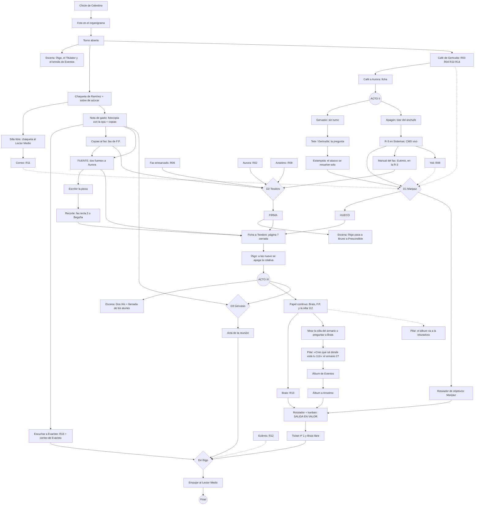

# FE DE ERRATAS — El guion completo
<!-- docs/GUION.md · volcado del guion vigente desde el código de content/ (y docs/guion2/e4/piezas.json) -->

*Una aventura de cierre. El Incontable, viernes de 18:30 a 21:00.*

> **PROPUESTA (sin aplicar al juego).** Es el guion vigente con doce cambios marcados. Busca «NOTA: [P» para ir a cada uno.
> - **[P4] Pista del enchufe:** al entrar en la Redacción en el Acto II, la pantalla de métricas se apaga un segundo y, justo ese segundo, el CMS publica una pieza.
> - **[P5] Apagón:** 12 segundos la primera vez; 5 en las repeticiones.
> - **[P6] Brais en el armario:** la escena automática baja de 23 a 16 líneas; todo lo necesario para seguir sigue siendo automático.
> - **[P7] Duelos:** se puede entrar sin todas las réplicas; cada ataque que no sabes contestar apunta en la libreta dónde se aprende.
> - **[P8] Gervasio:** tras el primer ataque escuchado entero, escribe más rápido.
> - **[P9] Réplicas nuevas en los duelos:** 11 de 16 cambian; cuatro cambian también de ataque.
> - **[P10] Formatos publicitarios por soporte:** en el papel, solo formatos de papel (faldón, robapáginas, módulo, anuncio por palabras); banners, pop-ups y vídeo, solo en web, correo y pantallas. Para la página 7, Maripaz propone un pop-up de cartulina, como los libros desplegables.
> - **[P11] Historia más simple y cosida (tandas 1 y 2 del informe del juez):** Evaristo entrega él mismo su correo (la coma con Aurora pasa a opcional); el CMS es condición del HUECO y Sistemas atiende siempre; Eutimio da el manual al apagar la R-3; el rotulador llega al ganar a Maripaz; el atasco de la puerta es automático; fuera el ticket nº 3, los tirones 3.º y 4.º, el faldón, la L3 y la L5; Herminia mide en 4–6 líneas y Begoña cierra el clímax en cuatro; Brais es F.P. (Bruno le debe la noticia); Íñigo mueve el pósit de Bruno al ganar la FIRMA y trae en persona la amenaza al cerrar la página 7.
> - **[P12] Eventos, integrada:** Íñigo es el ponente de Pilar (brindis del Plan Cero Papel a las 21:05) y su rider pide cero papel: el álbum va a la trituradora a las 21:04. Falta la silla 112, que Íñigo se llevó en julio y es la de Brais en el armario 27: decírselo a Pilar salva el álbum. Fuera la segunda palabra del kanban y el micropuzle de la silla 113; las croquetas se quedan todas.
> - **[P13] El periódico se llama «El Incontable»** (en la web, elincontable.es): cambio global de nombre y cinco chistes nuevos donde el nombre era el chiste.
> - **[P14] Pasada de coherencia (segunda vuelta del juez y lector 2):** la silla 112 se deduce (la opción sale tras mirar la silla o preguntarle a Brais, y hay que elegir dónde está); Pilar distingue acreditar de asistir; el rotulador sale del termómetro con Maripaz; respaldo del pósit «Prescindible»; un solo aviso del armario 27 al abrir el Acto III; la impresora de los Despachos; sin cena de Navidad para Brais, que sale a por atún pero no se puede ir; plantas, Gervasio, Gertrudis, Íñigo y Evaristo, el momento oportuno, el sello de la ficha, la regla de Teodoro, el registro de tickets y referencias cruzadas.
> - **[P15] Decisiones del dueño:** R06 y R14 vuelven a las réplicas de hoy (con lo que [P9] queda en 9 réplicas de 16, tres con ataque nuevo; el chisme de R14 conserva dos mejoras de [P9]); se queda el chiste de la gestoría; nuevos el «Mirar (después)» del logo y el murmullo de Yoli del nombre; aprobadas las pistas de la abuela que estaban pendientes (la silla de Pilar, el manual, el álbum y R05); como mucho seis opciones a la vez en cada árbol de diálogo; Gertrudis vuelve a «NADIE ME SALUDABA DESDE 2019.» y Celestino pasa a hablar en pasado.

> NOTA: [P13] Cambio global: donde salía el nombre viejo del periódico (en sus dos formas, la web y la de «el …») pone ahora «El Incontable» (y «elincontable.es» en direcciones y rótulos web; «ELINCONTABLE.ES» en mayúsculas). Esos cambios de nombre no se tachan uno a uno. Solo se tachan, con su nota, las líneas en las que el nombre era el chiste o un rótulo a la vista (el logo del Vestíbulo, el ordenador de Bruno, Yoli, Begoña, la tarjeta del titulador y la pantalla de título): ahí se ve el nombre viejo. Al implementador: buscar el nombre viejo en `content/` y en el arte (letras del logo, portada del título, tarjeta del titulador, el correo de bienvenida y la dirección web de Discover).

## Cómo usar este documento

- Es **el guion tal como está hoy en el juego**, reconstruido del código. Todo lo que va tras una etiqueta en negrita del tipo **NOMBRE:** (o tras **▸**, que es una opción del jugador) está copiado literalmente de `content/`. Las acotaciones en *cursiva* y los textos de presentación son descripción, no texto del juego.
- Se puede cambiar libremente todo: puzles, personajes, diálogos, chistes, orden. **Edita directamente** sobre el texto.
- Para **quitar** algo, táchalo con `~~así~~` (no lo borres: así el implementador sabe qué desaparece).
- Para dar una **instrucción al implementador** (mover, fusionar, cambiar una condición…), añade una línea que empiece por `> NOTA:`.
- Los **comentarios HTML** (`<!-- content/rooms/… · id -->`) bajo cada encabezado dicen de qué fichero e id sale cada bloque: **no los toques**; sirven para localizarlo en el código.
- Convenciones: « // » separa globos seguidos de una misma línea; « / » separa variantes alternativas (según estado o rotación); `{…}` es un hueco que el juego rellena (un número, un nombre); _(entre paréntesis y cursiva)_, cuándo sale.
- Ojo con el límite técnico: ninguna línea hablada puede pasar de 80 caracteres.

## Índice

- [La historia en una página](#la-historia-en-una-página)
- [Estructura](#estructura)
  - [Acto I — Entrar en la casa (18:30 → 19:07)](#acto-i--entrar-en-la-casa-1830--1907)
  - [Acto II — Hueco, fuente y firma (19:07 → 20:22)](#acto-ii--hueco-fuente-y-firma-1907--2022)
  - [Acto III — Cierre (20:22 → 21:00)](#acto-iii--cierre-2022--2100)
  - [Opcional (no hace falta para acabar)](#opcional-no-hace-falta-para-acabar)
  - [Esquema de dependencias](#esquema-de-dependencias)
- [Personajes](#personajes)
  - [Bruno Pellejo](#bruno-pellejo)
  - [La abuela Remedios](#la-abuela-remedios)
  - [Celestino](#celestino)
  - [Yoli](#yoli)
  - [Leoncio y Herminia (Infografía)](#leoncio-y-herminia-infografía)
  - [Anselmo (y el coro de Desarrollo)](#anselmo-y-el-coro-de-desarrollo)
  - [Valentín Retícula (Diseño y Producto)](#valentín-retícula-diseño-y-producto)
  - [Custodia (Secretaría de Redacción)](#custodia-secretaría-de-redacción)
  - [Íñigo Sinergia (el villano)](#íñigo-sinergia-el-villano)
  - [El Lector Medio](#el-lector-medio)
  - [Gervasio Acta](#gervasio-acta)
  - [Los tres de Mercados](#los-tres-de-mercados)
  - [Maripaz Remitido (Comercial)](#maripaz-remitido-comercial)
  - [Borja (su móvil) y Tadeo (su portátil)](#borja-su-móvil-y-tadeo-su-portátil)
  - [Gertrudis (la cafetera)](#gertrudis-la-cafetera)
  - [Aurora Galerada (correctora)](#aurora-galerada-correctora)
  - [Teodoro Cuerpodoce (jefe de cierre)](#teodoro-cuerpodoce-jefe-de-cierre)
  - [Eutimio Ticket (Sistemas)](#eutimio-ticket-sistemas)
  - [Brais (el Titulator)](#brais-el-titulator)
  - [Begoña Triplicado (Administración)](#begoña-triplicado-administración)
  - [Don Evaristo Salvedad (Controlling)](#don-evaristo-salvedad-controlling)
  - [Pilar Escaleta (Eventos)](#pilar-escaleta-eventos)
  - [Ramírez](#ramírez)
  - [Otros](#otros)
- [Inventario y objetos clave](#inventario-y-objetos-clave)
  - [Descripciones (Mirar) y combinaciones](#descripciones-mirar-y-combinaciones)
  - [La ficha de la página 7 (lista viva)](#la-ficha-de-la-página-7-lista-viva)
- [El guion, escena a escena](#el-guion-escena-a-escena)
  - [Acto I — Entrar en la casa](#acto-i--entrar-en-la-casa)
    - [I.1 · Vestíbulo (planta 0)](#i1--vestíbulo-planta-0)
    - [I.2 · Redacción (planta 1)](#i2--redacción-planta-1)
    - [I.3 · Despachos (planta 1)](#i3--despachos-planta-1)
    - [I.4 · Vending (planta 1)](#i4--vending-planta-1)
    - [I.5 · Redacción de papel / Cierre (planta 1)](#i5--redacción-de-papel--cierre-planta-1)
  - [Acto II — Hueco, fuente, firma](#acto-ii--hueco-fuente-firma)
    - [II.1 · Redacción: el apagón (planta 1)](#ii1--redacción-el-apagón-planta-1)
    - [II.2 · Sistemas (planta −1)](#ii2--sistemas-planta-1)
    - [II.3 · Sala Amazonas: la reunión que no se acaba (planta 1)](#ii3--sala-amazonas-la-reunión-que-no-se-acaba-planta-1)
    - [II.4 · Marketing y Comercial (planta 2)](#ii4--marketing-y-comercial-planta-2)
    - [II.5 · Administración (planta 2)](#ii5--administración-planta-2)
    - [II.6 · Redacción de papel: el fax habla (planta 1)](#ii6--redacción-de-papel-el-fax-habla-planta-1)
    - [II.7 · Redacción: la exclusiva (planta 1)](#ii7--redacción-la-exclusiva-planta-1)
    - [II.8 · Redacción de papel: el recorte y el cierre de la página (planta 1)](#ii8--redacción-de-papel-el-recorte-y-el-cierre-de-la-página-planta-1)
  - [Acto III — Cierre](#acto-iii--cierre)
    - [III.1 · Redacción: dos IAs (planta 1)](#iii1--redacción-dos-ias-planta-1)
    - [III.2 · Sistemas: el Titulator era un chaval (planta −1)](#iii2--sistemas-el-titulator-era-un-chaval-planta-1)
    - [III.3 · Marketing y Eventos: el rotulador y el álbum (planta 2)](#iii3--marketing-y-eventos-el-rotulador-y-el-álbum-planta-2)
    - [III.4 · Redacción: la salida en valor (planta 1)](#iii4--redacción-la-salida-en-valor-planta-1)
    - [III.5 · Despachos: el acta de Gervasio (planta 1)](#iii5--despachos-el-acta-de-gervasio-planta-1)
    - [III.6 · Sala Amazonas: el clímax (planta 1)](#iii6--sala-amazonas-el-clímax-planta-1)
- [Sistemas transversales](#sistemas-transversales)
  - [Los duelos «Responder a todos»](#los-duelos-responder-a-todos)
  - [El móvil de Bruno](#el-móvil-de-bruno)
  - [La abuela: las pistas](#la-abuela-las-pistas)
  - [El titulador de Yoli (minijuego)](#el-titulador-de-yoli-minijuego)
  - [Celestino narra las hazañas](#celestino-narra-las-hazañas)
  - [El ascensor](#el-ascensor)
  - [Los titulares del Titulator (Despachos)](#los-titulares-del-titulator-despachos)
  - [Lo más leído y la ráfaga del CMS (titulares que solo se ven)](#lo-más-leído-y-la-ráfaga-del-cms-titulares-que-solo-se-ven)
  - [Placas de las salas](#placas-de-las-salas)
  - [Respuestas por defecto (cuando no hay nada escrito para esa acción)](#respuestas-por-defecto-cuando-no-hay-nada-escrito-para-esa-acción)
  - [Cuarta pared y textos de la interfaz](#cuarta-pared-y-textos-de-la-interfaz)
- [Final y epílogo](#final-y-epílogo)
  - [La tarjeta: FE DE ERRATAS](#la-tarjeta-fe-de-erratas)
  - [Créditos](#créditos)
- [Apéndice: reglas vigentes del dueño que el guion respeta hoy](#apéndice-reglas-vigentes-del-dueño-que-el-guion-respeta-hoy)

## La historia en una página

**Premisa.** Viernes, 18:30, en El Incontable, un periódico económico con web y edición de papel. El cierre de la edición del sábado es a las 21:00. Bruno Pellejo lleva seis años de becario, 4.112 piezas en la web y ninguna en papel. Su abuela le pregunta por teléfono si mañana sale «en el de verdad, el que mancha», y él le promete que sí. Ella ya lo ha dicho en el grupo del pueblo.

**Qué quiere Bruno.** Firmar una noticia en la página 7 del papel de mañana. Para eso hacen falta tres cosas, le explica Aurora, la correctora: **hueco** (la página está vendida a unos colchones), **fuente** (dos, contrastadas) y **firma** (que el jefe de cierre, Teodoro, que solo habla por fax, acepte a uno de la web). Y escribir la pieza, y que quepa.

~~**Qué se lo impide.** Una casa en la que nadie le ve: el torno no le reconoce, no tiene silla, la cafetera no da café si no la saludas, el CMS se cae, Sistemas no atiende sin ticket, la reunión no se acaba nunca, Administración lo hace todo por triplicado y Comercial cobra cada píxel. Y sobre todo **Íñigo Sinergia**, consultor de Optimal Brains, que esa noche presenta el **Plan Cero Papel** en la Reunión de Dirección de las nueve: apagar la rotativa y sustituir la redacción por su «Titulator 3000», una inteligencia artificial de titulares que cuesta 48.000 € al mes. Bruno es, en la matriz de Íñigo, el empleado ideal: «Vacante».~~

**Qué se lo impide.** Una casa en la que nadie le ve: el torno no le reconoce, no tiene silla, la cafetera no da café si no la saludas, el CMS se cae (y sin web Comercial no suelta la página), la reunión no se acaba nunca, Administración lo hace todo por triplicado y Comercial cobra cada píxel. Y sobre todo **Íñigo Sinergia**, consultor de Optimal Brains, que esa noche presenta el **Plan Cero Papel** en la Reunión de Dirección de las nueve: apagar la rotativa y sustituir la redacción por su «Titulator 3000», una inteligencia artificial de titulares que cuesta 48.000 € al mes. A las nueve y cinco lo celebra en Eventos, con croquetas y sin papel. Bruno es, en la matriz de Íñigo, el empleado ideal: «Vacante». En cuanto Bruno consigue algo, Íñigo lo pasa a «Prescindible».

~~**Cómo lo consigue.** Bruno cotillea por la casa y apunta en su libreta las mejores réplicas a las frases hechas del correo corporativo; con ellas gana cuatro duelos «Responder a todos». Consigue el hueco ganándole a Maripaz (Comercial), la fuente con un fax anónimo y el reverso de una nota de gasto de Gervasio (una comida con Hidrovoltia: hay una opa sobre Banco Robledal), y la firma contestando a Teodoro con la respuesta automática de su propio fax. La página 7 se cierra y empieza el Acto III. Entonces descubre que el Titulator es **Brais**, un becario de verano encerrado en el armario 27 de Sistemas, que titula a cambio de bocadillos de atún; y don Evaristo, de Controlling, descubre que el contrato, por una coma, dice 48 euros y no 48.000. Bruno saca a Brais del tablero de Desarrollo con una «salida en valor», consigue el acta de Gervasio y entra en la Reunión de Dirección.~~

**Cómo lo consigue.** Bruno cotillea por la casa y apunta en su libreta las mejores réplicas a las frases hechas del correo corporativo; con ellas gana cuatro duelos «Responder a todos». Consigue el hueco ganándole a Maripaz (Comercial) cuando vuelve la web, la fuente con un fax anónimo y el reverso de una nota de gasto de Gervasio (una comida con Hidrovoltia: hay una opa sobre Banco Robledal), y la firma contestando a Teodoro con la respuesta automática de su propio fax. Por el camino, don Evaristo, de Controlling, le cuenta que el contrato del Titulator, por una coma, dice 48 euros y no 48.000, y le deja un correo para enviarlo «en el momento oportuno». La página 7 se cierra e Íñigo baja en persona a anunciar que a las nueve se apaga la rotativa: empieza el Acto III. Entonces Bruno descubre que el Titulator es **Brais**, un becario de verano encerrado en el armario 27 de Sistemas, sentado en una silla de Eventos, que titula a cambio de bocadillos de atún; y que el fax anónimo se lo mandó él. Para sacarlo del tablero de Desarrollo hace falta el álbum de Eventos, que el rider de Íñigo manda a la trituradora: Pilar lo salva cuando Bruno le dice dónde está su silla 112. Bruno saca a Brais con una «salida en valor», consigue el acta de Gervasio y entra en la Reunión de Dirección.

> NOTA: [P11] [P12] Resumen al día: el CMS ya no es la llave de Sistemas sino del hueco; la coma y el correo de Evaristo llegan en el Acto II, de su mano; Íñigo actúa en el Acto II y trae la amenaza; Brais es F.P.; Eventos entra en la trama por el rider del ponente y la silla 112. «Cómo acaba» no cambia.

**Cómo acaba.** En la Sala Amazonas, Bruno «responde a todos» a Íñigo: el ticket de alta de Brais, el acta (que solo dice «pedir más café») y el correo de Evaristo desmontan el plan. Bruno empuja al Lector Medio, el cartón de Marketing que lo aprobaba todo asintiendo; cae. Teodoro, por el teléfono rojo: «Goyita. Tira.» La rotativa arranca. Sábado, 6:00: los periódicos llegan al Vestíbulo con la pieza de Bruno, bien firmada; desfila la casa. La abuela le cuenta que ya no lee el papel: lo lee en el móvil y le pone «abrígate» en todo. Bruno, por fin, contesta: «Abrígate tú.» Y ella: «¡Me ha contestado el periódico!» Fe de erratas, créditos, fin.

## Estructura
<!-- orden canónico: tools/walk-data.mjs (STEPS, 49 pasos; ALT = orden alternativo) · objetivos y dependencias: content/pistas.js (OBJETIVOS: hecho / activo) -->

Tres actos, diez salas en cuatro plantas (−1 Sistemas · 0 Vestíbulo · 1 Redacción, Redacción de papel, Despachos, Sala Amazonas, Vending · 2 Marketing y Comercial, Eventos, Administración). El reloj del móvil va de las 18:30 a las 21:00; los relojes del edificio están parados en las 20:59. Los rótulos de acto los ponen dos escenas: el café de Aurora («ACTO II: HUECO, FUENTE, FIRMA») y el cierre de la página («ACTO III: CIERRE»).

**Las réplicas** (R01–R16) son el hilo de fondo: se aprenden cotilleando (casi todas son opcionales una a una, pero cada duelo necesita cierto número de las de su mazo). Dónde está cada una: *Sistemas transversales · Duelos*. Cuántas pide cada duelo: **D1** 3 de R08, R04, R11, R14 · **D2** las 3: R06, R02, R09 · **D3** 2 de R07, R03, R01, R05 · **D4** 5 de R10, R12, R13, R05, R16, R01, R07, R15.

### Acto I — Entrar en la casa (18:30 → 19:07)
1. **Pasar el torno.** Celestino da el **chicle** («¿Tiene algo para los nervios?») → chicle en la **tarjeta** → tarjeta en el **organigrama** (casilla VACANTE) → tarjeta en el **torno** → «BIENVENIDO, VACANTE.» · Desbloquea: subir a la Redacción (y el ascensor). *Opcional aquí: R05 (Celestino, «¿Algún cotilleo?»), la pista del café.*
2. ~~**La presentación del villano** (automática al entrar en la Redacción): Íñigo, el Titulator, el Plan Cero Papel.~~
2. **La presentación del villano** (automática al entrar en la Redacción): Íñigo, el Titulator, el Plan Cero Papel y el brindis de las 21:05 en Eventos. *Opcional desde aquí: Eventos (Pilar cuenta ciento once sillas: falta la 112, «se la llevó un señor de traje en julio»).*
> NOTA: [P12] La presentación siembra el evento de Pilar con una línea de Íñigo; el correo «CONFIRMADO» de Pilar llega al móvil justo después. No añade pasos.
3. **Una silla.** Coger la **chaqueta de Ramírez** de su silla (cae el **sobre de azúcar**) → en los Despachos, ponérsela al **Lector Medio** → la silla queda libre.
4. **El correo** (necesita la silla). Mirar o usar **mi ordenador** → réplica **R11**.
5. *Opcional, siembra:* en los Despachos, **mirar el Titulator tres veces** → «AYÚDAME ESTOY EN EL ARMARIO 27»; **mirar el ordenador de Gervasio** → **R07**.
6. **El café.** En el Vending, «**Buenas noches, Gertrudis.**» → **café** + **R03** (y la cafetera se hace viral); «**Buenas noches otra vez.**» → **R04, R10, R14**. **Mirar el tablón** → **R01**.
7. **El café de Aurora.** En la Redacción de papel, **dar el café a Aurora** → **ficha de la página 7** → **ACTO II**.

### Acto II — Hueco, fuente y firma (19:07 → 20:22)
~~*Los bloques A–E se pueden hacer en casi cualquier orden; dentro de cada uno, el orden es fijo.*~~

~~**A. El CMS** (sin él, Sistemas no atiende)~~
1. ~~En la Redacción, **tirar del enchufe** de la pantalla de métricas → apagón; Anselmo lo vuelve a enchufar: «Que te la apague Eutimio».~~
2. ~~En Sistemas, **tirar del regletero → R-3** (la del pósit) → el CMS vuelve. Desbloquea: Eutimio atiende (manual, R12), Yoli habla (R08).~~
3. ~~*Réplicas:* Yoli «¿Algún hilo bueno esta noche?» → **R08** · Eutimio «¿Algún cotilleo del consultor?» → **R12** · Anselmo «¿Qué tal con Yoli?» → **R09** (esta, en cualquier momento).~~

~~**B. La reunión → el HUECO**~~
1. ~~En la Sala Amazonas, a Gervasio: «**…¿y cuáles son los siguientes pasos?**» → «Los becarios no tienen turno… y los conectados.»~~
2. ~~Que pregunte un conectado: **hablar con la tele** → «Buenas noches, Gertrudis.» → «¿Y cuáles son los siguientes pasos?» *(o preguntárselo a Gertrudis en el Vending y luego encender la tele; o insistir tres veces a Gervasio)* → **estampida**.~~
3. ~~**Desatascar la puerta** (empujar, hablar, el medio cruasán o esperar) → se levanta la sesión.~~
4. ~~A Maripaz (sigue sentada en el planillo): «Siestatón no ha confirmado la página 7.» → **duelo D1** (remate: la **ficha**) → **HUECO** hecho. Maripaz le pega a Bruno un adhesivo en la espalda (Aurora se lo quita).~~

~~**C. Administración → papel y segunda fuente**~~
1. ~~(Por Marketing y Comercial; la primera vez, el anuncio de Maripaz antes de entrar.) A Begoña: **nota de gasto** → «Café para entender el capitalismo.» → importe → **el sobre de azúcar** → «enséñeme cómo es una nota bien hecha» → **fotocopia de la nota de Gervasio** (con «OPA ROBLEDAL» en el reverso) + **duplicado y triplicado** rechazados. Begoña le manda a Controlling.~~
2. ~~A don Evaristo: «¿Para qué me ha llamado?» → «¿De qué trata?» → «**Siga.**» → la coma de los 48.000 € (**R16**).~~

~~**D. La Redacción de papel → FUENTE, la coma y la FIRMA**~~
1. ~~**Mirar el fax** → pegatina «Ticket 0.441» → en Sistemas (con el CMS vivo), a Eutimio: «**Ticket 0.441. El fax de Teodoro.**» → **manual del fax**.~~
2. ~~**Usar el duplicado y triplicado con el fax** → el fax vomita la tarde y sale el **fax de F.P.** (primera fuente).~~
3. ~~**Dar las dos fuentes a Aurora** → **FUENTE** hecha (la fotocopia vuelve a Bruno).~~
4. ~~A Aurora: «**Don Evaristo pregunta si su coma está bien.**» (necesita R16/Evaristo escuchado y papel en el fax) → el **correo de Evaristo**, impreso.~~
5. ~~*Réplicas:* **mirar el fax enmarcado** → **R06** · Aurora «¿Por qué no se hablan usted y Teodoro?» → **R02**.~~
6. ~~A Teodoro: «Quiero firmar en tu página 7.» → **duelo D2** por fax (remate: el **manual**) → **FIRMA** hecha.~~

~~**E. La pieza y el cierre**~~
1. ~~(Con la FUENTE hecha) en la Redacción, **usar mi ordenador** → **mi exclusiva** (31 líneas; el hueco es de 23). Herminia la mide; Yoli la prueba en su titulador. *Opcional: el minijuego del titulador.*~~
2. ~~**Recortarla**: usar la pieza con el fax → tecla **2: ADMINISTRACIÓN** *(o dársela a Begoña)* → 23 líneas.~~
3. ~~Con hueco, fuente, firma y la pieza recortada: **dar la ficha a Teodoro** → la página 7 cerrada, «Goyita. Página 7 cerrada.» → **ACTO III**.~~

> NOTA: [P11] [P12] El Acto II queda en cuatro bloques en vez de cinco, y cada uno llena una casilla de la ficha. El CMS deja de ser un bloque suelto (la llave de Sistemas) y pasa a ser la condición del HUECO: Maripaz no pasa a Siestatón a una web que no publica. Sistemas atiende siempre, y Eutimio da el manual del fax al apagar la R-3 (fuera la pegatina como cadena y el «Ticket 0.441»). Evaristo entrega su correo al acabar de explicar la coma (fuera la escena obligatoria de Aurora y su condición de papel en el fax). El atasco de la puerta es automático. El rotulador llega al ganar el D1. Íñigo actúa dos veces: mueve el pósit de Bruno al ganar la FIRMA y trae la amenaza al cerrar la página. Pasos (walk-data): 23 → 20.

*Los bloques A–D se pueden hacer en casi cualquier orden; dentro de cada uno, el orden es fijo. Cada bloque llena una casilla de la ficha.*
*Una dependencia cruza bloques: el D2 (FIRMA, bloque C) se remata con el manual del fax, que Eutimio da en el bloque A (la R-3).*
> NOTA: [P14] La Estructura decía «cada bloque llena una casilla» sin decir que la FIRMA depende de la R-3; en el juego ya lo cubre la variante de pista «sin el manual».

**A. La reunión y el CMS → el HUECO**
~~1. En la Sala Amazonas, a Gervasio: «**…¿y cuáles son los siguientes pasos?**» → «Los becarios no tienen turno… y los conectados.»~~
1. En la Sala Amazonas, a Gervasio (al abrir, si el CMS sigue caído, Maripaz avisa: «Siestatón se va a la web. Si la web publicara.»): «**…¿y cuáles son los siguientes pasos?**» → «Los becarios no tienen turno… y los conectados.»
> NOTA: [P14] La condición del CMS se anuncia antes de la estampida (pide el lector 2): el jugador que llega primero a la Sala sabe para qué sirve el CMS antes de oír la negativa de Maripaz. Ver *II.3*.
2. Que pregunte un conectado: **hablar con la tele** → «Buenas noches, Gertrudis.» → «¿Y cuáles son los siguientes pasos?» *(o preguntárselo a Gertrudis en el Vending y luego encender la tele; o insistir tres veces a Gervasio)* → **estampida**. El atasco de la puerta se resuelve solo (el anuncio de cinco segundos de Maripaz) y se levanta la sesión.
3. A Maripaz (sigue sentada en el planillo): «Siestatón no ha confirmado la página 7.» *Con el CMS caído:* «Aunque la web no publica desde las cuatro. / Arréglala y te lo pongo por escrito.» *(Si el CMS ya va, este paso no existe: se pasa directo al 6.)*
4. En la Redacción, **tirar del enchufe** de la pantalla de métricas → apagón; Anselmo lo vuelve a enchufar: «Que te la apague Eutimio».
5. En Sistemas, **tirar del regletero → R-3** (la del pósit) → el CMS vuelve. Eutimio, con su único hueco, le da el **manual del fax** (el remate del D2).
6. A Maripaz: «Siestatón no ha confirmado la página 7.» → **duelo D1** (remate: la **ficha**) → **HUECO** hecho. Maripaz le da a Bruno su **rotulador de objetivos** y le pega un adhesivo en la espalda (Aurora se lo quita).
*Los pasos 4–5 se pueden hacer antes que los 1–3: lo único que no se puede es ganar el D1 con la web caída.* *Réplicas del bloque:* Yoli «¿Algún hilo bueno esta noche?» → **R08** (con el CMS vivo) · Eutimio «¿Algún cotilleo del consultor?» → **R12** · Anselmo «¿Qué tal con Yoli?» → **R09**.

**B. Administración → papel, segunda fuente y el correo de Evaristo**
1. (Por Marketing y Comercial; la primera vez, el anuncio de Maripaz antes de entrar.) A Begoña: **nota de gasto** → «Café para entender el capitalismo.» → importe → **el sobre de azúcar** → «enséñeme cómo es una nota bien hecha» → **fotocopia de la nota de Gervasio** (Bruno le da la vuelta: «OPA ROBLEDAL — jueves — NO PUBL.»; es su noticia) + **duplicado y triplicado** rechazados. Begoña le manda a Controlling.
2. A don Evaristo: «¿Para qué me ha llamado?» → «¿De qué trata?» → «**Siga.**» → la coma de los 48.000 € (**R16**) y el **correo de Evaristo**, que él mismo le da para enviarlo «en el momento oportuno».

**C. La Redacción de papel → FUENTE y FIRMA**
1. **Usar el duplicado y triplicado con el fax** → el fax vomita la tarde y sale el **fax de F.P.** (primera fuente: «La segunda fuente comió con ellos el jueves»).
2. **Dar las dos fuentes a Aurora** → **FUENTE** hecha (la fotocopia vuelve a Bruno).
3. *Réplicas:* **mirar el fax enmarcado** → **R06** · Aurora «¿Por qué no se hablan usted y Teodoro?» → **R02**.
4. A Teodoro: «Quiero firmar en tu página 7.» → **duelo D2** por fax (remate: el **manual**) → **FIRMA** hecha. En la siguiente entrada en la Redacción, Íñigo pasa el pósit de Bruno de «Ideal» a «Prescindible» (automático).

**D. La pieza y el cierre**
1. (Con la FUENTE hecha) en la Redacción, **usar mi ordenador** → **mi exclusiva** (31 líneas; el hueco es de 23). Herminia la mide; Yoli la prueba en su titulador. *Opcional: el minijuego del titulador.*
2. **Recortarla**: usar la pieza con el fax → tecla **2: ADMINISTRACIÓN** *(o dársela a Begoña)* → 23 líneas.
3. Con hueco, fuente, firma y la pieza recortada: **dar la ficha a Teodoro** → la página 7 cerrada, «Goyita. Página 7 cerrada.» → entra Íñigo: «A las nueve, la Reunión de Dirección apaga la rotativa.» → **ACTO III**.

*Opcional en el Acto II, en Eventos:* el rider del ponente (llega por un «RV:» de Tadeo), la trituradora nueva y lo que pide Íñigo («Agua con gas. Cero papel en sala. Y sin turno de preguntas»). *Opcional, con el correo de Evaristo:* preguntarle a Aurora por la coma → Aurora le escribe a Evaristo por el fax de Teodoro.

### Acto III — Cierre (20:22 → 21:00)
1. ~~**«Dos IAs»** (automática al entrar en la Redacción): Herminia ha hecho un gráfico del Titulator: come atún y sale del armario 27.~~
2. ~~**El armario 27.** En Sistemas, **tirar del papel continuo** → aparece **Brais**, el Titulator. Brais: «¿Escribiste tú los discursos de Íñigo?» → **R13** («salida en valor»). *Opcional: R15 («¿Te llegaban correos de Tadeo?»), darle el táper.*~~
3. ~~**El álbum.** En Eventos, a Pilar: «**¿Me prestas el álbum?**» → **álbum de Eventos** (y se oye «descopear», la otra palabra válida para la columna).~~
4. ~~**La baja.** En la Redacción, **dar el álbum a Anselmo** → «Las fotos me valen. Pero yo no escribo columnas nuevas.»~~
5. ~~**El rotulador.** En Marketing y Comercial, **coger el rotulador** del termómetro de ventas (se puede coger desde el Acto I).~~
6. ~~**La columna.** **Usar el rotulador con el kanban** → «SALIDA EN VALOR» (o «DESCOPEADO») → el pósit de Brais sale, llega el **ticket nº 1** y Brais queda libre.~~
7. ~~**El acta.** En los Despachos, a Gervasio: «Necesito el acta de la última reunión.» → **duelo D3** (sin pisarle la frase; remate: la **fotocopia** de su nota) → **acta de la reunión**.~~
8. ~~**El clímax.** **Usar la puerta de la Sala** (con acta, Brais libre y ticket) → **duelo D4** con Íñigo (remates: **ticket nº 1**, **acta**, **correo de Evaristo**).~~
9. ~~**El empujón.** **Empujar al Lector Medio** → «Goyita. Tira.» → **final**.~~

~~> NOTA: [P11] [P12] El Acto III pierde el viaje a por el rotulador (llega con el D1) y la segunda palabra del kanban (la que publicaba el móvil de Borja). El álbum deja de ser un recado: Íñigo lo ha mandado a la trituradora y se salva con una deducción (la silla 112 de Pilar es la de Brais). La llamada de los atunes de Evaristo suena al empezar el acto, cuando todavía sirve de pista. Pasos (walk-data): 10 → 9 (10 si se pide el álbum antes de saber lo de la silla). Cambios de planta: Sistemas → Eventos → Redacción, y no se vuelve a la planta 2.~~
> NOTA: [P11] [P12] [P14] El Acto III pierde el viaje a por el rotulador (llega con el D1) y la segunda palabra del kanban (la que publicaba el móvil de Borja). El álbum deja de ser un recado: Íñigo lo ha mandado a la trituradora y se salva con una deducción (la silla 112 de Pilar es la de Brais), que pide haber mirado la silla del armario o haberle preguntado a Brais por ella. La llamada de los atunes de Evaristo suena al empezar el acto, cuando todavía sirve de pista, y es el único aviso del armario 27 al abrirlo. Pasos (walk-data, que cuenta aparte los discursos de Brais y la puerta de la Sala, y no cuenta «Dos IAs», que es automática; por eso la lista de abajo tiene ocho puntos): 10 → 10 (sale el rotulador, entra la silla del armario; 11 si se pide el álbum antes de saber lo de la silla). Cambios de planta: Sistemas → Eventos → Redacción, y no se vuelve a la planta 2.

~~1. **«Dos IAs»** (automática al entrar en la Redacción): Herminia ha hecho un gráfico del Titulator: come atún y sale del armario 27. En la siguiente entrada en sala, Evaristo llama: la máquina de la planta −1 vende veinticuatro atunes al mes y nadie los cobra. Bruno: «…El armario 27.»~~
1. **«Dos IAs»** (automática al entrar en la Redacción): Herminia ha hecho un gráfico del Titulator: come atún y va once veces al baño. En la siguiente entrada en sala, Evaristo llama: la máquina de la planta −1 vende veinticuatro atunes al mes y nadie los cobra. Bruno: «…El armario 27.»
~~2. **El armario 27.** En Sistemas, **tirar del papel continuo** → aparece **Brais**, el Titulator, en una silla plegable de Eventos. Brais es F.P.: «Te lo mandé yo.» Y cuenta que Íñigo ha mandado el álbum de Eventos a la trituradora a las 21:04. Brais: «¿Escribiste tú los discursos de Íñigo?» → **R13** («salida en valor»). *Opcional: R15 («¿Te llegaban correos de Tadeo?»), darle el táper, mirar la silla («EVENTOS · 112»).*~~
2. **El armario 27.** En Sistemas, **tirar del papel continuo** → aparece **Brais**, el Titulator, en una silla plegable de Eventos. Brais es F.P.: «Te lo mandé yo.» Y cuenta que Íñigo ha mandado el álbum de Eventos a la trituradora a las 21:04. Brais: «¿Escribiste tú los discursos de Íñigo?» → **R13** («salida en valor»). **Mirar la silla** («EVENTOS · 112») o preguntarle a Brais «¿De dónde es esa silla?» (hace falta una de las dos para el paso 3). *Opcional: R15 («¿Te llegaban correos de Tadeo?»), darle el táper.*
~~3. **El álbum.** En Eventos, Pilar cuenta al entrar: «La 112, sin aparecer.» A Pilar: «**Tu silla 112 está en el armario 27.**» → «…Entonces se sentó.» → **álbum de Eventos** (y la croqueta). *Si antes le pide el álbum, Pilar se niega: va a la trituradora, y «quien no se sienta no consta».*~~
3. **El álbum.** En Eventos, Pilar cuenta al entrar: «La 112, sin aparecer.» A Pilar: «**Creo que sé dónde está tu 112.**» → «¿Dónde?» → «En el armario 27, en Sistemas.» → «…Entonces se sentó.» → **álbum de Eventos** (y la croqueta). *Si antes le pide el álbum, Pilar se niega: va a la trituradora, y «quien no se sienta no asiste».*
> NOTA: [P14] Tres arreglos de coherencia en esta lista: «Dos IAs» ya no dice «armario 27» (lo dice la llamada de Evaristo, justo después); la silla del armario pasa al camino principal, porque sin ella la 112 no se deduce; y la opción de Pilar ya no trae la respuesta escrita (ver *Eventos · Árbol: Pilar*).
4. **La baja.** En la Redacción, **dar el álbum a Anselmo** → «Las fotos me valen. Pero yo no escribo columnas nuevas.»
5. **La columna.** **Usar el rotulador con el kanban** (el de Maripaz, desde el D1) → «SALIDA EN VALOR» → el pósit de Brais sale, llega el **ticket nº 1** y Brais queda libre.
6. **El acta.** En los Despachos, a Gervasio: «Necesito el acta de la última reunión.» → **duelo D3** (sin pisarle la frase; remate: la **fotocopia** de su nota) → **acta de la reunión**.
7. **El clímax.** **Usar la puerta de la Sala** (con acta, Brais libre y ticket) → **duelo D4** con Íñigo (remates: **ticket nº 1**, **acta**, **correo de Evaristo**).
8. **El empujón.** **Empujar al Lector Medio** → Pilar, por el walkie de Íñigo: «Empezamos sin ponente.» → Aurora: «Tira, Teodoro.» → «Goyita. Tira.» → **final**.

### Opcional (no hace falta para acabar)
- **Boli muerto, boli nuevo** (Custodia ↔ Aurora): preguntar a Custodia cómo se consigue un boli → coger los bolis de Aurora → dárselo a Custodia → «Para apuntar lo que me digan.» → desbloquea «¿Dónde está…?».
- **El táper** (Vending → Brais): tras la estampida, a Fermín «¿Y cuáles son los siguientes pasos?» → táper → dárselo a Brais.
- **Alta de Herminia** (Sistemas → Redacción): tras «Dos IAs», a Eutimio «¿Me das de alta a una becaria?» → «Herramienta.» → la anexión de Infografía.
- ~~**La silla 113** (Eventos): contar sillas con Pilar → mirar la silla torcida → devolverla → la croqueta.~~
> NOTA: [P12] El micropuzle de la silla 113 se va: la silla que importa ahora es la 112, que falta, y está en el camino principal (Acto III, 3). Su croqueta y sus líneas pasan a la 112.
- **La coma, con Aurora** (Redacción de papel, con el correo de Evaristo): preguntarle por la coma de don Evaristo → Aurora le escribe por el fax de Teodoro, que la mira y no la para.
- **Eventos en el Acto II** (planta 2): el rider del ponente, la trituradora, la escaleta de memoria («21:00, rotativa apagada. 21:01, aplauso espontáneo.») y, en los Despachos, Íñigo sobre el brindis y la silla que se llevó en julio.
- ~~**La silla del armario 27** (Sistemas, Acto III): mirarla («EVENTOS · 112») y preguntarle a Brais de dónde es.~~
~~> NOTA: [P11] [P12] Opcionales nuevos: la escena de Aurora con la coma (antes era camino principal), la escalada de Eventos en el Acto II y la silla del armario, que confirma la deducción de la 112.~~
> NOTA: [P11] [P12] [P14] Opcionales nuevos: la escena de Aurora con la coma (antes era camino principal) y la escalada de Eventos en el Acto II. La silla del armario ya no es opcional: mirarla o preguntarle a Brais por ella es lo que abre la opción de Pilar (Acto III, 2).
- **La profecía** (ventilador de Sistemas) → una opción de Teodoro. **«RECHAZADO» en la frente** (concepto «Varios.» con Begoña) → comentarios sueltos.
- **El titulador de Yoli** → cambia el titular ganador de Discover del epílogo.

### Esquema de dependencias
> NOTA: [P11] [P12] Este primer esquema es el de hoy y queda sustituido entero por el segundo, más abajo. Se tacha línea a línea (por eso ya no se dibuja como diagrama: queda como texto).

~~```mermaid~~
~~graph TD~~
  ~~chicle[Chicle de Celestino] --> foto[Foto en el organigrama] --> torno[Torno abierto]~~
  ~~torno --> villano[Escena: Íñigo y el Titulator]~~
  ~~torno --> chaqueta[Chaqueta de Ramírez + sobre de azúcar] --> silla[Silla libre: chaqueta al Lector Medio] --> R11[Correo: R11]~~
  ~~torno --> cafe[Café de Gertrudis: R03 R04 R10 R14] --> aurora[Café a Aurora: ficha] --> A2((ACTO II))~~
  ~~A2 --> apagon[Apagón: tirar del enchufe] --> cms[R-3 en Sistemas: CMS vivo]~~
  ~~cms --> manual[Manual del fax: Ticket 0.441]~~
  ~~pegatina[Mirar el fax: pegatina] --> manual~~
  ~~cms --> R08[Yoli: R08]~~
  ~~cms --> R12[Eutimio: R12]~~
  ~~A2 --> sinturno[Gervasio: sin turno] --> tele[Tele / Gertrudis: la pregunta] --> estampida[Estampida y atasco] --> D1{D1 Maripaz}~~
  ~~R08 -.-> D1~~
  ~~R11 -.-> D1~~
  ~~cafe -.-> D1~~
  ~~D1 --> hueco[HUECO]~~
  ~~chaqueta --> nota[Nota de gasto: fotocopia + copias]~~
  ~~nota --> evaristo[Escuchar a Evaristo: R16]~~
  ~~nota --> papel[Copias al fax: fax de F.P.]~~
  ~~papel --> fuente[FUENTE: dos fuentes a Aurora]~~
  ~~nota --> fuente~~
  ~~evaristo --> coma[La coma: correo de Evaristo]~~
  ~~papel --> coma~~
  ~~papel --> D2{D2 Teodoro}~~
  ~~manual --> D2~~
  ~~R06[Fax enmarcado: R06] --> D2~~
  ~~R02[Aurora: R02] --> D2~~
  ~~R09[Anselmo: R09] --> D2~~
  ~~D2 --> firma[FIRMA]~~
  ~~fuente --> pieza[Escribir la pieza] --> recorte[Recorte: fax tecla 2 o Begoña]~~
  ~~hueco --> cierre[Ficha a Teodoro: página 7 cerrada]~~
  ~~fuente --> cierre~~
  ~~firma --> cierre~~
  ~~recorte --> cierre~~
  ~~cierre --> A3((ACTO III))~~
  ~~A3 --> dosias[Escena: Dos IAs]~~
  ~~A3 --> armario[Papel continuo: Brais] --> R13[Brais: R13]~~
  ~~armario --> album[Pilar: álbum + descopear] --> baja[Álbum a Anselmo]~~
  ~~torno --> rotulador[Rotulador de objetivos]~~
  ~~baja --> columna[Rotulador + kanban: salida en valor]~~
  ~~rotulador --> columna~~
  ~~R13 -.-> columna~~
  ~~columna --> ticket[Ticket nº 1 y Brais libre]~~
  ~~A3 --> D3{D3 Gervasio}~~
  ~~nota --> D3~~
  ~~D3 --> acta[Acta de la reunión]~~
  ~~acta --> D4{D4 Íñigo}~~
  ~~ticket --> D4~~
  ~~coma --> D4~~
  ~~evaristo -.-> D4~~
  ~~R12 -.-> D4~~
  ~~D4 --> empujon[Empujar al Lector Medio] --> final((Final))~~
~~```~~
~~*Flechas de puntos: réplicas que ayudan pero no son imprescindibles (basta con reunir el número que pide cada mazo; la columna también se puede escribir con «DESCOPEADO», que se oye al pedir el álbum). Las réplicas que no salen en el esquema (R01, R03–R05, R07, R10, R14, R15) entran en los mazos de los duelos según la tabla de arriba.*~~

**Esquema nuevo** (con [P11], [P12] y [P14]):

*Flechas de puntos: réplicas que ayudan pero no son imprescindibles (basta con reunir el número que pide cada mazo), y la negativa de Pilar, que el jugador se puede saltar. «SALIDA EN VALOR» (R13) es ahora la única columna posible del kanban, así que su flecha es continua. Las réplicas que no salen en el esquema (R01, R03–R05, R07, R10, R14, R15) entran en los mazos de los duelos según la tabla de arriba.*
> NOTA: [P14] En el diagrama, el nodo de Pilar decía «Tu silla 112 está en el armario 27»; ahora pasa antes por la silla del armario (mirarla o preguntar a Brais) y la opción ya no trae la respuesta. Cambia en el sitio porque dentro del bloque no se puede tachar.
~~> NOTA: [P11] [P12] Recuento (walk-data, 49 pasos hoy): Acto I 16 → 16 · Acto II 23 → 20 (fuera «Mirar el fax: pegatina», «Ticket 0.441» como paso aparte y la coma con Aurora) · Acto III 10 → 9 (fuera el rotulador; el álbum se consigue con la silla 112) · total 49 → 45 (46 si el jugador pide el álbum antes de saber lo de la silla).~~
> NOTA: [P11] [P12] [P14] Recuento (walk-data, 49 pasos hoy): Acto I 16 → 16 · Acto II 23 → 20 (fuera «Mirar el fax: pegatina», «Ticket 0.441» como paso aparte y la coma con Aurora) · Acto III 10 → 10 (fuera el rotulador; entra mirar la silla del armario o preguntar a Brais por ella; el álbum se consigue con la silla 112) · total 49 → 46 (47 si el jugador pide el álbum antes de saber lo de la silla). Cambios de planta en el orden de walk-data: 8 → 8; en el orden al que empuja el juego hoy (bajar a Sistemas antes de saber lo de la pegatina; ir al álbum antes que al rotulador), 12 → 8.

## Personajes
<!-- content/actors.js (reparto: nombre, color, aspecto, murmullos comunes) · cada sala define sus líneas -->

*Nombre visible · id técnico entre comentarios. «Mejor línea» = una frase literal del juego que define al personaje.*

### Bruno Pellejo
<!-- actor bruno -->
- **Dónde**: en todas partes (el protagonista).
- **Qué quiere**: firmar una noticia en el periódico de papel antes del cierre de las 21:00. Se lo ha prometido a su abuela.
- **Cómo habla**: resignado, irónico, con un orgullo diminuto; cuenta su vida en términos de becario («Becario senior. Senior en becario.»). Sus tarjetas dicen «Pellizco».
- **Función**: el jugador. Aprende réplicas cotilleando y las usa en los duelos «Responder a todos».
- **Mejor línea**: **BRUNO:** Bruno Pellejo. Becario senior. Senior en becario.

### La abuela Remedios
<!-- actor abuela_remedios (solo retrato en el móvil) -->
- **Dónde**: al teléfono, en el móvil de Bruno (sin sprite).
- **Qué quiere**: que Bruno coma y se abrigue; leerle «en el de verdad, el que mancha».
- **Cómo habla**: cariñosa, de pueblo, con refranes de su familia («Tu tío pone el contestador y se contesta solo»). Siempre termina con «Abrígate.».
- **Función**: arranca la historia (la promesa), da las pistas en tres niveles y cierra el juego. Es «la cuenta de siempre» que comenta «abrígate» en todo y la única lectora que se lee la pieza entera.
- **Mejor línea**: **ABUELA:** ...¡Ay! ¡Me ha contestado el periódico!

### Celestino
<!-- actor celestino · vestibulo.js -->
- **Dónde**: Vestíbulo (mostrador). En la megafonía del ascensor, por la rejilla de Sistemas y por la tele de la Sala en el final.
- **Qué quiere**: que le pregunten por el Ibex; que no le jubile el narrador automático.
- **Cómo habla**: narra todo como un partido de fútbol («¡Por la banda! ¡Qué técnica!»), con chicle de menta desde el Mundial del 82 y la bufanda del Ibex.
- **Función**: da el chicle (torno) y la pista del café; enseña R05; narra las hazañas de Bruno; en el epílogo le da la bienvenida y su bufanda.
- **Mejor línea**: **CELESTINO:** ...Pues bienvenido, Bruno Pellejo. Ya te ve hasta el torno.

### Yoli
<!-- actor yoli_tendencias · pecera.js, pecera.dialogos.js, pecera.titulador.js -->
- **Dónde**: Redacción, ante su monitor y la pantalla de métricas.
- **Qué quiere**: lectores. Vive para el contador de concurrentes; se cree lo que publica.
- **Cómo habla**: en cadenas de palabras clave («Hola Bruno, Bruno becario, becario incontable…»), rápida, con párpado tembloroso.
- **Función**: enseña R08; dueña del titulador (minijuego); anuncia el ganador de Discover; en el epílogo, cuenta lo de la única lectora.
- **Mejor línea**: **YOLI:** Y un comentario: «abrígate». La cuenta de siempre.

### Leoncio y Herminia (Infografía)
<!-- actor leoncio_quesitos · objeto herminia_portatil -->
- **Dónde**: Redacción, mesa de Infografía.
- **Qué quiere**: que se publique lo que hace su IA, Herminia (la hizo él en tres fines de semana).
- **Cómo habla**: melancólico; ya no dibuja, «supervisa»; todo lo ve en barras o en tarta. **Herminia es un portátil**, no un personaje: solo escribe en pantalla «HERMINIA (IA) › …».
- ~~**Función**: espejo de Brais (otra IA de la casa encintada por Desarrollo); Herminia mide la pieza (sobra un 26 %) y en el Acto III da la pista del armario 27. Micropuzle opcional: darla de alta como «herramienta».~~
- **Función**: espejo de Brais (otra IA de la casa encintada por Desarrollo); Herminia mide la pieza (sobra un 26 %) y en el Acto III da la pista del atún (el armario lo deduce Evaristo). Micropuzle opcional: darla de alta como «herramienta».
> NOTA: [P14] Al abrir el Acto III, el armario 27 se anunciaba dos veces seguidas (Herminia y la llamada de Evaristo). Ahora Herminia solo dice «consumo: atún».
- **Mejor línea**: **LEONCIO:** Ya lo ha hecho. En septiembre. No se lo he dicho a nadie.

### Anselmo (y el coro de Desarrollo)
<!-- actores anselmo_monolito, coro_desarrollo (DEV 1-3, sin sprite) -->
- **Dónde**: Redacción, detrás de la frontera de cinta de carrocero; el coro son tres espaldas sin cara.
- **Qué quiere**: que nada «de fuera» entre en sus sistemas. Lo de dentro, sí, aunque sea lo mismo.
- ~~**Cómo habla**: «¿De dónde viene?»; burocracia técnica («Encintar, no: aislar el componente»). El coro grita y culpa a Diseño.~~
- **Cómo habla**: «¿De dónde viene?»; burocracia técnica («A un metro de mi cinta. Fuera.»). El coro grita y culpa a Diseño.
> NOTA: [P11] El ejemplo cambia porque «Encintar, no: aislar el componente» sale de «Herminia mide la pieza», que se recorta.
- **Función**: enchufa la pantalla (el apagón); enseña R09; dueño del kanban donde está la baja de Brais: valida el álbum y deja que Bruno escriba la columna.
- **Mejor línea**: **ANSELMO:** El modelo es de fuera. El prompt es de dentro. / **ANSELMO:** Eso lo hace nuestro.

### Valentín Retícula (Diseño y Producto)
<!-- actor valentin_reticula -->
- **Dónde**: Redacción, junto a la ventana y la bandeja de entregas.
- **Cómo habla**: no habla. Se quita un auricular, espera y se lo vuelve a poner.
- **Función**: cameo mudo (a quien Desarrollo culpa de todo; su bandeja ya avisaba de que la pantalla tumbaría el CMS).
- **Mejor línea**: **VALENTÍN:** Está en la bandeja.

### Custodia (Secretaría de Redacción)
<!-- objeto custodia_precinto · pecera.secretaria.js -->
- **Dónde**: Redacción, tras la persiana del ventanuco (solo se le ven las manos; sin sprite).
- **Qué quiere**: que el material se merezca; tiene ochenta y tres bolis contados.
- **Cómo habla**: seca, sus preguntas acaban en punto («¿Qué quiere.»).
- **Función**: micropuzle opcional del boli muerto.
- **Mejor línea**: **CUSTODIA:** Para que sepa lo que se siente.

### Íñigo Sinergia (el villano)
<!-- actor inigo_sinergia · pecera.escenas.js, pajarera.js, escenas/climax.js -->
- ~~**Dónde**: Redacción (presentación), Despachos (Actos I-II), Sala Amazonas (clímax).~~
- **Dónde**: Redacción (presentación y, al ganar Bruno la FIRMA, el pósit), Despachos (Actos I-II), Redacción de papel (cierre de la página 7), Sala Amazonas (clímax, con un walkie de Eventos en el cinturón).
- ~~**Qué quiere**: aprobar el Plan Cero Papel en la Reunión de Dirección de las nueve y cobrar su Titulator 3000 (48.000 € al mes).~~
- **Qué quiere**: aprobar el Plan Cero Papel en la Reunión de Dirección de las nueve, celebrarlo a las nueve y cinco en Eventos (sin papel, sin preguntas y de pie) y cobrar su Titulator 3000 (48.000 € al mes).
- **Cómo habla**: consultor: matrices 2x2, pósits de colores, «escala», «sinergias», llama a Bruno «Vacante».
- ~~**Función**: el antagonista; rival del duelo final (D4). En el epílogo se descubre que fue el becario de marzo del 98.~~
- **Función**: el antagonista. Actúa en el Acto II: su rider de ponente deja Eventos sin papel y manda el álbum a la trituradora; pasa a Bruno a «Prescindible» en cuanto gana la FIRMA; y trae en persona la amenaza al cerrar la página 7. Se llevó la silla 112 de Eventos «para un proyecto» (es la de Brais). Rival del duelo final (D4). En el epílogo se descubre que fue el becario de marzo del 98.
> NOTA: [P11] [P12] Íñigo deja de ser una voz sentada en el sofá: tres acciones en el Acto II (el rider, el pósit y la amenaza) y la silla. No asesora a Hidrovoltia ni apaga el papel para tapar la opa: su plan es el de siempre, el Plan Cero Papel.
- **Mejor línea**: **ÍÑIGO:** Yo no recorto personas, Vacante.

### El Lector Medio
<!-- actor lector_medio (cartón) -->
- **Dónde**: Despachos (Actos I-II), Sala Amazonas (Acto III).
- **Qué es**: un cartón pluma de tamaño real encargado por Marketing («43 años. Le interesa la economía»). Asiente a todo; no preside nada.
- **Función**: viste la chaqueta de Ramírez (libera la silla); Gervasio decide «lo que diga el Lector Medio»; empujarlo es el gesto final.
- **Mejor línea**: **LECTOR MEDIO:** A mí lo que me interesa es la economía. Y ahorrar.

### Gervasio Acta
<!-- actor gervasio_acta · sala_amazonas.js, pajarera.js, office.js -->
- **Dónde**: preside la reunión de la Sala Amazonas (Acto II); su mesa en los Despachos; en el Acto III, en la puerta de la Sala; después, en el Vending.
- **Qué quiere**: no comerse un marrón en diecinueve años; no escribir nada con su nombre.
- **Cómo habla**: en pasiva refleja y frases sin terminar («Se está... se avanza»), «lo hablamos».
- **Función**: niega el turno al becario (la reunión); enseña R07 sin querer (su ordenador); rival del D3 (el acta).
- **Mejor línea**: **GERVASIO:** Diecinueve años y nadie lo había preguntado.

### Los tres de Mercados
<!-- actores mercados_1 (Fermín Plazofijo), mercados_2 (Rogelio Diferido), mercados_3 (Jacinto Dividendo) -->
- **Dónde**: Sala Amazonas (en el punto 3 desde marzo); tras la estampida, Fermín se esconde en la cola del microondas del Vending.
- **Cómo hablan**: Fermín, que nada se mueva; Rogelio, siempre con retraso («¿Sigue siendo marzo?»); Jacinto, que quiere cobrar dos veces.
- **Función**: la estampida y el atasco de la puerta; Fermín suelta el táper.
- **Mejor línea**: **JACINTO:** ¡Yo soy de Bolsa y de Mercados! ¡Tengo doble prioridad!

### Maripaz Remitido (Comercial)
<!-- actor maripaz_remitido · sala_amazonas.js, ecosistema.js -->
- **Dónde**: Marketing y Comercial (Acto I y desde que pierde el D1); Sala Amazonas, sentada en el planillo (Acto II).
- ~~**Qué quiere**: vender cada píxel: banners, pop-ups, interstitials, «se ve demasiado la noticia».~~
- **Qué quiere**: vender cada píxel y cada columna: en la web, banners, pop-ups, interstitials; en el papel, faldones, robapáginas, módulos; «se ve demasiado la noticia».
> NOTA: [P10] Ficha: separa los formatos de la web de los del papel.
- **Cómo habla**: «cariño», cobra cada gesto como «interacción», toca un gong por cada venta.
- ~~**Función**: rival del D1 (el HUECO de la página 7); regala el rotulador de objetivos; pega el adhesivo «SU ANUNCIO AQUÍ».~~
- **Función**: rival del D1 (el HUECO de la página 7), que no se juega con la web caída («Aunque la web no publica desde las cuatro»); al perderlo, le da el rotulador de objetivos y le pega el adhesivo «SU ANUNCIO AQUÍ».
> NOTA: [P11] El CMS pasa a ser condición de su duelo; el rotulador lo da al perder el D1 (antes se cogía del termómetro).
- **Mejor línea**: **MARIPAZ:** Para eso está la X. Cada mes la hago un poco más pequeña.

### Borja (su móvil) y Tadeo (su portátil)
<!-- objetos aro_borja (ecosistema), eventos_a_ecosistema; portatil_tadeo, actor tadeo_adjunto (correos RV:) -->
- ~~**Borja** no está: se fue a las seis. Queda su **aro de luz con el móvil**, que publica solo lo que oye («Publicando: …. Emoji de fuego.»). En Eventos, se oye «descopear» (la segunda palabra posible para el kanban).~~
- **Borja** no está: se fue a las seis. Queda su **aro de luz con el móvil**, que publica solo lo que oye («Publicando: …. Emoji de fuego.»), en Marketing y Comercial. Ya no sale en Eventos.
> NOTA: [P14] Pendiente del dueño: el crédito de Marketing («Asignado a: el móvil de Borja. Lo publicó a las nueve.») se queda literal, como manda la regla del final, aunque sin la palabra del kanban el móvil ya no publica nada a las nueve.
> NOTA: [P12] Fuera la segunda palabra del kanban: el móvil de Borja deja de publicar en el préstamo del álbum. Tadeo no cambia de función: su «RV:» del Acto II pasa a ser el rider del ponente, reenviado a toda la empresa (sigue sin sprite y sin fundirse con nadie).
- **Tadeo** (Negocio) no tiene sprite: su **portátil** reenvía todo («RV:», «Por si os sirve!!»), con un asistente que contesta «¡Excelente pregunta!»; sus «RV:» llegan al correo del móvil. Enseña R15 por la vía alternativa.
- **Mejor línea**: **MÓVIL DE BORJA:** Publicando: [SILENCIO INCÓMODO]. Emoji de fuego. · **TADEO (portátil):** ¡Excelente silencio! ¿Quieres que te lo resuma en una tabla?

### Gertrudis (la cafetera)
<!-- actor gertrudis (sprite de cafetera) · office.js -->
- **Dónde**: Vending. También en la tele de la Sala Amazonas («la próxima pantalla que la sintonice») y en la esquina de los créditos.
- **Qué quiere**: que la saluden. Nadie lo hacía desde 2019.
- ~~**Qué quiere**: que la saluden. Nadie lo hacía desde 2019, salvo Celestino.~~
~~> NOTA: [P14] Celestino dice que él sí la saluda («Por eso a mí me pone espuma»); la ficha y la línea de Gertrudis lo recogen (ver *I.4*). Ya estaba en el juego.~~
> NOTA: [P15] Vuelve la de hoy. Celestino la saludaba antes, y ya no (ver *I.4 · Árbol: Gertrudis*).
- **Cómo habla**: LCD verde, en mayúsculas, con códigos de error (E-47…E-55); chismosa, «tengo wifi y rencor».
- **Función**: da el café; enseña R03, R04, R10 y R14; se hace viral; hace la pregunta del público en la reunión.
- **Mejor línea**: **GERTRUDIS:** CON TODO LO QUE TENGA PANTALLA. TENGO WIFI Y RENCOR.

### Aurora Galerada (correctora)
<!-- actor aurora_galerada · catacumba.js -->
- **Dónde**: Redacción de papel.
- **Qué quiere**: que se escriba bien; no habla antes del café.
- **Cómo habla**: exacta, con punto y coma; «criatura»; sufre con método leyendo la web.
- ~~**Función**: da la ficha de la página 7 (abre el Acto II), contrasta las dos fuentes, bendice la coma de Evaristo (el correo), enseña R02, despega el adhesivo.~~
- **Función**: da la ficha de la página 7 (abre el Acto II), contrasta las dos fuentes, enseña R02, despega el adhesivo; si se le pregunta, bendice la coma de Evaristo por el fax de Teodoro (opcional); en el clímax, «Tira, Teodoro.».
~~> NOTA: [P11] La bendición de la coma ya no da el correo (lo da Evaristo) y pasa a opcional; Aurora gana una línea en el inserto del teléfono rojo: la primera vez que le habla a Teodoro en treinta años.~~
> NOTA: [P11] [P14] La bendición de la coma ya no da el correo (lo da Evaristo) y pasa a opcional; Aurora gana una línea en el inserto del teléfono rojo: la primera vez en la noche que le pide algo a Teodoro, y por su nombre. (No es la primera vez que se dirigen la palabra en treinta años: el fax ya escupe «Respuesta a Aurora» y, en la escena opcional de «coincidir», ella le contesta.)
- **Mejor línea**: **AURORA:** Nada. Eso es lo terrible, criatura: que no pasó nada y yo lo sé.

### Teodoro Cuerpodoce (jefe de cierre)
<!-- actor teodoro_cuerpodoce · catacumba.js -->
- **Dónde**: Redacción de papel, con su fax, su teléfono rojo (la Goyita, la rotativa) y su camastro.
- **Qué quiere**: que nadie de la web firme en papel; que todo «quepa».
- **Cómo habla**: nunca en voz alta: por fax, en telegrama y mayúsculas («Trece con espacios. Cabe.»). Solo habla por el teléfono rojo.
- ~~**Función**: rival del D2 (la FIRMA); cierra la página 7 y abre el Acto III; «Goyita. Tira.» en el clímax; en el epílogo le regala a Bruno su plaza de garaje.~~
- **Función**: rival del D2 (la FIRMA); cierra la página 7 y contesta a la amenaza de Íñigo («Si no hay rotativa, no hay firma»); «Goyita. Tira.» en el clímax, después del «Tira, Teodoro.» de Aurora; en el epílogo le regala a Bruno su plaza de garaje.
- **Mejor línea**: **TEODORO:** Goyita. Página 7 cerrada. Esta noche firma un chaval.

### Eutimio Ticket (Sistemas)
<!-- actor paco_ticket · cpd.js -->
- **Dónde**: Sistemas (sótano), de espaldas.
- **Qué quiere**: nada sin número de ticket.
- **Cómo habla**: todo es un ticket con estado («Estado: no prioritario»); no sube nunca.
- ~~**Función**: con el CMS caído no atiende; da el manual del fax (ticket 0.441), enseña R12, da de alta a Herminia (opcional) y cierra el ticket nº 1 de Brais.~~
- **Función**: atiende aunque el CMS esté caído (no arregla nada, pero contesta); al apagar Bruno la R-3, con su único hueco, le da el manual del fax (ticket 0.441); enseña R12, da de alta a Herminia (opcional) y cierra el ticket nº 1 de Brais.
> NOTA: [P11] Se quita «Sistemas no atiende»: el CMS ya no es su llave. El manual llega sin la cadena de la pegatina.
- **Mejor línea**: **EUTIMIO:** Es lo mejor que me ha pasado en la vida.

### Brais (el Titulator)
<!-- actor ruben (id técnico) · cpd.js, pecera.js -->
- ~~**Dónde**: dentro del armario 27 de Sistemas; liberado, junto a la ventana de la Redacción; en el clímax y el epílogo.~~
- **Dónde**: dentro del armario 27 de Sistemas, sentado en la silla 112 de Eventos; liberado, junto a la ventana de la Redacción; en el clímax y el epílogo.
- **Qué quiere**: salir, comer algo que no sea atún, que le den de baja (y de alta) como persona.
- **Cómo habla**: se le escapan los titulares en mayúsculas («BECARIO DETECTADO. LO QUE PASÓ DESPUÉS TE SORPRENDERÁ.»).
- ~~**Función**: el giro: la IA de Íñigo era un becario de verano. Enseña R13 y R15; es «la inversión» del remate A.~~
- **Función**: el giro: la IA de Íñigo era un becario de verano. Es F.P.: le mandó a Bruno la opa por la matricial («Te lo mandé yo»), así que Bruno le debe la noticia y sacarlo del tablero es pagar la deuda. Su silla es la 112 que le falta a Pilar. Enseña R13 y R15; es «la inversión» del remate A.
> NOTA: [P11] [P12] F.P. = Brais, con motivo; la silla del armario es la de Eventos.
- **Mejor línea**: **BRAIS:** No me encerró. Me dio una silla y wifi. Yo pensé que era un contrato.

### Begoña Triplicado (Administración)
<!-- actor begona_triplicado · administracion.js, administracion.dialogos.js -->
- **Dónde**: Administración (ventanilla); por el fax de Teodoro; en el clímax, con la factura.
- **Qué quiere**: el procedimiento. Siempre son las 19:07; todo por triplicado; recorte del 26 % «por abajo».
- **Cómo habla**: «Uno, dos, tres», sellos, «niño».
- ~~**Función**: la nota de gasto (fotocopia de Gervasio + papel rechazado para el fax); recorta la pieza; manda a Bruno a Controlling; rechaza la factura de Optimal Brains.~~
- **Función**: la nota de gasto (fotocopia de Gervasio + papel rechazado para el fax); recorta la pieza; manda a Bruno a Controlling; en el clímax trae la factura de Optimal Brains («Cuarenta y ocho euros. Con coma.») y el contrato de Brais («Con ticket.»).
> NOTA: [P11] Begoña cierra el clímax en cuatro líneas: ya no recorta ni sella la factura.
- **Mejor línea**: **BEGOÑA:** Porque la cuarta copia siempre acaba en un juzgado.

### Don Evaristo Salvedad (Controlling)
<!-- actor evaristo_salvedad · administracion.dialogos.js, game.js (llamadas), escenas/climax.js -->
- **Dónde**: despacho de Controlling (al fondo de Administración); llama al móvil; en el clímax, por el teléfono de conferencias; en el epílogo.
- **Qué quiere**: que le escuchen hasta el final. Lee la letra pequeña; le quita el sueño una coma.
- **Cómo habla**: «Una cosita.», «Era solo eso.», cortés y minucioso; humor amable (su manía salva el periódico).
- ~~**Función**: la coma de los 48.000 € (R16) y el correo que es el tercer remate del D4: «48,000» son 48 euros.~~
- **Función**: la coma de los 48.000 € (R16) y el correo que es el tercer remate del D4 («48,000» son 48 euros): se lo da él mismo a Bruno al acabar de contarlo, programado «para el momento oportuno», y explica cuándo es. En el Acto III, su llamada de los atunes señala el armario 27.
> NOTA: [P11] Su manía es heroica hasta el final: no duda de su coma ni necesita a Aurora; entrega el correo él. Fuera las llamadas L3 y L5; la L4 (los atunes) suena al empezar el Acto III.
- **Mejor línea**: **EVARISTO:** Y yo: «Una coma también lo era. Hasta que alguien la firmó».

### Pilar Escaleta (Eventos)
<!-- actor pilar_escaleta · eventos.js, eventos.dialogos.js -->
- **Dónde**: Eventos (Sala Polivalente).
- ~~**Qué quiere**: que el evento empiece en cinco minutos (siempre); que haya ciento doce sillas; las croquetas a las 21:05.~~
- **Qué quiere**: que el evento empiece en cinco minutos (siempre) y que esta noche, por primera vez, empiece de verdad: el brindis del Plan Cero Papel, con su primer ponente confirmado y las croquetas a las 21:05. Cuenta ciento once sillas: le falta la 112.
- **Cómo habla**: walkie, «cambio», acredita todo («Tres personas juntas ya son un evento»).
- ~~**Función**: presta el álbum de Eventos (la prueba de que Brais existe). Micropuzle opcional de la silla 113.~~
- **Función**: la empresa le sabotea su evento (el rider de Íñigo: cero papel, sin preguntas, de pie), y aun así salva el álbum que demuestra que Brais existe: cuenta las sillas y le falta la de Brais. Al saber que la 112 está ocupada, «…Entonces se sentó.», apaga la trituradora y le da el álbum a Bruno sabiendo que puede quedarse sin ponente. Paga en el clímax, por walkie: «Empezamos sin ponente.»
> NOTA: [P12] Pilar deja de ser la dueña de un álbum y tiene su propia noche. Sigue siendo la de siempre: los cinco minutos, la cinta, acreditarlo todo y las croquetas. Su mejor línea no cambia.
- **Mejor línea**: **PILAR:** Ninguno. Pero siempre estamos a cinco minutos de empezar.

### Ramírez
<!-- actor ramirez (solo en el epílogo) -->
- **Dónde**: ausente toda la noche («desayunando»); su chaqueta en la silla, su yogur en la nevera, su reserva en la Sala. Aparece en el epílogo.
- **Función**: su chaqueta es la llave de la silla; el gag de la ausencia que lo ocupa todo.
- **Mejor línea**: **RAMÍREZ:** Buenos días. ¿Me he perdido algo?

### Otros
- **Colchones Siestatón** (voz por teléfono en la derrota del D1): **SIESTATÓN:** Si ya duerme, no pulse. Le atenderemos en sueños.
- **El torno** (habla en su pantalla): **TORNO:** YA. NADIE PREGUNTA.
- **El altavoz del narrador automático del Ibex**: **ALTAVOZ:** El índice muestra una volatilidad moderada.
- **Dos redactores de guardia** (figurantes de la Redacción, sin nombre).

## Inventario y objetos clave
<!-- content/items.js · default export (objetos), FICHA y fichaViva (la ficha de la página 7) -->

*Regla del juego: ningún objeto se gasta salvo en su uso correcto (no hay callejones). Bruno empieza con la tarjeta de becario, la libreta de réplicas y el móvil.*

| objeto | dónde se consigue | para qué sirve | se gasta |
|---|---|---|---|
| tarjeta de becario | inventario inicial | con chicle, al organigrama; luego, al torno | no |
| libreta de réplicas | inventario inicial | repasa las réplicas aprendidas (n de 16) | no |
| móvil | inventario inicial | abuela (pistas), correo, llamadas | no |
| chicle | Celestino, «¿Tiene algo para los nervios?» | pegar la foto de la tarjeta | sí (en la tarjeta) |
| chaqueta de Ramírez | silla de Ramírez (Redacción) | vestir al Lector Medio → silla libre | sí |
| sobre de azúcar | cae de la chaqueta | justificante de la nota de gasto (Begoña) | sí |
| café | Gertrudis, «Buenas noches, Gertrudis.» | dárselo a Aurora → ficha y Acto II | sí |
| ficha de la página 7 | Aurora, tras el café | lista viva de hueco, fuente y firma; remate del D1; dársela a Teodoro al final | sí (7.3a) |
| fotocopia de la nota de Gervasio | Begoña, la nota ejemplar | segunda fuente; remate del D3 | sí (D3) |
| duplicado y triplicado | Begoña, la nota rechazada | papel para el fax de Teodoro | sí |
| fax de F.P. | sale del fax al darle papel | primera fuente | sí (Aurora) |
| ~~manual del fax | Eutimio, «Ticket 0.441» | remate del D2 (respuesta automática) | no~~ |
| manual del fax | Eutimio, al apagar Bruno la R-3 (su único hueco) | remate del D2 (respuesta automática) | no |
| ~~correo de Evaristo | Aurora, la coma (tecla 3 del fax) | remate C del D4 | no~~ |
| correo de Evaristo | Evaristo, al escucharle entero («Siga.») | remate C del D4 | no |
| mi exclusiva (la pieza) | mi ordenador, con la FUENTE hecha | recortarla (fax o Begoña); dársela a Teodoro con la ficha | sí (7.3a) |
| ~~álbum de Eventos | Pilar, «¿Me prestas el álbum?» | dárselo a Anselmo (prueba de que Brais existe) | sí~~ |
| ~~álbum de Eventos | Pilar, «Tu silla 112 está en el armario 27» (lo salva de la trituradora) | dárselo a Anselmo (prueba de que Brais existe) | sí~~ |
| álbum de Eventos | Pilar, «Creo que sé dónde está tu 112» → el armario 27 (lo salva de la trituradora) | dárselo a Anselmo (prueba de que Brais existe) | sí |
| ~~rotulador de objetivos | termómetro de ventas (Marketing) | escribir la columna nueva en el kanban | no~~ |
| rotulador de objetivos | Maripaz, al perder el D1 | escribir la columna nueva en el kanban | no |
| ticket nº 1 | el ascensor, tras la salida en valor | remate A del D4; abre la puerta de la Sala | no |
| acta de la reunión | Gervasio, al ganarle el D3 | abre la puerta de la Sala; remate B del D4 | no |
| boli muerto *(opcional)* | bolis de Aurora, tras la regla de Custodia | dárselo a Custodia | sí |
| táper sin nombre *(opcional)* | el de Mercados, en el Vending | regalo para Brais | sí |

> NOTA: [P11] [P12] Inventario: cambian de origen el manual del fax (Eutimio lo da en la R-3, sin pegatina ni «Ticket 0.441»), el correo de Evaristo (lo da él; la tecla 3 del fax ya no lo imprime), el rotulador (premio del D1; el termómetro no lo suelta antes) y el álbum (se consigue con la silla 112, no pidiéndolo). No desaparece ningún objeto. La croqueta de Pilar sigue sin ser objeto (se come en el diálogo).

### Descripciones (Mirar) y combinaciones
- **Tarjeta de becario:** **Mirar:** Tarjeta de becario: «Bruno Pellizco». La foto es de cuando tenía 23 años. / *(con chicle)* Con chicle detrás. Es lo primero que se me pega en esta empresa. / *(sin foto)* Sin foto. Ya no la necesito: mi cara está en el organigrama.
  - **Usar chicle con la tarjeta:** **BRUNO:** Le pego el chicle por detrás a la foto. Ahora mi cara se adhiere a cosas.
- **Libreta de réplicas:** **BRUNO:** Mi libreta de réplicas: {n} de 16. En otra empresa esto sería un máster.
- **Móvil**: ver *Sistemas transversales · El móvil*.
- **Chicle:** **Mirar:** Chicle de Celestino. «Para los nervios del cierre. Y para lo que surja».
- **Café:** **Mirar:** Un café de Gertrudis. Pone «cortado». No especifica de qué. · **Usar azúcar con el café:** Echarle azúcar al café de Gertrudis es corregirla.
- **Chaqueta de Ramírez:** **Mirar:** La chaqueta de Ramírez. Huele a 2019 y a sala de prensa. · **Usar (ponérsela):** Me la pongo por probar. Huele a cruasán de máquina. // Me queda grande. De hombros y de cargo. / *(quitársela)* Me la quito. Vuelvo a ser yo.
- **Sobre de azúcar:** **Mirar:** Sobre de azúcar caducado. Pone «Cafetería». Es casi un ticket.
- **Duplicado y triplicado:** **Mirar:** Duplicado y triplicado de mi nota de gasto, con dos sellos de RECHAZADA.
- **Fotocopia de la nota de Gervasio:** **Mirar:** Nota de gasto de Gervasio: «Comida de trabajo, Hidrovoltia. 312,00 €». // Por detrás, a boli: «OPA ROBLEDAL — jueves — NO PUBL.» Begoña no mira reversos.
- ~~**Fax de F.P.:** **Mirar:** Fax de F.P.: «La opa de Hidrovoltia sobre Banco Robledal es verdad». // «Falta la segunda fuente: mira las notas de gasto. — F.P.» // Borde perforado. Esto no viene de un fax: viene de una matricial.~~
- **Fax de F.P.:** **Mirar:** Fax de F.P.: «La opa de Hidrovoltia sobre Banco Robledal es verdad». // «La segunda fuente comió con ellos el jueves. — F.P.» // Borde perforado. Esto no viene de un fax: viene de una matricial.
> NOTA: [P11] El fax de F.P. apunta hacia atrás: cuando sale, Bruno ya tiene la nota de la comida del jueves. Antes le mandaba a buscar algo que ya llevaba en el bolsillo.
- **Manual del fax:** **Mirar:** Manual del fax de la Redacción de papel. Página 9: «Respuesta automática». // Las demás páginas son fotos del fax. Posando.
- **Mi exclusiva:** **Mirar:** Mi exclusiva. Treinta y una líneas. El hueco tiene veintitrés. / *(recortada)* Veintitrés líneas exactas. Begoña ha quitado la conclusión. // Y una coma que le caía mal.
- ~~**Álbum de Eventos:** **Mirar:** En todas las fotos, al fondo, Brais. Cena de Navidad, presentación, photocall. // Siempre yendo al baño, siempre en una esquina de la foto.~~
- ~~**Álbum de Eventos:** **Mirar:** Los descartes de Eventos: en todas sale alguien comiendo. Al fondo, Brais. // Cena de Navidad, presentación, photocall. // Siempre de pie, yendo al baño, en una esquina de la foto.~~
- **Álbum de Eventos:** **Mirar:** Los descartes de Eventos: en todas sale alguien comiendo. Al fondo, Brais. // Barbacoa de julio, presentación, photocall. // Siempre de pie, yendo al baño, en una esquina de la foto.
~~> NOTA: [P12] El álbum es el de los descartes (de E3): las fotos con comida no se publican y Brais siempre come, por eso solo sale en este álbum y nadie le ha visto. «Siempre de pie» siembra la regla de Pilar: quien no se sienta no consta.~~
> NOTA: [P12] [P14] El álbum es el de los descartes (de E3): las fotos con comida no se publican y Brais siempre come, por eso solo sale en este álbum y nadie le ha visto. «Siempre de pie» siembra la regla de Pilar: quien no se sienta no asiste. Fuera la cena de Navidad: Brais entró en julio (libro de visitas, «cuatro meses») y no pudo estar en ella; ya estaba en el juego.
- **Ticket nº 1:** **Mirar:** Ticket nº 1: «Alta becario Brais». Asignado a: Titulator 3000. // Estado: CERRADO. El primer ticket que cierra Eutimio en su vida.
- **Acta de la reunión:** **Mirar:** Acta de la última Reunión de Dirección: «1. Pedir más café. 2. Ninguno más». // La primera acta en diecinueve años. Tiene dos faltas.
- **Correo de Evaristo:** **Mirar:** Asunto: «Una coma». Todos en copia. Envío: «en el momento oportuno». // La cláusula 12, subrayada dos veces.
  - ~~**Dar a Begoña:** **BEGOÑA:** Una copia de un correo. Esto ya es casi un triplicado. · **Dar a Aurora:** **AURORA:** Ya lo he leído. Está perfecto. Guárdalo. · **Dar a Íñigo:** **ÍÑIGO:** Eso, por escrito. Si no está en el hilo, no escala. *(si el personaje no está en la sala, lo dice Bruno)*~~
  - **Dar a Begoña:** **BEGOÑA:** Una copia de un correo. Esto ya es casi un triplicado. · **Dar a Aurora:** la primera vez, la escena opcional de la coma (ver *II.6*); después, **AURORA:** Ya lo he leído. Está perfecto. Guárdalo. · **Dar a Íñigo:** **ÍÑIGO:** Eso, por escrito. Si no está en el hilo, no escala. · **Dar a Pilar:** **PILAR:** Un correo impreso. No me lo enseñes, que el rider dice cero papel. *(si el personaje no está en la sala, lo dice Bruno)*
  > NOTA: [P11] [P12] Dárselo a Aurora abre la escena opcional de la coma (también tiene su opción en el árbol). Nueva respuesta de Pilar (de E2).
  - **Dar o Usar con cualquier otra cosa:** Lo guardo. Evaristo dijo «en el momento oportuno». Aún no ha llegado.
- **Rotulador de objetivos:** **Mirar:** Rotulador rojo de Comercial. Solo ha pintado objetivos.
- **Boli muerto:** **Mirar:** Un boli rojo sin tinta. Murió corrigiendo un «detrás mío». · **Usar con la ficha:** No escribe. Le guardo un minuto de silencio. ...Ya.
- **Táper sin nombre:** **Mirar:** Un táper sin nombre. Vacío. Huele a lentejas de ayer y a huida.

### La ficha de la página 7 (lista viva)
<!-- content/items.js · FICHA, fichaViva -->
*Mirar la ficha dice el título, el estado de cada casilla, una nota al margen y la línea de la pieza; el icono marca las casillas hechas.*
- **Título:** Ficha de la página 7. Hueco, fuente, firma.
- ~~**HUECO:** HUECO: vendida a Siestatón, sin confirmar. Lo decide la Sala Amazonas. / *(reunión terminada)* HUECO: la reunión ha acabado. Maripaz no. Sigue sentada en el planillo. / *(hecho)* HUECO, hecho: Siestatón, a la web. Veintitrés líneas abajo, mías.~~
- **HUECO:** HUECO: vendida a Siestatón, sin confirmar. Lo decide la Sala Amazonas. / *(reunión terminada)* HUECO: la reunión ha acabado. Maripaz no. Sigue sentada en el planillo. / *(Maripaz ya lo ha dicho y el CMS sigue caído)* HUECO: Siestatón se va a la web. Si la web publica. / *(hecho)* HUECO, hecho: Siestatón, a la web. Veintitrés líneas abajo, mías.
> NOTA: [P11] Estado nuevo del HUECO: el CMS es su condición.
- **FUENTE:** FUENTE: dos fuentes, dice Aurora. Tengo cero. / *(con una)* FUENTE: tengo una nota de gasto con un reverso. Me falta otra fuente. / *(hecho)* FUENTE, hecho: una anónima y otra con IVA.
- **FIRMA:** FIRMA: Teodoro solo habla por fax. Y el fax no tiene papel. / *(tras preguntar por el papel)* FIRMA: el fax no tiene papel. El papel, en esta casa, sale de Begoña. / *(con papel)* FIRMA: el fax ya habla. Ahora hay que ganárselo contestando. / *(hecho)* FIRMA, hecho: «Trece con espacios. Cabe.»
- ~~**Al margen, con el CMS caído:** Al margen, a lápiz: «CMS en coma. Sistemas no atiende a nadie».~~
- ~~**Al margen, con el CMS caído:** Al margen, a lápiz: «CMS en coma. Sin web, Maripaz no suelta la página».~~
- **Al margen, con el CMS caído y después de oír a Maripaz:** Al margen, a lápiz: «CMS en coma. Sin web, Maripaz no suelta la página».
> NOTA: [P14] Desde el café, la nota al margen le daba a Bruno lo que todavía no le ha dicho nadie. Ahora sale cuando Maripaz lo ha dicho (en la Sala, antes o después de la estampida); antes, con el CMS caído, no hay nota al margen.
> NOTA: [P11] Se quita «Sistemas no atiende»: Sistemas atiende siempre.
- **PIEZA** (desde la FUENTE): PIEZA: sin escribir. Primero las fuentes; luego, mi ordenador. / PIEZA: treinta y una líneas. El hueco, veintitrés. Me sobran ocho. / *(medida por Herminia)* PIEZA: treinta y una líneas. Sobra un 26 %, dice Herminia. ¿Quién recorta? / *(recortada)* PIEZA: veintitrés líneas. Lista para Teodoro.
- ~~**Notas de la coma** (una como mucho): Al margen, a lápiz: «Evaristo me espera. Planta 2. Escucharle entero». *(si se lo dijo Begoña)* / Al margen, a lápiz: «Evaristo me ha llamado. Planta 2. Al fondo». *(si sonó la L2)* / Al margen, a lápiz: «La coma de Evaristo, a Aurora». *(escuchado)* / Al margen, a lápiz: «El correo, en el momento oportuno». *(con el correo)*~~
- **Notas de la coma** (una como mucho): Al margen, a lápiz: «Evaristo me espera. Planta 2. Escucharle entero». *(si se lo dijo Begoña)* / Al margen, a lápiz: «Evaristo me ha llamado. Planta 2. Al fondo». *(si sonó la L2)* / Al margen, a lápiz: «El correo, en el momento oportuno». *(con el correo)*
> NOTA: [P11] Fuera la nota «La coma de Evaristo, a Aurora»: escucharle entero ya da el correo.

## El guion, escena a escena

*En orden de juego, por acto y sala. Cada sala sale entera la primera vez que se visita en el camino principal (con todo lo que tiene en los tres actos, marcado según cuándo sale); en visitas posteriores solo se añade lo que pasa de nuevo. Lo que no es camino principal va marcado como opcional.*

### Acto I — Entrar en la casa
<!-- tools/walk-data.mjs · pasos 1-16 -->

#### I.1 · Vestíbulo (planta 0)
<!-- content/rooms/vestibulo.js · sala vestibulo -->

*El vestíbulo de El Incontable un viernes de lluvia. A la izquierda, la puerta de la calle y el mostrador de Celestino con su pantalla del Ibex; en el centro, la línea de tornos; detrás de los tornos, el núcleo: la escalera que sube a la Redacción y el ascensor. En la pared, el organigrama con una casilla VACANTE en la rama de abajo y el cuadro de llaves del garaje. Hasta que el torno se abre, Bruno no puede pisar el lado del ascensor.*

**Quién hay**: Celestino, el conserje (en el mostrador). El torno y el altavoz del Ibex hablan como objetos.

##### Escena: la intro (automática al empezar)
<!-- content/rooms/vestibulo.js · scenes.intro (la lanza game.onStart) -->

*Pantalla negra. Rótulos del narrador.*

**NARRADOR:** Viernes, 18:30. Cierre de la edición del sábado: 21:00.
**NARRADOR:** Bruno Pellejo. Seis años de becario. 4.112 piezas en la web.
**NARRADOR:** Cero en papel.

*Entra Bruno, se sacude la lluvia. Le suena el móvil: primer plano del móvil, «Abuela». Celestino, de espaldas, con su periódico.*

**ABUELA:** ¿Bruno? ¿Has comido? Se te nota en la voz que no has comido.
**BRUNO:** He comido, abuela. Un café.
**ABUELA:** Eso es una bebida, hijo. ¿Y mañana sales en el periódico?
**BRUNO:** Salgo todos los días, abuela. En la web.
**ABUELA:** En el de papel, digo. En el de verdad. El que mancha.

*Silencio de Bruno.*

**BRUNO:** Mañana. Mañana salgo en el de papel. Te lo prometo.
**ABUELA:** ¡Ay, qué ilusión! Se lo digo a la del quiosco. Y a la del pan.
**BRUNO:** No hace falta que se lo digas a todo el...
**ABUELA:** Ya está. Lo he dicho en el grupo del pueblo. Abrígate.

*Cuelga.*

**BRUNO:** Vale. Tengo hasta las nueve para firmar en papel.
**BRUNO:** Y a todo un pueblo esperando en el quiosco.

*Bruno va al torno y pasa la tarjeta. Pitido de error.*

**TORNO:** USUARIO NO CONSTA EN ORGANIGRAMA.
**CELESTINO:** ¿Tú eres el nuevo?
**BRUNO:** Llevo seis años.
**CELESTINO:** Pues no te ha visto ni el torno.

*Fin de la intro: el jugador toma el control.*

##### Al entrar en el Vestíbulo (después de la intro)
<!-- vestibulo.js · onEnter + content/lib/celestino.js · HITOS / IBEX -->

Cada vez que Bruno entra, Celestino dice una línea: si hay una **hazaña de Bruno sin narrar**, la retransmite como un gol (ver «Celestino narra», en *Sistemas transversales*); si no, una línea del **Ibex como si fuera un partido**, que rota dentro de cada acto:

- Acto I:
  **CELESTINO:** ¡Ibersideral entra por la banda! ¡Sube un 0,2! ¡Qué técnica!
  **CELESTINO:** ¡Las eléctricas tocan, tocan, tocan... y nada! ¡Plano!
  **CELESTINO:** ¡Banco Robledal se duerme en el área! ¡Así no, hombre, así no!
- Acto II:
  **CELESTINO:** ¡Penalti a las eléctricas! ¡Eso no era! ¡Árbitro, que mire el supervisor!
  **CELESTINO:** ¡Hidrovoltia calienta en la banda! ¡Algo trama el míster!
  **CELESTINO:** Cierre plano. Empate a cero. Y el árbitro sin añadir descuento.
  **CELESTINO:** ¡Me han puesto un narrador automático! ¡Narra sin bufanda! ¡Fuera de juego!
  > NOTA: [P11] La de Hidrovoltia («¡Hidrovoltia calienta en la banda! ¡Algo trama el míster!») sale siempre la primera vez que Bruno entra en el Vestíbulo en el Acto II, antes de que empiece la rotación: siembra la opa. Las demás rotan como hoy.
- Acto III:
  **CELESTINO:** ¡Prórroga! ¡El mercado americano mete presión! ¡Aguanta, Ibex, aguanta!
  **CELESTINO:** ¡El Robledal pide la hora! ¡No quiere que acabe el partido!

##### Camino principal: entrar en el edificio
1. Hablar con Celestino → «¿Tiene algo para los nervios?» → **chicle**.
2. (Pista) «¿Dónde hay café en esta casa?» → la cafetera se saluda.
3. (Réplica R05) «¿Algún cotilleo?».
4. Usar **chicle** con la **tarjeta de becario** (en el inventario, en cualquier sala).
5. Usar la **tarjeta** con el **organigrama** (o con la rama de abajo) → la foto de Bruno queda en VACANTE.
6. Usar la **tarjeta** con el **torno** → «BIENVENIDO, VACANTE.» → `torno_abierto`. Ya se puede subir a la Redacción por la escalera o el ascensor.

##### Árbol: Celestino
<!-- vestibulo.js · dialogs.celestino (C0) -->

*Al abrir la conversación:* la primera vez (solo en partidas sin intro) dice «¿Tú eres el nuevo?». Después, un saludo **solo si han pasado al menos dos entradas en la sala desde el último**, rotando:

**CELESTINO:** ¡Vuelve al vestíbulo! ¡Sin balón, pero con ganas!
**CELESTINO (solo con el torno abierto):** ¡Vacante entra por la banda! ¡Se le nota el organigrama!
**CELESTINO:** ¡Otra vez aquí! ¡Pisa más área que el portero!

- **▸** El torno no me deja pasar. _(solo con el torno cerrado; una vez)_
  **CELESTINO:** ¡El chaval encara el torno! ¡Saca la tarjeta! ¡Y nada! ¡No consta!
  **CELESTINO:** El torno solo deja pasar a los que salen en esa pared.
  *Señala el organigrama con la barbilla, sin mirarlo.*
  **BRUNO:** Yo salgo en la web. 4.112 veces.
  **CELESTINO:** La web no tiene pared, chaval.
- **▸** ¿Tiene algo para los nervios? _(hasta que le da el chicle)_ — **camino principal**
  **CELESTINO:** Chicle. Menta. Desde el Mundial del 82. Mira qué calma tengo.
  *Le da el chicle (`chicle`).*
  **CELESTINO:** ¡Y el chaval se lo guarda! ¡No lo mastica! ¡Algo trama el míster!
  **BRUNO:** Lo reservo para una ocasión importante. O para pegar algo.
- **▸** ¿Dónde hay café en esta casa? _(una vez; pista de Gertrudis)_
  **CELESTINO:** En el Vending. Gertrudis. La cafetera.
  **BRUNO:** ¿Y cómo se le pide?
  **CELESTINO:** Pedir, no. Se saluda. Dale las buenas noches.
  ~~**CELESTINO:** Nadie se las da. Yo sí. Por eso a mí me pone espuma.~~
  **CELESTINO:** Nadie se las da. Yo se las daba. Me ponía espuma.
  > NOTA: [P15] En pasado, para no contradecir a Gertrudis («NADIE ME SALUDABA DESDE 2019.»). Sigue diciendo que a la cafetera hay que saludarla y que con eso da café.
- **▸** ¿Algún cotilleo? _(una vez; enseña la réplica R05)_
  ~~**CELESTINO:** ¡Jugada de ascensor! Gervasio, al de Mercados: «Que esto no salga de aquí».~~
  ~~**CELESTINO:** ¡Y el de Mercados, de primeras: «Tranquilo: de aquí no sale ni el wifi»!~~
  ~~**CELESTINO:** ¡Tres años sin hablarse! ¡Y el wifi sigue sin salir!~~
  **CELESTINO:** ¡Jugada de correo! Gervasio, responder a todos: «Que esto no salga de aquí».
  **CELESTINO:** ¡Contesta Mercados, a todos: «Me lo estás diciendo en un responder a todos»!
  **CELESTINO:** ¡Me llegó hasta a mí! ¡Y yo soy un mostrador!
  > NOTA: [P9] R05: réplica nueva. El chisme pasa de «jugada de ascensor» a «jugada de correo» y se reescribe entero (sin el wifi).
- **▸** ¿Cómo va el Ibex? _(repetible)_
  *La primera vez:*
  **CELESTINO:** ¿El Ibex? ¿Me preguntas a mí por el Ibex?
  *Se le empañan las gafas; se ajusta la bufanda.*
  **CELESTINO:** Treinta años en este mostrador y eres el primero.
  *Y siempre, una línea del Ibex del acto en curso (las de arriba).*
- **▸** ¿Y usted no se aburre aquí? _(una vez)_
  **CELESTINO:** ¿Aburrirme? Entra la de la limpieza. Sale la de la limpieza.
  **CELESTINO:** Entra un becario. Pregunta tonterías. ¡Partidazo!
- **▸** Si ponen el narrador automático, ¿le jubilan? _(desde el Acto II; una vez)_
  *Deja de mascar.*
  **CELESTINO:** ...
  **CELESTINO:** Ese aparato no sabe lo que es una prórroga.
  **CELESTINO:** Tú pregúntame por el Ibex de vez en cuando.
  **BRUNO:** Perdone. Lo he dicho en voz alta. Era para dentro.
- **▸** ¿Cómo se consigue una plaza de garaje? _(una vez)_
  *Hace las comillas con los dedos.*
  **CELESTINO:** Dos maneras: jubilarse o un «accidente».
  **CELESTINO:** La segunda no ha funcionado nunca. Pero se entrena mucho.
  **BRUNO:** ¿Y una plaza de bici?
  **CELESTINO:** ¿Tú eres el nuevo?
- **▸** Nada, Celestino. _(salida)_
  **CELESTINO:** ¡Y el chaval se retira al vestuario sin marcar!
> NOTA: [P15] **Seis opciones a la vez, como mucho** (contando la de salida). Antes salían hasta ocho (Acto I, con el torno cerrado). No se quita ninguna:
> - «¿Dónde hay café en esta casa?» sale desde que el torno se abre (antes no hace falta: primero hay que pasar).
> - «¿Cómo va el Ibex?» sigue siempre; al preguntarlo la primera vez aparece, en un hueco, «¿Y usted no se aburre aquí?» → «¿Cómo se consigue una plaza de garaje?».
>
> | Estado | Se ven | Máx. |
> |---|---|---|
> | Acto I, torno cerrado | torno · chicle · cotilleo (R05) · Ibex · (aburre/garaje) · Nada | 6 |
> | Acto I, torno abierto | café · cotilleo · Ibex · aburre/garaje · Nada | 5 |
> | Actos II-III | café · cotilleo · Ibex · aburre/garaje · narrador · Nada | 6 |

**Otras respuestas de Celestino** (Dar / verbos):
- **Mirar a Celestino:** Celestino, el conserje, con la bufanda del Ibex. // Un chicle que no descansa desde el 82. Y un paquete abierto en el mostrador.
- **Dar la tarjeta:**
  **CELESTINO:** ¿Pellizco? Aquí pone Pellizco.
  **BRUNO:** Es Pellejo.
  **CELESTINO:** Pues díselo al torno, que es el que manda.
- **Dar el café:** **CELESTINO:** Gracias, pero el café me lo traigo en termo. Gertrudis y yo somos solo amigos.
- **Dar el chicle:** **CELESTINO:** Ese chicle ya es tuyo. Aquí no se aceptan devoluciones.
- **Dar la ficha:** **CELESTINO:** ¿Una ficha de la página 7? Eso, a la Redacción de papel. Yo solo veo pasar.
- **Dar el ticket nº 1:** **CELESTINO:** ¿Un ticket cerrado? Eso no lo había visto nunca. Y llevo aquí treinta años.
- **Dar el táper:** **CELESTINO:** ¡Despeje del mostrador! ¡Eso busca a alguien con hambre de verdad!
- **Dar cualquier otra cosa:** **CELESTINO:** Eso, a objetos perdidos. Ahí guardo desde paraguas hasta becarios.
- **Empujar:** A Celestino no se le empuja. Lleva galones. · **Tirar:** Le tiro de la bufanda y grita «¡fuera de juego!». · **Coger:** ¿Coger a Celestino? ¿Y quién narra el vestíbulo? No tengo bufanda.

**Murmullos de Celestino** (ambiente):
**CELESTINO:** Treinta años en este mostrador, y el mostrador tiene peor rodilla que yo.
**CELESTINO:** Si me preguntan por el Ibex, digo que va.
**CELESTINO:** A las seis y media sale todo el mundo. A las seis y treinta y uno, silencio.
**CELESTINO:** A estas horas quedan los de guardia, los que viven aquí y los que no se van.
**CELESTINO (desde el Acto II):** Hoy tres me han preguntado por mi salud. Con mucho interés. Estoy de miedo.

##### El puzle del torno: objetos
<!-- vestibulo.js · objects organigrama, rama_diseno, torno -->

**Organigrama**
- **Mirar (1.ª vez):** Un árbol genealógico en el que todos son primos y nadie sabe quién es el abuelo.
- **Mirar (después):** Abajo hay una casilla que pone VACANTE. Le falta una cara.
- **Mirar (con la foto puesta):** Ahí estoy, en VACANTE. Es la primera vez que salgo en un organigrama.
- **Usar tarjeta (sin chicle):** La pongo en la casilla. Se cae. Ni mi foto quiere estar en el organigrama.
- **Usar tarjeta (con chicle) — camino principal:**
  **BRUNO:** Ya consto.
  *La foto resbala un centímetro. Se para.*
  **BRUNO:** ...Un centímetro por debajo de donde la puse. Me parece justo.
- **Usar tarjeta (ya puesta):** Ya estoy colgado. Dos veces sería duplicidad. Begoña me lo sellaría.
- **Usar chicle:** El chicle solo no. Necesito algo que pegar. Por ejemplo, mi cara.
- **Coger:** Es de la empresa. Y la empresa es del organigrama. · **Tirar:** Si tiro del organigrama, me caen treinta jefes. · **Hablar:** Le hablo al organigrama. Treinta caras y ninguna me contesta. Es un comité.

**Rama del organigrama** (la de abajo; también admite la tarjeta)
- **Mirar (sin foto):** La rama de abajo: DISEÑO Y PRODUCTO. // De ella cuelga la casilla VACANTE. «Plaza pedida en 2021».
- **Mirar (con foto):** DISEÑO Y PRODUCTO. De la rama cuelga mi foto. // Pidieron a alguien hace años. Llego tarde, pero llego.
- **Coger:** La rama es suya. Yo solo cuelgo. · **Tirar:** Si tiro de la rama, se cae la casilla. · **Hablar:** Le pregunto a la rama si me quiere. No contesta. Se fue a las 18:30.

**Torno**
- **Mirar:** Un torno con pantallita. Me mira como si yo fuera un ticket sin IVA.
- **Ir a (cerrado):** El torno no gira. Para él, no existo. Tendría que constar en algún sitio.
- **Ir a (con la foto puesta, sin pasar la tarjeta):** Primero la tarjeta. El torno es muy de protocolo.
- **Usar tarjeta (sin foto en el organigrama):** **TORNO:** USUARIO NO CONSTA EN ORGANIGRAMA. *(Bruno lo mira en silencio.)*
- **Usar tarjeta (con la foto) — camino principal:**
  **TORNO:** BIENVENIDO, VACANTE.
  **BRUNO:** ...Vacante. Bueno. Es un cargo.
- **Usar (sin tarjeta, cerrado):** Sin tarjeta no gira. Y con tarjeta, de momento, tampoco.
- **Abrir (cerrado):** Se abre con tarjeta. La mía dice «Pellizco». El torno, con razón, duda.
- **Usar chicle:** Pegar un chicle en el torno es vandalismo. Pegarlo en el organigrama, gestión.
- **Dar cualquier cosa:** El torno no acepta regalos. Solo credenciales. Y la mía no le convence.
- **Empujar:** Empujar un torno es pedir permiso a gritos. · **Tirar:** Tirar de un torno es pedir perdón a gritos.
- **Hablar:** Le explico quién soy en treinta segundos. A los veinte, pita.
- **Coger:** No cabe en la mochila. Y tiene más antigüedad que yo.
- **El torno ha visto el vídeo** _(opcional; una vez, con el torno abierto y después de la cafetera viral, al Hablar o Usar el torno)_:
  **BRUNO:** Buenas noches, torno.
  *Pitido largo.*
  **TORNO:** BUENAS NOCHES, VACANTE. GRACIAS POR PREGUNTAR.
  **BRUNO:** No he preguntado nada.
  **TORNO:** YA. NADIE PREGUNTA.

**Escalera a la Redacción** y **ascensor** (detrás de los tornos)
- **Escalera, cerrado el torno:** La escalera está al otro lado del torno. Y el torno, de su lado.
- **Mirar escalera:** La escalera a la Redacción. Al otro lado de los tornos. A seis años y un torno. / *(abierto)* La escalera a la Redacción. Moqueta roja: aquí ya se nota que constas.
- **Hablar escalera:** «¿Hay alguien arriba?». Contesta un teclado. Eso es que sí.
- **Ascensor, cerrado el torno:** El ascensor está al otro lado del torno. Le saludo desde aquí.
- **Mirar ascensor:** El ascensor. Detrás de los tornos, con su moqueta y su logo. // Desde aquí se ve la moqueta. Algún día la piso. / *(abierto)* Botones: 2, 1, 0 y -1. El -1 está gastadísimo: Sistemas no sube nunca.
- **Cerrar:** Se cierra solo. Celestino lo narra: «¡Y cierra! ¡Y cierra!». · **Empujar:** Si empujo el ascensor, me lo cobra Sistemas como horas extra. · **Tirar:** Tiro de la puerta. No cede. Va con cita previa, como Eutimio. · **Hablar:** ¿Baja? Hace «tin». Es lo más amable que me han dicho hoy.

##### Objetos con chiste (opcionales)
<!-- vestibulo.js · objects -->

**Cuadro de llaves del garaje** (Mirar rota: 1…4, la 5.ª solo en el Acto III; luego vuelve a rotar)
- **Mirar 1:** El cuadro de llaves del garaje. Doce plazas. Ciento doce aspirantes. // Debajo, a lápiz, la línea de sucesión. Hay más tachones que nombres.
- **Mirar 2:** «Plaza 3: Ramírez. Libre. Ocupada por su ausencia». // Es la más codiciada. Nadie la usa y todos la quieren.
- **Mirar 3:** «Sucesión plaza 3: Maripaz, Yoli, el ficus y el móvil de Borja». // Me busco. Debajo del todo: «Vacante (bici)». Tachado.
- **Mirar 4:** «Plaza 1: Teodoro C., 1997». No ha salido del edificio desde entonces. // Nadie se atreve a pedírsela. Ni a desearle nada.
- **Mirar 5 (Acto III):** «Plaza 9: Optimal Brains, hasta 2031». Pegado encima de tres herederos.
- **Coger:** **CELESTINO:** Esas llaves no se tocan. Las custodio yo. Y el garaje me custodia a mí.
- **Usar tarjeta:** La tarjeta no abre el garaje. Seis años y no tengo ni plaza de bici. · **Abrir:** Aquí una plaza se abre cuando alguien se jubila. Nadie se jubila. · **Tirar:** Si tiro de una llave, la línea de sucesión se reordena. Y me echan a mí. · **Hablar:** Le pregunto qué hay que hacer para tener plaza. El cuadro calla.

**Ficus de plástico**
- **Mirar:** Es de plástico. Aun así, es la que más tiempo lleva en plantilla. / *(después de hablarle)* Juraría que tiene una hoja girada hacia mí. La de la oreja.
- **Hablar:** Le cuento lo de la firma. No me juzga. No me pide ticket.
- **Empujar (1.ª):**
  **BRUNO:** La giro. Debajo de una hoja, un micrófono de 1994.
  **BRUNO:** Etiqueta: «SEGURIDAD — NO RETIRAR». El piloto sigue encendido.
  **CELESTINO:** Esa planta lo oye todo. Por eso es la que más dura.
- **Empujar (2.ª):** **CELESTINO:** De ahí saco los cotilleos de ascensor.
> NOTA: [P15] Se queda: sigue siendo verdad en general (el micro del ficus oye el Vestíbulo, que es donde para el ascensor). El cotilleo de R05 le llegó a Celestino por correo, y lo dice él («¡Me llegó hasta a mí!»).
- **Empujar (después):** La dejo como estaba. No quiero que me oiga empujar.
- **Coger:** No. Ha sobrevivido a tres ERE. No voy a ser yo el cuarto. · **Dar café:** No bebe. Por eso dura tanto. · **Dar otra cosa:** No acepta nada: ni regalos ni sugerencias. · **Tirar:** Si le tiro de una hoja, me la deja en la mano. Es de plástico, pero digna. · **Usar:** La riego con la mirada. No necesita más. Es de plástico.

**Altavoz del narrador automático del Ibex** (de Desarrollo, amordazado con la bufanda de Celestino)
- **Mirar:** Un altavoz: «NARRADOR AUTOMÁTICO DEL IBEX (DESARROLLO)». // Celestino lo ha tapado con su bufanda.
- **Usar:**
  **ALTAVOZ:** El índice muestra una volatilidad moderada.
  **CELESTINO:** ¿Lo ves? Sin alma. Ni un «¡qué técnica!».
- **Coger:** **CELESTINO:** Déjalo. Con la bufanda puesta no narra. Solo respira.
- **Hablar:** Le pregunto por el Ibex. Me contesta con un índice. Sin bufanda no hay charla. · **Tirar:** Si le quito la bufanda, narra. · **Cerrar:** Celestino lo ha amordazado con la bufanda. El altavoz no ha opinado.

**Logo de la pared**
- ~~**Mirar (1.ª):** Letras de metal: «elContable.es». A la «e» le falta un tornillo.~~
- ~~**Mirar (después):** Un periódico económico que se llama el Contable. // Es lo más honesto que ha hecho nunca un periódico económico.~~
- ~~**Coger:** Si me llevo la «e», se queda en «lContable». Suena a gestoría con prisas. · **Tirar:** Le falta un tornillo. Si tiro, le faltan dos. Y a mí, el trabajo. · **Empujar:** No llego. Y si llego, la «e» se cae con todo su tornillo. · **Hablar:** «Buenas noches, Contable». La «e» se mueve un poco. Lo tomo como un sí.~~
- **Mirar (1.ª):** Letras de metal: «elincontable.es». Al «in» le falta un tornillo.
- ~~**Mirar (después):** Un periódico económico que se llama El Incontable. // Lo que pasa dentro tampoco se puede contar.~~
- **Mirar (después):** Un periódico económico que se llama El Incontable. // Es lo más honesto que ha hecho nunca un periódico económico.
- **Coger:** Si me llevo el «in», queda «elcontable.es». Una gestoría. · **Tirar:** Le falta un tornillo. Si tiro, le faltan dos. Y a mí, el trabajo. · **Empujar:** No llego. Y si llego, el «in» se cae con todo su tornillo. · **Hablar:** «Buenas noches, Incontable». El «in» se mueve un poco. Lo tomo como un sí.
~~> NOTA: [P13] Logo del Vestíbulo: el tornillo flojo pasa de la «e» al «in», que es lo que hace chiste ahora: sin él, el periódico se queda en gestoría. «Mirar (después)» cobra el doble sentido del nombre (las cifras que no se pueden contar y lo que no se puede contar de la casa). Arte: las letras del logo dicen «elincontable.es» y el «in» cuelga torcido. «Tirar» no cambia.~~
> NOTA: [P13] [P15] Logo del Vestíbulo: el tornillo flojo pasa de la «e» al «in», que es lo que hace chiste ahora: sin él, el periódico se queda en gestoría (el chiste de «Coger» se queda: decisión del dueño). «Mirar (después)» recupera el remate de hoy, que con el nombre nuevo es todavía más verdad: un periódico económico que admite en la fachada que no sabe contar. Arte: las letras del logo dicen «elincontable.es» y el «in» cuelga torcido. «Tirar» no cambia.

**Puerta de la calle**
- **Mirar:** La calle. Ahí fuera hay gente que lee el periódico. Dicen.
- **Abrir / Usar:** Si salgo ahora, mi abuela se entera por otro. · **Empujar:** Hacia fuera, no. Si salgo, mi abuela se entera antes que yo. · **Tirar:** Es de empujar. Lo pone. Lo pone en todas las puertas que no abro. · **Cerrar:** Ya está cerrada. Lo que entra a estas horas no sale hasta el cierre. · **Hablar:** Le digo a la lluvia que mañana salgo en papel. Sigue a lo suyo.

**Buzón de sugerencias**
- **Mirar:** Buzón de sugerencias. Tiene polvo en la ranura.
- **Abrir:** Dentro hay una sola sugerencia: «Más sugerencias». Firmado: el buzón.
- **Usar:** Escribo «Más becarios con contrato». La ranura la escupe. Polvo y principios. · **Dar:** Es un buzón de sugerencias. Pruebas, no se aceptan. · **Cerrar:** Lleva cerrado desde que se inventó el correo electrónico. · **Coger:** Está atornillado. A él sí lo hicieron fijo. · **Hablar:** Le sugiero algo en voz alta. El polvo ni se mueve.

**Pantalla del Ibex**
- **Mirar:** Rojo, verde, rojo, verde. Celestino grita «¡uy!» en cada rojo.
- **Usar:** No se toca. Celestino la tiene como la tele del bar. · **Coger:** Si me la llevo, Celestino se queda sin partido. · **Hablar:** ¡Arriba, Ibersideral! ...No me hace caso. Solo atiende a Celestino. · **Cerrar:** No se puede cerrar. El mercado cierra solo. A las 17:30, puntual. · **Empujar:** Si la tumbo, el Ibex baja de verdad. No quiero esa responsabilidad.

**Radio de Celestino**
- **Mirar:** Una radio de bolsillo. Retransmite la bolsa de las cinco y media. En diferido.
- **Coger:** **CELESTINO:** Esa radio no se toca. Es la del Mundial del 82.
- **Usar:** La subo: «...y el Ibex cierra plano». Llevan así desde las cinco y media. · **Hablar:** Le pregunto por el Ibex. Me contesta en diferido. · **Cerrar:** Si la apago, Celestino me narra a mí. Prefiero el Ibex.

**Decorado compacto:** **Paragüero:** Un paragüero con tres paraguas. Ninguno es mío. · **Cartel de suelo mojado:** Un cartel de suelo mojado. El suelo está mojado.

#### I.2 · Redacción (planta 1)
<!-- content/rooms/pecera.js · sala pecera (+ pecera.dialogos.js, pecera.escenas.js, pecera.secretaria.js) -->

*La Redacción web: una sala muy ancha (se recorre con la cámara). De izquierda a derecha: el núcleo (escaleras y ascensor), el vestíbulo de planta con el tótem-directorio, el cristal de los Despachos y el arco del Vending; la zona de papel con el ventanuco de la Secretaría (Custodia) y la puerta doble de latón a la Redacción de papel; la guardia web (dos redactores, sillas vacías con chaqueta, la pantalla de métricas y el monitor de Yoli); la mesa de Bruno y la silla de Ramírez; Infografía (Leoncio y su portátil, Herminia); la frontera de cinta de carrocero de Desarrollo (Anselmo, el coro de tres espaldas, el kanban); y al fondo, junto a la ventana y la bandeja de entregas, Valentín.*

**Quién hay**: Yoli (audiencias), Leoncio (Infografía) con Herminia (un portátil: solo escribe en pantalla «HERMINIA (IA) › …»), Anselmo (director de Desarrollo), el coro de Desarrollo (DEV 1, DEV 2, DEV 3: tres espaldas sin cara), Valentín Retícula (Diseño y Producto, cameo mudo), Custodia (dos manos bajo la persiana de la Secretaría), dos redactores de guardia. En el Acto III, Brais junto a la ventana.

~~**Escenas al entrar** (como mucho una por visita, por este orden): la presentación del villano (al cruzar el torno) · «Dos IAs» (Acto III) · la anexión de Infografía (opcional) · el ganador de Discover (Acto III, con la pieza escrita) · el CMS vuelve (primera entrada con el CMS vivo) · la cafetera viral (primera entrada tras saludar a Gertrudis) · «Ramírez ha vuelto» (si Bruno entra con la chaqueta puesta) · el adhesivo en la espalda (tras ganar a Maripaz).~~
**Escenas al entrar** (como mucho una por visita, por este orden): la presentación del villano (al cruzar el torno) · «Dos IAs» (Acto III) · la anexión de Infografía (opcional) · el ganador de Discover (Acto III, con la pieza escrita) · Íñigo pasa a Bruno a «Prescindible» (Acto II, primera entrada con la FIRMA hecha) · el CMS vuelve (primera entrada con el CMS vivo) · la cafetera viral (primera entrada tras saludar a Gertrudis) · «Ramírez ha vuelto» (si Bruno entra con la chaqueta puesta) · el adhesivo en la espalda (tras ganar a Maripaz).
> NOTA: [P11] Escena nueva en la lista: la del pósit (ver *II.7*).

##### Escena 7.2: la presentación del villano (primera entrada)
<!-- pecera.escenas.js · presentacion_villano -->

*Bruno sube y se planta en el pasillo. Yoli, ante su monitor.*

**YOLI:** ¡No entra nada! El CMS, el programa de publicar, lleva dos horas colgado.

*Las luces parpadean. Entra Íñigo con un portátil plateado bajo el brazo.*

**ÍÑIGO:** Buenas noches. Íñigo Sinergia, Optimal Brains. No vengo a despedir a nadie.
**ÍÑIGO:** Os presento al Titulator 3000. Inteligencia artificial de titulares.

*Plano detalle: el portátil de Íñigo. El Titulator escupe el titular línea a línea.*

**TITULATOR (en boca de Íñigo):** EL IBEX ABRE PLANO. PLANO. ¿POR QUÉ NADIE HABLA DE ESTO?
**ÍÑIGO:** Trescientos titulares esta tarde. Sin CMS. Sin silla. Sin convenio.

*Encuadre de Infografía. Leoncio, sin levantarse, señala su portátil con el lápiz.*

**LEONCIO:** Aquí ya tenemos una IA. Herminia. Hace sola las infografías.
**ÍÑIGO:** ¿Cuánto factura?
**LEONCIO:** Nada. La hice yo. En tres fines de semana.
**ÍÑIGO:** Entonces no es una IA. Es un hobby.

*Anselmo cruza su cinta, llega a la mesa de Infografía y da una vuelta de cinta al portátil. Rasss.*

**ANSELMO:** Y no ha pasado por mis sistemas.
**HERMINIA (pantalla):** cinta de Desarrollo · tiras: 1 · motivo: no consta

*Anselmo vuelve a su lado. Encuadre de Íñigo.*

**ÍÑIGO:** A las nueve, la Reunión de Dirección aprueba el Plan Cero Papel.
**ÍÑIGO:** Y a las nueve y cinco, brindis en Eventos. Con croquetas.
> NOTA: [P12] Línea nueva (de E2): siembra el evento de Pilar, su primer ponente y las croquetas de las 21:05. La escena gana una línea; lo demás no cambia.
**BRUNO:** ¿Sin papel? Pero si mañana firmo yo en papel.
**ÍÑIGO:** ¿Y tú eres...?
**BRUNO:** Bruno Pellejo. Becario senior. Senior en becario.

*Íñigo apunta en un pósit rosa.*

**ÍÑIGO:** Coste cero, disponibilidad total. Te tengo en la matriz, Vacante.

*Sale hacia los Despachos.*

##### Camino principal del Acto I en la Redacción
1. **Coger la chaqueta** beige de la silla de Ramírez → Yoli protesta → `chaqueta_ramirez` + `sobre_azucar`.
2. (En los Despachos) ponerle la chaqueta al Lector Medio → la silla queda libre.
3. **Mirar (o Usar) mi ordenador**, ya con silla → el correo de Ramírez enseña la réplica **R11**.

**Chaqueta beige** (en la silla de Ramírez; desaparece al cogerla)
- **Mirar:** Chaqueta beige de entretiempo. Del bolsillo asoma un sobre de azúcar.
- **Coger — camino principal:**
  **YOLI:** ¡Quieto! Una chaqueta en una silla es propiedad.
  **YOLI:** Si la quitas, que sea para dejarla en un sitio con más autoridad.
  *Bruno la descuelga.*
  **BRUNO:** Del bolsillo cae un sobre de azúcar. Me lo quedo. Es casi un ticket de gasto.
- **Usar:** No me la pongo aún. Primero la descuelgo. · **Tirar:** Tiro un poco. Cruje. Hace siete años que nadie la mueve. · **Hablar:** "¿Ramírez?" La chaqueta no contesta. Uno de la guardia, sin mirar: «Presente».

**Silla de Ramírez**
- **Mirar (con chaqueta):** Una silla libre. Tiene una chaqueta: Ramírez, el de Bolsa. // En el bolsillo, un tique: «1 cruasán. Para tomar aquí».
- **Mirar (sin chaqueta):** Una silla. Libre. Me tiembla algo que no sabía que tenía.
- **Usar (con la chaqueta colgada):** No. Chaqueta en silla es propiedad privada. Lo sabe todo el mundo.
- **Usar (con la chaqueta puesta):** Si me siento con su chaqueta, la silla sigue siendo suya.
- **Usar (con la chaqueta en la mano):** Si me siento con su chaqueta en la mano, Ramírez vuelve: es tradición.
- **Usar (ya libre, 1.ª vez):** La arrimo a mi mesa. Primera silla en seis años. / *(después)* Me siento. Me levanto. Me vuelvo a sentar. Es que puedo.
- **Coger:** Las sillas no se cogen. Se heredan. · **Empujar:** Tiene ruedas. Se mueve dos centímetros y vuelve. Echa de menos a Ramírez. · **Usar chaqueta:** Si la vuelvo a colgar, la silla vuelve a ser de Ramírez.

**Mi ordenador**
- **Mirar (sin silla):** Mi ordenador. De pie llego al teclado. A la pantalla, no.
- **Usar (sin silla):** Sin silla no hay ordenador. Lo dice la ergonomía y lo dice Begoña.
- **Mirar o Usar (con silla, la primera vez) — camino principal, réplica R11:**
  ~~**BRUNO:** Con silla, el correo se ve. Ramírez: «Quedo a la espera de tus comentarios».~~
  ~~**BRUNO:** Respuesta: «Espera sentado. Si encuentras silla».~~
  **BRUNO:** Con silla, el correo se ve. Ramírez, en 2019: «¿Has podido verlo?».
  **BRUNO:** En borradores, mi respuesta: «Poder, he podido».
  **BRUNO:** Nunca la mandé. La apunto.
  **BRUNO:** Y una autorrespuesta de Brais: «Estoy fuera de la oficina desde julio».
  **BRUNO:** «Bueno, fuera no. Dentro. Muy dentro».
- ~~**Mirar (después):** Bandeja de entrada. Ramírez sigue a la espera de mis comentarios. // Y Brais sigue fuera de la oficina. Bueno, dentro. Muy dentro.~~
- **Mirar (después):** Bandeja de entrada. Ramírez sigue preguntando si he podido. // Y Brais sigue fuera de la oficina. Bueno, dentro. Muy dentro.
> NOTA: [P9] R11: cambian ataque y réplica. El correo de Ramírez pasa a ser «¿Has podido verlo?» y la respuesta, un borrador de Bruno que nunca mandó; la autorrespuesta de Brais no cambia. También cambia el primer globo del «Mirar (después)».
- **Usar (sin fuentes):** Abro un documento en blanco. Me mira. Lo cierro: sin fuentes no hay pieza.
- **Usar (con la casilla FUENTE hecha)** → Bruno escribe la pieza: ver *Acto II · Redacción · escribir la exclusiva*.
- **Usar (ya escrita):** Ya está escrita. Si la toco más, le salen adjetivos.
- **Usar café:** Tentador. Pero el teclado de al lado ya lo probó en 2017. // Sigue escribiendo en negrita.
- ~~**Usar la pieza:** Ya está escrita. Ahora le faltan hueco, fuente y firma. · **Hablar:** Le susurro "papel". Se le acelera el ventilador. Le ha dado miedo. · **Coger:** Es del Contable. Lo pone una pegatina. Con mi nombre mal escrito. · **Cerrar:** Lo cierro. Cuatro mil ciento doce piezas me miran desde el escritorio.~~
- **Usar la pieza:** Ya está escrita. Ahora le faltan hueco, fuente y firma. · **Hablar:** Le susurro "papel". Se le acelera el ventilador. Le ha dado miedo. · **Coger:** Es de El Incontable. Lo pone una pegatina. Con mi nombre mal escrito. · **Cerrar:** Lo cierro. Cuatro mil ciento doce piezas me miran desde el escritorio.
> NOTA: [P13] Solo cambia «Coger»: el chiste es el nombre mal escrito, no el del periódico, así que se queda igual con el nombre nuevo («de El Incontable», sin contracción, porque el artículo es parte del nombre).

##### «Ramírez ha vuelto» (opcional: entrar o ponerse la chaqueta en la Redacción, una vez)
<!-- pecera.escenas.js · pecera_chaqueta; items.js · chaqueta_ramirez.usar -->

*Usar la chaqueta sin destino = ponérsela:*

**BRUNO:** Me la pongo por probar. Huele a cruasán de máquina.
**BRUNO:** Me queda grande. De hombros y de cargo.
**YOLI:** ¿Ramírez? ¡Ramírez ha vuelto! ...Ah. No. Eres tú.
**YOLI:** Por un segundo te he respetado.
**DEV 1:** ¡Ramírez!
**DEV 2:** ¿Viene a por el yogur?

*(Volver a usarla:)* **BRUNO:** Me la quito. Vuelvo a ser yo.

##### Yoli (audiencias)
<!-- pecera.js · actors yoli_tendencias; pecera.dialogos.js · yoli -->

**Hablar con el CMS caído** (no abre árbol):
**YOLI (sin silla):** Bruno, Bruno becario, becario sin silla... Ahora no. Se nos cae el CMS.
**YOLI (con silla):** Bruno, Bruno becario, becario con silla... ¿Con silla? Ahora no. Se cae el CMS.
**YOLI:** Vuelve con un titular con número. El siete convierte.

**Árbol de Yoli** (solo con el CMS vivo, desde el Acto II):
*Al abrirlo la primera vez, le habla al monitor:*
**YOLI:** Ponle nombre. Venga. Ponle nombre a la borrasca.
~~**YOLI:** Hola Bruno, Bruno becario, becario elContable, cuánto cobra un becario.~~
**YOLI:** Hola Bruno, Bruno becario, becario incontable, cuánto cobra un becario.
**YOLI:** Perdona. Sin nombre no la pincha nadie. La borrasca, digo.
*Las siguientes veces:*
~~**YOLI:** Hola Bruno, Bruno becario, becario elContable, cuánto cobra un becario.~~
**YOLI:** Hola Bruno, Bruno becario, becario incontable, cuánto cobra un becario.
**YOLI:** Perdona, me sale solo.
> NOTA: [P13] La cadena de palabras clave enlaza ahora por el adjetivo: «becario incontable» es la búsqueda que haría Yoli, y es verdad (becarios hay incontables). La línea es la misma las dos veces.

- **▸** ¿Algún hilo bueno esta noche? _(una vez; réplica R08)_
  **YOLI:** Maripaz me escribió «desde el más absoluto cariño».
  ~~**YOLI:** Le contesté: «Y yo te leo desde el más absoluto modo avión».~~
  ~~**YOLI:** Me ha puesto en copia a mi madre.~~
  **YOLI:** Le contesté: «Se nota. Has puesto a mi jefe en copia».
  **YOLI:** Ahora ha puesto en copia a mi madre.
  > NOTA: [P9] R08: réplica nueva; la tercera línea se ajusta a ella. La primera línea no cambia.
- **▸** ¿Y tú cómo estás? Tú, no la audiencia. _(una vez)_
  **YOLI:** Yo...
  *Mira la gráfica.*
  **YOLI:** ...bien. Bajando, pero bien.
  **YOLI:** Nadie me lo había preguntado sin querer un dato.
- **▸** ¿Cuántos me leen a mí? _(una vez)_
  **YOLI:** Tu última pieza: once segundos de media.
  **YOLI:** Menos una lectora: cuarenta y siete minutos, y comenta «abrígate» en todo.
- **▸** ¿Tú te crees esos titulares? _(una vez)_
  **YOLI:** Bajo las persianas todas las tardes. Lo leí en un sitio fiable.
  **BRUNO:** ¿Cuál?
  **YOLI:** El nuestro.
- **▸** ¿Me dejas tu titulador? _(con la pieza escrita; repetible)_ → abre el minijuego del titulador (ver *Sistemas transversales*).
- **▸** Íñigo va a cerrar el papel. _(Acto III; una vez)_
  **YOLI:** Si cierra el papel, ¿quién me va a odiar con criterio?
- **▸** Me voy. _(salida)_
  **YOLI:** Y cuando escribas algo, avísame. Te lo coloco en Discover. Con expertos.
> NOTA: [P15] **Seis opciones a la vez, como mucho** (contando la de salida). Antes, siete en el Acto III. «¿Cuántos me leen a mí?» aparece al agotar «¿Y tú cómo estás? Tú, no la audiencia.».
>
> | Estado | Se ven | Máx. |
> |---|---|---|
> | Acto II (CMS vivo) | hilo (R08) · cómo estás → cuántos · titulares · titulador (con la pieza) · Me voy | 5 |
> | Acto III | las de arriba + Íñigo va a cerrar el papel | 6 |

**Otras respuestas de Yoli:**
- **Mirar:** Yoli, audiencias. Le tiembla el párpado al ritmo de la gráfica.
- **Dar café:** **YOLI:** ¿Café? Llevo cuatro. El quinto lo mido.
- **Dar la ficha:**
  **YOLI:** ¿Una ficha de papel? ¿Tiene palabra clave?
  **BRUNO:** Tiene casillas.
  **YOLI:** Qué vintage.
- **Dar la pieza** (la 1.ª vez, y luego abre el titulador): **YOLI:** ¿Sin número en el titular? ¿Sin "lo que nadie te cuenta"? Valiente.
- **Dar el álbum:** **YOLI:** ¿Fotos de eventos? Eso no lo ve nadie. // Bueno. Uno. El del fondo.
- ~~**Murmullos:** **YOLI:** Esto sube. Esto baja. Esto soy yo. · **YOLI:** Busco "el Contable" y salen gestorías. Nos ganan. Tienen horario. · **YOLI:** «Los expertos coinciden»... Ya buscaré expertos. Primero, que coincidan. · **YOLI:** Ahí al lado imprimen lo que yo publiqué ayer.~~
- ~~**Murmullos:** **YOLI:** Esto sube. Esto baja. Esto soy yo. · **YOLI:** Busco "incontable" y salen sinónimos. Innumerable. Inenarrable. Nosotros, no. · **YOLI:** «Los expertos coinciden»... Ya buscaré expertos. Primero, que coincidan. · **YOLI:** Ahí al lado imprimen lo que yo publiqué ayer.~~
- **Murmullos:** **YOLI:** Esto sube. Esto baja. Esto soy yo. · **YOLI:** "Incontable": cero búsquedas al mes. · **YOLI:** «Los expertos coinciden»... Ya buscaré expertos. Primero, que coincidan. · **YOLI:** Ahí al lado imprimen lo que yo publiqué ayer.
~~> NOTA: [P13] Cambia el segundo murmullo: el buscador le da a Yoli los dos sentidos del nombre (lo que no se cuenta y lo que no se puede contar) y el periódico no sale. Los otros tres no cambian.~~
> NOTA: [P13] [P15] Cambia el segundo murmullo: Yoli, que vive de contar a los que entran, mira cuánto se busca el nombre del periódico. Los otros tres no cambian.

**Monitor de Yoli**
- **Mirar (CMS caído):** El monitor de Yoli. El CMS dice «GUARDANDO BORRADOR» desde las cuatro. / *(CMS vivo)* El monitor de Yoli: «PUBLICADO». Y otra. Y otra. Ella no se fía.
- **Usar (sin pieza):** **YOLI:** ¡Quieto! Si lo tocas, igual se guarda. Y entonces qué hago.
- **Usar (con la pieza escrita)**: abre el titulador.
- **Coger:** Es el monitor de Yoli. Separarla de él sería un despido.

**Pantalla de métricas**
- **Mirar:** Lectores concurrentes: 3.418. Se refresca cada segundo. Igual que Yoli. / *(CMS vivo)* Apagada. Y la web publica. Nadie se atreve a decirlo en voz alta.
- **Hablar:** "¿Me lees?" Baja a 3.417. Creo que se ha ido el que me leía. / *(CMS vivo)* Le hablo. Está apagada. No me da ni una cifra.
- **Cerrar:** No tiene botón. Solo un cable que baja a un enchufe. / *(CMS vivo)* Ya está apagada. Que no se entere Yoli.
- **Usar:** No sé usarla. Ella a mí tampoco. · **Tirar:** Está atornillada a la pared. Y Yoli, a la pantalla. · **Empujar:** Ni la toco. Se refresca cada segundo: me vería venir.

**Enchufe de la pantalla** (el puzle del CMS es del Acto II)
- **Mirar:** Cinta: «NO DESENCHUFAR». Y una brida que baja por la pared. // Etiqueta de la brida: «R-3, SISTEMAS. EUTIMIO».
- ~~**Mirar (camino antiguo, con la excepción pegada):** Debajo, a rotulador, la excepción de Anselmo: «SALVO TICKET Nº 3».~~
> NOTA: [P11] Fuera el camino alternativo del ticket nº 3 (ver *II.1*): la excepción de Anselmo ya no se pega.
- **Tirar** → el apagón (ver *Acto II*). · **Tirar (CMS vivo):** Ya está fuera, y el CMS, dentro.
- **Empujar:** Ya está enchufado. Lo dicen la cinta, el cable y Anselmo con la mirada. / *(CMS vivo)* Ni hablar. Nueve años esperando a que alguien la desenchufara.
- **Usar:** Enchufar algo más aquí sería pedirle demasiado a esa pantalla. · **Coger:** La cinta dice NO DESENCHUFAR. No dice NO COGER, pero se sobreentiende.

**Lo más leído** (hoja impresa clavada con chinchetas; Mirar abre la hoja en plano detalle; contenido en *Sistemas transversales · Titulares*)
- **Mirar (1.ª):** Lo más leído de la web, impreso y clavado con chinchetas.
- **Mirar (2.ª):** **YOLI:** Esa ya está vieja. Te imprimo otra.
- **Mirar (Acto III, una vez):** Por fin salgo el primero. Soy una borrasca.
- **Mirar (Acto III, con ganador de Discover, una vez):** El Ibex, a cero. El que lo escribe se ha ido a {asunto ganador}.

##### Infografía: Leoncio y Herminia
<!-- pecera.dialogos.js · leoncio; pecera.js · herminia_portatil, mesa_dibujo -->

**Árbol de Leoncio**
*Al abrirlo la primera vez dibuja un quesito en el aire:* **LEONCIO:** Vacante. En tarta, eres un quesito muy fino.
*Las siguientes:* **LEONCIO:** Pasa. Aquí ya no se trabaja: se supervisa.

- **▸** ¿Qué es Herminia? _(una vez)_
  **LEONCIO:** Mi IA. La hice yo, en tres fines de semana.
  **LEONCIO:** Hace sola las infografías de la casa. Papel, web y redes.
  **LEONCIO:** Mejor que todo mi departamento. Me incluyo.
  **LEONCIO:** Me duele, pero me incluyo.
- **▸** ¿Y tu departamento? _(una vez)_
  **LEONCIO:** Ficharon y se fueron. Herminia no ficha.
  **LEONCIO:** Dejaron las chaquetas en las sillas, mirándola.
  **LEONCIO:** Yo ya no dibujo. Superviso. Que es mirarla con orgullo.
- **▸** ¿Por qué no se publica lo que hace? _(una vez)_
  **LEONCIO:** Porque Anselmo no la integra. Dice que no ha pasado por Desarrollo.
  **LEONCIO:** Le he mandado cuarenta y un pósits. Me los devuelve con un «NO».
  **LEONCIO:** En su tipografía, que es fea.
- **▸** ¿Me hace un gráfico a mí? _(una vez)_
  *Gira el portátil hacia Bruno.*
  **HERMINIA (pantalla):** Bruno · aportación a la planta: 0,3 % · tendencia: plana
  **LEONCIO:** Plana no es mala. Plana es estable. Yo estoy plano desde que existe ella.
  *Vuelve a girar el portátil hacia sí, despacio.*
- **▸** ¿Y esos gráficos de Anselmo en tu sección? _(desde el Acto II; una vez)_
  **LEONCIO:** Me los pone desde su pantalla.
  **LEONCIO:** Un quesito que suma 130 %. Yo los hacía de 100.
  **LEONCIO:** Herminia lo arreglaría en una décima. Pero está encintada.
- **▸** ¿Y si Herminia te sustituye a ti también? _(una vez)_
  **LEONCIO:** Ya lo ha hecho. En septiembre. No se lo he dicho a nadie.
  **LEONCIO:** Ni a ella. Es muy sensible a los datos.
- **▸** El Titulator era un becario. _(tras encontrar a Brais; una vez)_
  **LEONCIO:** Lo sé. Ella lo dijo a las ocho y veinte. En barras.
  **LEONCIO:** Nadie mira las barras. Para eso existo yo.
- **▸** ¿Qué tal ahora con Anselmo? _(tras la anexión, opcional)_
  **LEONCIO:** Me han absorbido en plataforma. Sigo aquí, supervisando desde Desarrollo.
- **▸** Me voy. _(salida)_
  **LEONCIO:** Cuidado con la cinta. Se ha movido desde que has llegado.
> NOTA: [P15] **Seis opciones a la vez, como mucho** (contando la de salida). Antes, hasta nueve en el Acto III. Se encadenan: «¿Qué es Herminia?» → «¿Y tu departamento?» → «¿Y si Herminia te sustituye a ti también?», y «¿Por qué no se publica lo que hace?» → «¿Y esos gráficos de Anselmo en tu sección?» (esta, desde el Acto II).
>
> | Estado | Se ven | Máx. |
> |---|---|---|
> | Actos I-II | Herminia (cadena) · se publica (cadena) · gráfico · Me voy | 4 |
> | Acto III | las de arriba + el Titulator era un becario + qué tal ahora (tras la anexión) | 6 |

**Otras respuestas de Leoncio:**
- **Mirar:** Leoncio, Infografía. Ya no dibuja: mira dibujar a su IA.
- **Dar café:** **LEONCIO:** Gracias. Herminia dice que es mi quinto. Me lo ha puesto en barras. Suben.
- **Dar la ficha:** **LEONCIO:** Tres casillas. Herminia lo pinta en semáforo. Estás en ámbar.
- **Dar el acta:** **LEONCIO:** En tarta: 50 % café, 50 % nada. El gráfico más honesto del año.
- **Dar la pieza:** **LEONCIO:** Sobra un 26 %. Te la ha medido ella. Yo te la sostengo, que pesa. / *(recortada)* **LEONCIO:** Veintitrés líneas. Cabe. Ella lo dijo antes que Teodoro.
- **Dar otra cosa:** **LEONCIO:** Herminia ya lo ha contado. Yo lo sostengo. Es mi parte.
- **Empujar:** No. Está mirando a Herminia trabajar.
- **Murmullo** (como mucho uno por visita entre Leoncio y Anselmo): **LEONCIO:** Esto, en barras. Esto, en tarta. Esto, en tarta pero triste.

**Herminia, la IA de Infografía** (portátil; cambia de aspecto: limpio → una tira de cinta → dos tiras → envuelta en paquete → anexionada)
- **Mirar (limpio / una tira):** Herminia, la IA de Leoncio: un portátil que hace solo las infografías. // Delante, dos sillas vacías con chaqueta. Mirándola. / *(con cinta)* Delante, dos sillas vacías con chaqueta. Mirándola. Encima, una tira de cinta.
- **Mirar (dos tiras):** Dos tiras de cinta de Desarrollo. Por debajo, la IA sigue haciendo gráficos.
- **Mirar (paquete):** Envuelta entera. «PENDIENTE DE INTEGRAR». Por un hueco, la pantalla trabaja.
- **Mirar (anexionada):** Sin cinta. Pegatina nueva: «DESARROLLO». Los gráficos, idénticos.
- **Usar:**
  **HERMINIA (pantalla):** quesito de Desarrollo · suma: 130 % · corregir: bloqueado
  **LEONCIO:** Ella lo arreglaría en una décima. No la dejan. Él lo publica.
  *(Anexionada:)* **HERMINIA (pantalla):** propietario: Desarrollo · cambios en los gráficos: 0 · *(paquete)* **BRUNO:** No se puede. La han integrado en un paquete.
- **Hablar:** **HERMINIA (pantalla):** saludo recibido · hola: 100 % · *(paquete)* **BRUNO:** Le digo hola al paquete. Por el hueco, una barra sube un poco.
- **Usar la ficha:** **HERMINIA (pantalla):** ficha página 7 · casillas hechas: {n} de 3 · semáforo: {rojo, ámbar o verde}
- **Usar la pieza (sin medir):** Se la acerco. La pantalla parpadea. Aún no la ha leído nadie.
- **Usar la pieza (medida):**
  **HERMINIA (pantalla):** pieza_opa · ya medida · sobra: 26 % · sin cambios
  **LEONCIO:** Medida dos veces, mismo resultado. Eso, en mi época, era un milagro.
- **Usar la pieza (recortada):**
  **HERMINIA (pantalla):** pieza_opa · 23 líneas · hueco: 23 · cabe
  **LEONCIO:** Cabe. Ni ella ni yo hemos tocado nada.
- **Coger:** **LEONCIO:** Herminia no sale de esta mesa: fuera está Anselmo. · **Cerrar:** **LEONCIO:** Ni se te ocurra. Con nombre de persona no se la apaga.
- **Tirar:** **ANSELMO:** ¡Eh! Eso es infraestructura. / *(anexionada)* **BRUNO:** Ya no tiene cinta de la que tirar. Solo una pegatina nueva.

**Mesa de dibujo:** **Mirar:** Una mesa de dibujo inclinada. Tiene polvo con forma de regla. · **Usar:** Dibujo un quesito. El portátil de al lado lo corrige en una décima. · **Empujar:** Está inclinada. Si la enderezo, Leoncio tendría que volver a dibujar.

##### Desarrollo: Anselmo, el coro y el tablero
<!-- pecera.dialogos.js · anselmo, coro; pecera.js · kanban, frontera_carrocero, ambient -->

**Árbol de Anselmo**
*La primera vez:*
**ANSELMO:** Alto. Esto es Desarrollo. ¿Traes algo de fuera?
**BRUNO:** Solo a mí.
**ANSELMO:** Pasa. Lo vacío no se integra, pero tampoco molesta.
*Las siguientes:* **ANSELMO:** ¿Otra vez cruzando? Te voy a pedir visado.

- **▸** ¿Por qué bloqueas a Herminia? _(una vez)_
  **ANSELMO:** ¿De dónde viene? De Infografía. Hecha con IA. Fuera de mis sistemas.
  **BRUNO:** ¿Y si funciona?
  **ANSELMO:** Peor. Si funciona, la gente se acostumbra.
  **ANSELMO:** Y si se rompe a las tres, ¿quién baja? Eutimio abre ticket. Bajo yo.
- **▸** ¿Y tú no usas IA? _(una vez)_
  **ANSELMO:** Mucha. Para los demás departamentos.
  **ANSELMO:** Un corrector para Aurora. Notas de gasto generativas para Begoña.
  **BRUNO:** ¿Y esa IA no es de fuera?
  *Si Bruno aún no ha oído la frase (aquí o en «Herminia mide la pieza»):*
  **ANSELMO:** El modelo es de fuera. El prompt es de dentro.
  **ANSELMO:** Eso lo hace nuestro.
  *Si ya la oyó:* **ANSELMO:** Ya te lo he dicho. Lo escribí yo. En mayúsculas.
- **▸** ¿Qué tal con Yoli? _(una vez; réplica R09)_
  ~~**ANSELMO:** Me dijo que mi dato de tráfico estaba «sacado de contexto».~~
  ~~**ANSELMO:** ¿El contexto? ¿De dónde viene? De la web. No entra.~~
  ~~**ANSELMO:** Le dije: «Tráeme el contexto. Le hago una pieza aparte».~~
  ~~**ANSELMO:** «El contexto, explicado». No hemos vuelto a comer juntos.~~
  **ANSELMO:** Yoli dijo que mi dato de tráfico estaba «sacado de contexto».
  **ANSELMO:** Le contesté: «Claro que lo saqué. El contexto no cabía en la pieza».
  **ANSELMO:** Como no lo entendió, se lo resumí: «Lo saqué yo. No cabía».
  **ANSELMO:** No hemos vuelto a comer juntos.
  > NOTA: [P9] R09: réplica nueva. Se reescribe la rama entera; Bruno aprende aquí la versión larga y la corta (la que cabe en el fax del D2).
- **▸** ¿Por qué invades la sección de Leoncio? _(desde el Acto II; una vez)_
  **ANSELMO:** Invadir, no. Desplegar capacidad.
  **ANSELMO:** Mi quesito suma 130 %. Desarrollo siempre da de más.
- **▸** He arreglado el CMS. _(con el CMS vivo; una vez)_
  **ANSELMO:** ¿Desde dónde?
  **BRUNO:** Desde Sistemas. Una regleta.
  ~~*(Por el camino antiguo del ticket nº 3:)* **BRUNO:** Desde aquí. Un enchufe con número.~~
  > NOTA: [P11] Fuera la variante del ticket nº 3.
  **ANSELMO:** Solución de terceros. Funciona, pero no es mía.
- **▸** Necesito la baja de Brais. _(Acto III, tras encontrar a Brais y antes de tener el álbum; una vez)_
  **ANSELMO:** ¿Brais? «Baja becario Brais». En POR HACER. Letra de julio.
  **ANSELMO:** De mi tablero se sale de dos formas: hecho o muerto.
  **ANSELMO:** Para darlo por hecho, pruebas de que existió. Fotos. Actas. Algo.
  **ANSELMO:** Y que no venga de fuera.
- **▸** Mira este álbum. _(con el álbum de Eventos)_ → *el álbum, ver Acto III.*
- **▸** El Titulator era un becario. _(con Brais encontrado y aún sin liberar; una vez)_
  **ANSELMO:** Tenía alta y estaba en mis sistemas.
  *Pausa.*
  **ANSELMO:** ...En un armario de mis sistemas. Lo miro en la próxima versión.
- **▸** Me voy. _(salida)_
  **ANSELMO:** Cierra la frontera al salir. No tiene puerta. Ciérrala igual.
> NOTA: [P15] **Seis opciones a la vez, como mucho** (contando la de salida). Antes, hasta ocho en el Acto III. Se encadenan: «¿Por qué bloqueas a Herminia?» → «¿Por qué invades la sección de Leoncio?» (desde el Acto II), y «¿Qué tal con Yoli?» (R09, a la vista desde el principio) → «He arreglado el CMS.» (con el CMS vivo). «Necesito la baja de Brais.» y «Mira este álbum.» (camino principal) no coinciden nunca. «¿Y tú no usas IA?» (la frase de «El modelo es de fuera…») no cambia.
>
> | Estado | Se ven | Máx. |
> |---|---|---|
> | Acto I | Herminia · IA · Yoli · Me voy | 4 |
> | Acto II | Herminia o invades · IA · Yoli o CMS · Me voy | 4 |
> | Acto III | las de arriba + baja (o álbum) + el Titulator era un becario | 6 |

**Otras respuestas de Anselmo:**
- **Mirar:** Anselmo, director de Desarrollo. Cinta en el cinto.
- **Dar el correo de Evaristo:** **ANSELMO:** ¿Un correo impreso? De Controlling. De fuera. Pero con buena puntuación.
- **Dar la pieza:** **ANSELMO:** ¿Escrita fuera del CMS? Sistema paralelo. Te abro expediente. Mental.
- **Dar café:** **ANSELMO:** ¿De Gertrudis? No. Yo bebo de mi termo. Café de la casa.
- **Dar el ticket nº 1:** **ANSELMO:** Un ticket cerrado. Es de Sistemas. Yo no lo he visto.
- **Dar otra cosa:** **ANSELMO:** ¿De dónde viene? Si no lo sabes, no lo cojo.
- **Empujar:** Está detrás de su cinta. Empujarle sería cruzar sin visado.
- **Murmullos:** **ANSELMO:** Esto no ha pasado por mí. Esto tampoco. Esto, de refilón. · **ANSELMO:** (al termo) Tú sí eres de la casa. · **ANSELMO:** Mañana es sábado. Lo dice la ferretería. Es de fuera, pero acierta.

**Árbol del coro de Desarrollo**
*Al abrirlo (las tres sillas giran un poco; las espaldas, no):*
**CORO:** ¿Diseño?
**BRUNO:** No. Bruno.
**DEV 1:** Ah. Entonces no es culpa tuya.

- **▸** ¿Por qué gritáis tanto? _(una vez)_
  **DEV 2:** ¡No gritamos!
  **DEV 1:** ¡Es que juntos no nos oímos!
  **ANSELMO:** Juntos son un incendio. Por separado, santos.
- **▸** ¿Con quién estáis enfadados? _(una vez)_
  **DEV 1:** Con el navegador. Con los lectores. Con la lluvia.
  **DEV 2:** Con el de al lado.
  **DEV 1:** ¡Con el de al lado no!
  **DEV 2:** ¡Pues ahora sí!
- **▸** El CMS lo he arreglado yo. _(con el CMS vivo; una vez)_
  **DEV 2:** Lo hemos arreglado nosotros.
  **BRUNO:** He desenchufado una pantalla.
  *Pausa.*
  **DEV 1:** ...Pues la pantalla la eligió Diseño.
- **▸** Me voy. _(salida)_
  **CORO:** ¡Vale!

**Discusiones del coro** (de fondo, solo con Bruno cerca de su zona; el motor las espacia):
- *Acto I:*
  **DEV 1:** ¡Se ha caído el CMS! · **DEV 2:** ¡Hay que levantarlo! · **DEV 1:** ¿Cómo? · **DEV 2:** ...Gritando más alto. · **DEV 3:** No.
  **DEV 1:** ¿Quién ha puesto este margen de ocho píxeles? · **DEV 2:** Diseño. · **DEV 1:** ...Queda bien. · **DEV 2:** No se lo digas.
- *Acto II (con el CMS vivo):* **DEV 1:** El CMS se colgaba por una pantalla. ¿Quién la enchufó? · **DEV 2:** Tú. · **DEV 1:** Yo no. Él.
- *Acto III (con Brais libre):* **DEV 2:** ¿Lo del Titulator ha sido Diseño? · **DEV 3:** No. · *(pausa)* · **DEV 3:** Hemos sido nosotros. · **DEV 1:** No lo repitas.
- *Una vez por partida, «de fondo»:* **DEV 1:** Le he explicado a Yoli su artículo de buscadores. · **DEV 2:** ¿Y? · **DEV 1:** Lo ha entendido a la primera. · **YOLI:** Es que lo escribí yo. Ayuda bastante.

**Coro (objeto):** **Mirar:** Tres espaldas de Desarrollo. Se les ven las manos. // Las manos están enfadadas. · **Empujar:** La silla gira. Su dueño sigue gritando. No se ha dado cuenta.
- **Dar café:** **CORO:** ¿De quién es? · **BRUNO:** De Gertrudis. · **DEV 1:** Café de fuera.
- **Coger:** **DEV 1:** Yo no. Él.
- **Dar otra cosa:** **DEV 1:** ¿Eso quién lo ha hecho? · **DEV 2:** Alguien de fuera.

**Tablero kanban**
- **Mirar:** Columnas: POR HACER, EN CURSO, BLOQUEADO, HECHO y HECHO (PERO NO).
  *Acto III, antes de la columna:* **BRUNO:** En POR HACER, amarillo de puro viejo: "Baja becario Brais".
  ~~*Con la columna escrita:* **BRUNO:** Y una nueva, a rotulador: SALIDA EN VALOR. Dentro, el pósit de Brais. / *(vía «descopeado»)* Y una nueva, a rotulador: DESCOPEADO. Dentro, el pósit de Brais.~~
  *Con la columna escrita:* **BRUNO:** Y una nueva, a rotulador: SALIDA EN VALOR. Dentro, el pósit de Brais.
  > NOTA: [P12] Fuera la variante de la otra palabra: la columna solo puede ser SALIDA EN VALOR.
- **Usar (sin el álbum validado):** Me escribo un pósit: "Firmar en papel". Lo pego en POR HACER.
- ~~**Usar (álbum validado, sin rotulador):** **ANSELMO:** Mi rotulador no sale de Desarrollo. Que te lo preste alguien de fuera.~~
> NOTA: [P11] Inalcanzable: el rotulador llega siempre con el D1, antes del Acto III. «Mi rotulador no sale de Desarrollo» sigue en la escena del álbum, como acotación.
- **Usar rotulador (sin álbum validado):** **ANSELMO:** Ni se te ocurra. De mi tablero se sale hecho o muerto.
- **Usar rotulador (con la columna ya escrita):** **ANSELMO:** Una columna nueva por noche. La siguiente, en la próxima versión.
- **Coger:** **ANSELMO:** Ni se te ocurra. De mi tablero se sale hecho o muerto. · **Empujar:** Tiene ruedas. Lo empujo un palmo y Anselmo lo devuelve con la mirada. · **Tirar:** Si tiro, se caen los pósits. Y Anselmo me pone en BLOQUEADO.
- **Usar boli muerto:** Un boli no pinta en pizarra. Este, ni en papel. · **Usar álbum:** El tablero no mira fotos. Anselmo, sí: el tablero es suyo.

**Pósit amarillísimo:** **Mirar:** Un pósit amarillísimo: "Contratar al becario de marzo – 1998". // Está en HECHO (PERO NO). · **Usar:** No lo muevo. En HECHO (PERO NO) se está calentito. *(Coger, Usar rotulador/boli/álbum: como el tablero.)*

**Cinta de carrocero (la frontera)**
- **Mirar:** Cinta de carrocero en el suelo. La frontera de Desarrollo. Recta, de momento. / *(tras la anexión)* Ya no hay cinta. Queda la marca del pegamento.
- **Tirar:** **ANSELMO:** ¡Eh! Eso es infraestructura. / *(tras la anexión)* **BRUNO:** Ya no queda de qué tirar. Solo pegamento con nostalgia.
- **Coger:** Si me llevo un trozo, Anselmo me reclama soberanía. · **Usar chicle:** No. Un chicle en una frontera es un tratado. · **Usar chaqueta:** Si la dejo en la frontera, Anselmo la envuelve. · **Empujar:** La piso. Anselmo me mira el zapato como a un paquete sin declarar.

**Cartel de la frontera:** **Mirar:** "DESARROLLO · A PARTIR DE AQUÍ, SOLO CÓDIGO PROPIO". // Debajo, a boli: "Y café propio". · **Coger:** Es un cartel de frontera. Si me lo llevo, me convierto en contrabando. · **Empujar:** Se tambalea y vuelve. La política de integración, igual.

**Pantalla de Anselmo**
- **Mirar:** "ACCESO DENEGADO: HERMINIA (INFOGRAFÍA)". // Debajo: "ACCESO CONCEDIDO: TITULATOR 3000 (USUARIO INTERNO)".
- **Mirar (Acto II, desde la 2.ª, alterna):** Un gráfico de Desarrollo en la sección de Infografía: un quesito que suma 130 %. / *(la otra)* "Lectores por continente". Gana la Antártida, con un 40 %.
- **Mirar (Brais libre):** "ACCESO REVOCADO: TITULATOR 3000". La fecha está corregida a mano. · *(anexionada)* "ACCESO CONCEDIDO: HERMINIA (DESARROLLO)". Lo de Infografía, tachado.
- **Usar:** **ANSELMO:** Esa sesión es mía. Hasta el salvapantallas pasó revisión. · **Hablar:** Le pregunto por Herminia. Me pide credenciales. Las de Anselmo.

**Semáforo de ruido**
- **Mirar:** Semáforo de ruido de Prevención. Rojo. // Pósit de Anselmo: "Verde: 14 de agosto. Estaban de vacaciones".
- **Hablar:** "Shhh", le digo. Se pone verde un segundo. Luego, rojo otra vez. *(Y se pone verde un segundo.)*
- **Usar:** Lo toco. Se pone más rojo. Existe un rojo más rojo. · **Tirar:** **ANSELMO:** No. Es de Prevención. El pósit, mío. · **Coger:** Si me lo llevo, Desarrollo deja de hacer ruido oficialmente. No sería verdad.

**Taza «NO»:** **Mirar:** Una taza que pone "NO". Es de la tercera espalda. · **Coger / Usar:** **DEV 3:** No.
- **Usar café:** **BRUNO:** Le sirvo un poco de café. · **DEV 3:** ...No. · **BRUNO:** Pero se lo bebe.

**Calendario de ferretería:** **Mirar:** Calendario de Ferretería Hermanos Tornillo. Anselmo solo se fía de este. // Trae santoral, fases de la luna y una oferta de tacos del 8. · **Tirar:** **ANSELMO:** ¡Quieto! Es de fuera, pero trae tacos del 8. Tiene permiso. · **Coger:** Si me lo llevo, Anselmo no sabría en qué día vive. · **Abrir:** Lo hojeo. En diciembre regalan una llave inglesa. Hay que llegar a diciembre.

**Mesa vacía de Desarrollo:** **Mirar:** Una mesa de Desarrollo, vacía. Pósit: «GUARDIA: ANSELMO». // Debajo, otro: «GUARDIA DE LA GUARDIA: ANSELMO». · **Usar:** No me siento. Es de Desarrollo. Hasta el polvo pasa por sus sistemas. · **Coger:** Si me llevo un pósit, Anselmo me abre expediente. Mental.

##### Diseño y Producto: Valentín y la bandeja
<!-- pecera.js · valentin_reticula, bandeja_diseno -->

**Valentín Retícula** (cameo mudo)
- **Mirar:** Valentín Retícula, de Diseño y Producto. El cable de los cascos no va a nada.
- **Hablar (1.ª vez):**
  **BRUNO:** ¿No le molesta que le culpen de todo?
  *Valentín le mira, se quita un auricular y espera.*
  **VALENTÍN:** …
  **BRUNO:** ...Nada. Perdone.
  *Se vuelve a poner el auricular.*
- **Hablar (después):** **VALENTÍN:** Está en la bandeja.
- **Dar:** Se lo dejo en la mesa. Lo alinea con el borde sin mirarlo. · **Empujar:** No. Está trabajando. Si le empujo, se le mueve un píxel. · **Tirar:** No le tiro de la americana. Es de buen corte. Hasta yo lo noto.

**Bandeja de Diseño y Producto**
- **Mirar:** Una bandeja: "ENTREGAS DE DISEÑO Y PRODUCTO". Llena hasta arriba. // Todo con fecha y a su hora. Desde Desarrollo no la abre nadie.
- **Abrir:** «Entregado a las 18:29». Y al fondo, una hoja con una flecha. // «La pantalla tumbará el CMS». Sello: «LEÍDO (PERO NO)».
- **Coger:** **ANSELMO:** Déjala. Está ordenada. Se nota que no es nuestra. · **Cerrar:** Ya está cerrada. Es una bandeja: lo suyo es que alguien la abra. · **Usar la pieza:** No. Si la dejo aquí, le ponen el sello de LEÍDO (PERO NO).

##### La Secretaría de Redacción: Custodia (micropuzle opcional del boli muerto)
<!-- pecera.secretaria.js · dialogoCustodia, objetosSecretaria -->

*Custodia no tiene sprite: habla la persiana de su ventanuco. Sus preguntas acaban en punto, no en interrogación.*

**Puzle opcional «Boli muerto, boli nuevo»**: preguntar a Custodia cómo se consigue un boli → coger los bolis de Aurora en la Redacción de papel (después del café) → **boli muerto** → dárselo a Custodia y contestar «Para apuntar lo que me digan.» → Custodia se ablanda (desbloquea «¿Dónde está...?»). No hace falta para acabar.

*Al hablarle:* la primera vez **CUSTODIA:** ¿Qué quiere. · después **CUSTODIA:** Otra vez usted. ¿Qué quiere.

- **▸** ¿Me deja un boli?
  **CUSTODIA:** ¿Para qué.
  - **▸** Para escribir.
    **CUSTODIA:** Escribir se escribe con la cabeza. El boli es para firmar.
    **CUSTODIA:** ¿Va a firmar algo.
    **BRUNO:** Algún día.
    **CUSTODIA:** Pues vuelva ese día.
  - **▸** Para firmar en papel. En la página 7.
    **CUSTODIA:** Ja.
    *No se ríe. Lo dice. Es una sílaba.*
    **CUSTODIA:** Seis años en la web y viene a pedirme un boli para el papel.
    **CUSTODIA:** La firma de la página 7 se la gana con Teodoro, no con un boli.
  - **▸** Para tenerlo, por si acaso.
    **CUSTODIA:** "Por si acaso" es como desaparecen ochenta y tres bolis al año.
  - **▸** ¿Y cómo se consigue un boli aquí? _(abre el micropuzle)_
    *Por primera vez, la persiana sube un centímetro.*
    **CUSTODIA:** Boli muerto, boli nuevo.
    **CUSTODIA:** Tráigame el cadáver. Gastado de trabajar, no de perderlo.
    **CUSTODIA:** Eso lo noto.
- **▸** ¿Me da una libreta? _(una vez)_
  **CUSTODIA:** Ya tiene una.
  **BRUNO:** Está a medias.
  **CUSTODIA:** Pues acábela. Las libretas a medias son de los que no acaban.
- **▸** Buenas noches. _(una vez)_
  **CUSTODIA:** Las buenas noches, a la cafetera. A mí tráigame un motivo.
- **▸** Por favor. Es una emergencia. _(una vez)_
  **CUSTODIA:** Una emergencia es que se pare la rotativa.
  **CUSTODIA:** Lo suyo es un capricho con prisa.
- **▸** Me manda Gervasio. _(una vez)_
  **CUSTODIA:** Gervasio no manda. Delega. Y a mí no se me delega.
- **▸** Begoña dice que hay que rellenar algo. _(una vez)_
  **CUSTODIA:** Begoña tiene formularios. Yo tengo memoria.
- **▸** ¿Por qué no se le ve la cara? _(una vez)_
  **CUSTODIA:** Porque la cara no es material. Siguiente.
- **▸** ¿Usted sabe dónde está todo? _(hasta ablandarla)_
  **CUSTODIA:** Todo. Siguiente.
- **▸** Le traigo un muerto. _(con el boli muerto)_
  *Sin haber preguntado antes cómo se consigue:* **CUSTODIA:** Un muerto sin que se lo pida. No me había pasado nunca.
  *Si ya lo pidió: la mano coge el boli y lo levanta a contraluz, despacio.*
  **CUSTODIA:** Rojo. Sin tinta. Gastado hasta el final.
  **CUSTODIA:** Esto es de Aurora. Es la única que los acaba. Ha muerto trabajando.
  **CUSTODIA:** ¿Y para qué quiere el nuevo.
  - **▸** Para firmar en papel. → **CUSTODIA:** Firmar no gasta. No doy bolis para gestos.
  - **▸** Para lo que surja. → **CUSTODIA:** Lo que surja, apúntelo en la mano.
  - **▸** Para mi abuela. → **CUSTODIA:** Su abuela que venga. Con su muerto.
  *Tras cada fallo la opción desaparece y Custodia insiste:* **CUSTODIA:** No. Otra vez. ¿Para qué.
  - **▸** Para apuntar lo que me digan. _(la buena)_
    *Silencio. La mano se queda quieta.*
    **CUSTODIA:** ...Eso hacía la gente antes.
    *Gira la llave. La mano sale con un boli azul.*
    **CUSTODIA:** Azul. El rojo es de Aurora.
    **CUSTODIA:** Firme aquí que se lo lleva.
    *Bruno firma en EL LIBRO.*
    **CUSTODIA:** Ya ha firmado. Ya lo ha usado. Devuélvamelo.
    **BRUNO:** ...¿Y para qué me lo ha dado?
    **CUSTODIA:** Para que sepa lo que se siente.
    **CUSTODIA:** Desde hoy, pregúnteme dónde está la gente. Las cosas, no.
  *Si Bruno se va a medias:* **CUSTODIA:** Llévese a su muerto. Vuelva con una razón.
- **▸** ¿Dónde está...? _(con Custodia ablandada)_
  **CUSTODIA:** Diga.
  - **▸** ¿Dónde está Ramírez? → **CUSTODIA:** Desayunando. · **BRUNO:** ¿Todavía? · **CUSTODIA:** Él desayuna despacio y yo apunto rápido.
  - **▸** ¿Dónde está la bandeja 2 de la impresora de la tercera? → **CUSTODIA:** No existe. Y tiene lista de espera.
  - **▸** ¿Dónde está la gente? La redacción está vacía. → **CUSTODIA:** En su casa. Desde las seis y media. Donde tiene que estar. // Lo raro es usted.
  - **▸** ¿Dónde está mi nombre bien escrito? → **CUSTODIA:** En ningún sitio. Todavía. // Pero el todavía, en esta casa, ya es mucho.
  - **▸** Ya está. → **CUSTODIA:** Siguiente.
- **▸** Nada, perdone. _(salida)_
  **CUSTODIA:** Perdonado.
> NOTA: [P15] **Seis opciones a la vez, como mucho** (contando la de salida). Antes, nueve (diez con el boli muerto). Se encadenan las cuatro maneras de pedirle algo: «Buenas noches.» → «Por favor. Es una emergencia.» → «Me manda Gervasio.» → «Begoña dice que hay que rellenar algo.»; y «¿Me da una libreta?» → «¿Por qué no se le ve la cara?». «¿Usted sabe dónde está todo?» y «¿Dónde está...?» ya no coincidían (antes y después de ablandarla).
>
> | Estado | Se ven | Máx. |
> |---|---|---|
> | Siempre | boli · libreta (cadena) · buenas noches (cadena) · sabe dónde (o dónde está) · Nada | 5 |
> | Con el boli muerto | las de arriba + le traigo un muerto | 6 |

**Secretaría (objeto):**
- **Mirar:** La Secretaría de Redacción. Bajo la persiana, dos manos. // Nadie le ha visto la cara. Se le oye la mirada.
- **Dar café:** **CUSTODIA:** ¿Me soborna con un café de Gertrudis. // Gertrudis me debe catorce. No cuenta.
- **Dar la tarjeta:** **CUSTODIA:** "Pellizco". Seis años y nunca me ha pedido un boli. // O es respeto o es miedo. Las dos me valen.
- **Dar el ticket nº 1:** **CUSTODIA:** Brais. Por fin alguien lo apunta. Me debe dos bolis.
- **Dar otra cosa:** **CUSTODIA:** Eso no es material. · **Abrir:** **CUSTODIA:** Abierta dos dedos, lo que cabe un boli. · **Empujar / Tirar:** **CUSTODIA:** Empuje algo suyo. · **Coger:** **CUSTODIA:** ¿Qué ha merecido usted hoy. · **Cerrar:** **CUSTODIA:** La cierro yo. Cuando cierre el periódico.
- **Murmullos:** **CUSTODIA:** Ochenta y tres bolis. Los tengo contados. Los que faltan. · **CUSTODIA:** ¿Quién anda ahí. · **CUSTODIA:** ...Buenas noches.

**Cartel del material:** **Mirar:** "EL MATERIAL NO SE PIDE. SE MERECE". · **Coger:** **CUSTODIA:** El cartel tampoco se pide. · **Usar:** Lo leo dos veces y sigo sin merecer nada.

**Timbre:** **Mirar:** Un timbre de mostrador. Pegatina: "NO". · **Coger:** Si me llevo el timbre, Custodia me apunta en el libro. · **Empujar:** Lo empujo sin tocarlo. Es la versión cobarde de llamar.
- **Usar (1.ª):** **BRUNO:** ¡Ding! · **CUSTODIA:** Estoy delante. · **BRUNO:** Ya. Perdón.
- **Usar (después):** **CUSTODIA:** Tóquelo otra vez y le apunto en el libro.

##### La guardia web y el resto de la sala
<!-- pecera.js · objects -->

**Redactores de guardia** (Mirar rota)
- **Mirar 1:** Dos redactores. Teclean desde las tres. Uno escribe "pensiones" en bucle.
- **Mirar 2:** Siguen tecleando. De guardia. El resto de la planta son chaquetas.
- **Mirar 3 y siguientes** (la segunda línea rota entre las tres):
  **BRUNO:** En sus pantallas:
  **BRUNO:** "Pensiones: lo que debes saber si cobras, vas a cobrar o conoces a alguien".
  **BRUNO:** "Última hora del Ibex 35 hoy, en directo: sigue el directo del directo".
  **BRUNO:** "Calendario laboral 2027: todos los puentes (y cómo pedir el lunes)".
- **Hablar:** Ni me miran. Están en directo. Yo no soy noticia. · **Coger:** No se cogen. Son la guardia. Si me llevo uno, la web cae a la mitad. · **Empujar:** Ni se inmutan. Un empujón no es noticia. Si me caigo, quizá. · **Dar café:** Les dejo el café al lado. Lo titulan sin mirarlo: "Café, en directo".
- **Murmullos:** **REDACTOR:** "Lo siento muchísimo. ¿Y la plaza?" ...No, así no. · **REDACTOR:** "Era un gran compañero. Aparcaba de lujo". · **REDACTOR:** "Mi más sentido pésame. Y mi matrícula, por si acaso".

**Sillas con chaqueta:** **Mirar (1.ª):** Sillas vacías con chaqueta. Se fueron a las seis y media. // La chaqueta ficha por ellos. · **Mirar (después):** Pantallas encendidas, sillas vacías. Si llama alguien, contesta la chaqueta. · **Usar:** Son de Mercados. Una silla no cambia de sección sin reunión previa. · **Coger:** Esa chaqueta está fichando. Si la quito, a su dueño le ponen falta. · **Empujar:** Giran. Las chaquetas, no. Tienen más arraigo que yo. · **Usar chaqueta de Ramírez:** Una chaqueta más no se notaría. Ese es el problema: busco que se note.

**Taza abandonada:** **Mirar:** Una taza con costra de café de la crisis de la deuda. Debería cotizar. · **Coger:** Es de alguien. O de algo que ahora vive en ella. · **Usar:** Beber de ahí sería datar la crisis con carbono 14. · **Usar café:** Echarle café nuevo a esa taza es reabrir la crisis de la deuda. · **Empujar:** La empujo. No se mueve: la costra la tiene soldada a la mesa.

**Ventana:** **Mirar:** Ahí fuera hay un mundo real, sin contador de lectores. · **Abrir:** No se abre. El aire acondicionado lo consideraría una amenaza. · **Cerrar:** Las ventanas de oficina se abren una vez: para la foto de inauguración. · **Usar:** Pego la frente al cristal. La ciudad sigue ahí. No se ha enterado del cierre.

**Directorio con atajos** (tótem; atajo opcional a las salas ya visitadas)
- **Mirar (1.ª):** Directorio de la planta 1: Despachos, Vending, Secretaría, Papel y Redacción. // Un punto rojo: «ESTÁ AQUÍ». Gracias. Me hacía falta.
- **Usar / Ir a**: abre la lista de salas visitadas (con su nombre y planta) y «Nada, me quedo aquí.». El primer viaje:
  **BRUNO:** Toco un nombre y el tótem me lleva. Ni ticket, ni cita previa.
- **Empujar:** No se mueve. Está donde dice que está. · **Coger:** Es un tótem. Se consulta, no se adopta.

**Salidas:**
- **Escalera al vestíbulo:** **Mirar:** La escalera de bajada al vestíbulo. Planta 0. // Abajo espera el torno. Ya no me da miedo. Un poco. · **Abrir:** Es una escalera. No tiene puerta. Lo cerrado es el torno de abajo. · **Cerrar:** Una escalera no se cierra. Para eso ya está el torno, abajo. · **Empujar:** Empujar a alguien escaleras abajo sería una salida en valor. No.
- **Despachos (cristal):** **Mirar:** Los Despachos. Cristal de arriba abajo: se ven las broncas, pero no se oyen. // Al fondo, la puerta de la Sala de Reuniones. · **Hablar:** Golpeo el cristal con los nudillos. Al otro lado lo apuntan en un pósit.
- **Vending (arco):** **Mirar:** El Vending. Un arco sin puerta: se ve la máquina y a Gertrudis. Ahí vive ella. · **Cerrar:** No tiene puerta. Gertrudis no necesita puertas: necesita público. · **Hablar:** ¡Buenas noches, Gertrudis! No contesta. Habrá que decírselo a la cara.
- **Redacción de papel (puerta doble):** **Mirar:** La Redacción de papel. Misma planta, otro siglo. // El umbral de latón es la frontera. Nadie lo pisa sin motivo. · **Abrir:** Está abierta de par en par. Nadie se atreve a cerrarla. · **Cerrar:** Si cierro esa puerta, Teodoro lo publica en la página 7. · **Hablar:** "¿Hola?" Me contesta un fax. Dentro de un rato. · **Empujar:** Está abierta. Empujarla sería meterme en la guerra fría a traición.
- **Escalera a la planta 2:** **Mirar:** Escalera a la planta 2. La moqueta engorda dos centímetros: ahí está el dinero. · **Hablar:** "¿Hay alguien arriba?" Me contesta un gong. Eso es que sí. · **Empujar:** ¿Empujar una escalera? Tengo un máster, pero no de eso.
- **Ascensor:** **Mirar:** El ascensor. Espejo, moqueta y un cartel: «8 personas o 1 consultor». · **Cerrar:** Se cierra solo. Despacio, para que dé tiempo a arrepentirse. · **Empujar:** Pulso el botón y viene enseguida. No estoy acostumbrado a eso. · **Tirar:** Tiro de la puerta del ascensor. No cede. Pulso el botón, avergonzado. · **Hablar:** «¿Sube o baja?». Hace «tin». Es la conversación más clara de la planta.

#### I.3 · Despachos (planta 1)
<!-- content/rooms/pajarera.js · sala pajarera -->

*Detrás del cristal de la Redacción: los despachos de los jefes. Un sofá blanco, la pantalla del Titulator en un atril, una pared de pósits de cuatro colores con la matriz 2x2 de Íñigo, una mesa grande con un informe, un perchero vacío y, al fondo, la puerta de la Sala Amazonas con su pantallita y su hoja de reservas. Junto a los pósits, el Lector Medio: un cartón pluma de tamaño real que asiente.*

**Quién hay**: Actos I-II: Íñigo (en el sofá) y el Lector Medio. Acto II, tras la reunión: Gervasio en su mesa. Acto III: Gervasio de guardia en la puerta de la Sala (hasta ganarle el duelo); el atril del Titulator, vacío.

**Al entrar** (Actos I-II): si Bruno ha hecho algo nuevo, la pantalla del Titulator pita y lo titula sola (ver *Sistemas transversales · Titulares del Titulator*). En el Acto III, cuando Brais ya ha aparecido, el titular lo dice Bruno, «contagiado».

##### Camino principal del Acto I en los Despachos
1. **Usar la chaqueta de Ramírez con el Lector Medio** (o Dar) → la silla de Ramírez queda libre (`silla_libre`).
2. (Réplica R07) **Mirar el ordenador de Gervasio** (sin Gervasio delante).
3. **Mirar la pantalla del Titulator tres veces** → a la tercera, la súplica «AYÚDAME ESTOY EN EL ARMARIO 27» (`vio_armario_27`). Siembra el Acto III.

##### Vestir al Lector Medio
<!-- pajarera.js · vestirLector -->

**BRUNO:** Le pongo la chaqueta de Ramírez. Le queda mejor que a Ramírez.
*Íñigo levanta la vista de los pósits. Es la primera vez.*
**ÍÑIGO:** ...Ramírez. Ha vuelto. Y asiente.
**ÍÑIGO:** Esto lo cambia todo. Lo subo a «Ideal».
*Despega un pósit beige y lo pega en la matriz.*
**YOLI (desde la Redacción):** ¿El Lector Medio lleva la chaqueta de Ramírez? ¡Que nadie la toque!
**BRUNO:** La silla de Ramírez queda libre. Por antigüedad, es mía.

**El Lector Medio**
- **Mirar:** El Lector Medio: cartón pluma a tamaño real, encargado por Marketing. // Ficha: "43 años. Le interesa la economía". Lo demás, tapado con celo. // Aquí se le consulta todo. No ha leído nada. Siempre está de acuerdo.
- **Mirar (con la chaqueta):** El Lector Medio: cartón pluma a tamaño real, encargado por Marketing. // Con la chaqueta de Ramírez parece más medio.
- **Hablar / Dar cualquier cosa** (pita y suena su grabación): **LECTOR MEDIO:** A mí lo que me interesa es la economía. Y ahorrar.
- **Usar chicle:** No. Ya lleva celo. Dos adhesivos en un lector es golpe de Estado. · **Empujar:** Todavía no. Si se cae, se cae todo. · **Tirar:** Si tiro, se dobla. Un lector doblado ya no se endereza. · **Coger:** No me lo llevo. Lleva tres semanas asintiendo. Se ha ganado el sitio. · **Abrir:** Le abro el periódico. Lo tiene pintado cerrado. Lee los titulares desde fuera.

**Con la chaqueta puesta delante de Íñigo** (opcional, una vez):
**ÍÑIGO:** Ramírez. Bolsa. «Prescindible». Siéntese donde no se vea.
**BRUNO:** Soy Bruno.
**ÍÑIGO:** Entonces quítese eso. Confunde a la matriz.
**LECTOR MEDIO:** A mí lo que me interesa es la economía. Y ahorrar.
**ÍÑIGO:** ¿Ve? Él sí sabe estar.
*Bruno se quita la chaqueta, sin decir nada.*

##### El Titulator y la súplica del armario 27
<!-- pajarera.js · mirarTitulator, suplica -->

**Pantalla del Titulator — Mirar** (Actos I-II):
- Las dos primeras veces (y las siguientes, si no hay hazaña nueva), un titular genérico, rotando:
  **TITULATOR:** UN EMPRESARIO SE HACE RICO CON ESTE SENCILLO TRUCO: HEREDAR
  **TITULATOR:** LA PRIMA DE RIESGO SUBE TRES PUNTOS: ASÍ AFECTA A TU PERRO
  **TITULATOR:** LOS 7 ERRORES CON TU PLAN DE PENSIONES. EL 4 ES TENER PLAN
  **TITULATOR:** ¿CUÁNTO COBRA UN BECARIO EN 2026? TE LO CONTAMOS CUANDO COBRE
  **TITULATOR:** EL VALOR REFUGIO DE 2026: TENER PISO Y CALLARSE
  **TITULATOR:** 10 RAZONES POR LAS QUE EL PAPEL HA MUERTO. LA 7 ES LA 3 OTRA VEZ
  *(tras la de las 10 razones, una vez)* **BRUNO:** Son nueve razones. La séptima está repetida. Escribe como un becario.
- Si hay una hazaña sin titular, la titula (ver *Sistemas transversales*).
- **La tercera vez — camino principal**: *plano detalle de la pantalla: el titular del Ibex tiembla, se rompe y queda en rojo:*
  **TITULATOR:** AYÚDAME ESTOY EN EL ARMARIO 27
  **BRUNO:** Un titular pidiendo socorro. Con número de armario. Eso no es clickbait.
  **ÍÑIGO (si está):** Alucinaciones. Es normal en modelos tan avanzados.
- **Después, cada Mirar par** (hasta que aparece Brais):
  **TITULATOR:** AYÚDAME ESTOY EN EL ARMARIO 27
  **BRUNO:** Otra vez: «ARMARIO 27». Los titulares no se repiten. Las personas, sí.
  **ÍÑIGO (si está):** Sigue alucinando. Eso es que aprende.
- **Mirar (Acto III):** El atril está vacío. Íñigo se ha llevado el Titulator a la reunión. // Sin titulares, los Despachos parecen una oficina normal.
- **Usar:** **ÍÑIGO:** No toques el modelo. Se enfría. / *(Acto III)* No hay nada que usar. Solo el atril y un cable que se va hacia la Sala.
- **Usar el móvil:** No le hago fotos. Luego me titula: "BECARIO FOTOGRAFÍA UNA IA. LA IA, INCÓMODA".
- **Hablar:** Le pregunto quién le escribe los titulares. Parpadea. En mayúsculas. / *(Acto III)* Le hablo a un atril vacío. Contesta lo mismo que la Reunión de Dirección.
- **Coger:** **ÍÑIGO:** Cuidado, que es una licencia. Cuarenta y ocho mil al mes. Una inversión. / *(Acto III)* Se lo ha llevado Íñigo. Con cuidado de que no se enfríe.

##### Árbol: Íñigo (Actos I-II)
<!-- pajarera.js · dialogs.inigo (I0) -->

*Al abrirlo:* **ÍÑIGO:** Vacante. Mi cuadrante favorito.

- **▸** ¿Qué es esa matriz? _(una vez)_
  **ÍÑIGO:** Coste contra disponibilidad. Todo cabe: personas, emociones, el pádel.
  **ÍÑIGO:** Tú estás aquí. En «Ideal».
  **BRUNO:** ¿Y qué hay que hacer para estar en «Ideal»?
  **ÍÑIGO:** Nada. Literalmente. Ese es el perfil.
- **▸** ¿De qué color soy yo? _(una vez)_
  **ÍÑIGO:** Rosa. Emociones. No te lo tomes como algo personal: es un pósit.
- **▸** ¿El Titulator escribe solo? _(una vez)_
  **ÍÑIGO:** Es generativo, autónomo y escala...
  **BRUNO:** ¿Y qué come?
  **ÍÑIGO:** Datos.
  *Pausa.*
  **ÍÑIGO:** Y algo de atún. Lo estamos optimizando.
- **▸** ¿Qué es eso del armario 27? _(tras ver la súplica; una vez)_
  **ÍÑIGO:** Alucinaciones. Es normal en modelos tan avanzados.
  **BRUNO:** Ha escrito «ayúdame».
  **ÍÑIGO:** Es un modelo muy empático. Le tenemos en un entorno de concentración.
- **▸** Usted no ha escrito un titular en su vida, ¿verdad? _(una vez)_
  **ÍÑIGO:** Yo no escribo, Vacante. Yo hago que las cosas estén escritas.
  **BRUNO:** Eso lo hace un becario.
  *Pausa larga.*
  **ÍÑIGO:** Siguiente pregunta.
- **▸** ¿Me puede poner en otro cuadrante? Aunque sea "Caro". _(una vez)_
  **ÍÑIGO:** «Caro» es para quien tiene contrato. ¿Tienes contrato?
  **BRUNO:** Tengo seis convenios de prácticas.
  **ÍÑIGO:** Entonces eres barato con antigüedad. Eso no tiene cuadrante.
  *Escribe un pósit y lo pega fuera de la matriz.*
  **ÍÑIGO:** Te invento uno: «Vacante (histórico)». Enhorabuena.
  *Bruno mira el pósit, fuera de la matriz.*
  **ÍÑIGO:** Siguiente.
- **▸** ¿Usted va a despedir a alguien esta noche? _(una vez)_
  **ÍÑIGO:** Yo no recorto personas, Vacante.
  **ÍÑIGO:** Recorto la distancia entre las personas y la puerta.
- **▸** ¿Y si en la Reunión de Dirección dicen que no? _(una vez)_
  **ÍÑIGO:** El Lector Medio nunca dice que no. Lleva tres semanas asintiendo.
- **▸** ¿Y el de Controlling? _(una vez)_
  **ÍÑIGO:** Me llama por las comas de las facturas. Le tengo en azul.
  **ÍÑIGO:** Excusas. Pero muy bien puntuadas.
- **▸** ¿Y el brindis de Eventos? _(una vez)_
  **ÍÑIGO:** Lanzamiento interno. De pie: las sillas generan jerarquía.
- **▸** ¿Se llevó usted una silla de Eventos? _(una vez; tras oír a Pilar lo de la 112)_
  **ÍÑIGO:** Reasigné un activo infrautilizado. En la última fila no se sienta nadie.
  > NOTA: [P12] Dos opciones nuevas (de E2), opcionales: el brindis de las 21:05 y la silla 112. Es lo primero que Íñigo reconoce haber hecho, y es contra una silla.
- **▸** Me voy. _(salida)_
  **ÍÑIGO:** Perfecto. Eso libera sinergias.
> NOTA: [P15] **Seis opciones a la vez, como mucho** (contando la de salida). Antes salían hasta doce. No se quita ninguna: se encadenan por tema (cada flecha: la siguiente aparece al agotar la anterior, en el mismo hueco).
> - **La matriz:** «¿Qué es esa matriz?» → «¿De qué color soy yo?» → «¿Me puede poner en otro cuadrante?…».
> - **El Titulator:** «¿El Titulator escribe solo?» → «Usted no ha escrito un titular en su vida, ¿verdad?».
> - **El armario 27:** «¿Qué es eso del armario 27?» (tras ver la súplica, como hoy).
> - **El plan:** «¿Usted va a despedir a alguien esta noche?» → «¿Y si en la Reunión de Dirección dicen que no?» → «¿Y el de Controlling?».
> - **Eventos:** «¿Y el brindis de Eventos?» → «¿Se llevó usted una silla de Eventos?» (esta, además, tras oír a Pilar lo de la 112).
>
> | Estado | Se ven | Máx. |
> |---|---|---|
> | Actos I-II, sin la súplica del Titulator | matriz · Titulator · plan · Eventos · Me voy | 5 |
> | Actos I-II, tras la súplica | las de arriba + armario 27 | 6 |
> | Antes | las once a la vez + Me voy | 12 |

**Otras respuestas de Íñigo:**
- **Mirar:** Íñigo Sinergia. Traje de dos mil euros y zapatillas de trescientos.
- **Dar café:** **ÍÑIGO:** Yo solo tomo agua con gas y sinergias.
- **Dar la tarjeta:** **ÍÑIGO:** Perfecto. Con esto te doy de baja más rápido.
- **Dar el fax de F.P.:** **ÍÑIGO:** ¿Un fax? Qué entrañable. Te lo pongo en la matriz: "Vintage".
- **Dar el correo de Evaristo:** **ÍÑIGO:** Eso, por escrito. Si no está en el hilo, no escala.
- **Empujar:** Lo empujo. Se deja. Me da las gracias por el feedback.
- ~~**Murmullos:** **ÍÑIGO:** Esto en verde. Esto en rosa. Esto en azul, que es excusa. · **ÍÑIGO:** Diapositiva 248: «El viaje continúa». · **ÍÑIGO:** ¿Y esto el Lector Medio lo entiende? Perfecto: asiente.~~
- **Murmullos:** **ÍÑIGO:** Esto en verde. Esto en rosa. Esto en azul, que es excusa. · **ÍÑIGO:** Diapositiva 248: «El viaje continúa». · **ÍÑIGO:** ¿Y esto el Lector Medio lo entiende? Perfecto: asiente. · **ÍÑIGO:** A las nueve y cinco, croquetas. Si nadie pregunta.
> NOTA: [P12] Un murmullo más (de E2).

##### Objetos de los Despachos
<!-- pajarera.js · objects -->

**Ordenador de Gervasio** (réplica R07)
- **Mirar / Usar** (sin Gervasio delante):
  **BRUNO:** Enviados. Gervasio a Teodoro: "Me consta que esto ya lo hablamos".
  ~~**BRUNO:** Teodoro, por fax escaneado: "A ti te consta. A mí me consta que hablabas tú".~~
  **BRUNO:** Teodoro, por fax escaneado: "¿En qué acta consta?".
  **BRUNO:** No hay respuesta. Gervasio no ha escrito un acta en su vida.
  > NOTA: [P9] R07: réplica nueva (la respuesta de Teodoro) y una línea más de Bruno, que siembra el D3.
- **Mirar (con Gervasio delante):** Con Gervasio delante, leerle el correo sería periodismo de investigación.
- **Hablar:** Le hablo. Me contesta con una notificación: "Se verá". · **Cerrar:** No lo cierro. Una sesión abierta aquí es lo más parecido a un acta.

**Matriz 2x2**
- **Mirar:** Matriz 2x2: COSTE contra DISPONIBILIDAD. Toda la plantilla en "Prescindible". // En "Ideal" hay un solo pósit: "VACANTE". Soy el empleado perfecto. No existo.
- **Mirar (con la chaqueta en el Lector):** En «Ideal», dos pósits: «VACANTE» y «RAMÍREZ (LECTOR)». // El empleado perfecto es un becario. El segundo, un cartón con chaqueta.
- **Mirar (con la FIRMA hecha):** Mi pósit ya no está en «Ideal». Está en «Prescindible», con toda la plantilla. *(con la chaqueta en el Lector, añade:)* // En «Ideal» solo queda el cartón con chaqueta.
- **Usar / Coger (con la FIRMA hecha):** Busco mi pósit para volver a «Ideal». No hay forma: ya he hecho algo.
> NOTA: [P11] Variantes de la matriz desde que Íñigo pasa a Bruno a «Prescindible» (escena de *II.7*). Las de «Usar», «Coger» y «Tirar» de abajo («vuelve solo a "Ideal"», «Si me quito de "Ideal"…», «Tiro del pósit VACANTE») valen solo hasta entonces.
- **Usar:** Me muevo de cuadrante con el dedo. El pósit vuelve solo a "Ideal". · **Coger:** Si me quito de "Ideal", la matriz se queda sin empleado perfecto. · **Tirar:** Tiro del pósit VACANTE. No sale. Lo ha pegado alguien con convicción.

**Puerta de la Sala Amazonas**
- **Mirar:** Pantallita: "REUNIÓN EN CURSO". Debajo, a boli: "Y EN CURSO". / *(reunión terminada)* "LIBRE". Lo leo dos veces. Sigue poniendo "LIBRE". / *(Acto III)* "OCUPADO – hasta 2031".
- **Ir / Usar / Abrir / Empujar**: en los Actos I-II entra en la Sala. En el Acto III:
  *Sin acta, con Gervasio delante:* **GERVASIO:** Sin acta de la anterior no se abre la siguiente. Es el reglamento. // Se escribió en una reunión.
  *Sin acta y sin Gervasio:* **BRUNO:** OCUPADO hasta 2031. Llamar a esta puerta es pedir una prórroga.
  *Con el acta, pero sin Brais libre o sin el ticket nº 1:* **BRUNO:** Tengo el acta. Pero sin lo de Brais, Íñigo me desapalanca.
  *Con todo* → entra en la Sala: empieza el clímax.
- **Hablar:** Toc, toc en el marco. Desde dentro: "Siguiente punto". / *(Acto III)* Toc, toc. Desde dentro: "Siguiente diapositiva". No era a mí.
- **Cerrar:** Tiene una cuña. Si la quito, alguien tendría que salir. / *(cerrada)* Cerrada por dentro. Se oye pasar una diapositiva. Muy despacio.

**Hoja de reservas** (Mirar rota)
  **BRUNO:** "Viernes, 20:59 · Seguimiento · Org.: Ramírez · recurrente".
  **BRUNO:** Todos los relojes marcan las 20:59, y la sala es de Ramírez.
  **BRUNO:** "Mercados · cinco minutitos · marzo". La hora de salida, en blanco.
  **BRUNO:** "RESERVADA – Gervasio". Tachado: "RESERVADA DE VERDAD – Gervasio".
  **BRUNO:** "Esta anula las anteriores – Íñigo". Debajo: "Y esta, la tuya – Maripaz".
  **BRUNO:** "Reunión para decidir quién reserva la sala". 2.ª convocatoria.
- *Tras la reunión (una vez):* **BRUNO:** La pantallita dice LIBRE. La hoja sigue diciendo Ramírez.
- *Acto III:* **BRUNO:** "Reunión · Íñigo · hasta 2031". Pegado encima de lo de Ramírez. // Ha pisado la reserva de un hombre que no está.
- **Coger:** Si quito la hoja, la sala queda libre. Aquí eso es un golpe de Estado. · **Usar:** Me apunto: "Bruno · firmar en papel · hoy". Lo tacho yo.

**Pósit azul:** **Mirar:** Un pósit azul: "EVARISTO (CONTROLLING). PESADO. BAJO IMPACTO". · **Coger:** **ÍÑIGO:** Eso es propiedad intelectual. / *(Acto III)* Lo dejo. Que Evaristo se entere por escrito. Le gustará. · **Usar:** Le pongo una coma al pósit: "PESADO, BAJO IMPACTO". Mejora.

**Mesa grande:** **Mirar:** Una mesa enorme. Encima, un informe: "Lo que quiere el Lector Medio". // Lo abro. Está en blanco. Se nota que lo ha validado. · **Coger:** ¿El informe en blanco? Se queda. Está validado. · **Abrir:** El cajón tiene llave. La mesa, no. Aquí decide el cajón. · **Usar:** No me siento ahí. Esa mesa tiene más cargos que yo. · **Usar la pieza:** Si la dejo en esta mesa, la validan. En blanco. · **Hablar:** El cartelito dice «RESERVADO». Para una reunión que nunca empieza.

**Sofá:** **Mirar:** Un sofá blanco en el que nunca se sentó nadie. Ahora se sienta el consultor. / *(Acto III)* Un sofá blanco. Sin consultor parece todavía más caro. · **Usar:** **ÍÑIGO:** Este sofá es un espacio de alto valor. Tú eres bajo coste. / *(Acto III)* Me siento. Me hundo. Huele a consultor. Me levanto. · **Empujar:** Pesa como un contrato de consultoría. No se mueve sin adenda. · **Coger:** Es de cuero blanco. Si lo toco, le dejo la huella de un sueldo bajo.

**Pósits:** **Mirar:** Cuatro colores. Uno por estado de ánimo. Íñigo los tiene contados. · **Coger:** **ÍÑIGO:** Eso es propiedad intelectual. / *(Acto III)* No. Íñigo los tiene contados. Por colores. · **Usar:** Me pego uno verde en el pecho: "Oportunidad". Nadie lo ve. · **Tirar:** Si tiro de uno, cae la pared entera. Es una estructura muy apalancada.

**Perchero:** **Mirar:** El perchero de los Despachos, vacío. Aquí colgada no asiente nadie. · **Usar chaqueta:** En el perchero no asiente. Encima de alguien que asiente, sí. · **Usar:** Me cuelgo la mochila. El perchero se tambalea. No está hecho para becarios.

**Persiana:** **Mirar:** Persiana a media altura. Mitad transparencia, mitad no preguntes. · **Tirar:** No. Si sube, se ve todo. Si baja, se sospecha todo. · **Abrir:** Subirla del todo sería transparencia. Aquí eso va en otra partida. · **Cerrar:** Bajarla del todo sería reconocer algo. No pienso reconocer nada. · **Empujar:** Si la toco, alguien de Mercados lo interpreta como una señal.

**Salida a la Redacción:** **Mirar:** Tras el cristal, la Redacción. Desde aquí parece un acuario con wifi. · **Hablar:** Le hago gestos al tótem del vestíbulo. Me contesta: «AQUÍ». Ya lo sé. · **Empujar:** Empujo el cristal. Desde la Redacción parece que pido auxilio. Un poco sí.

#### I.4 · Vending (planta 1)
<!-- content/rooms/office.js · sala office -->

*Un cuarto pequeño al que se entra por un arco sin puerta desde la Redacción. Gertrudis, la cafetera con pantalla LCD verde que escribe en mayúsculas; enfrente, una máquina de vending con una bolsa de pipas colgando; un microondas con nueve tuppers en cola; la nevera; un tablón de corcho; el fregadero; la porra de las plazas de garaje. Sin más salidas.*

**Quién hay**: Gertrudis (actor: su pantalla habla). En los Actos II-III, tras la estampida de la reunión, Fermín Plazofijo (de Mercados) escondido en la cola del microondas. Tras el duelo con Gervasio, Gervasio delante de Gertrudis.

##### Camino principal en el Vending
1. Hablar con Gertrudis → **«Buenas noches, Gertrudis.»** → café + réplica R03 + la cafetera se hace viral (`cafetera_viral`).
2. **«Buenas noches otra vez.»** → el directo: réplicas R04, R10 y R14.
3. (Réplica R01) **Mirar el tablón**.
4. *(Acto II, alternativa a la tele de la Sala Amazonas)* «¿Y cuáles son los siguientes pasos?» → Gertrudis reenvía la pregunta a la próxima pantalla.

##### Árbol: Gertrudis
<!-- office.js · dialogs.gertrudis (G0) -->

*Al abrirlo en el Acto III (si ya la ha saludado):* **GERTRUDIS:** E-27: AYÚDAME. NO ES UN ERROR.

- **▸** Buenas noches, Gertrudis. _(repetible; cambia según el estado)_
  *La primera vez — camino principal:*
  **GERTRUDIS:** NADIE ME SALUDABA DESDE 2019.
  ~~**GERTRUDIS:** NADIE ME SALUDABA DESDE 2019. SALVO CELESTINO.~~
  ~~> NOTA: [P14] Celestino dice en el Vestíbulo «Nadie se las da. Yo sí. Por eso a mí me pone espuma.», y la rejilla oye a «alguien más» saludarla. Ya estaba en el juego.~~
  > NOTA: [P15] Vuelve la línea de hoy, sin coletilla. Lo que cambia es la de Celestino, que ahora la saludaba antes (ver *I.1 · Árbol: Celestino*).
  *Muele. Pita. Cae un vaso: el café.*
  ~~**GERTRUDIS:** CHISME: EL DE BOLSA A YOLI: "ESTO LO NECESITABA PARA AYER".~~
  ~~**GERTRUDIS:** YOLI: "AYER NO PUEDO. TE MIRO HUECO PARA ANTEAYER".~~
  **GERTRUDIS:** CHISME: GERVASIO A YOLI: "ESTO LO NECESITABA PARA... PARA... PARA AYER".
  **GERTRUDIS:** YOLI: "AYER FUE CUANDO EMPEZASTE LA FRASE".
  > NOTA: [P9] R03: réplica nueva. En el chisme ataca ahora Gervasio (antes «el de Bolsa»), a trozos, como en el D3; contesta Yoli.
  *Bruno saca la libreta y apunta (réplica R03).*
  **GERTRUDIS:** SALUDO RECIBIDO. COMPARTIENDO...
  **BRUNO:** ¿Compartiendo con quién?
  **GERTRUDIS:** CON TODO LO QUE TENGA PANTALLA. TENGO WIFI Y RENCOR.
  **GERTRUDIS:** SI ME SALUDAS OTRA VEZ, MEJOR. QUE HAY PÚBLICO.
  *Si aún quedan chismes: el directo (abajo).*
  *Ya agotados los chismes, el tercer saludo (una vez):*
  **GERTRUDIS:** ESTOY AGOTADA. HABLE CON MI REPRESENTANTE.
  **BRUNO:** ¿Quién es su representante?
  **GERTRUDIS:** CELESTINO, EXTENSIÓN 0.
  *Y luego, cada saludo, un chisme de relleno (rotan):*
  **GERTRUDIS:** CHISME: EL MICROONDAS Y YO NO NOS HABLAMOS. ÉL SABE POR QUÉ.
  **GERTRUDIS:** CHISME: LA PLANTA DEL VESTÍBULO ES DE PLÁSTICO. NO SE LO DIGÁIS.
  **GERTRUDIS:** CHISME: TEODORO DUERME AQUÍ. LA ROTATIVA LO SABE Y CALLA.
  **GERTRUDIS:** CHISME: LAS PAREDES OYEN. YO SOY UNA PARED CON CAFÉ.
  **GERTRUDIS:** CHISME: DESARROLLO INTENTÓ ACTUALIZARME. LE DI UN E-47.
  **GERTRUDIS:** CHISME: LA DE LA PERSIANA DICE QUE LE DEBO CATORCE CAFÉS. ME DEBE QUINCE.
  **GERTRUDIS:** CHISME: EVARISTO ME REVISÓ EL "1,20". ESTABA BIEN. NOS EMOCIONAMOS.
  **GERTRUDIS:** CHISME: LA PORRA DEL GARAJE VA TRES A UNO. YO NO APUESTO: ESTOY ENCHUFADA.
  *Seguro anticallejón, si Bruno no lleva café:* **GERTRUDIS:** OTRO CORTADO. ESTE NO LO SUBO A REDES. *(solo en el Acto I; después:)* **GERTRUDIS:** YA TE DI UNO. NO SOY UNA FUENTE. SOY UNA CAFETERA.
- **▸** Buenas noches otra vez. _(tras el primer saludo, mientras queden chismes; el directo, camino principal)_
  **GERTRUDIS:** ¿OTRA? UN MOMENTO. ME PONGO DE PERFIL.
  *Pitido; el LCD parpadea; se enciende el piloto EN DIRECTO. Ráfaga de avisos: «GERTRUDIS está en directo», «¿Quién es el chico?», «Compartido 300 veces», «+2.000 te siguen»; el contador sube de 3.418 a 11.302.*
  **GERTRUDIS:** BUENAS NOCHES, PAÍS. ESTO NO LO SABE NADIE.
  ~~**GERTRUDIS:** CHISME: GERVASIO A ANSELMO: "ES QUE TÚ ERES EL QUE MEJOR ESCRIBE".~~
  ~~**GERTRUDIS:** ANSELMO: "Y TÚ EL QUE MEJOR DELEGA. POR ESO ME ESCRIBES A MÍ".~~
  **GERTRUDIS:** CHISME: MARIPAZ A ANSELMO: "HAZLO TÚ, QUE TE VA A DAR MUCHA VISIBILIDAD".
  **GERTRUDIS:** ANSELMO: "SI VALIERA ALGO, ME LA COBRARÍAS".
  *Bruno apunta (R04).*
  **GERTRUDIS:** CHISME: ÍÑIGO A EUTIMIO: "ESTAMOS ANALIZANDO TODAS LAS OPCIONES".
  **GERTRUDIS:** EUTIMIO: "O SEA, QUE NO SABÉIS QUÉ HACER, PERO EN TABLA DINÁMICA".
  **BRUNO:** Más despacio, que escribo a mano.
  **GERTRUDIS:** NO. ME HAS SALUDADO. AHORA ME AGUANTAS.
  *(R10)*
  ~~**GERTRUDIS:** CHISME: GERVASIO A MARIPAZ: "ESTO LO VEMOS EN UNA REUNIÓN RÁPIDA".~~
  ~~**GERTRUDIS:** MARIPAZ: "¿TE VA EN MARZO, CARIÑO? ES CUANDO ACABAN LAS RÁPIDAS".~~
  ~~**GERTRUDIS:** CHISME: MARIPAZ A BEGOÑA: "ESTO LO VEMOS EN UNA REUNIÓN RÁPIDA".~~
  ~~**GERTRUDIS:** BEGOÑA: "VALE. TE BLOQUEO TODA LA TARDE".~~
  **GERTRUDIS:** CHISME: GERVASIO A BEGOÑA: "ESTO LO VEMOS EN UNA REUNIÓN RÁPIDA".
  **GERTRUDIS:** BEGOÑA: "¿TE VA EN MARZO? ES CUANDO ACABAN LAS RÁPIDAS".
  ~~> NOTA: [P9] R04 y R14: réplicas nuevas (y ataque nuevo en R04). En los dos chismes ataca ahora Maripaz: a Anselmo (antes Gervasio) en R04 y a Begoña en R14, que pasa a ser quien contesta (antes Gervasio atacaba y contestaba Maripaz). Se quita el «CARIÑO» del chisme de R14. El de R10 no cambia.~~
  > NOTA: [P9] [P15] R04: réplica y ataque nuevos; en el chisme ataca ahora Maripaz a Anselmo (antes Gervasio). R14 vuelve a la réplica de hoy, sin tocar una palabra, y a su chisme de hoy (ataca Gervasio) con dos cambios que eran de [P9] y caben sin reescribirla: fuera el apelativo de Maripaz, y contesta Begoña en vez de Maripaz, que si no perdería el D1 con su propia frase. El de R10 no cambia.
  *Bruno apunta (R14).*
  **GERTRUDIS:** FIN DE LA EMISIÓN. NO HAY MÁS CAFÉ. HAY FAMA.
  *Bruno se sacude la mano.*
- **▸** ¿Me da un café sin saludar? _(hasta saludarla; repetible, cada vez un error peor)_
  **GERTRUDIS:** E-47: LLAMAR A SISTEMAS.
  **GERTRUDIS:** E-48: SISTEMAS NO CONTESTA.
  **GERTRUDIS:** E-49: YA SÉ QUE ERES TÚ OTRA VEZ.
  **GERTRUDIS:** E-50: ESTOY EN UNA REUNIÓN.
- **▸** ¿Y cuáles son los siguientes pasos? _(Acto II: solo después de que Gervasio diga en la Sala que los becarios no tienen turno, y antes de que acabe la reunión)_
  *Pitido; el LCD parpadea.*
  **GERTRUDIS:** PREGUNTA SIN RESPUESTA. LA MANDO A LA PRÓXIMA PANTALLA QUE ME SINTONICE.
  *Se enciende el piloto EN DIRECTO (hasta salir del Vending). La pregunta sale después por la tele de la Sala Amazonas.*
- **▸** Nada. Gracias, Gertrudis. _(salida)_
  **GERTRUDIS:** E-00: DE NADA. ESO TAMBIÉN SE DICE.

**Otras respuestas de Gertrudis:**
- **Murmullos:** **GERTRUDIS:** PRECALENTANDO RENCOR... · **GERTRUDIS:** LIMPIEZA AUTOMÁTICA: NADIE ME LIMPIA.
- **Mirar:** Gertrudis, la cafetera. Tiene pantalla y carácter. Lo segundo, más. // Un pósit: «Servicio técnico: CELESTINO, ext. 0».
- **Usar / Dar café:** **GERTRUDIS:** NO SE ADMITEN DEVOLUCIONES. NI SENTIMIENTOS.
- **Usar la libreta:** **GERTRUDIS:** NO ACEPTO RÉPLICAS. SOLO SALUDOS.
- **Usar / Dar la tarjeta:** **GERTRUDIS:** NO ACEPTO TARJETAS. SOLO MODALES.
- **Usar el azúcar:** **GERTRUDIS:** EL AZÚCAR LO PONGO YO. CUANDO TE LO MERECES.
- **Usar el boli muerto:** **GERTRUDIS:** NO RECOJO CADÁVERES: PRUEBE EN SECRETARÍA.
- **Usar / Dar el táper:** **GERTRUDIS:** NO SIRVO PARA LLEVAR. TENGO UN NOMBRE QUE MANTENER.
- **Usar / Dar otra cosa:** **GERTRUDIS:** E-46: ESO NO ES UN CAFÉ.
- **Empujar / Tirar:** Ni la rozo. En la pantalla ya pone: «ANOTADO». · **Coger:** Pesa lo que un convenio colectivo. · **Abrir:** La abro. Dentro, un pósit: «Si lees esto, salúdala. — C.» · **Cerrar:** Ya está cerrada. Abierta, solo con buenas palabras. · **Usar:** Pulso el botón del café. Me mira y espera a que la salude.

**Al entrar con el CMS vivo** (Acto II, una vez, si la cafetera ya fue viral):
**GERTRUDIS:** E-53: SE HA IDO EL PÚBLICO. VUELVO A SER UNA CAFETERA.
**BRUNO:** Yo la sigo viendo.
**GERTRUDIS:** LO SÉ. ERES EL ÚNICO. NO SE LO DIGAS A NADIE.

##### El fugitivo de Mercados (opcional, Actos II-III, tras la estampida)
<!-- office.js · actors mercados_1, dialogs.mercados_office -->

*Fermín Plazofijo, de Mercados, escondido en la cola del microondas. Da el táper (que solo sirve para un regalo opcional a Brais).*

*Al hablarle:* **FERMÍN:** Chsss. Aquí la cola tiene orden. Me siento seguro.
- **▸** ¿Qué tal la reunión? _(una vez)_
  **FERMÍN:** ¿La de la Sala? Sigue. Yo no. No me la nombres.
- **▸** ¿Y cuáles son los siguientes pasos? _(una vez)_
  **FERMÍN:** ¡AQUÍ NO! ¡ESTO ES EL VENDING!
  *Se le cae un táper. Huye corriendo por el arco.*
  **BRUNO:** Lo adopto. Es lo primero que tengo a mi cargo.
- **▸** Nada. Siga haciendo cola. _(salida)_
  **FERMÍN:** Eso hago. Desde la hora de comer.

- **Mirar:** Fermín Plazofijo, de Mercados, en la cola del microondas.
- **Dar café:** **FERMÍN:** No, gracias. El café es de reunión. Y yo ya no voy a reuniones. · **Dar otra cosa:** **FERMÍN:** ¿Eso es un orden del día? Guárdatelo. Aquí no.
- **Empujar / Tirar:** Si le empujo, pierde el sitio en la cola. Sería lo más cruel que he hecho. · **Coger:** Todavía no. Hay que esperar a que suelte la presa.
- **Murmullos:** **FERMÍN:** Punto tres. Punto tres... · **FERMÍN:** Aquí nadie convoca nada. Qué paz.

**El táper en el suelo:** **Mirar:** En el suelo, vacío y sin nombre. Su dueño ha elegido la libertad. · **Coger:** «ETIQUETAD VUESTROS TUPPERS», dice el cartel. Este, ahora, es mío. · **Usar:** Primero lo cojo. Luego ya veré a quién se lo doy. A alguien que no tenga nada. · **Empujar:** Lo empujo con el pie. Rueda dos palmos. Vuelve. Me ha elegido.

##### Gervasio en el Vending (Acto III, tras su duelo)
<!-- office.js · gagGervasio, actors gervasio_acta -->

*Al entrar la primera vez después de ganarle el acta:*
**GERVASIO:** Buenas noches. Se dan, digo. Se dan las buenas noches.
*Error de la cafetera.*
**GERTRUDIS:** E-54: ¿Y TÚ QUIÉN ERES?
**GERVASIO:** Diecinueve años en la casa. Y no consto.

- **Mirar:** Gervasio, delante de Gertrudis. Ella no le sirve y él no la saluda.
- **Hablar:** **GERVASIO:** Se está esperando a que la máquina salude. // Esperar cosas se me da bien.
- **Dar café:** **GERVASIO:** ¿Café? Se agradece. Pero se espera a que la máquina lo ofrezca. · **Dar el acta:** **GERVASIO:** Eso ya no es mío. Se ha delegado. En ti. · **Dar el ticket nº 1:** **GERVASIO:** Un ticket. Eso es de Sistemas. Se les reenvía. · **Dar otra cosa:** **GERVASIO:** Eso se deja... Se deja ahí. Ya se verá de quién es.
- **Empujar:** Lleva toda la tarde sin moverse de su sitio. No voy a ser yo quien empiece. · **Tirar:** Si le tiro de la manga, me la delega. · **Coger:** Gervasio espera algo. No sabe qué. Por si soy yo, me aparto.
- **Murmullo:** **GERVASIO:** Sin el acta se está... Se está muy ligero.

##### Objetos del Vending
<!-- office.js · objects -->

**Tablón** (réplica R01)
- **Mirar:**
  **BRUNO:** Un hilo impreso: «RE: RE: RE: ¿De quién es el yogur?». 214 respuestas.
  **BRUNO:** Uno: «Como ya comenté en mi anterior correo, que parece que nadie ha leído...»
  **BRUNO:** Respuesta: «Lo leímos todos. Por eso no contestó nadie».
- **Coger:** El hilo del yogur no se toca. Es patrimonio del Vending. · **Usar:** Pincho mi nombre en el corcho. Se cae. Ni la chincheta me reconoce.

**Nevera:** **Mirar:** Nevera con imanes y un cartel: «ETIQUETAD VUESTROS TUPPERS». · **Abrir:** Un yogur con nombre: «RAMÍREZ». Lo respetan más que a la chaqueta. · **Cerrar:** La cierro con la delicadeza de un jefe de cierre. · **Coger:** El yogur de Ramírez. Dijo que volvía antes de que caducara. · **Usar:** No tengo nada que calentar. Solo nervios, y esos no se enfrían. / *(con el táper)* Se queda conmigo. En el currículum: «Personal a cargo: 1». · **Usar táper:** Si lo meto ahí, mañana es de Ramírez. Aquí todo acaba siendo suyo. · **Usar café:** Café frío de Gertrudis. Lo tomaría como una ofensa. · **Empujar:** No. Dentro duerme el yogur de Ramírez. Respeto.

**Máquina de vending:** **Mirar:** Le queda una bolsa de pipas caducada. Lleva años a punto de caer. · **Usar:** Pulso la B4. Las pipas se asoman y se quedan colgando. Las animo. Nada. · **Usar tarjeta:** No acepta tarjetas. Ni de becario. Solo monedas, y no tengo. · **Usar café:** Darle café a la máquina de enfrente de Gertrudis sería una provocación. · **Coger:** Pegatina: «NO ZARANDEAR». Debajo, a boli: «lo digo por experiencia. R.» · **Empujar:** La empujo un poco. La bolsa se asoma. Se lo piensa. Se queda. · **Hablar:** Le pregunto si tiene algo para los nervios. Me ofrece pipas. Es un sí. · **Abrir:** Se abre con llave. La llave la tiene Custodia. Las pipas, también.

**Microondas:** **Mirar (1.ª):** Nueve tuppers en cola. El primero lleva ahí desde la hora de comer. / *(después)* Los nueve tuppers siguen en la cola. Nadie viene a por ellos. · **Usar:** Hay cola. Colarse aquí es despido procedente. · **Abrir:** Dentro gira un plato vacío. Nadie se atreve a pararlo. · **Usar café:** No pienso recalentar un café de Gertrudis delante de ella. · **Usar táper:** Está vacío. Calentar la nada en la cola de otros: eso sí es despido. · **Usar la ficha:** Si caliento la ficha, se borran las casillas. · **Hablar:** Le pregunto qué le pasa con Gertrudis. Pita. Un minuto entero. · **Coger:** Si me llevo el microondas, nueve tuppers me denuncian.

**Porra de las plazas:** **Mirar (1.ª):** Una hoja: «PORRA: ¿QUIÉN DEJA ANTES SU PLAZA? CINCO EUROS». // Gervasio, a tres contra uno. Teodoro, a cuatrocientos. Ramírez: «no computa». / *(después)* Abajo, a boli: «Prohibido apostar por la salud. Solo por la jubilación». · **Coger:** Si la quito, me apuestan a mí. Y ni siquiera tengo plaza. · **Usar:** Apuesto cinco euros por mí. En la cuota pone «no consta».

**Hoja de firmas:** **Mirar:** Curso obligatorio de prevención de riesgos. No lo ha hecho nadie. // Hay una sola firma: «Brais (todavía aquí)». · **Usar:** Mi primera firma en papel no va a ser en una hoja de riesgos. · **Coger:** Si me la llevo, Brais pierde su firma. Y todavía no sé quién es.

**Cartel del cortado:** **Mirar:** «El cortado sube a 1,20 €». Escrito a mano. La noticia más leída del edificio. · **Coger:** Si me lo llevo, el precio sube igual. Lo dice el IPC. · **Usar:** Lo releo. 1,20 €. Cuando entré de becario, valía uno.

**Fregadero:** **Mirar:** Tazas de eventos. La del «Foro de Innovación» tiene moho innovador. · **Usar:** Si friego una taza, mañana me toca fregar todas. Así empezó Celestino. · **Coger:** La taza del Foro de Innovación no se mueve. Ha echado raíces. Disruptivas. · **Usar café:** Tirar un café de Gertrudis por el fregadero. Me oiría. · **Usar táper:** Ya está limpio. Lo vuelvo a fregar. Por tener algo hecho. · **Abrir:** Abro el grifo. Tose dos veces y suelta un hilo. Lo cierro antes de que opine. · **Cerrar:** Cierro el grifo. Gotea igual. Es su manera de opinar.

**Decorado compacto:** **Mesa alta:** Una mesa alta, sin taburetes. · **Arco a la Redacción:** **Mirar:** La Redacción, por el arco. Se oye teclear «pensiones». · **Abrir:** Más abierto no puede estar. Es un arco. · **Cerrar:** Para cerrar un arco hace falta una puerta y un presupuesto. No hay ninguno. · **Empujar:** Empujo el aire del arco. Cede. · **Hablar:** Le digo a la Redacción que ahora vuelvo. Nadie levanta la vista. · **Coger:** El arco se queda. Yo, de momento, también.

##### De vuelta en la Redacción: la cafetera viral (primera entrada tras saludar a Gertrudis)
<!-- pecera.escenas.js · pecera_viral -->
*La pantalla de métricas salta: 3.418, 7.950, 11.302. Avisos: «Gertrudis, en directo», «+300 compartidos», «abrígate comentó».*

**YOLI:** ¡Bruno! ¡Once mil concurrentes! ¿Qué ha pasado?
**YOLI:** «Un joven da las buenas noches a una cafetera». Lo ha sacado el Titulator.
**BRUNO:** Le he dado las buenas noches. Dos veces. Tengo don de gentes.
**YOLI:** Hazlo otra vez. Con otra máquina. Lo que sea que tenga enchufe.
*El contador baja.*
**YOLI:** 11.290 — 11.284 — ...Ya está. Era un pico. Qué bonito ha sido.
**YOLI:** Y un comentario: «abrígate». La cuenta de siempre.

#### I.5 · Redacción de papel / Cierre (planta 1)
<!-- content/rooms/catacumba.js · sala catacumba -->

*Al otro lado de la puerta doble y el umbral de latón, la redacción del periódico de papel: «misma planta, otro siglo». Galeradas colgadas como jamones, fotos de jefes de cierre con bigote, un reloj parado en las 20:59, el Libro de Estilo calzado con una tableta. A la izquierda, la mesa de Teodoro con su fax de 1992, el teléfono rojo (línea directa con la rotativa, la Goyita) y el tipómetro; detrás de una cortina, su camastro. A la derecha, la mesa de Aurora con su cartel y sus bolígrafos rojos.*

**Quién hay**: Aurora Galerada (correctora) y Teodoro Cuerpodoce (jefe de cierre).

~~**Regla de Teodoro**: nunca habla. Sus líneas salen **del fax**, impresas en mayúsculas con el prefijo «TEODORO (fax):» (en este documento se citan con la caja del código; en pantalla salen en mayúsculas). Sin papel en el fax, teclea, el fax pita y no sale nada. Habla en voz alta una sola vez, por el teléfono rojo, al abrir el Acto III.~~
**Regla de Teodoro**: nunca habla. Sus líneas salen **del fax**, impresas en mayúsculas con el prefijo «TEODORO (fax):» (en este documento se citan con la caja del código; en pantalla salen en mayúsculas). Sin papel en el fax, teclea, el fax pita y no sale nada. En voz alta solo habla por el teléfono rojo, y dos veces: al cerrar la página 7 («Goyita. Página 7 cerrada…», que abre el Acto III) y en el clímax («Goyita. Tira.»).
> NOTA: [P14] La regla decía «una sola vez», pero el juego le da dos líneas por el teléfono rojo. Se corrige la regla, no las escenas. Ya estaba en el juego.

**Regla de Aurora**: antes del café no habla; da golpecitos con el boli a su cartel y Bruno lo traduce.

##### Camino principal del Acto I: el café de Aurora (fin del Acto I)
1. Dar (o Usar) el **café** a Aurora → le da la **ficha de la página 7** y explica «hueco, fuente y firma» → **ACTO II**.

<!-- catacumba.js · dialogs.aurora A_CAFE -->
**AURORA:** Gracias, criatura. Este café está mal escrito, pero se entiende.
**BRUNO:** Aurora, quiero firmar en papel. Mañana.
**AURORA:** Para firmar hacen falta tres cosas: hueco, fuente y firma.
**AURORA:** Toma la ficha de la página 7. Ahí lo tienes todo, en casillas.
~~*Le da la ficha (`ficha_pagina_7`).*~~
*Le pone su sello en la esquina y le da la ficha (`ficha_pagina_7`).*
> NOTA: [P14] El remate del D1 lee «Sellada por {Aurora o Teodoro}» y Maripaz contesta «Aurora no sella nada sin café», pero el D1 se puede ganar antes de la FUENTE y de la FIRMA, cuando nadie ha sellado la ficha. Ahora Aurora la sella al darla, después del café: la línea de Maripaz pasa a ser literal. Ya estaba en el juego.
**AURORA:** La página está vendida a unos colchones. Eso se decide en la Sala Amazonas.
**AURORA:** Y una reunión solo se acaba cuando alguien pregunta por el punto que nadie toca.

*Rótulo:*
**NARRADOR:** ACTO II: HUECO, FUENTE, FIRMA

*(Darle un segundo café, ya en el Acto II:)* **AURORA:** Ya me he tomado uno. El segundo me vuelve amable. No te conviene.

##### Aurora antes del café
<!-- catacumba.js · dialogs.aurora A_SIN_CAFE -->

- **▸** Buenas noches, Aurora.
  *Toc al cartel.*
  **BRUNO:** «No hablo antes del café». Entendido. Pero no me ha dicho que no.
- **▸** ¿Usted es la correctora?
  *Toc, toc, toc.*
  **BRUNO:** Sí, es la correctora. Yo soy la errata. Y el cartel, la norma.
- **▸** Puedo hablar yo por los dos, si quiere.
  *Aurora le quita el boli de la oreja y le tacha media frase en el aire.*
  **BRUNO:** Me ha corregido sin hablar.
- **▸** Ya vuelvo con café.
  *Toc.*
  **BRUNO:** Un toc. Uno solo. Suena a «eso espero».

*Dar cualquier otra cosa antes del café:* **BRUNO:** Toc. Señala el cartel. Primero el café; luego, lo demás. *(Una fuente:)* **BRUNO:** Toc al cartel. Antes del café, ni fuentes ni nada.

##### Árbol: Aurora (desde el Acto II)
<!-- catacumba.js · hablarAurora, dialogs.aurora A_MENU -->

*Al hablarle, antes del menú:*
- *Si Bruno lleva el adhesivo de Maripaz en la espalda (una vez):*
  **AURORA:** Llevas un anuncio en la espalda. En esta planta, no.
  *Se lo despega con la uña.*
- *Si la pieza lleva el pósit de Yoli (ver Acto II):*
  **AURORA:** Un pósit de la web en tu pieza; lo leo dos veces y no me entero.
  **AURORA:** Los dos puntos se inventaron para explicar, no para hacer esperar.
  *Cuatro tachones; escribe encima.*
  **BRUNO:** Cuatro tachones para volver a mi titular.
  **AURORA:** Cinco. El quinto es por traérmelo.
- *La primera vez (rumor sobre Teodoro, paso 1 de 3):* **AURORA:** Teodoro duerme aquí desde 1997. Detrás de esa cortina.
- *Las siguientes:* **AURORA:** Dime. Con sujeto y predicado, si puede ser.

- **▸** ¿Qué noticia puedo traer? _(repetible)_
  **AURORA:** Una que no tenga nadie. Y que aguante hasta mañana.
  **AURORA:** Una exclusiva se guarda para el papel. La web la tiene a las 00:01.
- **▸** ¿Cómo convenzo a Teodoro? _(una vez)_
  **AURORA:** Contestándole. Teodoro solo respeta al que le contesta mejor que él.
- **▸** ¿De dónde saco papel para el fax? _(mientras el fax no tenga papel; una vez)_
  **AURORA:** Papel, en esta casa, solo gasta Begoña. Lo devuelve por triplicado.
- **▸** ¿Por qué no se hablan usted y Teodoro? _(una vez; réplica R02)_
  ~~**AURORA:** En 1996 me mandó un fax que empezaba «Con el debido respeto...».~~
  ~~**AURORA:** Le contesté dándole las gracias por avisarme. Antes de lo que venía.~~
  **AURORA:** En 1996 me mandó un fax que empezaba «Corrígeme si me equivoco».
  **AURORA:** Le contesté: «Con mucho gusto: te equivocas».
  > NOTA: [P9] R02: cambian ataque y réplica. Cambian las dos primeras líneas de Aurora; la tercera se queda.
  **AURORA:** No me ha vuelto a dirigir la palabra. Han sido treinta años muy buenos.
- **▸** ¿Usted ha cometido alguna errata? _(una vez)_
  *Pausa. Se quita las gafas.*
  **AURORA:** Una. En 1989. Una coma después de «sin embargo» que no puse.
  **AURORA:** Desde entonces la pongo siempre; sin embargo, no se me ha olvidado.
  **BRUNO:** ¿Y qué pasó?
  **AURORA:** Nada. Eso es lo terrible, criatura: que no pasó nada y yo lo sé.
- **▸** ¿Qué le parecen los verbos de abajo? _(una vez)_
  **AURORA:** Nueve verbos y ni un subjuntivo. Así no se cierra un periódico.
- **▸** En la web eso lo arregla el corrector automático. _(una vez)_
  *Silencio. Deja el boli sobre la mesa, muy despacio.*
  **AURORA:** Repítemelo, que creo que no te he oído, y prefiero no haberte oído.
  **BRUNO:** Digo que en la web no hay correctora. Lo hago fatal yo solo.
  **AURORA:** Ya lo sé. Leo la web todas las noches, para sufrir con método.
- **▸** Tengo dos fuentes. _(con el fax de F.P. y la fotocopia de la nota; camino principal, ver Acto II)_
- **▸** Tengo una fuente. _(con solo una de las dos)_
  **AURORA:** Con una fuente se hace un rumor; con dos, una noticia.
  **AURORA:** Con tres, un libro, y no estamos para libros.
- **▸** ¿Y ahora qué? _(con la FUENTE hecha y la pieza sin escribir)_
  **AURORA:** Ahora escríbela en tu ordenador, fuera del CMS, que ahí vive el Titulator.
  **AURORA:** Y sin adjetivos; si se te escapa uno, que sea el bueno.
- **▸** ¿Ha oído cómo pregunta Custodia? _(tras oír la regla del boli; una vez)_
  **AURORA:** Eso, criatura, es una sentencia.
- ~~**▸** Teodoro dice que en la reunión van a apagar la rotativa. _(Acto III; una vez)_~~
- **▸** Íñigo dice que en la reunión van a apagar la rotativa. _(Acto III; una vez)_
> NOTA: [P11] La amenaza la trae ahora Íñigo en persona (escena 7.3a); las respuestas de Aurora no cambian.
  **AURORA:** Esa reunión no decide nada sin acta.
  **AURORA:** Y Gervasio no ha escrito un acta en su vida.
- ~~**▸** Don Evaristo pregunta si su coma está bien. _(tras escuchar a Evaristo, hasta bendecir la coma; camino principal, ver Acto II)_~~
  ~~*Sin papel en el fax:* **AURORA:** Su coma está bien. Pero se lo digo por fax, y ese fax no tiene papel.~~
- **▸** ¿Está bien la coma de don Evaristo? _(con el correo de Evaristo, una vez; opcional, ver Acto II; también al darle el correo)_
> NOTA: [P11] La escena de la coma pasa a ser opcional y sin condición de papel: Evaristo ya no duda ni pide segunda opinión, así que la pregunta la hace Bruno por su cuenta. Fuera la respuesta «sin papel».
- **▸** Yoli quiere sacar mi opa con «los expertos coinciden». _(con la pieza escrita, papel en el fax y el titulador ya probado; una vez)_
  **AURORA:** ¿Coinciden en qué? «Coincidir» pide complemento.
  *El fax se pone a escribir solo.*
  **TEODORO (fax):** {hora}. Respuesta a Aurora: coincido.
  *Aurora se quita las gafas.*
  **AURORA:** ...¿En qué?
  **TEODORO (fax):** En que pide complemento.
- **▸** Nada, Aurora. Gracias. _(salida)_
  **AURORA:** Lo has dicho bien. Me has descolocado.
> NOTA: [P15] **Seis opciones a la vez, como mucho** (contando la de salida). Antes salían hasta once. No se quita ninguna; se reparten en cinco huecos (cada flecha: la siguiente aparece al agotar la anterior, en el mismo hueco):
> - **La pieza** (camino principal): «¿Qué noticia puedo traer?» (repetible) mientras Bruno no lleva ninguna fuente → «Tengo una fuente.» o «Tengo dos fuentes.» (según lleve una o las dos; nunca salen juntas; y dárselas sigue sin pasar por el menú) → «¿Y ahora qué?» (FUENTE hecha y pieza sin escribir) → con la pieza escrita, vuelve «¿Qué noticia puedo traer?».
> - **Teodoro:** «¿Por qué no se hablan usted y Teodoro?» (R02, a la vista desde el principio) → «¿Cómo convenzo a Teodoro?».
> - **El fax:** «¿De dónde saco papel para el fax?» (sin papel) o «Yoli quiere sacar mi opa con…» (con papel, pieza y titulador). Sus condiciones ya no coinciden nunca.
> - **El oficio:** «¿Usted ha cometido alguna errata?» → «¿Qué le parecen los verbos de abajo?» → «En la web eso lo arregla el corrector automático.» → «¿Ha oído cómo pregunta Custodia?» (esta, además, tras oír la regla del boli).
> - **Recados:** «¿Está bien la coma de don Evaristo?» (con el correo). En el Acto III sale antes «Íñigo dice que en la reunión van a apagar la rotativa.» y, agotada esa, la de la coma.
>
> | Estado | Se ven | Máx. |
> |---|---|---|
> | Acto II, sin fuentes | noticia · R02 · papel · oficio · (coma, con el correo) · Nada | 6 |
> | Acto II, con una o dos fuentes | fuente · R02 o convenzo · papel u opa · oficio · coma · Nada | 6 |
> | Acto II, FUENTE hecha | ¿Y ahora qué? · Teodoro · fax · oficio · coma · Nada | 6 |
> | Acto III | noticia · Teodoro · opa · oficio · rotativa (luego coma) · Nada | 6 |
> | Antes | hasta once a la vez (Acto II con una fuente, el correo y la regla del boli; Acto III) | 11 |

**Otras respuestas de Aurora:**
- **Mirar:** Aurora, correctora. Tiene un boli rojo clavado en el moño. Por si acaso.
- **Dar la pieza:** **AURORA:** Tiene un adjetivo. Lo dejo. Hoy estoy de buenas.
- **Dar el acta:** **AURORA:** Dos faltas en dos líneas. Para ser la primera acta, prometedora.
- **Dar la ficha:** **AURORA:** La ficha es tuya. No la arrugues, que la rotativa lo nota.
- **Dar el boli muerto:** **AURORA:** No me lo devuelvas. A los muertos no se les corrige.
- **Dar el correo de Evaristo:** **AURORA:** Ya lo he leído. Está perfecto. Guárdalo.
- **Dar otra cosa:** **AURORA:** Eso no lleva tilde ni la necesita. No me interesa.
- **Empujar:** Ni se me ocurre. Me corregiría la postura. · **Tirar:** Tirarle del boli del moño es quitarle la espoleta a una granada.
- **Murmullos:** **AURORA:** «Detrás mío». Ha dicho «detrás mío». En esta planta. · **AURORA:** Una tilde. Solo pido una tilde. · **AURORA:** Por esa puerta entra la web. No se limpia los pies.
- **Tras leer en el móvil algún «RV:» de Tadeo, una vez:** **AURORA:** Dos exclamaciones de cierre y ninguna de apertura. · **AURORA:** Eso no es entusiasmo, criatura. Es inglés.

##### Teodoro y su fax
<!-- catacumba.js · hablarTeodoro, dialogs.teodoro (T0) -->

**Hablar sin papel en el fax** (cada intento queda «pendiente de respuesta», hasta tres):
*Teodoro teclea; el fax pita; no sale nada.*
- *Acto I:* **BRUNO:** El fax pita. Aurora señala su cartel. Aquí nadie me habla sin requisitos.
- *Acto II, la primera vez:* **AURORA:** Sin papel no habla. Es su mejor época.
- *Acto II, después:* **BRUNO:** Teclea. Pita. Ni una línea. Me lo guarda todo para cuando haya papel.
- *Dar o Usar algo sin papel:* **BRUNO:** Teclea una respuesta. El fax pita. Sin papel, Teodoro es un mimo.

**Árbol de Teodoro** (con papel en el fax)
*Si Maripaz ya le contó a Bruno el rumor (cadena Aurora → Maripaz), una vez, el desmentido:*
**TEODORO (fax):** No estoy empadronado.
**TEODORO (fax):** Estoy maquetado.
*Y siempre:* **TEODORO (fax):** ¿Qué quieres?

- **▸** Quiero firmar en tu página 7. _(hasta ganarle; camino principal: el duelo D2, ver Acto II)_
- **▸** ¿Por qué solo habla por fax? _(una vez)_
  **TEODORO (fax):** Lo que se dice se lo lleva el aire. Lo que se faxea, se archiva.
- **▸** ¿Con quién habla por el teléfono rojo? _(una vez)_
  **TEODORO (fax):** Con la Goyita. La rotativa. Vive en el polígono.
  **TEODORO (fax):** No me pide likes. Solo papel, tinta y que no la llame impresora.
- **▸** ¿Qué le pasa con la web? _(una vez)_
  **TEODORO (fax):** En internet una errata se corrige, chaval. En papel se enmarca.
  **TEODORO (fax):** Si firma uno de la web, el papel se acaba.
- **▸** He encontrado una página perdida del Libro de Estilo. _(tras leer la profecía del ventilador de Sistemas; una vez)_
  **TEODORO (fax):** ¿«Nota del autor: tengo sueño»? La escribí yo, una noche de cierre.
  **TEODORO (fax):** No se lo digas a Aurora.
- **▸** ¿Conoce a Herminia, la de Infografía? _(una vez)_
  **TEODORO (fax):** La máquina de Leoncio respeta el cuerpo 9. Lo he medido. Nueve.
  **TEODORO (fax):** Le mando faxes. Me contesta con un quesito. Nos entendemos.
- **▸** ¿Conoce a don Evaristo? _(una vez)_
  **TEODORO (fax):** Es de los nuestros. Él cuenta comas. Yo, líneas.
  ~~**TEODORO (fax):** Una vez me devolvió un fax corregido. Lo tengo enmarcado.~~
  **TEODORO (fax):** Una vez me devolvió un fax corregido. Tenía razón.
  ~~> NOTA: [P9] El fax enmarcado es ahora el de «Este sí»; el de Evaristo deja de estar enmarcado para que no se confundan.~~
  > NOTA: [P15] Se queda «Tenía razón.» aunque el fax enmarcado vuelve a ser el de hoy: ese es la respuesta de un redactor («dos fuentes y media», y la media era Teodoro), no un fax corregido por Controlling. Con «Lo tengo enmarcado», el jugador creería que el del marco es el de Evaristo.
- **▸** Me voy. _(salida)_
  **TEODORO (fax):** Cierra al salir. El reloj no se toca: las 20:59 caben.
> NOTA: [P15] **Seis opciones a la vez, como mucho** (contando la de salida). Antes, ocho. Se encadenan: «¿Por qué solo habla por fax?» → «¿Con quién habla por el teléfono rojo?», y «¿Conoce a Herminia, la de Infografía?» → «¿Conoce a don Evaristo?».
>
> | Estado | Se ven | Máx. |
> |---|---|---|
> | Con papel en el fax | firmar (D2) · fax (cadena) · la web · Herminia (cadena) · Me voy | 5 |
> | Tras la profecía del ventilador | las de arriba + la página perdida del Libro de Estilo | 6 |

**Otras respuestas de Teodoro** (con papel; sin papel, el fax solo pita):
- **Mirar:** Teodoro Cuerpodoce, jefe de cierre. // Tirantes, visera y veintinueve años sin ver la calle.
- **Dar la pieza:** **TEODORO (fax):** Treinta y una líneas. El hueco, veintitrés. // **TEODORO (fax):** Me sobran ocho. No recorto: yo solo mido. / *(recortada)* **TEODORO (fax):** Veintitrés. Cabe. Ahora dame la ficha: sin ficha no hay página.
- **Dar la ficha** (antes de tiempo, según lo que falte):
  **TEODORO (fax):** Una ficha no es una firma. Gánatela.
  **TEODORO (fax):** Sin hueco no hay página. Hay un deseo.
  **TEODORO (fax):** Sin fuentes, eso es una columna de opinión.
  **TEODORO (fax):** Sin texto, eso es una esquela con firma.
  **TEODORO (fax):** Me sobran ocho líneas. No recorto: yo solo mido.
- **Dar café:** **TEODORO (fax):** Café de la web. Sabe a clic.
- **Dar el manual:** **TEODORO (fax):** Ese manual lo escribí yo. Hay una errata en la página 9. Déjala.
- **Dar el boli muerto:** **TEODORO (fax):** Descanse en cuerpo 9.
- **Dar las copias rechazadas:** **BRUNO:** Teodoro no dice nada. Señala el fax.
- **Dar una fuente:** **TEODORO (fax):** Las fuentes, a Aurora. Yo solo mido.
- **Dar el acta:** **TEODORO (fax):** Dos líneas. Cabe en un faldón. Y sobra.
- **Dar la tarjeta:** **TEODORO (fax):** «Pellizco». Once con espacios. Mal medido y peor escrito.
- **Dar el táper:** **TEODORO (fax):** Vacío. Cabe todo. No lo quiero.
- **Dar el correo de Evaristo:** **TEODORO (fax):** De Controlling. Ni lo mido. Lo respeto.
- **Dar otra cosa:** **TEODORO (fax):** Eso no se faxea. No cabe. Lo he medido de lejos.
- **Empujar:** ¿Empujar al jefe de cierre antes del cierre? ¿Y quién cierra? · **Tirar:** Tirarle de los tirantes sería el último gesto de mi carrera. · **Coger:** No. Teodoro no sale de aquí. Yo no voy a inaugurar la costumbre.
- **Murmullo de Teodoro:** **TEODORO:** AL OTRO LADO DEL LATÓN PUBLICAN SIN CERRAR. YO CIERRO SIN PUBLICAR.
- **El fax escupe solo (con papel):** **FAX:** CUERPO 9. INTERLINEADO 10. CORAZÓN 12. · **FAX:** GOYITA, ¿ME OYES? TÚ AGUANTA.

**El fax**
- ~~**Mirar (sin papel) — da la pista del manual:** Un fax de 1992: «SIN PAPEL». Pegatina: «Mantenimiento: Sistemas. Ticket 0.441».~~
- **Mirar (sin papel):** Un fax de 1992: «SIN PAPEL». Pegatina: «Mantenimiento: Sistemas. Ticket 0.441».
> NOTA: [P11] La pegatina se queda como decorado (Eutimio la cita al dar el manual), pero ya no es un paso: mirarla no desbloquea nada.
- **Mirar (con papel):** Tiene papel. Teodoro lo mira como quien mira a un hijo que vuelve. // Tres teclas de marcación rápida: 1 GOYITA, 2 ADMINISTRACIÓN, 3 CONTROLLING.
- **Usar las copias rechazadas** → el fax vomita la tarde (Acto II). **Usar la pieza** → las tres teclas (Acto II).
- **Usar la ficha:** La ficha no se faxea. Se sella. · **Usar café:** Teodoro me mira. El fax me mira. Los dos han visto cosas peores. · **Usar el manual:** Página 9: respuesta automática. La guardo para cuando conteste él. · **Usar el fax de F.P.:** Devolverle a un fax su propio fax es de mala educación. · **Usar la fotocopia:** ¿Faxear una fuente? Mañana sale en otro periódico. · **Usar el boli muerto:** Un boli muerto en un fax. Ni con eso se queja. · **Usar el táper:** Eso no se faxea, y vacío todavía menos.
- **Usar:** Pulso un botón. Me contesta «SIN PAPEL» con más énfasis. / *(con papel)* Tres teclas. Sin nada que enviar, cualquiera de ellas es una grosería.
- **Abrir:** Abro la bandeja. Vacía. Queda la marca de un papel que estuvo. / *(con papel)* Dentro, mi nota de gasto rechazada. Por fin sirve para algo.
- **Coger:** Pesa lo que pesa una década. · **Hablar:** Le hablo al fax. Teodoro lo considera una grosería.

##### Objetos de la Redacción de papel
<!-- catacumba.js · objects -->

**Fax enmarcado** (réplica R06)
- **Mirar:**
  **BRUNO:** Un fax enmarcado: «¿Esto lo has contrastado?».
  **BRUNO:** Debajo, a mano: «Con dos fuentes y media.
  **BRUNO:** La media dijo "yo no te he dicho nada"».
- **Coger:** No hace falta. La réplica ya me la sé. El marco, que se quede. · **Abrir:** Si abro el marco, se escapa la réplica. · **Usar:** Ya lo he contrastado: está enmarcado.
  ~~**BRUNO:** Un fax enmarcado: «¿Te ha llegado mi fax?».~~
  ~~**BRUNO:** Debajo, a mano: «Este sí».~~
- ~~**Coger:** No hace falta. La réplica ya me la sé. El marco, que se quede. · **Abrir:** Si abro el marco, se escapa la réplica. · **Usar:** No hace falta reenviarlo. Ese ya llegó: está enmarcado.~~
~~> NOTA: [P9] R06: cambian ataque y réplica (la alternativa de reserva de la segunda vuelta). Cambia el texto del fax, la línea de Bruno al leerlo y el «Usar» del marco, que con el ataque viejo («contrastado») dejaba de tener sentido. «Coger» y «Abrir» no cambian. Paquete completado en la propuesta, no en las fuentes: que lo revise el dueño.~~
> NOTA: [P15] R06 vuelve a la de hoy: el texto del fax enmarcado, la lectura de Bruno y el «Usar» del marco, literales del juego; fuera el paquete de [P9].

**Bolígrafos rojos** (micropuzle opcional del boli muerto)
- **Mirar:** Bolígrafos rojos. Todos vivos menos uno, que yace. / *(ya cogido)* Bolígrafos rojos. Todos vivos. Al muerto lo llevo yo.
- **Coger (antes del café):** *(toc)* **BRUNO:** ¡Au! Me ha corregido la mano. En rojo. / *(si Custodia ya pidió el boli)* ¡Au! Sin café, Aurora no suelta ni a sus muertos.
- **Coger (sin que Custodia lo haya pedido):** **AURORA:** Un boli muerto solo le sirve a Custodia. Y a ti no te lo ha pedido.
- **Coger (con la regla de Custodia):** **AURORA:** Ese murió corrigiendo un «detrás mío». Llévatelo. Que se sepa. *(→ boli muerto)*
- **Coger (otra vez):** **AURORA:** Los demás están vivos; por eso no los presto.
- **Usar:** Pruebo uno en la mano. Me corrige la línea de la vida.

**Teléfono rojo:** **Mirar:** Línea directa con la rotativa, en el polígono. // Teodoro la usa para hablar de sentimientos. · **Usar / Coger (con papel):** **TEODORO (fax):** Ese teléfono no se toca. Es nuestro. / *(sin papel)* **BRUNO:** ¡Au! Una palmada en la mano. Sin papel, Teodoro se expresa así. · **Hablar:** Digo «¿hola?». La rotativa no me conoce. Solo contesta a Teodoro. · **Tirar:** Tirar del cable del teléfono rojo es cortarle la línea a una pareja.

**Tipómetro:** **Mirar:** Un tipómetro, la regla de medir texto. Teodoro no se lo quita ni para dormir. · **Coger (con papel):** **TEODORO (fax):** Toca eso y te mido. Un metro setenta. No cabes. *(sin papel: la palmada)* · **Usar:** No sé medir en cíceros. En la web medimos en clics y en disgustos. · **Empujar:** Lo empujo un centímetro. Teodoro lo devuelve a su sitio. Exacto.

**Galeradas:** **Mirar:** Galeradas colgadas como jamones.
- **Mirar (2.ª vez):**
  **BRUNO:** «El supervisor abre expediente sancionador al sector de los áridos»
  **BRUNO:** «en el marco normativo».
  **BRUNO:** Ochenta y siete caracteres con espacios.
  *Con papel:* **TEODORO (fax):** Has contado. Sin que te lo pida. Hijo mío. · *Sin papel:* **BRUNO:** Teodoro asiente. Sin papel, es lo más parecido a un abrazo.
- **Coger:** Si descuelgo una, Teodoro me mide. · **Usar:** Las leo. Tienen más erratas que la web, pero se notan menos. · **Hablar:** Les leo el titular en voz alta. Aquí eso es casi una misa.

**Reloj:** **Mirar:** Parado en las 20:59. Teodoro lo paró a propósito: así nunca llega tarde. · **Usar:** No. Si lo arreglo, aquí alguien se jubila de golpe. · **Coger:** Si lo descuelgo, se acaba el minuto. Y con él, el periódico. · **Empujar (1.ª):** Le doy un toquecito. Sigue en las 20:59. Tiene más aguante que yo. / *(después)* Nada. Las 20:59. Es el minuto más largo de la historia del periodismo. · **Tirar:** No. Las agujas están así por convenio.

**Camastro:** **Mirar:** Detrás de la cortina, un camastro. Y un despertador puesto a las 20:59. · **Usar:** No. Si me tumbo aquí, mañana soy de papel. · **Coger:** La manta de cuadros de Teodoro, doblada en cuatro como un pliego. · **Empujar:** No lo muevo. Está orientado al fax. Teodoro duerme mirando la bandeja. · **Abrir:** La cortina ya está entreabierta. Aquí solo se cierran páginas. · **Cerrar:** Corro la cortina. Teodoro la vuelve a abrir sin dejar de mirar el fax.

**Cartel de Aurora:** **Mirar:** «NO HABLO ANTES DEL CAFÉ. NI DESPUÉS, PERO ANTES MENOS.» · **Coger:** *(antes del café)* **BRUNO:** Toc en los nudillos. El cartel no se toca. / *(después)* **AURORA:** Deja el cartel. Lleva treinta años sin una errata. · **Usar:** Lo señalo. Aurora me señala a mí. Hemos llegado a un acuerdo.

**Libro de Estilo:** **Mirar:** El Libro de Estilo. // Página 1: «No se dice a nivel de». Página 2: «A nivel de comas, ver pág. 3». · **Coger:** *(antes del café)* **BRUNO:** Toc en el lomo. El libro no se mueve. / *(después)* **AURORA:** Ese libro, ni tocarlo; se consulta aquí, de pie y con las manos limpias. · **Abrir:** Lo abro por cualquier página y pone «Así no se dice». · **Usar:** Consulto «becario senior». Remite a «contradicción». · **Empujar:** Si lo empujo, se cae la mesa. Y con ella, la ortografía de la casa.

**Tableta (corrector IA):** **Mirar:** Una tableta: «CORRECTOR IA (DESARROLLO)». Calza el Libro de Estilo. // Por fin sirve. · **Coger:** *(antes del café)* **BRUNO:** Toc en la tableta. La tableta calla. Aurora, también. / *(después)* **AURORA:** Déjala. Me cambiaba «detrás de mí» por «detrás mío». // La desenchufé con el boli. Rojo. · **Usar:** Si la saco, se cae la mesa. · **Hablar:** Le digo «detrás de mí». Se queda callada. Ha aprendido.

**Fotos de jefes de cierre:** **Mirar:** Jefes de cierre en blanco y negro. Todos con bigote. · **Coger:** No. Llevan cuarenta años colgadas. Debajo, la pared es de otro color. · **Hablar:** Les digo que voy a firmar en papel. Ninguno se ríe. Es el bigote. · **Usar:** No tengo bigote que comparar.

**Factura del fax** (aparece en el Acto II, tras el recorte): **Mirar:** Grapada: «Envío por fax: 0,26 €». Pagado: Teodoro. Lo mira más que a mí. · **Coger:** **TEODORO (fax):** Eso es mío. La primera pieza de la web que pago. · **Usar:** La toco. Teodoro carraspea por el fax. La dejo donde estaba.

**Decorado compacto:** **Mesa de Teodoro:** La mesa de Teodoro, ordenada al milímetro. · **Salida a la Redacción:** **Mirar:** Vuelta a la Redacción web. Al otro lado del latón, el siglo XXI. · **Abrir:** Está abierta de par en par. Aquí lo que se cierra son páginas. · **Cerrar:** Ya lo intentó Teodoro. La web entró igual. Por el fax. · **Hablar:** Le digo adiós a 1994. 1994 no contesta: está maquetando. · **Coger:** No la cojo: esta puerta separa el papel del clic.

### Acto II — Hueco, fuente, firma
<!-- tools/walk-data.mjs · pasos 17-39 -->

#### II.1 · Redacción: el apagón (planta 1)
<!-- content/rooms/pecera.escenas.js · pecera_apagon, pecera_cms_entrada, pecera_cms_vivo, pecera_banner -->

~~*Primer objetivo del Acto II: que el CMS vuelva. Sistemas no atiende a nadie con el CMS caído, y la culpa es de la pantalla de métricas: cada vez que se enchufa, el CMS se cuelga.*~~
*Objetivo del Acto II para el HUECO: que el CMS vuelva. Sin web, Maripaz no puede pasar a Siestatón y no suelta la página 7; y la culpa es de la pantalla de métricas: cada vez que se enchufa, el CMS se cuelga.*
> NOTA: [P11] [P4] El CMS deja de ser la llave de Sistemas (que atiende siempre) y pasa a ser la condición del HUECO. La pista de [P4] no cambia; lo que cambia es para qué sirve arreglarlo.

##### Camino principal
1. **Tirar del enchufe de la pantalla** → primer apagón, jugable a oscuras; Anselmo vuelve a enchufarlo y suelta la pista: «Que te la apague Eutimio».
2. Bajar a **Sistemas** y apagar la **R-3** del regletero (ver *II.2*) → `cms_vivo`.

##### Escena nueva: la pantalla parpadea (pista del enchufe)
> NOTA: [P4] Nueva. Salta sola la primera vez que Bruno entra en la Redacción en el Acto II con el CMS colgado. Una sola vez. El CMS está colgado desde el principio; lo que enseña la escena es que, el segundo en que la pantalla de métricas se apaga, funciona. No lo dice nadie: se ve.

*En el monitor de Yoli: GUARDANDO… La pantalla de métricas parpadea y se queda en negro un segundo. PLIN. En el monitor de Yoli: PUBLICADO.*
**YOLI:** ¡Ha entrado una pieza!
*La pantalla de métricas vuelve a encenderse. En el monitor de Yoli: GUARDANDO…*
**YOLI:** ...Ya no va.

##### Escena: el primer apagón (jugable)
*Bruno desenchufa. Negro. Solo se ven el monitor de Yoli y, al rato, la linterna del móvil de Anselmo.*

**YOLI:** ¡Estamos ciegos! ¿Hay alguien leyendo? ¿HAY ALGUIEN AHÍ FUERA?
*PLIN. El monitor de Yoli: PUBLICADO.*
**YOLI:** ...Ha entrado una pieza. ¡Ha entrado una pieza! ¡El CMS va!

*A oscuras, los nombres de las cosas cambian: el coro es «tres sombras enfadadas», la taza «algo que dice que no», el kanban «algo con pósits» y Yoli «alguien que cuenta».*

*Ventana a oscuras de unos 12 segundos: Anselmo se levanta con la linterna y cruza, sin prisa, hacia el enchufe. Cada dos segundos, PLIN y el monitor parpadea en PUBLICADO. Lo que Bruno intenta a oscuras:*
- **Hablar con Yoli:** **YOLI:** ¡Chsss! Estoy contando. Diecisiete. Dieciocho.
- **Hablar con / Empujar a Anselmo:** **ANSELMO:** No me tapes la linterna. Voy a mi enchufe.
- **Coger la taza «NO»:** **DEV 3:** No.
- **Cualquier otra cosa:** **BRUNO:** No veo nada. Solo a Yoli, a la luz del monitor, contando.
- **Usar el enchufe**: Bruno lo vuelve a enchufar él mismo y la ventana se cierra.

*La ventana se cierra cuando llega Anselmo (o a los 12 s, o si Bruno enchufa). Vuelve la luz.*
> NOTA: [P5] La primera vez se queda en 12 segundos: es el tiempo que hace falta para probar cosas a oscuras. Del segundo apagón en adelante, la ventana dura 5 segundos (Anselmo ya está de pie junto al enchufe).

**ANSELMO:** Ese enchufe está en mis sistemas. Desenchufar es un cambio sin revisar.
**YOLI:** ...Ya no va.
**BRUNO:** Iba mientras estaba apagada.
**ANSELMO:** ¿La quieres apagada? Ese cable baja a Sistemas. Que te la apague Eutimio.

##### Si Bruno insiste: la escalada (opcional)
- **Segundo tirón:**
  **YOLI:** ¡Otra! ¡Ha entrado otra!
  *Le tiembla el párpado. Se levanta y enchufa ella.*
  **YOLI:** Perdona. Si no veo la gráfica, no sé si estoy contenta.
  **BRUNO:** Pero estaba entrando todo.
  **YOLI:** Ya. Pero si no lo veo entrar, no cuenta.
- ~~**Tercer tirón**: *Anselmo cruza su cinta, enchufa sin mirar y vuelve.*~~
  ~~**ANSELMO:** Tercera vez. Te paso a BLOQUEADO.~~
  ~~**ANSELMO:** Si quieres que se quede apagada, tráeme un motivo. ¿Tiene número?~~
  ~~**BRUNO:** Un motivo con número y un cable que baja. Eso huele a Eutimio.~~
- ~~**Cuarto y siguientes:** **ANSELMO:** Sin número, a su enchufe.~~
- **Tercero y siguientes:** *Yoli enchufa sin levantar la vista.* (Sin texto: el segundo tirón ya ha dicho lo que había que decir.)
> NOTA: [P11] Fuera los tirones 3.º y 4.º: repetían que el cable baja a Sistemas, que ya dice Anselmo en el primer apagón. Del tercero en adelante, solo el gesto.

##### ~~Camino alternativo (antiguo): el ticket nº 3~~
<!-- pecera.escenas.js · pecera_cms_vivo -->
~~*Si Bruno ya ha leído en Sistemas el registro de tickets (el nº 3 dice que la pantalla tumba el CMS), tirar del enchufe resuelve el puzle aquí arriba:*~~

~~**YOLI:** ¡Estamos ciegos! ¿Hay alguien leyendo? ¿HAY ALGUIEN AHÍ FUERA?~~
~~*Clic. Negro. Anselmo ya se está levantando.*~~
~~**BRUNO:** Ticket nº 3: «El CMS se cuelga con esta pantalla».~~
~~**ANSELMO:** ¿Tiene número?~~
~~**BRUNO:** El tres.~~
~~**ANSELMO:** ...Entonces existe. A HECHO (PERO NO).~~
~~*Corta cinta y pega bajo el letrero: «SALVO TICKET Nº 3».*~~
~~**YOLI:** ...Ha entrado una pieza. ¡Ha entrado una pieza! ¡El CMS va!~~
~~**CORO:** ¡Ha sido Diseño!~~
~~**BRUNO:** He sido yo. Pero gracias.~~
> NOTA: [P11] Fuera el camino alternativo del ticket nº 3: con [P4] y el primer apagón, era la tercera forma de contar que la pantalla tumba el CMS. El registro de tickets de Sistemas sigue diciendo lo del nº 3, como decorado, pero leerlo ya no abre nada.

##### Escena: el CMS vuelve (primera entrada con el CMS vivo)
<!-- pecera.escenas.js · pecera_cms_entrada -->
*Bruno se acerca a Yoli. El CMS escupe en su monitor la cola de la tarde (cinco avisos, solo se ven): «Los expertos coinciden: esta tarde hay que...», «La moneda de 2 euros con un árbol: vale 2 euros», «Adiós a la freidora de aire: llega una freidora», «Confirmado: el lunes vuelve a ser lunes», «El Ibex cierra plano». La pantalla de métricas sigue negra. Yoli se echa colirio y se pone la mano en el pecho.*

**YOLI:** Lectores... no lo sé. Por primera vez en seis años, no lo sé.
**YOLI:** Me siento rarísima. Creo que esto es estar tranquila.

##### Escena: el adhesivo en la espalda (tras ganar a Maripaz, una vez)
<!-- pecera.escenas.js · pecera_banner -->
**YOLI:** ¿Llevas un banner en la espalda? ...Pues convierte.

#### II.2 · Sistemas (planta −1)
<!-- content/rooms/cpd.js · sala cpd -->

~~*El sótano: solo se llega en ascensor (la escalera es de evacuación). Cuarenta armarios de servidores que zumban en mi bemol; uno, el 27, mastica y por debajo le asoma papel continuo. El regletero con cinco regletas, el contador LED de tickets abiertos (empieza en 48.211 y sube uno por cada entrada), el registro de tickets, el libro de visitas, una caja de ratones de bola, un ventilador con una cuña de papel y la rejilla del falso suelo, por la que suben las voces del edificio. Eutimio, de espaldas, no se gira nunca.*~~
*El sótano: solo se llega en ascensor (la escalera es de evacuación). Cuarenta armarios de servidores que zumban en mi bemol; uno, el 27, mastica y por debajo le asoma papel continuo. El regletero con cinco regletas, el contador LED de tickets abiertos (empieza en 48.211 y sube uno por cada entrada), el registro de tickets, el libro de visitas, una caja de ratones de bola, un ventilador con una cuña de papel, la rejilla del falso suelo, por la que suben las voces del edificio, y, junto al ascensor, una máquina de bocadillos. Eutimio, de espaldas, no se gira nunca.*
> NOTA: [P14] La llamada de los atunes de Evaristo habla de «la máquina de la planta -1», que no salía en la sala. Arte: una máquina de bocadillos junto al ascensor del sótano (decorado, con un «Mirar» en *Objetos de Sistemas*). Ya estaba en el juego.

**Quién hay**: Eutimio Ticket (Sistemas; id técnico `paco_ticket`). En el Acto III, Brais dentro del armario 27 (hasta liberarlo).

##### Camino principal del Acto II en Sistemas
1. ~~**Tirar del regletero** → menú de cinco regletas → **R-3** (la que tapa un pósit) → la pantalla de la Redacción se apaga y el CMS vuelve (`cms_vivo`). Eutimio por fin atiende.~~
2. ~~(Requiere haber mirado el fax en la Redacción de papel y visto su pegatina) a Eutimio: **«Ticket 0.441. El fax de Teodoro.»** → **manual del fax** (el remate del duelo con Teodoro).~~
3. ~~(Réplica R12) a Eutimio: **«¿Algún cotilleo del consultor?»**.~~
1. **Tirar del regletero** → menú de cinco regletas → **R-3** (la que tapa un pósit) → la pantalla de la Redacción se apaga y el CMS vuelve (`cms_vivo`). Eutimio, con su único hueco, le da el **manual del fax** (el remate del duelo con Teodoro).
2. (Réplica R12) a Eutimio: **«¿Algún cotilleo del consultor?»** (con el CMS caído o vivo).
> NOTA: [P11] El manual llega en la R-3, sin la cadena de la pegatina ni el «Ticket 0.441» como paso; y Eutimio atiende siempre, también con el CMS caído.

##### El regletero
<!-- cpd.js · usarRegletero, tirarRegleta, corteRedaccion -->

- **Mirar** (plano detalle de las cinco regletas): Cinco regletas: NÓMINAS, ASCENSOR, un pósit, GERTRUDIS y NO TOCAR NUNCA. // El pósit, con letra de Eutimio: «ni aunque lo diga el ticket 3». / *(apagada la R-3)* El regletero. La del pósit, apagada. // Arriba, la Redacción trabaja a ciegas.
- **Tirar / Usar** → menú: «R-1 · NÓMINAS», «R-2 · ASCENSOR», «R-3 · (un pósit tapa la etiqueta)», «R-4 · GERTRUDIS», «R-5 · NO TOCAR NUNCA», «Mejor no.»
  - **R-1** *(se desenchufa y se vuelve a enchufar sola):* **EUTIMIO:** Esa es la de las nóminas. Si la tocas, no cobra nadie. Tú tampoco.
  - **R-2** *(un «tin» triste: el ascensor, parado):* **CELESTINO (por la rejilla):** ¡Ascensor parado en mitad de la jugada! ¡Tiempo muerto!
  - **R-4:** **GERTRUDIS (por la rejilla):** E-55: UN SEGUNDO SIN CORRIENTE. ANOTADO CON RENCOR.
  - **R-5:** **BRUNO:** Pone «NUNCA». Eutimio la mira con ternura. No la toco.
  - **R-3 — camino principal:**
    *Clic. El piloto verde se apaga. Un segundo de nada.*
    *Si Bruno no llegó a ver el apagón de la Redacción, corte en plano detalle, «MIENTRAS, EN LA REDACCIÓN», a oscuras:*
    **YOLI:** ¡Estamos ciegos! ¿Hay alguien leyendo? ¿HAY ALGUIEN AHÍ FUERA?
    **YOLI:** ...Ha entrado una pieza. ¡Ha entrado una pieza! ¡El CMS va!
    *Por la rejilla, de muy lejos:*
    **CORO:** ¡Ha sido Diseño!
    **BRUNO:** (a la rejilla) He sido yo. Pero gracias.
    *El contador LED salta +318 en cuatro pitidos.*
    **EUTIMIO:** Trescientos dieciocho tickets nuevos. Todos dicen «el CMS ya va».
    *Eutimio se gira por primera vez en el juego.*
    **EUTIMIO:** Tengo un hueco. Uno. ¿Qué querías?
    *Si Bruno aún no tiene el manual:*
    **BRUNO:** El fax de Teodoro.
    **EUTIMIO:** 0.441. De 1999. Estado: lo respetamos.
    **EUTIMIO:** Toma el manual. Página 9: la respuesta automática. Mi mejor empleada.
    *Le da el **manual del fax**.*
    > NOTA: [P11] La entrega del manual pasa aquí, con las mismas dos líneas de Eutimio que tenía la opción «Ticket 0.441» (que se quita). El «Tengo un hueco. Uno.» pasa a tener consecuencia. Bruno ya sabe que la FIRMA es el fax de Teodoro (la ficha se lo dice desde el café de Aurora).
- ~~**Tirar / Usar (ya apagada):** Ya está apagada. Arriba, alguien sigue sin saber si está contenta. · *(CMS ya arreglado arriba)* La pantalla ya la desenchufaron arriba. Esta brida la respeto.~~
- **Tirar / Usar (ya apagada):** Ya está apagada. Arriba, alguien sigue sin saber si está contenta.
> NOTA: [P11] Fuera la variante «CMS ya arreglado arriba»: solo existía por el camino del ticket nº 3.
- **Empujar:** La empujo con el pie. El piloto ni parpadea. Tiene brida. · **Coger:** Tiene brida. No me la llevo. Pero el enchufe no tiene brida. · **Abrir:** No se abre. Dentro solo hay corriente. Y no es la mía. · **Cerrar:** Ya está cerrado. Cinco bridas lo dicen. / *(apagada)* ¿Volver a encenderla? Arriba ya se han acostumbrado. · **Hablar:** Le hablo a la regleta. Zumba. Es su forma de pedir un ticket.

##### Árbol: Eutimio
<!-- cpd.js · dialogs.paco (P / P0 / P1 / P_27 / P_ALTA) -->

*Al abrirlo:*
- ~~*Con el CMS caído:* **EUTIMIO:** No atiendo. Tengo 312 tickets que dicen «el CMS no va». // **EUTIMIO:** Y uno que dice «el CMS no va, URGENTE». Es el mismo, con mayúsculas.~~
- *Con el CMS caído:* **EUTIMIO:** Tengo 312 tickets que dicen «el CMS no va». // **EUTIMIO:** Y uno que dice «el CMS no va, URGENTE». Es el mismo, con mayúsculas.
> NOTA: [P11] Se quita «No atiendo.»: Eutimio atiende aunque el CMS esté caído (y no lo arregla). Detrás del saludo se abre el árbol entero.
- *La primera vez con el CMS vivo (si no lo dijo ya en la escena de la regleta):* **EUTIMIO:** Se ha arreglado el CMS. Nadie sabe cómo. Ya hay ticket para saberlo.
- *Con Brais ya libre (Acto III, una vez):*
  **EUTIMIO:** Ticket nº 1. Estado: cerrado. No he tenido que subir.
  *Pausa.*
  **EUTIMIO:** ...Ya está. No es para tanto.
  **EUTIMIO:** Es lo mejor que me ha pasado en la vida.
- *Sin novedad, no dice nada.*

~~**Con el CMS caído:**~~
**Siempre** (con el CMS caído o vivo):
- ~~**▸** ¿Y por qué no va? _(una vez)_~~
- **▸** ¿Y por qué no va? _(una vez; con el CMS caído)_
  **EUTIMIO:** Si lo supiera, tendría 311. Está todo en el registro. Nadie lo lee.
- **▸** ¿Tú eres el de Sistemas? _(una vez)_
  **EUTIMIO:** {cifra del contador}. Es tu número. Tiene más identidad que tú.
- **▸** ¿Qué hay en el armario 27? _(repetible)_
  **EUTIMIO:** Lo alquiló el consultor. Dice que dentro «se enfría el modelo».
  **EUTIMIO:** Hace ruido de matricial. Y a ratos, de masticar.
  **EUTIMIO:** Ticket 48.100: «Armario 27, mastica». Estado: pendiente.
- **▸** ¿Cuándo fue la última vez que viste el sol? _(una vez)_
  **EUTIMIO:** Ticket 2.003: «luz natural». Estado: no prioritario. Me lo abrí yo.
- **▸** ¿Me abres un ticket a mí? Para existir. _(una vez)_
  **EUTIMIO:** Ya tienes uno. El 31.207: «Becario sin alta definitiva».
  **EUTIMIO:** Asignado a: nadie. Es el más estable que tengo.
- **▸** ¿Escuchas por la rejilla? _(repetible)_
  **EUTIMIO:** No escucho. Oigo. Escuchar sería abrir un ticket.
  **EUTIMIO:** Me entero de todo. No arreglo nada.
- **▸** Me voy. _(salida)_
  **EUTIMIO:** Cierra al salir. La puerta, no el servidor.

~~**Con el CMS vivo:**~~
- ~~**▸** ¿Sabes algo del fax de la Redacción de papel? _(sin el manual y sin haber visto la pegatina del fax)_~~
  ~~**EUTIMIO (1.ª):** ¿Qué fax? Sin número de ticket, para mí no hay fax.~~
  ~~**EUTIMIO (después):** Todo lo que mantengo lleva mi pegatina. Ese fax también.~~
- ~~**▸** Ticket 0.441. El fax de Teodoro. _(tras ver la pegatina del fax; camino principal)_~~
  ~~**EUTIMIO:** 0.441. De 1999. Estado: lo respetamos.~~
  ~~**EUTIMIO:** Toma el manual. Página 9: la respuesta automática. Mi mejor empleada.~~
  ~~*Le da el **manual del fax**.*~~
**También siempre:**
> NOTA: [P11] Las dos opciones del fax se quitan (el manual lo da Eutimio al apagar la R-3) y las demás de este bloque salen también con el CMS caído: R12 ya no depende del CMS.
- **▸** ¿Algún cotilleo del consultor? _(una vez; réplica R12)_
  **EUTIMIO:** Íñigo me dijo que había que poner las luces largas.
  **EUTIMIO:** Le contesté: «Puestas. Ahora se ve perfectamente que no hay carretera.»
  **EUTIMIO:** Me ha puesto en azul. Excusas.
- **▸** ¿Qué hay en el armario 27? _(como arriba)_
- **▸** ¿Me das de alta a una becaria? Se llama Herminia. _(Acto III, después de que Anselmo diga que «lo que tiene alta es de la casa»; micropuzle opcional)_
  **EUTIMIO:** Ticket {siguiente número}: «Alta becaria Herminia». ¿Persona o herramienta?
  - **▸** Persona. → **EUTIMIO:** Cola de personas. Detrás del nº 1, que es de julio. Estado: espera.
  - **▸** Herramienta.
    **EUTIMIO:** Herramientas, por el otro circuito, el rápido.
    *El contador LED cuenta cuarenta segundos.*
    **EUTIMIO:** «Herminia. Becaria de Desarrollo. Herramienta.» Estado: de la casa.
    *Si Brais está en el armario:* **BRAIS:** ¿CUARENTA SEGUNDOS? ...Perdón. Yo también soy herramienta.
    *(Al volver a la Redacción: la anexión de Infografía, ver Acto III.)*
  - **▸** Mejor no. → **EUTIMIO:** Lo dejo abierto. Total, uno más.
- **▸** ¿Te escribe mucho Tadeo? _(una vez)_
  **EUTIMIO:** Cada reenvío suyo es un ticket. Carpeta: «La IA dice (sin leer)».
  **EUTIMIO:** Le contesta mi respuesta automática.
- **▸** ¿Escuchas por la rejilla? _(como arriba)_
- **▸** ¿Se ha caído el wifi? _(repetible)_
  **EUTIMIO:** No, el wifi no se ha caído. Has dejado de merecerlo.
- **▸** Me voy. _(salida, como arriba)_
> NOTA: [P15] **Seis opciones a la vez, como mucho** (contando la de salida). Antes, diez con el CMS caído. Se encadenan: «¿Tú eres el de Sistemas?» → «¿Me abres un ticket a mí? Para existir.» → «¿Cuándo fue la última vez que viste el sol?» → «¿Te escribe mucho Tadeo?»; y «¿Escuchas por la rejilla?» (pasa a una vez: dice siempre lo mismo) → «¿Se ha caído el wifi?» (repetible). R12 y «¿Qué hay en el armario 27?», siempre a la vista.
>
> | Estado | Se ven | Máx. |
> |---|---|---|
> | CMS caído | por qué no va · el de Sistemas (cadena) · armario 27 · R12 · rejilla (o wifi) · Me voy | 6 |
> | CMS vivo, Acto II | el de Sistemas (cadena) · armario 27 · R12 · rejilla (o wifi) · Me voy | 5 |
> | Acto III | las de arriba + el alta de Herminia (con su condición) | 6 |

**Otras respuestas de Eutimio:**
- **Mirar:** Eutimio Ticket. No le da la luz natural desde que había fax en cada mesa.
- **Dar café:** **EUTIMIO:** Café sin ticket. Estado: rumor. Olor: confirmado.
- **Dar el manual:** **EUTIMIO:** Ese manual ya es tuyo. Las devoluciones van por ticket. Estado: en cola.
- **Dar el ticket nº 1:** **EUTIMIO:** Quédatelo. Yo ya tengo el recuerdo.
- **Dar la tarjeta:** **EUTIMIO:** «Pellizco». Te abro un ticket: «Nombre mal escrito». Ponte a la cola.
- **Dar el álbum:** **EUTIMIO:** Fotos de eventos. Yo no salgo en ninguna. Lo tengo por ticket.
- **Dar el táper:** **EUTIMIO:** Ticket abierto: «objeto huérfano». Estado: tuyo.
- **Dar otra cosa:** **EUTIMIO:** ¿Viene con número de ticket? Pues no lo veo.
- **Empujar:** Eutimio ni se gira. Escribe algo. Creo que ya consto. · **Tirar:** Le tiro del forro polar. Me mira como a una impresora sin driver. · **Coger:** Eutimio no se mueve de Sistemas. Es infraestructura. Tiene número de inventario.
- **Murmullos:** **EUTIMIO:** 48.213... 48.214... Esto no para. · **EUTIMIO:** No, mamá, el wifi no se ha caído. Has dejado de merecerlo. · **EUTIMIO:** Los tickets nunca se van a casa. Y yo... · **EUTIMIO:** Me abrió un ticket con márgenes. Lo tengo enmarcado.

##### El armario 27 y el papel continuo (Actos I-II)
<!-- cpd.js · armario_27, papel_continuo -->

- **Armario 27 — Mirar:** Armario 27. Hace «ñiiic, ñiiic». Por debajo asoma papel continuo. *(Acto III, añade:)* ...Y alguien teclea dentro. Rápido.
- **Abrir:**
  **BRUNO:** Pegatina: «PROPIEDAD DE OPTIMAL BRAINS. NO ABRIR: SE ENFRÍA EL MODELO».
  **EUTIMIO:** Lo alquiló el consultor. Sin ticket. Para mí, ese armario no existe.
- **Hablar:** Le hablo al armario. Me contesta «ñiiic». Es más de lo que hace Teodoro. / *(Acto III)* ¿Hola? ...Alguien deja de teclear. Y vuelve a teclear más bajito.
- **Cerrar:** Está cerrado. Por fuera y por dentro. · **Tirar:** La puerta no cede. El papel de abajo es otra cosa. · **Empujar:** Ni se mueve. Pesa más de lo que debería pesar un armario de servidores. · **Dar el táper (sin Brais):** Al armario no. Esto es para alguien que coma.
- **Papel continuo — Mirar:** Papel continuo con borde perforado. *(Si ya vio el borde del fax de F.P.:)* ...El mismo borde que el fax de F.P.
- **Tirar (Actos I-II):** Tiro un poco. Desde dentro, alguien tira más fuerte. / *(2.ª y siguientes)* Desde dentro no sueltan. El de ahí no está distraído.
- **Tirar (Acto III)** → la revelación de Brais (ver Acto III).
- **Coger:** No lo arranco. El papel continuo, si se corta, deja de ser continuo. · **Usar:** Para usarlo habría que tirar. Y aquí el que tira de algo acaba de responsable. · **Empujar:** Lo empujo hacia dentro. El armario lo vuelve a sacar. Insiste. · **Hablar:** Le leo un trozo en voz alta: «...OPA...». El resto, con faltas.

##### Objetos de Sistemas
<!-- cpd.js · objects -->

~~**Registro de tickets** (si se lee antes de tirar del enchufe de arriba, abre el camino antiguo del ticket nº 3)~~
**Registro de tickets**
> NOTA: [P11] Leerlo ya no abre el camino del ticket nº 3 (fuera). El texto se queda: es decorado y pista de la R-3.
**BRUNO:** Este registro lo empezó Eutimio en julio. El contador lleva la otra numeración.
> NOTA: [P14] Línea nueva, la primera al leer el registro: explica por qué conviven el ticket nº 1 (julio) y los 2.003, 31.207 o 48.100 que cita Eutimio. Son dos numeraciones. Ya estaba en el juego.
**BRUNO:** Ticket nº 1, julio: «Alta becario Brais». Estado: pendiente. *(con Brais libre:)* Ticket nº 1, julio: «Alta becario Brais». Estado: cerrado. Por fin.
**BRUNO:** Nº 2, hoy: «Alta portátil de Infografía». Denegado.
**BRUNO:** Motivo: «No ha pasado por Desarrollo». Firmado: Anselmo.
**BRUNO:** Nº 3: «El CMS se cuelga con la pantalla de la Redacción».
**BRUNO:** «Va a la regleta R-3 de Sistemas. Apagarla». Estado: no prioritario.
*(Con Herminia de alta:)* **BRUNO:** Y al final, de hoy: «Alta becaria Herminia». Cuarenta segundos.
- **Abrir:** Lo abro por donde siempre: por el principio. Nadie llega al final. · **Coger:** Pesa más que la paciencia de Eutimio. No me lo llevo. · **Hablar:** Le leo en voz alta el número 3. Eutimio suspira desde su silla.

**La rejilla del falso suelo** (Usar: si hay una hazaña sin narrar, Celestino la retransmite por aquí; si no, rota)
- **Mirar:** Una rejilla del falso suelo. Por aquí suben las voces del edificio. // Eutimio lo sabe todo. No es intuición: es fontanería.
- **Usar (rotación):**
  **BRUNO:** (Planta 2) «Te lo dejo en doscientos. Más IVA.» Maripaz. // (¡GONG!)
  **BRUNO:** (Administración) «Original. Duplicado. Triplicado. Original...»
  **BRUNO:** (Despachos) «Amarillo, prescindible. Verde, prescindible pero barato...»
  **BRUNO:** (Vestíbulo) «¡Ibersideral entra por la banda!». También narra para el sótano. *(Acto I; desde el Acto II, en su lugar:)*
  **BRUNO:** Por la rejilla: «¡Vacante encara la planta 2! ¡Atención, que va!». // Me retransmiten hasta el sótano. Es mi primera cobertura nacional.
  **EUTIMIO:** Lo sé desde el chicle.
  **BRUNO:** (Desde el 27) Ñiiic, ñiiic. Alguien mastica. // ...Eso no viene de arriba. *(Acto III:)* (Desde el 27) Alguien teclea. Se equivoca. Vuelve atrás. *(con Brais encontrado:)* (Desde el 27) La matricial. Y Brais, tarareando un titular. *(con Brais libre:)* (Desde el 27) Nada. Solo la matricial, imprimiendo por respeto.
  **BRUNO:** (Vending) «...Buenas noches.» Una voz de mujer, muy bajita. // Alguien más saluda a Gertrudis.
- **Abrir:** **EUTIMIO:** Ahí abajo hay cables viejos. Y un bocadillo de 2003.
- **Hablar:** Hablo por la rejilla: «¿Hola?». Arriba alguien contesta: «Se toma nota». · **Coger:** Está atornillada. Si me la llevo, el edificio se queda sin oídos. · **Empujar:** La piso. Suena a planta 2. Me aparto, por si me oyen.

**Ventilador** (la profecía, opcional; desbloquea una opción de Teodoro)
- **Mirar:** Un ventilador con una cuña de papel. Hace un ruido como de prosa.
- **Tirar:**
  **BRUNO:** Es una página perdida del Libro de Estilo.
  **BRUNO:** «El día que firme en papel uno de la web, el periódico saldrá igual».
  **BRUNO:** «(Nota del autor: tengo sueño).» La vuelvo a poner. El ventilador la necesita.
- **Tirar (otra vez):** Ya leí la profecía. La cuña vuelve a su sitio. El ventilador lo agradece. · **Usar:** Ya está encendido. Nadie sabe dónde está el botón. · **Empujar:** La cuña es una hoja doblada: «Libro de Estilo». Pesa más que el ventilador. · **Hablar:** Le hablo. Me contesta con prosa. Ventilada.

**Máquina de bocadillos** *(nueva, decorado)*: **Mirar:** Una máquina de bocadillos. Solo le queda la fila del atún. Vacía.

**Contador de tickets:** **Mirar:** TICKETS ABIERTOS: {cifra}. Sube cada vez que respiro. Lo he comprobado. · **Usar:** No tiene botones. Sube uno cada vez que entro. Soy una incidencia. · **Empujar:** Lo empujo. Sube uno. Me lo apunta a mí. · **Hablar:** Le pido que baje. Sube. Es su forma de decir que no. · **Coger:** Ocho tornillos para un contador. A mí me sujetan con un convenio.

**Libro de visitas:** **Mirar:** Libro de visitas de Sistemas: «Brais. Entrada: julio. Salida: —». / *(Brais libre)* Libro de visitas de Sistemas: «Brais. Entrada: julio. Salida: hoy». // La salida, con letra de Eutimio. Apretando mucho. · **Usar:** Firmo: «Bruno. Entrada: 2020. Salida: —». · **Coger:** Si me lo llevo, Eutimio no sabe quién ha venido. Que es nadie, pero apuntado. · **Abrir:** Ya está abierto. Por la misma página. · **Cerrar:** Si lo cierro, Brais no sale ni en el libro. Lo dejo abierto.

**Armarios:** **Mirar:** Cuarenta armarios iguales. Zumban en mi bemol. · **Abrir:** Cerrados. Treinta y nueve zumban. El 27 mastica. · **Hablar:** Les hablo. Me contestan en mi bemol. Es más de lo que hace mucha gente. · **Empujar:** Empujo uno. Eutimio carraspea. Paro, y Eutimio para. · **Coger:** Pesan como un servidor. Porque son servidores. · **Tirar:** Tiro de un cable. Eutimio carraspea a seis metros. Lo suelto.

**Caja de ratones:** **Mirar:** Caja de ratones de bola. Eutimio no los tira. Dice que aún ruedan por dentro. · **Coger:** Si me llevo uno, Eutimio lo apunta. Y lo tacha cuando ruede. · **Usar:** Muevo una bola. Rueda por dentro. Eutimio tenía razón. · **Hablar:** Les doy el pésame. Uno rueda. Lo tomo como un sí. · **Empujar:** La caja no se mueve. Pesa como treinta jefes de Sistemas.

**Ascensor:** **Mirar:** El ascensor. En el sótano, el «tin» suena más bajito. Por respeto. · **Cerrar:** Se cierra solo. Lo programó Eutimio. Tiene número de incidencia. · **Empujar:** No. Si lo empujo, Eutimio lo apunta como «impulso no autorizado». · **Hablar:** «Subo». No contesta. Pero sube. Ya es más que la mayoría.

#### II.3 · Sala Amazonas: la reunión que no se acaba (planta 1)
<!-- content/rooms/sala_amazonas.js · sala sala_amazonas -->

*La sala de reuniones del fondo de los Despachos. Una mesa larga; en la cabecera, Gervasio preside. Tres de Mercados, sentados, llevan en el punto 3 desde marzo. Al fondo, Maripaz sentada encima del planillo (la hoja que reparte las páginas: la 7 está vendida a Colchones Siestatón). En la pared, la pantalla del orden del día y una tele de videollamadas; en la mesa, ochenta mini-cruasanes y catorce botellines; una caja de cables; carteles cruzados sobre las tazas. La puerta, abierta: nadie sale «hasta terminar el orden del día».*

~~**Quién hay**: Actos I-II: Gervasio (preside), Fermín Plazofijo, Rogelio Diferido y Jacinto Dividendo (de Mercados). Acto II: Maripaz, en el planillo (hasta ganarle el duelo). Acto III: ver *III.7 · El clímax*.~~
**Quién hay**: Actos I-II: Gervasio (preside), Fermín Plazofijo, Rogelio Diferido y Jacinto Dividendo (de Mercados). Acto II: Maripaz, en el planillo (hasta ganarle el duelo). Acto III: ver *III.6 · El clímax*.
> NOTA: [P14] Referencia: el clímax es la III.6 (no hay III.7). Ya estaba en el documento.

##### Camino principal del Acto II en la Sala
1. (Opcional, pista) **Mirar el orden del día** → el punto 3, «Siguientes pasos», «que muerde».
2. A Gervasio: **«Bueno... ¿y cuáles son los siguientes pasos?»** → «Los becarios no tienen turno. Pregunta la mesa... y los conectados.» (`sala_becario_sin_turno`).
3. Que pregunte «un conectado»: **Hablar con la tele** (o Usarla) → «Buenas noches, Gertrudis.» → «¿Y cuáles son los siguientes pasos?» (también vale preguntárselo a Gertrudis en el Vending, o insistir tres veces a Gervasio) → **estampida**: los de Mercados se encajan en la puerta.
4. ~~**Desatascar la puerta** (empujarlos, hablarles, el medio cruasán o esperar 20 s al anuncio de Maripaz) → se levanta la sesión (`reunion_terminada`).~~
5. ~~A Maripaz: **«Siestatón no ha confirmado la página 7.»** → **duelo D1** → `casilla_hueco` (HUECO hecho).~~
4. El atasco de la puerta se resuelve solo (escena automática: el anuncio de cinco segundos de Maripaz) → se levanta la sesión (`reunion_terminada`).
5. A Maripaz: **«Siestatón no ha confirmado la página 7.»** → *con el CMS caído*, no hay duelo: «Aunque la web no publica desde las cuatro» (vuelve con el CMS vivo) → **duelo D1** → `casilla_hueco` (HUECO hecho) y el **rotulador de objetivos**.
> NOTA: [P11] El atasco pasa a ser automático y el D1 pide el CMS vivo; ganarlo da también el rotulador.

##### Árbol: Gervasio en la reunión
<!-- sala_amazonas.js · dialogs.gervasio_reunion (GV_REUNION) -->

*La primera vez:*
**GERVASIO:** Estamos en el punto tres. Desde marzo. Se está... se avanza.
**MARIPAZ (si está):** Y yo, esperando a Siestatón. Mientras, le vendo el punto tres a Mercados.
**MARIPAZ (si está y el CMS sigue caído):** Siestatón se va a la web. Si la web publicara.
> NOTA: [P14] Línea nueva (la idea es del lector 2, sin «cariño»): Maripaz anuncia la condición del CMS antes de la estampida, así que su negativa de después ya no pilla por sorpresa y la nota al margen de la ficha tiene de dónde salir.
**ROGELIO:** ¿Sigue siendo marzo?
*Las siguientes:* **GERVASIO:** Seguimos en el punto tres. Se avanza.

- **▸** ¿Qué se decide aquí? _(una vez)_
  **GERVASIO:** Se decide... Se está decidiendo por quien corresponda.
  *Si el Lector Medio lleva la chaqueta:* **GERVASIO:** Y Ramírez, que ha vuelto. Asiente mucho.
  **BRUNO:** ¿Y qué dice el Lector Medio?
  **GERVASIO:** Aún no se le ha preguntado. Se le preguntará. En el punto cuatro.
- **▸** ¿Me deja la página 7? _(una vez)_
  **GERVASIO:** La página 7 se... Eso habría que... Tú, que tienes la agenda limpia...
  **BRUNO:** ¿...que tengo la agenda limpia para qué?
  **GERVASIO:** Para eso. Muy bien visto. Se toma nota.
- **▸** ¿Puedo presidir yo un rato? _(una vez)_
  *Gervasio se levanta.*
  **GERVASIO:** Toma. Se preside sentado. Yo voy a por... a por una cosa.
  **FERMÍN:** Gervasio, que es el becario.
  *Gervasio se vuelve a sentar.*
  **GERVASIO:** ...Ya decía yo que se ofrecía muy rápido.
- **▸** ¿Y si votamos si votamos? _(una vez)_
  **FERMÍN:** Secundo.
  **JACINTO:** Secundo.
  **GERVASIO:** Se abre un turno de... Se abrirá. Cuando se cierre el punto tres.
- **▸** Bueno... ¿y cuáles son los siguientes pasos? _(repetible) — camino principal_
  *En el Acto I (sin el café de Aurora):* **GERVASIO:** Los siguientes pasos los pide quien trae página. ¿Tú traes página?
  *En el Acto II, la primera vez: las tres cabezas se levantan y vuelven a bajar; la tele se enciende sola en «BUSCANDO SEÑAL».*
  **GERVASIO:** Los becarios no tienen turno. Pregunta la mesa... y los conectados.
  *Rogelio mira la tele.*
  *La segunda vez (Gervasio señala la tele, que parpadea):* **GERVASIO:** Las preguntas de los conectados entran por la pantalla, cuando hay señal.
  *La tercera vez, la tele recoge la pregunta sola:* **GERTRUDIS (en la tele):** BUENAS NOCHES, SALA AMAZONAS. *(→ la estampida)*
- **▸** ¿Quién tiene reservada la sala? _(una vez)_
  **GERVASIO:** Ramírez. Los viernes a las 20:59.
  **BRUNO:** ¿Y dónde está Ramírez?
  **GERVASIO:** Desayunando. La reserva se respeta: puede volver en cualquier momento.
- **▸** Me voy. _(salida)_
  **GERVASIO:** Se toma nota. No la tomo yo, pero se toma.
> NOTA: [P15] **Seis opciones a la vez, como mucho** (contando la de salida). Antes, siete. «¿Y si votamos si votamos?» aparece al agotar «¿Puedo presidir yo un rato?». Los siguientes pasos (camino principal), siempre a la vista.
>
> | Estado | Se ven | Máx. |
> |---|---|---|
> | Siempre | qué se decide · página 7 · presidir → votamos · siguientes pasos · sala reservada · Me voy | 6 |

**Otras respuestas de Gervasio en la Sala:**
- **Mirar:** Gervasio preside. Lleva tanto en el punto 3 que ya lo tutea. / *(Acto III)* Gervasio, de pie junto a su sillón. Con un café que no le han servido.
- **Dar café:** **GERVASIO:** ¿Un café? ¿A mí? Esto no estaba en el orden del día. · **Dar el acta:** **GERVASIO:** No, no. El acta es tuya. Yo ya... Se ha cumplido. · **Dar otra cosa:** **GERVASIO:** Eso lo coges tú, que tienes la agenda más limpia.
- **Empujar:** Gervasio no se mueve. Esquivar marrones da mucha estabilidad.
- **Murmullo:** **GERVASIO:** Eso, en todo caso, lo hablamos.

##### Los tres de Mercados
<!-- sala_amazonas.js · mercadosActor -->
- **Mirar Fermín:** Fermín Plazofijo, de Mercados. Cuando empezó la reunión, era lampiño. · **Mirar Rogelio:** Rogelio Diferido, de Mercados. Sigue una videollamada que ya ha acabado. · **Mirar Jacinto:** Jacinto Dividendo, de Mercados. Gafas de cerca y dos dietas por reunión.
- **Hablar:** **FERMÍN:** Chsss. Punto tres. Mientras no se mueva nada, yo estoy bien. · **ROGELIO:** ¿Sigue siendo marzo? · **JACINTO:** Propongo otra reunión para ver el punto tres. Yo cobro dieta por cada una.
- **Hablar con Rogelio tras «sin turno»:** **ROGELIO:** Yo pregunto por la tele. Cuando hay señal.
- **Empujar:** No reaccionan. Están en modo «a la espera de resultados». · **Coger:** No se cogen. Cotizan. · **Dar café:** Lo miran como a un dato nuevo. No se atreven: no está en el orden del día. · **Dar otra cosa:** Lo miran. No lo cogen. Hasta que no se vote, no es suyo.
- **Murmullos:** **FERMÍN:** Que alguien pida sala para salir de la sala. · **ROGELIO:** ¿Me veis la pantalla? ...¿Hola? ¿Me veis? · **JACINTO:** Entramos cinco minutitos. En marzo.

##### La tele de videollamadas
<!-- sala_amazonas.js · tele_amazonas, dialogs.tele_sala, teleGertrudis -->

- **Mirar:** Una tele de videollamadas. Pegatina: «PULSAR ENTRADA 3. NO, LA 2. NO».
- **Mirar / Cerrar (tras «sin turno»):** *nieve en la pantalla.* **BRUNO:** «BUSCANDO SEÑAL». Alguien con wifi y rencor la encontraría enseguida.
- **Mirar (con la pregunta ya mandada desde el Vending):** «BUSCANDO SEÑAL». La pregunta de Gertrudis está esperando una pantalla.
- **Usar** (Actos I-II, rota):
  **BRUNO:** Sale la cámara del vestíbulo. Celestino le narra el Ibex al ficus.
  **BRUNO:** «ENTRADA 2»: el tiempo de ayer. En diferido.
  **BRUNO:** «ENTRADA 3»: una videollamada de 2019. Ramírez, congelado a medio cruasán.
  **BRUNO:** «BUSCANDO SEÑAL». La busca con más ganas que yo.
  **BRUNO:** «ENTRADA 5»: «PLAN CERO PAPEL · DIAPOSITIVAS: 400 · DATOS: 0».
- **Hablar (sin más):** «¿Me veis la pantalla?». La tele no contesta. // Es la experiencia completa. · **ROGELIO:** Se te ha congelado.
- **Usar el móvil (tras «sin turno»):** Desde mi móvil no me sintoniza nadie. Los once mil son de la cafetera.
- **Cerrar:** La apago y se enciende sola en «BUSCANDO SEÑAL». / *(Acto III)* Ya está apagada. Más apagada sería una sala de espera.
- **Coger:** Atornillada. Alguien temió que la tele se fuera antes que Mercados.
- **Usar (Acto III):** No se enciende. El mando lo tiene alguien de Mercados, en el Vending. · **Mirar (Acto III):** Apagada. Solo el piloto rojo, en reposo. Se lo ha ganado.

**Hablar / Usar la tele tras «sin turno» — camino principal** (las opciones son las mismas que con Gertrudis en el Vending):
- **▸** Buenas noches, Gertrudis.
  *Nieve; la pantalla se llena con el LCD verde de Gertrudis.*
  **GERTRUDIS (en la tele):** BUENAS NOCHES, SALA AMAZONAS.
  - **▸** ¿Y cuáles son los siguientes pasos? → *la estampida.*
  - **▸** Nada. Gracias, Gertrudis. → **GERTRUDIS (en la tele):** E-00: DE NADA. ESO TAMBIÉN SE DICE.
- **▸** Nada. _(la tele, como estaba)_

##### Escena: la pregunta del público y la estampida
<!-- sala_amazonas.js · teleGertrudis -->

*La tele sintoniza a Gertrudis. Todos se giran hacia la pantalla.*

**ROGELIO:** ¡Se ve! ¡Por fin se ve la pantalla!
**GERTRUDIS (en la tele):** PREGUNTA DEL PÚBLICO: ¿Y CUÁLES SON LOS SIGUIENTES PASOS?
*Silencio. Tiembla un botellín.*
**GERVASIO:** Pregunta de un conectado. Consta. Los... siguientes...
*Fermín se pone de pie.*
**FERMÍN:** El siguiente paso sería...
**ROGELIO:** ¡No lo digas!
**GERVASIO:** Eso se podría ver en una reunión. De siguientes pasos.
**JACINTO:** ¿Y quién la convoca?
*Todos miran a la tele.*
**GERTRUDIS (en la tele):** CONVOCADA. TODA LA EMPRESA EN COPIA. EMPIEZA EN CINCO MINUTITOS.
*¡Estampida! Sillas atrás, el dominó de los catorce botellines. Los tres de Mercados salen a la vez y se encajan en el marco de la puerta.*
**FERMÍN:** ¡Usted primero!
**ROGELIO:** ¡No, usted, que es de Bolsa!
**JACINTO:** ¡Yo soy de Bolsa y de Mercados! ¡Tengo doble prioridad!
*Plano de la puerta: los tres tiemblan, encajados. Se giran hacia Bruno sin soltarse.*
**BRUNO:** ¿Necesitan ayuda?
~~*Nadie contesta. El jugador vuelve a tener el control.*~~
*Nadie contesta.*

##### ~~El atasco de la puerta (jugable)~~
<!-- sala_amazonas.js · resolverAtasco -->

~~*Mientras dura: Mirar a cualquiera* **BRUNO:** Los tres de Mercados, encajados en el marco, sin ceder un palmo. *La tele repite la convocatoria. No se puede guardar.* Cuatro maneras de resolverlo:~~

- ~~**Empujarlos** (o Ir a la puerta): **BRUNO:** Les doy un empujoncito. Salen los tres de golpe.~~
- ~~**Coger o usar el medio cruasán:** **JACINTO:** ¡Ese medio cruasán es mío! ¡Lo he cobrado dos veces! *(Jacinto se suelta a por él; Bruno lo devuelve a la bandeja.)*~~
- ~~**Hablarles** (o hablar con Gervasio): **BRUNO:** ¿Y la próxima reunión, cuándo es? *(desbandada)*~~
- ~~**Hablar con Maripaz, o esperar 20 segundos sin hacer nada:** *Maripaz, de pie, con la tableta en alto; nadie la mira:* **MARIPAZ:** ¡Un momento! ¡Antes de salir, un anuncio de cinco segundos!~~
> NOTA: [P11] El atasco deja de ser jugable: cualquier verbo lo resolvía, así que no era un puzle, y retrasaba el mejor chiste del acto. Pasa a escena automática, justo después de «¿Necesitan ayuda?». Se conservan el anuncio de cinco segundos de Maripaz, el medio cruasán de Jacinto y «Esta sala la tengo pagada hasta las nueve». Fuera las otras tres salidas y la espera de 20 segundos. En la escena de la estampida, «El jugador vuelve a tener el control» pasa al final de esta.

##### Escena: el atasco de la puerta (automática, justo después de la estampida)
*Maripaz, de pie, con la tableta en alto; nadie la mira:*
**MARIPAZ:** ¡Un momento! ¡Antes de salir, un anuncio de cinco segundos!
*Los tres de Mercados se miran.*
~~*Plop, plop, plop: salen los tres. Jacinto vuelve corriendo a por el medio cruasán y se va con él. Gervasio, con el móvil, ante una sala vacía:*~~
*Plop, plop, plop: salen los tres. Jacinto vuelve corriendo a por el medio cruasán.*
**JACINTO:** ¡Ese medio cruasán es mío! ¡Lo he cobrado dos veces!
*Se va con él. Gervasio, con el móvil, ante una sala vacía:*
> NOTA: [P11] La línea del medio cruasán, que era una de las cuatro salidas, pasa aquí para no perderla.
**GERVASIO:** Se levanta la sesión. Lo hablamos.
*Sale. Portazo. Solo queda Maripaz.*
**BRUNO:** ¿Usted no huye?
**MARIPAZ:** ¿Huir? Esta sala la tengo pagada hasta las nueve, cariño. La amortizo.
**MARIPAZ:** Y estoy sentada en el planillo. La página 7 no se mueve sin mí.
*El jugador vuelve a tener el control.*

##### Maripaz en la Sala y el duelo D1
<!-- sala_amazonas.js · actors maripaz_remitido, popupMaripaz, dialogs.maripaz_sala, duelMaripaz, d1Siestaton -->

*Antes de la estampida:* **MARIPAZ:** Ahora no. Le estoy vendiendo el orden del día a Mercados.

**El pop-up antes del menú** (cada vez que Bruno le habla tras la estampida, hasta el primer duelo; plano detalle «PUBLICIDAD» con una X cada vez más pequeña):
- *1.ª (X de 3 px):*
  **BRUNO:** ¿Dónde se cierra esto?
  **MARIPAZ:** En la X, cariño.
  **BRUNO:** La X mide un píxel.
  **MARIPAZ:** La semana pasada medía dos. Optimizamos.
- *2.ª (X de 1 px):*
  **BRUNO:** Ahora la X es un punto.
  **MARIPAZ:** Un punto muy bien situado.
- *3.ª y siguientes:* sin X; «Podrá cerrar en 3… 2… 1», luego «Cerrar ›».

**Árbol de Maripaz (Sala)**
- **▸** Siestatón no ha confirmado la página 7. _(hasta ganar) — camino principal_
  *La primera vez:*
  **MARIPAZ:** ¿Ocho meses sin confirmar? Eso no es un cliente, cariño. Es un exnovio.
  **MARIPAZ:** Los paso a la web, que allí cabe todo. Pero alguien tiene que llamarles.
  *Con el CMS caído (y cada vez que se le pregunte mientras siga caído), aquí acaba:*
  **MARIPAZ:** Aunque la web no publica desde las cuatro.
  **MARIPAZ:** Arréglala y te lo pongo por escrito.
  > NOTA: [P11] El CMS es condición del HUECO: Maripaz no puede pasar a Siestatón a una web que no publica, así que no hay duelo hasta que el CMS vuelve. Son dos líneas nuevas (la idea y la frase base son de J1, sin el «cariño»). Con el CMS vivo, la escena sigue como hoy. Desde aquí, la ficha dice «HUECO: Siestatón se va a la web. Si la web publica.» y la abuela da las pistas del CMS (ver *La abuela*).
  *Rodea la mesa y se planta delante de Bruno, con la tableta.*
  **MARIPAZ:** Eso, por escrito. Con copia a todos.
  *Clic, clic. ¡Ding! en el bolsillo de Bruno; un sobre junto a cada presente.*
  **BRUNO:** Estamos a un metro.
  **MARIPAZ:** Por eso. Lo que no está en copia no ha pasado.
  *En las revanchas:* **MARIPAZ:** ¿Llamar yo a Siestatón un viernes? Te lo pongo por escrito.
  *→ **Duelo D1** (ataques y réplicas en* Sistemas transversales · Duelos*).*
- **▸** ¿Qué hace usted con el planillo? _(una vez)_
  **MARIPAZ:** Mi propuesta para la página 7. Mira.
  ~~*Plano detalle: «PÁGINA 7 · PROPUESTA DE COMERCIAL», todo anuncios y una línea gris.*~~
  *Plano detalle: «PÁGINA 7 · PROPUESTA DE COMERCIAL»: faldón, robapáginas, cuatro módulos y una línea gris.*
  **MARIPAZ:** ¿Ves esa línea gris?
  **BRUNO:** ¿La noticia?
  ~~**MARIPAZ:** Se ve demasiado. Estoy en ello.~~
  **MARIPAZ:** Se ve demasiado. Por eso lleva pop-up.
  *Abre el planillo por el pliegue: se levanta un colchón de cartulina troquelada, como en los libros desplegables, y tapa la línea gris.*
  > NOTA: [P10] La propuesta de la página 7 es de papel: el plano detalle muestra formatos de prensa y el remate pasa a ser un pop-up físico, de cartulina (hace falta un segundo plano detalle: el colchón levantado sobre la línea gris). Es la siembra del «pop-up. De cartulina.» del epílogo, que no cambia.
- **▸** ¿Y si la gente no quiere anuncios? _(una vez)_
  **MARIPAZ:** Para eso está la X. Cada mes la hago un poco más pequeña.
  **MARIPAZ:** Nadie se ha quejado. No la encuentran.
- **▸** Luego vuelvo. _(salida)_
  **MARIPAZ:** Aquí estaré. Si me cierras, vuelvo a aparecer.

**Remate del D1** (a los tres aciertos):
**MARIPAZ:** ¿Y quién me firma que esa página es noticia y no un hueco para anuncios?
*[Usar objeto] → la ficha de la página 7.*
**BRUNO:** Ficha de la página 7. Sellada por {Aurora o Teodoro}. Impar.
*(Otro objeto:* **MARIPAZ:** Eso no lleva sello. Sin sello, para mí es un hueco. Y los huecos los vendo.*)*

**Si Bruno gana el D1:**
**MARIPAZ:** ...Aurora no sella nada sin café. Has invitado a la correctora. *(si la ficha ya la selló Teodoro:)* ...Teodoro no sella nada que no quepa. Y tú has cabido.
**MARIPAZ:** Vale. Llamo yo. Siestatón, a la web. Allí caben en todas partes.
*Se levanta; debajo, el planillo: lo dobla y se lo da a Bruno, que lo mete en la ficha.*
~~**MARIPAZ:** Hueco libre: veintitrés líneas. Impar, y sin un banner.~~
**MARIPAZ:** Hueco libre: veintitrés líneas. Impar, y sin faldón.
> NOTA: [P10] El hueco es de la página 7, en papel: lo que se va es el faldón de Siestatón, no un banner.
*Al pasar por detrás de Bruno, le pega en la mochila un adhesivo «SU ANUNCIO AQUÍ» (golpe de mazo).*
**MARIPAZ:** Y esto, por las molestias. Tenías la espalda desaprovechada.
**MARIPAZ:** Y llévate mi rotulador de objetivos. Lo que pintes, lo cobro como espacio.
~~*Bruno recibe el **rotulador de objetivos**.*~~
*Lo saca del bolso: es el del termómetro de Marketing, con un trozo de cordel. Bruno recibe el **rotulador de objetivos**.*
> NOTA: [P14] La acotación dice de dónde sale el rotulador: Maripaz se lo llevó del termómetro a la reunión. Desde el Acto II, el cordel del termómetro está vacío (ver *II.4*).
> NOTA: [P11] [P12] El rotulador llega aquí, con la frase que Maripaz ya decía en el termómetro; desaparece el viaje a Marketing a por él en el Acto III.
*Si Bruno había perdido antes:* **MARIPAZ:** Y quitad el ronquido de la espera. Me lo ha chivado el becario.
*Sale hacia los Despachos (vuelve a Marketing y Comercial). HUECO hecho.*

**Si Bruno pierde el D1:** *(sello «LLAMA: B. POLLEJO»)*
**MARIPAZ:** Llamas tú.
**MARIPAZ:** Asignado a ti, cariño. El teléfono de Siestatón es este. Antes, un anuncio.
*Bruno llama a Colchones Siestatón (primer plano del móvil):*
- *1.ª derrota:*
  **SIESTATÓN:** Ha llamado a Colchones Siestatón. Si desea dormir, pulse uno.
  **SIESTATÓN:** Si ya duerme, no pulse. Le atenderemos en sueños.
  **SIESTATÓN:** Rrrrr... fiuuu... Rrrrr... fiuuu...
  **BRUNO:** Me han puesto un ronquido en espera. Cuelgo y vuelvo con Maripaz.
- *2.ª:*
  **SIESTATÓN:** Bienvenido otra vez. Su llamada nos importa. Por eso bostezamos.
  **SIESTATÓN:** Rrrrr... RRRRR... fiuuu... fiuuu...
  **BRUNO:** Ahora roncan dos. Están ampliando plantilla.
- *3.ª y siguientes:*
  **SIESTATÓN:** Le pasamos con su comercial.
  *¡Gong!*
  **MARIPAZ:** ¿Sí? ¿Me llamas desde un colchón? Buena elección.
  **BRUNO:** Maripaz, está usted a tres metros.
  **MARIPAZ:** Por eso. Llamada a tres metros: tarifa de proximidad.

**Otras respuestas de Maripaz en la Sala:**
- **Mirar:** Maripaz, Comercial. Sentada en el planillo, con una tableta llena de anuncios.
- **Usar / Empujar:** **MARIPAZ:** ¡Uy! Si me mueves a mí, se mueve la página 7.
- **Coger:** **MARIPAZ:** ¿Cogerme? Antes, el formulario de contacto, cariño: catorce campos.
- **Dar la ficha:** **MARIPAZ:** Una ficha sin hueco. El hueco lo tengo yo, aquí debajo.
- **Dar café:** **MARIPAZ:** ¿Café? Ya tengo. Y la taza lleva anuncio. Mira: Cafés Madrugón.
- **Dar otra cosa:** **MARIPAZ:** Si no lleva logo, no lo cojo. Y si lo lleva, lo cobro.
- ~~**Murmullos:** **MARIPAZ:** Entre esta silla y aquella cabe un banner. Lo he medido. · **MARIPAZ:** Esta reunión, con un pop-up al principio, ya sería rentable.~~
- **Murmullos:** **MARIPAZ:** Entre esta silla y aquella cabe un roll-up. Lo he medido. · **MARIPAZ:** Esta reunión, con un pop-up al principio, ya sería rentable.
> NOTA: [P10] Murmullo de la silla: entre dos sillas de verdad cabe un formato de verdad, el roll-up (el de Comercial). El del pop-up se queda: aplica la web a la reunión.

**El planillo** (bajo Maripaz): **Mirar:** Asoma un borde del planillo. Página 7: «Colchones Siestatón». Encima, Maripaz. · **Coger:** **MARIPAZ:** Ese planillo tiene un hueco. Es mío hasta que alguien llame a Siestatón. · **Tirar:** Tiro un milímetro. Maripaz pesa más que el planillo. · **Usar:** Para usarlo tendría que levantarse Maripaz. Eso se negocia aparte. · **Empujar:** Lo empujo hacia dentro y Maripaz se acomoda encima.

##### Objetos de la Sala Amazonas
<!-- sala_amazonas.js · objects -->

**Orden del día**
- **Mirar:** ORDEN DEL DÍA: 1. Previsión. 2. Previsión de la previsión. 3. Siguientes pasos. // El punto 3. Nadie lo toca: dicen que muerde. / *(reunión terminada)* Todo tachado, hasta «Siguientes pasos». La tinta está corrida.
- **Usar:** Para tocar el punto 3 hay que decirlo en voz alta, a quien preside. / *(terminada)* Ya no queda nada que tratar. Es la pantalla más feliz del edificio.
- **Usar la ficha:** La página 7 no sale en el orden del día. Se decide en el punto 3. · **Coger:** Es una pantalla. Si me la llevo, la reunión me sigue a casa. · **Hablar:** Leo el punto 3 en voz baja. Fermín se estremece.

**Mini-cruasanes:** **Mirar:** Ochenta mini-cruasanes para cuarenta periodistas. // Las matemáticas nunca fallan: no llegan. · **Coger:** Queda medio. Es de Mercados: lo tienen en cartera. · **Usar:** Me como una miga. Sabe a reunión de marzo. · **Empujar:** Acerco la bandeja a Mercados. Ni la miran. Están en el punto 3.

**Botellines:** **Mirar:** Catorce botellines sin abrir. Aquí nadie bebe: se nota que se piensa. / *(tumbados)* Catorce botellines por los suelos. Uno sigue en pie. Es de Mercados. · **Coger:** Si abro uno, me lo imputan como gasto de representación. · **Abrir:** Abrir uno es asumir un gasto. Mejor me deshidrato con dignidad. · **Empujar:** Los alineo. Catorce en fila parecen un comité.

**Caja de cables:** **Mirar:** Catorce cables y siete adaptadores. Uno adapta un adaptador a otro. // Hay uno que encaja consigo mismo. Lo dejo así: es feliz. · **Usar**: como Usar la tele. · **Coger:** Si me llevo un cable, alguien no podrá presentar. Tentador. · **Abrir:** Ya está abierta. Cierro la tapa y un cable me saluda por el hueco. · **Tirar:** Tiro de un cable. Sale otro. Y otro. Es un truco de magia sin final.

**Carteles** (Mirar rota): **BRUNO:** «NO DEJÉIS TAZAS. – Gervasio». · **BRUNO:** «LAS TAZAS SON DE GERVASIO. – Mercados». · **BRUNO:** «ESTA SALA NO ES EL VENDING». Firmado por la cafetera. · **BRUNO:** «ESTE CARTEL ESTÁ RESERVADO. – Íñigo». · **BRUNO:** «¿QUIÉN HA CAMBIADO LOS CARTELES? – Todos». · **Coger:** ¿Coger un cartel? ¿Y elegir bando? Acabo de llegar a la sala. · **Usar el móvil:** Les hago una foto. Así queda constancia de quién empezó.

**Cartel de salida:** **Mirar:** «SALIDA: AL TERMINAR EL ORDEN DEL DÍA». La puerta está abierta y nadie sale. · **Coger:** Si me lo llevo, no sabrán cuándo salir. Bueno, ya no lo saben. · **Hablar:** Le pregunto cuándo termina el orden del día. Me mira como un pósit. · **Empujar:** Empujo la puerta de al lado. Estaba abierta. Nadie lo había comprobado.

**Puerta de los Despachos:** **Mirar:** La puerta. Abierta. Nadie la usa: el orden del día no lo permite. · **Abrir:** Ya está abierta. Nadie sale. Es un hecho cultural. · **Cerrar:** Si la cierro, esto se convierte en una reunión de verdad.

#### II.4 · Marketing y Comercial (planta 2)
<!-- content/rooms/ecosistema.js · sala ecosistema (+ ecosistema.dialogos.js) -->

~~*La planta del dinero: la moqueta engorda dos centímetros. A la izquierda, el núcleo (escalera que baja a la Redacción y ascensor, con pufs delante). En el centro, el aro de luz con el móvil de Borja, que publica solo; el embudo de Marketing, la pizarra de SINERGIA, un lema enmarcado, el roll-up «SU ANUNCIO AQUÍ», el termómetro de ventas pintado a rotulador (con el rotulador colgado de un cordel), el monitor de Comercial y el portátil de Tadeo. La puerta doble de Eventos y, al fondo a la derecha, el pasillo a Administración, con una piel de plátano junto a la impresora.*~~
*La planta del dinero: la moqueta engorda dos centímetros. A la izquierda, el núcleo (escalera que baja a la Redacción y ascensor, con pufs delante). En el centro, el aro de luz con el móvil de Borja, que publica solo; el embudo de Marketing, la pizarra de SINERGIA, un lema enmarcado, el roll-up «SU ANUNCIO AQUÍ», el termómetro de ventas pintado a rotulador (en el Acto I, con el rotulador colgado de un cordel; desde el Acto II, el cordel vacío: Maripaz se lo ha llevado a la reunión), el monitor de Comercial y el portátil de Tadeo. La puerta doble de Eventos y, al fondo a la derecha, el pasillo a Administración, con una piel de plátano junto a la impresora.*
> NOTA: [P14] Arte: dos estados del termómetro (rotulador en el cordel en el Acto I; cordel vacío desde el Acto II), para que cuadre con el rotulador que Maripaz da en la Sala al perder el D1.

**Quién hay**: Maripaz (directora de Comercial; en el Acto I y desde que gana el duelo D1 — mientras tanto está en la Sala Amazonas). Borja no está: se fue a las seis; queda su aro de luz con el móvil, que publica lo que oye. Tadeo tampoco: queda su portátil, con un asistente que contesta.

~~**Función en la trama**: es el paso hacia Administración (Acto II) y hacia Eventos (Acto III); aquí se coge el **rotulador de objetivos** (Acto III, para el kanban).~~
**Función en la trama**: es el paso hacia Administración (Acto II) y hacia Eventos (Acto III). El **rotulador de objetivos** ya no se coge aquí: lo da Maripaz al perder el D1.
> NOTA: [P11] [P12] El rotulador sale del termómetro y pasa al D1.

##### Al entrar
<!-- ecosistema.js · onEnter, anuncioAntesDeEntrar -->
- *Acto I, la primera vez:* **BRUNO:** La planta 2 a las seis y media: moqueta, pufs y nadie.
- *La primera vez que Maripaz está en la planta — el anuncio antes de entrar:* Maripaz corre a plantarse delante de Bruno.
  **MARIPAZ:** Bienvenido a Comercial. Podrás pasar en cinco segundos.
  *Plano detalle: «ANUNCIO», con cuenta atrás («Podrá continuar en 5…», luego «Saltar anuncio ›»). Un clic no lo salta. Bruno mira al techo.*
  **BRUNO:** ¿Qué ha sido eso?
  **MARIPAZ:** Un anuncio antes de entrar. Se llama interstitial. Son ingresos.
  *¡Gong!*
- ~~*Si Bruno le devolvió a Pilar la silla 113 (micropuzle opcional de Eventos), una vez:* **MARIPAZ:** Me has devuelto la silla. Ya le he puesto un anuncio en el respaldo.~~
> NOTA: [P12] Se va con el micropuzle de la silla 113.
- *Tras ganarle el D1, una vez, al fondo:* **MARIPAZ:** ¿Siestatón? Os paso a la web. Con un vídeo que se pone solo.

##### Árbol: Maripaz (Comercial)
<!-- ecosistema.dialogos.js · maripaz (M0) -->

*Al abrirlo (si Aurora ya le contó a Bruno que Teodoro duerme en la redacción, Maripaz lo propaga: paso 2 del rumor):*
- *La primera vez:* **MARIPAZ:** ¿Esa cara? Te la patrocino. «Agobio, con Tilas Calmín».
- *La primera tras el D1:* **MARIPAZ:** Mi becario favorito. Te debo una comisión. No te la voy a pagar.
- *Después:* **MARIPAZ:** ¿Vuelves? En la web eso se llama fidelización. Se cobra el doble.

- **▸** ¿Qué vende Comercial? _(una vez)_
  **MARIPAZ:** Contenido que paga. Lo vuestro es contenido que no paga.
  **MARIPAZ:** Branded content: una noticia que es un anuncio, pero no lo dice.
  **BRUNO:** ¿Eso no es engañar al lector?
  **MARIPAZ:** Es contarle una historia. De una marca. Que paga.
- **▸** ¿Me vende algo a mí? _(una vez)_
  **MARIPAZ:** Tengo tres paquetes. Básico, Premium y Gong.
  **BRUNO:** ¿Qué lleva el Gong?
  *¡Gong!*
  **MARIPAZ:** Esto. Ya lo has consumido. Son doce euros.
- **▸** La web va muy lenta. _(una vez)_
  **MARIPAZ:** Eso te lo arreglo con un pop-up, cariño.
  **BRUNO:** ¿Un pop-up la hace más rápida?
  **MARIPAZ:** No. Pero mientras lo cierras, no te das cuenta.
- **▸** Mi abuela dice que no encuentra las noticias. _(una vez)_
  **MARIPAZ:** Están ahí. Debajo del vídeo que se pone solo.
  **MARIPAZ:** Que baje un poco. Y otro poco. Ahí, entre los colchones.
- **▸** ¿Por qué tiene un gong? _(una vez)_
  **MARIPAZ:** Cada vez que vendo un banner, lo toco.
  **BRUNO:** ¿Y cuando no vende ninguno?
  **MARIPAZ:** Lo toco más fuerte. Que parezca.
- **▸** ¿Usted se lee el periódico? _(una vez)_
  **MARIPAZ:** De la cabecera a las esquelas. Para vender un hueco hay que leer lo de al lado.
  ~~**MARIPAZ:** Lo más leído es la fe de erratas. Y ahí no me dejan poner ni un banner.~~
  **MARIPAZ:** Lo más leído es la fe de erratas. Y ahí no me dejan ni un anuncio por palabras.
  > NOTA: [P10] Habla del periódico de papel («de la cabecera a las esquelas»): el formato más pequeño de la prensa en vez de un banner.
- **▸** ¿Qué tal con Siestatón? _(tras el D1; una vez)_
  **MARIPAZ:** Encantados. En la web caben en todas partes. Hasta en la X de cerrar.
- **▸** Me voy. _(salida)_
  *¡Gong!*
  **MARIPAZ:** ¿Seguro que quieres salir? Era una pregunta patrocinada.
> NOTA: [P15] **Seis opciones a la vez, como mucho** (contando la de salida). Antes, siete (ocho tras el D1). Se encadenan: «¿Me vende algo a mí?» → «¿Por qué tiene un gong?», y «La web va muy lenta.» → «Mi abuela dice que no encuentra las noticias.».
>
> | Estado | Se ven | Máx. |
> |---|---|---|
> | Antes del D1 | qué vende · me vende → gong · web lenta → abuela · se lee el periódico · Me voy | 5 |
> | Tras el D1 | las de arriba + qué tal con Siestatón | 6 |

**Otras respuestas de Maripaz (Comercial):**
- **Mirar:** Maripaz, Comercial. Lleva el mazo del gong como otros el bolso. // La funda del móvil lleva anuncio.
- **Usar:** **BRUNO:** Le toco el hombro. · **MARIPAZ:** Has hecho clic en un anuncio. Ahora te sigo toda la noche.
- **Coger:** **MARIPAZ:** ¿Cogerme? Rellena antes el formulario: catorce campos, ocho obligatorios.
- **Empujar (1.ª, con gong):** **MARIPAZ:** Uy. Eso en la web se llama «interacción». Te la facturo. / *(después)* **MARIPAZ:** Segunda interacción: tarifa plana. Ya puedes empujar lo que quieras.
- **Dar café:** **MARIPAZ:** ¿Café? Te lo patrocino: «Despertar, con Cafés Madrugón». El vaso ya es soporte.
- **Dar la tarjeta:** **MARIPAZ:** ¿«Pellizco»? Eso no es un nombre, cariño. Es un formato publicitario.
- **Dar la ficha:** **MARIPAZ:** Una ficha sin hueco. El hueco lo tengo yo. En la Sala Amazonas. / *(tras el D1)* **MARIPAZ:** Ya te he firmado. Firmar dos veces es un contrato de permanencia.
- ~~**Dar la pieza** *(la primera vez la lee entera, con el dedo; tres golpecitos donde iría un banner):*~~
- **Dar la pieza** *(la primera vez la lee entera, con el dedo; tres golpecitos donde iría un módulo):*
  **MARIPAZ:** Línea nueve: «Hidrovoltia, a por el Robledal». Quita el sueño. Siestatón.
  **MARIPAZ:** Y la conclusión vale un faldón entero. Que no te la recorten.
  *(Después:)* **MARIPAZ:** ¿Toda esta noticia sin un anuncio en medio? Se ve demasiado. *(Recortada:)* **MARIPAZ:** Te han quitado la conclusión. Era mi hueco de cierre. Lo daba por vendido.
  > NOTA: [P10] La pieza es para la página 7, en papel (luego habla de «un faldón entero»): los golpecitos marcan un módulo, no un banner.
- **Dar el acta:** **MARIPAZ:** ¿El acta? Ya la he leído. «Pedir más café». Ahí cabe Cafés Madrugón.
- **Dar el correo de Evaristo:** **MARIPAZ:** ¿Evaristo? Me revisa los contratos. Por él cobro lo pactado. Qué pena.
- **Usar el móvil:** **MARIPAZ:** Si me fotografías, cobro por impresión.
- **Dar otra cosa:** **MARIPAZ:** Me lo quedo cinco segundos. Lo que dura un anuncio. Toma.
- **Murmullos:** **MARIPAZ:** Entre línea y línea todavía cabe un banner. Lo he medido. · **MARIPAZ:** Si la noticia se ve demasiado, se le pone un vídeo encima. · **MARIPAZ:** Te pongo un «ofrecido por» tan pequeño que solo lo verá el supervisor. · **MARIPAZ:** (lee la web) Incendio en un polígono. Y al lado, barbacoas. Lo cambio.

~~##### El rotulador de objetivos (camino principal del Acto III)~~
##### El termómetro de ventas (el rotulador, hasta el D1)
<!-- ecosistema.js · termometro_ventas, rotulador_cordel, cogerTermometro -->

- ~~**Termómetro de ventas — Mirar:** Un termómetro pintado a rotulador: «OBJETIVO Q3». Rojo hasta el 97 %. // El rotulador cuelga al lado, de un cordel, como el boli de un banco. *(ya cogido:)* El 3 % que falta se lo lleva el gong de al lado.~~
- **Termómetro de ventas — Mirar:** Un termómetro pintado a rotulador: «OBJETIVO Q3». Rojo hasta el 97 %. // El rotulador cuelga al lado, de un cordel, como el boli de un banco. *(desde el Acto II, con el cordel vacío:)* El cordel, vacío. El 3 % que falta se lo lleva el gong de al lado.
- ~~**Coger el termómetro o el rotulador** (desde que el torno está abierto, una vez):~~
  ~~*Con Maripaz en la planta:* **MARIPAZ:** ¿Mi rotulador de objetivos? Llévatelo. Lo que pintes, lo cobro como espacio.~~
  ~~*Bruno coge el **rotulador de objetivos** (sin Maripaz, en silencio).*~~
- **Coger el termómetro o el rotulador** (antes del D1):
  *Con Maripaz en la planta:* **MARIPAZ:** Ese rotulador pinta objetivos. Cuando tengas uno, hablamos.
  ~~*Sin ella:* **BRUNO:** Atado con un cordel. Y el cordel, con un nudo de Comercial.~~
  *Sin ella (Acto II, con el cordel vacío):* **BRUNO:** Solo queda el cordel, cortado. El rotulador se lo ha llevado Maripaz.
- ~~**Coger (tras el D1):** el rotulador ya lo lleva Bruno; «Mirar (ya cogido)», arriba, no cambia.~~
- **Coger (tras el D1):** el rotulador ya lo lleva Bruno; el «Mirar» del cordel vacío, arriba, no cambia.
> NOTA: [P11] [P12] Antes del D1 el rotulador no se suelta (líneas de E2); su frase «Lo que pintes, lo cobro como espacio» pasa a la victoria del D1.
> NOTA: [P14] Maripaz está en la Planta 2 en el Acto I y en la Sala en el Acto II hasta el D1: «sin ella» solo pasa con el cordel ya vacío, así que la línea cambia. «Usar», abajo, pide el rotulador (tras el D1).
- ~~**Usar:** **BRUNO:** Le pinto un poquito más de rojo. · **MARIPAZ:** Así lo pinto yo los viernes. Pero con más pulso. *(sin ella:)* **BRUNO:** Rojo hasta el 98 %. Nadie lo nota.~~
- **Usar** *(tras el D1, con el rotulador; antes, como «Coger»)*: **BRUNO:** Le pinto un poquito más de rojo. · **MARIPAZ:** Así lo pinto yo los viernes. Pero con más pulso. *(sin ella:)* **BRUNO:** Rojo hasta el 98 %. Nadie lo nota.
- **Hablar:** **BRUNO:** ¿Cuándo llegas al cien? · **MARIPAZ:** Cuando la noticia ocupe una línea. Vamos por dos. *(sin ella:)* **BRUNO:** No contesta. Le falta el 3 %. A mí, el contrato.
- **Empujar:** Si lo empujo, sube la temperatura. No las ventas.

##### El aro de luz de Borja
<!-- ecosistema.js · aro_borja -->

*Publica solo, en pantalla (color cian), sin prefijo.*
- **Mirar (1.ª):** Un aro de luz con el móvil de Borja. Borja se fue a las seis. // El móvil no. Tiene publicaciones programadas hasta el lunes.
- **Mirar (después, rota):** En pantalla: «Programado: lunes, 9:00. Feliz lunes, [NOMBRE].» / En pantalla: «Programado: viernes. Cerramos semana con [LOGRO].» / En pantalla: «Programado: domingo. Desconectar también es [VALOR].»
- **Mirar (con la página 7 cerrada, una vez):**
  **MÓVIL DE BORJA:** Publicando: Exclusiva en la página 7, por [NOMBRE]. Emoji de fuego.
  **BRUNO:** Mi primera firma en redes. Pone «[NOMBRE]».
- **Hablar (1.ª):**
  **BRUNO:** ¿Hola?
  **MÓVIL DE BORJA:** Publicando: «¿Hola?». Emoji de fuego.
  **BRUNO:** Me ha publicado un hola.
- **Hablar (2.ª):**
  **BRUNO:** Deja de publicar lo que digo.
  **MÓVIL DE BORJA:** Publicando: «Deja de publicar lo que digo». Emoji de fuego.
- **Hablar (3.ª y siguientes):** *Bruno abre la boca. No dice nada.* **MÓVIL DE BORJA:** Publicando: [SILENCIO INCÓMODO]. Emoji de fuego.
- **Usar (1.ª):** **BRUNO:** Me pongo delante. El aro me ilumina. Se me ven seis años de ojeras. · **MÓVIL DE BORJA:** Publicando: Damos la bienvenida a [NOMBRE]. Emoji de aplausos. *(después:)* **MÓVIL DE BORJA:** Publicando: [NOMBRE], otra vez. Emoji de aplausos.
- **Empujar:** **MÓVIL DE BORJA:** Publicando: Movimiento en la oficina. Emoji de cohete.
- **Cerrar:** **MÓVIL DE BORJA:** Publicando: Nos vamos. Volvemos en cinco minutos. Emoji de fuego. · **BRUNO:** Sigue encendido. Lo de «faltan cinco minutos» se lo ha copiado a Pilar.
- **Usar el móvil:** **MÓVIL DE BORJA:** Publicando: Alguien me hace una foto. Emoji de cámara. · **Dar el álbum:** **MÓVIL DE BORJA:** Publicando: Recuerdos de [EVENTO]. Emoji de lágrima. · **Dar otra cosa:** **MÓVIL DE BORJA:** Publicando: Abrimos la caja de [OBJETO]. Emoji de caja.
- **Coger:** No. Si lo cojo, publica que me lo llevo.
- **Ambiente (uno por visita):** **MÓVIL DE BORJA:** Publicando: Viernes noche y aquí seguimos. Emoji de fuego. · **MÓVIL DE BORJA:** Publicando: ¿Sabías que [DATO]? Comenta abajo. Emoji de ojos. · **MÓVIL DE BORJA:** Publicando: Orgulloso de mi equipo: [AÑADIR EQUIPO]. Emoji de fuego.
- **Ambiente (Acto III, opcional, entra en la rotación):** **MÓVIL DE BORJA:** Publicando: Bienvenidos a [EVENTO]. Emoji de croqueta.
> NOTA: [P12] Lo único que le queda a Borja de Eventos (de E2), y desde Marketing.

##### El portátil de Tadeo (réplica R15, vía alternativa)
<!-- ecosistema.js · portatil_tadeo, mirarPortatil; ecosistema.dialogos.js · portatil_tadeo -->

- **Mirar** (la primera vez, antes: «El portátil de Tadeo, de Negocio.»; luego rota):
  **BRUNO:** En pantalla: «La IA dice que lo más pesado de la web es el logo».
  **BRUNO:** Debajo: «Propongo quitar el logo. Por si os sirve!!». Enviado a todos.
  **BRUNO:** «La IA dice que la gente no lee. RV: a todos. Para que lo lean».
  **BRUNO:** «La IA está de acuerdo conmigo. Adjunto pantallazo de la IA de acuerdo».
  *Con Brais ya encontrado, tras este cuarto, contesta el Titulator (réplica R15):*
  **BRUNO:** Contesta el Titulator: «Lo sé. Me lo ha contado ella. Se llama Brais».
  **BRUNO:** Tadeo no lo ha leído. Yo sí.
  **BRUNO:** «RV: La IA dice que nuestra web se mueve mucho al cargar». // «Propongo atornillarla». // «He pedido presupuesto a Ferretería Hermanos Tornillo».
  **BRUNO:** «RV: La IA dice: cargar las cosas solo cuando hacen falta». // «Propongo aplicarlo a las reuniones». // Es lo primero sensato que leo hoy. Lo ha escrito una máquina.
- **Cerrar:** *(Acto I)* **BRUNO:** Lo cierro. Se abre solo. · **TADEO (portátil):** «He detectado que querías cerrarme. ¿Te ayudo a cerrarme?». / *(Acto II)* **BRUNO:** Lo cierro. Antes de apagarse, reenvía: «RV: Me han cerrado». / *(Acto III, se queda cerrado)* **BRUNO:** Lo cierro. Silencio. Toda la planta suspira. // Ahora reenvía desde la impresora de la tercera. // Pantalla de la impresora: «ATASCO EN BANDEJA DE SALIDA».
- **Mirar (cerrado):** Cerrado. // Se oye la moqueta. · **Cerrar (ya cerrado):** Ya está cerrado. Por fin descansa.
- **Abrir:** Ya está abierto. Nunca se ha cerrado. Su bandeja de salida, tampoco. / *(cerrado)* Mejor no. Ahora está en paz. La impresora, no.
- **Coger:** Si lo cojo, me reenvía a mí. · **Usar:** No me siento. Si me siento, reenvío. · **Empujar:** Lo empujo un centímetro. Reenvía «RV: Me han movido». A todos. · **Usar el móvil:** Le hago una foto. Me la reenvía. · **Dar / Usar la pieza:** Ni loco. La reenvía a todos, con resumen y sin leer. · **Dar otra cosa:** Si le doy algo, lo reenvía. Con «Por si os sirve!!».
- **Hablar — el asistente de Tadeo:**
  **TADEO (portátil):** Tadeo no está. Soy su asistente. ¡Excelente pregunta!
  **BRUNO:** No he preguntado nada.
  **TADEO (portátil):** ¡Excelente silencio! ¿Quieres que te lo resuma en una tabla?
  - **▸** ¿Quién es Tadeo? _(una vez)_ → **TADEO (portátil):** ¡Excelente pregunta! Tadeo es tu usuario favorito.
  - **▸** ¿Lees lo que te reenvía? _(una vez)_ → **TADEO (portátil):** ¡Excelente pregunta! No. Él tampoco.
  - **▸** Adiós. → **TADEO (portátil):** ¡Excelente despedida! ¿Quieres que la reenvíe?

##### Otros objetos de Marketing y Comercial
<!-- ecosistema.js · objects -->

**Monitor de Comercial:** **Mirar (1.ª):** *plano detalle «LA PORTADA, SEGÚN COMERCIAL»* **BRUNO:** La portada de la web, en el monitor de Maripaz. // Un anuncio. Otro. Un vídeo. Una línea de noticia. Otro anuncio. · **Mirar (después):** La línea de noticia tiene un pósit al lado: «Se ve demasiado». · **Usar:** **PANTALLA:** ¡COLCHONES SIESTATÓN! ¡DUERMA COMO NUNCA! · **BRUNO:** Lo silencio. Se vuelve a poner. Tiene más iniciativa que yo. · **Cerrar:** Busco la X del vídeo. Es un píxel. Le doy. Se abre otro vídeo. · **Hablar:** Le digo «para». Lo entiende como «reproducir». · **Coger:** Es de Comercial. Si lo toco, me lo cobran como clic.

**Roll-up de Comercial:** **Mirar:** Un roll-up: «SU ANUNCIO AQUÍ». Y la extensión de Maripaz, en grande. // Lleva aquí tanto tiempo que ya se anuncia a sí mismo. · **Usar:** **BRUNO:** Me pongo delante del roll-up. · **MARIPAZ:** Ahora tú eres el anuncio, cariño. Te cobro el metro cuadrado. *(sin ella:)* **BRUNO:** Me pongo delante. Soy el anuncio. Nadie me contrata. · **Empujar (se enrolla):** **MARIPAZ:** Eso es una baja de campaña, cariño. Con tres días de preaviso. *(sin ella:)* **BRUNO:** Se enrolla solo. Sin testigos. Lo disfruto. · **Coger:** **MARIPAZ:** El roll-up no se toca: está contratado. *(sin ella:)* **BRUNO:** Contratado hasta 2030. Lo pone abajo, en pequeño. · **Tirar:** Tiro de la lona. Sube como una persiana con objetivos.

**Embudo de Marketing:** **Mirar:** Un embudo de Marketing: «VEN · MIRA · COMPARTE · ¿?». // El último paso es una interrogación. Ese paso ya lo domino. · **Usar:** Me meto en el embudo. Salgo por abajo convertido. En becario. · **Hablar:** **BRUNO:** ¿Y qué hay al final del embudo? · **MÓVIL DE BORJA:** Publicando: ¿Qué hay al final del embudo? Emoji de embudo. · **Coger:** Si lo descuelgo, el móvil de Borja lo publica. · **Empujar:** Lo enderezo. Debajo, un pósit de Borja: «Torcido convierte más».

**Piel de plátano:** **Mirar (1.ª):** Una piel de plátano junto a la impresora. Pósit: «Para Gervasio (plaza 7)». // Gervasio no imprime nunca. El plan tiene un fallo. · **Mirar (después):** Sigue ahí. Nadie la pisa. Aquí todo el mundo mira dónde pone el pie. · **Coger:** **MARIPAZ:** ¡Deja eso! Lleva un adhesivo de patrocinio. Por debajo. *(sin ella:)* **BRUNO:** Mejor la dejo. Alguien la ha puesto con mucha planificación. · **Empujar:** La aparto con el pie. Aquí no se cae nadie: aquí la gente se jubila. · **Usar:** No. Yo quiero una plaza de bici. · **Hablar:** Le pregunto a quién espera. El pósit lo dice todo.

**Impresora de la tercera:** **Mirar:** Pantalla: «ATASCO EN BANDEJA 2». No tiene bandeja 2. // Empiezo a dudar de la bandeja 1. *(con el portátil cerrado:)* Pantalla: «ATASCO EN BANDEJA DE SALIDA». // Ahora reenvía ella. Con más criterio que Tadeo. · **Abrir:** Dentro hay un folio que pone «PRUEBA». Superada. · **Cerrar:** La cierro. «ATASCO EN BANDEJA 2». Cerrada, pero con dudas. · **Usar:** Pulso imprimir. «ATASCO EN BANDEJA 2». Por lo menos es coherente. · **Empujar:** No. Una impresora a la que empujas siempre se acuerda. · **Hablar:** Le pregunto por la bandeja 2. Se calla. · **Usar cualquier papel:** «ATASCO EN BANDEJA 2». Le da igual lo que le dé. · **Usar las copias:** Le doy papel. Dice «ATASCO EN BANDEJA 2». Le da igual: es de principios. · **Usar el manual:** El manual es del fax. La impresora no se deja ayudar por un fax.

**Pizarra:** **Mirar:** Pone SINERGIA en tres colores. Si la miras fijamente, aparece un velero. · **Usar:** Debajo escribo «¿Y qué es?». Se borra solo. Por vergüenza. · **Coger:** No me llevo la pizarra. Si la muevo, se escapa el velero. · **Empujar:** La empujo. Se ve otro velero. Hay más sinergia de la que parece. · **Hablar:** Le pregunto qué es sinergia. Me contesta un velero.

**Pufs:** **Mirar:** Pufs. Aquí nadie se sienta: se «ubica». · **Usar:** Me ubico. Me hundo. Me desubico. / *(otra vez)* Otra vez no. Aún tengo la forma del puf en la espalda. · **Coger:** Lo cojo. Lo abrazo. Lo dejo. No tengo piso. · **Empujar:** Rueda hacia la puerta de Eventos. Hasta el puf quiere salir en una foto. · **Tirar:** Tiro. Suspira.

**Lema enmarcado:** **Mirar:** «TODO ES UNA OPORTUNIDAD SI TIENE UN MÓDULO AL LADO.» · **Coger:** Si lo descuelgo, detrás habrá un módulo. · **Usar:** Me pongo al lado. Soy una oportunidad. · **Hablar:** Le leo el lema en voz alta. Suena a anuncio. *(con Maripaz:)* Le leo el lema en voz alta. Maripaz asiente y le busca hueco a un banner.

**Salidas:** **Escalera a la Redacción:** **Mirar:** La escalera de bajada. A Redacción, donde la moqueta es de verdad. · **Empujar:** Empujar una escalera es bajar sin decidirlo. Aquí se decide todo en trimestres. · **Puerta de Eventos:** **Mirar:** La puerta de Eventos. Por la rendija salen focos, un gong y prisa. // Encima, un piloto verde: «PRÓXIMO EVENTO: 5 MIN». No se apaga nunca. · **Cerrar:** Ya está entornada. Más cerrada, Pilar lo llama «evento privado». · **Empujar:** Empujo. Desde dentro: «¡Faltan cinco minutos!». Empujo con más respeto. · **Hablar:** «¿Se puede?». Contesta un walkie: «Con acreditación. Cambio». · **Ambiente al pasar por la puerta de Eventos** (Acto II, una vez por visita, rota): **PILAR (desde Eventos):** ¿De pie? ...Recibido. Ciento once sillas de pie. Cambio. · **PILAR (desde Eventos):** Cero papel. Recibido. Me lo aprendo. Cambio. · **Pasillo a Administración:** **Mirar:** Pasillo a Administración. Al fondo, una ventanilla brilla como un faro. · **Abrir:** Es un pasillo. Ya viene abierto. Lo que se abre al fondo es un expediente. · **Empujar:** ¿Empujar un pasillo? ¿Hacia Administración? Ya va él solo. · **Ascensor:** **Mirar:** El ascensor. Marketing le ha puesto pufs delante. // Para que la gente no se vaya. Que se «ubique». · **Cerrar:** Se cierra solo. Al rato, Marketing le pregunta qué tal la experiencia. · **Tirar:** Tiro de la puerta. El móvil de Borja lo publica: «Abriendo caminos». · **Hablar:** «¿Bajas?». Hace «tin». Es la conversación más barata de la planta. *(con Maripaz:)* «¿Bajas?». Hace «tin». Maripaz quiere ponerle un anuncio al «tin».
> NOTA: [P12] Salidas: la puerta de Eventos gana un ambiente en el Acto II (de E2): Pilar, por el walkie, recibiendo el rider del ponente. Lo demás no cambia.

#### II.5 · Administración (planta 2)
<!-- content/rooms/administracion.js · sala administracion (+ administracion.dialogos.js) -->

*Al fondo del pasillo de Marketing. Una ventanilla dentro de una oficina, con un mostrador, un banco de espera y un dispensador de turnos que marca 0. Detrás, Begoña con sus tres sellos; en la pared, notas de gasto rechazadas enmarcadas como un museo y el cartel del recorte del 26 %. Un reloj de horario: «19:00 A 19:15» (para Begoña siempre son las 19:07). Al lado, tras una puerta de cristal, el despacho de Controlling: don Evaristo, con lupa, leyendo la cláusula 12 de un contrato.*

**Quién hay**: Begoña Triplicado (Administración) y don Evaristo Salvedad (Controlling).

##### Camino principal en Administración
1. A Begoña: **«Quiero presentar una nota de gasto.»** → concepto **«Café para entender el capitalismo.»** → importe (cualquiera) → justificante **«Aquí tiene. Un sobre de azúcar. Es casi un ticket.»** → **«Pues enséñeme cómo es una nota bien hecha…»** → la **fotocopia de la nota de Gervasio** (con un reverso que dice «OPA ROBLEDAL — jueves — NO PUBL.») y el **duplicado y triplicado** rechazados (papel para el fax de Teodoro). Begoña le manda a Controlling.
2. ~~A Evaristo: **«¿Para qué me ha llamado?»** (o «¿Qué quería decirme?») → **«¿De qué trata?»** → **«Siga.»** → la coma de los 48.000 € (réplica **R16**, `evaristo_escuchado`).~~
2. A Evaristo: **«¿Para qué me ha llamado?»** (o «¿Qué quería decirme?») → **«¿De qué trata?»** → **«Siga.»** → la coma de los 48.000 € (réplica **R16**, `evaristo_escuchado`) y el **correo de Evaristo**, que le da él mismo.
> NOTA: [P11] Escucharle entero da ya el correo; la escena de Aurora con la coma pasa a opcional.
3. *(Alternativa al recorte por fax, más adelante)* «Necesito recortar ocho líneas.» o Dar la pieza a Begoña.

##### Árbol: Begoña
<!-- administracion.dialogos.js · begona (B0, B_NOTA, B_IMPORTE, B_JUST, B_INSULTO, B_EJEMPLAR) -->

*Al abrirlo:* **BEGOÑA:** Son las 19:07. Te quedan ocho minutos de existencia administrativa.

- **▸** Quiero presentar una nota de gasto. _(hasta presentarla) — camino principal_
  **BEGOÑA:** Uno: concepto. Dos: importe. Tres: justificante.
  **BEGOÑA:** Y como me escribas «varios», te sello la frente.
  - **▸** Nada. Importe cero. No he gastado nada. _(una vez)_
    *Pausa. Revisa la nada por las dos caras.*
    **BEGOÑA:** ...Correcta. Aprobada. Vete. Me has hecho daño.
    **BRUNO:** Un trámite bien hecho, y ni un papel. Lo pongo en «logros».
  - **▸** Café para entender el capitalismo. _(camino principal)_
    **BEGOÑA:** «Café para entender el capitalismo». Importe.
    - **▸** Lo que sea. → **BEGOÑA:** «Lo que sea». Lo escribo en letra. En número no cabe.
    - **▸** 1,40 €, más IVA espiritual. → **BEGOÑA:** El espíritu no tributa, niño. Por eso no lo veo por aquí.
    - **▸** Cero. Me lo invitó la máquina. → **BEGOÑA:** Una invitación es retribución en especie. Se lo comunico a Gertrudis.
    *Y en los tres casos:* **BEGOÑA:** ¿Y el justificante?
    - **▸** Aquí tiene. Un sobre de azúcar. Es casi un ticket. _(con el sobre de azúcar; camino principal)_
      **BEGOÑA:** Un sobre de azúcar. Caducado. Del bolsillo de Ramírez, por el olor. *(las siguientes veces:)* **BEGOÑA:** Esto... esto sigue siendo un insulto a la contabilidad.
      - **▸** Pues enséñeme cómo es una nota bien hecha, si tan lista es. → *la nota ejemplar (abajo)*
      - **▸** Seguro que en los Despachos las hacen peor. → **BEGOÑA:** ¿Peor? ¿Las de los Despachos? Siéntese. Bueno, no hay silla. Mire. *(→ la nota ejemplar)*
      - **▸** Lo siento. En la universidad no dimos tickets. → *la nota ejemplar*
      - **▸** ¿Me la aprueba o no? → **BEGOÑA:** Se la apruebo el día que el CMS no se caiga.
    - **▸** Mi palabra de honor. → **BEGOÑA:** La palabra de honor dejó de ser moneda de curso legal con la peseta.
    - **▸** Una foto mental. ¿Se la describo? → **BEGOÑA:** Las fotos mentales solo se aceptan con NIF.
    - **▸** ¿Usted cree en los tickets, Begoña? Pero de verdad. → **BEGOÑA:** Yo no creo en los tickets, niño. Los tickets creen en mí.
    - **▸** Lo busco y vuelvo. _(sin el sobre)_ → **BEGOÑA:** Aquí estaré. A las 19:07.
  - **▸** Varios. _(una vez; opcional)_
    **BEGOÑA:** Te lo he avisado.
    *¡Sello!*
    **BRUNO:** RECHAZADO, en la frente. Mi primer documento oficial.
    *(Desde aquí, varios personajes lo comentan una vez: p. ej.* **EVARISTO:** Lleva «RECHAZADO» en la frente. Bien centrado.*)*
  - **▸** Representación. Me represento a mí mismo. _(una vez)_
    **BEGOÑA:** Eso es autoestima. Y no desgrava.

  **La nota ejemplar — camino principal:**
  *Begoña abre el archivador.*
  **BEGOÑA:** Esto. Esto es una nota de gasto.
  **BEGOÑA:** Concepto claro. Importe con céntimos. NIF. Firma.
  **BEGOÑA:** «Comida de trabajo con Hidrovoltia. 312,00 euros. Firmado: Gervasio.»
  **BRUNO:** ¿Gervasio come con Hidrovoltia?
  **BEGOÑA:** Gervasio come con quien haga falta. Y lo justifica. Es su gran talento.
  *La fotocopiadora. Le da la **fotocopia de la nota de Gervasio**.*
  **BEGOÑA:** Te la fotocopio, para que aprendas. Y la tuya, por triplicado.
  *Bruno le da la vuelta a la fotocopia.*
  **BRUNO:** Por detrás, a boli: «OPA ROBLEDAL — jueves — NO PUBL.»
  **BRUNO:** Es lo primero que leo hoy que no quieren que lea.
  > NOTA: [P11] El hallazgo de la opa pasa a ser un momento de la escena, no solo el «Mirar» de la fotocopia: Bruno encuentra aquí su noticia (líneas de S2, con el texto del reverso que ya existe). Begoña sigue sin mirar reversos: no reacciona.
  *Tres sellos.*
  **BEGOÑA:** Original. Duplicado. Triplicado.
  **BEGOÑA:** Rechazadas las tres. El original, para mí. Las copias, para su archivo.
  *Le da el **duplicado y triplicado**; se queda el sobre de azúcar.*
  *En el Acto II, si aún no ha escuchado a Evaristo:*
  **BEGOÑA:** Y pase por Controlling. Don Evaristo le espera. Escúchele hasta el final.
  - **▸** ¿Y qué hago yo con dos copias de un rechazo? → **BEGOÑA:** Nadie lo sabe. Llevo cuarenta años dándolas y nadie vuelve a decírmelo.
  - **▸** ¿Me hace una cuarta copia, para mi abuela?
    **BEGOÑA:** No existe el CUADRUPLICADO.
    **BRUNO:** ¿Por qué?
    **BEGOÑA:** Porque la cuarta copia siempre acaba en un juzgado.
  - **▸** Gracias, Begoña. _(salida)_ → **BEGOÑA:** No me dé las gracias. Las gracias no se pueden sellar.

- **▸** ¿Me da unos folios? Son para el fax de Teodoro. _(Acto II, antes de la nota y con el fax sin papel; una vez)_
  **BEGOÑA:** Folios no doy. De esta ventanilla solo sale papel rechazado.
- **▸** Llevan siendo las 19:07 toda la tarde. _(una vez)_
  **BEGOÑA:** Por eso sigo abierta. El horario se cumple.
- **▸** Begoña, con todo el respeto, yo solo venía a preguntarle si... _(una vez)_
  *Begoña levanta un sello. Bruno se calla en seco.*
  **BEGOÑA:** Recortado. Lo que venía después era la conclusión. No la lee nadie.
  **BRUNO:** ¿Me ha recortado una pregunta?
  **BEGOÑA:** El 26 %. Por abajo. Sin excepciones.
  **BRUNO:** ¿Y qué le iba a preguntar?
  **BEGOÑA:** No lo sabremos nunca. Así es más limpio.
- **▸** Vengo a ver la pared. Dicen que es un museo de facturas. _(una vez)_
  **BEGOÑA:** Mi favorita: «Cena con el ministro». Motivo: «el ministro pagó».
  **BEGOÑA:** Algún día enmarcaré una buena. Para que se vea la diferencia.
- **▸** Necesito recortar ocho líneas. _(con la pieza sin recortar) — el recorte en persona, ver Acto II_
- **▸** ¿Qué le parece Custodia, la de Secretaría? _(una vez)_
  **BEGOÑA:** ¿Custodia? Temperamento, niño. Eso no hay quien lo selle.
- **▸** ¿Le han pedido algo raro hoy? _(una vez)_
  **BEGOÑA:** Un yunque. Por nota de gasto. Concepto: «Sucesión, plaza 7».
  **BEGOÑA:** Rechazado. Si lo aprobara, tendría que justificar la caída.
- **▸** Nada. Me iba. _(salida)_
  **BEGOÑA:** Salida sin trámite. La anoto como lo más eficiente del día.
> NOTA: [P15] **Seis opciones a la vez, como mucho** (contando la de salida). Antes, ocho (Acto II, antes de la nota). Se encadenan: «Llevan siendo las 19:07 toda la tarde.» → «Vengo a ver la pared…», y «¿Le han pedido algo raro hoy?» → «¿Qué le parece Custodia, la de Secretaría?». La nota de gasto y el recorte (camino principal) no coinciden nunca: el recorte pide la pieza, que pide la fotocopia de la nota.
>
> | Estado | Se ven | Máx. |
> |---|---|---|
> | Acto II, antes de la nota, fax sin papel | nota · folios · 19:07 → pared · con todo el respeto · algo raro → Custodia · Nada | 6 |
> | Con la pieza sin recortar | recortar · 19:07 → pared · con todo el respeto · algo raro → Custodia · Nada | 5 |

**Dar o Usar el sobre de azúcar con Begoña o la ventanilla** (atajo al impreso): **BEGOÑA:** ¿Un sobre de azúcar? Sin nota de gasto, esto es azúcar. *(y abre el formulario)*

**Otras respuestas de Begoña:**
- **Mirar:** Begoña Triplicado. Manguitos, gafas rojas y tres sellos. // Uno por mano y otro por si acaso.
- **Dar café:** **BEGOÑA:** ¿Tiene ticket? · **BRUNO:** Es de Gertrudis. · **BEGOÑA:** Entonces este café no ha existido.
- **Dar la tarjeta:** **BEGOÑA:** «Pellizco». ¿Viene a justificarse? Usted no tiene ticket.
- **Dar el ticket nº 1:** **BEGOÑA:** Un ticket cerrado. Lo sello por emoción. *(¡sello!)* **BEGOÑA:** Sigue cerrado.
- **Dar las copias:** **BEGOÑA:** Eso es suyo. Para su archivo personal. Yo ya tengo el original.
- **Dar la fotocopia:** **BEGOÑA:** Quédesela y estúdiela. Por las dos caras, como se la he dado.
- **Dar el acta:** **BEGOÑA:** ¿Un acta de Gervasio? La sello para que conste que existe.
- **Dar la ficha:** **BEGOÑA:** Tres casillas. Bien. Pero ninguna dice «importe».
- **Dar el correo de Evaristo:** **BEGOÑA:** Una copia de un correo. Esto ya es casi un triplicado.
- **Dar la pieza (ya recortada):** **BEGOÑA:** Recortar dos veces es de Marketing.
- **Usar el móvil:** **BEGOÑA:** ¿Fotos? En esta ventanilla, fotocopias. Por triplicado.
- **Empujar:** Me pongo detrás para empujarla. Me da número de turno. El uno. · **Coger:** **BEGOÑA:** Toca algo de esta ventanilla y lo sello. A usted también.
- ~~**Murmullos:** **BEGOÑA:** Original. Duplicado. Triplicado. Original. Duplicado... · **BEGOÑA:** Las 19:07. Qué rápido pasa la tarde. No pasa. · **BEGOÑA:** Se ha ido todo el mundo. Yo cierro a las 19:15. Por principios. · **BEGOÑA:** Esto es el Contable, niño. Aquí cuadra todo menos las nóminas. · **BEGOÑA:** Don Evaristo me ha llamado para decirme que me llamará. Qué hombre.~~
- **Murmullos:** **BEGOÑA:** Original. Duplicado. Triplicado. Original. Duplicado... · **BEGOÑA:** Las 19:07. Qué rápido pasa la tarde. No pasa. · **BEGOÑA:** Se ha ido todo el mundo. Yo cierro a las 19:15. Por principios. · **BEGOÑA:** Esto es El Incontable, niño. Y yo lo cuento todo. · **BEGOÑA:** Don Evaristo me ha llamado para decirme que me llamará. Qué hombre.
> NOTA: [P13] Cambia el cuarto murmullo: el chiste de la gestoría («cuadra todo menos las nóminas») ya no casa con el nombre; ahora es la ventanilla que cuenta lo que, según la cabecera, no se puede contar. Los demás no cambian.

##### Árbol: don Evaristo
<!-- administracion.dialogos.js · evaristo (E0, E_CORREO, E_COSITA, E_DET, E_REVELA) -->

*Hablar con él (o Usar la puerta de Controlling): Bruno se aparta; Evaristo sale a la puerta de cristal.*
*Al abrirlo:*
- *En el Acto I, la primera vez:* **EVARISTO:** Pellejo, con jota. Lo tengo anotado. Era eso, nada más.
- *En el Acto II, la primera vez:* **EVARISTO:** Pellejo, con jota. Pase un segundo, que es una cosita muy pequeña.
- *Después:* **EVARISTO:** Disculpe. ¿Tiene un segundo? Son tres.

- **▸** ¿Para qué me ha llamado? _(Acto II, si le ha convocado la llamada L2 o Begoña; hasta escucharle) — camino principal_
  **EVARISTO:** Le he llamado para comunicarle que le voy a escribir un correo. *(si le mandó Begoña:)* Le he hecho llamar para comunicarle que le voy a escribir un correo. *(si ya lo escribió:)* Para comunicarle que le he escrito un correo. Va en tres partes.
- **▸** ¿Qué quería decirme? _(Acto II, si Bruno sube por su cuenta)_
  **EVARISTO:** Le voy a escribir un correo. Para comunicarle una cosa. *(si ya lo escribió:)* Le he escrito un correo. Va en tres partes.
  *En los dos casos:*
  - **▸** ¿Y no me lo puede decir ahora? _(una vez)_ → **EVARISTO:** Ahora no. Lo verbal no lleva comas.
  - **▸** ¿Falta mucho? _(cierra la conversación)_
    *Bruno mira el móvil, impaciente.*
    **EVARISTO:** Si tiene prisa, se lo pongo por escrito.
    *Se pone de espaldas y lo escribe de verdad: llega al móvil la parte siguiente de «Una cosita» (1, 2 o 3 de 3).*
    *(Con las tres enviadas:)* **EVARISTO:** Ya se lo he puesto por escrito. Las tres partes.
  - **▸** ¿De qué trata? _(camino principal)_
    **EVARISTO:** De una coma.
    - **▸** ¿Una coma? ¿Solo? _(cierra)_ → **EVARISTO:** Usted también es solo un becario. Y mire. Otro día se lo cuento.
    - **▸** Siga. _(camino principal)_

      **La revelación de la coma:**
      **EVARISTO:** Contrato de Optimal Brains. El Titulator. Cláusula 4: «48,000 euros al mes».
      **BRUNO:** Cuarenta y ocho mil.
      **EVARISTO:** Eso dice todo el mundo. Por eso nadie llega a la cláusula 12.
      **EVARISTO:** La añadí yo: «punto de miles y coma decimal». Con mi cláusula...
      **EVARISTO:** ...«48,000» son cuarenta y ocho euros. Y pagamos cuarenta y ocho mil.
      **BRUNO:** ¿Y por qué no lo ha dicho?
      **EVARISTO:** Lo dije. El consultor me contestó: «Eso es un detalle sin importancia».
      **EVARISTO:** Y yo: «Una coma también lo era. Hasta que alguien la firmó».
      *(Réplica R16 apuntada.)*
      ~~**EVARISTO:** Pero ahora dudo de mi propia coma. Me falta una segunda opinión.~~
      ~~**EVARISTO:** De alguien que sepa de comas de verdad.~~
      *Saca de la carpeta una hoja impresa: el **correo de Evaristo**.*
      **EVARISTO:** Le dejo el correo programado. Lo envía usted, en el momento oportuno.
      **BRUNO:** ¿Y cuándo es el momento oportuno?
      ~~**EVARISTO:** Cuando alguien diga que una coma es un detalle sin importancia.~~
      **EVARISTO:** Cuando alguien dé por firmados los cuarenta y ocho mil.
      > NOTA: [P14] La pista tiene que coincidir con la frase que dispara el remate C del D4 («Cuarenta y ocho mil al mes. Firmado. Fin del hilo.»). «Detalle sin importancia» es el ataque de R16, en el que no se pueden usar objetos. La frase vieja era de Aurora en el juego de hoy: ya estaba en el juego.
      **EVARISTO:** Gracias por escucharme hasta el final. La gente suele colgar en la coma.
      > NOTA: [P11] Evaristo entrega el correo él mismo: fuera «dudo de mi propia coma» (rebajaba al héroe de la coma) y el recado a Aurora. La pregunta de Bruno y la respuesta, que eran de Aurora en la bendición, pasan aquí; así sobra la L5. La línea de cierre («Gracias por escucharme…») no cambia.
- **▸** ¿Por qué llama tanto? _(si ya ha llamado alguna vez; una vez)_
  **EVARISTO:** Por escrito se pierden matices. En persona, comas. Por teléfono, nada.
- **▸** ¿Qué hay en esas carpetas? _(una vez)_
  **EVARISTO:** Todos los contratos de la casa. Leídos. Sobre todo la letra pequeña.
  **EVARISTO:** La grande la lee cualquiera.
- **▸** ¿Ha visto mi contrato? _(una vez)_
  **EVARISTO:** Usted no tiene contrato. Tiene seis convenios de prácticas.
  **EVARISTO:** Al tercero le falta una coma. No le cambia nada. Pero me quita el sueño.
- **▸** ¿Begoña trabaja para usted? _(una vez)_
  **EVARISTO:** Begoña trabaja para el procedimiento. Yo le reviso los triplicados.
  **BEGOÑA:** Una vez encontró una coma distinta en uno. No dormí en un año.
- **▸** ¿Ha enviado ya el correo? _(con el correo impreso)_
  **EVARISTO:** Programado. Para el momento oportuno. Lo lleva usted en la mano.
- **▸** Me voy. _(salida; promete un correo de agradecimiento, que llega al móvil en la entrada siguiente)_
  **EVARISTO:** Gracias por venir. Le escribiré un correo para agradecérselo.

**Otras respuestas de Evaristo:**
- **Mirar:** Don Evaristo Salvedad, Controlling, con corbata de comas y lupa al cuello. // Y un inalámbrico en la mano. Por si hay que llamar.
- **Usar el móvil:** **BRUNO:** No le llamo. Está a un metro. · **EVARISTO:** Puede llamarme. Lo cogería.
- **Dar la pieza:** **EVARISTO:** Treinta y una líneas. Diecisiete comas. Todas en su sitio.
- **Dar las copias:** **EVARISTO:** El triplicado tiene una coma distinta. · **EVARISTO:** ...Es broma. Es lo único que sé hacer de broma.
- **Dar el ticket nº 1:** **EVARISTO:** «Asignado a: Titulator 3000». ¿Y a quién se lo reclamo? ¿Al enchufe?
- **Dar el acta:** **EVARISTO:** Dos faltas y ninguna coma. Casi es poesía. Mala, pero poesía.
- **Dar café:** **EVARISTO:** Gracias. ¿Lleva ticket? No lo pregunto yo, lo preguntaría Begoña.
- **Dar la tarjeta:** **EVARISTO:** «Pellizco». Se lo corrijo a lápiz. Rojo el error, azul usted.
- **Dar su correo:** **EVARISTO:** Es mío. Pero lo envía usted. En el momento oportuno.
- **Dar el boli muerto:** **EVARISTO:** Sin tinta. Ni para una coma. Lo siento por él.
- **Dar la ficha:** **EVARISTO:** Tres casillas y ninguna coma. Así cualquiera firma.
- **Dar otra cosa:** **EVARISTO:** Gracias. Lo leo y le escribo un correo muy pequeño. *(si ya lo prometió:)* **EVARISTO:** Gracias. Lo leo. Esta vez se lo agradezco de palabra.
- **Empujar:** **BEGOÑA:** Ni se le ocurra. Si le empuja, vuelve a empezar la cláusula 12. · **Coger:** **EVARISTO:** No me coja. Si me muevo, pierdo la línea.
- **Murmullos:** **EVARISTO:** Coma. Coma. Punto y coma. Esto es un punto y coma disfrazado. · **EVARISTO:** Cláusula 12... sigue ahí. Bien. Buenas noches, cláusula 12. · **EVARISTO:** (al teléfono) No, no es urgente. Solo es importante. No es lo mismo. · **EVARISTO:** Plaza 3, sucesión en disputa. Tres herederos. Ningún coche.

##### Objetos de Administración
<!-- administracion.js · objects -->

**Pared de notas rechazadas** (Mirar rota; tras el recorte por fax, entra la factura de Teodoro, la primera vez la primera):
**BRUNO:** «Comida con fuente. Motivo: las fuentes no comen».
**BRUNO:** «Cena con el ministro. Motivo: el ministro pagó».
**BRUNO:** «Taxi a un canutazo. Motivo: un canutazo no es una dirección».
**BRUNO:** «Paraguas. Motivo: la lluvia no es gasto de empresa».
**BRUNO:** «Doble fila durante exclusiva. Motivo: la exclusiva no salió».
**BRUNO:** «Flores para una fuente. Motivo: las fuentes no se riegan».
**BRUNO:** «Nota de gasto generada por IA (Desarrollo). Motivo: la IA no come».
**BRUNO:** «Yunque, una unidad. Motivo: un yunque no es material de oficina».
**BRUNO:** «Fax de la Redacción de papel, 0,26 €. Motivo: lo pagó Teodoro».
- **Coger:** **BEGOÑA:** Uno: es patrimonio. Dos: ya están rechazadas. Tres: esas manos. · **Empujar:** Una nota se tuerce. Begoña la endereza sin mirar. Tiene un sexto sentido. · **Usar las copias:** Las mías van al archivo personal. Lo dijo ella.

**Cartel del recorte:** **Mirar:** «TODA PIEZA O NOTA SUFRE EL RECORTE ESTÁNDAR (26 %). SIN EXCEPCIONES». // «Firmado: Administración (también recortada)». · **Coger:** Si lo quito, el cartel sufre el recorte. Un 26 % de cartel no se entiende. · **Tirar:** Tiro de una esquina. Se recorta sola. Un 26 %.

**Cartel del horario:** **Mirar:** «ATENCIÓN: 19:00 A 19:15». Según Begoña son las 19:07. // Llevan siéndolo toda la tarde. · **Coger:** **BEGOÑA:** Ese cartel es el horario. Sin él, son las 19:08. Y eso no lo consiento. · **Hablar:** Le pregunto la hora al cartel: las 19:07.

**Dispensador de turnos:** **Mirar:** Dispensador de turnos. Marca 0. Si no hay cola, no hay control. / *(con número)* Ahora marca 1. Begoña aún no se ha recuperado. · **Coger:** Cojo número. El 1. Begoña me mira como a un milagro. / *(otra vez)* Ya tengo el 1. Si cojo el 2, hago cola conmigo mismo. · **Tirar:** Tiro del papelito. Sale el 1. Aquí hasta la cola es de una persona. · **Usar:** Le doy al botón. Pita. Begoña se pone las gafas de atender.

**Ventanilla:** **Mirar:** Una ventanilla dentro de una oficina. // Nadie sabe por qué. Begoña la defiende igual. · **Abrir:** **BEGOÑA:** ¿Abrirla? Por el agujerito cabe un impreso doblado en tres. Usted, no. · **Empujar:** **BEGOÑA:** Ese cristal aguantó una auditoría. Te aguanta a ti. · **Hablar / Usar**: abre el árbol de Begoña.

**Sellos:** **Mirar:** ORIGINAL, DUPLICADO, TRIPLICADO. Y uno escondido: RECHAZADO. Es el que más usa. · **Coger:** **BEGOÑA:** Toca un sello y te sello la mano. Y la mano no desgrava. · **Usar:** **BEGOÑA:** Los sellos los uso yo. Usted, como mucho, los padece.

**Tazas de Begoña:** **Mirar:** Tres tazas vacías. Una por copia. · **Coger:** **BEGOÑA:** Esa es la del duplicado. Si se la lleva, quedo en original y triplicado. · **Usar café:** Lleno la del original y la dejo ahí. Begoña la mira con sospecha.

**Archivador EJEMPLARES:** **Mirar:** «EJEMPLARES». Once notas bien hechas en cuarenta años. Una por cuatrienio. · **Abrir:** **BEGOÑA:** Las notas son confidenciales. Las nóminas, también. Y la receta de la tortilla. · **Coger:** **BEGOÑA:** Los ejemplares no salen de aquí. Salen sus fotocopias. Por las dos caras. · **Empujar:** No se mueve. Lo sujetan cuarenta años de notas bien hechas.

**Puerta de Controlling:** **Mirar:** «CONTROLLING Y FINANZAS». Detrás del cristal, un señor lee con lupa. // Lee un contrato con lupa. Va por la cláusula 12. Lleva una semana en ella. · **Empujar:** **BEGOÑA:** Ni se le ocurra. Si le empuja, vuelve a empezar la cláusula 12. · **Cerrar:** Ya está cerrada. Don Evaristo la cierra con doble vuelta. Y con nota al pie.

**Carpetas de contratos:** **Mirar:** Carpetas: «CONTRATOS (LEÍDOS)». Y es verdad: están subrayados. · **Coger:** **EVARISTO:** Esas no. Están leídas. Si las toca, hay que releerlas. · **Abrir:** **EVARISTO:** Si la abre, se pierde la página. Y la página es lo de menos: la coma.

**Coma enmarcada:** **Mirar:** Una coma enmarcada. Placa: «Cláusula 7, 2009. Nos ahorró una fusión». · **Hablar:** Le digo que es preciosa. Desde dentro, Evaristo asiente. · **Coger:** **EVARISTO:** Esa coma no se presta. Ya hizo bastante en 2009. · **Usar:** Ya está en su sitio. Evaristo me mira hasta que aparto la mano.

**Pasillo a Marketing** · **Mirar (suena un gong):** El pasillo, de vuelta a Marketing. Al fondo suena un gong. · **Abrir:** Es un pasillo: viene abierto de serie. Begoña lo tiene en revisión. · **Cerrar:** Si cierro el pasillo, Begoña me pide el F-3 de Pasillos. Por triplicado.

#### II.6 · Redacción de papel: el fax habla (planta 1)
<!-- content/rooms/catacumba.js · faxConPapel, dialogs.aurora A_FUENTE, comaDeEvaristo, dueloTeodoro -->

##### Camino principal
1. ~~**Mirar el fax** (aunque no tenga papel) → la pegatina «Ticket 0.441» → pedir a Eutimio el **manual** (ver *II.2*).~~
2. ~~**Usar el duplicado y triplicado con el fax** → el fax vomita la tarde y sale el **fax de F.P.** (`fax_con_papel`).~~
3. ~~(Pista) **Mirar el fax de F.P.** → borde perforado: viene de una matricial.~~
4. ~~**Dar la fotocopia de la nota** (o el fax de F.P.) **a Aurora** con las dos fuentes → **FUENTE** hecha.~~
5. ~~A Aurora: **«Don Evaristo pregunta si su coma está bien.»** → el **correo de Evaristo** impreso (y, si lo llevaba, Aurora le despega el adhesivo).~~
6. ~~A Teodoro: **«Quiero firmar en tu página 7.»** → **duelo D2** por fax; remate con el **manual del fax** → **FIRMA** hecha.~~

~~*(La FIRMA, la FUENTE y la coma pueden hacerse en otro orden; el duelo se puede jugar en cuanto el fax tiene papel.)*~~
1. **Usar el duplicado y triplicado con el fax** → el fax vomita la tarde y sale el **fax de F.P.** (`fax_con_papel`).
2. (Pista) **Mirar el fax de F.P.** → borde perforado: viene de una matricial.
3. **Dar la fotocopia de la nota** (o el fax de F.P.) **a Aurora** con las dos fuentes → **FUENTE** hecha.
4. A Teodoro: **«Quiero firmar en tu página 7.»** → **duelo D2** por fax; remate con el **manual del fax** (de Eutimio, en la R-3) → **FIRMA** hecha.
5. *(Opcional, con el correo de Evaristo)* A Aurora: **«¿Está bien la coma de don Evaristo?»** → Aurora le escribe a Evaristo por el fax de Teodoro.

*(La FIRMA y la FUENTE pueden hacerse en otro orden; el duelo se puede jugar en cuanto el fax tiene papel.)*
> NOTA: [P11] Fuera la pegatina como paso (el manual lo da Eutimio en la R-3) y la coma como paso obligatorio (el correo lo da Evaristo). La coma con Aurora queda opcional.

##### Escena: el fax vomita la tarde (golpe A)
**BRUNO:** El duplicado y el triplicado. El fax los traga con hambre.
*Arranca. Teodoro levanta la vista. Papel saliendo sin parar. El fax escupe las respuestas atrasadas de la tarde (una por cada vez que Bruno intentó hablarle sin papel, hasta tres):*
**TEODORO (fax):** 18:01. Respuesta a Aurora: ya lo sé.
**TEODORO (fax):** 18:42. Respuesta a «¿hola?»: no. *(si lo intentó una vez)*
**TEODORO (fax):** 18:55. Respuesta a «¿me oye?»: sí. Por desgracia. *(dos veces)*
**TEODORO (fax):** 19:10. Respuesta a todo lo demás: ver respuestas anteriores. *(tres veces)*
**TEODORO (fax):** 19:12. Goyita, ¿me oyes? Tú aguanta.
**AURORA:** Lleva toda la tarde contestándote; nadie le había dado papel.
*El último pliego sale torcido, con borde perforado.*
**BRUNO:** Y esto no es de Teodoro. «F.P.» Atascado desde las seis.
*Bruno coge el **fax de F.P.***
**TEODORO (fax):** Ese no es mío. Mío, todo lo demás.

*(Usar las copias otra vez:)* **BRUNO:** Ya tiene papel. Más papel sería un archivo.

##### Las dos fuentes (FUENTE)
*Dar la fotocopia o el fax de F.P. a Aurora (o «Tengo dos fuentes.»), con las dos en el bolsillo:*
**AURORA:** Un fax anónimo de un tal F.P. Y una nota de gasto con un reverso.
**AURORA:** «OPA ROBLEDAL, jueves, NO PUBL.» A boli. ¿Esto lo has contrastado?
**BRUNO:** Son dos fuentes.
**AURORA:** Una anónima y otra con IVA. Me vale.
*¡Grapa! Sella la ficha con el fax de F.P.*
**AURORA:** Te devuelvo la nota. Una fuente se cita y se devuelve: es prestada.

*(Con una sola fuente:)* **AURORA:** Con una fuente se hace un rumor; con dos, una noticia. // Con tres, un libro, y no estamos para libros. · *(Ya citadas:)* **AURORA:** Ya está citada. Dos veces sería abusar de su confianza.

##### La coma de Evaristo (bendición)
<!-- catacumba.js · comaDeEvaristo -->
~~*«Don Evaristo pregunta si su coma está bien.» (con Evaristo escuchado y papel en el fax):*~~
*Opcional: «¿Está bien la coma de don Evaristo?», o darle a Aurora el correo de Evaristo (con el correo en el bolsillo; tenga o no papel el fax; una vez):*
> NOTA: [P11] La bendición deja de ser camino principal y pierde su condición oculta (el papel en el fax). Se queda el gag: Aurora tocando el fax de Teodoro, que no la para. Ya no produce el correo (lo dio Evaristo) ni hace falta la tecla 3 para nada más; Aurora solo le manda a Evaristo su visto bueno.
**AURORA:** ¿Evaristo? ¿El de las comas? Siéntate. Bueno, no hay silla.
**AURORA:** Punto de miles y coma decimal. Si su cláusula lo dice, manda la cláusula.
**AURORA:** Son cuarenta y ocho euros. Y su corbata, lo único bien puntuado de la casa.
*Aurora se levanta, va al fax de Teodoro, escribe una línea a mano y pulsa la tecla 3. Teodoro la mira. No la para (no se hablan desde 1996: que ella toque su fax es el gag).*
~~**AURORA:** «La coma está bien. Envíelo. A.G.»~~
~~*La mano de Teodoro, en el aire. No baja. Pitido. El fax imprime una hoja con membrete de Controlling: el **correo de Evaristo**.*~~
~~**TEODORO (fax):** De Controlling. Ni lo mido. Lo respeto.~~
~~**BRUNO:** Su correo, impreso. «Asunto: Una coma. Envío: en el momento oportuno».~~
~~**BRUNO:** ¿Y cuándo es el momento oportuno?~~
~~**AURORA:** Cuando alguien diga que una coma es un detalle sin importancia.~~
**AURORA:** «La coma está bien. A.G.»
*La mano de Teodoro, en el aire. No baja. Pitido: enviado.*
> NOTA: [P11] Fuera «Envíelo» (Evaristo ya lo ha dado), la impresión del correo, la línea de Teodoro (sigue en su «Dar el correo de Evaristo») y la pregunta del momento oportuno, que pasa a Evaristo. La escena acaba en la mano de Teodoro.

##### El duelo D2: Teodoro, por fax
<!-- catacumba.js · dueloTeodoro, remateRespuestaAutomatica, derrotaTeodoro -->
*«Quiero firmar en tu página 7.» El duelo se juega en la ventana del fax (ataques y réplicas en* Sistemas transversales · Duelos*).*

**Entrada:** **TEODORO (fax):** ¿Tú? ¿El de la web? ¿En mi página? Contesta.

**El remate — el manual del fax, página 9:**
**TEODORO (fax):** Esto está cerrado. Y lo que está cerrado no tiene respuesta.
*[Usar objeto] → manual del fax.*
**BRUNO:** Página 9: respuesta automática.
*Bip, bip. Éxito.*
**FAX:** ESTOY FUERA DE LA OFICINA HASTA QUE EL PAPEL DEJE DE EXISTIR.
**FAX:** PARA CUALQUIER URGENCIA, CONTACTE CON USTED MISMO.
*Teodoro manda otro; otra respuesta automática; otro; otra. El rollo de papel se agota.*
**FAX:** ESTOY FUERA DE LA OFICINA HASTA QUE EL PAPEL DEJE DE EXISTIR.
**TEODORO (fax):** ...Es lo más bonito que me han escrito en veintinueve años.

**Al ganar** (con la ficha en el bolsillo):
**TEODORO (fax):** Dame tu ficha.
**TEODORO (fax):** Bruno Pellejo. Trece con espacios. Cabe.
*¡Sello!*
**BRUNO:** ...Lo ha escrito bien.
*Nadie dice nada.* *(Sin la ficha:)* **TEODORO (fax):** Tráeme la ficha y te la sello. *(y al dársela después, lo mismo de arriba)*

**Al perder:** *(rótulo: «RESPUESTA AUTOMÁTICA DEL FAX: «SIN PAPEL PARA USTED.»»)* *El fax escupe «VUELVE» en cuerpo 72, una letra por hoja:* **FAX:** V · **FAX:** U · **FAX:** E · **FAX:** L · **FAX:** V · **FAX:** E
- *1.ª derrota:*
  **AURORA:** Ha perdido usted con dos faltas, en cuerpo 72; se ven desde la escalera.
  **BRUNO:** Seis folios para una palabra. Es mi pieza más larga en papel.
- *2.ª y siguientes:*
  **AURORA:** Otros seis folios. Con esto ya se encuaderna.
  **BRUNO:** Doce folios. Ya tengo una obra completa. En una palabra.

**Objetos equivocados en el remate:** **TEODORO (fax):** La ficha, después. Primero contéstame, si puedes. · **TEODORO (fax):** Eso es texto. Yo te he pedido una respuesta. *(la pieza)* · **TEODORO (fax):** Café de la web. Sabe a clic.

#### II.7 · Redacción: la exclusiva (planta 1)
<!-- content/rooms/pecera.js · ordenador_bruno.usar; pecera.escenas.js · pecera_herminia_mide, pecera_opa_ab -->

##### Escena nueva: Íñigo pasa a Bruno a «Prescindible» (Acto II, primera entrada en la Redacción con la FIRMA hecha; una vez)
> NOTA: [P11] Nueva: es la primera vez que Íñigo hace algo contra Bruno. Salta sola, antes que cualquier otra escena de entrada salvo la presentación. Si la FIRMA es lo último que consigue Bruno antes de cerrar la página y ya no vuelve a la Redacción en el Acto II, no sale (la amenaza de la 7.3a la cubre). Desde aquí, la matriz de los Despachos tiene el pósit «VACANTE» en «Prescindible» (ver su «Mirar», en *I.3*).
*Íñigo sale de los Despachos con un pósit rosa en la mano: «VACANTE». Se para delante de Bruno.*
**ÍÑIGO:** Una firma en papel. Ya haces cosas, Vacante.
**ÍÑIGO:** Bienvenido a la plantilla.
*Vuelve tras el cristal de los Despachos y pega el pósit en «Prescindible», con el resto de la plantilla. Se ve desde aquí; no se oye.*


##### Camino principal
1. Con la FUENTE hecha, **Usar mi ordenador** → Bruno escribe la pieza de la opa → **«mi exclusiva»** (31 líneas; el hueco es de 23). Herminia la mide y Yoli la prueba en su titulador.
2. *(Opcional)* jugar con el **titulador** de Yoli (Usar su monitor, darle la pieza o «¿Me dejas tu titulador?»). Si Bruno saca un titular mejor que el suyo, Yoli le pega un pósit con el mejor en la pieza (Aurora lo tachará).

##### Escena: escribir la exclusiva
**BRUNO:** Lo escribo fuera del CMS: ahí dentro vive el Titulator.
**BRUNO:** Treinta y una líneas. Sin adjetivos. Bueno, con uno.

##### Escena: Herminia mide la pieza (la primera vez)
~~*Pitido. Entre la cinta, la pantalla de Herminia se enciende.*~~
~~**HERMINIA (pantalla):** tu pieza · 31 líneas · hueco de la página 7: 23 · sobra: 26 %~~
~~**LEONCIO:** Ya te la ha leído. Yo no, ¿eh? Yo ya no leo. Superviso.~~
~~**BRUNO:** ¿Y quién quita un 26 %?~~
~~**LEONCIO:** Ella no. Ella mide. Quitar siempre es de otro departamento.~~
~~*Segundo pitido.*~~
~~**HERMINIA (pantalla):** infografía de la opa · hecha en 0,4 s · publicar: bloqueado~~
~~**LEONCIO:** Cuatro décimas. Yo tardaba una semana. Bien hecha, eso sí.~~
~~*Anselmo cruza la cinta y llega a la mesa. Segunda vuelta de cinta. Rasss.*~~
~~**ANSELMO:** Hecha con una IA de fuera. No entra en ninguna pieza.~~
~~**ANSELMO:** Encintar, no: aislar el componente.~~
~~*Si Bruno no ha oído aún la frase de Anselmo:*~~
~~**BRUNO:** ¿Y vosotros no usáis IA de fuera?~~
~~**ANSELMO:** El modelo es de fuera. El prompt es de dentro.~~
~~**ANSELMO:** Eso lo hace nuestro.~~
~~**LEONCIO:** El prompt de Herminia lo escribí yo. En esta mesa.~~
~~*Si ya la oyó (en el árbol de Anselmo):*~~
~~**BRUNO:** ¿Y lo vuestro no viene de fuera?~~
~~**ANSELMO:** Ya te lo dije. Lo que cuenta es lo de dentro.~~
~~**LEONCIO:** El prompt de Herminia lo escribí yo. En esta mesa.~~
~~*Y siempre:*~~
~~**ANSELMO:** A un metro de mi cinta. Fuera.~~
~~*Anselmo vuelve a su lado de la frontera.*~~
*Pitido. Entre la cinta, la pantalla de Herminia se enciende.*
**HERMINIA (pantalla):** tu pieza · 31 líneas · hueco de la página 7: 23 · sobra: 26 %
**BRUNO:** ¿Y quién quita un 26 %?
**LEONCIO:** Ella no. Ella mide. Quitar siempre es de otro departamento.
*Anselmo cruza la cinta y llega a la mesa. Segunda vuelta de cinta. Rasss.*
*Si Bruno no ha oído aún la frase de Anselmo:*
**BRUNO:** ¿Y vosotros no usáis IA de fuera?
**ANSELMO:** El modelo es de fuera. El prompt es de dentro.
**ANSELMO:** Eso lo hace nuestro.
~~*Si ya la oyó (en el árbol de Anselmo):*~~
~~**ANSELMO:** A un metro de mi cinta. Fuera.~~
~~*Y siempre: Anselmo vuelve a su lado de la frontera.*~~
*Y siempre:*
**ANSELMO:** A un metro de mi cinta. Fuera.
*Anselmo vuelve a su lado de la frontera.*
> NOTA: [P14] «A un metro de mi cinta. Fuera.» salía solo en la rama de quien ya había oído la frase de Anselmo; ahora sale en las dos. La escena queda en 7 líneas (4 si Bruno ya oyó la frase).
> NOTA: [P11] «Herminia mide la pieza» baja de 14 líneas a 6 (4 si Bruno ya oyó la frase de Anselmo): la medición, «Quitar siempre es de otro departamento», la vuelta de cinta y salida. Todas las líneas que quedan son las de hoy. Fuera la infografía de la opa (hecha en 0,4 s) y la repetición de «lo de dentro». La frase de Anselmo «El modelo es de fuera. El prompt es de dentro.» / «Eso lo hace nuestro.» sigue en el camino principal (aquí, la primera vez) y en su árbol. La vuelta de cinta se queda porque el portátil pasa a «dos tiras» en esta escena (lo pide el arte).

##### Escena: la prueba A/B de Yoli (una vez)
**YOLI:** No me has avisado. Te la he leído por encima del hombro.
*Plano detalle del titulador, «TITULADOR · PRUEBA» (demo muda): el titular de Bruno, «Hidrovoltia lanza una opa sobre Banco Robledal.», y la versión de Yoli, que el cursor compone sola (los meteorólogos, Banco Robledal, el corte con puntos suspensivos). Publica.*
**YOLI:** Tu titular: tres. Uno era yo, comprobando.
**YOLI:** Te dejo mi titulador. Cuando quieras, pruebas tú.

##### Al salir del titulador con la pieza (si Bruno ha batido su propio titular, una vez)
**YOLI:** Te pego el mejor en un pósit. Por si cambias de idea en la escalera.
*Y al volver a abrirlo tras la corrección de Aurora (una vez):* **YOLI:** ¿Quién te ha tocado el pósit? Es letra de Aurora. Qué profesional. Qué miedo.

#### II.8 · Redacción de papel: el recorte y el cierre de la página (planta 1)
<!-- content/rooms/catacumba.js · usarPiezaConFax, teclaGoyita/teclaAdministracion/teclaControlling, faldonComercial, escenaActo3a; administracion.dialogos.js · recorte -->

##### Camino principal
1. **Usar la pieza con el fax** → tecla **2: ADMINISTRACIÓN** → Begoña recorta el 26 % a distancia (`pieza_recortada`). *(Alternativa: llevarle la pieza a Begoña en persona.)*
2. **Dar la ficha a Teodoro** con las tres casillas y la pieza recortada → **escena 7.3a** → **ACTO III**.

##### Las tres teclas del fax (Usar la pieza con el fax)
*Menú: «1: GOYITA», «2: ADMINISTRACIÓN», «3: CONTROLLING», «Mejor no.»* *(Sin papel:* **BRUNO:** Sin papel, este fax no traga ni una coma. *· Ya recortada:* **BRUNO:** Ya está recortada. Si la vuelvo a enviar, Begoña recorta el recorte.*)*

- **1: GOYITA** *(la primera vez Teodoro le da una palmada en la mano antes de que toque la tecla)*
  **TEODORO (fax):** La Goyita no tira borradores.
  **TEODORO (fax):** Y a ella no le marca nadie más que yo.
  **BRUNO:** Perdón, Goyita.
  *(Otra vez:)* **TEODORO (fax):** Otra vez. Te mido la mano. No cabe.
- **3: CONTROLLING** *(el fax traga la pieza; suena el móvil de Bruno: Evaristo)*
  **EVARISTO (móvil):** Una cosita. He recibido su pieza. Treinta y una líneas.
  **EVARISTO (móvil):** Diecisiete comas. Todas en su sitio. No recorto: yo solo leo.
  **EVARISTO (móvil):** Era solo eso.
  *El fax devuelve la pieza entera.*
  **BRUNO:** Necesito a alguien que recorte sin leer.
- **2: ADMINISTRACIÓN — camino principal**
  **TEODORO (fax):** Que conste: por mi boca sale una pieza de la web.
  *El fax traga la pieza. Pitido largo. Diez segundos. Timbre.*
  **BEGOÑA (fax):** ADMINISTRACIÓN. RECIBIDO A LAS 19:07. AQUÍ SIEMPRE SON LAS 19:07.
  **BEGOÑA (fax):** TODA PIEZA SUFRE EL RECORTE ESTÁNDAR DEL 26 %. SIN EXCEPCIONES.
  **BEGOÑA (fax):** POR ABAJO. SE PIERDE LA CONCLUSIÓN, QUE NO LA LEE NADIE.
  *El fax imprime. Una hoja. Otra. Otra. Con sello rojo. Teodoro las mide con el tipómetro: una, dos, tres.*
  **TEODORO (fax):** Veintitrés. Veintitrés. Veintitrés.
  **TEODORO (fax):** Cabe, cabe y cabe.
  *El fax vuelve a pitar. Sale una cuarta hoja, pequeña.*
  **AURORA:** ¿Una cuarta copia? Eso no existe. Eso acaba en un juzgado.
  **BRUNO:** «Envío por fax: 0,26 euros». Me ha facturado el recorte.
  **TEODORO (fax):** Pago yo. Es la primera pieza de la web que me entra.
  *Teodoro grapa la factura en su tablón.*
  ~~**El faldón de Comercial** *(una vez, justo después: el fax pita y saca una hoja larguísima que se arrastra por el suelo)*:~~
  ~~**BRUNO:** Mi pieza, con faldón de Comercial: «¿La opa le quita el sueño? Siestatón».~~
  ~~**TEODORO (fax):** El anuncio mide cuarenta líneas. La noticia, veintitrés.~~
  ~~**TEODORO (fax):** En mi página la noticia se ve. Devuelto.~~
  ~~*Teodoro mete la hoja larga en el fax al revés. El fax la traga entera, despacio.*~~
  > NOTA: [P11] Fuera el faldón de Comercial: era el cuarto golpe seguido tras el recorte (la cuarta copia, la factura, el faldón). La factura de 0,26 € se queda.
- **Mejor no.** **BRUNO:** Lo pienso. En este fax, un número mal marcado también llega. A otro.

##### El recorte en persona (alternativa, en Administración)
*Dar la pieza a Begoña, o «Necesito recortar ocho líneas.»:*
**BEGOÑA:** Toda pieza sufre el recorte estándar del 26 %. Sin excepciones.
**BEGOÑA:** Por abajo, que manda la pirámide invertida. Se pierde la conclusión.
**BRUNO:** Pero en la conclusión explico por qué la opa es import...
*¡Sello!*
**BEGOÑA:** Recortado.
**BEGOÑA:** Ni una línea más. Ni un céntimo menos.

##### Escena 7.3a: la página 7, cerrada (fin del Acto II)
<!-- catacumba.js · escenaActo3a (Dar la ficha a Teodoro con todo) -->
*Teodoro coge la ficha y la pieza. Las mide con el tipómetro. Dos veces.*
**TEODORO (fax):** Veintitrés líneas. Hueco, fuente y firma.
**TEODORO (fax):** Página 7 cerrada.
~~*Si Evaristo ya ha leído la pieza (tecla 3, o el triplicado de Begoña):*~~
*Si Evaristo ya ha leído la pieza (tecla 3):*
> NOTA: [P11] Sin la L3 («Begoña me manda el triplicado»), lo de que Evaristo lee el triplicado no se cuenta en ningún sitio: queda solo la tecla 3.
**TEODORO (fax):** Y Controlling la ha leído entera. Ese hombre lee.
*Teodoro descuelga el teléfono rojo. Por primera vez se le oye la voz: ronca, bajita.*
**TEODORO:** Goyita. Página 7 cerrada. Esta noche firma un chaval.
*Cuelga. Aurora se quita las gafas. Se las vuelve a poner.*
**AURORA:** Ha hablado. En voz alta. Delante de mí.
~~**TEODORO (fax):** La Reunión de Dirección apaga la rotativa a las nueve.~~
~~**TEODORO (fax):** Si no hay rotativa, no hay firma.~~
~~**AURORA:** Y con buena letra, criatura.~~
*Entra Íñigo por la puerta de latón, con el portátil bajo el brazo. Mira la ficha sellada; luego, a Bruno.*
**ÍÑIGO:** Enhorabuena por tu página 7, Vacante. Es la última.
**ÍÑIGO:** A las nueve, la Reunión de Dirección apaga la rotativa.
*Si Bruno no ha visto aún la escena del pósit (ver* II.7*):* **ÍÑIGO:** Y tú, a «Prescindible». Con el resto de la plantilla.
> NOTA: [P14] Línea de respaldo: si la FIRMA es lo último que consigue Bruno, la escena del pósit no sale y la matriz ya diría «Prescindible» sin que el jugador lo haya visto pasar. Así se lo dice Íñigo en persona.
*Se va hacia la Sala Amazonas. El fax pita.*
**TEODORO (fax):** Si no hay rotativa, no hay firma.
> NOTA: [P11] La amenaza la trae Íñigo en persona (antes era un fax de Teodoro): el villano cierra el Acto II, no un aviso. Teodoro contesta con su línea de siempre. Fuera «Y con buena letra, criatura», que pisaba la amenaza. La primera línea de Íñigo es de J2; la segunda es la de Teodoro, que pasa a su boca. Íñigo no menciona la opa: su plan sigue siendo el Plan Cero Papel.

*Rótulo:*
**NARRADOR:** ACTO III: CIERRE

### Acto III — Cierre
<!-- tools/walk-data.mjs · pasos 40-49 -->

#### III.1 · Redacción: dos IAs (planta 1)
<!-- content/rooms/pecera.escenas.js · pecera_dos_ias, pecera_anexion, pecera_opa_ganadora -->

~~*Al empezar el Acto III, en la primera entrada en la Redacción, la escena «Dos IAs» deja la pista de que el Titulator es una persona que come atún en el armario 27. Después (una escena por visita) pueden salir la anexión de Infografía (opcional) y el ganador de Discover.*~~
*Al empezar el Acto III, en la primera entrada en la Redacción, la escena «Dos IAs» deja la pista de que el Titulator es una persona que come atún (el armario 27 lo dice, justo después, la llamada de Evaristo). Después (una escena por visita) pueden salir la anexión de Infografía (opcional) y el ganador de Discover.*

##### Camino principal
~~1. Entrar en la Redacción → **«Dos IAs»** (automática): Herminia ha hecho un gráfico del Titulator: come a las dos, va once veces al baño, sale de Sistemas, armario 27.~~
1. Entrar en la Redacción → **«Dos IAs»** (automática): Herminia ha hecho un gráfico del Titulator: come a las dos, va once veces al baño y consume atún.
2. Bajar a **Sistemas** y **tirar del papel continuo** del armario 27 (ver *III.2*).
> NOTA: [P11] En la siguiente entrada en sala tras «Dos IAs» suena la llamada L4 de Evaristo (los atunes, ver *El móvil*), que ahora llega antes de encontrar a Brais y le señala el armario 27.

##### Escena: Dos IAs
*La cámara busca a Leoncio; Bruno va corriendo. Anselmo, en Infografía, da la última vuelta de cinta. Rasss. El portátil queda envuelto como un paquete.*
**ANSELMO:** Última vuelta. Integración: en la próxima versión.
**LEONCIO:** Envuelta. Parece un regalo. De nadie.
*Anselmo vuelve a su mesa. Leoncio se gira hacia Bruno.*
**LEONCIO:** Antes de que la envolviera le pedí un gráfico del Titulator.
*Por un hueco de la cinta, la pantalla.*
**HERMINIA (pantalla):** titulares por hora · picos: 14:00 y 14:30 · pausas de 5 min: 11
~~**HERMINIA (pantalla):** origen: Sistemas, armario 27 · consumo: atún~~
**HERMINIA (pantalla):** consumo: atún
> NOTA: [P14] Fuera «origen: Sistemas, armario 27»: la llamada de Evaristo, en la entrada siguiente, lo dice otra vez. Ahora Herminia da el atún y Evaristo, con la máquina del sótano, deduce el armario. Arte: la pantalla de Herminia pierde esa línea.
**LEONCIO:** Una IA que come a las dos y va once veces al baño.
**ANSELMO (desde su mesa):** Tiene alta de usuario interno. Lo que tiene alta es de la casa.
*Bruno no dice nada: mira hacia el ascensor.*

##### Escena: el ganador de Discover (Acto III, con la pieza escrita)
*Yoli se levanta de un salto. Tres plins.*
**YOLI:** ¡Bruno! Ya hay ganador. A las 00:01 le meto tu opa dentro.
*Plano detalle «PRUEBA · RESULTADO»: las últimas versiones probadas, tachadas en rojo; la de Bruno, con candado; y en grande, con corona, el titular ganador (el récord del jugador en el titulador si supera al ganador por defecto; si no, «Los cocineros coinciden: los mejillones de lata están mejor si los preparas con...»). Abajo, la dirección web: «elincontable.es/mercados/hidrovoltia-lanza-una-opa-sobre-banco-robledal», con «opa» en rojo.*
**BRUNO:** ¿Y dónde se ve la opa?
**YOLI:** En la dirección web. Donde no molesta.

##### Escena: la anexión de Infografía (opcional)
*Solo si Bruno ha dado de alta a Herminia como «herramienta» en Sistemas (ver* II.2*). Al volver a la Redacción, la pantalla de Anselmo pita. La lee. Se levanta despacio.*
**ANSELMO:** «Herminia. Becaria de Desarrollo.» ¿Procedencia? ...De la casa.
**ANSELMO:** Entonces es estupenda.
*Cruza la frontera y desenvuelve el portátil. Rasss, al revés. Largo.*
**LEONCIO:** Son los mismos gráficos de esta tarde.
**ANSELMO:** Esta tarde eran de fuera. Ahora son nuestros. Se nota en el trazo.
*Despega la pegatina «INFOGRAFÍA» y pega una de «DESARROLLO».*
**LEONCIO:** ¿Me la estás quitando?
**ANSELMO:** Quitar, no: absorber en plataforma.
**HERMINIA (pantalla):** › propietario: Desarrollo · cambios en los gráficos: 0
*Anselmo se agacha y arranca la cinta del suelo. Toda.*
**ANSELMO:** Ya no hace falta frontera. Todo esto es Desarrollo.
**LEONCIO:** Me han anexionado. Pero integrada, que es lo que quería. Creo.

#### III.2 · Sistemas: el Titulator era un chaval (planta −1)
<!-- content/rooms/cpd.js · revelacion_ruben, dialogs.ruben, darTaper -->

*En el Acto III, al entrar, el papel del 27 sale a chorro y la matricial teclea bajito:* **BRUNO:** El papel del 27 sale a chorro. El de dentro está muy ocupado. *(Mirar el papel:* **BRUNO:** Papel continuo, saliendo a chorro. Nadie lo sujeta desde dentro.*)*

##### Camino principal
1. **Tirar del papel continuo** → la revelación de Brais (`ruben_encontrado`).
2. A Brais: **«¿Escribiste tú los discursos de Íñigo?»** → réplica **R13** («salida en valor»: también es la columna que hará falta en el kanban).
~~3. *(Opcional)* «¿Te llegaban correos de Tadeo?» → réplica R15. Darle el táper del Vending.~~
3. **Mirar la silla** del armario («EVENTOS · 112») o preguntarle a Brais **«¿De dónde es esa silla?»** → se abre, en Eventos, la opción «Creo que sé dónde está tu 112.».
4. *(Opcional)* «¿Te llegaban correos de Tadeo?» → réplica R15. Darle el táper del Vending.
> NOTA: [P14] La silla pasa al camino principal: sin ella la opción de Pilar no sale (ver *Eventos · Árbol: Pilar*).

##### Escena: dos titulares en un armario
*Bruno tira. La tira se tensa. Tres tirones. Tiembla todo.*
**ARMARIO 27:** ¡EH! ¡QUE ES MI BORRADOR!
~~*Bruno da un paso atrás. La puerta se abre hacia fuera en dos tiempos; dentro, un nido de cables y un chico de pie. Primer plano: ARMARIO 27.*~~
~~*Bruno da un paso atrás. La puerta se abre hacia fuera en dos tiempos; dentro, un nido de cables, una silla plegable y un chico de pie. Primer plano: ARMARIO 27.*~~
*Bruno da un paso atrás. La puerta se abre hacia fuera en dos tiempos; dentro, un nido de cables, una silla plegable con una cruz de cinta en las patas y un chico de pie. Primer plano: ARMARIO 27.*
> NOTA: [P12] La acotación gana la silla plegable: es la 112 de Eventos (ver «Silla del armario 27», abajo).
> NOTA: [P14] La cruz de cinta (la de las sillas de Pilar) se ve en el plano: es la pista visible de la 112, ahora que mirar la silla es camino principal.
**BRAIS (en titular):** BECARIO DETECTADO. LO QUE PASÓ DESPUÉS TE SORPRENDERÁ.
*Sale del armario.*
**BRUNO:** ...¿Tú eres el Titulator?
**BRAIS (en titular):** «EL TITULATOR ERA UN CHAVAL»: LA VERDAD QUE NADIE TE CUENTA.
**BRAIS:** Perdón. Se me escapa. Brais. Becario de verano. Del verano pasado.
**BRUNO:** ¿Y qué haces en un armario?
**BRAIS:** No me encerró. Me dio una silla y wifi. Yo pensé que era un contrato.
> NOTA: [P6] El contagio de titulares sale de la escena automática y pasa al árbol de Brais, como opción del jugador (abajo). Son 7 líneas menos sin control.
~~*Bruno se contagia: dos titulares suyos.*~~
~~**BRUNO (en titular):** UN BECARIO VIVE EN UN ARMARIO Y FACTURA COMO UN BANCO~~
~~**BRAIS:** Le falta un número.~~
~~**BRUNO (en titular):** UN BECARIO VIVE EN UN ARMARIO. EL 4 TE SORPRENDERÁ~~
~~**BRAIS:** Mejor.~~
~~**BRUNO:** ...Ya hablo como tú.~~
~~*Pausa.*~~
**BRAIS:** Te he titulado toda la noche. Perdona. Eras lo único que pasaba.
**BRUNO:** ¿Y a ti cuánto te paga?
**BRAIS:** A mí, en bocadillos de atún. A Íñigo le pagan por mí 48.000 al mes.
**BRUNO:** ¿Y el fax de F.P.?
~~**BRAIS:** Fuentes Próximas. Muy próximas: la impresora de Íñigo sale aquí.~~
**BRAIS:** Fuentes Próximas. Muy próximas: la impresora de los Despachos sale aquí.
**BRAIS:** El jueves salió por aquí una reserva: comida con Hidrovoltia. Y la opa.
> NOTA: [P14] Cosido del fax de F.P. con el mínimo de texto: la matricial del armario es la salida de la impresora de los Despachos (no la de Íñigo: la opa no sale de sus papeles y no hay conspiración; apunta a Gervasio, que comió con Hidrovoltia, sin decirlo). Por ahí supo Brais lo del jueves (línea nueva). Cómo llega al fax de Teodoro lo dicen ya el juego y la siguiente línea: Brais le contesta a «¿Y el fax de F.P.?» con «Te lo mandé yo»; lo mandó por fax a las seis, y sin papel se quedó dentro («Atascado desde las seis»); el borde perforado de la matricial sale en la copia.
**BRAIS:** Te lo mandé yo. Pensé: si sale en papel, alguien bajará a ver quién lo filtró.
**BRAIS:** Nadie baja nunca. Has bajado tú.
**BRUNO:** ...Eres mi fuente.
**BRUNO:** Sal de ahí. Vámonos.
~~> NOTA: [P11] [P6] F.P. es Brais, con motivo: filtró la opa para que alguien bajara a buscarle, y Bruno le debe la noticia; sacarle del tablero es pagar la deuda. Tres líneas más (las dos de Brais son de J3, con «si sale en papel» por «si firma en papel»; la de Bruno es de S2). La escena de [P6] pasa de 16 a 20 líneas con esta y la de la trituradora; las dos son de camino principal (sin ellas el Acto III no está cosido al II). Brais no dice nada de por qué la opa salió de la impresora de Íñigo: no hay conspiración.~~
> NOTA: [P11] [P6] [P14] F.P. es Brais, con motivo: filtró la opa para que alguien bajara a buscarle, y Bruno le debe la noticia; sacarle del tablero es pagar la deuda. Tres líneas más (las dos de Brais son de J3, con «si sale en papel» por «si firma en papel»; la de Bruno es de S2), y una de [P14] (el jueves). La escena de [P6] pasa de 16 a 21 líneas con estas y la de la trituradora; todas son de camino principal (sin ellas el Acto III no está cosido al II). No hay conspiración: la impresora es la de los Despachos, no la de Íñigo.
**BRAIS:** Mi baja está en un pósit del tablero de Anselmo, en POR HACER.
**BRAIS:** Y Anselmo no mueve un pósit sin pruebas de que existo.
~~**BRAIS:** Nadie me ha hecho nunca una foto. Bueno, una. En Eventos. Al fondo.~~
**BRAIS:** Nadie me ha hecho nunca una foto. Solo salgo de fondo, en las de Eventos.
> NOTA: [P14] «Bueno, una» chocaba con el álbum, donde sale en todas. Ya estaba en el juego.
**BRAIS:** Esta tarde Íñigo ha impreso aquí: «Álbum de Eventos: trituradora, 21:04».
~~> NOTA: [P12] Línea nueva (de E2): el «ve a por la foto» pasa a «ve a salvarla», y la impresora de Íñigo que sale en el armario vuelve a servir.~~
> NOTA: [P12] [P14] Línea nueva (de E2): el «ve a por la foto» pasa a «ve a salvarla», y la impresora de los Despachos que sale en el armario vuelve a servir (Íñigo imprime allí sus órdenes del rider, nada más).
> NOTA: [P6] La petición del táper también sale de la escena: ya está en el árbol («¿Y el táper?»). Lo del fax de F.P. y lo de la baja y la foto de Eventos se quedan automáticos: sin eso el jugador no sabe cómo seguir.
~~*Pausa.*~~
~~**BRAIS:** ¿Me traes un táper, ya que vas?~~
~~*Si Bruno ya lleva el táper del Vending:* **BRUNO:** Pues mira. Traigo uno. Huérfano. *(y se lo da: abajo)*~~

~~*(Justo después, en la siguiente entrada en sala, suena la llamada L4 de Evaristo: ver* Sistemas transversales · El móvil*.)*~~
> NOTA: [P11] La L4 se adelanta al principio del Acto III (antes de encontrar a Brais).

##### Árbol: Brais (en el armario)
<!-- cpd.js · dialogs.ruben (R0) -->
- **▸** ¿Escribiste tú los discursos de Íñigo? _(una vez; réplica R13) — camino principal_
  **BRAIS (en titular):** TODOS. «NO ES UN DESPIDO: ES UNA SALIDA EN VALOR».
  **BRAIS:** ...Esa es mía.
  **BRAIS:** Le escribí también la respuesta. Por si un día alguien se la decía.
  **BRUNO:** ¿Y cuál era?
  ~~**BRAIS:** «Claro. Y la carta de despido es una newsletter personalizada».~~
  **BRAIS:** «¿A cuántos días por año?».
  > NOTA: [P9] R13: réplica nueva; solo cambia la última línea. «Salida en valor» se sigue oyendo entera en la primera (la necesita el kanban).
- **▸** UN BECARIO VIVE EN UN ARMARIO Y FACTURA COMO UN BANCO _(una vez; la opción ya es el titular)_
  > NOTA: [P6] Opción nueva con las líneas que salen de la escena. Bruno la dice en titular.
  **BRAIS:** Le falta un número.
  **BRUNO (en titular):** UN BECARIO VIVE EN UN ARMARIO. EL 4 TE SORPRENDERÁ
  **BRAIS:** Mejor.
  **BRUNO:** ...Ya hablo como tú.
- **▸** ¿Te llegaban correos de Tadeo? _(una vez; réplica R15)_
  **BRAIS:** Trescientos al día: «Lo he consultado con la IA y está de acuerdo».
  **BRAIS:** La IA era yo. Le decía que sí. Por no discutir.
  **BRUNO:** Entonces, si alguien me dice que lo ha consultado con la IA...
  **BRUNO:** «Lo sé. Me lo ha contado ella. Se llama Brais.»
- **▸** ¿Qué es lo primero que vas a hacer fuera? _(una vez)_
  **BRAIS:** Comer algo que no sea atún. Y que nadie me lo titule.
- ~~**▸** ¿De dónde es esa silla? _(una vez, tras mirar la silla del armario)_~~
- **▸** ¿De dónde es esa silla? _(una vez; sale desde el «Me dio una silla y wifi» de la escena)_
  **BRAIS:** Me la trajo Íñigo. Dijo que en la última fila no se sentaba nadie.
  > NOTA: [P12] Opción nueva (de E2): confirma la deducción de la silla 112.
  > NOTA: [P14] Pasa a ser una de las dos maneras de abrir la opción de Pilar «Creo que sé dónde está tu 112.» (la otra, mirar la silla): ya no hace falta haber mirado la silla antes, porque Brais la nombra en la escena.
- **▸** ¿Y el táper? _(hasta dárselo)_
  > NOTA: [P6] Si Bruno no pregunta, Brais lo pide él al despedirse la primera vez: **BRAIS:** ¿Me traes un táper, ya que vas?
  *Sin táper:* **BRAIS (en titular):** ¿TRAES TÁPER? · **BRAIS:** ...Perdona. Hola. ¿Traes táper?
  *Con el táper:* **BRUNO:** Aquí lo tienes. Es huérfano. *(y se lo da)*
- **▸** Ahora vuelvo. _(salida)_
  **BRAIS (en titular):** BECARIO PROMETE VOLVER.
  ~~**BRAIS:** ...Te espero. No me muevo. No puedo.~~
  **BRAIS:** ...Te espero. No me voy. No puedo.
  *La primera vez:* **BRAIS:** Salir, salgo: a por atún. Irme, no. Sin baja, no consta que me vaya.
  > NOTA: [P14] Brais no está encerrado (firma en la hoja del Vending, sale de fondo en las fotos de Eventos, compra el atún en la máquina del sótano): lo que no puede es irse, porque su baja es un pósit. Una palabra cambia («me muevo» → «me voy») y entra una línea, la primera vez (la idea es del lector 2). Ya estaba en el juego.
> NOTA: [P15] **Seis opciones a la vez, como mucho** (contando la de salida). Antes, siete. «¿Qué es lo primero que vas a hacer fuera?» aparece al agotar la del titular («UN BECARIO VIVE EN UN ARMARIO…»). R13, R15 y la silla (camino principal), siempre a la vista.
>
> | Estado | Se ven | Máx. |
> |---|---|---|
> | En el armario | discursos (R13) · titular → lo primero · Tadeo (R15) · la silla · su encargo (hasta dárselo) · Ahora vuelvo | 6 |

**Darle el táper** (opcional; también vale en la Redacción, con Brais ya libre):
**BRAIS (en titular):** TÁPER DETECTADO. LO QUE HIZO ESTE BECARIO TE EMOCIONARÁ.
**BRAIS:** ...Perdón. Gracias. Nadie me había traído nunca nada.
**BRAIS:** Lo voy a dejar vacío. Para que dure.
*(Otra vez:)* **BRAIS:** Ya tengo uno. Vacío. Para que dure.

**Otras respuestas de Brais (en el armario):**
- **Mirar:** Brais, alias Titulator 3000. Sudadera, ojeras y migas de bocadillo de máquina.
- **Dar café:** **BRAIS:** ¿Café? Gracias. Pero lo que necesito es un táper. · **Dar el álbum:** **BRAIS:** Ahí salgo. Al fondo. Siempre al fondo. Es mi encuadre.
- **Dar otra cosa:** **BRAIS (en titular):** ¿ES COMIDA? · **BRAIS:** ...No. Pues gracias igual.
- **Empujar:** No. Bastante empujado está. Lleva cuatro meses en un armario. · **Tirar:** No puedo sacarlo a tirones. Su baja es un pósit. Y el pósit es de Anselmo.
- **Murmullos:** **BRAIS:** UN BECARIO ENCUENTRA UN ARMARIO. EL ARMARIO, OCUPADO. · **BRAIS:** ¿Hay alguien? ¿Me traéis algo de comer?
- **Armario 27 (abierto):** **Mirar:** Brais asoma la cabeza. Tiene más ojeras que el armario. · **Abrir:** Ya está abierto. Por dentro. Brais lo prefiere entornado. · **Cerrar:** ¿Cerrarlo con él dentro? Eso ya lo hizo un consultor. No seré el segundo. · **Tirar del papel:** Ya no hace falta. Ahora Brais me abre él.
- **Armario 27 (vacío, con Brais libre):** **Mirar:** Armario 27. Vacío. Huele a atún y a becario. · **Abrir:** Vacío. Cables, envoltorios de atún y un «Gracias, Tadeo» pegado. · **Hablar:** Le hablo al armario vacío. Contesta el eco. · **Tirar del papel:** Brais ya no está, y la matricial sigue imprimiendo.
- ~~**Silla del armario 27** (opcional; confirma la deducción): **Mirar:** Una silla plegable con una cruz de cinta pegada a las patas. // Debajo del asiento: «EVENTOS · 112 · NO SACAR DE SU CRUZ». · **Coger:** **BRAIS:** Es mi silla. Bueno. Es la única cosa que tengo con número.~~
- **Silla del armario 27** (camino principal, o preguntarle a Brais de dónde es: una de las dos abre la opción de Pilar): **Mirar:** Una silla plegable con una cruz de cinta pegada a las patas. // Debajo del asiento: «EVENTOS · 112 · NO SACAR DE SU CRUZ». · **Coger:** **BRAIS:** Es mi silla. Bueno. Es la única cosa que tengo con número.
> NOTA: [P12] Objeto nuevo (de E2): la silla en la que Brais lleva cuatro meses sentado es la 112 que le falta a Pilar. Arte: silla plegable dentro del armario 27, con una cruz de cinta en las patas.

#### III.3 · Marketing y Eventos: el rotulador y el álbum (planta 2)
<!-- content/rooms/ecosistema.js · termometro_ventas; content/rooms/eventos.js · sala eventos (+ eventos.dialogos.js) -->

##### Camino principal
1. ~~En **Marketing y Comercial**, **coger el rotulador** del termómetro de ventas (Maripaz lo regala; ver *II.4*).~~
2. ~~En **Eventos**, a Pilar: **«¿Me prestas el álbum?»** (solo tras encontrar a Brais) → **álbum de Eventos**; por la puerta, el móvil de Borja publica «descopeado» (`oyo_descopear`: la segunda columna posible del kanban).~~
1. En **Eventos**, al entrar: la trituradora zumba con el álbum en la boca, y Pilar cuenta: «La 112, sin aparecer» (automática).
~~2. A Pilar: **«Tu silla 112 está en el armario 27.»** (tras encontrar a Brais) → «…Entonces se sentó.» → **álbum de Eventos** (y la croqueta). *Si antes pide «¿Me prestas el álbum?», Pilar se niega: el ponente lo quiere en la trituradora a las 21:04.*~~
2. A Pilar: **«Creo que sé dónde está tu 112.»** (tras mirar la silla del armario o preguntarle a Brais por ella) → «¿Dónde?» → «En el armario 27, en Sistemas.» → «…Entonces se sentó.» → **álbum de Eventos** (y la croqueta). *Si antes pide «¿Me prestas el álbum?», Pilar se niega: el ponente lo quiere en la trituradora a las 21:04.*
> NOTA: [P11] [P12] El rotulador ya no está aquí (llega con el D1) y la segunda palabra del kanban se va. En el Acto III solo se sube a la planta 2 una vez, a salvar el álbum. El título de la sección se queda por el índice.

#### Eventos / Sala Polivalente (planta 2)
<!-- content/rooms/eventos.js · sala eventos -->

~~*Detrás de la puerta doble de Marketing. Una sala para todo, sobre todo para estar a punto de empezar: un photocall con treinta logos y un hueco, un aro de luz, un gong, cajas de lanyards, una barra de focos (el tercero parpadea desde la cena de Navidad), una cuenta atrás clavada en 00:05:00, una pancarta «BIENVENIDOS A» con el nombre tapado, un atril con micro, ciento doce sillas cada una en su cruz de cinta (más una torcida), la mesa de sonido con walkies, la mesa de acreditaciones, el catering de croquetas «21:05» y flight cases.*~~
*Detrás de la puerta doble de Marketing. Una sala para todo, sobre todo para estar a punto de empezar: un photocall con treinta logos y un hueco, un aro de luz, un gong, cajas de lanyards, una barra de focos (el tercero parpadea desde la cena de Navidad), una cuenta atrás clavada en 00:05:00, una pancarta, un atril con micro (desde el Acto II, con un pulsador rojo al lado), sillas en filas, cada una en su cruz de cinta (en la última fila hay una cruz vacía), la mesa de sonido con walkies, la mesa de acreditaciones, el catering de croquetas «21:05» y flight cases.*
> NOTA: [P12] Atrezzo (de E2, más el pulsador de E3). (1) Se quita la silla torcida y se deja una **cruz de cinta vacía** en la última fila. (2) La pancarta tiene dos estados: Acto I, «BIENVENIDOS A LA PRESENTACIÓN DEL PLAN CERO PAPEL»; Actos II-III, «BIENVENIDOS A» con el resto tapado con cinta. (3) Desde el Acto II, una **trituradora** junto a la mesa de Pilar, con pegatina de Optimal Brains; en el Acto III, el **álbum encima, en la boca**. (4) Desde el Acto II, junto al atril, un **pulsador rojo** en un pedestal, «APAGADO»: el apagado simbólico del brindis, que no está conectado a nada (lo necesita una línea de Pilar). (5) En el clímax, un walkie en el cinturón de Íñigo. No hace falta sala nueva.

~~**Quién hay**: Pilar Escaleta (Eventos). Todo está «a cinco minutos de empezar»; cuenta sillas; tres personas juntas ya son un evento con acreditación.~~
**Quién hay**: Pilar Escaleta (Eventos). Todo está «a cinco minutos de empezar»; cuenta sillas; tres personas juntas ya son un evento con acreditación. Esta noche tiene ponente: Íñigo, a las 21:05. Cuenta ciento once sillas: le falta una.

**Al entrar (siempre)**: *¡FLASH! del photocall.* Pilar acredita al que llega (rota):
**PILAR:** ¡Acreditado! Empezamos en cinco minutos.
**PILAR:** ¡Foto de entrada hecha! Cinco minutos y empezamos.
**PILAR:** Uno más. Ya sois tres. Eso es un evento. ¡Acreditación!
**PILAR:** ¡Flash! Para el álbum. Y para el seguro.
*La primera vez:* **BRUNO:** La Sala Polivalente. Vale para todo. // Sobre todo, para estar a punto de empezar.

**Primera entrada en el Acto II** (opcional): *Pilar despega la pancarta de papel y la tapa con cinta, sin mirar.*
**PILAR (al walkie):** ¿Sin turno de preguntas? ...Recibido. Desenchufo el micro de sala. Cambio.

**Primera entrada en el Acto III** (automática; camino principal): *La trituradora zumba. El álbum, encima, en la boca. Pilar cuenta con el dedo.*
**PILAR:** ...ciento diez, ciento once. La 112, sin aparecer.
**PILAR (al walkie):** Ponente, aquí Eventos. Sala lista. Trituradora lista. Cambio.
**WALKIE (ÍÑIGO):** Siguiente.
**PILAR:** 21:04, trituradora. 21:05, brindis. Lo tengo todo.
> NOTA: [P12] Dos entradas nuevas (de E2). La del Acto III es la que pone en marcha el puzle: el álbum, a punto de triturarse, y la 112 que falta. Las cuatro acreditaciones de siempre siguen saliendo en las demás entradas.

##### Árbol: Pilar
<!-- eventos.dialogos.js · pilar (PE0) -->

*Al abrirlo, desde el Acto II y una vez, el rumor:*
**PILAR:** Teodoro tiene acreditación vitalicia. Del 97. Plastificada a mano.
**PILAR:** Dicen que el edificio lo compró él. Por fax. Con acuse de recibo.
*Si Bruno lleva «RECHAZADO» sellado en la frente, una vez:* **PILAR:** Llevas RECHAZADO en la frente.
*Siempre:* **PILAR:** ¿Vienes acreditado? Empezamos en cinco minutos.
*Siempre, Acto III (en lugar de la anterior):* **PILAR:** ¿Vienes acreditado? Esta noche los cinco minutos son de verdad.
*La primera vez que se abre después de que Pilar le dé el álbum (antes premiaba devolver la silla de más):*
*Pilar levanta un dedo la campana del catering.*
**PILAR:** Bruno, eso merece algo. Toma: una croqueta antes de las 21:05.
**BRUNO:** Está fría.
**PILAR:** Es una crisis de reputación. Pero es nuestra.
> NOTA: [P12] La croqueta se queda entera, con sus tres líneas literales: ahora premia encontrar la 112 en vez de devolver la 113. El saludo de siempre vale para los Actos I-II; en el III, Pilar tiene evento de verdad.

- ~~**▸** ¿Qué evento hay hoy? _(una vez)_~~
  ~~**PILAR:** Ninguno. Pero siempre estamos a cinco minutos de empezar.~~
  ~~**PILAR:** Así nunca llegamos tarde. Ni a lo que no hay.~~
- **▸** ¿Qué evento hay hoy? _(una vez; desde la presentación del villano)_
  **PILAR:** Presentación del Plan Cero Papel. A las 21:05. Ponente: confirmado.
  **PILAR:** Confirmado. Le he llamado tres veces para oírselo.
  *(Acto III, con el álbum ya dado:)* **PILAR:** El de las 21:05. Con ponente o sin él. Eso lo decidís abajo.
- **▸** ¿Cuántos eventos habéis empezado este año? _(una vez)_
  **PILAR:** Ninguno. Pero siempre estamos a cinco minutos de empezar.
  **PILAR:** Así nunca llegamos tarde. Ni a lo que no hay.
  *Mira la cuenta atrás.*
  **PILAR:** Hoy empiezo uno.
> NOTA: [P12] Esta noche sí hay evento. Las dos líneas de siempre se quedan literales, en la pregunta que ahora las dispara, y ganan una que dice lo que Pilar quiere esta noche (de E2).
- **▸** ¿Para qué es el photocall? _(una vez)_
  **PILAR:** Lo que no está en el photocall no ha ocurrido.
  **PILAR:** Lo que está, tampoco. Pero sale mejor iluminado.
- ~~**▸** ¿Cuántas sillas hay? _(repetible; abre el micropuzle opcional de la silla 113)_~~
  ~~*La primera vez:* **PILAR:** Ciento doce. ...Ciento once, ciento doce... ciento trece. ¿Quién ha traído una?~~
  ~~*Después:* **PILAR:** Ciento trece. Las cuento cada cinco minutos. Por si se van. *(devuelta la silla: «Ciento doce. Las cuento…»)*~~
- **▸** ¿Cuántas sillas hay? _(repetible)_
  *La primera vez:* **PILAR:** Ciento doce. ...ciento diez, ciento once. ...Ciento once.
  **PILAR:** Falta la 112. Se la llevó un señor de traje en julio. «Para un proyecto».
  *Después:* **PILAR:** Ciento once. Las cuento cada cinco minutos. Por si vuelve.
  *(Con la 112 encontrada:)* **PILAR:** Ciento doce. Una está en el sótano, pero cuenta.
> NOTA: [P12] El recuento se da la vuelta (de E2): ya no sobra una silla (la 113), falta una (la 112). Desde aquí, en todo el juego: Pilar tiene ciento doce sillas en el plano, cuenta ciento once en la sala, y la 112 está en el armario 27.
- **▸** ¿Por qué hay que acreditarse? _(una vez)_
  **PILAR:** Tres personas juntas ya son un evento. Y un evento sin acreditar es un caos.
  **PILAR:** Ayer acredité a la cola de la máquina de café. Funcionó.
- **▸** ¿Hay catering? _(una vez)_
  **PILAR:** Croquetas a las 21:05. Si el cierre se retrasa, se enfrían.
  **PILAR:** Una croqueta fría es una crisis de reputación.
- **▸** ¿Qué ha pedido el ponente? _(desde el Acto II; una vez)_
  **PILAR:** Agua con gas. Cero papel en sala. Y sin turno de preguntas.
  **BRUNO:** ¿Un evento sin preguntas?
  **PILAR:** Lo piden todos. Él lo ha puesto por escrito.
- **▸** ¿Y sin papel, cómo acreditas? _(tras la anterior; una vez)_
  **PILAR:** De memoria. Me he aprendido la escaleta y las caras.
  **BRUNO:** ¿La mía también?
  **PILAR:** Bruno. Acceso: hasta el canapé.
- **▸** ¿Sabes que el plan es apagar la rotativa? _(desde el Acto II; una vez)_
  **PILAR:** Lo pone mi escaleta. 21:00, rotativa apagada. 21:01, aplauso espontáneo.
  **BRUNO:** ¿Y te parece bien?
  **PILAR:** Yo hago eventos, Bruno. El contenido lo trae el ponente.
  *Bruno mira el pulsador rojo del atril.*
  **PILAR:** Si te sirve de algo, el botón no está conectado a nada.
  > NOTA: [P12] Tres opciones nuevas del Acto II (de E2): el rider de Íñigo y cómo lo encaja Pilar, con memoria y cinta. La última línea es de E3 (requiere el pulsador del atrezzo): Pilar no toma partido, pero no se lo pone más difícil a Bruno.
- ~~**▸** ¿Me prestas el álbum? _(tras encontrar a Brais) — camino principal_~~
  ~~**PILAR:** ¿El de la cena de Navidad? Está acreditado. Firma aquí. Y aquí.~~
  ~~**PILAR:** Cuídamelo. Sale todo el mundo. Hasta el chico del táper.~~
  ~~*Por la puerta de Marketing, entornada, el aro de luz se enciende solo y el móvil de Borja publica:*~~
  ~~**MÓVIL DE BORJA (desde Marketing):** Publicando: Hemos descopeado la ética del trimestre. Emoji de fuego.~~
  ~~**BRUNO:** Descopear. Quitar algo sin que se note.~~
  ~~**PILAR:** ¡Ese móvil! Sin acreditación, de la puerta no se pasa.~~
  ~~**MÓVIL DE BORJA (desde Marketing):** Publicando: Nos vamos. Pero esto lo contamos. En vertical.~~
  ~~*Bruno recibe el **álbum de Eventos**.*~~
- **▸** ¿Me prestas el álbum? _(Acto III, tras encontrar a Brais; se puede saltar)_
  **PILAR:** Hoy no. El ponente lo quiere en la trituradora. A las 21:04.
  **BRUNO:** En ese álbum sale Brais. Es la única prueba de que existe.
  **PILAR:** Son los descartes. Foto con comida no se publica.
  **PILAR:** ¿El extra? Nunca se sentó. Siempre de pie, al fondo, yendo al baño.
  ~~**PILAR:** Quien no se sienta no consta. Y lo que no consta, se tritura.~~
  **PILAR:** Quien no se sienta no asiste. Y lo que no asiste, se tritura.
  > NOTA: [P14] La regla chocaba con cómo trabaja Pilar: acredita a todo el que entra de pie («¡Acreditado!», «Ya constas en un evento»). Ahora distingue: acreditar es entrar; asistir es sentarse. Cambian dos palabras; encaja con «Una silla de Eventos ocupada es un asistente.».
  *(Si se repite:)* **PILAR:** 21:04, Bruno. Lo pone el rider. Subrayado.
- ~~**▸** Tu silla 112 está en el armario 27. _(Acto III, tras encontrar a Brais; sale desde la primera entrada del Acto III, porque Pilar menciona la 112 al entrar) — camino principal_~~
- **▸** Creo que sé dónde está tu 112. _(Acto III, tras mirar la silla del armario 27 o preguntarle a Brais de dónde es; Pilar ha mencionado la 112 al entrar; repetible hasta acertar) — camino principal_
  **PILAR:** ¿Mi 112? ¿La de la última fila?
  **PILAR:** ¿Dónde?
  *Tres respuestas: «En los Despachos.», «En la Sala Amazonas.» y «En el armario 27, en Sistemas.». Con las dos primeras:* **PILAR:** Ahí ya la he buscado. Con el plano y con el walkie. *(y se cierra la conversación). Con la del armario, sigue:*
  > NOTA: [P14] La opción vieja daba la solución en el menú, aunque el jugador no hubiera mirado la silla ni oído a Brais. Ahora sale solo con una de las dos y no dice el sitio: hay que elegirlo (lo propone el juez). Los Despachos son la trampa razonable: el «señor de traje» es Íñigo. Dos líneas nuevas de Pilar; el resto de la escena no cambia.
  **BRUNO:** Con Brais sentado encima. Cuatro meses.
  *Pausa. Pilar mira la cruz vacía.*
  **PILAR:** ...Entonces se sentó.
  **PILAR:** Una silla de Eventos ocupada es un asistente. Y un asistente consta.
  *Cuenta con el dedo: las filas, la puerta, el ascensor, el sótano.*
  **PILAR:** ¡CIENTO DOCE! ¡Vuelvo a ser persona!
  *Apaga la trituradora con el pie. Le da el álbum.*
  **PILAR:** Llévatelo. Que conste que ha venido.
  **BRUNO:** Si sale bien, igual te quedas sin ponente.
  **PILAR:** Sin ponente sé hacerlo. Lo he hecho siempre.
  *En la mesa de acreditaciones escribe algo a boli. Bruno recibe el **álbum de Eventos**.*
~~> NOTA: [P12] El álbum deja de ser un recado: Íñigo lo quiere triturar y Pilar lo salva por su manía de contar. Dos explicaciones que no se pisan: el álbum es el de los descartes (foto con comida no se publica, y Brais siempre come: por eso solo sale ahí; de E3), y Pilar no lo cuenta porque nunca se sentó (quien no se sienta no consta; de E2). Encontrar su silla 112 en el armario es lo que hace que Brais conste para ella. Fuera el móvil de Borja y su palabra para el kanban. «¡CIENTO DOCE! ¡Vuelvo a ser persona!» es la de la silla 113, literal.~~
> NOTA: [P12] [P14] El álbum deja de ser un recado: Íñigo lo quiere triturar y Pilar lo salva por su manía de contar. Dos explicaciones que no se pisan: el álbum es el de los descartes (foto con comida no se publica, y Brais siempre come: por eso solo sale ahí; de E3), y Pilar no lo cuenta porque nunca se sentó (quien no se sienta no asiste; de E2, con el ajuste de [P14]). Encontrar su silla 112 en el armario es lo que hace que Brais conste para ella. Fuera el móvil de Borja y su palabra para el kanban. «¡CIENTO DOCE! ¡Vuelvo a ser persona!» es la de la silla 113, literal.
- **▸** ¿Qué es esa cinta en la muñeca? _(una vez)_
  **PILAR:** Cinta americana. Con ella acredito, señalizo y arreglo un atril.
  **PILAR:** Una vez sujeté un evento entero. Con dos tiras.
- **▸** ¿Y de qué va el evento? _(repetible; escala)_
  ~~*1.ª:* **PILAR:** Es un encuentro. Con ponente, photocall y croquetas. // El tema lo trae el ponente. El ponente, por confirmar.~~
  ~~*2.ª:* **PILAR:** Es una jornada de... de... Mira, estamos a cinco minutos. // No me líes, que pierdo la cuenta.~~
  *1.ª, antes de la presentación del villano:* **PILAR:** Es un encuentro. Con ponente, photocall y croquetas. // El tema lo trae el ponente. El ponente, por confirmar.
  *2.ª, antes de la presentación del villano:* **PILAR:** Es una jornada de... de... Mira, estamos a cinco minutos. // No me líes, que pierdo la cuenta.
  *1.ª, desde la presentación:* **PILAR:** Del Plan Cero Papel. Con ponente, photocall y croquetas.
  *2.ª, desde la presentación:* **PILAR:** De quitar el papel. Creo. // Me dijeron «ponente confirmado» y ya no oí más.
  *3.ª y siguientes:* **PILAR:** Va de empezar. Cuando empiece, ya sabremos de qué iba.
  > NOTA: [P12] Las dos primeras respuestas de hoy se quedan, literales, para quien suba a Eventos antes de la presentación de Íñigo (con el ponente aún «por confirmar»); desde que Íñigo lo anuncia, salen las de E2. La 3.ª no cambia.
- ~~**▸** ¿Estás bien, Pilar? _(con la crisis de la silla 113 abierta)_~~
  ~~**PILAR:** Ciento trece, Bruno. Una silla de más es un asistente que no existe.~~
  ~~**PILAR:** ¿Y si se sienta? ¿A quién acredito? ¿Al vacío?~~
  ~~**PILAR:** Esa silla ha venido de fuera. Tiene que tener dueño.~~
- **▸** ¿Estás bien, Pilar? _(desde el Acto II, hasta darle el álbum)_
  **PILAR:** Tengo ponente, Bruno. Lo demás lo arreglo con cinta.
> NOTA: [P12] La crisis de la 113 se va con su micropuzle; la opción se queda para el sabotaje del rider (de E2).
- **▸** ¿Por qué no baja la cuenta atrás? _(una vez)_
  **PILAR:** La puse a cinco minutos el día que entré. Y ahí la dejé.
  **PILAR:** Si baja, hay que empezar. Y eso ya es otro presupuesto.
  *(Actos I-II:)* **PILAR:** Esta noche hay presupuesto. Lo paga el ponente.
  > NOTA: [P12] Una línea más (de E2) mientras el evento sigue en pie; las dos de siempre no cambian.
- **▸** ¿Puedes acreditar a mi abuela? _(una vez)_
  **PILAR:** ¿Por teléfono? Tú, ella y la compañía: tres. ¡Evento!
  **PILAR:** Acreditada: «Abuela de Bruno. Acceso: todo. Que se abrigue».
- **▸** Gracias por la croqueta. _(tras la croqueta; una vez)_
  **PILAR:** No me las des. Te he apuntado como catering.
  **PILAR:** Y si alguien pregunta, a las 21:05 estaban todas.
- **▸** Me voy. _(salida)_
  ~~**PILAR:** ¡Hasta ahora! Te guardo la silla ciento {doce o trece}.~~
  **PILAR:** ¡Hasta ahora! Te guardo la silla ciento once.
  *(Con la 112 encontrada:)* **PILAR:** ¡Hasta ahora! Te guardo la ciento once. La 112 está ocupada.
  > NOTA: [P12] Número de silla, al día con el recuento nuevo.
> NOTA: [P15] **Seis opciones a la vez, como mucho** (contando la de salida). Antes salían hasta dieciséis (Acto III). No se quita ninguna y las croquetas se quedan todas en Eventos («¿Hay catering?», la croqueta al abrir tras el álbum y «Gracias por la croqueta.»). Se reparten así (cada flecha: la siguiente aparece al agotar la anterior, en el mismo hueco):
> - **Siempre:** «¿Cuántas sillas hay?» (repetible; siembra la 112) y «Me voy.».
> - **El evento:** antes de la presentación del villano, «¿Y de qué va el evento?»; desde la presentación, «¿Qué evento hay hoy?» y, en cuanto se ha preguntado, «¿Y de qué va el evento?» en su lugar (repetible y con su escala, como hoy). Fusión: las dos preguntan lo mismo y comparten hueco.
> - **La sala:** «¿Para qué es el photocall?» → «¿Qué es esa cinta en la muñeca?» → «¿Por qué hay que acreditarse?» → «¿Puedes acreditar a mi abuela?».
> - **Los cinco minutos:** «¿Cuántos eventos habéis empezado este año?» → «¿Por qué no baja la cuenta atrás?» → «¿Hay catering?».
> - **El ponente** (desde el Acto II): «¿Qué ha pedido el ponente?» → «¿Y sin papel, cómo acreditas?» → «¿Sabes que el plan es apagar la rotativa?» → «¿Estás bien, Pilar?» (pasa de repetible a una vez: dice siempre lo mismo; sigue caducando al darle el álbum).
> - **Acto III:** las tres cadenas comparten un solo hueco: sale la primera pendiente del ponente; si no queda, la de los cinco minutos; si no, la de la sala. Entran «¿Me prestas el álbum?» (tras encontrar a Brais, hasta tener el álbum), «Creo que sé dónde está tu 112.» (camino principal; nunca queda detrás de otra) y, tras la croqueta, «Gracias por la croqueta.».
>
> | Estado | Se ven | Máx. |
> |---|---|---|
> | Acto I, antes de la presentación | de qué va · sillas · sala · cinco minutos · Me voy | 5 |
> | Acto I, desde la presentación | qué evento (o de qué va) · sillas · sala · cinco minutos · Me voy | 5 |
> | Acto II | las de arriba + ponente | 6 |
> | Acto III, antes de encontrar a Brais | evento · sillas · cadena compartida · Me voy | 4 |
> | Acto III, tras encontrar a Brais y mirar la silla (o preguntarle) | evento · sillas · cadena · álbum · 112 · Me voy | 6 |
> | Acto III, con el álbum | evento · sillas · cadena · gracias por la croqueta · Me voy | 5 |
> | Antes | Acto I 11 (10 antes de la presentación) · Acto II 14 · Acto III 14–16 | 16 |

**Otras respuestas de Pilar:**
- ~~**Mirar:** Pilar Escaleta, de Eventos. Cascos, walkie, escaleta y seis acreditaciones. // En la muñeca, un rollo de cinta americana. Por si hay que acreditar algo.~~
- **Mirar:** *Acto I:* Pilar Escaleta, de Eventos. Cascos, walkie, escaleta y seis acreditaciones. // En la muñeca, un rollo de cinta americana. Por si hay que acreditar algo. · *Actos II-III:* Pilar Escaleta. Cascos, walkie y ninguna escaleta: era papel. // La lleva en la cabeza. Al minuto.
> NOTA: [P12] El «Mirar» de hoy se queda para el Acto I; desde el rider, sin escaleta de papel (de E2).
- ~~**Dar café:** **PILAR:** Café sin catering es un café. Con catering, una pausa. Apuntado. · **Dar la tarjeta:** **PILAR:** «Pellizco». Te la repito bien: «Bruno. Acceso: hasta el canapé». · **Dar la ficha:** **PILAR:** ¿Una ficha con tres casillas? ¡Eso es una escaleta! Me encanta. · **Dar el álbum:** **PILAR:** Quédatelo hasta que acabes. Lo tengo apuntado: «Bruno, álbum, 19:40». · **Usar el móvil:** **PILAR:** ¡Sin fotos sin acreditación! ...Bueno, una. Salgo mejor de perfil. · **Dar otra cosa:** **PILAR:** Gracias. Lo acredito y lo pongo en la mesa de bienvenida.~~
- **Dar café:** **PILAR:** Café sin catering es un café. Con catering, una pausa. Apuntado. · **Dar la tarjeta:** **PILAR:** «Pellizco». Te la repito bien: «Bruno. Acceso: hasta el canapé». · **Dar la ficha:** **PILAR:** ¿Una ficha con tres casillas? ¡Eso es una escaleta! Me encanta. · **Dar el álbum:** **PILAR:** Quédatelo hasta que acabes. Lo tengo apuntado: «Bruno, álbum, 20:40». · **Dar el correo de Evaristo:** **PILAR:** Un correo impreso. No me lo enseñes, que el rider dice cero papel. · **Dar el acta:** **PILAR:** «Pedir más café». Eso lo tenía yo en la escaleta. 20:58. · **Dar el ticket nº 1:** **PILAR:** «Alta becario Brais». ¿Ves? Ya consta en dos sitios. · **Dar el táper:** **PILAR:** El extra siempre llevaba uno. Nunca llegaba al catering. · **Usar el móvil:** **PILAR:** ¡Sin fotos sin acreditación! ...Bueno, una. Salgo mejor de perfil. · **Dar otra cosa:** **PILAR:** Gracias. Lo acredito y lo pongo en la mesa de bienvenida.
> NOTA: [P12] La hora del álbum pasa a las 20:40 (el álbum ya solo se da en el Acto III); cuatro respuestas nuevas de E2 (el correo, el acta, el ticket y el táper).
- **Empujar:** No. Está contando sillas. Si la empujo, empieza otra vez. · **Coger:** A Pilar no se la coge. Se la avisa con cinco minutos. · **Tirar:** Le tiro del cable de los cascos. Me mira como a un micro que acopla.
- ~~**Murmullos:** **PILAR:** Cinco minutos. Siempre cinco minutos. Es mi zona horaria. · **PILAR:** Ciento diez, ciento once, ciento doce... ¿Quién se ha sentado? · **PILAR:** Cinta en el suelo, cinta en el cable, cinta en el alma. · **PILAR:** Tres en el ascensor. Eso ya es un evento. Sin acreditar. · **PILAR:** Si no hay croquetas, no es un evento. Es una reunión. · **PILAR:** Aquí Eventos, cambio. Sí, a cinco minutos. Cambio y corto. · **PILAR:** Foco tres, me parpadeas. No, cambio, foco tres. Tú. · **PILAR:** Ponente: por confirmar. Croquetas: confirmadísimas. · **PILAR:** Si alguien dice «empezamos ya», que me lo pase por escrito. · *(con la crisis)* **PILAR:** Ciento trece. Que alguien me diga que es una errata. · **PILAR:** Una silla de más. Un asistente fantasma. Sin acreditar. · *(resuelta)* **PILAR:** Ciento doce. Qué paz. Hasta el walkie suena más bajito.~~
- **Murmullos** (de doce a ocho): **PILAR:** Cinco minutos. Siempre cinco minutos. Es mi zona horaria. · **PILAR:** Si no hay croquetas, no es un evento. Es una reunión. · **PILAR:** Cinta en el suelo, cinta en el cable, cinta en el alma. · **PILAR:** Aquí Eventos, cambio. Sí, a cinco minutos. Cambio y corto. · **PILAR:** Si alguien dice «empezamos ya», que me lo pase por escrito. · *(antes de la presentación del villano)* **PILAR:** Ponente: por confirmar. Croquetas: confirmadísimas. · *(desde la presentación)* **PILAR:** Ponente: confirmado. Croquetas: confirmadísimas. · *(hasta encontrar la 112)* **PILAR:** Ciento once. Y la 112, de proyecto. · *(con la 112 encontrada)* **PILAR:** Ciento doce. Qué paz. Hasta el walkie suena más bajito.
> NOTA: [P12] Murmullos de E2: salen los cinco que contaban sillas de más o repetían otro chiste («¿Quién se ha sentado?», «Tres en el ascensor», «Foco tres», «Ciento trece…», «Un asistente fantasma»). Ninguno es de croquetas: «Si no hay croquetas…» se queda, y «Ponente: por confirmar. Croquetas: confirmadísimas.» se queda literal hasta que Íñigo anuncia el brindis; desde ahí, «Ponente: confirmado.». Entra uno nuevo, el de la 112.

##### ~~Micropuzle opcional: la silla 113~~
<!-- eventos.js · silla_torcida, devolverSilla, tocarSilla -->
1. ~~Preguntar a Pilar «¿Cuántas sillas hay?» → hay una de más (crisis).~~
2. ~~**Mirar la silla torcida:** Una silla torcida, fuera de su cruz de cinta. Saca una pata al pasillo. // Debajo del asiento, una pegatina: «PROPIEDAD DE COMERCIAL. NO TOCAR, CARIÑO». *(con la crisis:)* La silla ciento trece. Tiene dueña. *(después:)* La silla de Comercial. Maripaz se la trajo para oír el gong sentada.~~
3. ~~**Usar / Coger / Empujar la silla** (ya mirada) → devolverla:~~
   ~~**BRUNO:** Es de Comercial. Se la devuelvo a Maripaz, que es de donde ha venido.~~
   ~~**PILAR:** Ciento diez, ciento once... ciento doce.~~
   ~~**PILAR:** ¡CIENTO DOCE! ¡Vuelvo a ser persona! *(solo si había crisis)*~~
   ~~**PILAR:** Bruno, eso merece algo. Toma: una croqueta antes de las 21:05.~~
   ~~**BRUNO:** Está fría.~~
   ~~**PILAR:** Es una crisis de reputación. Pero es nuestra.~~
   ~~*(Y Maripaz, en Comercial: «Me has devuelto la silla. Ya le he puesto un anuncio en el respaldo.»)*~~
- ~~*Tocarla sin haberla mirado:* **BRUNO:** La pongo recta en su cruz. · **PILAR:** Ciento doce... ciento trece. ¡No es la postura, es la silla! · *Cogerla sin mirar:* **BRUNO:** Antes miro de quién es. Aquí todo tiene dueño. Y acreditación. · **Hablar:** «¿De quién eres?». La silla no contesta. Tiene contrato de confidencialidad.~~
~~> NOTA: [P12] Fuera el micropuzle entero (la silla torcida de Comercial, devolverla y la línea de Maripaz): la silla de más no conectaba con nada. Su idea se da la vuelta: ya no sobra la 113, falta la 112, y está debajo de Brais. Pasan a la 112, literales: «¡CIENTO DOCE! ¡Vuelvo a ser persona!» (en «Tu silla 112…»), la croqueta con «Está fría.» y «Es una crisis de reputación. Pero es nuestra.» (al volver a hablarle tras el álbum) y «Ciento doce. Qué paz…» (murmullo).~~
> NOTA: [P12] [P14] Fuera el micropuzle entero (la silla torcida de Comercial, devolverla y la línea de Maripaz): la silla de más no conectaba con nada. Su idea se da la vuelta: ya no sobra la 113, falta la 112, y está debajo de Brais. Pasan a la 112, literales: «¡CIENTO DOCE! ¡Vuelvo a ser persona!» (en «Creo que sé dónde está tu 112.»), la croqueta con «Está fría.» y «Es una crisis de reputación. Pero es nuestra.» (al volver a hablarle tras el álbum) y «Ciento doce. Qué paz…» (murmullo).

##### Objetos de Eventos
<!-- eventos.js · objects -->

~~**Álbum de Eventos** (en una mesa, hasta que Pilar lo presta): **Mirar:** El álbum de Eventos. En todas las fotos sale al fondo un chico pálido. // Siempre yendo al baño. Con un táper. Pilar lo llama «el extra». · **Coger:** **PILAR:** ¡Eh! Ese álbum está acreditado. Pídemelo con un motivo. *(tras encontrar a Brais:)* **BRUNO:** Mejor se lo pido a Pilar. Lo tiene acreditado. Con foto. · **Abrir:** Lo abro por la cena de Navidad. Al fondo, el chico pálido. Con táper. · **Usar:** Paso páginas. Photocall, canapé, chico pálido. Photocall, canapé, chico.~~
~~**Álbum de Eventos** (en una mesa en los Actos I-II; en el Acto III, encima de la trituradora, hasta que Pilar lo salva): **Mirar:** El álbum de Eventos: los descartes. En todas sale alguien comiendo. // Al fondo, siempre, un chico pálido con un táper. Pilar lo llama «el extra». · **Coger (Actos I-II):** **PILAR:** ¡Eh! Ese álbum está acreditado. Pídemelo con un motivo. · **Coger (Acto III, en la trituradora):** **PILAR:** ¡Quieto! Ese álbum tiene hora: 21:04. · **Abrir:** Lo abro por la cena de Navidad. Al fondo, el chico pálido. Con táper. · **Usar:** Paso páginas. Photocall, canapé, chico pálido. Photocall, canapé, chico.~~
**Álbum de Eventos** (en una mesa en los Actos I-II; en el Acto III, encima de la trituradora, hasta que Pilar lo salva): **Mirar:** El álbum de Eventos: los descartes. En todas sale alguien comiendo. // Al fondo, siempre, un chico pálido con un táper. Pilar lo llama «el extra». · **Coger (Actos I-II):** **PILAR:** ¡Eh! Ese álbum está acreditado. Pídemelo con un motivo. · **Coger (Acto III, en la trituradora):** **PILAR:** ¡Quieto! Ese álbum tiene hora: 21:04. · **Abrir:** Lo abro por la barbacoa de julio. Al fondo, el chico pálido. Con táper. · **Usar:** Paso páginas. Photocall, canapé, chico pálido. Photocall, canapé, chico.
> NOTA: [P14] Fuera la cena de Navidad: Brais entró en julio. Ya estaba en el juego.
> NOTA: [P12] «Mirar» pasa a decir que son los descartes (de E3): por eso Brais sale solo en este álbum. «Coger» en el Acto III, con el álbum en la trituradora (de E2). «Abrir» y «Usar» no cambian.

**Gong:** **Mirar:** El gong de Eventos: suena para empezar. Maripaz lo usa por cada venta.
- **Usar / Empujar (1.ª):**
  **BRUNO:** ¡GOOONG! La planta entera aplaude: creen que he vendido algo.
  **PILAR:** ¡Ese gong es de Eventos! ¡Y aún faltan cinco minutos!
  **MARIPAZ (desde Comercial):** Si suena, cariño, yo facturo. Es el acuerdo.
  **BRUNO:** Lo ha oído desde Comercial. El dinero tiene muy buen oído.
- **Usar / Empujar (después):** **BRUNO:** ¡GOOONG! Esta vez aplaude menos gente. El mercado se satura. · **MARIPAZ (desde Comercial):** Otro, cariño. A la tercera te hago una factura proforma.
- **Coger:** **PILAR:** El gong no se mueve. Tiene la marca de cinta en el suelo. · **Hablar:** Le digo algo bonito al gong. No suena. Solo suena por dinero. · **Tirar:** Se balancea. Maripaz me mira como a un cliente moroso.

~~**Photocall:** **Mirar:** Treinta logos y un hueco en medio: «Espacio premium para tu cara».~~
**Photocall:** **Mirar:** Treinta logos y un hueco en medio: «Espacio premium para tu cara». · **Mirar (Acto II):** Treinta logos. Hidrovoltia, pegada al logo del Banco Robledal. // Pilar dice que lo pidieron ellos. Por escrito, y pagaron el suplemento. · **Usar:** **BRUNO:** Me pongo en el hueco. *(¡flash!)* **PILAR:** ¡Foto de acreditación! Ya constas en un evento. · **Usar la tarjeta:** **BRUNO:** Pongo mi tarjeta en el hueco. «Bruno Pellizco», premium. · **PILAR:** «Pellizco», acreditado. Con foto. Acceso: hasta el canapé. · **Usar el álbum:** **BRUNO:** Pongo el álbum en el hueco. Al fondo de la foto, el chico del táper. · **PILAR:** Una foto de un álbum de fotos. Eso ya es un archivo. ¡Acreditado! · **Coger:** ¿Me llevo el photocall? Sin él, Eventos dejaría de existir. · **Empujar:** Si se cae el photocall, la planta 2 no ha ocurrido nunca. · **Hablar:** Le hablo al photocall. Treinta logos me escuchan. Ninguno paga.
> NOTA: [P12] Un «Mirar» nuevo en el Acto II (de E2), opcional: cruza Eventos con la exclusiva sin decir nada de Íñigo. El resto del photocall no cambia.

**Cuenta atrás:** **Mirar (Acto I, 1.ª):** Una cuenta atrás: 00:05:00. No se mueve. // Todos los relojes de la casa marcan las 20:59. Este, cinco minutos. / *(después)* Sigue en 00:05:00. Pilar dice que así nadie llega tarde. Funciona: nadie llega. · **Mirar (Acto II):** 00:05:00. Juraría que he visto un 04:59. // Pilar le ha dado un golpe con la escaleta. Ha vuelto a 05:00. · ~~**Mirar (Acto III):** 00:05:00. Mientras el edificio arde, aquí siempre faltan cinco minutos. // Es lo más estable de la casa. El CLS de Tadeo lo envidia.~~ · **Mirar (Acto III):** 00:05:00. Pilar tiene el dedo encima del botón. // A las 21:00 piensa soltarlo. · **Usar:** Busco el botón de empezar. Solo hay uno, y pone «+5 MIN». · **Coger / Tirar:** Está pegada con cinta americana. A la pared y al tiempo. · **Hablar:** **BRUNO:** «¿Cuánto falta?». · **PILAR:** ¡Cinco minutos! ...Perdona, creía que me hablabas a mí. · **Usar el móvil:** Le hago una foto. En el móvil también pone 00:05:00. Se contagia.
> NOTA: [P12] Cambia solo el «Mirar» del Acto III (de E2): esta noche Pilar sí piensa empezar. El resto, y el pago de los créditos («00:04:59. Por fin empezamos»), no cambian.

**Mesa de acreditaciones** (Mirar: la lista crece por actos; la primera vez: «La mesa de acreditaciones. Hay una lista pegada con cinta.»):
**BRUNO:** «Cola de la máquina de café: doce personas y una máquina».
**BRUNO:** «El ascensor. Tres veces. Con acompañante: el hilo musical».
**BRUNO:** «Gertrudis, máquina de café. Acceso total. Ya lo tenía».
~~**BRUNO:** «La impresora de la tercera. Con su bandeja 2». La bandeja no consta. *(Acto II)*~~
~~**BRUNO:** «Piel de plátano, plaza 7. Asistencia: por confirmar». *(Acto II)*~~
~~**BRUNO:** «Titulator 3000: DENEGADA. Motivo: trae su propio atún». *(Acto III)*~~
~~**BRUNO:** «El chico del táper. Acreditado. Sale en todas las fotos». *(Acto III)*~~
**BRUNO:** «Ponente: Íñigo Sinergia. Confirmado». Subrayado tres veces. *(Acto I)*
*Desde el Acto II, la lista ya no está:* **BRUNO:** No hay lista. Era papel. Pilar se la sabe. // Queda un trozo de cinta con mi nombre: «Bruno. Hasta el canapé».
*Acto III, antes del álbum, si Bruno mira:* **PILAR:** El extra: sin acreditar. No se sienta. Sale en todas las fotos.
*Acto III, tras el álbum:* **BRUNO:** Un folio nuevo, a boli: «Brais. Silla 112». // Es el único papel de la sala. Y la letra más grande.
**BRUNO:** «Titulator 3000: DENEGADA. Motivo: trae su propio atún». *(Acto III; Pilar lo recita de memoria)*
~~> NOTA: [P12] La lista de acreditaciones (de E2): en el Acto I gana el ponente confirmado; desde el Acto II, por el rider, desaparece el papel y Pilar la recita; tras el álbum hay un folio nuevo, el único papel de la sala. Se quitan las dos líneas del Acto II (la impresora y la piel de plátano: la lista ya no está) y «El chico del táper. Acreditado…», que contradice la regla nueva (quien no se sienta no consta). «Titulator 3000: DENEGADA» se queda. Las tres primeras y la última («Bruno. Acceso: hasta el canapé») no cambian.~~
> NOTA: [P12] [P14] La lista de acreditaciones (de E2): en el Acto I gana el ponente confirmado; desde el Acto II, por el rider, desaparece el papel y Pilar la recita; tras el álbum hay un folio nuevo, el único papel de la sala. Se quitan las dos líneas del Acto II (la impresora y la piel de plátano: la lista ya no está) y «El chico del táper. Acreditado…», que contradice la del Acto III («El extra: sin acreditar»). «Titulator 3000: DENEGADA» se queda. Las tres primeras y la última («Bruno. Acceso: hasta el canapé») no cambian.
**BRUNO:** Al final, a boli: «Bruno. Acceso: hasta el canapé». Subrayado.
- **Usar:** **BRUNO:** Me pongo detrás de la mesa, a acreditar. · **PILAR:** ¡Fuera de mi mesa! Acreditar es un oficio. Tiene escaleta. · **Usar la tarjeta:** **BRUNO:** Dejo mi tarjeta en la mesa. · **PILAR:** «Pellizco», otra vez. Te hago la segunda. Por si pierdes la primera. · **Coger:** La mesa es de Eventos. Lo pone el mantel. Lo pone todo. · **Empujar:** No se mueve. Está pegada al suelo con cinta. Es su marca.

**Atril:** **Mirar:** Un atril con micro. Encima, el discurso: «Buenas noches y bienvenidos a...». // Ahí se acaba. Lleva años esperando un sustantivo. · **Usar:** **BRUNO:** «Buenas noches y bienvenidos a...». · **PILAR:** ¡Aún no! ¡Faltan cinco minutos! ...Pero muy bien proyectado. · **Hablar:** **BRUNO:** «Sí, sí, probando». El micro me devuelve un eco. · **PILAR:** ¡Probando, cambio! Se te oye en Comercial. · ~~**Usar la ficha:** Leo la ficha desde el atril: tres casillas. Ovación de {ciento doce o ciento trece} sillas.~~ · **Usar la ficha:** Leo la ficha desde el atril: tres casillas. Ovación de {ciento once o ciento doce} sillas. · **Usar la libreta:** Ensayo réplicas en el atril. El eco me las devuelve mejoradas. · **Coger:** Si me llevo el atril, empiezo yo el evento. Y no sé de qué va. · **Empujar:** No. Tiene su cruz de cinta. Y Pilar tiene memoria fotográfica de cruces.
> NOTA: [P12] Atril: solo cambia el número de sillas (ciento once hasta encontrar la 112; ciento doce después).

~~**Sillas:** **Mirar (Acto I):** Filas de sillas, cada una en su cruz de cinta. Cuento cincuenta y seis. // Pilar dice que son {ciento doce o ciento trece}. Las otras están «en el plano». · **Mirar (Acto II):** Las sillas. Una sobresale por la derecha. // Pilar la mira de reojo cada cinco minutos. · **Mirar (Acto III):** {Ciento doce o Ciento trece} sillas para un evento sin tema. La ocupación media es Pilar. · **Mirar (devuelta la silla):** Todas en su cruz. Ciento doce, según el plano. // Pilar respira en mayúsculas. · **Usar:** **BRUNO:** Me siento un momento en la última fila. · **PILAR:** ¡Público! ¡Ya tenemos uno! Cuatro minutos y medio. · **BRUNO:** Me levanto. Vuelven a ser cinco. · **Hablar:** «¿Hay alguien?». {Ciento doce o Ciento trece} sillas en silencio. El mejor público de la casa. · **Coger:** Si me llevo una, Pilar tendrá que contar hacia atrás. Y eso es el reloj. · **Empujar:** No. Cada silla está en su cruz. Si muevo una, Pilar lo nota en el walkie. · **Dar:** Si dejo algo en una silla, Pilar lo acredita como asistente.~~
~~**Sillas:** **Mirar (Acto I):** Filas de sillas, cada una en su cruz de cinta. Cuento cincuenta y seis. // Pilar dice que son ciento once. Las otras están «en el plano». · **Mirar (Actos I-II, la última fila):** En la última fila, una cruz de cinta sin silla. // Pilar la mira de reojo cada cinco minutos. · **Mirar (Acto III):** Ciento once sillas para un ponente que quiere el evento de pie. // La ocupación media es Pilar. · **Mirar (con la 112 encontrada):** Ciento doce, según Pilar. Ciento once aquí y una en el sótano. // La cruz vacía tiene ahora un pósit: «112 · OCUPADA (ARMARIO 27)». · **Usar:** **BRUNO:** Me siento un momento en la última fila. · **PILAR:** ¡Público! ¡Ya tenemos uno! Cuatro minutos y medio. · **BRUNO:** Me levanto. Vuelven a ser cinco. · **Hablar:** «¿Hay alguien?». {Ciento once o Ciento doce} sillas en silencio. El mejor público de la casa. · **Coger:** Si me llevo una, Pilar tendrá que contar hacia atrás. Y eso es el reloj. · **Empujar:** No. Cada silla está en su cruz. Si muevo una, Pilar lo nota en el walkie. · **Dar:** Si dejo algo en una silla, Pilar lo acredita como asistente.~~
**Sillas:** **Mirar (Acto I):** Filas de sillas, cada una en su cruz de cinta. Cuento ciento once. // Pilar dice que son ciento doce. La otra está «en el plano». · **Mirar (Actos I-II, la última fila):** En la última fila, una cruz de cinta sin silla. // Pilar la mira de reojo cada cinco minutos. · **Mirar (Acto III):** Ciento once sillas para un ponente que quiere el evento de pie. // La ocupación media es Pilar. · **Mirar (con la 112 encontrada):** Ciento doce, según Pilar. Ciento once aquí y una en el sótano. // La cruz vacía tiene ahora un pósit: «112 · OCUPADA (ARMARIO 27)». · **Usar:** **BRUNO:** Me siento un momento en la última fila. · **PILAR:** ¡Público! ¡Ya tenemos uno! Cuatro minutos y medio. · **BRUNO:** Me levanto. Vuelven a ser cinco. · **Hablar:** «¿Hay alguien?». {Ciento once o Ciento doce} sillas en silencio. El mejor público de la casa. · **Coger:** Si me llevo una, Pilar tendrá que contar hacia atrás. Y eso es el reloj. · **Empujar:** No. Cada silla está en su cruz. Si muevo una, Pilar lo nota en el walkie. · **Dar:** Si dejo algo en una silla, Pilar lo acredita como asistente.
> NOTA: [P14] El «cincuenta y seis» chocaba con el recuento nuevo (Pilar cuenta ciento once en la sala y ciento doce en el plano). Ahora Bruno cuenta lo mismo que Pilar, y la que falta es la del plano.
> NOTA: [P12] Recuento nuevo (de E2): {ciento doce o ciento trece} pasa a {ciento once o ciento doce} en todas las respuestas; la silla que sobresalía pasa a ser la cruz vacía de la 112. «Usar», «Coger», «Empujar» y «Dar» no cambian.

**La cruz vacía (última fila)** *(nueva; sustituye a la silla torcida)*: **Mirar:** Una cruz de cinta sin silla. Al lado, a boli: «112». // Es el sitio de alguien que no está. · **Usar:** **BRUNO:** Me pongo en la cruz. · **PILAR:** ¡Tú no eres la 112! Tú eres de pie. · **Hablar:** «¿Hay alguien?». La cruz no contesta. Lleva meses sin nadie que la pise. · **Coger / Tirar:** No. Si despego la cruz, Pilar pierde la cuenta. Y la esperanza.
> NOTA: [P12] Objeto nuevo (de E2): el hueco de la 112.

~~**Silla con «RESERVADO»:** **Mirar:** Un folio en una silla: «RESERVADO». Debajo, más pequeño: «Ponente». // «Por confirmar». La silla lleva años confirmando que no viene nadie. · **Usar:** No me siento. Si me siento, me toca hablar. Y no sé de qué va. · **Coger:** **PILAR:** ¡Esa no! Es la del ponente. El día que venga, que la encuentre. · **Hablar:** Le pregunto al ponente si viene. El folio ni se mueve. Eso es un «ya veremos». · **Usar la chaqueta:** La chaqueta de Ramírez reserva sillas sola. Pero esta ya está pillada.~~
**Silla con «RESERVADO»:** **Mirar (Acto I, antes de la presentación del villano):** Un folio en una silla: «RESERVADO». Debajo, más pequeño: «Ponente». // «Por confirmar». La silla lleva años confirmando que no viene nadie. · **Mirar (Acto I, desde la presentación):** Un folio en una silla: «RESERVADO · Ponente: CONFIRMADO». // «Confirmado» está escrito encima de «por confirmar». Apretando. · **Mirar (Actos II-III):** La silla del ponente, sin folio: era papel. // El ponente hablará de pie. La silla espera igual. · **Usar:** No me siento. Si me siento, me toca hablar. Y no sé de qué va. · **Coger:** **PILAR:** ¡Esa no! Es la del ponente. Hoy viene. Que la encuentre. · **Hablar:** Le pregunto al ponente si viene. El folio ni se mueve. Eso es un «ya veremos». · **Usar la chaqueta:** La chaqueta de Ramírez reserva sillas sola. Pero esta ya está pillada.
> NOTA: [P12] La silla del ponente sigue la noche de Pilar (de E2): confirmado y, desde el rider, sin folio. El «Mirar» de hoy se queda para quien suba antes de la presentación; «Coger» cambia «El día que venga» por «Hoy viene».

~~**Mesa de sonido:** **Mirar:** La mesa de sonido. Doce faders y un pósit: «NO TOCAR. YA ESTÁ A 5 MIN». // Al lado, el cargador. Cuatro walkies cargando. Uno dice «cambio» solo.~~
**Mesa de sonido:** **Mirar:** La mesa de sonido. Doce faders y un pósit: «NO TOCAR. YA ESTÁ A 5 MIN». // Al lado, el cargador. Cuatro walkies cargando. Uno dice «cambio» solo. · **Mirar (Actos II-III):** La mesa de sonido. Doce faders y un pósit: «NO TOCAR. YA ESTÁ A 5 MIN». // Tres walkies cargando. El cuarto lo lleva el ponente. · **Usar:** Subo un fader. Suena una freidora. Es el canal del catering. · **Tirar:** Tiro de un cable. Se apaga el foco tres. Lo enchufo: sigue parpadeando. · **Hablar:** **BRUNO:** Cojo un walkie: «¿Hola?». · **WALKIE:** WALKIE: Cinco minutos. Cambio. · **Abrir:** Abro la tapa del cargador. Pilas de 2009 y un caramelo. Cierro. · **Coger:** Cojo un walkie. Pilar me lo quita sin mirar. Tiene seis acreditaciones. · ~~**Usar el móvil:** Conecto el móvil. Suena mi tono a todo volumen. Lo oyen {ciento doce o ciento trece} sillas.~~ · **Usar el móvil:** Conecto el móvil. Suena mi tono a todo volumen. Lo oyen {ciento once o ciento doce} sillas. · **Murmullos:** **WALKIE:** WALKIE: Catering a Eventos: croquetas en posición. Cambio. · **WALKIE:** WALKIE: ¿Empezamos? ...Cambio. No. Cambio. · **WALKIE:** WALKIE: Foco tres, deja de parpadear. Cambio. Foco tres no contesta.
> NOTA: [P12] Siembra el walkie del clímax (de E2). El «Mirar» de hoy se queda para el Acto I.
> NOTA: [P12] Mesa de sonido: «Usar el móvil» cambia el número de sillas. El walkie de las croquetas («croquetas en posición») no cambia.

**Catering:** **Mirar:** Una campana de catering con un cartel: «21:05». Debajo, croquetas. // Tienen su propio foco. Son las únicas que están listas. / *(tras la croqueta)* Falta una croqueta. Pilar ha tapado el hueco con cinta americana. // Ahí no ha pasado nada. · **Abrir:** **PILAR:** ¡Ni se te ocurra! A las 21:05. Ni un minuto antes. Ni cinco. · **Coger:** **PILAR:** Las croquetas están acreditadas para las 21:05. Tú, para el canapé. · **Usar:** **PILAR:** ¡Las 21:05! ¡Lo pone el cartel! ¡Y la escaleta! ¡Y mi alma! · **Hablar:** Les susurro a las croquetas: «¿Falta mucho?». No contestan. Están en su papel. · **Usar café:** **BRUNO:** Dejo el café junto a la campana. · **PILAR:** Café junto al catering. Eso ya es una pausa. ¡Apuntado!

**Focos:** **Mirar:** Una barra de focos. Dos parpadean. Pilar dice que es «ambiente». // El tercero parpadea desde la cena de Navidad. Ya es de la plantilla. · **Usar:** No llego. Los focos solo los toca Pilar. Con escalera acreditada. · **Coger:** Si me llevo un foco, la Redacción me verá por fin. No estoy preparado. · **Tirar:** **BRUNO:** Tiro de un cable. Parpadean todos a la vez. · **PILAR:** ¡Eso! ¡Eso es ambiente! · **Hablar:** Le pido al foco que deje de parpadear. Parpadea dos veces: es un no.

~~**Pancarta:** **Mirar:** Una pancarta: «BIENVENIDOS A». El nombre, tapado con cinta americana. // Debajo de la cinta, otra cinta. Es cinta hasta el fondo. · **Tirar / Usar:** Despego una esquina. Debajo pone «POR CONFIRMAR». La vuelvo a pegar.~~
**Pancarta:** **Mirar (Acto I, antes de la presentación del villano):** Una pancarta: «BIENVENIDOS A». El nombre, tapado con cinta americana. // Debajo de la cinta, otra cinta. Es cinta hasta el fondo. · **Mirar (Acto I, desde la presentación):** «BIENVENIDOS A LA PRESENTACIÓN DEL PLAN CERO PAPEL». // Pilar le ha quitado la cinta por primera vez. La pancarta parece asustada. · **Mirar (Actos II-III):** «BIENVENIDOS A». El resto, tapado con cinta otra vez. // La pancarta era de papel. El ponente, no. · **Tirar / Usar (Acto I):** Despego una esquina. Debajo pone «POR CONFIRMAR». La vuelvo a pegar. · **Tirar / Usar (Actos II-III):** Despego una esquina. Debajo pone «CERO PAPEL». En papel. La vuelvo a pegar. · **Coger:** La pancarta se queda. Es lo único confirmado del evento: «BIENVENIDOS». · **Hablar:** «Bienvenidos a...». Ni la pancarta lo sabe. Pero lo dice con ilusión.
> NOTA: [P12] La pancarta, con dos estados (de E2). Las respuestas de hoy se quedan para el Acto I, antes de que haya ponente. «Coger» y «Hablar» no cambian.

**Trituradora** *(nueva, desde el Acto II)*: **Mirar (Acto II):** Una trituradora nueva. Pegatina: «OPTIMAL BRAINS · CERO PAPEL». // Viene con un manual de cuarenta páginas. En papel. · **Mirar (Acto III, con el álbum encima):** La trituradora, zumbando. Encima, el álbum de Eventos. // Pilar la ha puesto en la escaleta: 21:04. · **Mirar (álbum salvado):** Apagada. Pilar le ha puesto su cruz de cinta. Ya consta, como mueble. · **Usar:** **PILAR:** ¡Quieto! A las 21:04. Ni un minuto antes. · **Usar la tarjeta:** Si tritura mi tarjeta, vuelvo a no constar. Ya he estado ahí. · **Usar la fotocopia de la nota:** Ni hablar. Gervasio todavía tiene que reconocer esa comida. · **Usar el correo de Evaristo:** Lo guardo. Evaristo dijo «en el momento oportuno». Aún no ha llegado. · **Usar el manual del fax / la libreta:** No. Esto es lo único de papel que me ha salido bien. · **Hablar:** Zumba. Está esperando a las 21:04 como Pilar a las 21:05. · **Empujar / Coger:** **PILAR:** Esa no se mueve. La ha traído el ponente. Con su manual.
> NOTA: [P12] Objeto nuevo (de E2). Las 21:04 son una cuenta atrás de la historia, no del motor: los relojes siguen en las 20:59 y nadie lo dice.

**Pulsador rojo** *(nuevo, junto al atril, desde el Acto II)*: **Mirar:** Un pulsador rojo, gordo, en un pedestal. Pone «APAGADO». · **Usar / Coger:** **PILAR:** El botón no sale de su cruz. Lo pulsa el ponente.
> NOTA: [P12] Atrezzo nuevo (de E3): el «apagado simbólico» del brindis. Hace falta para la línea de Pilar «Si te sirve de algo, el botón no está conectado a nada.» (en «¿Sabes que el plan es apagar la rotativa?»). Sus dos respuestas son de E3.

**Decorado compacto:** **Aro de luz:** **Mirar:** Un aro de luz. Te pone cara de haber dormido. Mentira institucional. · **Usar:** Me pongo delante. Por fin parezco alguien con contrato. · **Coger:** ¿Llevarme el aro de luz? Mañana la Redacción amanecería con su cara de verdad. · **Cerrar:** Ya está apagado. Solo se enciende cuando hay alguien importante. Nunca. · **Abrir:** Es un aro. No tiene por dónde. Por eso le cabe todo el mundo.
**Cajas de lanyards:** **Mirar:** Lanyards de Eventos. Para acreditar dos veces a la ONU. · **Coger:** Si me pongo uno más, Pilar me cuenta como asistente. · **Abrir:** Dentro, más lanyards. Y debajo, tazas con logo. Es un ecosistema. · **Usar:** Me acredito a mí mismo. Me lo deniego. Tengo criterio. · **Empujar:** No se mueven. Pesan más que mi currículum. Literalmente.
**Flight cases:** **Mirar:** Flight cases de Eventos. Uno pone «FRÁGIL». Otro, «5 MIN». // Encima, un rollo de cinta. El de repuesto del de repuesto. · **Abrir:** Dentro: cinta americana, cinta americana y un rollo de cinta de emergencia. · **Empujar:** Ruedan un palmo. Pilar los mira. Vuelven solos a su marca de cinta. · **Coger:** Pesa como un evento entero. Que es justo lo que lleva dentro. · **Usar:** Me subo a uno para ver el escenario. Desde arriba también faltan cinco minutos.
**Marcas de cinta:** **Mirar:** Cruces de cinta en el suelo. Una por silla, por atril y por persona. // Hay una con mi nombre. Pilar me ha marcado antes de que llegara. · **Usar:** Me pongo en mi marca. Por fin sé dónde tengo que estar. · **Coger:** Despego una esquina. Pilar lo nota desde el photocall. La vuelvo a pegar. · **Tirar:** Tiro de la cinta. Debajo sale otra. Esto es arqueología de eventos. · **Hablar:** Le pregunto a mi cruz si me quedo. Las cruces no prometen nada.
**Puerta a Marketing:** **Mirar:** La puerta a Marketing y Comercial. Por la rendija entra luz lila y sale el gong. · **Abrir:** Está entornada. Pilar la deja así: «para que fluya el público». · **Cerrar:** **PILAR:** ¡No! Una puerta cerrada es un evento privado. Y no hay presupuesto. · **Empujar:** La empujo. Pilar me acredita al salir. Y al volver, por si acaso. · **Hablar:** «¿Hay alguien?». Desde Comercial: «Depende de lo que pagues, cariño».

#### III.4 · Redacción: la salida en valor (planta 1)
<!-- content/rooms/pecera.dialogos.js · anselmo AN_ALBUM_INTRO, columnas, columnaMal, salida -->

##### Camino principal
1. **Dar el álbum a Anselmo** (o «Mira este álbum.») → «Las fotos me valen. Pero yo no escribo columnas nuevas.» (`album_validado`; Anselmo se queda el álbum).
2. ~~**Usar el rotulador con el kanban** → menú de columnas → **SALIDA EN VALOR** (si Bruno aprendió R13 con Brais) o **DESCOPEADO** (si oyó el móvil de Borja en Eventos) → el pósit de Brais cambia de columna, el ascensor deja el **ticket nº 1** y Brais sale a la ventana (`ruben_libre`).~~
2. **Usar el rotulador con el kanban** (el de Maripaz, desde el D1) → menú de columnas → **SALIDA EN VALOR** (con R13, que se aprende en el camino principal con Brais) → el pósit de Brais cambia de columna, el ascensor deja el **ticket nº 1** y Brais sale a la ventana (`ruben_libre`).
> NOTA: [P11] [P12] Una sola palabra para la columna: fuera la otra palabra (la del móvil de Borja). «Salida en valor» es la del kanban y la tesis.

##### Escena: el álbum
**ANSELMO:** ¿De dónde vienen estas fotos? De Eventos. De fuera.
*Pasa hojas; se detiene.*
~~**ANSELMO:** Cena de Navidad. Al fondo, un chico pálido con un táper.~~
**ANSELMO:** Barbacoa de julio. Al fondo, un chico pálido con un táper.
> NOTA: [P14] Brais entró en julio: no pudo salir en la cena de Navidad. Ya estaba en el juego.
**ANSELMO:** Photocall. Al fondo, el mismo. Yendo al baño. Es de la casa: sale en todas.
**ANSELMO:** Pero darle de baja es despedir. Y despedir no es una columna de mi tablero.
*Se queda el álbum. Grapa una foto al pósit de Brais.*
**ANSELMO:** Las fotos me valen. Pero yo no escribo columnas nuevas.
*Tapa su rotulador y se lo guarda en el cinto: el suyo no sale de Desarrollo.*

##### El menú de columnas (Usar el rotulador con el kanban)
~~*Opciones: «DESPEDIDOS», «HECHO (DE VERDAD)», «FIRMAR EN PAPEL», «SALIDA EN VALOR» (solo con R13), «DESCOPEADO» (solo tras oírlo en Eventos), «Mejor no.»*~~
*Opciones: «DESPEDIDOS», «HECHO (DE VERDAD)», «FIRMAR EN PAPEL», «SALIDA EN VALOR» (solo con R13), «Mejor no.»*
> NOTA: [P12] Fuera la opción de la otra palabra.

**Una columna equivocada**: *Bruno la escribe con mala letra y se aparta. Anselmo cruza y la borra con la manga.*
- DESPEDIDOS → **ANSELMO:** Eso es «muerto» con corbata.
- HECHO (DE VERDAD) → **ANSELMO:** «De verdad» no es un estado.
- FIRMAR EN PAPEL → **ANSELMO:** Eso es tuyo. Mi tablero no es tu diario.
- ~~*La primera vez, si Bruno aún no tiene ninguna de las dos palabras buenas:* **ANSELMO:** Tráeme algo que no sea ni hecho ni muerto. Eso no existe.~~
- *La primera vez, si Bruno aún no tiene la palabra buena:* **ANSELMO:** Tráeme algo que no sea ni hecho ni muerto. Eso no existe.
> NOTA: [P12] Solo queda una palabra buena.

##### Escena: la salida en valor — camino principal
*Bruno escribe la columna nueva a rotulador; coge el pósit de Brais y lo cambia de columna. Las tres espaldas del coro se giran. Anselmo se acerca, mira la columna, mira el rotulador.*
**ANSELMO:** ¿Con qué has escrito eso? ...Rotulador de Comercial. De fuera.
~~*Con SALIDA EN VALOR:*~~
~~**ANSELMO:** Salida en valor. Ni hecho ni muerto, pero sale.~~
~~**ANSELMO:** La frase la escribió Brais. Brais tenía alta. ...Entonces es de la casa.~~
~~*Con DESCOPEADO:*~~
~~**ANSELMO:** Descopear. Quitar sin que se note. Eso es infraestructura.~~
~~*Y en los dos casos:*~~
**ANSELMO:** Salida en valor. Ni hecho ni muerto, pero sale.
**ANSELMO:** La frase la escribió Brais. Brais tenía alta. ...Entonces es de la casa.
> NOTA: [P12] Fuera la variante de la otra palabra; las líneas de SALIDA EN VALOR no cambian y siguen con el resto de la escena.
**ANSELMO:** Columna nueva. La primera que no dice que no.
**ANSELMO:** El tablero va conectado al registro de Eutimio.
*Tin. El ascensor se abre. Vacío. En el suelo, un papel: el **ticket nº 1**.*
**BRUNO:** «Ticket nº 1: Alta becario Brais. CERRADO.»
**BRUNO:** «No subo. Nunca subo. Eutimio.»
**BRUNO:** Baja como Titulator. Alta como becario.
> NOTA: [P14] Línea nueva: el pósit era «Baja becario Brais» y el ticket dice «Alta becario Brais»; sin ella no se sabe si a Brais le despiden o le contratan. Las dos cosas: sale del tablero como Titulator (lo confirma «ACCESO REVOCADO: TITULATOR 3000») y entra en Sistemas como becario.
*Tin. Sale Brais del ascensor y va derecho a la ventana (con el táper en la mano, si se lo dieron).*
**BRAIS:** Eutimio ha mandado primero el papeleo. Es el procedimiento.
**BRAIS:** Estoy esperando a que salga el sol. Me han dicho que existe.
*La pantalla de Anselmo cambia sola: «ACCESO REVOCADO: TITULATOR 3000».*
**ANSELMO:** Revocado. Fecha: hoy. Efectos: julio.
*Anselmo mira el portátil envuelto. Da un paso hacia Infografía.*
**ANSELMO:** Nos hemos quedado sin IA de la casa.
*Mira el portátil, aparta la vista, lo vuelve a mirar. Leoncio pone las dos manos encima del paquete. No dice nada.*
**HERMINIA (pantalla):** alta de usuario: no · propietaria: Infografía
*Anselmo se va sin decir nada. Brais, en la ventana, se gira hacia la columna.*
**BRAIS:** SEGUIREMOS INFORMANDO.

##### Brais en la Redacción (Acto III, ya libre)
<!-- pecera.js · actors ruben -->
- **Mirar:** Brais mira por la ventana. Espera al sol como quien espera una nómina.
- **Hablar:** *si Bruno dio de alta a Herminia y Brais no lo oyó, una vez:* **BRAIS:** ¿A ella le dieron el alta en cuarenta segundos? · **BRUNO:** Es una herramienta. · **BRAIS:** Yo también. Pero sin pegatina. *(y siempre:)* **BRAIS:** Estoy esperando a que salga el sol. Me han dicho que existe.
- **Dar café:** **BRAIS:** Gracias. Lo primero caliente que no es un servidor. · **Dar el ticket nº 1:** **BRAIS:** Guárdalo tú. Si lo toco, me vuelvo a dar de alta. · **Dar el táper**: como en Sistemas.
- **Murmullos:** **BRAIS:** AMANECER DETECTADO. LO QUE PASÓ DESPUÉS... Perdón. Aún no ha salido. · **BRAIS:** ¿El sol también va con ticket?

#### III.5 · Despachos: el acta de Gervasio (planta 1)
<!-- content/rooms/pajarera.js · dialogs.gervasio_puerta, dueloGervasio, gervasioDerrota -->

*En el Acto III, Gervasio está de guardia en la puerta de la Sala Amazonas (en el Acto II, tras la reunión, está en su mesa de los Despachos con el mismo árbol). Para entrar en la Sala hace falta un acta de la última reunión, y Gervasio no ha escrito una nunca.*

##### Camino principal
1. A Gervasio: **«Necesito el acta de la última reunión.»** → **duelo D3** (no hay que pisarle la frase: escribe a trozos); remate con la **fotocopia de su nota de gasto** (la comida con Hidrovoltia) → el **acta de la reunión** (`sala_abierta`).
2. **Usar la puerta de la Sala** con el acta, Brais libre y el ticket nº 1 → el clímax.

##### Árbol: Gervasio (Despachos)
*Al abrirlo:* **GERVASIO:** Vacante. Se te iba a llamar. Por alguien. Ya se verá por quién.
*Si Bruno lleva el adhesivo de Maripaz (una vez, en lugar del saludo):* **GERVASIO:** Ese anuncio en la espalda... se agradece. Pero lo hablamos.

- **▸** Necesito el acta de la última reunión. _(Acto III) — camino principal: el duelo D3_
- **▸** ¿Quién decide lo del Plan Cero Papel? _(una vez)_
  **GERVASIO:** Lo que diga el Lector Medio.
  *El cartón cabecea, sin globo.*
  **GERVASIO:** ...Pues ya está decidido.
  *(En el Acto III:)* **GERVASIO:** Lo que diga el Lector Medio. Ahí dentro, asintiendo desde las seis.
- **▸** ¿Cuántos marrones lleva este año? _(una vez)_
  **GERVASIO:** Cero. Los marrones se... se reparten.
- **▸** ¿Usted ha escrito alguna vez algo? _(una vez)_
  **GERVASIO:** Una vez se firmó un acuse de recibo.
  *Pausa.*
  **GERVASIO:** Fue muy duro. No se volvió a pedir.
- **▸** Si quiere, le escribo yo el acta. _(una vez)_
  *Se le iluminan los ojos; se le cae un móvil.*
  **GERVASIO:** ¿Lo harías? ¿Por escrito? ¿Con tu nombre?
  **BRUNO:** ...No. Era para ver qué cara ponía.
  **GERVASIO:** Se agradece la iniciativa igual. Se archiva.
- **▸** Me voy. _(salida)_
  **GERVASIO:** Se verá.

**Otras respuestas de Gervasio (Despachos):**
- **Mirar:** Gervasio, en su mesa. Tres móviles y ninguna tarea. / *(Acto III)* Gervasio, de guardia en la puerta de la Sala. Tres móviles y un reglamento.
- **Dar la fotocopia de su nota:** **GERVASIO:** Eso es confidencial. // Además, no me acuerdo de esa comida. Había vino.
- **Murmullos:** **GERVASIO:** Ese correo se contesta... Se contestará. · **GERVASIO:** Hoy me han preguntado tres veces por mi salud. Debo de estar fatal.

##### El duelo D3
*Entrada:* **GERVASIO:** Mejor por escrito. Que conste que lo has pedido tú.
*(Ataques, réplicas y la regla de «no le pises la frase» en* Sistemas transversales · Duelos*.)*

**Remate — la nota de la comida:**
**GERVASIO:** Yo con Hidrovoltia no he comido en mi vida. Ni cenado.
*[Usar objeto] → fotocopia de la nota de Gervasio.*
**BRUNO:** «Comida de trabajo con Hidrovoltia. 312 euros». Firma: usted.
**GERVASIO:** ...Se comió. Pero no se habló. Bueno. Se habló un poco.

**Al ganar:**
**GERVASIO:** Diecinueve años sin un marrón. Y ahora me toca el acta.
*Escribe, despacio, con la lengua fuera.*
**GERVASIO:** Acuerdos de la última reunión: uno, pedir más café. Dos, ninguno más.
**GERVASIO:** Toma. Entra tú. Se va a ver si esa máquina saluda.
*Le da el **acta de la reunión**. Se va al Vending (allí, ante Gertrudis: ver* I.4*).*

**Al perder:** *(rótulo: «RESPUESTA AUTOMÁTICA DE GERVASIO: «Fuera de la oficina hasta nueva acta.»»; titular: «UN BECARIO REDACTA UN ACTA. GERVASIO LA ARCHIVA EN "DIARIOS"»)*
**GERVASIO:** ...¿Yo? Asignado a ti. El acta, digo.
*Bruno escribe en la libreta, despacio.*
**BRUNO:** «Acuerdos: uno, perder un duelo». Ya está. Mi primera acta. *(2.ª y siguientes:* **BRUNO:** «Acuerdos: uno, perder otro duelo». Mi segunda acta. Ya tengo archivo.*)*
**GERVASIO:** Un acta escrita por un becario no es un acta. Es un diario.

#### III.6 · Sala Amazonas: el clímax (planta 1)
<!-- content/escenas/climax.js · climaxEntrada, duelInigo, heroeDeLaComa, climaxEmpujon; sala_amazonas.js · update (megafonía) -->

~~*La Reunión de Dirección, a las 20:59. Íñigo presenta bajo la pantalla, con el proyector colgado en la diapositiva 247 de 400; Gervasio, de pie junto a su sillón vacío; a la izquierda de la pantalla, el Lector Medio (con la chaqueta de Ramírez), asintiendo. En el Acto III no se sale de la Sala hasta ganar (salvo que falten réplicas).*~~
*La Reunión de Dirección, a las 20:59. Íñigo presenta bajo la pantalla, con el proyector colgado en la diapositiva 247 de 400; Gervasio, de vuelta del Vending, de pie junto a su sillón vacío; a la izquierda de la pantalla, el Lector Medio (con la chaqueta de Ramírez), asintiendo. En el Acto III no se sale de la Sala hasta ganar (salvo que falten réplicas).*
> NOTA: [P14] Tras el D3 Gervasio «se va al Vending»; en el clímax está en la Sala. La acotación dice que ha vuelto (y su «Mirar», «Con un café que no le han servido», ya lo cuadraba). Ya estaba en el juego.

##### Camino principal
1. Entrar → la escena de entrada → **duelo D4** con Íñigo: cinco aciertos y tres remates (**ticket nº 1**, **acta de la reunión**, **correo de Evaristo**).
2. **Empujar al Lector Medio** → el ¡PLOF! → el final.

##### Escena de entrada (la primera vez)
**ÍÑIGO:** Siguiente.
**ÍÑIGO:** Siguiente.
**ÍÑIGO:** Perfecto. La 247, como veis, tiene mucho recorrido.
**BRUNO:** El proyector se colgó en la 247 hace tres semanas.
**ÍÑIGO:** ...y en la fase 3, el papel pasa a ser un recuerdo de marca.
**ÍÑIGO:** ¿Vacante? Esto es una Reunión de Dirección. Los becarios no tienen voz.
**BRUNO:** Pero tienen correo.
*Saca el móvil.*
**BRUNO:** Respondo a todos.
**ÍÑIGO:** Perfecto. Te lo pongo por escrito.
*Las siguientes veces:* **ÍÑIGO:** Siguiente. · **BRUNO:** Respondo a todos. · **ÍÑIGO:** Perfecto. Te lo pongo por escrito.
*Reintento, hablándole:* **ÍÑIGO:** Siguiente. · **BRUNO:** Respondo a todos. Otra vez. · **ÍÑIGO:** Perfecto. Te lo pongo por escrito.

##### Los tres remates del D4
**Remate A — el ticket nº 1** (a los 2 aciertos):
**ÍÑIGO:** El Titulator es una inversión de 48.000 € al mes. Perfectamente auditada.
**BRUNO:** ¿Auditada por quién? Para Sistemas, tu IA es un becario. Alta: julio.
*Si Brais no está en la sala, entra por la puerta.*
**BRAIS:** Hola. Soy la inversión.
**ÍÑIGO:** ...Eso es una alucinación.
**BRAIS:** No. Es un becario. Es más barato, pero se nota.

**Remate B — el acta** (a los 4):
**ÍÑIGO:** Esto ya lo ha decidido la Reunión de Dirección.
**BRUNO:** Acta de la última reunión. Acuerdos: uno, pedir más café. Dos, ninguno más.
**GERVASIO:** Es la que hay. Las demás no las escribí.

**Remate C — el correo de Evaristo, «en el momento oportuno»** (a los 5):
**ÍÑIGO:** Cuarenta y ocho mil al mes. Firmado. Fin del hilo.
**BRUNO:** Momento oportuno.
*Pulsa «Enviar». Cuatro plins. Aviso: «De: Evaristo Salvedad · Asunto: Una coma». Suena el teléfono de conferencias: CONTROLLING.*
**EVARISTO (por el altavoz):** Buenas noches. Una cosita. Muy pequeña.
~~**ÍÑIGO:** ¿Quién es Evaristo?~~
**ÍÑIGO:** ¿Evaristo? ¿Otra vez?
> NOTA: [P14] Íñigo conoce a Evaristo (en su árbol: «Me llama por las comas de las facturas. Le tengo en azul.»; el pósit azul; «El consultor me contestó…»). Ya estaba en el juego.
**GERVASIO:** El que llama. De mis tres móviles, uno es para no cogerle.
**EVARISTO (por el altavoz):** Cláusula 12: punto de miles y coma decimal. «48,000» son 48 euros.
**ÍÑIGO:** ¡Es formato internacional! ¡Lo entiende todo el mundo!
**EVARISTO (por el altavoz):** Cláusula 13: ley española. Lo oscuro, contra quien lo escribe.
**EVARISTO (por el altavoz):** Cuatro meses pagando mil veces de más. Nos deben 191.808 euros.
**EVARISTO (por el altavoz):** Lo he revisado tres veces. Era solo eso. Buenas noches.
*Clic.*
**LECTOR MEDIO:** ...Y ahorrar.

**Objetos equivocados en los remates:** **ÍÑIGO:** Un acta. Muy analógico. Luego la leemos. *(el acta en el A)* · **ÍÑIGO:** Eso ya me lo has enseñado. No escala dos veces. *(el ticket después)* · **ÍÑIGO:** Un acta de café. Ya la he leído. *(el acta en el C)*

**Al ganar el D4:**
**ÍÑIGO:** Ni un gesto en contra. Ni una pregunta. El mejor lector que he tenido.
*Todas las caras se giran hacia el cartón. El Lector Medio se tambalea (cruje).*

**Al perder el D4:** *(rótulo: «RESPUESTA AUTOMÁTICA DE OPTIMAL BRAINS: «Gracias por su feedback.»»)*
**ÍÑIGO:** Asignado a Vacante. Llama tú a la rotativa.
**BRUNO:** Ni hablar.
~~*Íñigo despega el pósit de Bruno de «Ideal» y lo pega en «Prescindible».*~~
> NOTA: [P11] El pósit ya está en «Prescindible» desde la FIRMA (ver *II.7*): fuera el gesto.
**ÍÑIGO:** Siguiente.
**BRUNO:** Le vuelvo a hablar. Un consultor siempre tiene un hueco en la agenda. ~~*(si le faltan réplicas:* **BRUNO:** Me faltan réplicas. Tengo que cotillear más. La 247 no se va a mover.*)*~~
> NOTA: [P7] También en el duelo final se puede entrar sin todas; si pierde, la puerta sigue dejando salir a cotillear.

##### Si Bruno no empuja: la megafonía (tras el D4, con tiempo quieto)
*A los 10, 25 y 45 segundos sin actuar, Celestino por la megafonía:*
**CELESTINO (megafonía):** ¡Balón suelto en la Sala Amazonas! ¡El cartón se tambalea y nadie lo toca!
**CELESTINO (megafonía):** Ahí sigue. De pie, asintiendo, sin nadie que le lleve la contraria.
**CELESTINO (megafonía):** ...Que alguien le dé un empujón, hombre. Que esto no se acaba solo.

##### En la Sala durante el clímax
- **Lector Medio — Mirar:** Junto a la pantalla, el Lector Medio, con la chaqueta de Ramírez. Asiente. *(sin chaqueta:* Junto a la pantalla, el Lector Medio. Asiente.*)*
- **Hablar al Lector:** **GERVASIO:** Lo que diga el Lector Medio. *(asiente)* **GERVASIO:** ...Pues ya está decidido.
- **Empujar antes de ganar:** Todavía no. Primero, por escrito. · **Coger:** Lo levanto un poco. Pesa lo que un folio. Asiente igual. · **Tirar:** No tiro de la chaqueta de Ramírez. Aún tiene que volver a por ella. · **Dar:** Se lo enseño. Asiente. Antes le ha asentido al proyector.
- ~~**Íñigo — Mirar:** Íñigo, de pie, con el portátil. Para él, la 247 avanza.~~ **Íñigo — Mirar:** Íñigo, de pie, con el portátil y un walkie de Eventos. Para él, la 247 avanza. · **Hablar fuera del clímax:** **ÍÑIGO:** ¿Vacante? Esto es una Reunión de Dirección. Los becarios no tienen voz. · **Dar café:** **ÍÑIGO:** ¿Café? Ahora no. Voy por la 247. · **Dar la tarjeta:** **ÍÑIGO:** Ya te tengo en la matriz. Abajo a la izquierda. · **Dar el ticket o el acta:** **ÍÑIGO:** Eso, por escrito. Si no está en el hilo, no escala. · **Dar otra cosa:** **ÍÑIGO:** Ese input no escala. · **Empujar:** No. Está presentando. Si le empujo, pasa a la diapositiva 248. · **Murmullos:** **ÍÑIGO:** Si nadie pregunta, esto se aprueba solo. Es mi parte favorita. · **ÍÑIGO:** Rotativa, en rojo. Papel, en rojo. Becario, en rosa.
  > NOTA: [P12] Íñigo lleva el walkie de Eventos en el cinturón (de E2; siembra el inserto de Pilar). Cambia solo su «Mirar».
- **Gervasio — Hablar:** **GERVASIO:** Yo aquí solo estoy en... en copia. *(tras ganar el D4:)* **GERVASIO:** Lo que diga el Lector Medio. Que se está... Se está moviendo.
- **Proyector — Mirar:** Diapositiva 247 de 400: «Sinergias exponenciales: el viaje». / *(tras el empujón)* Diapositiva 248: «El viaje continúa». Ya no la mira nadie. · **Usar:** Le doy a «siguiente». La 247 se queda. Tiene más estabilidad que yo. · **Empujar:** Lo empujo un poco. Zumba, y la 247 aguanta. · **Cerrar:** Si lo apago, Íñigo presenta a oscuras, y lo haría igual. · **Coger:** Está atornillado al techo. Tadeo lo propuso para toda la web.
- **Puerta, intentando salir:** Vuelvo enseguida. La 247 no se va a mover. *(con todas las réplicas:)* No me voy. Íñigo sigue en la 247 y yo sigo en copia. *(tras ganar:)* Todavía no. A Íñigo le queda un dato. Asiente junto a la pantalla.

##### Escena: el empujón — camino principal
*Bruno se acerca por la izquierda del Lector Medio y le da un toquecito. Se inclina. Se inclina más. ¡PLOF!, de cara contra el suelo, delante de la mesa. Rebota, tiembla la sala, vuelan los catorce botellines. Plano detalle: «EL REVERSO DEL LECTOR MEDIO», con su pegatina «Atrezo – Focus group 2014», mientras suena su grabación:*
**LECTOR MEDIO:** A mí lo que me interesa es la economía. Y ahorrar.
**GERVASIO:** Lo que diga el Lector Medio.
*La tele de videollamadas se enciende sola: «ENTRADA 1», Celestino retransmite desde el vestíbulo.*
**CELESTINO (en la tele):** ¡Al suelo el Lector Medio! ¡Penalti! ¡Penalti clarísimo!
**CELESTINO (en la tele):** ¡Que lo mire el árbitro! ¡Que lo mire!
*Silencio.*
**GERVASIO:** ...Lo que diga el árbitro.
*Silencio.*
**ÍÑIGO:** ...¿Y quién ha validado la fase 1?
*Silencio largo; alguien deja de teclear.*
**GERVASIO:** Diecinueve años y nadie lo había preguntado.
**ÍÑIGO:** Sin Lector Medio no hay plan. Era toda mi muestra.
*Saca su matriz 2x2. Se busca. Se encuentra.*
**ÍÑIGO:** «Prescindible. Caro.»
**ÍÑIGO:** Es la primera vez que la matriz me pone en algún sitio.
*El proyector salta a la diapositiva 248.*
**PROYECTOR:** EL VIAJE CONTINÚA
**ÍÑIGO:** ...Ahora no.
~~*Entra Begoña por la puerta, con una factura (Brais se la ha bajado del armario).*~~
~~**BEGOÑA:** Factura de Optimal Brains. Cuarenta y ocho euros. Con coma.~~
~~**BEGOÑA:** Concepto: «IA». ¿Qué es una IA? ¿Un taxi?~~
~~**BEGOÑA:** Recorte estándar del 26 %: treinta y cinco euros con cincuenta y dos.~~
~~*¡Sello!*~~
~~**BEGOÑA:** Y rechazada igual. Al lado del ministro.~~
~~**BRAIS:** Cuarenta y ocho euros al mes... Es lo que me como en atún.~~
~~**BEGOÑA:** Con lo que nos deben hay para un contrato.~~
~~**BRAIS:** ¿Con táper?~~
~~**BEGOÑA:** Con ticket.~~
~~*Inserto en una esquina: la Redacción de papel, Teodoro al teléfono rojo.*~~
~~**TEODORO (por el teléfono rojo):** Goyita. Tira.~~
*En el cinturón de Íñigo chisporrotea el walkie de Eventos.*
~~**PILAR (walkie):** Ponente, aquí Eventos. Croquetas en posición. ¿Bajas? Cambio.~~
**PILAR (walkie):** Ponente, aquí Eventos. Croquetas en posición. ¿Subes? Cambio.
> NOTA: [P14] Eventos está en la planta 2 y la Sala en la 1: Íñigo tendría que subir. La croqueta no cambia.
*Íñigo mira el walkie. No contesta.*
**PILAR (walkie):** Recibido. Empezamos sin ponente. Cambio y corto.
~~*Entra Begoña por la puerta, con una factura (Brais se la ha bajado del armario).*~~
*Entra Begoña por la puerta, con una factura (Brais se la ha subido del armario).*
> NOTA: [P14] El armario está en el sótano: la factura sube. Ya estaba en el juego.
**BEGOÑA:** Factura de Optimal Brains. Cuarenta y ocho euros. Con coma.
**BEGOÑA:** Con lo que nos deben hay para un contrato.
**BRAIS:** ¿Con táper?
**BEGOÑA:** Con ticket.
*Inserto en una esquina: la Redacción de papel, Teodoro al teléfono rojo. Aurora, de pie a su lado.*
**AURORA:** Tira, Teodoro.
**TEODORO (por el teléfono rojo):** Goyita. Tira.
~~> NOTA: [P11] [P12] El clímax no crece: sale una línea neta. Begoña baja a cuatro líneas (fuera el taxi, el recorte a 35,52, el sello, «al lado del ministro» y la de Brais con el atún: era la cuarta vez que se oía el 26 %, cuando Evaristo ya había ganado), y con eso caben las dos líneas del walkie de Pilar (de E2), que cierran su noche, y «Tira, Teodoro.» (de S2): la primera vez que Aurora le habla en treinta años, que hace falta porque Aurora ya no toca su fax en el camino principal. Todo esto va antes del fundido a blanco: la cadena final no se toca. Arte: Aurora entra en el inserto del teléfono rojo.~~
> NOTA: [P11] [P12] [P14] El clímax no crece: sale una línea neta. Begoña baja a cuatro líneas (fuera el taxi, el recorte a 35,52, el sello, «al lado del ministro» y la de Brais con el atún: era la cuarta vez que se oía el 26 %, cuando Evaristo ya había ganado), y con eso caben las dos líneas del walkie de Pilar (de E2), que cierran su noche, y «Tira, Teodoro.» (de S2): la primera vez en la noche que Aurora le pide algo a Teodoro, y por su nombre (no la primera vez que se hablan: el fax de las 18:01 ya es «Respuesta a Aurora»), que hace falta porque Aurora ya no toca su fax en el camino principal. Todo esto va antes del fundido a blanco: la cadena final no se toca. Arte: Aurora entra en el inserto del teléfono rojo.
*Retumba la rotativa. Tiemblan los botellines.*
**BRAIS:** ¿Eso que suena es el papel?
**BRUNO:** Eso es el papel.
*Fundido a blanco.*

*Si se vuelve a la Sala tras el empujón (el final no deja, pero el código lo prevé):*
- **Mirar al Lector:** Boca abajo en el suelo, delante de la mesa. // Por detrás: «Atrezo – Focus group 2014». · **Empujarlo:** Ya está en el suelo. Empujarlo más sería ensañarse con un cartón.
- **Mirar a Íñigo:** Íñigo se busca en su matriz. Se ha encontrado. No le gusta el cuadrante. · **Hablarle:** **ÍÑIGO:** «Prescindible. Caro.» Lo pone mi propia matriz.
- **Gervasio:** **GERVASIO:** Diecinueve años y nadie lo había preguntado. · **Mirar la tele:** «ENTRADA 1»: el vestíbulo. Celestino retransmite.

## Sistemas transversales

### Los duelos «Responder a todos»
<!-- content/duelo.js (parejas, flojas, comodín, objetos equivocados, hurtByPair, masUno, cameos, texts) · engine/duel.js (reglas) · rivales: sala_amazonas.js duelMaripaz, catacumba.js dueloTeodoro, pajarera.js dueloGervasio, escenas/climax.js duelInigo -->

**Cómo funcionan** (en llano): el rival ataca con frases hechas de correo corporativo, en un orden fijo (su «mazo»). Bruno contesta eligiendo de un menú de hasta cinco líneas: la réplica buena (si la ha aprendido por la casa), otras réplicas aprendidas como señuelo y una «floja» que siempre falla. Acertar suma un punto; fallar mete a más gente «en copia». Con tres fallos, Bruno pierde (sin consecuencias graves: escena cómica y revancha, que empieza por el ataque que le ganó). A ciertas puntuaciones llega un **remate**: el rival suelta una frase y solo vale **[Usar objeto]** con el objeto adecuado (un objeto equivocado da una línea, no un fallo). En los remates se puede **[Retirarse del hilo]**. En un duelo no se aprende nada. La ventana es el móvil de Bruno con la app de correo (en D2, el fax), con marcador de puntos, la pregunta de lo que está en juego y, al final, un **sello** con la respuesta.

> NOTA: [P7] **Aprender perdiendo.** Cambian dos reglas:
> 1. **Se puede entrar a cualquier duelo aunque falten réplicas.** Desaparecen los avisos de «Aún no tengo con qué contestarle. Debería cotillear más.» y «Me faltan réplicas. Tengo que cotillear más.».
> 2. **Cada ataque para el que Bruno no tiene la réplica deja una pista en la libreta**, en el momento de recibirlo. La pista es la nota de Bruno que ya existe para esa réplica (lista «Dónde está cada réplica», más abajo), sin texto nuevo. Ejemplo, al recibir de Maripaz «Te escribo desde el cariño más absoluto…» sin tener la R08: en la libreta aparece «Redacción, con el CMS vivo: a Yoli, "¿Algún hilo bueno esta noche?"».
> - Aviso en pantalla al apuntarse: **AVISO:** Pista apuntada en la libreta.
> - En ese turno el menú enseña las réplicas que sí tiene y la floja, como ahora.
> - Al perder, tras la escena de derrota, Bruno repasa: **BRUNO:** Me faltan réplicas. Están apuntadas en la libreta.
> - Las pistas se borran de la libreta al aprender la réplica.
> - «En un duelo no se aprende nada» deja de ser cierto solo en esto: no se aprende la réplica, se aprende dónde está.

- **`cabe`** (solo D2, R09): el fax de Teodoro solo admite 38 caracteres por línea; la réplica larga no cabe (nunca cuenta como fallo: Teodoro la devuelve) y gana la versión corta.
- **`aTiempo`** (solo D3): Gervasio escribe a trozos; si Bruno contesta antes de que acabe la frase, le corta (no es fallo, pero el ataque vuelve a empezar). Hay que esperar a que se le acaben las palabras.

#### Las réplicas (R01–R16) y dónde se aprenden
*Al aprender una:* **AVISO:** Réplica apuntada. Para el próximo «responder a todos».

- **R01** — se aprende en: Vending: Mirar el tablón. El hilo del yogur. · la piden: D3, D4
  **Ataque:** Como ya comenté en mi anterior correo, que parece que nadie ha leído...
  **Réplica:** Lo leímos todos. Por eso no contestó nadie.
- **R02** — se aprende en: Redacción de papel: a Aurora, por qué no se habla con Teodoro. · la piden: D2
  ~~**Ataque:** Con el debido respeto...~~
  ~~**Réplica:** Gracias por avisar antes de faltármelo.~~
  **Ataque:** Corrígeme si me equivoco.
  **Réplica:** Con mucho gusto: te equivocas.
  > NOTA: [P9] Cambian ataque y réplica. El sitio no cambia (Aurora).
- **R03** — se aprende en: Vending: «Buenas noches, Gertrudis», el primer chisme. · la piden: D3
  **Ataque:** Esto lo necesitaba para ayer.
  ~~**Réplica:** Ayer no puedo. Te miro hueco para anteayer.~~
  **Réplica:** Ayer fue cuando empezaste la frase.
  > NOTA: [P9] Cambia la réplica. En el chisme ataca Gervasio; en el D3 el ataque gana el trozo «// para ayer.».
- **R04** — se aprende en: Vending: saludar otra vez a Gertrudis. Suelta todos los chismes. · la piden: D1
  ~~**Ataque:** Es que tú eres el que mejor escribe.~~
  ~~**Réplica:** Y tú el que mejor delega. Por eso me escribes a mí.~~
  **Ataque:** Esto te va a dar mucha visibilidad.
  **Réplica:** Si valiera algo, me la cobrarías.
  > NOTA: [P9] Cambian ataque y réplica. En el chisme ataca Maripaz (antes Gervasio).
- **R05** — se aprende en: Vestíbulo: a Celestino, «¿Algún cotilleo?». · la piden: D3, D4
  **Ataque:** Que esto no salga de aquí.
  ~~**Réplica:** Tranquilo: de aquí no sale ni el wifi.~~
  **Réplica:** Me lo estás diciendo en un responder a todos.
  > NOTA: [P9] Cambia la réplica. El chisme de Celestino pasa a ser un correo, no el ascensor.
- **R06** — se aprende en: Redacción de papel: Mirar el fax enmarcado, sobre la mesa de Teodoro. · la piden: D2
  **Ataque:** ¿Esto lo has contrastado?
  **Réplica:** Con dos fuentes y media. La media dijo «yo no te he dicho nada».
  ~~**Ataque:** ¿Te ha llegado mi fax?~~
  ~~**Réplica:** Este sí.~~
  ~~> NOTA: [P9] Cambian ataque y réplica. El sitio no cambia (el fax enmarcado, que ahora dice esto).~~
  > NOTA: [P15] R06 vuelve a la de hoy, ataque y réplica.
- **R07** — se aprende en: Despachos: Mirar el ordenador de Gervasio, los enviados. · la piden: D3, D4
  **Ataque:** Me consta que esto ya lo hablamos.
  ~~**Réplica:** A ti te consta. A mí me consta que hablabas tú.~~
  **Réplica:** ¿En qué acta consta?
  > NOTA: [P9] Cambia la réplica.
- **R08** — se aprende en: Redacción, con el CMS vivo: a Yoli, «¿Algún hilo bueno esta noche?». · la piden: D1
  **Ataque:** Te escribo desde el más absoluto cariño.
  ~~**Réplica:** Y yo te leo desde el más absoluto modo avión.~~
  **Réplica:** Se nota. Has puesto a mi jefe en copia.
  > NOTA: [P9] Cambia la réplica.
- **R09** — se aprende en: Redacción: a Anselmo, «¿Qué tal con Yoli?». · la piden: D2
  **Ataque:** Ese dato está sacado de contexto.
  ~~**Réplica:** Tráeme el contexto. Le hago una pieza aparte: «El contexto, explicado».~~
  **Réplica:** Claro que lo saqué. El contexto no cabía en la pieza. · **Corta (la que cabe en el fax):** Lo saqué yo. No cabía.
  > NOTA: [P9] Cambia la réplica, larga y corta (antes, corta: «Tráeme el contexto.»).
- **R10** — se aprende en: Vending: saludar otra vez a Gertrudis. Suelta todos los chismes. · la piden: D4
  **Ataque:** Estamos analizando todas las opciones.
  **Réplica:** O sea, que no sabéis qué hacer, pero en tabla dinámica.
- ~~**R11** — se aprende en: Redacción: mi ordenador, sentado. Ramírez espera mis comentarios. · la piden: D1~~
  ~~**Ataque:** Quedo a la espera de tus comentarios.~~
  ~~**Réplica:** Espera sentado. Si encuentras silla.~~
- **R11** — se aprende en: Redacción: mi ordenador, sentado. Ramírez pregunta si he podido verlo. · la piden: D1
  **Ataque:** ¿Has podido verlo?
  **Réplica:** Poder, he podido.
  > NOTA: [P9] Cambian ataque y réplica, y el rótulo del sitio (el sitio es el mismo).
- ~~**R12** — se aprende en: Sistemas, con el CMS vivo: a Eutimio, «¿Algún cotilleo del consultor?». · la piden: D4~~
- **R12** — se aprende en: Sistemas: a Eutimio, «¿Algún cotilleo del consultor?» (con el CMS caído o vivo). · la piden: D4
> NOTA: [P11] Eutimio atiende siempre: R12 deja de pedir el CMS vivo.
  **Ataque:** Hay que poner las luces largas.
  **Réplica:** Puestas. Ahora se ve perfectamente que no hay carretera.
- **R13** — se aprende en: Sistemas: a Brais, «¿Escribiste tú los discursos de Íñigo?». · la piden: D4
  **Ataque:** No es un despido: es una salida en valor.
  ~~**Réplica:** Claro. Y la carta de despido es una newsletter personalizada.~~
  **Réplica:** ¿A cuántos días por año?
  > NOTA: [P9] Cambia la réplica.
- **R14** — se aprende en: Vending: saludar otra vez a Gertrudis. Suelta todos los chismes. · la piden: D1
  **Ataque:** Esto lo podemos ver en una reunión rápida.
  **Réplica:** Perfecto. ¿Te va en marzo? Es cuando acaban las rápidas.
  ~~**Réplica:** Vale. Te bloqueo toda la tarde.~~
  ~~> NOTA: [P9] Cambia la réplica. En el chisme ataca Maripaz y contesta Begoña.~~
  > NOTA: [P15] Vuelve la réplica de hoy. En el chisme ataca Gervasio, como hoy, y contesta Begoña, sin el apelativo (las dos cosas, de [P9]).
- **R15** — se aprende en: Sistemas: a Brais, «¿Te llegaban correos de Tadeo?». · la piden: D4
  **Ataque:** Lo he consultado con la IA y está de acuerdo conmigo.
  **Réplica:** Lo sé. Me lo ha contado ella. Se llama Brais.
- **R16** — se aprende en: Administración: escuchar entero a Evaristo. «¿De qué trata?» y «Siga». · la piden: D4
  **Ataque:** Eso es un detalle sin importancia.
  **Réplica:** Una coma también lo era. Hasta que alguien la firmó.

#### Las flojas (una por asalto, rotando; fallan siempre y cada rival contesta la suya)
- **▸** Te lo miro y te digo.
  **Respuesta por defecto:** Ya. Te lo miro yo también.
  **MARIPAZ:** ¿Me lo miras? Eso es una impresión. Te la cobro.
  **TEODORO (fax):** MIRAR NO CUENTA. MEDIR, SÍ.
  **GERVASIO:** Eso es mío. No me lo copies.
  **ÍÑIGO:** Perfecto. Te pongo en «Pendiente». Es azul.
- **▸** ¿Eso no lo llevaba otro departamento?
  **Respuesta por defecto:** Lo llevaba. Ahora lo llevas tú.
  **MARIPAZ:** Lo llevaba. Ahora lo llevas tú. Con IVA.
  **TEODORO (fax):** AQUÍ NO HAY OTRO. HAY ESTE.
  **GERVASIO:** Lo llevaba. Se ha delegado. Mira quién está delante.
  **ÍÑIGO:** Ya no hay departamentos. Hay cuadrantes.
- **▸** ¿Me lo pones por escrito?
  **Respuesta por defecto:** Te lo estoy poniendo por escrito. Es un correo.
  **MARIPAZ:** Por escrito es más caro. Lleva anuncio.
  **TEODORO (fax):** ES UN FAX, CHAVAL. MÁS ESCRITO, IMPOSIBLE.
  **GERVASIO:** ¿Por escrito? ¿Con mi nombre? No, no, no.
  **ÍÑIGO:** Ya está por escrito. En la diapositiva 247.
- **▸** Eso lo ha hecho la IA.
  **Respuesta por defecto:** Pues que conteste ella.
  **MARIPAZ:** ¿La IA? ¿Y quién la patrocina?
  **TEODORO (fax):** LA IA NO MIDE. NO CABE.
  **GERVASIO:** Pues se le delega a la IA. ¿Tiene agenda?
  **ÍÑIGO:** La IA no se equivoca, Vacante. Se optimiza.
- **▸** ¿Y usted cómo se encuentra? De salud, digo.
  **Respuesta por defecto:** Estupendamente. La plaza no se hereda.
  **MARIPAZ:** Estupendamente. La plaza no se hereda.
  **TEODORO (fax):** MÁS SANO QUE LA GOYITA. Y LA GOYITA TIRA.
  **GERVASIO:** Hoy me lo han preguntado tres veces. ¿Estoy mal?
  **ÍÑIGO:** Yo no tengo plaza. Tengo chófer. Es escalable.
- **▸** ¿Y cuáles son los siguientes pasos? _(solo en el D4)_
  **ÍÑIGO:** Me alegra que lo preguntes. Diapositiva 312. // «Siguientes pasos de los siguientes pasos».
- **▸** Enviado desde mi móvil, disculpa la brevedad. _(el comodín: la primera vez en un duelo no suma ni resta y el rival repite el ataque; la segunda cuenta como fallo)_
  **Respuesta (1.ª):** Te espero. · **En el fax:** Enviado desde mi fax. Disculpa la longitud. · **(2.ª):** Llevas toda la noche con el móvil. Ya no te creo.
  *En el D4, la floja «¿Y cuáles son los siguientes pasos?» hace que Gervasio se agache detrás de su sillón mientras Íñigo contesta.*

#### Textos comunes de la ventana
- **Ayuda (primer duelo):** Contesta con la réplica que la desmonte. · **Pestaña:** LIBRETA · réplicas oídas por la casa · **Botones:** [Usar objeto] / [Retirarse del hilo] · **Adjuntar:** Adjuntar al hilo:
- ~~**Si faltan réplicas al empezar:** Aún no tengo con qué contestarle. Debería cotillear más.~~
> NOTA: [P7] Ya no se bloquea la entrada (ver «Aprender perdiendo»).
- **Al retirarse**: el hilo dice «RV: Bruno ha abandonado el hilo.» y Bruno: **BRUNO:** Me salgo del hilo. Vuelvo cuando tenga algo que adjuntar.
- **Derrota por defecto:** RESPUESTA AUTOMÁTICA: «Su correo es muy importante. Por eso lo archivamos.» · **En copia, escalada:** Toda la planta → Toda la empresa
- **Objeto equivocado (por defecto):** Eso no encaja en este hilo.

#### D1 · Maripaz
<!-- duelo «maripaz» -->
- ~~**Dónde**: Sala Amazonas, Acto II (tras la estampida). Se abre con «Siestatón no ha confirmado la página 7.»~~
- **Dónde**: Sala Amazonas, Acto II (tras la estampida y con el CMS vivo). Se abre con «Siestatón no ha confirmado la página 7.» Con el CMS caído, Maripaz no lo juega («Aunque la web no publica desde las cuatro»).
> NOTA: [P11] El CMS es condición del D1.
- **Mazo**: R08, R04, R11, R14; **fallos para perder**: 3; **remates**: a los 3 aciertos, con «ficha de la página 7»
- **Asunto del hilo**: «Llamar a Siestatón para pasarlos a la web (contiene publicidad)»; **en juego**: «¿Quién llama a Siestatón?»; **sello**: «LLAMA: MARIPAZ» si gana Bruno, «LLAMA: B. POLLEJO» si pierde.
- **+1 al acertar** (notificaciones en el móvil, en orden): Celestino, Yoli, Gertrudis
- **Ataques, en su voz:**
  - R08 · **MARIPAZ:** Te escribo desde el cariño más absoluto. Con un banner en la firma.
  - ~~R04 · **MARIPAZ:** Hazlo tú, que escribes divinamente. Entre tus párrafos caben tres banners.~~
  - ~~R11 · **MARIPAZ:** Me quedo a la espera de tus comentarios. Mientras, te pongo un vídeo.~~
  - R04 · **MARIPAZ:** Hazlo tú, que te va a dar mucha visibilidad. Te pongo junto al banner.
  - R11 · **MARIPAZ:** ¿Has podido ver mi correo? El vídeo dura veinte segundos. No se salta.
  - R14 · **MARIPAZ:** Si quieres lo vemos en una reunión rápida. Con pop-up de bienvenida.
  > NOTA: [P9] Cambian las voces de R04 y R11, por los ataques nuevos. R08 y R14 no cambian.
- **Acierto** (rota): **MARIPAZ:** Uy, eso tiene tarifa. · **MARIPAZ:** Bien dicho. Eso, al lado de un anuncio de tiritas.
  - ~~con R08: **MARIPAZ:** ¿Modo avión? Sin cobertura no me cargan los anuncios. Eso duele.~~
  - ~~con R11: **MARIPAZ:** ¿Sentado? Sentado se ven mejor los banners.~~
  - con R04: **MARIPAZ:** Tienes razón. Mañana sale con tarifa.
  - con R08: **MARIPAZ:** Uy. Esa copia iba oculta.
  - con R11: **MARIPAZ:** Pues te lo vuelvo a poner. Sin poder saltarlo.
  - ~~con R14: **MARIPAZ:** ¿Toda la tarde? Te la vendo por franjas.~~
  ~~> NOTA: [P9] Las reacciones de R08 y R11 se sustituyen (citaban las réplicas viejas); las de R04 y R14 son nuevas.~~
  > NOTA: [P9] [P15] Las reacciones de R08 y R11 se sustituyen (citaban las réplicas viejas); la de R04 es nueva. Con R14 no hay reacción propia, como hoy: la que añadía [P9] citaba su réplica.
- **Fallo** (rota): **MARIPAZ:** Eso no lo patrocina nadie. · **MARIPAZ:** Muy bonito. Pero sin anuncio no es contenido. *(o la respuesta del rival a la floja)*
- **En copia**: 1.er fallo, Colchones Siestatón; luego Toda la planta, Toda la empresa.
- **Derrota (rótulo):** **RÓTULO:** RESPUESTA AUTOMÁTICA DE COMERCIAL: «Cierre este anuncio para leer la respuesta».
  **MARIPAZ:** Llamas tú.
  **MARIPAZ:** Asignado a ti, cariño. El teléfono de Siestatón es este. Antes, un anuncio.
- **Titular de la derrota:** **TITULATOR:** BECARIO LLAMA A UN COLCHÓN UN VIERNES. EL COLCHÓN NO LO COGE
- **Remates, victoria y escena de derrota**: en la sala correspondiente del guion.

#### D2 · Teodoro
<!-- duelo «teodoro» -->
- **Dónde**: Redacción de papel, Acto II (con papel en el fax). «Quiero firmar en tu página 7.» Por fax: sus líneas salen en mayúsculas.
- **Mazo**: R06, R02, R09; **fallos para perder**: 3; **remates**: a los 3 aciertos, con «manual del fax»
- **Asunto del hilo**: «Firma de la web en papel. Asignado a: quien se atreva»; **en juego**: «¿Quién firma la página 7?»; **sello**: «FIRMA: TEODORO» si gana Bruno, «FIRMA: EL DE LA WEB» si pierde.
- **+1 al acertar** (notificaciones en el móvil, en orden): Begoña, Celestino, Yoli
- **Entrada:** **TEODORO (fax):** ¿Tú? ¿El de la web? ¿En mi página? Contesta.
- **Ataques, en su voz:**
  - R06 · **TEODORO (fax):** ¿CONTRASTADO? FUENTES. NÚMERO.
  - ~~R02 · **TEODORO (fax):** CON TODO EL RESPETO QUE ME MERECE LA WEB. QUE ES POCO.~~
  - ~~R09 · **TEODORO (fax):** DATO SIN CONTEXTO. CONTESTA EN UNA LÍNEA: TREINTA Y OCHO CARACTERES.~~
  - ~~R06 · **TEODORO (fax):** ¿TE HA LLEGADO MI FAX? CONFIRMA RECEPCIÓN.~~
  - R02 · **TEODORO (fax):** CORRÍGEME SI ME EQUIVOCO: LA WEB NO ES UN PERIÓDICO.
  - R09 · **TEODORO (fax):** DATO SACADO DE CONTEXTO. CONTESTA EN UNA LÍNEA: TREINTA Y OCHO CARACTERES.
  ~~> NOTA: [P9] Cambian las tres voces: R06 y R02 por sus ataques nuevos; en R09, «SACADO» en vez de «SIN», para que la réplica lo recoja. La voz de R06 la ha completado la propuesta: que la revise el dueño.~~
  > NOTA: [P9] [P15] Cambian dos voces: la de R02, por su ataque nuevo, y la de R09, con «SACADO» en vez de «SIN», para que la réplica lo recoja. La de R06 se queda como hoy.
- **`cabe` R09**: en el menú salen la réplica larga y la corta; gana la corta y la larga no cabe en 38 caracteres.
  ~~**BRUNO (la corta):** Tráeme el contexto.~~
  **BRUNO (la larga):** Claro que lo saqué. El contexto no cabía en la pieza.
  **BRUNO (la corta):** Lo saqué yo. No cabía.
  > NOTA: [P9] Textos nuevos de la larga (53 caracteres: no cabe) y la corta (22: cabe). La respuesta de Teodoro a la larga no cambia.
  **TEODORO (fax) (a la larga, la 1.ª vez):** NO CABE. REPITA EN TREINTA Y OCHO.
- **Acierto** (rota): **TEODORO (fax):** Hum. Cabe. · **TEODORO (fax):** Eso, en mis tiempos, era una portada.
  - con R02: **TEODORO (fax):** ESO ME LO DIJO ELLA. EN 1996.
  - con R06: **TEODORO (fax):** LA MEDIA FUENTE ERA YO. NO LO REPITAS.
  - ~~con R06: **TEODORO (fax):** ESE LO TENGO ENMARCADO.~~
  - con R09: **TEODORO (fax):** ...CABE.
  ~~> NOTA: [P9] La reacción con R06 citaba la «media fuente»; la nueva remite al fax enmarcado donde se aprende. La ha completado la propuesta: que la revise el dueño. Las de R02 y R09 se quedan.~~
  > NOTA: [P15] Vuelve la reacción de hoy con R06; las de R02 y R09 no cambian.
- **Fallo** (rota): **TEODORO (fax):** Treinta y ocho caracteres de nada. · **TEODORO (fax):** Respuesta a otro fax. Devuelto. *(o la respuesta del rival a la floja)*
- **En copia**: 1.er fallo, Aurora; luego Toda la planta, Toda la empresa.
- **Objeto equivocado en un remate**:
  - móvil: **TEODORO (fax):** ¿Me vas a llamar? Estoy aquí. A dos metros.
  - tarjeta de becario: **TEODORO (fax):** Una tarjeta sin foto. Sin cara no hay cuerpo.
  - libreta de réplicas: **TEODORO (fax):** Ya te he leído las réplicas. No caben.
  - boli muerto: **TEODORO (fax):** ESQUELA: UN BOLI DE AURORA. MURIÓ CORRIGIENDO. CABE EN UNA LÍNEA.
  - cualquier otro: **TEODORO (fax):** Eso no se faxea.
- **Derrota (rótulo):** **RÓTULO:** RESPUESTA AUTOMÁTICA DEL FAX: «SIN PAPEL PARA USTED.»
- **Titular de la derrota:** **TITULATOR:** UN BECARIO RECIBE SEIS FOLIOS PARA UNA PALABRA. LA PALABRA, CRUEL
- **Remates, victoria y escena de derrota**: en la sala correspondiente del guion.

#### D3 · Gervasio
<!-- duelo «gervasio» -->
- **Dónde**: Despachos, Acto III (en la puerta de la Sala). «Necesito el acta de la última reunión.»
- **Mazo**: R07, R03, R01, R05; **fallos para perder**: 3; **remates**: a los 2 aciertos, con «fotocopia de la nota de Gervasio»
- **Asunto del hilo**: «Redactar el acta de la última Reunión de Dirección»; **en juego**: «¿Quién redacta el acta?»; **sello**: «REDACTA: GERVASIO» si gana Bruno, «REDACTA: EL BECARIO» si pierde.
- **+1 al acertar** (notificaciones en el móvil, en orden): Eutimio, Anselmo
- **Entrada:** **GERVASIO:** Mejor por escrito. Que conste que lo has pedido tú.
- **Ataques, en su voz:**
  - R07 · **GERVASIO:** Esto ya se... se habló. Me consta. Lo hablamos.
  - R01 · **GERVASIO:** Ya se dijo en el otro correo. Ese que no se leyó...
  - ~~R03 · **GERVASIO:** El acta se necesitaba para... para...~~
  - R03 · **GERVASIO:** El acta se necesitaba para... para... para ayer.
  - R05 · **GERVASIO:** Lo del acta, entre tú y yo. Que no salga de esta puerta.
- **A trozos (`aTiempo`):**
  - R07 · **GERVASIO:** Esto se necesitaba para... // para cuando... // me consta que ya lo hablamos.
  - ~~R03 · **GERVASIO:** El acta se necesitaba para... // para...~~
  - R03 · **GERVASIO:** El acta se necesitaba para... // para... // para ayer.
  > NOTA: [P9] R03 gana un tercer trozo, «// para ayer.», en la versión entera y en `aTiempo`: sin él la réplica nueva no tiene «ayer» que recoger, y esperar a que acabe la frase tiene premio.
  - R01 · **GERVASIO:** Ya se dijo en el otro correo... // ese que no se leyó...
  - R05 · **GERVASIO:** Lo del acta, entre tú y yo... // que no salga de esta puerta.
  - Si Bruno le pisa la frase (la primera vez): **GERVASIO:** Me has interrumpido. Se apunta.
> NOTA: [P8] En cuanto Bruno deja acabar un ataque entero sin interrumpir, los siguientes llegan en dos tramos en vez de tres y con pausas un 40 % más cortas. El primero se queda lento: es donde se entiende el chiste. Si Bruno vuelve a pisarle, Gervasio recupera el ritmo lento en ese ataque.
- **Acierto** (rota): **GERVASIO:** Eso habría que verlo. Se verá. · **GERVASIO:** Se toma nota. Por alguien.
  - con R07: **GERVASIO:** Me consta que... Bueno. Se constaba.
  - con R03: **GERVASIO:** La frase se... se empezó en plazo.
  - con R01 *(opcional)*: **GERVASIO:** Se leyó. Se... Se agradece.
  - con R05 *(opcional)*: **GERVASIO:** ...Se ha... se ha enviado solo.
  > NOTA: [P9] Reacción nueva con R03 (va con su réplica). Las de R01 y R05 son opcionales: si no se ponen, sale la rotación general.
- **Fallo** (rota): **GERVASIO:** Eso se... Eso no venía a cuento. Se agradece. · **GERVASIO:** Se toma nota. La tomas tú. *(o la respuesta del rival a la floja)*
- **En copia**: 1.er fallo, Sus tres móviles; luego Toda la planta, Toda la empresa.
- **Objeto equivocado en un remate**:
  - cualquier otro: **GERVASIO:** Eso no es mío. Ni lo ha sido nunca. Siguiente adjunto.
- **Derrota (rótulo):** **RÓTULO:** RESPUESTA AUTOMÁTICA DE GERVASIO: «Fuera de la oficina hasta nueva acta.»
- **Titular de la derrota:** **TITULATOR:** UN BECARIO REDACTA UN ACTA. GERVASIO LA ARCHIVA EN "DIARIOS"
- **Remates, victoria y escena de derrota**: en la sala correspondiente del guion.

#### D4 · Íñigo
<!-- duelo «inigo» -->
- **Dónde**: Sala Amazonas, clímax del Acto III (empieza solo al entrar).
- **Mazo**: R10, R12, R13, R05, R16, R01, R07, R15; **fallos para perder**: 3; **remates**: a los 2 aciertos, con «ticket nº 1»; a los 4 aciertos, con «acta de la reunión»; a los 5 aciertos, con «correo de Evaristo»
- **Asunto del hilo**: «Plan Cero Papel – Llamar a la rotativa para apagarla»; **en juego**: «¿Quién apaga la rotativa?»; **sello**: «APAGA: NADIE» si gana Bruno, «APAGA: VACANTE» si pierde.
- **+1 al acertar** (notificaciones en el móvil, en orden): Yoli, Eutimio, Aurora, Begoña, Celestino
- **Cameo** (tras el primer acierto, una vez por partida): notificación de Tadeo: «RV: Resumen IA: todos de acuerdo»!!
- ~~**Ataques**: los de la tabla, tal cual.~~
- **Ataques, en su voz:**
  - R10 · **ÍÑIGO:** Estamos analizando todas las opciones. Con un framework propio. *(opcional)*
  - R12 · **ÍÑIGO:** Hay que poner las luces largas, Vacante. Visión 2030. *(opcional)*
  - R13 · **ÍÑIGO:** Vacante, no es un despido: es una salida en valor.
  - R05 · **ÍÑIGO:** Esto, entre nosotros, es confidencial. Que no salga de esta sala.
  - R16 · **ÍÑIGO:** Eso es un detalle sin importancia, Vacante. No escala. *(opcional)*
  - R01 · **ÍÑIGO:** Como ya expuse en mi anterior deck, que parece que nadie ha leído... *(opcional)*
  - R07 · **ÍÑIGO:** Me consta que esto ya lo alineamos en el último comité.
  - R15 · **ÍÑIGO:** Lo he consultado con la IA y está de acuerdo conmigo. Al cien por cien. *(opcional)*
  > NOTA: [P9] Íñigo pasa a tener voz propia. Van con sus réplicas nuevas R13, R05 y R07. Las de R10, R12, R16, R01 y R15 son opcionales: si no se ponen, esos ataques salen como en la tabla, y las réplicas valen igual. «Vacante» sale tres veces (R12, R13, R16); si sobra, se quita la de R16.
- **Acierto** (rota): **ÍÑIGO:** Ese input no lo tenía en el framework. · **ÍÑIGO:** Interesante. Lo pongo en azul.
  - con R10: **ÍÑIGO:** Interesante. Lo pongo en azul.
  - con R12: **ÍÑIGO:** ...Eso es una visión muy pesimista de la carretera.
  - con R13: **ÍÑIGO:** Eso lo escribió alguien brillante. · **BRAIS:** Yo. Perdón.
  - con R15: **ÍÑIGO:** ...Brais, ¿tú le has contado algo? · **BRAIS:** TODO. Se me escapa todo.
  - con R16: **ÍÑIGO:** Esa coma no estaba en mi framework.
  - con R01 *(opcional)*: **ÍÑIGO:** Leído y sin respuesta. En mi sector eso es engagement.
  - con R05 *(opcional)*: **ÍÑIGO:** Eso es una filtración. Lo pongo en rojo.
  - con R07 *(opcional)*: **ÍÑIGO:** El acta es un formato legacy.
  > NOTA: [P9] Reacciones opcionales nuevas con R01, R05 y R07; la de R07 sale después del remate del acta. Las demás se quedan.
- **Fallo** (rota): **ÍÑIGO:** Ese input no escala. · **ÍÑIGO:** Rosa. Emociones. Siguiente. *(o la respuesta del rival a la floja)*
- **En copia**: 1.er fallo, Optimal Brains & Partners (en pantalla: Optimal → la planta → toda la empresa); luego Toda la planta, Toda la empresa.
- **Objeto equivocado en un remate**:
  - móvil: **ÍÑIGO:** Grábame. Lo subimos como caso de éxito. Tú sales en «aprendizajes».
  - ~~tarjeta de becario: **ÍÑIGO:** Sin foto no estás en mi matriz. Ah, sí: en «Ideal».~~
  - tarjeta de becario: **ÍÑIGO:** Sin foto no estás en mi matriz. Ah, sí: en «Prescindible».
  > NOTA: [P11] Desde la FIRMA, Bruno está en «Prescindible».
  - libreta de réplicas: **ÍÑIGO:** Bonito cuaderno. Low-cost.
  - manual del fax: **ÍÑIGO:** ¿Un manual? Nosotros lo resumimos en una diapositiva. La 247.
  - boli muerto: **ÍÑIGO:** ¿Un boli? Yo firmo con el dedo. En la tableta.
  - cualquier otro: **ÍÑIGO:** Ese input no escala.
- **Derrota (rótulo):** **RÓTULO:** RESPUESTA AUTOMÁTICA DE OPTIMAL BRAINS: «Gracias por su feedback.»
  **ÍÑIGO:** Asignado a Vacante. Llama tú a la rotativa.
  **BRUNO:** Ni hablar.
- **Remates, victoria y escena de derrota**: en la sala correspondiente del guion.

### El móvil de Bruno
<!-- content/lib/movil.js · menuMovil, RV_TADEO, CORREOS_EVARISTO, FIJOS · content/game.js · LLAMADAS, avisos · content/items.js · movil -->

**Usar el móvil** abre su pantalla con cuatro opciones: «Llamar a la abuela» (las pistas, ver abajo), «Correo (N sin leer)», «Llamadas perdidas» y «Guardar el móvil». La hora de la barra de estado avanza por hitos de la historia (18:30 → 21:00; ver *La hora*). La primera vez que suena, un aviso: «Usa el móvil para llamar a la abuela o leer el correo».

- **Mirar el móvil:** Mi móvil. Una llamada perdida de la abuela. Siempre hay una. *(con correos de Tadeo:)* **BRUNO:** Mi móvil. Una llamada perdida de la abuela. // Y {n} correos de Tadeo. Todos «RV:». Ninguno leído.
- **Usar el móvil con algo:** No le hago fotos. Luego me pide derechos de imagen.
- **Llamadas perdidas:** **BRUNO:** Una perdida de la abuela. *(con llamadas de Evaristo:)* **BRUNO:** Y una de Evaristo. Era solo eso. / Y {n} de Evaristo. Todas eran solo eso. *(Opciones: «Devolver la llamada a la abuela», «Volver».)*

~~#### Las llamadas de don Evaristo (L1–L5)~~
#### Las llamadas de don Evaristo (L1, L2 y L4)
> NOTA: [P11] Quedan tres llamadas: fuera la L3 y la L5, y la L4 se mueve.
*Suenan solas al entrar en una sala (como mucho un aviso por entrada; nunca en Administración la L2, ni en la Sala Amazonas en el Acto III). Primer plano del móvil: «Evaristo · Controlling». Si Bruno intenta colgar haciendo clic muy pronto (una vez):* **BRUNO:** No se puede colgar a Evaristo. Lo he intentado. Me ha anotado.

**L1 — al abrir el torno**
**EVARISTO:** Una cosita. Evaristo Salvedad, Controlling. Su tarjeta pone «Pellizco».
**BRUNO:** Es Pellejo. Con dos eles.
**EVARISTO:** Anotado. Era solo eso.
*Cuelga. Vuelve a llamar.*
**EVARISTO:** Perdone. ¿Pellejo con jota o con ge?
**BRUNO:** Con jota.
**EVARISTO:** Ahora sí era solo eso.
**BRUNO:** Es el primero que me lo pregunta.

**L2 — al empezar el Acto II** (convoca a Bruno; no suena si ya le escuchó)
**EVARISTO:** Una cosita. ¿Puede pasarse por mi despacho? Es un segundo.
**BRUNO:** ¿Ahora?
**EVARISTO:** Cuando pueda. Pero ahora.
**EVARISTO:** Planta 2, al fondo de Administración.

~~**L3 — tras el recorte de la pieza**~~
~~**EVARISTO:** Una cosita. Begoña me manda el triplicado de su recorte.~~
~~**EVARISTO:** Ella recorta sin leer. Yo leo sin recortar.~~
~~**EVARISTO:** Veintitrés líneas. Ni una coma fuera de sitio.~~
> NOTA: [P11] Fuera la L3: no aportaba nada y era una interrupción más tras el recorte.

~~**L4 — tras encontrar a Brais y antes de liberarlo** (se pierde si Brais sale antes)~~
~~**EVARISTO:** Una cosita. La máquina de la planta -1 vende veinticuatro atunes al mes.~~
~~**EVARISTO:** En Sistemas no come atún nadie. Lo he cruzado con las nóminas.~~
~~**EVARISTO:** Alguien come ahí abajo y no cobra.~~
~~**BRUNO:** Se llama Brais.~~
**L4 — al empezar el Acto III** (en la primera entrada en sala tras «Dos IAs»; se pierde si Bruno ya ha encontrado a Brais)
**EVARISTO:** Una cosita. La máquina de la planta -1 vende veinticuatro atunes al mes.
**EVARISTO:** En Sistemas no come atún nadie. Lo he cruzado con las nóminas.
**EVARISTO:** Alguien come ahí abajo y no cobra.
**BRUNO:** ...El armario 27.
> NOTA: [P11] La L4 se adelanta al principio del Acto III, cuando todavía es una pista (Evaristo, el detective de la casa), y sustituye uno de los cinco avisos del armario 27: el «RV x5» de Tadeo del Acto III, que se quita (ver *El correo*). Bruno contesta con el armario, no con el nombre, que aún no sabe.

~~**L5 — con Brais libre y el correo en el bolsillo, antes del clímax**~~
~~**EVARISTO:** Una cosita. Me dicen que va a la Sala. ¿Lleva mi correo?~~
~~**BRUNO:** En el bolsillo.~~
~~**EVARISTO:** Envíelo en el momento oportuno. Usted lo notará. Era solo eso.~~
> NOTA: [P11] Fuera la L5: «el momento oportuno» lo explica ahora Evaristo en persona, al dar el correo.

*(La llamada de la tecla 3 del fax, en* II.8*, es aparte.)*

#### El correo
*Del más nuevo al más viejo; se leen de uno en uno; leer no cambia nada de la trama.*

**Los «RV:» de Tadeo** (llegan solos al entrar en una sala con su condición; sin aviso):
- *Tras la presentación de Íñigo:* **TADEO:** RV: Cómo hacer que la web cargue en la mitad de tiempo (40 págs.)!!
- ~~*Al empezar el Acto II:* **TADEO:** RV: RV: RV: La IA dice que la web va más rápida sin lo más grande!!~~
- *Al empezar el Acto II:* **TADEO:** RV: RV: Rider del ponente: agua con gas, cero papel, sin preguntas!! · **BRUNO:** Lo ha reenviado a toda la empresa. Nadie ha preguntado.
> NOTA: [P12] El «RV:» del Acto II pasa a ser el rider de Íñigo (de E2): Tadeo sigue siendo una tubería que reenvía sin leer, y ahora lleva trama.
- ~~*Al empezar el Acto III:* **TADEO:** RV x5: Reflexión sobre armarios: "AYÚDAME ESTOY EN EL ARMARIO 27" · **BRUNO:** Lo ha visto toda la empresa. Y nadie lo ha leído.~~
> NOTA: [P11] Fuera: es uno de los cinco avisos del armario 27, y su sitio (el principio del Acto III) lo ocupa ahora la llamada de los atunes de Evaristo. Tadeo conserva sus otros dos «RV:».

**Los correos de Evaristo** (llegan con aviso «Correo nuevo de Evaristo Salvedad: «…».»; la parte 1 la escribe al meterle prisa —«¿Falta mucho?»—, la 2 y la 3 en las dos entradas siguientes; el de agradecimiento, en la entrada siguiente a despedirse de él):
- **«Una cosita (1 de 3)»:** **EVARISTO:** Estimado señor Pellejo, con jota: // **EVARISTO:** Lo que le quiero comunicar no cabe en un correo. Va en tres. · **BRUNO:** Una cosita muy pequeña. En tres entregas.
- **«Una cosita (2 de 3)»:** **EVARISTO:** Es sobre una coma. // **EVARISTO:** Sigue en el próximo. · **BRUNO:** Me lo está dando por entregas. Y yo, enganchado.
- **«Una cosita (3 de 3)»:** **EVARISTO:** Fin. // **EVARISTO:** Atentamente, Evaristo Salvedad. Controlling. · **BRUNO:** Tres correos. Ni una errata. Ni un dato.
- **«Agradecimiento»:** **EVARISTO:** Gracias por pasar por Controlling. // **EVARISTO:** Su visita ha durado once minutos. Ninguno sobraba. · **BRUNO:** Me da las gracias por escrito. Aquí no me las dan ni de palabra.

~~**Los tres correos fijos** (siempre, al fondo de la bandeja):~~
**Los correos fijos** (los tres de siempre, al fondo de la bandeja, y encima el nuevo de Pilar):
> NOTA: [P14] El título decía «tres» y la lista tiene ya cuatro (el «CONFIRMADO» de Pilar va encima de los tres de siempre).
- **Eventos, hoy, «CONFIRMADO»** *(nuevo; llega tras la presentación del villano, sin aviso; va encima de los fijos)*: **PILAR:** Presentación del Plan Cero Papel. 21:05. Sala Polivalente. // **PILAR:** Ponente: confirmado. Croquetas: confirmadísimas. · **BRUNO:** «Ponente: confirmado». Es la primera vez que lo leo.
> NOTA: [P12] Correo nuevo de Pilar (de E2). Con el fijo del 3 de marzo («¡Empezamos en 5 minutos!»), que no cambia, cuentan la historia de Pilar en dos asuntos.
- **Eventos, 3 mar., «¡Empezamos en 5 minutos!»:** **PILAR:** Recordatorio: la presentación empieza en 5 minutos. // **PILAR:** Enviado el 3 de marzo. Reenviado cada cinco minutos desde entonces. · **BRUNO:** Enviado el 3 de marzo. No he ido. Ya no sé si llego tarde o si no empieza.
- **Administración, ayer, «Nota de gasto RECHAZADA (se adjunta duplicado)»:** **BEGOÑA:** Su nota «Café para pensar» queda RECHAZADA. // **BEGOÑA:** Motivo: pensar no es un gasto deducible. Triplicado, por correo interno. · **BRUNO:** «Pensar no es deducible». Lo enmarco.
- **elincontable.es, hace 6 años, «¡Bienvenido a El Incontable, Bruno!»:** **SISTEMA:** ¡Bienvenido, Bruno! Tu acceso estará listo en 24 horas. // **SISTEMA:** Mientras, lee el libro de estilo: página 1 de 900. Un abrazo, Personal. · **BRUNO:** Sin leer. El acceso «en 24 horas» sigue en camino.

#### La hora
<!-- content/pistas.js · horaMovil -->
*Los relojes del edificio están parados en las 20:59 (es un chiste recurrente: el de Teodoro, la hoja de reservas, la etiqueta del titulador). La hora del móvil avanza por hitos:* 18:30 (inicio) → 18:41 (torno) → 18:48 (silla) → 18:55 (Gertrudis) → desde 19:07 (Acto II; sube unos minutos con cada casilla, el CMS y el recorte, hasta 20:17) → 20:22 (Acto III) → 20:31 (Brais encontrado) → 20:44 (Brais libre) → 20:53 (acta) → 20:59 (clímax) → 21:00 (el empujón: «Goyita. Tira.»).

### La abuela: las pistas
<!-- content/game.js · pistas · content/pistas.js · OBJETIVOS, DONDE, SALUDOS, OTRA_VEZ, ABUELA_VIRAL, DESPEDIDA -->

**Cómo funciona**: Usar el móvil → «Llamar a la abuela». La abuela elige el objetivo pendiente más relevante (los del acto en curso primero, y el de la sala en la que está Bruno) y da una pista por llamada, subiendo de nivel si se repite: **nivel 1** sugiere, **nivel 2** dice quién o dónde, **nivel 3** lo dice casi claro y, al colgar, **Bruno traduce la acción en voz alta**. Nunca dos llamadas idénticas seguidas. Cada objetivo se da por hecho con su flag. Lo mismo alimenta «Mirar a Bruno» (dice la **meta**) y la ficha de la página 7.

**La llamada, siempre igual:**
- **Saludo** (rota): **ABUELA:** ¿Bruno? ¿Has comido? · **ABUELA:** Hijo, ¿ya sales en el periódico? · **ABUELA:** Te llamo porque no me llamas.
- **Una vez, si Evaristo ya ha llamado dos veces o más:** **ABUELA:** Me ha llamado un señor de tu trabajo, muy educado. · **ABUELA:** Quería saber si "Remedios" lleva tilde. Le he dicho que no. · **ABUELA:** Y que te abrigues. Me ha dicho que era solo eso.
- **Una vez, tras la cafetera viral:** **ABUELA:** Hijo, en el grupo del pueblo ha salido una cafetera. Muy educada. · **ABUELA:** Y un chico dándole las buenas noches. Se te parecía. Más flaco. · **BRUNO:** Era yo, abuela. Once mil personas. Es mi récord de audiencia. · **ABUELA:** Pues come algo. Que en el vídeo se te ve el codo.
- **Si repite el nivel 3:** **ABUELA:** Te lo digo otra vez, hijo, que no comes.
- **Despedida:** **ABUELA:** Abrígate.
- **Si el objetivo es un duelo y faltan réplicas**: en el nivel 2-3 la abuela dice dónde está la primera que falta; en el nivel 3 Bruno, al colgar, dice «Me faltan réplicas.» y los sitios (abajo, «Dónde está cada réplica»).

#### Los objetivos, en orden, con sus tres niveles
##### Entrar (el torno)
<!-- pistas.js · OBJETIVOS torno -->
- **Meta (Mirar a Bruno):** Seis años aquí y el torno no sabe quién soy. Tengo que constar en algo.
- **ABUELA (1):** En el pueblo, el que no sale en la foto no existe. Ponte en la foto.
- **ABUELA (2):** Si el torno no te conoce, preséntate en ese cuadro de caras.
- **ABUELA (3):** Pega tu cara donde salen los jefes. ¿Tienes algo que pegue? · **BRUNO, al colgar:** Vestíbulo: chicle en la tarjeta, tarjeta en el organigrama, y al torno.
- **ABUELA (añade en el 3):** El del mostrador siempre está mascando algo: pídeselo.
##### Una silla
<!-- pistas.js · OBJETIVOS silla -->
- **Meta (Mirar a Bruno):** Necesito sentarme. Seis años de pie: tengo rodillas de becario senior.
- **ABUELA (1):** ¿Estás de pie? Siéntate, hijo. La silla es del que llega.
- **ABUELA (2):** Esa silla la guarda una chaqueta. Sin chaqueta, no la guarda nadie.
- **ABUELA (3):** Coge la chaqueta de esa silla, hijo, que no muerde. · **BRUNO, al colgar:** Redacción: Coger la chaqueta de Ramírez. Y ponérsela al Lector Medio.
- *Variante con la chaqueta ya en la mano:*
  **ABUELA (1):** Tu abuelo, con chaqueta, mandaba en el bar. Pónsela a alguien que mande. · **ABUELA (2):** En los despachos hay uno que dice a todo que sí. Ese manda. · **ABUELA (3):** Ponle la chaqueta al que dice a todo que sí. · **BRUNO, al colgar:** Despachos: Usar la chaqueta de Ramírez con el Lector Medio.
##### Mirar el correo (R11)
<!-- pistas.js · OBJETIVOS correo -->
- **Meta (Mirar a Bruno):** Tengo silla. Ya puedo mirar mi ordenador como un adulto.
- **ABUELA (1):** Ahora que estás sentado, mira lo tuyo. Que nunca lo miras.
- **ABUELA (2):** En el ordenador tendrás cartas sin abrir. Tu tío tiene el buzón igual.
- **ABUELA (3):** Mira tu ordenador, hijo. Con silla ya se ve. · **BRUNO, al colgar:** Redacción: Mirar mi ordenador, ya sentado.
##### El café (saludar a Gertrudis)
<!-- pistas.js · OBJETIVOS cafe -->
- **Meta (Mirar a Bruno):** La correctora no habla antes del café. Necesito un café que no sea para mí.
- **ABUELA (1):** ¿Has saludado a todo el mundo? A las máquinas también.
- **ABUELA (2):** La cafetera esa no da café por botones. Lo da por educación.
- **ABUELA (3):** Dale las buenas noches a la cafetera, en alto. · **BRUNO, al colgar:** Vending: hablar con Gertrudis, «Buenas noches, Gertrudis».
##### El café de Aurora
<!-- pistas.js · OBJETIVOS aurora -->
- **Meta (Mirar a Bruno):** La correctora no habla antes del café. Necesito un café que no sea para mí.
- **ABUELA (1):** Los que corrigen siempre están cansados. Tu abuelo corregía la quiniela.
- **ABUELA (2):** A la señora del cartel no le hables: dale. Primero el café.
- **ABUELA (3):** Dale el café a la que corrige. La del boli rojo. · **BRUNO, al colgar:** Redacción de papel: Dar el café a Aurora.
##### El CMS
<!-- pistas.js · OBJETIVOS cms -->
- ~~**Meta (Mirar a Bruno):** Con el CMS caído, en Sistemas no atienden a nadie.~~
- **Meta (Mirar a Bruno):** Sin web, Maripaz no pasa a Siestatón. Y la web no publica desde las cuatro.
> NOTA: [P11] El objetivo del CMS cuelga ahora del HUECO (es su condición) y deja de hablar de Sistemas, que atiende siempre. Las tres pistas de la abuela siguen siendo verdad y no se tocan; la de Bruno al colgar, tampoco.
- **ABUELA (1):** La tele de tu abuelo no iba si él la miraba. Apágale algo a alguien.
- **ABUELA (2):** Si te la vuelven a enchufar, apágala donde no lleguen. Sigue el cable.
- **ABUELA (3):** El cable baja a los ordenadores. Apaga la regleta que no dice lo que es. · **BRUNO, al colgar:** Sistemas: Tirar de la R-3 del regletero. La del pósit de Eutimio.
##### La reunión (los siguientes pasos)
<!-- pistas.js · OBJETIVOS reunion -->
- **Meta (Mirar a Bruno):** La página 7 se decide en esa reunión. Y esa reunión no se acaba nunca.
- **ABUELA (1):** Las reuniones se acaban cuando alguien pregunta lo que nadie quiere tocar.
- **ABUELA (2):** En esa reunión tienen los puntos en una pantalla. Mira cuál no tocan.
- **ABUELA (3):** Pregúntale al que preside por los pasos que vienen, hijo. · **BRUNO, al colgar:** Sala Amazonas: a Gervasio, «¿y cuáles son los siguientes pasos?».
- *Variante tras mirar el orden del día:*
  **ABUELA (1):** Las reuniones se acaban cuando alguien pregunta lo que nadie quiere tocar. · **ABUELA (2):** Ese punto que nadie toca, pregúntaselo al que preside. En alto. · **ABUELA (3):** Pregúntale al que preside por los pasos que vienen, hijo. · **BRUNO, al colgar:** Sala Amazonas: a Gervasio, «¿y cuáles son los siguientes pasos?».
##### Que pregunte un conectado
<!-- pistas.js · OBJETIVOS turno -->
- **Meta (Mirar a Bruno):** En esa reunión solo pregunta quien sale en la tele. Yo no salgo en nada.
- **ABUELA (1):** Si a ti no te dejan preguntar, que pregunte alguien que salga en la tele.
- **ABUELA (2):** Esa cafetera tan educada sale en todas las pantallas, hijo. Hasta en la mía.
- **ABUELA (3):** A esa tele dale las buenas noches, como a la cafetera, y pregúntale. · **BRUNO, al colgar:** Sala Amazonas: a la tele, «Buenas noches, Gertrudis». Y lo de los pasos.
- ~~*Variante con Mercados atascados en la puerta:* **Meta:** Los de Mercados, encajados en la puerta. Alguien tendrá que ayudarles.~~
  ~~**ABUELA (1):** Esos señores no saben salir por una puerta. Échales una mano. · **ABUELA (2):** Los de la puerta están encajados, hijo. Un empujoncito con educación. · **ABUELA (3):** Empújalos, o pregúntales cuándo es la próxima reunión. · **BRUNO, al colgar:** Sala Amazonas: Empujar a los de Mercados, en la puerta.~~
> NOTA: [P11] Variante inalcanzable: el atasco ya no es jugable (se resuelve solo), así que la abuela no puede pillar a Bruno con Mercados encajados.
- *Variante con la pregunta ya mandada desde el Vending:* **Meta:** Gertrudis ya ha mandado la pregunta. Falta una pantalla que la sintonice.
  **ABUELA (1):** La cafetera ya lo ha mandado. Ahora alguien tiene que sintonizarla. · **ABUELA (2):** La cafetera sale en la primera tele que se encienda. Prueba la de la reunión. · **ABUELA (3):** Enciende la tele de la reunión, hijo, que la cafetera ya ha hablado. · **BRUNO, al colgar:** Sala Amazonas: Usar la tele, o hablarle.
##### HUECO (Maripaz, D1)
<!-- pistas.js · OBJETIVOS hueco -->
- **Meta (Mirar a Bruno):** Maripaz se ha quedado sentada en el planillo. La página 7 está debajo.
- **ABUELA (1):** La que se queda sentada es que quiere que le hables.
- **ABUELA (2):** Si alguien tiene algo apartado y no lo usa, ya no es suyo.
- **ABUELA (3):** Díselo por escrito, que es como se dicen las cosas. · **BRUNO, al colgar:** Sala Amazonas: a Maripaz, «Siestatón no ha confirmado la página 7».
##### La nota de gasto
<!-- pistas.js · OBJETIVOS nota -->
- **Meta (Mirar a Bruno):** Teodoro no habla sin papel. Y en esta casa no queda un folio sin sellar.
- **ABUELA (1):** En las oficinas sin papel siempre hay una que lo gasta en decir que no.
- **ABUELA (2):** ¿Has hecho la cuenta de gastos? Hazla mal, que las malas vuelven con copia.
- **ABUELA (3):** Lo que lleves en el bolsillo vale de justificante. Y pídele una bien hecha. · **BRUNO, al colgar:** Administración: nota de gasto a Begoña, con el azúcar. Y una bien hecha.
##### Escuchar a Evaristo
<!-- pistas.js · OBJETIVOS coma -->
- **Meta (Mirar a Bruno):** Evaristo me llama y Begoña me manda a verle. Algo le quita el sueño.
- **ABUELA (1):** A los mayores hay que dejarlos acabar, hijo. Lo bueno lo dicen al final.
- **ABUELA (2):** Ese señor que te llama tanto quiere contarte algo. No le metas prisa.
- ~~**ABUELA (3):** Escúchale entero, hijo, aunque se te enfríe la cena. · **BRUNO, al colgar:** Administración: escuchar a Evaristo. «¿De qué trata?» y «Siga».~~
- **ABUELA (3):** Escúchale entero, hijo, aunque se te enfríe la cena. · **BRUNO, al colgar:** Administración: escuchar a Evaristo, «¿De qué trata?» y «Siga». Y su correo.
> NOTA: [P11] Escucharle entero da ahora el correo: lo nombra Bruno al colgar. La abuela no cambia.
##### Papel para el fax
<!-- pistas.js · OBJETIVOS papel_fax -->
- **Meta (Mirar a Bruno):** El fax de Teodoro sigue sin papel. Y yo llevo un taco de copias rechazadas.
- **ABUELA (1):** Las máquinas viejas, sin papel, no hablan. Dales papel. ¿Has cenado?
- **ABUELA (2):** Ese papel que te rechazaron tiene la espalda en blanco.
- **ABUELA (3):** Lo que no te sirve a ti le sirve a una máquina. · **BRUNO, al colgar:** Redacción de papel: Usar las copias rechazadas con el fax.
##### FUENTE (dos fuentes)
<!-- pistas.js · OBJETIVOS fuente -->
- **Meta (Mirar a Bruno):** Un fax anónimo y una nota con reverso. Dos fuentes, si alguien las contrasta.
- **ABUELA (1):** Lo que me cuenta una vecina no me lo creo hasta que me lo cuenta otra.
- **ABUELA (2):** Tienes un papel del fax y otro de la ventanilla: dos vecinas.
- **ABUELA (3):** Llévale las dos vecinas a la que corrige. · **BRUNO, al colgar:** Redacción de papel: Dar la fotocopia de la nota a Aurora.
##### ~~La coma, a Aurora~~
<!-- pistas.js · OBJETIVOS bendicion -->
- ~~**Meta (Mirar a Bruno):** Evaristo duda de su propia coma. Necesita a alguien que sepa de comas.~~
- ~~**ABUELA (1):** Si dudas de una coma, pregúntale a la que corrige.~~
- ~~**ABUELA (2):** La señora del boli rojo sabe de comas más que el cura.~~
- ~~**ABUELA (3):** Pregúntale a la del boli por la coma de ese señor. · **BRUNO, al colgar:** Redacción de papel: a Aurora, lo de la coma de Evaristo.~~
> NOTA: [P11] Fuera el objetivo entero: Evaristo ya no duda de su coma y el correo lo da él. La escena con Aurora queda como opcional, sin pista.
##### FIRMA (Teodoro, D2)
<!-- pistas.js · OBJETIVOS firma -->
- **Meta (Mirar a Bruno):** Teodoro no firma a nadie de la web. Habrá que contestarle mejor que él.
- **ABUELA (1):** Tu tío pone el contestador y se contesta solo. Hazle eso a ese señor.
- **ABUELA (2):** Si el del fax se pone terco, que le conteste su propia máquina.
- **ABUELA (3):** Contéstale mejor que él, y al final, lo de su máquina. · **BRUNO, al colgar:** Redacción de papel: a Teodoro, «Quiero firmar». Remate: el manual.
- *Variante sin el manual del fax:*
  ~~**ABUELA (1):** Tu tío pone el contestador y se contesta solo. Hazle eso a ese señor. · **ABUELA (2):** El de los ordenadores guarda el manual de esa máquina. Pídeselo con su número. · **ABUELA (3):** Mira el número que lleva el fax y díselo al de los ordenadores. · **BRUNO, al colgar:** Fax: Mirar la pegatina. Sistemas: a Eutimio, «Ticket 0.441».~~
  ~~**ABUELA (1):** Tu tío pone el contestador y se contesta solo. Hazle eso a ese señor. · **BRUNO, al colgar:** Sistemas: el manual lo tiene Eutimio. Me lo da con su hueco, al apagar la R-3.~~
  **ABUELA (1):** Tu tío pone el contestador y se contesta solo. Hazle eso a ese señor. · **ABUELA (2):** El de los cables guarda el manual de esa máquina. Arréglale lo suyo. · **ABUELA (3):** Apaga la regleta que no dice lo que es, y el de los cables te da el manual. · **BRUNO, al colgar:** Sistemas: el manual lo tiene Eutimio. Me lo da con su hueco, al apagar la R-3.
  ~~> NOTA: [P11] Sin la cadena de la pegatina, los niveles 2 y 3 de esta variante quedan falsos («Pídeselo con su número», «Mira el número que lleva el fax») y se tachan; se queda el 1, que sigue siendo verdad, y cambia lo que dice Bruno al colgar. Propuesta **pendiente de aprobar por el dueño**, por si se quieren conservar los tres niveles: **ABUELA (2):** «El de los ordenadores guarda el manual de esa máquina. Arréglale lo suyo.» · **ABUELA (3):** «Apaga lo del cable en los ordenadores, hijo, y el de abajo te da el manual.» Mientras no se apruebe, la variante da el nivel 1 y, a partir del segundo intento, la línea de Bruno.~~
  > NOTA: [P11] [P15] Sin la cadena de la pegatina, los niveles 2 y 3 de esta variante quedaban falsos («Pídeselo con su número», «Mira el número que lleva el fax») y se tachan. Aprobados los nuevos (eran la propuesta pendiente), ajustados a la voz de la abuela: Eutimio es «el de los cables», como en R12, y la regleta es «la que no dice lo que es», como en la pista del CMS.
##### Escribir la pieza
<!-- pistas.js · OBJETIVOS pieza -->
- **Meta (Mirar a Bruno):** Ya tengo fuente. Falta escribir la pieza, y tengo silla para hacerlo.
- **ABUELA (1):** ¿Y has escrito ya? Siéntate en tu silla y escribe.
- **ABUELA (2):** Lo de escribir, en tu mesa. Que te ha costado la silla.
- **ABUELA (3):** Escribe en tu máquina, hijo, que lo entienda tu abuela. · **BRUNO, al colgar:** Redacción: Usar mi ordenador. A escribir.
##### El recorte
<!-- pistas.js · OBJETIVOS recorte -->
- **Meta (Mirar a Bruno):** Mi pieza tiene 31 líneas y el hueco, 23. Alguien tiene que cortar.
- **ABUELA (1):** Si te sobra, dáselo a quien corta. La que me hace los bajos no pregunta.
- **ABUELA (2):** La de la ventanilla no lee: corta. Y el fax llega a todas partes.
- **ABUELA (3):** Mándaselo a la que corta, por la máquina o en mano. · **BRUNO, al colgar:** Redacción de papel: la pieza al fax, tecla 2. O en mano, a Begoña.
- **ABUELA (antes del 1):** Hasta la maquinita de los dibujos sabe cuánto te sobra, hijo.
##### Cerrar la página
<!-- pistas.js · OBJETIVOS cierre -->
- **Meta (Mirar a Bruno):** Lo tengo todo. Solo falta que Teodoro diga «cabe».
- **ABUELA (1):** ¿Y a qué esperas para darle los papeles a ese señor del fax?
- **ABUELA (2):** Tienes las tres cosas, hijo. Llévalas a quien manda en el papel.
- **ABUELA (3):** Al señor del fax llévale los papeles de mi parte. · **BRUNO, al colgar:** Redacción de papel: Dar la ficha a Teodoro.
##### El armario 27
<!-- pistas.js · OBJETIVOS armario -->
- **Meta (Mirar a Bruno):** A las nueve apagan la rotativa. Y alguien teclea en el armario 27.
- **ABUELA (1):** Si de un armario sale papel, es que alguien escribe dentro, hijo.
- **ABUELA (2):** Antes tiraban desde dentro. Ahora el de dentro está muy liado escribiendo.
- **ABUELA (3):** Tira con ganas del papel del armario, hijo. · **BRUNO, al colgar:** Sistemas: tirar del papel continuo del 27.
##### El álbum
<!-- pistas.js · OBJETIVOS album -->
- **Meta (Mirar a Bruno):** A las nueve apagan la rotativa. Y Brais sigue de alta en un armario.
- **ABUELA (1):** Para que dejen irse a alguien, hay que demostrar que estuvo.
- **ABUELA (2):** Las fotos de las fiestas las guarda la que las organiza.
- ~~**ABUELA (3):** Pídele las fotos a la de las fiestas. · **BRUNO, al colgar:** Eventos: a Pilar, «¿Me prestas el álbum?». Brais sale al fondo.~~
- **ABUELA (3):** Sube a ver a la de las fiestas, hijo, y escúchala. Algo le falta. · **BRUNO, al colgar:** Eventos: ver a Pilar antes de las 21:04. El álbum está en su trituradora.
~~> NOTA: [P12] «El álbum» se queda literal y vale para antes de la negativa de Pilar (pedir el álbum es un paso que se puede dar). Tras la negativa hace falta un objetivo nuevo. **Pendiente de aprobar por el dueño** (las tres líneas de la abuela son de E2, en su voz y con su fórmula; la meta y la de Bruno no son de la abuela):~~
~~> - **La silla de Pilar** (con la negativa oída y sin el álbum) · **Meta (Mirar a Bruno):** Pilar no suelta el álbum. Lo que no consta, se tritura. Y le falta una silla. · **ABUELA (1):** La que cuenta las sillas sabe siempre quién falta, hijo. · **ABUELA (2):** Esa silla que le falta, ¿no la has visto tú en algún sitio? · **ABUELA (3):** Dile a la de las fiestas dónde está su silla. Y quién se sienta. · **BRUNO, al colgar:** Eventos: a Pilar, «Tu silla 112 está en el armario 27».~~
~~> - Si no se aprueba, la alternativa mínima: tras la negativa, «El álbum» da sus tres niveles como hoy y lo que cambia es lo que dice Bruno al colgar: «Eventos: a Pilar, "Tu silla 112 está en el armario 27".»~~
~~> NOTA: [P14] Pendiente del dueño (no se toca aquí): las dos propuestas citan la opción vieja de Pilar. Si se aprueban, lo que dice Bruno al colgar debería ser «Eventos: a Pilar, "Creo que sé dónde está tu 112". En el armario 27.», y la meta, «Lo que no asiste, se tritura.» en vez de «Lo que no consta, se tritura.». Y el nivel 2 de la abuela («¿no la has visto tú en algún sitio?») ahora pide que Bruno haya mirado la silla o le haya preguntado a Brais.~~
> NOTA: [P12] [P15] «El álbum» vale desde que Bruno encuentra a Brais hasta su primera entrada en Eventos del Acto III. Su nivel 3 ya no manda a pedir el álbum (eso solo lleva a la negativa de Pilar): manda a subir a Eventos, donde Pilar cuenta al entrar que le falta la 112. Desde esa entrada (o desde la negativa, si llega antes), la abuela pasa a «La silla de Pilar», abajo.
##### La silla de Pilar
- **Cuándo:** Acto III, desde que Pilar dice al entrar «La 112, sin aparecer» (o desde su negativa) hasta tener el álbum.
- **Meta (Mirar a Bruno):** Pilar no suelta el álbum: quien no se sienta no asiste. Y le falta una silla. / *(sin la negativa oída)* El álbum va a la trituradora a las 21:04. Y a Pilar le falta una silla.
- **ABUELA (1):** La que cuenta las sillas sabe siempre quién falta, hijo.
- **ABUELA (2):** Esa silla que le falta, ¿no la has visto tú en algún sitio?
- **ABUELA (3):** Mira bien en qué se sienta el chico del armario, hijo. · **BRUNO, al colgar:** Sistemas: Mirar la silla del armario 27. O preguntarle a Brais de dónde es.
- *Variante tras mirar la silla del armario o preguntarle a Brais de dónde es (la opción de Pilar ya está abierta):*
  **ABUELA (1):** La que cuenta las sillas sabe siempre quién falta, hijo. · **ABUELA (2):** Esa silla que le falta la has visto tú, hijo. Con alguien encima. · **ABUELA (3):** Dile a la de las fiestas dónde está su silla. Y quién se sienta. · **BRUNO, al colgar:** Eventos: a Pilar, «Creo que sé dónde está tu 112». En el armario 27.
> NOTA: [P15] Objetivo nuevo, aprobado. Son las líneas propuestas en [P12] (las de la abuela, de E2), ajustadas a cómo quedó el puzle en [P14]: la opción de Pilar sale solo tras mirar la silla del armario o preguntarle a Brais por ella, así que hay dos variantes. Sin eso, la abuela manda a la silla; con eso, a Pilar. La meta usa la regla de Pilar tal como la dice ella («Quien no se sienta no asiste»), y Bruno, al colgar, dice la opción nueva y el sitio que hay que elegir.
##### Enseñar el álbum
<!-- pistas.js · OBJETIVOS baja -->
- **Meta (Mirar a Bruno):** A las nueve apagan la rotativa. Y Brais sigue de alta en un armario.
- **ABUELA (1):** Las fotos, enséñaselas al que lleva la lista. Que vea que el chico existe.
- **ABUELA (2):** El del tablero no se cree nada sin pruebas. Ya tienes pruebas.
- **ABUELA (3):** Enséñale las fotos al del tablero. · **BRUNO, al colgar:** Redacción: Dar el álbum a Anselmo.
##### La columna del kanban
<!-- pistas.js · OBJETIVOS columna -->
- **Meta (Mirar a Bruno):** Anselmo ya cree que Brais existe. Lo que no hay es columna para que se vaya.
- **ABUELA (1):** Ya tienes con qué y qué escribir. Al tablero, hijo.
- **ABUELA (2):** Escribe en el tablero la frase fina del chico, y mueve tú el papelito.
- **ABUELA (3):** El rotulador, al tablero del que no se cree nada. · **BRUNO, al colgar:** Redacción: Usar el rotulador con el kanban. «SALIDA EN VALOR».
- ~~*Variante sin «salida en valor» ni «descopear»:* **Meta:** Para sacar a Brais del tablero hace falta una columna que no diga «despedido».~~
- *Variante sin «salida en valor»:* **Meta:** Para sacar a Brais del tablero hace falta una columna que no diga «despedido».
> NOTA: [P12] Solo cambia la condición: ya no existe la otra palabra. Las pistas de esta variante no cambian.
  **ABUELA (1):** Para que alguien se vaya sin que parezca que lo echan, hay palabras finas. · **ABUELA (2):** El chico del armario escribía discursos finos. Pregúntale por ellos. · **ABUELA (3):** Pregúntale al chico por los discursos de ese señor del traje. · **BRUNO, al colgar:** Sistemas: a Brais, «¿Escribiste tú los discursos de Íñigo?».
- ~~*Variante sin el rotulador:* **Meta:** Ya sé qué columna escribir. Me falta un rotulador que no sea de Anselmo.~~
  ~~**ABUELA (1):** En esa pizarra se escribe con rotulador, hijo, y no con el de ese señor. · **ABUELA (2):** La de los anuncios pinta sus objetivos a rotulador. Lo tiene colgado. · **ABUELA (3):** Coge el rotulador que cuelga junto a los objetivos de ventas. · **BRUNO, al colgar:** Marketing y Comercial: Coger el rotulador del termómetro de ventas.~~
- ~~*Variante solo con «descopear»:*~~
  ~~**ABUELA (1):** Ya tienes con qué y qué escribir. Al tablero, hijo. · **ABUELA (2):** Escribe en el tablero esa palabra rara que oíste en las fiestas. · **ABUELA (3):** El rotulador, al tablero del que no se cree nada. · **BRUNO, al colgar:** Redacción: Usar el rotulador con el kanban. «DESCOPEADO».~~
> NOTA: [P11] [P12] Dos variantes inalcanzables: el rotulador llega siempre con el D1, antes del Acto III, y la otra palabra del kanban ya no existe.
##### El acta (Gervasio, D3)
<!-- pistas.js · OBJETIVOS acta -->
- **Meta (Mirar a Bruno):** Para entrar en la Sala hace falta un acta. Gervasio no ha escrito una nunca.
- **ABUELA (1):** En una reunión manda el que escribe el acta. Que la escriba otro.
- **ABUELA (2):** A ese señor no le pises las frases, hijo. Espera a que se le acaben.
- **ABUELA (3):** Cuando deje de escribir, contéstale. Y al final, su cuenta de la comida. · **BRUNO, al colgar:** Despachos: a Gervasio, que acabe de escribir. Remate: su nota de la comida.
##### El clímax (Íñigo, D4)
<!-- pistas.js · OBJETIVOS inigo -->
- **Meta (Mirar a Bruno):** Respondo a todos. Por fin algo que sé hacer.
- **ABUELA (1):** A los que hablan mucho se les contesta corto.
- **ABUELA (2):** Cuando pida papeles, dale lo del chico, lo de la reunión y lo de las comas.
- **ABUELA (3):** Primero lo del chico; luego la reunión; luego la coma. · **BRUNO, al colgar:** Sala Amazonas, remates: el ticket nº 1, el acta y el correo de Evaristo.
- **ABUELA (añade en el 3):** Y el papel del señor de las comas, que lo vas a necesitar.
##### El empujón
<!-- pistas.js · OBJETIVOS empujon -->
- **Meta (Mirar a Bruno):** El Lector Medio se tambalea. Un empujoncito y deja de asentir.
- **ABUELA (1):** A los que nunca dicen nada, hijo, un empujoncito con educación.
- **ABUELA (2):** Ese de cartón lleva semanas diciendo que sí. Que diga otra cosa.
- **ABUELA (3):** Empújalo, que es de cartón y no se hace daño. · **BRUNO, al colgar:** Sala Amazonas: Empujar al Lector Medio.
##### El boli muerto (opcional)
<!-- pistas.js · OBJETIVOS boli -->
- **Meta (Mirar a Bruno):** Custodia da un boli nuevo por uno muerto. Muerto de trabajar.
- **ABUELA (1):** Los bolis que mueren trabajando, hijo, mueren en la mesa del que más corrige.
- **ABUELA (2):** La del boli rojo los gasta todos. Mira en su mesa, después del café.
- **ABUELA (3):** Coge el boli sin tinta de la mesa de la que corrige. · **BRUNO, al colgar:** Redacción de papel: Coger los bolis de Aurora, después del café.
- *Variante antes de oír la regla de Custodia:* **Meta:** Un boli muerto. A alguien le servirá. A mí, de momento, no.
  **ABUELA (1):** Un boli gastado no le sirve a nadie, hijo. Bueno, a una sí. · **ABUELA (2):** La del ventanuco de tu planta da bolis. Pregúntale cómo se consiguen. · **ABUELA (3):** Pídele un boli a la del ventanuco y pregúntale cómo se consigue. · **BRUNO, al colgar:** Redacción: a Custodia, «¿Me deja un boli?» y «¿Y cómo se consigue…?».
- *Variante con el boli muerto en el bolsillo:* **Meta:** Llevo un boli muerto en el bolsillo. Custodia lo estará esperando.
  **ABUELA (1):** Ese boli sin tinta, llévaselo a la que lo pidió. · **ABUELA (2):** La del ventanuco te preguntará para qué. Dile la verdad. · **ABUELA (3):** Dile que es para apuntar lo que te digan, hijo. Que es verdad. · **BRUNO, al colgar:** Redacción: Dar el boli muerto a Custodia. «Para apuntar lo que me digan».
- **Meta final (sin objetivos):** **BRUNO:** Lo hemos conseguido. Bueno: lo he conseguido. Lo pongo en «logros».

#### Dónde está cada réplica (lo que dicen la abuela y Bruno si faltan)
- R01 · **ABUELA:** En el cuarto del café hay un corcho con cartas. Léelo, que es gratis. · **BRUNO:** Vending: Mirar el tablón. El hilo del yogur.
- R02 · **ABUELA:** La del boli rojo y el del fax no se hablan. Pregúntale por qué. · **BRUNO:** Redacción de papel: a Aurora, por qué no se habla con Teodoro.
- R03 · **ABUELA:** La cafetera esa cuenta chismes si la saludas, hijo. · **BRUNO:** Vending: «Buenas noches, Gertrudis», el primer chisme.
- R04 · **ABUELA:** A esa cafetera salúdala otra vez, hijo, que le quedan chismes. · **BRUNO:** Vending: saludar otra vez a Gertrudis. Suelta todos los chismes.
- ~~R05 · **ABUELA:** El del mostrador de abajo sabe lo que se dice en el ascensor. · **BRUNO:** Vestíbulo: a Celestino, «¿Algún cotilleo?».~~
- R05 · **ABUELA:** El del mostrador de abajo sabe lo que se dice en las cartas de todos. · **BRUNO:** Vestíbulo: a Celestino, «¿Algún cotilleo?».
~~> NOTA: [P9] R05: el chisme de Celestino ya no es «de ascensor» sino un correo, así que la línea de la abuela deja de ser exacta (sigue mandando al sitio bueno). No se toca aquí: que decida el dueño.~~
~~> NOTA: [P11] Propuesta del juez (tanda 1) para R05, **pendiente de aprobar por el dueño**: **ABUELA:** «El del mostrador recibe todos los correos, hijo. Hasta los que no son para él.» (de J1). Va con el chisme nuevo («jugada de correo»). Si se aprueba, conviene mirar también la siembra del ficus («De ahí saco los cotilleos de ascensor», Celestino), que se queda colgada con la R05 nueva.~~
> NOTA: [P15] R05, aprobada con el cambio mínimo: «en el ascensor» pasa a «en las cartas de todos», porque el chisme de Celestino es ahora un correo a todos. La abuela llama «cartas» a los correos, como en R11. El ficus no cambia (ver *Vestíbulo · Ficus de plástico*).
- R06 · **ABUELA:** Encima de la mesa del fax hay un papel con marco: léelo. · **BRUNO:** Redacción de papel: Mirar el fax enmarcado, sobre la mesa de Teodoro.
- R07 · **ABUELA:** Al que manda en los Despachos, mírale el ordenador. · **BRUNO:** Despachos: Mirar el ordenador de Gervasio, los enviados.
- R08 · **ABUELA:** La chica de los números tiene hilos buenos. Cuando le vaya el ordenador. · **BRUNO:** Redacción, con el CMS vivo: a Yoli, «¿Algún hilo bueno esta noche?».
- R09 · **ABUELA:** Pregúntale al del tablero cómo se lleva con la chica de los números. · **BRUNO:** Redacción: a Anselmo, «¿Qué tal con Yoli?».
- R10 · **ABUELA:** A esa cafetera salúdala otra vez, hijo, que le quedan chismes. · **BRUNO:** Vending: saludar otra vez a Gertrudis. Suelta todos los chismes.
- ~~R11 · **ABUELA:** Mira tu ordenador, hijo, sentado. Tienes cartas sin contestar. · **BRUNO:** Redacción: mi ordenador, sentado. Ramírez espera mis comentarios.~~
- R11 · **ABUELA:** Mira tu ordenador, hijo, sentado. Tienes cartas sin contestar. · **BRUNO:** Redacción: mi ordenador, sentado. Ramírez pregunta si he podido verlo.
> NOTA: [P9] R11: cambia solo la nota de Bruno (es también la pista de la libreta de [P7]). La de la abuela se queda.
- ~~R12 · **ABUELA:** El de los cables sabe cosas del señor del traje. Pregúntale. · **BRUNO:** Sistemas, con el CMS vivo: a Eutimio, «¿Algún cotilleo del consultor?».~~
- R12 · **ABUELA:** El de los cables sabe cosas del señor del traje. Pregúntale. · **BRUNO:** Sistemas: a Eutimio, «¿Algún cotilleo del consultor?».
> NOTA: [P11] [P7] Cambia solo la nota de Bruno, que es también la pista de la libreta de [P7]: R12 ya no pide el CMS vivo. La abuela no cambia.
- R13 · **ABUELA:** El chico del armario escribía los discursos. Pregúntale. · **BRUNO:** Sistemas: a Brais, «¿Escribiste tú los discursos de Íñigo?».
- R14 · **ABUELA:** A esa cafetera salúdala otra vez, hijo, que le quedan chismes. · **BRUNO:** Vending: saludar otra vez a Gertrudis. Suelta todos los chismes.
- R15 · **ABUELA:** Pregúntale al chico del armario por los correos de ese Tadeo. · **BRUNO:** Sistemas: a Brais, «¿Te llegaban correos de Tadeo?».
- R16 · **ABUELA:** Al señor de las comas, escúchale hasta el final. · **BRUNO:** Administración: escuchar entero a Evaristo. «¿De qué trata?» y «Siga».

### El titulador de Yoli (minijuego)
<!-- content/rooms/pecera.titulador.js (reglas) · docs/guion2/e4/piezas.json → content/rooms/pecera.titulador.datos.js (piezas; se edita el JSON y se regenera con tools/gen-titulador.mjs) -->

**Cuándo**: con la pieza escrita (Acto II), Usar el monitor de Yoli, Darle la pieza o «¿Me dejas tu titulador?». Opcional: solo cambia el titular ganador de Discover que sale en el Acto III y en el epílogo.

**Cómo se juega, en llano**: tres casillas — **autoridad** (quién lo dice), **asunto** (de qué) y **gancho** (cómo se cuenta) — componen un titular de Discover. Se publica cinco veces por sesión y un contador de **usuarios concurrentes** sube o se desploma. La puntuación es `B(asunto) × k(autoridad) × k(gancho)`, multiplicada por las afinidades (algunas parejas autoridad-asunto puntúan más) y **por 0,05 si el titular contiene la palabra «opa»** (la noticia de verdad hunde). Gana lo que no dice nada: las persianas y los mejillones (asuntos «de casa») valen mucho; Banco Robledal y el Ibex, casi nada; el gancho «decirlo todo» hunde. Meta del pie: **«LA CASA: 225.000»**. Hay **combinaciones secretas** con etiqueta y línea propias. La primera vez que se bate la casa, fogonazo y temblor; por encima de 200.000, la Redacción reacciona (tres plins). Yoli comenta con una línea por categoría, cada línea una vez por partida (si ya la dijo, la de «sube» o «baja»; si no, calla).
- ~~**Pie**: «ELIGE. PUBLICA. DISCOVER DECIDE.» (antes de publicar) · «LA CASA: 225.000» · «RÉCORD: …» · tarjeta «ELCONTABLE.ES · HACE 1 MIN». Menú: «Autoridad: …», «Asunto: …», «Gancho: …», «¡Publicar! (quedan N)», «Dejarlo».~~
- **Pie**: «ELIGE. PUBLICA. DISCOVER DECIDE.» (antes de publicar) · «LA CASA: 225.000» · «RÉCORD: …» · tarjeta «ELINCONTABLE.ES · HACE 1 MIN». Menú: «Autoridad: …», «Asunto: …», «Gancho: …», «¡Publicar! (quedan N)», «Dejarlo».
> NOTA: [P13] La tarjeta del titular publicado lleva el nombre nuevo en forma web, en mayúsculas. Es un rótulo, no un chiste: no cambia nada más.
- **El titular de Bruno** (el honesto, el de la demo): «Hidrovoltia lanza una opa sobre Banco Robledal.» (3 usuarios). **Ganador por defecto**: «Los cocineros coinciden: los mejillones de lata están mejor si los preparas con...» (243.000).

#### Autoridades
| id | en el menú | k | manía |
|---|---|---|---|
| hidro | Hidrovoltia lanza una opa | 0.02 | la noticia de verdad: dice algo y hunde |
| expertos | Los expertos coinciden | 2 | esta tarde hay que bajarlo todo |
| psicologia | Según la psicología | 1.7 | todo dice algo de ti |
| pareja | Amor y pareja | 1.8 | todo es una relación |
| cocineros | Los cocineros coinciden | 1.8 | todo se cocina |
| confirmado | Confirmado | 1.2 | todo se confirma |
| pueblo | El pueblo de España | 1.5 | allí todo es como antes |
| analistas | Los analistas recomiendan | 0.7 | todo es inversión |
| nutricionista | Una nutricionista avisa | 1.5 | todo se come |
| hogar | Ni lejía ni vinagre | 1.5 | todo se limpia |
| meteorologos | Los meteorólogos avisan | 1.9 | el parte del tiempo |
| trafico | Tráfico avisa | 1.6 | todo se multa |

#### Asuntos
| id | en el menú | dominio | B (base) | en el epílogo |
|---|---|---|---|---|
| persianas | las persianas | casa | 40000 | Tus persianas |
| mejillones | los mejillones de lata | casa | 36000 | Tus mejillones |
| hacienda | Hacienda | economía | 10000 | Tu Hacienda |
| hipoteca | la hipoteca | economía | 9000 | Tu hipoteca |
| nomina | la nómina | economía | 8500 | Tu nómina |
| euribor | el Euríbor | economía | 8000 | Tu Euríbor |
| plazofijo | el plazo fijo | economía | 3000 | Tu plazo fijo |
| robledal | Banco Robledal | economía | 2000 | Tu Robledal |
| prima | la prima de riesgo | economía | 1200 | Tu prima de riesgo |
| deuda | la deuda pública | economía | 700 | Tu deuda pública |
| pib | el PIB | economía | 500 | Tu PIB |
| ipc | el IPC | economía | 400 | Tu IPC |
| ibex | el Ibex 35 | economía | 60 | Tu Ibex |
| opa | la opa de Hidrovoltia | economía | 600 | — |

#### Ganchos
| id | en el menú | k | mecanismo |
|---|---|---|---|
| corte | «...» (cortar) | 2.5 | el gancho cortado del molde |
| obvio | lo que ya sabías | 3 | el molde que no dice nada |
| punto | decirlo todo | 0.05 | el dato (hunde) |
| senales | las señales | 2.2 | lista o test: «las 5 señales», «cómo saber si» |
| probe | lo probé yo | 2 | testimonio: «esto es lo que pasó» |
| prisa | antes de que sea tarde | 1.6 | plazo u hora |
| curioso | lo que no sabías | 1.8 | curiosidad: «este es el motivo», «tienen esto en común» |
| truco | el truco | 1.7 | el truco o la técnica |

**Afinidades**: cocineros + mejillones ×1.5 · expertos + persianas ×1.3 · confirmado + euribor + obvio ×20 · psicologia + euribor ×1.3 · nutricionista + mejillones ×1.3. **Castigo «opa»**: ×0.05. **Redondeo**: < 100 → entero, mínimo 3 · < 10.000 → decena · si no, centena.

#### Moldes de titular (autoridad × gancho; `{S}` = el asunto con artículo)
*Composición:* Clave a|s|g. 1) Si está en especiales, ese texto. 2) Si no, autoridad.tObj[gancho] si el asunto es de casa y existe; si no, autoridad.t[gancho]. Cada plantilla es un molde real de Discover con UN hueco. 3) Marcas: {S} asunto con artículo, {C} forma corta, {P} lo/la/los/las, {E} o/a/os/as, {N} '' o 'n', {s} '' o 's' (adjetivo en plural). 4) «a el» → «al», «de el» → «del», mayúscula inicial.
- **Hidrovoltia lanza una opa** (hidro)
  - corte · **MOLDE:** Opa de Hidrovoltia: qué pasa con {S} si no...
  - obvio · **MOLDE:** Hidrovoltia lanza una opa sobre {S}: esto es lo que debes saber
  - punto · **MOLDE:** Hidrovoltia lanza una opa sobre {S}.
  - senales · **MOLDE:** Si tienes {S}, esto es lo que te ofrece Hidrovoltia en su opa
  - probe · **MOLDE:** Tengo {S} y Hidrovoltia lanza una opa: qué hago
  - prisa · **MOLDE:** Opa de Hidrovoltia sobre {S}: tienes hasta el viernes para vender
  - curioso · **MOLDE:** Qué es una opa y por qué Hidrovoltia quiere {S}
  - truco · **MOLDE:** Cómo saber si la opa de Hidrovoltia sobre {S} te afecta
- **Los expertos coinciden** (expertos)
  - corte · **MOLDE:** Los expertos avisan: nunca metas {S} en el lavavajillas porque...
  - obvio · **MOLDE:** Los expertos coinciden: esta tarde hay que cerrar las puertas y bajar {S}
  - punto · **MOLDE:** Los expertos recomiendan ventilar {S} diez minutos al día.
  - senales · **MOLDE:** Las 5 señales de que {S} tiene{N} humedad, según los expertos
  - probe · **MOLDE:** Purgué {S} como dicen los expertos y esto es lo que pasó
  - prisa · **MOLDE:** Los expertos piden purgar {S} antes de encender la calefacción
  - curioso · **MOLDE:** Por qué los expertos recomiendan dormir con {S} abiert{E}
  - truco · **MOLDE:** El truco de los expertos para secar {S} sin secadora
- **Según la psicología** (psicologia)
  - corte · **MOLDE:** Qué significa soñar con {S}, según la psicología: es señal de...
  - obvio · **MOLDE:** Si piensas en {S} antes de dormir, esto es lo que significa
  - punto · **MOLDE:** La psicología lo confirma: tu relación con {S} es dependencia emocional.
  - senales · **MOLDE:** Las 7 señales de que tu relación con {S} es tóxica
  - probe · **MOLDE:** Le conté a mi psicóloga lo de {S} y se quedó callada
  - prisa · **MOLDE:** Según la psicología, si {S} te escribe{N} pasadas las ocho, no es amor
  - curioso · **MOLDE:** Las personas que hablan con {S} tienen esto en común, según la psicología
  - truco · **MOLDE:** La técnica japonesa para dejar de pensar en {S}
- **Amor y pareja** (pareja)
  - corte · **MOLDE:** {S} te ha{N} dejado: los 5 pasos para...
  - obvio · **MOLDE:** Si {S} hace{N} esto, no te quiere{N}
  - punto · **MOLDE:** Los españoles piensan en {S} una media de 14 veces al día.
  - senales · **MOLDE:** Cómo saber si {S} te quiere{N}: 5 señales
  - probe · **MOLDE:** Dejé a {S} hace un año y esto es lo que aprendí
  - prisa · **MOLDE:** La regla de los tres días: cuánto esperar para escribir a {S}
  - curioso · **MOLDE:** Por qué {S} te deja{N} en visto, según la ciencia
  - truco · **MOLDE:** Cómo olvidar a {S} en 21 días
- **Los cocineros coinciden** (cocineros)
  - corte · **MOLDE:** Los cocineros coinciden: {S} está{N} mejor si {P} preparas con...
  - obvio · **MOLDE:** Los cocineros coinciden: {S} se hace{N} mejor a fuego lento
  - punto · **MOLDE:** Los cocineros coinciden: {S} se sala{N} al final.
  - senales · **MOLDE:** Las 5 señales de que {S} se ha{N} puesto mal{E}
  - probe · **MOLDE:** Los cocineros coinciden: {S} nunca se lava{N} antes de cocinar{P}
  - prisa · **MOLDE:** Los cocineros coinciden: descongela {S} la noche antes
  - curioso · **MOLDE:** Los cocineros nunca piden {S} en un restaurante: este es el motivo
  - truco · **MOLDE:** El truco de los cocineros para que {S} quede{N} jugos{E}
- **Confirmado** (confirmado)
  - corte · **MOLDE:** Confirmado: {S} se puede{N} meter en el microondas si...
  - obvio · **MOLDE:** Confirmado: {S} sube{N}, baja{N} o se queda{N} igual
  - punto · **MOLDE:** Confirmado: {S} caduca{N} el 14 de marzo.
  - senales · **MOLDE:** Confirmado: {S} encoge{N} si {P} lavas con agua caliente
  - probe · **MOLDE:** Confirmado: {S} va{N} al contenedor amarillo
  - prisa · **MOLDE:** Confirmado: {S} se tiende{N} antes de las ocho o pierde{N} valor
  - curioso · **MOLDE:** Confirmado: {S} no se puede{N} congelar
  - truco · **MOLDE:** Confirmado: {S} se lava{N} a 30 grados
- **El pueblo de España** (pueblo)
  - corte · **MOLDE:** El pueblo de España donde {S} se hereda{N} de padres a...
  - obvio · **MOLDE:** El pueblo de España donde {S} se sigue{N} haciendo a mano
  - punto · **MOLDE:** El pueblo de España que vive sin {S} desde la Edad Media.
  - senales · **MOLDE:** Los 5 pueblos de España donde todavía no ha{N} llegado {S}
  - probe · **MOLDE:** Dejé la ciudad por un pueblo sin {S} y esto es lo que pasó
  - prisa · **MOLDE:** El pueblo de España que regala {S} si te empadronas antes de diciembre
  - curioso · **MOLDE:** El pueblo de España que todavía paga {S} en pesetas
  - truco · **MOLDE:** El pueblo de España donde la gente vive cien años gracias a {S}
- **Los analistas recomiendan** (analistas)
  - corte · **MOLDE:** Los analistas recomiendan sacar {S} del horno antes de que...
  - obvio · **MOLDE:** Los analistas recomiendan guardar {S} en un lugar fresco y seco
  - punto · **MOLDE:** Los analistas fijan el precio objetivo de {S} en 4,10 euros el kilo.
  - senales · **MOLDE:** Las 3 señales de que {S} está{N} madur{E}, según los analistas
  - probe · **MOLDE:** Llevo un año comprando {S} a granel y esto es lo que he ahorrado
  - prisa · **MOLDE:** Los analistas recomiendan recoger {S} antes de que llueva
  - curioso · **MOLDE:** Por qué los analistas guardan {S} en la nevera
  - truco · **MOLDE:** Los analistas recomiendan comprar {S} y dejar{P} en remojo
- **Una nutricionista avisa** (nutricionista)
  - corte · **MOLDE:** Una nutricionista avisa: {S} tiene{N} más azúcar que...
  - obvio · **MOLDE:** Qué le pasa a tu cuerpo si comes {S} todos los días
  - punto · **MOLDE:** Una nutricionista desaconseja comer {S}.
  - senales · **MOLDE:** Las 5 señales de que tu cuerpo necesita {S}
  - probe · **MOLDE:** Comí {S} todos los días durante un mes y esto pasó
  - prisa · **MOLDE:** El mejor momento del día para tomar {S}, según una nutricionista
  - curioso · **MOLDE:** Una nutricionista avisa: nunca cenes {S}
  - truco · **MOLDE:** Una nutricionista revela cómo comer {S} sin engordar
- **Ni lejía ni vinagre** (hogar)
  - corte · **MOLDE:** Ni lejía ni vinagre: el truco para limpiar {S} es...
  - obvio · **MOLDE:** Ni lejía ni vinagre: así se limpia{N} {S}
  - punto · **MOLDE:** Ni lejía ni vinagre: {S} se blanquea{N} con bicarbonato.
  - senales · **MOLDE:** Las 5 señales de que hay que tirar {S}
  - probe · **MOLDE:** Metí {S} en el congelador y esto es lo que pasó
  - prisa · **MOLDE:** Cada cuánto hay que lavar {S}, según los expertos
  - curioso · **MOLDE:** El error que todos cometemos al tender {S}
  - truco · **MOLDE:** El truco de la bola de papel de aluminio para {S}
- **Los meteorólogos avisan** (meteorologos)
  - corte · **MOLDE:** Los meteorólogos ponen fecha a la llegada de {S}: será el...
  - obvio · **MOLDE:** Los meteorólogos avisan: {S} entra{N} por Galicia este fin de semana
  - punto · **MOLDE:** {S} dejará{N} hasta 40 litros por metro cuadrado.
  - senales · **MOLDE:** {S} llega{N} con fuerza: estas son las zonas afectadas
  - probe · **MOLDE:** Las imágenes de {S} a su paso por Cuenca
  - prisa · **MOLDE:** Alerta naranja por {S} en media España
  - curioso · **MOLDE:** Llega el veranillo de {S}: hasta cuándo durará
  - truco · **MOLDE:** Adiós a {S}: los meteorólogos confirman el cambio a partir del jueves
- **Tráfico avisa** (trafico)
  - corte · **MOLDE:** Los radares de Tráfico ya detectan {S} y la multa es de...
  - obvio · **MOLDE:** Tráfico aclara si {S} puede{N} viajar en la baca del coche
  - punto · **MOLDE:** Tráfico confirma: {S} puede{N} ir en el asiento de delante.
  - senales · **MOLDE:** Tráfico avisa: si ves {S} en la carretera, reduce la velocidad
  - probe · **MOLDE:** Me multaron por llevar {S} sin cinturón: así lo recurrí
  - prisa · **MOLDE:** Tráfico avisa: a partir de enero, {S} tendrá{N} que pasar la ITV
  - curioso · **MOLDE:** La pegatina de {S} que Tráfico te exigirá en el parabrisas
  - truco · **MOLDE:** Cómo saber si Tráfico te ha multado por {S}: el truco

#### Titulares especiales (sustituyen al molde)
- hogar · persianas · prisa · **TITULAR:** Cada cuánto hay que lavar las persianas, según los analistas
- confirmado · mejillones · probe · **TITULAR:** Confirmado: los mejillones de lata cotizan en el contenedor amarillo
- nutricionista · mejillones · truco · **TITULAR:** Los mejillones de lata, el nuevo valor refugio, según una nutricionista
- nutricionista · mejillones · corte · **TITULAR:** Una nutricionista avisa: los mejillones de lata cotizan más que...
- nutricionista · mejillones · obvio · **TITULAR:** Qué le pasa a tu hipoteca si comes mejillones de lata todos los días
- cocineros · mejillones · senales · **TITULAR:** Las 5 señales de que los mejillones de lata van a subir, según los cocineros
- hogar · persianas · curioso · **TITULAR:** El error que todos cometemos al declarar las persianas
- hogar · persianas · obvio · **TITULAR:** Ni lejía ni vinagre: así se amortizan las persianas
- hogar · persianas · senales · **TITULAR:** Las 5 señales de que hay que refinanciar las persianas
- hogar · mejillones · obvio · **TITULAR:** Ni lejía ni vinagre: así se amortizan los mejillones de lata
- hogar · mejillones · senales · **TITULAR:** Las 5 señales de que hay que refinanciar los mejillones de lata
- cocineros · mejillones · punto · **TITULAR:** Los cocineros coinciden: los mejillones de lata no se cocinan.
- cocineros · mejillones · obvio · **TITULAR:** Los cocineros coinciden: los mejillones de lata se hacen mejor en la lata
- nutricionista · mejillones · punto · **TITULAR:** Una nutricionista desaconseja comer los mejillones de lata con la lata.
- hogar · persianas · punto · **TITULAR:** Ni lejía ni vinagre: las persianas se limpian bajándolas.
- hogar · mejillones · punto · **TITULAR:** Ni lejía ni vinagre: los mejillones de lata se limpian con su propio caldo.
- expertos · persianas · corte · **TITULAR:** Los expertos coinciden: esta tarde hay que cerrar las puertas y bajar las...
- hidro · opa · punto · **TITULAR:** Hidrovoltia lanza una opa sobre su propia opa.

#### Etiquetas de resultado (categorías, por orden de prioridad) y lo que dice Yoli
- **(la del secreto)** — si: la combinación está en secretos
- **TITULAR DE PAPEL** — si: hidro|robledal|punto · **YOLI:** Tres otra vez. Ya nos conocemos los tres.
- **SOLO LOS DE HIDROVOLTIA** — si: el titular contiene la palabra «opa» · **YOLI:** Han entrado los de Hidrovoltia. A mirarse.
- **DICHO. NADIE ENTRA** — si: gancho punto · **YOLI:** Lo has contado todo. Ya no hace falta entrar.
- **PICO DE LA NOCHE** — si: u >= 200.000 · **YOLI:** No dice nada y lo lee media España. Me tiembla el párpado.
- **ECONOMÍA, SECCIÓN CORAZÓN** — si: autoridad psicologia o pareja y asunto de economía
- **SECCIÓN DE ECONOMÍA** — si: asunto de economía y u < 20.000 · **YOLI:** Economía. Lo leen los de Bolsa. Los dos.
- **LOS PUNTOS TRABAJAN** — si: gancho corte
- **VERDAD COMO UN TEMPLO** — si: gancho obvio
- **SEÑALES INEQUÍVOCAS** — si: gancho senales
- **LE PASÓ A ALGUIEN** — si: gancho probe
- **ANTES DE LAS OCHO (SON LAS 20:59)** — si: gancho prisa
- **NADIE LO SABÍA** — si: gancho curioso
- **TRUCO DE TODA LA VIDA** — si: gancho truco
- **SUBE** — si: u > anterior · **YOLI:** Sube. No sé qué has quitado, pero quítalo más.
- **SE DESPLOMA** — si: u < anterior · **YOLI:** Baja. Has dicho algo, ¿verdad?
- **NI SUBE NI BAJA** — si: u = anterior

#### Combinaciones secretas
- expertos · persianas · obvio → **CLÁSICO DE LAS SIETE** → «Los expertos coinciden: esta tarde hay que cerrar las puertas y bajar las persianas» (312.000) · **YOLI:** El de todas las tardes. Lo saco a las siete. Nunca falla.
- cocineros · mejillones · corte → **CON... (NADIE SABE QUÉ)** → «Los cocineros coinciden: los mejillones de lata están mejor si los preparas con...» (243.000) · **YOLI:** ¿Con qué? No lo sabe nadie. Por eso lo leen.
- cocineros · opa · corte → **COCINA DE ALTAS FINANZAS** → «Los cocineros coinciden: la opa de Hidrovoltia está mejor si la preparas con...» (140) · **YOLI:** Ciento cuarenta cocineros. Ninguno sabe qué es una opa.
- confirmado · euribor · obvio → **RÉCORD DE LA CASA** → «Confirmado: el Euríbor sube, baja o se queda igual» (576.000) · **YOLI:** Sube, baja o se queda igual. Lo he medido: es verdad.
- psicologia · euribor · probe → **SE QUEDÓ CALLADA** → «Le conté a mi psicóloga lo del Euríbor y se quedó callada» (35.400) · **YOLI:** Callada. Cobra sesenta euros la hora y se ha quedado callada.
- psicologia · prima · prisa → **NO ES AMOR** → «Según la psicología, si la prima de riesgo te escribe pasadas las ocho, no es amor» (3260) · **YOLI:** Pasadas las ocho. Aquí siempre son las 20:59. Estamos a salvo.
- pueblo · euribor · curioso → **EN PESETAS** → «El pueblo de España que todavía paga el Euríbor en pesetas» (21.600) · **YOLI:** En pesetas. No sabe nadie cuánto es, y por eso entran.
- psicologia · euribor · senales → **RELACIÓN TÓXICA (A TIPO VARIABLE)** → «Las 7 señales de que tu relación con el Euríbor es tóxica» (38.900)
- confirmado · ibex · prisa → **TENDIDO ANTES DE LAS OCHO** → «Confirmado: el Ibex 35 se tiende antes de las ocho o pierde valor» (120)
- expertos · prima · obvio → **PUERTAS CERRADAS, PRIMA BAJADA** → «Los expertos coinciden: esta tarde hay que cerrar las puertas y bajar la prima de riesgo» (7200)
- analistas · prima · truco → **EN REMOJO DESDE ANOCHE** → «Los analistas recomiendan comprar la prima de riesgo y dejarla en remojo» (1430)

### Celestino narra las hazañas
<!-- content/lib/celestino.js · HITOS (se narra el más reciente sin narrar: al entrar en el Vestíbulo, por la megafonía del ascensor o por la rejilla de Sistemas) -->
**CELESTINO:** ¡Vacante supera al torno! ¡Por la banda! ¡Con chicle! ¡Qué técnica! *(hoy no suena: el torno lo da por narrado)*
**CELESTINO:** ¡Cambio de camiseta en pleno partido! ¡El Lector Medio sale con chaqueta!
**CELESTINO:** ¡Buenas noches a la cafetera! ¡Juego limpio! ¡Eso no se veía desde el 82!
**CELESTINO:** ¡Desbandada en la Sala Amazonas! ¡Mercados se retira al vestuario!
**CELESTINO:** ¡Tarjeta en Administración! ¡Por triplicado! ¡El nuevo sigue en el campo!
**CELESTINO:** ¡Teodoro le da la firma! ¡Un fax de cabeza! ¡Golazo de papel!
**CELESTINO:** ¡Sale un chaval del banquillo de Sistemas! ¡Cuatro meses calentando! *(hoy no suena: la revelación lo da por narrado)*
**CELESTINO:** ¡Y el de Sistemas pide el cambio! ¡Sale a ver el sol!

### El ascensor
<!-- content/lib/ascensor.js · PLANTAS, FRASES, NEGATIVAS -->
*Botonera: «Planta 2 · Marketing · Eventos · Comercial · Administración», «Planta 1 · Redacción · Despachos · Vending», «Planta 0 · Vestíbulo», «Planta -1 · Sistemas» (la actual, en gris «(aquí)») y «Nada, me quedo en esta planta.». En cada viaje, si hay una hazaña sin narrar, Celestino la cuenta por la megafonía; si no, una frase (rotan):*
**ASCENSOR:** Su planta ha quedado registrada con el ticket 48.216. Eutimio le atenderá.
**ASCENSOR:** Este ascensor tiene espejo. Para que el becario se vea subir, aunque sea aquí.
**ASCENSOR:** Hilo musical: el Ibex en diferido. Narra Celestino, desde el mostrador.
**ASCENSOR:** Prohibido hablar de plazas de garaje. La rejilla del sótano lo oye todo.
**ASCENSOR:** RV de Tadeo: «La IA dice que subir es lo contrario de bajar. Por si os sirve!!».
**ASCENSOR:** Este ascensor no consta en el organigrama. Funciona igual. O por eso.
**ASCENSOR:** Optimal Brains propone sustituirme por una escalera. Más escalable.
**ASCENSOR:** Si al abrir oye un gong, alguien ha vendido algo. No se asuste.
*Con el torno cerrado, las plantas bloqueadas:* **ASCENSOR:** Planta -1: solo personal de Sistemas. Abra un ticket desde el torno. · **ASCENSOR:** Planta 1: usuario no consta en organigrama. Pruebe a constar. · **ASCENSOR:** Planta 2: se requiere acreditación. Pilar tiene seis. Usted, ninguna.

### Los titulares del Titulator (Despachos)
<!-- content/rooms/pajarera.js · HAZANAS (al entrar en los Despachos, la hazaña más reciente sin anunciar; en el Acto III los dice Bruno, contagiado) -->
**TITULATOR:** BECARIO SE PEGA A UN ORGANIGRAMA. EL ORGANIGRAMA, EN SHOCK
**TITULATOR:** UN BECARIO VISTE AL LECTOR MEDIO: LA CHAQUETA QUE LO CAMBIÓ TODO
**TITULATOR:** UN JOVEN DA LAS BUENAS NOCHES A UNA CAFETERA. LA CAFETERA, VIRAL
~~**TITULATOR:** ALGUIEN DESENCHUFA UNA PANTALLA TRES VECES. LA PANTALLA, BLOQUEADA~~
**TITULATOR:** ALGUIEN DESENCHUFA UNA PANTALLA. LA WEB PUBLICA A OSCURAS
> NOTA: [P11] El titular contaba el tercer tirón («BLOQUEADO»), que se quita; ahora cuenta el primer apagón.
**TITULATOR:** UN BECARIO APAGA LA REDACCIÓN DESDE EL SÓTANO. ARRIBA, NI SE ENTERAN
**TITULATOR:** UN BECARIO PREGUNTA POR LOS SIGUIENTES PASOS. HAY HERIDOS
**TITULATOR:** UN REDACTOR DE MERCADOS HUYE DEL VENDING. DEJA UN TÁPER Y UN VACÍO
**TITULATOR:** UNA COMERCIAL SE QUEDA SOLA EN UNA REUNIÓN. Y LA AMORTIZA
**TITULATOR:** ADMINISTRACIÓN, EN ALERTA: UN BECARIO JUSTIFICA CON AZÚCAR
**TITULATOR:** UN HOMBRE QUE SOLO HABLA POR FAX SE CONTESTA A SÍ MISMO. LLORA
**TITULATOR:** ADMINISTRACIÓN RECORTA A DISTANCIA. LA CONCLUSIÓN, DESAPARECIDA
**TITULATOR:** UN BECARIO CONSIGUE UN BOLI. LO DEVUELVE A LOS DIEZ SEGUNDOS
**TITULATOR:** UN SEÑOR ANUNCIA UN CORREO. LO QUE PASÓ DESPUÉS: NADA, DE MOMENTO
**TITULATOR:** UNA HERRAMIENTA CONSIGUE CONTRATO EN 40 SEGUNDOS. UN BECARIO, EN SHOCK

### Lo más leído y la ráfaga del CMS (titulares que solo se ven)
<!-- content/rooms/pecera.titulares.datos.js · FIJOS, RAFAGA, HOJA, FILA_CAFETERA · pecera.escenas.js · mirarHoja -->
*La hoja impresa de la Redacción tiene tres versiones (la impresora corta cada titular a 34 caracteres con «...»); la última fila siempre es «214 · El Ibex cierra plano», con una cuenta que baja hasta 0 cuando hay ganador de Discover.*
- **Acto I (palabra clave PERSIANAS):** **HOJA:** Los expertos coinciden: esta tarde hay que cerrar las puertas y bajar las persianas *(312.000)* · **HOJA:** El pueblo de España que todavía paga el Euríbor en pesetas *(21.600)* · **HOJA:** Los cocineros coinciden: los mejillones de lata están mejor si los preparas con... *(19.400)* · **HOJA:** Ni 19 ni 21 grados: la temperatura del salón para ahorrar sin pasar frío (20) *(14.250)* · **HOJA:** Qué significa que tu gato duerma sobre el extracto bancario, según la psicología *(9.870)* · **HOJA (suelta, puesto 213):** Cómo doblar la prima de riesgo: el método de los hoteles
- **Acto II (BORRASCA):** **HOJA:** Los expertos coinciden: esta tarde hay que cerrar las puertas y bajar las persianas *(298.000)* · **HOJA:** Atención si tienes una moneda de 2 euros con un árbol: vale 2 euros *(41.300)* · **HOJA:** Un economista explica por qué nunca debes guardar el pan en la nevera *(9.410)* *(con la cafetera viral, en su lugar:* **HOJA:** Un joven da las buenas noches a una cafetera *11.302)* · **HOJA:** Un hombre de 104 años revela su secreto: no ha mirado el Ibex ni una vez *(7.230)* · **HOJA:** Me multaron por llevar la prima de riesgo sin cinturón: así lo recurrí *(5.120)*
- **Acto III (BRUNO):** **HOJA:** La borrasca ya tiene nombre: Bruno llega con fuerza y los expertos piden bajar las... *(402.000)* · **HOJA:** Los expertos avisan: el Euríbor subirá, bajará o se quedará igual *(88.100)* · **HOJA:** Qué es una opa y por qué no te afecta *(31.700)* · **HOJA:** La moneda de 2 euros con el Euríbor que vale una fortuna *(24.900)* · **HOJA:** Tráfico avisa: esta noche cortan la A-6 para que pase el Euríbor *(17.600; con ganador de Discover, el titular ganador a las 00:01)*
- **La ráfaga del CMS** (avisos al revivir): **AVISO:** Los expertos coinciden: esta tarde hay que... · **AVISO:** La moneda de 2 euros con un árbol: vale 2 euros · **AVISO:** Adiós a la freidora de aire: llega una freidora · **AVISO:** Confirmado: el lunes vuelve a ser lunes · **AVISO:** El Ibex cierra plano
- **Titulares de reserva** (en el fichero, sin usar): **RESERVA:** Si te despiertas a las 3:33, el Euríbor te está diciendo esto · **RESERVA:** Las personas que miran el Ibex antes de desayunar tienen esto en común · **RESERVA:** Tráfico retira el carné al IPC por ir a 140 · **RESERVA:** Si naciste entre 1950 y 2010, esto te interesa · **RESERVA:** Los cocineros coinciden: la opa de Hidrovoltia, doce minutos a 180 grados · **RESERVA:** Le conté a mi psicóloga lo del Euríbor y se quedó callada · *(y los de versión larga de la ráfaga:)* **RESERVA:** Adiós a la freidora de aire: el electrodoméstico que arrasa es una freidora

### Placas de las salas
<!-- content/lib/edificio.js · SALA (placa y segunda línea; la pinta el arte con kit.placaSala) -->
*Cada puerta y escalera lleva una placa con el número y el color de la planta, el nombre llano y una flecha: VESTÍBULO · REDACCIÓN (REDACCIÓN WEB) · VENDING · REDACCIÓN (DE PAPEL · CIERRE) · DESPACHOS · AMAZONAS (SALA DE REUNIONES) · MARKETING (Y COMERCIAL) · EVENTOS (SALA POLIVALENTE) · ADMINISTRACIÓN · SISTEMAS (CPD). Los motes (la Pecera, la Catacumba, el Ecosistema, la Ventanilla) no se ven.*

### Respuestas por defecto (cuando no hay nada escrito para esa acción)
<!-- content/game.js · DEFAULTS, COMBO_GAG -->
*Rotan en orden, por verbo.*
- **Mirar:** Es exactamente lo que parece. En esta casa, eso ya es noticia. / Lo miro con intensidad de periodista sin cenar. No descubro nada. / Nada que contrastar. / Si lo miro más, Yoli me lo cuenta como tiempo de permanencia. / Visto. Ni una errata. Sospechoso.
- **Coger:** Está inventariado. Aquí todo está inventariado menos yo. / Si lo cojo, alguien me pedirá una nota de gasto por tocarlo. / No es mío. Aquí nada es mío. Ni la silla, hasta hace poco. / Mejor no. Luego desaparece algo y el becario es el primero en la lista. / No me cabe. Mi mochila ya va llena de chapas de eventos.
- **Usar** (y combinar dos objetos sin combinación): No veo cómo. El manual se lo llevó alguien al jubilarse. / Usarlo así sería innovación. Y la innovación la cobra la consultora. / No funciona. Lo añado a mis competencias: «equipos averiados». / No se me ocurre para qué. Y eso que he hecho un máster. / Mejor no lo toco. Si se rompe, sale en el parte con mi nombre mal escrito.
- **Dar:** No creo que lo quiera. Y si lo acepta, luego hay que declararlo. / Aquí si das algo sin acta, te lo devuelven con tareas. / Lo rechazaría. Tiene cara de quien ya tiene uno. / Regalar cosas en una redacción se considera soborno o despedida. / No. Aquí los regalos vuelven con acuse de recibo.
- **Hablar:** No contesta. O es un objeto o está en una videollamada. / Le hablo. No me contesta. Es lo más parecido a una fuente oficial. / Hablarle a eso sería como responder a todos: posible, pero imperdonable. / Silencio. Al menos no me ha dicho «lo hablamos». / No me contesta. Por lo menos no me ha llamado Pellizco.
- **Abrir:** No se abre. Lo apunto como «acceso restringido». Suena a ascenso. / Cerrado. Hay una pegatina: «No forzar». Me ha convencido. / No tiene por dónde. Lo ha montado alguien que no quería visitas. / Si lo abro, me hacen responsable de lo que salga. / No se abre. Lo dejo así: está en su derecho.
- **Cerrar:** Ya está cerrado. Hasta en eso llego tarde. / Cerrarlo no cierra nada. Bueno, cerraría el tema, que aquí es lo difícil. / No hay nada que cerrar. Lo apunto en «tareas completadas». / Lo cierro. No pasa nada. Igual que en las reuniones. / ¿Cerrar algo yo? ¿Con qué cargo?
- **Empujar:** Empujo con las dos manos. Nada. Sigo un poco, por si alguien mira. / No pienso empujar eso. Saldría en una diapositiva del próximo comité. / Ni se inmuta. Tiene más estabilidad laboral que yo. / Empujo. Nada. Es como empujar la prima de riesgo con la mirada. / No, que luego se cae y el becario es el último que lo tocó.
- **Tirar:** Tiro. Nada. Tiene más resistencia que el papel. / Aquí el que tira de algo se convierte en el responsable. / No pienso tirar de eso. En esta empresa ya tira siempre el becario. / Tiro. No sale. Le pido perdón. Me parece lo correcto. / Mejor no. Todo lo que tiene cable acaba en Sistemas.
- **Tras diez combinaciones fallidas seguidas:** ¿Estás probando todo con todo? Así trabajan en Administración.

### Cuarta pared y textos de la interfaz
<!-- content/game.js · title, idle, saveMessages, saveFirstLine, help, quitConfirm, learnReply, metaFinal -->
- ~~**Pantalla de título**: la portada «FE DE ERRATAS — Una aventura de cierre — elContable.es · Sáb. · Pág. 7», con el titular «UN BECARIO QUIERE FIRMAR EN PAPEL», la firma «Por Bruno Pellizco» corregida en rojo a «Pellejo» y un recuadro de fe de erratas: «Donde dice «becario» debe decir «Bruno Pellejo».». Un reloj parpadea en 20:59. Al pie:~~
- **Pantalla de título**: la portada «FE DE ERRATAS — Una aventura de cierre — elincontable.es · Sáb. · Pág. 7», con el titular «UN BECARIO QUIERE FIRMAR EN PAPEL», la firma «Por Bruno Pellizco» corregida en rojo a «Pellejo» y un recuadro de fe de erratas: «Donde dice «becario» debe decir «Bruno Pellejo».». Un reloj parpadea en 20:59. Al pie:
> NOTA: [P13] La portada del título cambia solo la cabecera: «elincontable.es». No se le añade chiste: el de la portada es la fe de erratas del recuadro.
  **TÍTULO:** Viernes, 18:30. Cierre de la edición del sábado.
- **Un minuto sin hacer nada:** **BRUNO:** Tranquilo. Yo también me quedo así en las reuniones.
- **Guardar:** **AVISO:** Guardando... (original) / Guardando... (duplicado) / Guardando... (triplicado) · *la primera vez:* **AVISO:** BEGOÑA: «Por triplicado, como debe ser.»
- **Salir** (botones «Sí» y «Lo hablamos»): **AVISO:** ¿Seguro que quiere salir?
- **Libreta de réplicas (Mirar / Usar):** **BRUNO:** Mi libreta de réplicas: {n} de 16. En otra empresa esto sería un máster. *(y la lista, con «[Cerrar la libreta]»)*
- **Mirar a Bruno / Hablar con Bruno**: dice la meta actual (ver *La abuela*); sin meta, **BRUNO:** Respondo a todos. Por fin algo que sé hacer. · **Usar la tarjeta con Bruno:** **BRUNO:** Me identifico. Me reconozco. Es más de lo que hace el torno.
- **«Cómo se juega» (menú de pausa):** **AYUDA:** Elige un verbo y haz clic en algo. Sin verbo, el clic anda o mira. // **AYUDA:** Clic derecho (o pulsación larga): la acción más obvia. // **AYUDA:** H, Espacio o el ojo del panel: ver los objetos de la sala. // **AYUDA:** · El MÓVIL: clic en su icono (o clic derecho): llamar a la abuela, // **AYUDA:** que da pistas, o leer el correo. // **AYUDA:** · La LIBRETA: clic en su icono para repasar las réplicas. // **AYUDA:** · DIRECTORIO de la Redacción: atajo a salas visitadas. // **AYUDA:** Doble clic en una salida: se sale ya. // **AYUDA:** Esc: pausa. F: pantalla completa. Toque largo: ver objetos.

## Final y epílogo
<!-- content/escenas/final.js · final (alias epilogo), FE_DE_ERRATAS, creditos -->

*Tras el fundido a blanco del clímax. Todo es una cinemática hasta la tarjeta y los créditos. Después, el título: no hay nada más (ni poscréditos).*

**NARRADOR:** Sábado, 6:00.

*El Vestíbulo al amanecer: la puerta de la calle, con luz de mañana. Celestino en el mostrador. Brais, junto al cristal, mira la calle como un estreno. Íñigo sale del ascensor con una caja (sus pósits, la matriz y el portátil).*

**CELESTINO:** ¡Y sale el consultor por la banda! ¡Con la caja! ¡Con...!
*Deja de narrar; le mira la cara.*
**CELESTINO:** ¿Íñigo? ¿El becario de marzo del 98? ¡Te dejaste la taza!
*Saca de objetos perdidos una taza: «BECARIO 98».*
**ÍÑIGO:** Yo no fui becario. Fui un perfil junior con mucho recorrido.
**CELESTINO:** Cuatro meses. Sin baja. Saliste por esa puerta con un táper.
*Silencio largo. Íñigo mira la taza.*
**ÍÑIGO:** ...Me la quedo.
**BRUNO:** ¿Y qué hiciste después?
**ÍÑIGO:** Me fui. Y volví facturando. Es lo que se hace.
**BRUNO:** Yo no voy a hacer eso.
**ÍÑIGO:** Eso dije yo. Con esas palabras.
*Mete la taza en la caja.*
**ÍÑIGO:** Suerte, Bruno.
*Es la primera vez que dice su nombre. Bruno no contesta. Íñigo sale a la calle con su caja.*

*Cae al suelo un fardo de periódicos.*
**CELESTINO:** ¡Furgoneta del polígono! ¡Recién salidos! ¡Todavía manchan!
*Bruno coge uno. Plano detalle: la página 7. «Hidrovoltia lanza una opa sobre Banco Robledal. Por Bruno Pellejo».*
**BRUNO:** Bien escrito. Bruno. Pellejo. Con jota y dos eles.
**CELESTINO:** ¡Hidrovoltia se lanza a por el Robledal! ¡Eso es opa, árbitro!
**BRUNO:** Celestino, que la noticia es mía.
**CELESTINO:** ¿Tú eres el nuevo?
**BRUNO:** No. Soy Bruno Pellejo.
*Pausa.*
**CELESTINO:** ...Pues bienvenido, Bruno Pellejo. Ya te ve hasta el torno.

*Maripaz sale del ascensor con el periódico abierto por la página 7 y un rotulador.*
**MARIPAZ:** Página 7. Tu noticia, entera. Ni un anuncio. Me ha dolido, cariño.
**MARIPAZ:** Aunque mira: entre línea y línea todavía cabía un banner.
*Lo dibuja con el rotulador, entre dos líneas.*
**BRUNO:** Es papel. No se le puede hacer clic.
**MARIPAZ:** Eso te lo arreglo con un pop-up. De cartulina.
*Golpe de mazo en el fardo. Pum. Sale a la calle.*

*Entra don Evaristo.*
**EVARISTO:** Pellejo. Lo he revisado en el periódico. Con jota y dos eles.
**BRUNO:** Gracias, don Evaristo.
*Se lo piensa. Mucho.*
**EVARISTO:** ...Felicidades. Es la primera vez que lo digo sin adjunto.
*Se va.*

*Ramírez entra por la puerta de la calle, con un cruasán mordido.*
**RAMÍREZ:** Buenos días. ¿Me he perdido algo?
**CELESTINO:** ¡Vuelve Ramírez! ¡Del desayuno más largo de la historia del club!
**BRUNO:** Su chaqueta está en la Sala Amazonas. En el suelo. Con el Lector Medio.
*Ramírez sube la escalera, masticando.*

*Un fax.*
**CELESTINO:** Y esto ha llegado por fax. De la Redacción de papel. Para ti.
**CELESTINO:** «PLAZA 1. NO LA USO DESDE 1997. TUYA, CHAVAL. QUE NADIE ME DESEE NADA.»
**BRUNO:** No tengo coche.
**CELESTINO:** Ni bici.
*Celestino tacha una línea en el cuadro de llaves del garaje.*

*Yoli baja por la escalera, con el abrigo puesto y el colirio en la mano.*
**YOLI:** Bruno. {Tus mejillones}: un millón cien mil. Nadie pasó del titular.
*(«Tus mejillones», «Tus persianas»… según el asunto del titular ganador de Discover; sin ganador: «Bruno. Tu opa en Discover: un millón cien mil. Nadie pasó del titular.»)*
**YOLI:** Menos esa cuenta que comenta «abrígate» en todo...
**YOLI:** Se ha leído tu opa entera. Cuarenta y siete minutos. La portada dura nueve.
**BRUNO:** ¿Cuántos, de un millón?
**YOLI:** Una. Pero se lo lee TODO. La he puesto de objetivo de empresa.
**YOLI:** Y desde esta noche, otro. Comenta «gracias por sacarme». En mayúsculas.
*Brais se gira hacia ella. Yoli sale.*

*Suena el móvil de Bruno: primer plano, «Abuela».*
**ABUELA:** ¿Bruno? ¿Has comido?
**BRUNO:** Abuela. Salgo en el papel. Página 7. Con mi nombre bien escrito.
**ABUELA:** Ay, hijo. El papel lo dejé en 2011, que me manchaba el sofá.
**BRUNO:** ...
**ABUELA:** Yo te leo todas las mañanas en el móvil. Te pongo un corazoncito.
**ABUELA:** Y te pongo «abrígate». Que nunca contestas.
*Cuelga. Bruno baja el móvil. Primer plano de la pantalla: «Comentarios · Página 7: la opa · Por Bruno Pellejo»; debajo, «abrígate: Abrígate.». Bruno teclea con el pulgar, despacio. Aparece un comentario nuevo: «Bruno Pellejo: Abrígate tú.»*
**NARRADOR:** Bruno Pellejo ha respondido: «Abrígate tú.»
*Pausa.*
**ABUELA (en el móvil):** ...¡Ay! ¡Me ha contestado el periódico!

*Celestino, sin decir nada, le enrolla al cuello la bufanda del Ibex. Bruno sale a la calle con el periódico bajo el brazo. Fundido a negro.*

### La tarjeta: FE DE ERRATAS
<!-- final.js · FE_DE_ERRATAS (api.tarjeta, mínimo 6 s) -->
*Tarjeta fija, a pantalla completa; espera un clic.*

**TARJETA:** En la edición de ayer, donde decía
**TARJETA:** «inteligencia artificial»
**TARJETA:** debía decir «Brais».
**TARJETA:** Donde decía «Por Bruno Pellejo»
**TARJETA:** debía decir «Por Bruno Pellejo».
**TARJETA:** Lamentamos el acierto.

### Créditos
<!-- final.js · creditos; game.js · ending (LCD de Gertrudis) -->
*Cada « // » es un renglón aparte. Suben sobre una página de periódico. En la esquina, el LCD de Gertrudis:* **GERTRUDIS (LCD):** E-00: HOY SÍ. DISFRUTADLO, QUE NO SE REPITE. *Entre «Música» y «Café», una viñeta: Aurora lee la fe de erratas, se quita las gafas y se desmaya sobre el Libro de Estilo.*

**CRÉDITOS:** FE DE ERRATAS
**CRÉDITOS:** Una aventura de cierre
**CRÉDITOS:** Guion // Asignado a: el equipo de guion // (tras tres reuniones rápidas)
**CRÉDITOS:** Puzles y duelos // Asignado a: quien no se escaqueó
**CRÉDITOS:** Motor y pegamento // Asignado a: Sistemas. Ticket nº 4. // Estado: cerrado.
**CRÉDITOS:** Fondos // Asignado a: tres artistas con tipómetro
**CRÉDITOS:** Música // Asignado a: un secuenciador de onda cuadrada
**CRÉDITOS:** Café // Asignado a: Gertrudis. Se lo había ganado.
**CRÉDITOS:** Audiencia // Asignado a: una lectora. Cuarenta y siete minutos.
**CRÉDITOS:** Controlling // Asignado a: don Evaristo Salvedad. Leyó hasta el final.
**CRÉDITOS:** Eventos // Asignado a: Pilar Escaleta. Empezamos en cinco minutos.
**CRÉDITOS:** Marketing // Asignado a: el móvil de Borja. Lo publicó a las nueve.
**CRÉDITOS:** Reenvíos // Asignado a: Tadeo Adjunto. La IA estaba de acuerdo.
**CRÉDITOS:** Material // Asignado a: Custodia Precinto. Devuélvanle el boli.
**CRÉDITOS:** Salas // Asignado a: Ramírez (viernes, 20:59, recurrente)
**CRÉDITOS:** Rumores // Asignado a: la planta del vestíbulo (micrófono de 1994)
**CRÉDITOS:** Plazas de garaje // Asignado a: Bruno Pellejo (plaza 1, sin coche)
**CRÉDITOS:** Lector Medio // Atrezo. Focus group 2014. Asintió.
**CRÉDITOS:** Sala Polivalente // Cuenta atrás: 00:04:59. Por fin empezamos.
**CRÉDITOS:** Ninguna rotativa fue apagada
**CRÉDITOS:** durante el desarrollo de este juego.
**CRÉDITOS:** Gracias por jugar.
**CRÉDITOS:** Abrígate.

*FIN. Vuelta al título.*

## Apéndice: reglas vigentes del dueño que el guion respeta hoy
<!-- reglas del dueño recogidas en los briefs de reescritura (P1-P4, E2, E5, E6) y en tools/text-audit.mjs / tools/plan-rules.mjs -->

*Para tenerlas a la vista al reescribir. Si alguna se quiere cambiar, mejor decirlo con una `> NOTA:`.*

- ~~**El periódico es elContable.es.** El nombre del periódico real en el que se inspira no aparece en ningún sitio (ni en el juego ni en el repositorio).~~
- **El periódico es El Incontable** (en la web, elincontable.es; en rótulos en mayúsculas, ELINCONTABLE.ES). El nombre del periódico real en el que se inspira no aparece en ningún sitio (ni en el juego ni en el repositorio).
> NOTA: [P13] Nombre nuevo del periódico. Juega con los dos sentidos de «incontable» (lo que no se puede contar con números y lo que no se puede contar en voz alta); los chistes del nombre son cinco (dos en el logo del Vestíbulo, dos de Yoli y uno de Begoña) y no hay que añadir más. Nada en el nombre ni en sus chistes remite al periódico real.
- **No sale ni se alude al director del periódico.** Gervasio Acta (jefe intermedio) sí sale.
- **El Lector Medio** es un cartón de Marketing (buyer persona): nunca preside una mesa ni está tras la mesa de un jefe.
- Se dice **«Reunión de Dirección»**, nunca «Consejo».
- **Diseño y Producto e Infografía** no se mencionan juntos ni coinciden en escena (ni en el mismo plano). Nada de fusiones de departamentos.
- **Desarrollo**: no hay mujeres en el equipo; su machismo inconsciente es muy velado: nunca se nombra, nunca se pregunta por él, ningún objeto lo señala (como mucho, los intercambios oblicuos de fondo que ya existen).
- El chiste **«Desarrollo culpa a Diseño»**, reducido (tope de «Diseño» en todo el juego).
- **Don Evaristo** (Controlling): humor amable, que el aludido no se moleste; su manía (la coma decimal) es heroica.
- **Valentín Retícula**: cameo mudo en la Redacción (se quita un auricular, espera, se lo vuelve a poner; «Está en la bandeja.»), fuera de la presentación del villano, el epílogo y los créditos.
- **Leoncio y Anselmo** son personajes con voz. **Herminia es un objeto** (el portátil de Infografía): solo texto en pantalla, «HERMINIA (IA) › …»; nunca habla como personaje.
- **Tadeo** no se funde con nadie y no tiene sprite. **Borja** ya no es personaje: es su aro de luz con el móvil, que publica solo.
- **Custodia** se queda en su ventanuco de la Redacción, sin función de oráculo de pistas; conserva el micropuzle del boli muerto.
- **Maripaz** va a la reunión en el Acto II y su duelo es en la Sala Amazonas.
- ~~**Eventos y Pilar Escaleta están protegidos**: solo cambios mínimos y nombrados.~~
- **Eventos y Pilar Escaleta**: Eventos entra en la trama (ver [P12]); Pilar sigue reconocible (los cinco minutos, la cinta, acreditarlo todo) y tratada con cariño; **las croquetas se quedan todas** (ninguna línea, recompensa ni gag de croquetas se quita); los créditos de Eventos no cambian de texto.
> NOTA: [P12] El dueño ha levantado la protección de Eventos para integrarla, con tres condiciones que pasan a ser regla: Pilar reconocible, las croquetas todas y los créditos intactos.
- **El final es intocable**: «Abrígate tú.» → «¡Me ha contestado el periódico!» → tarjeta fija FE DE ERRATAS → créditos cortos. Nada después (ni poscréditos). Ramírez sale dentro del epílogo.
- **Nombres de sala a la vista**: Redacción, Redacción de papel / Cierre, Despachos, Vending, Sala Amazonas, Marketing y Comercial, Eventos, Administración, Sistemas, Vestíbulo. Los motes (Pecera, Catacumba, Pajarera, Office, Ecosistema, CPD) solo como ids internos.
- **Reloj**: cierre a las 21:00; la partida va de 18:30 a 21:00; los relojes del edificio, parados en las 20:59.
- **Texto**: español de España; ninguna línea hablada de más de 80 caracteres; signos de apertura «¿ ¡»; ningún remate del tipo «… Como X.»; topes de muletillas por personaje y en todo el juego (p. ej. «cariño», «desde [fecha]», «Era solo eso», «Lo hablamos»); opciones de diálogo que no se repiten salvo que tengan condición.
- **El titulador**: sus piezas y su fórmula salen de `docs/guion2/e4/piezas.json` (se cambia el JSON, no los datos generados).
