# FE DE ERRATAS — Informe de ajuste visual (pantallas y diseño frente al guion)

**Para:** dirección de diseño y producto · **Autor:** revisión independiente de dirección de arte y UX · **Fecha de captura:** 13-11-2026, 07:52–08:31
**Pregunta:** ¿encajan las pantallas y el diseño visual con el guion (`GUION_BIBLIA.md` §3, §5, §7 y `GUION_ADENDA.md`)?
**Alcance:** auditoría de solo lectura. No se ha tocado ningún archivo del juego. Todas las capturas citadas están en `docs/informes/img/`.

---

## 1. Resumen ejecutivo

1. El juego **se parece a lo que el guion describe**: casi todos los objetos con guion están pintados, la paleta tiene identidad por sala y el texto pintado clave (orden del día, recorte del 26 %, «OCUPADO HASTA 2031», contador de tickets) se lee sin ayuda. El inventario de objetos está cumplido. Lo que falla es la **puesta en escena**.
2. **Los momentos que pagan el guion no se ven.** El ¡PLOF! del Lector Medio, que remata todo el juego, ocurre fuera de cuadro: el cartón está detrás de la mesa, se pinta medio transparente y, cuando cae, desaparece. En la revelación de Rubén el armario 27 sigue cerrado. Teodoro dice «Goyita» sin coger el teléfono rojo. El amanecer de las 6:00 no existe.
3. **Todas las salas usan la misma plantilla**: una pared al fondo y una franja de suelo transitable de y=104 a y=142 en las 9 salas. Los PNJ quedan en fila contra la pared y entre un 30 % y un 40 % del encuadre es suelo vacío. Así se pierde lo que los puzles necesitan saber: qué está delante de qué, quién preside, quién está sentado.
4. **Los PNJ con guion «tras un mostrador» casi no se ven** (Celestino, Paco, la cara de Begoña), y el punto desde el que Bruno les habla lo coloca justo delante de ellos.
5. **La Pecera tiene todos los elementos pero no tiene zonas**: son 800 px de mobiliario en una sola línea, con dos departamentos rotulados (Desarrollo, Diseño) y tres sin rótulo (Web, Infografía, la mesa de Bruno). El kanban, que es la pieza de P14, queda tapado por el coro.
6. La **geografía del edificio** casi funciona (el torno, el ascensor detrás de él y la escalera del vestíbulo están muy bien resueltos), pero la Pecera la contradice: tiene una puerta acristalada «VESTÍBULO» al mismo nivel, con el torno visible al otro lado.
7. Hay **una marca real pintada** («PANTONE», en la zona de Diseño), lo que incumple la lista negra de la biblia (§1.3), y una docena de **rótulos cortados**.
8. **En móvil** los objetivos táctiles son pequeños: filas de menú de unos 14 pt, hotspots de 10×11 px y ningún nombre al pasar el dedo. Esto penaliza justo la sala más cargada, la Pecera.

| Sala | Ajuste al guion (0-10) | En una línea |
|---|---|---|
| `vestibulo` | **7** | La geografía del torno es la mejor del juego; Celestino apenas se ve y el epílogo no cambia la sala. |
| `pecera` | **6** | Están todos los elementos del guion, pero no hay jerarquía: zonas sin delimitar, kanban tapado, marca real y rótulos cortados. |
| `office` | **7** | Legible y fiel; el ventanuco de Custodia está encajado encima de Gertrudis. |
| `catacumba` | **8** | La sala con más atmósfera y la más fiel; falla la escena del teléfono rojo. |
| `pajarera` | **7** | La matriz, los pósits y la puerta con estados funcionan; Íñigo no está en el sofá y el Titulator es ilegible. |
| `sala_amazonas` | **5** | El orden del día es excelente, pero el clímax visual (Lector Medio, ¡PLOF!) no se ve. |
| `administracion` | **8** | La señalética está al servicio del puzle; a Begoña le tapa la cara el agujerito. |
| `cpd` | **6** | Buena atmósfera y buen contador; la revelación ocurre con el armario cerrado. |
| `ecosistema` (versión vista a las 07:56) | **4** | Tres departamentos apiñados en 320 px y sin fronteras. Está en obras: ver §4.9. |
| `eventos` (nueva, a medio hacer a las 08:31) | s/n | No se puntúa: estaba a medio hacer en el momento de la captura. |

---

## 2. Método

- **Captura real del juego** con Playwright, mediante scripts propios fuera del repositorio que solo importan, en lectura, `tools/serve.mjs`, `tools/walk-data.mjs` y `tools/walk-lib.mjs`. El script juega el walkthrough §5.4 de la biblia y, en cada punto de control, recorre las 9 salas.
  - Estados capturados: **antes del torno** (`a0`), **Acto I** tras el paso 13 (`a1`), **Acto II** tras el duelo D1 (`a2`), **Acto III** al inicio (`a3`) y **Acto III con Rubén libre** (`a3b`).
  - Cada sala se capturó limpia y con el overlay de depuración (`debug`: walkboxes e ids de hotspot). La Pecera se capturó además en panorámica cosida de 800 px y en tres posiciones de cámara.
  - Momentos capturados fotograma a fotograma: título, intro y llamada, menú de diálogo, escena del villano (7.2), los cuatro duelos (D1-D4, incluido el selector de objeto), Acto III (7.3a), revelación (7.3), clímax (7.4), final, créditos, poscréditos e impresora, más la botonera del ascensor.
  - Encuadres de dispositivo: iPhone horizontal como app (844×390 a DPR 3), iPhone en Safari (750×340 a DPR 3) y escritorio (1440×900).
  - Hoja del reparto generada con `tools/actors.mjs --out=<scratchpad>`.
- **Sobre la imagen**: las capturas de sala están a 2× (640×400). Los recortes de detalle, a 3-6×. **Coordenadas en píxeles de sala (1×)**.
- **Contraste con la fuente**: para cada sala se revisaron (a) los hotspots con guion, (b) la composición y la lógica espacial, (c) los cambios de estado, (d) los PNJ, (e) la diferencia entre interactivo y decorado, (f) el ruido y los textos, y (g) lo que contradice al guion o sobra. La geometría se verificó en `content/rooms/art/*.art.js` (rects, `at`, walkboxes).
- **Limitaciones**: no se ha oído el audio. Las animaciones (parpadeo del fluorescente, el «ñiiic» del armario 27) solo se han visto en fotogramas sueltos. El `planillo_mesa` no se vio en la mesa porque el walkthrough lo recoge antes del recorrido del Acto II. Tampoco se ha visto la diapositiva 248.

---

## 3. Geografía del edificio

### 3.1 Mapa con guion (biblia §3.0 + adenda §14) frente al implementado

```
GUION                                            IMPLEMENTADO (lo que ve el jugador)
P2  [ecosistema]──pasillo──[administracion]     P2  [ecosistema]──pasillo (dcha.)──[administracion]
        │ escalera + ascensor                           └─puerta «EVENTOS»──[eventos]   (en obras)
P1  [pecera]──[office]──[catacumba]              P1  [pecera 800 px]: puerta «DIRECCIÓN»→[pajarera]→[sala_amazonas]
        └─cristal─[pajarera]──[sala_amazonas]               puerta «OFFICE»→[office]→«TALLERES»→[catacumba]
P0  [vestibulo] torno→escalera / ascensor               escalera P2 (x≈760) + ascensor (x≈740)
P-1 [cpd] (solo ascensor)                               puerta «VESTÍBULO» (x≈4-54) ← ¡al mismo nivel!
                                                 P0  [vestibulo]: torno → escalera «REDAC. 1» ↑ · ascensor
                                                 P-1 [cpd]: solo ascensor («SALA FRÍA»)
```

- **Lo que funciona:** el vestíbulo cuenta la barrera de forma física (adenda §14.1) con la línea de tornos en diagonal, el ascensor y la escalera «REDAC. 1» al otro lado, el cartel «REDACCIÓN → / ASCENSOR →» y la moqueta roja interior ([v01](img/v01-vestibulo-torno-cerrado.png), [v04](img/v04-vestibulo-zoom-tornos.png)). La escalera de la Pecera sube con el cartel «PLANTA 2 · MARKETING · EVENTOS · COMERCIAL · ADMINISTRACIÓN» y llega al pie de la escalera «P1▼» del Ecosistema: es coherente.
- **Lo que falla:** desde el vestíbulo se **sube** por la escalera «REDAC. 1», pero en la Pecera se aparece por una **puerta acristalada a ras de suelo** rotulada «VESTÍBULO», con un torno y suelo de damero visibles detrás del cristal ([p10](img/p10-pecera-puerta-vestibulo.png)). La biblia §3.2 lo pedía («se ve el torno al otro lado»), pero la adenda §14 lo dejó obsoleto y el arte siguió la versión vieja. **Dentro del juego hay dos versiones del mismo trayecto.**
- **Ambigüedades:** la botonera dice «Planta 1 · Redacción (aquí)» ([g04](img/g04-ascensor-botonera.png)), pero nada en Office, Catacumba, Pajarera ni Sala indica que estén en la planta 1. La Catacumba, con techo bajo, tuberías y «TALLERES», se lee como un sótano y no lo es. El CPD solo tiene el ascensor (es lo que pide el guion): bien.
- **Señalética:** cada puerta usa un estilo y una nomenclatura distintos: «VESTÍBULO» (placa verde), «OFFICE» (placa dorada), «DIRECCIÓN» (vinilo sobre cristal, para la sala que la interfaz llama **Pajarera**), «TALLERES» (placa azul), «PECERA» (placa azul, dentro del Office), «SALA FRÍA» (CPD), «P1▼», «PASILLO», «REDAC. 1». La puerta de la Sala Amazonas **no dice «Amazonas»** en ningún sitio: solo lleva la pantallita de estado. Falta un lenguaje común de rótulos de puerta.

---

## 4. Sala por sala

Leyenda de estado: **OK** se ve y se identifica sin leer el nombre · **dudoso** está, pero no se identifica o se confunde · **falla** está, pero contradice al guion · **falta** no está · **sobra** está y el guion no lo pide o lo prohíbe.

### 4.1 `vestibulo` — 7/10

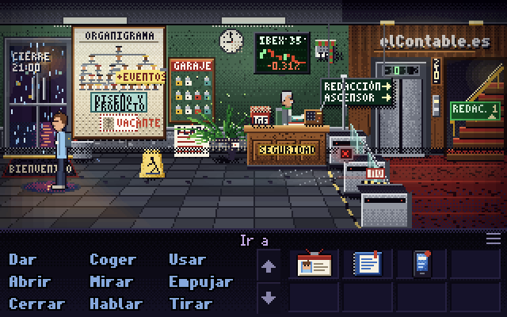

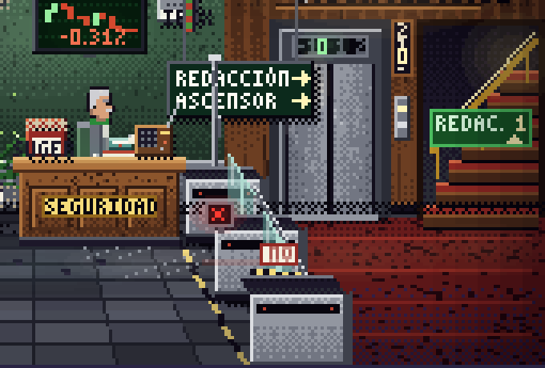
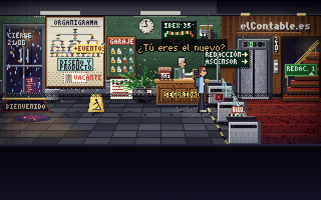
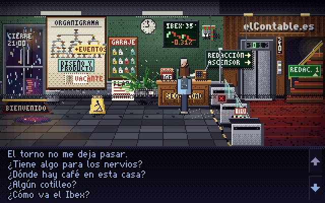
Depuración: [v02](img/v02-vestibulo-debug.png) · Epílogo: [v06](img/v06-epilogo-vestibulo.png), [v07](img/v07-epilogo-furgoneta.png)

| Elemento con guion | Estado | Motivo |
|---|---|---|
| Puerta de la calle, lluvia, farolas | OK | Cristal con lluvia y cartel «CIERRE 21:00». |
| `organigrama` y casilla VACANTE | OK | Muy legible. La foto pegada tras P01 se distingue a 4×; a 1× ([v03](img/v03-vestibulo-torno-abierto.png)), casi nada. |
| `rama_diseno` «DISEÑO Y PRODUCTO» y pósit «+EVENTOS» | OK | Los dos se leen. |
| `cuadro_plazas` (garaje) | OK | Rótulo «GARAJE» y llaves de colores. La línea de sucesión a lápiz es ilegible (es esperable). |
| `planta_plastico` | OK | Ficus de plástico bien resuelto. |
| Mostrador de seguridad pegado a los tornos | OK | Rótulo «SEGURIDAD»; está donde dice la adenda §14.1. |
| `pantalla_ibex` | OK | «IBEX 35», gráfica roja y verde. |
| `altavoz_ibex` tapado con la bufanda | dudoso | Mancha de 15×18 px sobre la pared; no se lee como altavoz. |
| `radio_celestino`, `buzon_sugerencias` | dudoso | Hotspots de 15×12 y 15×14 px junto al mostrador; ni la forma ni el color los distinguen. |
| Línea de tornos en diagonal, 3 bancadas | OK | Es la composición más clara del juego. |
| LED rojo en el carril de Bruno, «el de atrás» | dudoso | El LED está en la bancada del **medio** ([v04](img/v04-vestibulo-zoom-tornos.png)). |
| Carril de delante FUERA DE SERVICIO | dudoso | Placa roja con «NO» (`vestibulo.art.js:547`); a 1× es ilegible. |
| Cartel «REDACCIÓN → / ASCENSOR →» | OK | Legible. |
| `logo_pared` «elContable.es» | OK | Letras metálicas. El tornillo de la «e» no se ve (el gag vive en Mirar). |
| Ascensor y escalera detrás del torno | OK | Moqueta roja, botonera e indicador «0». |
| Celestino: bigote, uniforme gris y bufanda IBEX | **falla** | Solo asoman la cabeza y los hombros por encima del mostrador; la bufanda no se ve. Al hablarle, Bruno (`walkTo` [181,112]) se pone justo delante y lo tapa entero ([g03](img/g03-menu-dialogo.png)). |
| Estado `torno_abierto` | dudoso | Solo cambia el icono del LED (X roja → visto verde, unos 6 px). Las alas no se recogen de forma visible. |
| Epílogo 6:00: amanece | **falta** | Es la misma paleta nocturna con lluvia ([v06](img/v06-epilogo-vestibulo.png)). |
| Epílogo: caja de cartón de Íñigo, taza «MEJOR BECARIO», fardo de periódicos | **falta** | Íñigo entra con las manos vacías y el fardo no aparece en el mostrador ([v07](img/v07-epilogo-furgoneta.png)). |
| Celestino en el epílogo | dudoso | Gervasio se coloca delante del mostrador y vuelve a taparlo ([v06](img/v06-epilogo-vestibulo.png)). |

**Los 3 problemas principales**
1. El PNJ que abre el juego y da tres pistas (P01, P02, rep_05) es un busto de 10 px, y al hablarle queda oculto detrás de Bruno.
2. El cambio de estado del primer puzle, el torno abierto, depende de un icono de 6 px. Es la primera recompensa del juego y apenas se nota.
3. El epílogo reutiliza la sala nocturna sin ninguno de los objetos del guion: amanecer, caja, taza y fardo.

### 4.2 `pecera` — 6/10

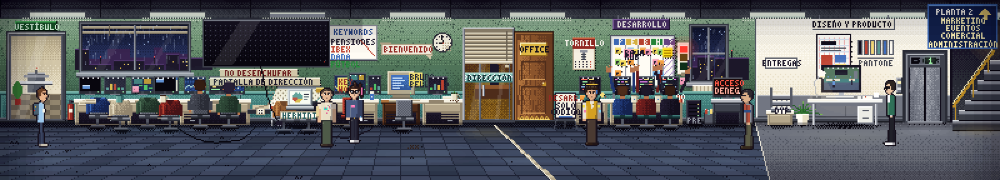
Tramos del Acto I (antes de P04, con la chaqueta en la silla): [0-270](img/p03-pecera-0-270-acto1.png) · [270-540](img/p04-pecera-270-540-acto1.png) · [540-800](img/p05-pecera-540-800-acto1.png) · depuración: [p02](img/p02-pecera-panorama-debug.png)
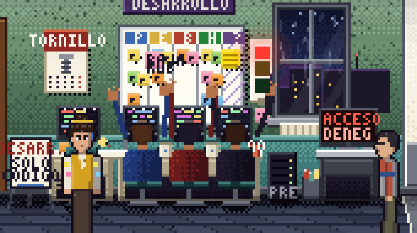
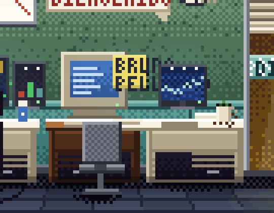
Acto III: [Rubén en la ventana](img/p08-pecera-acto3-ruben-ventana.png) · [cinta alrededor de Infografía](img/p09-pecera-acto3-cinta.png) · Escena 7.2: [Titulator](img/p11-escena-villano-titulator.png), [Nerea](img/p12-escena-villano-nerea.png) · Epílogo: [p13](img/p13-epilogo-yoli.png) · Poscréditos: [p14](img/p14-poscreditos-ramirez.png)

| Elemento con guion | Estado | Motivo |
|---|---|---|
| `pecera_a_vestibulo` (0-80) | **falla** | Puerta acristalada al mismo nivel, con el torno detrás. Contradice la escalera del vestíbulo (§3.1). La «V» del rótulo sale cortada. |
| Mesas vacías con chaqueta y pantallas encendidas (`sillas_con_chaqueta`) | OK | El gag de las 18:30 se lee bien. |
| `figurantes_web` (2 de espaldas) | OK | |
| `pantalla_metricas` «LECTORES CONCURRENTES 3.418» | OK | Muy legible. Con `cms_vivo` se apaga y el cambio es claro ([p01](img/p01-pecera-panorama-acto2.png)). |
| `enchufe_pantalla` con cinta | OK | Pancarta «NO DESENCHUFAR / PANTALLA DE DIRECCIÓN» legible, aunque no es cinta en el zócalo. Tras P05 el cable cuelga. |
| Infografía: Leoncio, `mesa_dibujo`, `herminia_portatil` | OK / dudoso | Están los tres. La pegatina se lee «HERMINI» (cortada). No hay rótulo de departamento. |
| Mesa de Yoli (tres monitores, colirio, pósit «KEYWORD DEL DÍA») | dudoso | Hay pizarra «KEYWORDS», pero no hay una mesa reconocible como suya. Yoli está de pie en x=284, delante de mesas genéricas. |
| `ordenador_bruno`, pósit «Bruno Pellizco» y la falta de silla | dudoso | El pósit se lee «BRU / PEL» ([p07](img/p07-pecera-zoom-mesa-bruno.png)). Se pierde el gag G1 en el decorado. |
| `silla_ramirez` y `chaqueta_ramirez_hotspot` (18×17 px) | dudoso | A 1× la chaqueta es una mancha beige. El cambio de P04 (la silla pasa a la mesa de Bruno) es correcto, pero sutil. |
| `taza_abandonada` (12×11) | dudoso | Diminuta. |
| Puerta de la Pajarera (cristal y persianas) y puerta OFFICE | OK | La de la Pajarera está rotulada «DIRECCIÓN»; ver §3.1. |
| `frontera_carrocero` y sus estados por acto | dudoso | La diagonal clara (x≈394-488) se lee como un reflejo de luz que sale de la puerta del Office, no como cinta. El lazo del Acto III alrededor de Infografía sí se entiende ([p09](img/p09-pecera-acto3-cinta.png)). |
| `cartel_frontera` | dudoso | «DESARR.» sale cortado por el atril; «SOLO CÓDIGO» a duras penas. |
| `kanban` (5 columnas) y `posit_1998` | **falla** | Las cabeceras son bloques de color sin texto legible, y las manos del coro, que el sprite anima por encima, tapan el tercio inferior del tablero ([p06](img/p06-pecera-zoom-kanban-coro.png)). `kanban` (488-540) y `coro_desarrollo` (488-546) se solapan. Es la pieza física de P14. |
| `calendario_ferreteria` | OK | «TORNILLO» se lee. |
| `ventana` (ciudad de noche) | OK | Rubén se coloca ahí en el Acto III ([p08](img/p08-pecera-acto3-ruben-ventana.png)). |
| `coro_desarrollo` (3 espaldas, cascos, manos) | OK | Es muy buena solución. |
| `taza_no` (10×11), tazas «DEV/DEV/NO» | **falla** | No se leen. El chiste «NO» no existe a 1×. |
| `semaforo_ruido` | dudoso | Tres rectángulos (rojo, marrón y verde oscuro) que se leen como muestrario de color. |
| Anselmo y `pantalla_anselmo` | OK / dudoso | El sprite se lee. La pantalla dice «ACCESO DENEG» / «ACCESO REVOC»: texto cortado. |
| Diseño y Producto (pared blanca, moqueta gris, rótulo) | OK | Es la única frontera de zona bien hecha: cambian el suelo y la pared. |
| `bandeja_diseno` «ENTREGAS» | OK | |
| Valentín y `monitor_valentin` (la Pecera en miniatura) | OK | Es uno de los mejores gags visuales del juego. |
| Muestras de color rotuladas «PANTONE» (`pecera.art.js:307`) | **sobra** | Es una marca real; la biblia §1.3 lo prohíbe. |
| Ascensor y escalera a P2 con cartel | OK | |
| Pancarta «BIENVENIDO» y torre «PRE» | sobra | El guion no los pide; son objetos de lectura ambigua. |
| Escena 7.2: «gira el portátil. En pantalla: …» | **falla** | El titular sale como globo de texto. El portátil del Titulator no se ve en ningún momento de la presentación ([p11](img/p11-escena-villano-titulator.png)). |
| Palabra clave «DANA» en la pizarra | dudoso | Tacto: la biblia §1.3 regla 2 pide que el blanco sea el sistema; usar una catástrofe real como keyword es un riesgo innecesario. |

**Los 3 problemas principales**
1. **No hay zonas.** Web, Infografía, la mesa de Bruno y la de Ramírez se suceden en una sola línea de mesas sin rótulo, sin cambio de suelo y sin luz propia. El jugador no sabe dónde acaba un departamento y empieza otro, y en la Pecera está el 40 % de los hotspots del juego.
2. El **kanban**, donde se resuelve P14, queda tapado por el coro, con cabeceras ilegibles.
3. Hay una **marca real** y unos **6 rótulos cortados** en la sala que más se ve.

### 4.3 `office` — 7/10

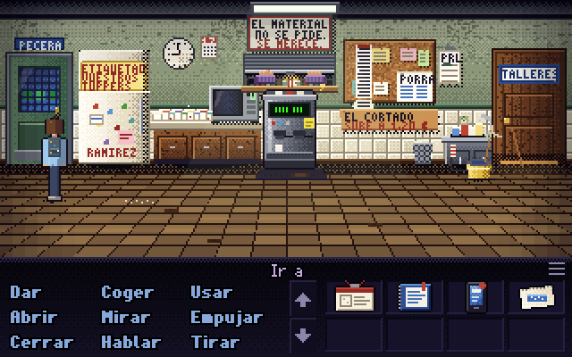
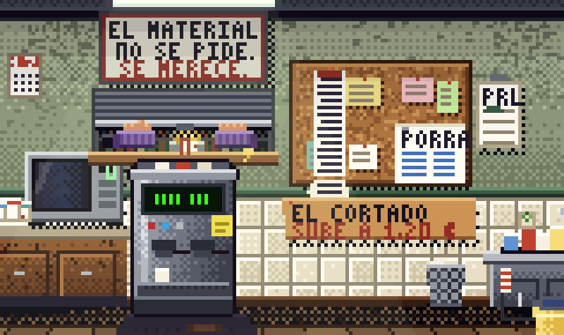
Depuración: [o02](img/o02-office-debug.png) · Acto III: [o04](img/o04-office-acto3-gervasio.png)

| Elemento con guion | Estado | Motivo |
|---|---|---|
| Puerta a la Pecera (izquierda) y puerta «TALLERES» (derecha) | OK | Las dos están rotuladas. |
| `gertrudis`: cromada, gigantesca, LCD verde | dudoso | Tiene el tamaño de un microondas (unos 45 px). En reposo el LCD muestra barras («IIII III»), no texto. El pósit amarillo está, pero no se lee. |
| `nevera`, cartel «ETIQUETAD VUESTROS TUPPERS» | OK | |
| `microondas` con nueve tuppers en cola | dudoso | La fila de tuppers no se distingue. |
| `tablon` con hilo impreso, `porra_plazas`, `hoja_firmas` (PRL) | OK | «PORRA» y «PRL» se leen. |
| `cartel_cortado` «EL CORTADO SUBE A 1,20 €» | OK | |
| `fregadero` con tazas | OK | |
| Ventanuco de Custodia «entre la puerta de la Pecera y Gertrudis» | **falla** | Está **encima** de Gertrudis (hotspot 136-188 × 30-54; la cafetera empieza en y≈52). La máquina tapa el mostrador. Las manos con guantes son dos bultos morados que no se leen como manos. |
| `timbre_secretaria` (14×12), `cartel_material` | dudoso / OK | El timbre no se distingue. El cartel se lee. |
| Gervasio en el Acto III «plantado delante de Gertrudis» | dudoso | Está a su derecha ([o04](img/o04-office-acto3-gervasio.png)). La imagen de «ella no le sirve y él no la saluda» queda floja. |
| Composición | dudoso | La mitad inferior (y 100-144) es suelo vacío, y todo el atrezo cabe en una banda de 70 px. |

**Los 3 problemas principales**
1. Custodia y Gertrudis comparten la misma columna de pantalla, así que las dos presencias más raras del Office se pisan.
2. Gertrudis, «gigantesca» y con «carácter», es una máquina mediana cuyo LCD en reposo no muestra texto.
3. Hay demasiado suelo vacío para una «cocina pequeña» con «nueve tuppers en cola».

### 4.4 `catacumba` — 8/10

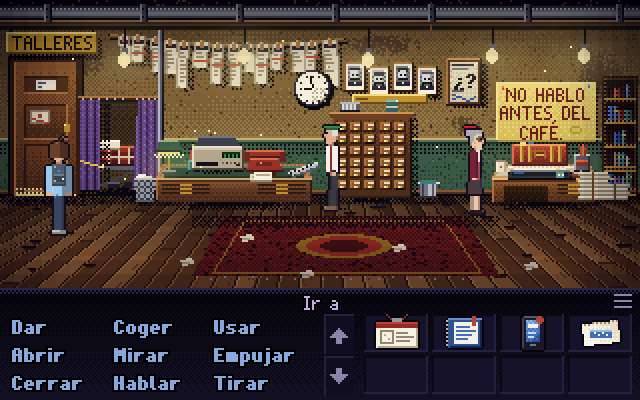
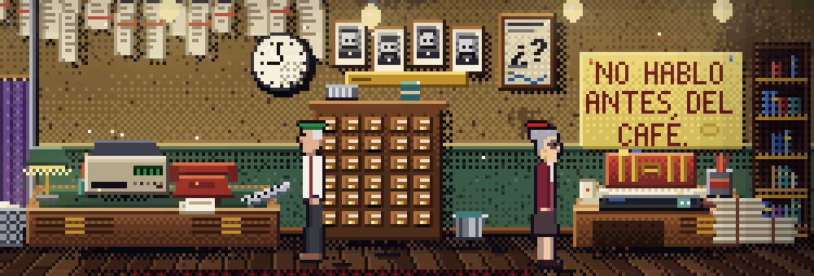
Depuración: [c02](img/c02-catacumba-debug.png) · Fax: [sin papel](img/c04-fax-sin-papel.png) / [con papel](img/c05-fax-con-papel.png) · Escena 7.3a: [c06](img/c06-acto3-goyita.png) · Duelo: [d2](img/d2-teodoro-fax.png)

| Elemento con guion | Estado | Motivo |
|---|---|---|
| Techo bajo con tuberías, luz amarillenta | OK | Es la mejor atmósfera del juego. |
| `galeradas` colgadas «como jamones» | OK | |
| `reloj_2147` parado en las 20:59 | dudoso | A 1× marca «las nueve»; el «falta un minuto» no se ve. |
| `fotos_jefes_cierre` y `fax_enmarcado` | OK | |
| Mesa de Teodoro: fax beige, teléfono rojo, tipómetro | OK / dudoso | El fax y el teléfono se leen. El tipómetro (16×8) parece un peine. |
| Cambio de estado del fax sin papel → con papel | OK | La bandeja vacía frente a la bandeja con hojas se lee bien ([c04](img/c04-fax-sin-papel.png) / [c05](img/c05-fax-con-papel.png)). |
| `camastro` tras la cortina | OK | |
| Mesa de Aurora: bolis, taza, `libro_estilo` | OK | |
| `cartel_aurora` «NO HABLO ANTES DEL CAFÉ.» | OK | Es un cartel de pared grande y no una cartulina en la mesa, pero así sirve mejor de pista de P03. |
| `corrector_aurora` (28×5 px), `bolis_aurora` | dudoso | Un hotspot de 5 px de alto es casi imposible de tocar. |
| Teodoro «sentado frente al fax» | dudoso | Está de pie a unos 30 px del fax, junto al chibalete. Irónicamente encaja con «a dos metros», pero pierde la imagen del hombre pegado a su máquina. |
| 7.3a: «Descuelga el teléfono rojo» | **falla** | Teodoro dice «Goyita…» de pie y lejos del teléfono, que sigue colgado ([c06](img/c06-acto3-goyita.png)). Es la primera vez que habla en voz alta. |
| Puerta «TALLERES» vista desde dentro | dudoso | Repite el rótulo del otro lado; desde la Catacumba debería anunciar el Office. |

**Los 3 problemas principales**
1. La primera voz de Teodoro, el teléfono rojo, no se pone en escena.
2. Teodoro no está sentado frente al fax.
3. Hay hotspots finos (tipómetro, corrector) en una mesa ya muy cargada.

### 4.5 `pajarera` — 7/10

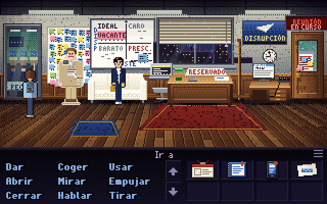
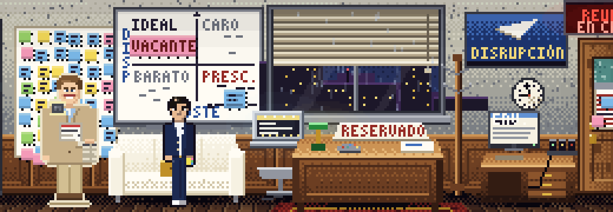
Depuración: [j02](img/j02-pajarera-debug.png) · Acto II: [j04](img/j04-pajarera-acto2.png) · Acto III: [j05](img/j05-pajarera-acto3.png)

| Elemento con guion | Estado | Motivo |
|---|---|---|
| Despacho de cristal; «a través del cristal izquierdo se intuye la Pecera» | dudoso | La puerta izquierda es de cristal, pero la ventana grande da a la **ciudad**. No se transmite que sea una pecera dentro de otra. |
| `persiana` a media altura | OK | |
| `mesa_direccion` con «RESERVADO», cuenco e informe | OK | |
| Lector Medio con ficha y altavocito | OK / dudoso | Se lee como figura. La base y la ficha lo delatan como expositor, pero el altavocito no se ve. Con chaqueta, el cambio es claro. |
| `perchero` vacío | dudoso | Un palo fino que se confunde con el marco de la ventana. |
| `sofa` blanco con Íñigo «con las piernas cruzadas» | **falla** | Íñigo está **de pie** delante del sofá (`at` [116,101]). |
| `pantalla_titulator`: portátil plateado con pegatina, en un atril | dudoso | Mide 24×24 px y su pantalla es ilegible. Además se solapa con `sofa` y con `mesa_direccion`. |
| `postits` de cuatro colores | OK | |
| `matriz_2x2` con VACANTE en IDEAL | OK | Muy legible. «COSTE» sale cortado («STE») en el Acto I. |
| Mesa de Gervasio, ordenador y tres móviles | OK | |
| `puerta_sala` y pantallita: EN CURSO / LIBRE / OCUPADO HASTA 2031 | OK | Es el mejor cambio de estado del juego ([j01](img/j01-pajarera-acto1.png), [j04](img/j04-pajarera-acto2.png), [j05](img/j05-pajarera-acto3.png)). |
| `hoja_reservas` (y el folio del Acto III) | OK | |
| Gervasio en su mesa con `reunion_terminada` | OK | |
| Póster «DISRUPCIÓN» | sobra (inocuo) | Encaja con el tono. |

**Los 3 problemas principales**
1. Íñigo no está en el sofá, y el chiste «sofá en el que nunca se sentó nadie; ahora se sienta el consultor» queda sin imagen.
2. El Titulator, la pista G4 y la del armario 27, es un rectángulo de 24 px en el que no se lee nada.
3. No hay cristal hacia la Pecera, que es lo que da nombre a la sala.

### 4.6 `sala_amazonas` — 5/10

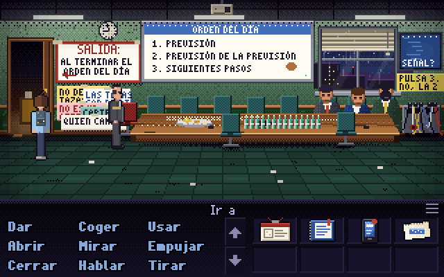
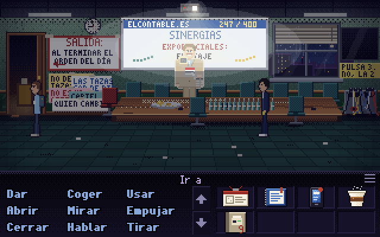
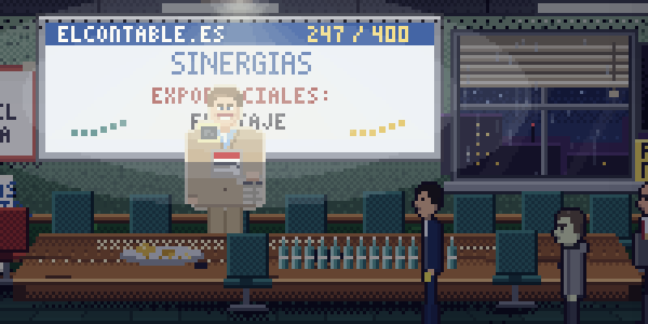
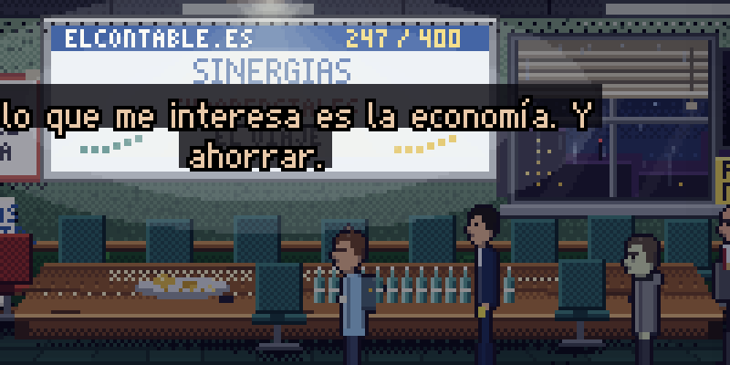
Depuración: [s02](img/s02-sala-debug.png) · Acto II: [s03](img/s03-sala-acto2.png) · Fotograma completo tras el ¡PLOF!: [s07](img/s07-climax-tras-plof.png) · Duelo: [d4](img/d4-inigo-menu.png)

| Elemento con guion | Estado | Motivo |
|---|---|---|
| Mesa larga con doce sillas | OK | |
| `orden_del_dia` y su versión tachada | OK | Es la mejor pista visual del juego (P06). |
| `cartel_salida` | OK | |
| `minicruasanes`, `botellines` | OK | |
| Gervasio «preside» | dudoso | Está de pie en x=84, junto a la puerta y delante de los carteles: parece que vigila la salida, no que preside. |
| Tres figurantes de Mercados «desplomados, uno con barba» | dudoso | Son tres cabezas de 8 px al fondo a la derecha; la barba no se ve. |
| `tele_amazonas`, `caja_cables`, `carteles_amazonas` | OK / dudoso | La tele se lee («PULSA 3. NO, LA 2»). Los carteles en guerra se pisan y salen cortados («NO DE TAZAS», «QUIEN CAMB…»). |
| Acto II: «sillas desordenadas» | **falta** | Las sillas siguen en fila; solo cambia el orden del día ([s03](img/s03-sala-acto2.png)). |
| Acto III: penumbra y proyector «247 / 400» | OK | |
| Lector Medio con la chaqueta de Ramírez, en la cabecera | **falla** | `at` [160,92], detrás de la mesa y dentro del halo del proyector (overlay de `sala_amazonas.art.js:388`). Se ve **semitransparente, como un holograma** proyectado en la pantalla ([s05](img/s05-climax-lector-antes.png)). |
| Empujar: «cae de cara sobre la mesa. ¡PLOF! Vuelan catorce botellines. Por detrás, pegatina "Atrezo – Focus group 2014"» | **falla** | El Lector **desaparece**. Los botellines siguen en pie, la variante `caido` no se ve (queda tapada por la mesa y las sillas) y no aparece la pegatina ([s06](img/s06-climax-lector-despues.png), [s07](img/s07-climax-tras-plof.png)). Paradójicamente, en el poscréditos sí se ve el Lector caído en el suelo de la Pecera ([p14](img/p14-poscreditos-ramirez.png)). |
| Gervasio en un rincón | OK | |

**Los 3 problemas principales**
1. **El remate del juego no se ve.** El empujón al Lector Medio es el clímax de G5 y del guion, y en pantalla no ocurre nada.
2. Antes de caer, el Lector se lee como proyección y no como cartón pluma «en la cabecera».
3. La reunión infinita no se lee como reunión: no hay presidente y los figurantes son diminutos.

### 4.7 `administracion` — 8/10

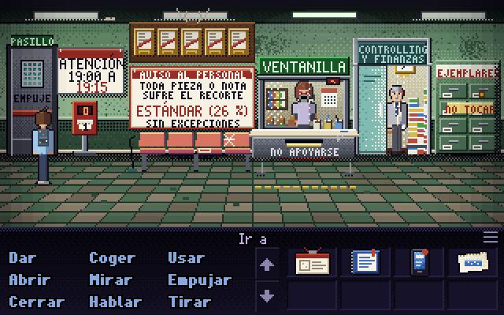
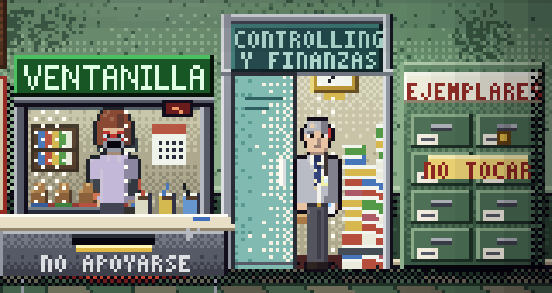
Depuración: [a02](img/a02-administracion-debug.png)

| Elemento con guion | Estado | Motivo |
|---|---|---|
| `ventanilla` (cabina de cristal dentro de una oficina) | OK | Rótulo «VENTANILLA» y mostrador «NO APOYARSE». |
| Agujerito a la altura de la boca | **falla** | Queda exactamente sobre la cara de Begoña y la tapa: parece que lleva una máscara ([a03](img/a03-administracion-zoom.png)). |
| Begoña: pelo caoba, gafas rojas, manguitos | dudoso | Se reconoce el pelo; la cara, no. |
| `sellos`, `tazas_begona` (22×11) | dudoso | Diminutos. Que haya «tres» no se lee. |
| `pared_rechazadas` (notas enmarcadas «como trofeos de caza») | OK | |
| `cartel_recorte` 26 % | OK / dudoso | Muy legible. Falta la firma «La Dirección (también recortada)», que es el remate del cartel. |
| `cartel_horario` 19:00 A 19:15 | OK | |
| `dispensador_turnos` «0» | OK | |
| `archivador_ejemplares` | OK / dudoso | El rótulo sale cortado («EJEMPLARE…») por el borde. |
| Puerta al pasillo (izquierda) | OK | «PASILLO» y «EMPUJE». |
| Despacho de Controlling acristalado | OK | |
| Evaristo «leyendo con lupa» detrás del cristal | dudoso | Está de pie en la puerta (`at` [252,97]) en vez de sentado leyendo. Así pierde la gradación entre el sprite sentado y el sprite de pie que pide la adenda §3.8. |
| `coma_enmarcada` | dudoso | Marco dorado con una esfera blanca: parece un reloj. |
| `contratos_evaristo` | OK | |

**Los 3 problemas principales**
1. La cara de Begoña queda tapada por el agujerito. Es el PNJ con más diálogo (§7.6.2) y no se le ve el gesto.
2. La coma enmarcada se confunde con un reloj.
3. Evaristo ya está fuera de su despacho, lo que resta sentido a la puerta y al «sale cuando se le llama».

### 4.8 `cpd` — 6/10

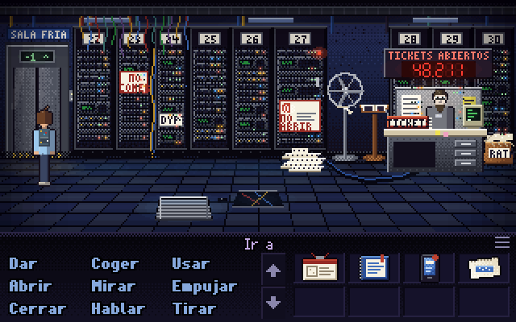
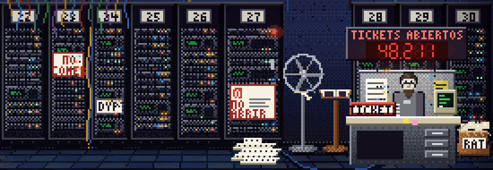
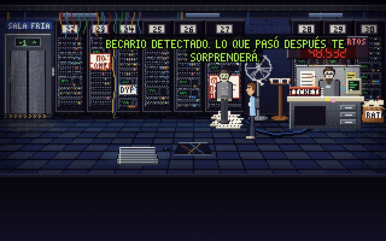
Depuración: [k02](img/k02-cpd-debug.png) · Armario abierto (Acto III, Rubén libre): [k05](img/k05-cpd-armario-abierto.png)

| Elemento con guion | Estado | Motivo |
|---|---|---|
| Luz azul fría, suelo técnico | OK | |
| Armarios numerados 22-30 (y la etiqueta «DYP?») | OK | |
| `armario_27` con la pegatina «NO ABRIR» | OK | |
| `papel_continuo` que sale por debajo de la puerta | dudoso | Es un montón de papel en el suelo, entre el 27 y el ventilador. No se ve que salga del armario y el borde perforado no se aprecia a 1×. |
| `registro_tickets` y mesa de Paco | OK | |
| `contador_tickets` «48.211», que sube | OK | Es un gag visual excelente; se ve 48.532 tras el CMS. |
| `cementerio_ratones` («RAT») | OK | |
| `ventilador` con cuña de papel | dudoso | El ventilador se ve; la cuña, no. |
| `libro_visitas` en atril | OK | |
| `rejilla_cpd` | OK | |
| Paco «a cuerpo descubierto, con mampara gris detrás» | dudoso | Solo se ven la cabeza y el pecho por encima del mostrador. El forro «SISTEMAS» y las llaves no se ven. |
| 7.3: «La puerta del armario se abre hacia fuera. Dentro, entre cables…» | **falla** | Durante toda la escena el armario sigue **cerrado**, con «NO ABRIR» visible, y Rubén aparece delante, como pegado ([k04](img/k04-revelacion-armario-cerrado.png)). El dibujo abierto depende del flag `ruben_encontrado`, que se pone al final de la escena (`cpd.art.js:186`), no del estado `abierto` que la lógica pone al principio (`cpd.js:31`). |
| Armario abierto después | OK | Monitor verde y cables ([k05](img/k05-cpd-armario-abierto.png)). |

**Los 3 problemas principales**
1. La revelación central del Acto III se ve con el armario cerrado.
2. El papel continuo, el hilo que hay que seguir en P13, no sale del armario: es un montón.
3. Paco queda medio oculto tras su mesa.

### 4.9 `ecosistema` / `eventos` — breve: en obras

**Estado visto:** a las 07:56 (recorrido completo) la versión **antigua**: Pilar, Borja y Maripaz en una sola sala de 320 px ([e01](img/e01-ecosistema-antiguo.png), [e02](img/e02-ecosistema-antiguo-debug.png), duelo D1: [d1](img/d1-maripaz-ataque.png)). A las 08:31, una captura puntual muestra la sala **partida**: un `ecosistema` sin photocall, con una puerta «EVENTOS» y el póster «SU ANUNCIO AQUÍ», y una sala nueva `eventos` de 512 px, a medio hacer ([e03](img/e03-ecosistema-0831.png), [e04](img/e04-eventos-0831.png)). La partida de prueba ya no encuentra a Pilar en el Ecosistema, de modo que el walkthrough §5.4 (paso 40) está desalineado mientras dure la obra.

- **Versión antigua (4/10):** tres departamentos sin frontera, el photocall y el gong compiten en 320 px, el lema «TODO ES…» sale cortado, la impresora de la tercera está en el borde y la piel de plátano mide 14×8 px. En el duelo D1, Bruno se coloca delante de Maripaz y la tapa ([d1](img/d1-maripaz-ataque.png)).
- **Versión de las 08:31 (no se puntúa):** `eventos` promete. Tiene la alfombra roja, el photocall «ESPACIO PREMIUM PARA TU CARA», el aro de luz, el gong en su tarima, las filas de sillas rojas («ciento doce») y una cuenta atrás «00:05:00» que convierte en imagen el tic de Pilar («a cinco minutos de empezar»). Antes de cerrarla conviene vigilar la señalética común (§3.1) y que el `walkTo` no tape a los PNJ.

---

## 5. Hallazgos transversales

### 5.1 Composición y profundidad
- Las 9 salas definen el mismo walkbox: un rectángulo de y≈104 a 142 a todo el ancho (`*.art.js`, línea `walkboxes`). Todos los PNJ tienen los pies en y≈96-106, en fila contra la pared del fondo. **No hay primeros planos, diagonales ni mobiliario en medio del suelo.** El resultado es teatral pero plano. Lo que el guion escenifica en profundidad («detrás de la cortina», «en la cabecera», «preside», «sentado frente al fax», «en el sofá») se convierte en «de pie, en fila».
- Entre un 30 % y un 40 % del encuadre de sala es suelo vacío en Office, Catacumba, Sala, Administración y CPD ([o01](img/o01-office.png), [s01](img/s01-sala-reunion.png)). El atrezo se apretuja en una banda de unos 70 px.
- **Patrón de oclusión:** el `walkTo` para hablar coloca a Bruno delante del PNJ, a la misma x: Celestino [181,99]→[181,112], Begoña [193,96]→[193,114], Paco [273,99]→[270,113]. En diálogos largos, el interlocutor queda tapado ([g03](img/g03-menu-dialogo.png), [d1](img/d1-maripaz-ataque.png)).

### 5.2 Escala, luz y paleta
- **Escala coherente:** Bruno mide unos 48-52 px en todas las salas y las puertas, unos 70 px. **Luz** de noche en todas partes, con lluvia en vestíbulo y Pecera. **Paleta** con identidad por sala: vestíbulo verde, nogal y rojo; Pecera verde agua; Catacumba ámbar; Sala verde frío; Administración verde institucional; CPD azul; planta 2 lila. Esto funciona y conviene conservarlo.
- **Lo que falla es el tiempo.** El «Sábado, 6:00» no cambia la luz de ninguna sala ([v06](img/v06-epilogo-vestibulo.png), [p13](img/p13-epilogo-yoli.png)). La rotativa, el amanecer y el «¿Sigue gobernando el mismo?» de Rubén piden un cambio de luz que no existe.

### 5.3 Texto pintado
Recortado o ilegible a 1×: «VESTÍBULO» (la V), «HERMINI», «BRU/PEL», «DESARR.», «ACCESO DENEG/REVOC», tazas «DEV/NO» (Pecera); «STE» (COSTE, Pajarera, Acto I); carteles en guerra (Sala); «EJEMPLARE…» (Administración); «TODO ES…» (Ecosistema antiguo); «NO» como FUERA DE SERVICIO (vestíbulo); el LCD de Gertrudis en reposo. Legible y al servicio del puzle: orden del día, cartel del 26 %, ATENCIÓN 19:00-19:15, «NO HABLO ANTES DEL CAFÉ», LECTORES CONCURRENTES, «OCUPADO HASTA 2031», TICKETS ABIERTOS.

### 5.4 Interactivo frente a decorado
- Densidad alta y buena, pero **sin código visual** que distinga lo interactivo. En escritorio el nombre aparece al pasar el ratón; **en táctil no hay hover**: el nombre solo sale al tocar, y el toque largo equivale al verbo por defecto (`core.js:1215`). No existe una forma de «enseñar hotspots».
- Hotspots de 14 px o menos en una dimensión: `corrector_aurora` 28×5, `tipometro` 16×8, `piel_platano` 14×8, `taza_no` 10×11, `taza_abandonada` 12×11, `posit_1998` 12×12, `posit_evaristo` 12×11, `timbre_secretaria` 14×12, `coma_enmarcada` 14×14, `planillo_mesa` 24×10, `sellos` y `tazas_begona` 22×11, entre otros.
- Hay solapes que el jugador no puede resolver a ojo: `kanban` / `coro_desarrollo`; `pantalla_titulator` / `sofa` / `mesa_direccion`; `custodia_precinto` / `timbre_secretaria` / Gertrudis; `torno` / `ascensor_vestibulo` (x 234-250, y 74-98).

### 5.5 Interfaz y móvil
- **Escritorio** (1440×900, escala 4×): nítido y bien encuadrado ([g07](img/g07-escritorio-vestibulo.png)).
- **iPhone horizontal:** el lienzo ocupa toda la altura con bandas laterales ([g05](img/g05-iphone-safari-dialogo.png), [g06](img/g06-iphone-safari-vestibulo.png)). A unas 340 pt de alto, 1 px de juego son unas 1,7 pt. Las filas del menú de diálogo y del duelo (unos 8-9 px) son objetivos de unos 14-15 pt, un tercio de los 44 pt recomendados. Los verbos ocupan unos 24 pt de alto.
- **Duelos:** la ventana «Responder a todos» es buena y temática; la variante FAX del D2 está muy conseguida ([d2](img/d2-teodoro-fax.png), [d2 adjuntar](img/d2-teodoro-adjuntar.png)). Pero el menú de réplicas tiene **16 opciones** y se ven 4, con flechas de desplazamiento ([d1](img/d1-maripaz-menu.png), [d3](img/d3-gervasio-menu.png), [d4](img/d4-inigo-menu.png)). En móvil, buscar la réplica correcta exige desplazarse con objetivos pequeños.
- **Ascensor:** la «botonera» es un menú de texto ([g04](img/g04-ascensor-botonera.png)). Es correcto según la adenda §14.2, pero no hay botonera visual.
- **Llamadas:** el móvil con retrato de la abuela está muy bien resuelto ([g02](img/g02-intro-llamada.png)).
- **Título:** la portada como página 7 de periódico, con «Pellizco» tachado, «Pellejo» y la fe de erratas, presenta el tono y el gag G1 desde el primer segundo ([g01](img/g01-titulo.png)). Conservarla.

### 5.6 Cómo llegan los gags visuales
- **Funcionan:** el organigrama con VACANTE y «DISEÑO Y PRODUCTO»; la matriz 2x2 con VACANTE en IDEAL; el orden del día tachado; «OCUPADO HASTA 2031»; el contador de tickets; el cartel del 26 %; el monitor de Valentín que muestra la propia Pecera; el coro de espaldas con las manos; la cinta que acaba encerrando a Infografía; el fax como HUD de duelo; «BANDEJA 2 INSTALADA» ([f04](img/f04-fin-impresora.png)); los créditos sobre la fe de erratas, con Aurora y el LCD «E-00» ([f02](img/f02-creditos-fe-de-erratas.png), [f03](img/f03-creditos-aurora.png)).
- **No funcionan:**
  - El ¡PLOF! (§4.6).
  - El Titulator presentado sin pantalla (§4.2).
  - El armario 27 que no se abre (§4.8).
  - El teléfono rojo (§4.4).
  - La caja y la taza de Íñigo (§4.1).
  - La página 7 final: el titular está en la fuente del juego, al mismo cuerpo que la firma y repetido como subtítulo encima. No hay «primer plano en tipografía de periódico» ([f01](img/f01-epilogo-pagina7.png)). El «Por Bruno Pellejo» en rojo sí funciona.
  - «Bruno Pellizco» en el pósit de su mesa.

### 5.7 Personajes
La hoja del reparto ([g08](img/g08-reparto.png)) es coherente y se lee bien a 1×: siluetas distintas y colores de ficha respetados (Yoli fucsia, Nerea mostaza, Paco gris, Pilar de negro técnico con acreditaciones, Valentín con americana verde). Los problemas de personajes son de **colocación** y de **oclusión**, no de diseño: Celestino, Paco, la cara de Begoña, Íñigo de pie en vez de en el sofá, Teodoro de pie y Evaristo fuera de su despacho.

---

## 6. Los 20 problemas más importantes (priorizados)

Severidad: **S1** rompe un remate o una pista del guion · **S2** debilita la lectura de un puzle o de un personaje · **S3** pulido.

| # | Sev. | Sala / estado | Evidencia | Problema y por qué duele | Dirección (una línea) |
|---|---|---|---|---|---|
| 1 | S1 | `sala_amazonas`, clímax tras `duelo_inigo_ganado` | [s05](img/s05-climax-lector-antes.png), [s06](img/s06-climax-lector-despues.png), [s07](img/s07-climax-tras-plof.png) | El empujón al Lector Medio no se ve: el cartón está detrás de la mesa (`at` [160,92]), semitransparente por el halo del proyector, y al caer desaparece. No vuelan botellines ni aparece la pegatina «Atrezo». Es el remate de G5 y de todo el juego. | Lector delante del halo y caída visible sobre la mesa. |
| 2 | S1 | `cpd`, escena 7.3 (P13) | [k04](img/k04-revelacion-armario-cerrado.png) | El armario 27 sigue cerrado con «NO ABRIR» mientras Rubén habla delante: el dibujo lee el flag `ruben_encontrado`, que llega al final, y no el estado `abierto`. Es la revelación del Acto III. | Dibujar el armario por su estado. |
| 3 | S1 | `vestibulo`, todos los actos | [v05](img/v05-vestibulo-celestino-habla.png), [g03](img/g03-menu-dialogo.png) | Celestino es un busto de 10 px tras el mostrador y Bruno lo tapa al hablarle (`walkTo` [181,112]). Es el PNJ de P01-P02 y de G3; la bufanda IBEX no se ve. | Sacarlo a la vista y mover el punto de conversación. |
| 4 | S1 | `catacumba`, escena 7.3a | [c06](img/c06-acto3-goyita.png) | «Descuelga el teléfono rojo. Por primera vez se le oye la voz»: Teodoro habla de pie, lejos del teléfono, que sigue colgado. | Escenificar el descolgar. |
| 5 | S2 | Transversal, las 9 salas | [o01](img/o01-office.png), [s01](img/s01-sala-reunion.png) | Plantilla única: walkbox y=104-142, PNJ en fila contra la pared y un 30-40 % de suelo vacío. Sin profundidad, la puesta en escena del guion (presidir, sentarse, detrás o delante) no tiene dónde ocurrir. | Variar planos y suelos por sala. |
| 6 | S2 | `pecera`, todos los actos | [p01](img/p01-pecera-panorama-acto2.png) | 800 px en una sola línea; Web, Infografía y la mesa de Bruno no tienen rótulo ni frontera. Concentra el 40 % de los hotspots y la orientación depende de leerlos. | Delimitar zonas con suelo, luz y rótulo. |
| 7 | S2 | `pecera`, Acto III (P14) | [p06](img/p06-pecera-zoom-kanban-coro.png) | Las manos del coro tapan el kanban, con cabeceras ilegibles; `kanban` y `coro_desarrollo` se solapan (x 488-546). | Separar el tablero del coro. |
| 8 | S2 | `pecera` ↔ `vestibulo` | [p10](img/p10-pecera-puerta-vestibulo.png), [v01](img/v01-vestibulo-torno-cerrado.png) | Puerta «VESTÍBULO» a ras de suelo con el torno detrás, frente a la escalera «REDAC. 1» que sube: dos geografías para el mismo trayecto. | Que la llegada desde el vestíbulo sea la escalera o el ascensor. |
| 9 | S2 | `pecera`, escena 7.2 | [p11](img/p11-escena-villano-titulator.png) | El Titulator se presenta sin que se vea el portátil: «gira el portátil» se queda en globo de texto. Es la siembra de G4 y del giro de Rubén. | Mostrar la pantalla en la escena. |
| 10 | S2 | `pecera`, Diseño (x≈686-715) | [p05](img/p05-pecera-540-800-acto1.png) | «PANTONE» pintado (`pecera.art.js:307`): marca real prohibida por la biblia §1.3. | Sustituir por un texto inventado. |
| 11 | S2 | `sala_amazonas`, Actos I-II | [s01](img/s01-sala-reunion.png), [s03](img/s03-sala-acto2.png) | Gervasio no preside (está de pie junto a la puerta), los figurantes son cabezas de 8 px y las sillas no se desordenan tras P06. La reunión infinita no se lee como reunión. | Presidente en la cabecera y estado «huida». |
| 12 | S2 | Epílogo, `vestibulo` y `pecera` | [v06](img/v06-epilogo-vestibulo.png), [v07](img/v07-epilogo-furgoneta.png), [p13](img/p13-epilogo-yoli.png) | Sin amanecer, sin la caja ni la taza de Íñigo y sin el fardo de periódicos: el «Sábado, 6:00» se ve igual que el viernes por la noche. | Luz de amanecer y atrezo del epílogo. |
| 13 | S2 | `office`, todos los actos | [o03](img/o03-office-zoom-gertrudis-custodia.png) | El ventanuco de Custodia está encima de Gertrudis y la máquina tapa el mostrador. Las manos no se leen como manos y Gertrudis no es «gigantesca». | Separar las dos columnas y escalar a Gertrudis. |
| 14 | S2 | `administracion` | [a03](img/a03-administracion-zoom.png) | El agujerito de la ventanilla tapa la cara de Begoña (parece una máscara). Evaristo está de pie en la puerta en lugar de leer con lupa y la coma enmarcada parece un reloj. | Mover el agujerito y escenificar a Evaristo dentro. |
| 15 | S2 | Móvil, transversal | [g05](img/g05-iphone-safari-dialogo.png), [d1](img/d1-maripaz-menu.png) | Filas de menú de unos 14 pt, 16 réplicas con 4 visibles, ningún nombre al pasar el dedo y hotspots de 10-14 px (§5.4). El director juega en iPhone. | Objetivos de 44 pt y un modo «ver hotspots». |
| 16 | S2 | `pajarera`, Actos I-II | [j03](img/j03-pajarera-zoom.png) | Íñigo está de pie y no en el sofá; el Titulator mide 24 px y es ilegible (es la pista de «AYÚDAME ESTOY EN EL ARMARIO 27»); la ventana da a la ciudad y no a la Pecera. | Íñigo sentado y pantalla del Titulator legible. |
| 17 | S3 | `cpd`, todos los actos | [k03](img/k03-cpd-zoom.png) | El papel continuo es un montón y no un hilo que sale de debajo del 27; Paco solo asoma la cabeza y el pecho. | Tira de papel desde la puerta. |
| 18 | S3 | `vestibulo`, P01 | [v03](img/v03-vestibulo-torno-abierto.png), [v04](img/v04-vestibulo-zoom-tornos.png) | `torno_abierto` solo cambia un icono de 6 px; el LED está en la bancada del medio y no en la de atrás; «FUERA DE SERVICIO» se reduce a «NO». | Cambio de estado más grande (alas, luz). |
| 19 | S3 | Transversal, texto pintado | [p04](img/p04-pecera-270-540-acto1.png), [p07](img/p07-pecera-zoom-mesa-bruno.png), [a03](img/a03-administracion-zoom.png) | Una docena de rótulos cortados (§5.3), entre ellos «BRU/PEL», que debía cargar el gag G1 «Bruno Pellizco». | Ajustar los textos a su soporte. |
| 20 | S3 | Transversal, señalética | [p01](img/p01-pecera-panorama-acto2.png), [k01](img/k01-cpd.png) | Las puertas usan cinco estilos y nombres distintos; la Pajarera está rotulada «DIRECCIÓN» y la Sala Amazonas no tiene rótulo. | Un sistema de rótulos común. |

Fuera del top 20, para quien rehaga la sala: la página 7 final sin tipografía de periódico ([f01](img/f01-epilogo-pagina7.png)); la keyword «DANA» (tacto); «BIENVENIDO» y «PRE» en la Pecera (sobran); el reloj de la Catacumba no se lee como 20:59; la Catacumba rotula «TALLERES» por los dos lados de la misma puerta.

---

## 7. Qué funciona y hay que conservar

- **La geografía del vestíbulo:** la línea de tornos en diagonal, el ascensor y la escalera al otro lado, el cartel «REDACCIÓN → / ASCENSOR →» y los walkboxes `entrada` / `paso_torno` / `interior`. Es la referencia de cómo convertir una regla del guion en espacio.
- **La Catacumba completa:** atmósfera, galeradas, camastro y el cambio de estado del fax.
- **La señalética al servicio del puzle:** orden del día (y su versión tachada), cartel del 26 %, horario 19:00-19:15, «NO HABLO ANTES DEL CAFÉ», pantallita EN CURSO / LIBRE / OCUPADO HASTA 2031, TICKETS ABIERTOS.
- **La matriz 2x2 con VACANTE en IDEAL** y el organigrama con VACANTE colgando de Diseño.
- **La zona de Diseño y Producto:** cambio de suelo y de pared, la bandeja «ENTREGAS» y el monitor de Valentín con la Pecera en miniatura.
- **El coro de Desarrollo** de espaldas, con las manos, y **la cinta** que acaba encerrando a Infografía.
- **Los HUD de duelo**, sobre todo la variante FAX, y el **móvil con retrato** para las llamadas.
- **Los créditos** sobre la fe de erratas, con Aurora y el LCD «E-00», y el cierre con «BANDEJA 2 INSTALADA».
- **Una paleta con identidad por sala** y una escala de personajes coherente en todo el juego.
- **La sala `eventos` en obras:** la cuenta atrás «00:05:00» y las filas de sillas convierten en imagen los tics de Pilar.
