# FE DE ERRATAS — Crítica independiente

**Para:** dirección de diseño y producto · **Encargo:** «hay cosas que no me terminan de convencer» · **Fecha:** 13-11-2026
**Método:** dos partidas reales con eventos de ratón sobre el canvas (Playwright, 960×600 y iPhone horizontal emulado), la
primera a ciegas; lectura del corpus completo de texto extraído de `content/`; medición de tiempos, objetivos táctiles,
bucles de música y rendimiento. Solo lectura: no se ha tocado ni `engine/`, ni `content/`, ni `tools/`, ni la
documentación existente. Todo lo que afirmo lleva una cita `archivo:línea`, una captura que he mirado, un número medido o
unos pasos reproducibles. Los datos en bruto están en [`datos/`](datos/) y en los apéndices.

---

## 1. Veredicto (una página)

**Lo que es hoy.** *Fe de erratas* es una aventura muy bien construida, bonita y sin errores graves, con una premisa
que se entiende en un minuto y un final que de verdad emociona. Pero no es, todavía, una comedia de carcajada: es una
comedia de **sonrisa constante**. En una muestra aleatoria de 216 líneas, el 52 % arranca una sonrisa y solo el **5 %
una risa**; casi todo el texto está escrito con la misma plantilla («frase seca + remate de dos o tres palabras»,
«… Como X.») y todos los personajes la usan, de modo que las voces se distinguen por muletillas («cariño», «chaval»,
«Una cosita») más que por su manera de ver el mundo. Encima de esa base, las incorporaciones «de la casa» (el coro de
Desarrollo que culpa a Diseño cada 14-24 s, el cameo del director de Diseño, Herminia, Custodia, Tadeo, las plazas de
garaje) han inflado el reparto a unas 24 voces y han convertido la sala central en un chiste interno que el jugador de
fuera no tiene con qué celebrar; peor: el último gag del epílogo y de los créditos es para Diseño, no para Bruno ni su
abuela. Los puzles tienen tres o cuatro momentos de verdadero «¡ajá!» (las copias rechazadas como papel de fax, el
recorte del 26 % que deja la pieza en 23 líneas, el Titulator que es un becario), pero el Acto II se juega a base de
idas y vueltas por un pasillo de 1.270 px con una abuela que repite la misma pista, y el duelo «Responder a todos» es un
test de memoria de tres asaltos en el que el ataque desaparece de la pantalla justo cuando hay que contestarlo.

**Nota global: 6,5 / 10** (frente a la ambición declarada, «tan desternillante como las mejores de LucasArts», que en mi
escala es un 9-9,5).

| Área | Nota | En una línea |
|---|---|---|
| **A. Comedia** | **6** | Ingenio alto y uniforme, carcajada escasa (5 %); fórmula repetida y chiste interno sobredimensionado. |
| **B. Diseño de puzles** | **6** | 3-4 puzles excelentes; Acto II con mucho ir y venir, pistas planas y duelos sin tensión. |
| **C. Historia y estructura** | **6** | Premisa clarísima y final redondo; reparto inflado y subtramas que no aportan a la historia. |
| **D. Interfaz y sensación** | **6** | La interfaz clásica funciona; andar es lento, el táctil es justo y el duelo se lee mal. |
| **E. Visual** | **8** | Salas preciosas y legibles; sprites rígidos y algunos momentos clave pequeños. |
| **F. Audio** | **6** *(provisional)* | Música bien escrita sobre el papel; bucles cortos (23-58 s) en salas donde se pasan muchos minutos. Sin oídos no puedo juzgar más. |
| **G. Técnico** | **8** | Sin errores de consola en toda la partida; carga y rendimiento sobrados; incoherencias de contenido, no de código. |

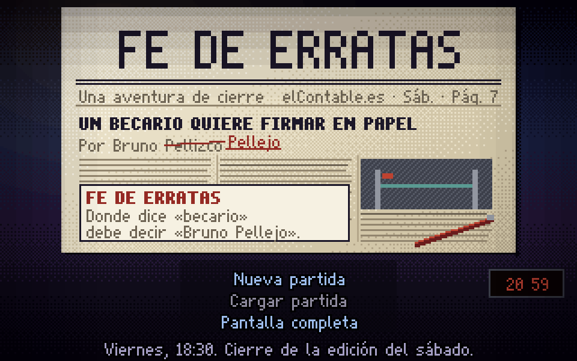

### Las 5 cosas que más lo frenan

1. **Sonrisa sí, carcajada no.** 5 % de risas, 52 % de sonrisas, 14 % entre fallidas y relleno (§3.1). El 52 % de las
   líneas de dos o más frases acaban en un remate de ≤ 4 palabras; al menos 54 terminan en «Como…». El oído aprende el
   molde en diez minutos y deja de sorprenderse.
2. **El chiste de la casa se come la sala principal.** 13 discusiones del coro de Desarrollo (`pecera.js:47-61`) que
   saltan cada 14-24 s mientras juegas (27 líneas de coro en 2 minutos de exploración), 9 de 13 sobre Diseño; Valentín
   «dirigiendo» la aventura; y el remate final del juego es «Diseño soy yo… Y es el que tenía razón» (`final.js:182-186`).
   Para quien no trabaja en ese edificio no es un chiste, es una dedicatoria.
3. **Demasiada gente para tan poca historia.** ~24 personajes con voz; Leoncio, Anselmo, Valentín y Custodia tienen
   árboles completos y **0 líneas en el camino crítico**; el coro de Desarrollo dice más en una partida óptima (33
   líneas) que Pilar, Borja y Maripaz juntos (21). Las voces se confunden: en una prueba a ciegas, solo 15 de 30 réplicas
   llevan una marca que permita saber quién habla.
4. **El Acto II cansa.** Tres objetivos paralelos, 24 cambios de sala en el recorrido óptimo (de 41 en todo el juego), una
   sala-pasillo de 1.270 px a 62 px/s (≈ 19 s y 4-5 clics de punta a punta, sin doble clic para saltar) y una abuela
   que, llamada cuatro veces seguidas, dice cuatro veces exactamente lo mismo.
5. **«Responder a todos» no tiene duelo dentro.** D1-D3 son tres asaltos; el ataque del rival desaparece cuando se abre
   el menú (captura 12); el menú tiene 18-19 opciones en 5 líneas con scroll; la réplica correcta es literalmente la frase
   que ya oíste entera al aprenderla; perder no cuesta nada. Es reconocimiento, no esgrima.

### Las 5 cosas que funcionan y hay que proteger

1. **El arranque y la premisa.** En 63 s de lectura (20 líneas) sabes quién eres, qué quieres y para cuándo, y la abuela
   ya ha puesto el corazón: «Ya está. Lo he dicho en el grupo del pueblo. Abrígate.» (`vestibulo.js:74-77`).
2. **Los puzles con «¡ajá!» y chiste a la vez:** pegarse en la VACANTE del organigrama para que el torno te deje pasar
   («BIENVENIDO, VACANTE.» / «…Vacante. Bueno. Es un cargo.», `vestibulo.js:237-240`); las copias de la nota de gasto
   rechazada como papel para el fax; el recorte estándar del 26 % que deja tus 31 líneas en las 23 del faldón; el
   Titulator que resulta ser Rubén en un armario.
3. **El final emocional.** «Ay, hijo. El papel lo dejé en 2011, que me manchaba el sofá» → «Yo te leo todas las mañanas en
   el móvil. Te pongo un corazoncito» (`final.js:141-143`) y la fe de erratas de cierre: «Donde decía «Por Bruno Pellejo»
   debía decir «Por Bruno Pellejo». Lamentamos el acierto» (`final.js:204`). Es el mejor momento del juego.
4. **El mundo reacciona.** Los titulares del Titulator comentan lo que acabas de hacer («UN JOVEN DA LAS BUENAS NOCHES A
   UNA CAFETERA. LA CAFETERA, VIRAL», `pajarera.js:22`); «Mirar» tiene respuesta propia en el 100 % de los casos probados;
   las 45 respuestas por defecto están bien escritas; colgar a Evaristo tiene su propia línea.
5. **El arte de las salas.** Diez salas con paleta propia, rótulos legibles a 1×, composición clara y el vestíbulo con su
   torno como ejemplo de geografía resuelta (capturas 2, 7, 8, 16-19).

---

## 2. Diario de la partida a ciegas

Jugué desde el título sin haber leído el guion ni la solución, con clics reales y mirando una captura cada pocas
acciones. Cuento «acciones» como verbo+objeto, opción de diálogo o clic de salida.

| Momento | Acciones | Qué pasó |
|---|---|---|
| Título → control | 0 | Portada de periódico preciosa (captura 1). Intro de 20 líneas (≈ 63 s): «Seis años de becario. 4.112 piezas en la web. Cero en papel.» Lo entendí todo: firmar en papel antes de las 21:00, la abuela lo ha contado en el pueblo. **Primera sonrisa** a los 20 s («Eso es una bebida, hijo»). |
| Vestíbulo | 32 | Miré 8 cosas y hablé con Celestino (7 opciones). Fallé: tarjeta en el torno, coger la rama, chicle solo en el organigrama («El chicle solo no. Necesito algo que pegar. Por ejemplo, mi cara», `vestibulo.js:201`), tarjeta sola («Se cae. Ni mi foto quiere estar en el organigrama», `vestibulo.js:194`). Las negativas me guiaron: chicle + tarjeta → organigrama. **Primera risa:** «BIENVENIDO, VACANTE.» Puzle justo y bien señalizado. |
| Llegada a la Redacción | — | Escena de 21 líneas (≈ 73 s) con el villano y el Plan Cero Papel. Premisa reforzada. Aquí aparece el coro: «CORO: ¡Ha sido Diseño!» No sabía quién era Diseño ni por qué tenía gracia. |
| Redacción (1.270 px) | ~45 | 37 hotspots en una sola sala. Miré todo (32 «mirar», ~2 min), hablé con cinco PNJ. Nemesio solo ladra una línea; Anselmo y Valentín abren árboles largos sobre Desarrollo, Diseño y la propia aventura gráfica. **Me perdí:** nada de lo que vi me decía qué hacer a continuación. Mientras miraba, el coro me habló 27 veces, a veces a la vez que Bruno (dos globos simultáneos, ver §6.3). |
| Redacción de papel, Vending | ~45 | Teodoro no habla (el fax no tiene papel), Aurora no habla antes del café; Celestino ya me había dicho «Dale las buenas noches» a Gertrudis. Café en 5 acciones (puzle dicho, no deducido). Aurora me dio el objetivo del Acto II: **Hueco, Fuente, Firma**. Total del Acto I a ciegas: **≈ 120 acciones** frente a 26 del recorrido óptimo (×4,6). |
| Acto II a ciegas | ≈ 130 | Despachos, Sala Amazonas, planta 2, Administración, Eventos: 17 cambios de sala, ~70 «mirar», 9 conversaciones. Terminé la reunión preguntando por «los siguientes pasos» y **no me di cuenta**: Gervasio dijo «Lo hablamos.», hubo un ruido de sillas y la sala quedó vacía (captura 10); ninguna línea señalaba el planillo que quedaba en la mesa. |
| Primera vez que quise la pista | ≈ 170 | Tras la Sala Amazonas. La abuela: «¿Estás de pie? Siéntate. Y si hay una chaqueta, que la lleve alguien importante.» Llamé cuatro veces: **la misma frase cuatro veces** (`game.js:48`). Era la pista de otro objetivo (la silla), no del que yo estaba persiguiendo (el hueco). |
| Atasco | ≈ 260 | Con la chaqueta, Yoli me paró («Si la quitas, que sea para dejarla en un sitio con más autoridad», `pecera.js:285`); el perchero de los Despachos dice «Colgar algo aquí le quitaría autoridad a la chaqueta» (`pajarera.js:210`), que me mandó al perchero, no al Lector Medio. Aquí consulté la solución (`tools/walk-data.mjs`). |

**Chistes que me hicieron reír jugando:** «BIENVENIDO, VACANTE»; el titular de la cafetera viral; «Nueve verbos y ni un
subjuntivo. Así no se cierra un periódico» (`catacumba.js:228`); «Gracias por avisar antes de faltármelo… Han sido
treinta años muy buenos» (`catacumba.js:217`); «Yo no creo en los tickets, niño. Los tickets creen en mí»
(`administracion.dialogos.js:89`); el fax de Teodoro con respuesta automática «ESTOY FUERA DE LA OFICINA HASTA QUE EL
PAPEL DEJE DE EXISTIR» (`catacumba.js:325`).
**Los que no:** todo lo del coro de Desarrollo a partir de la tercera vez; «Esto es un puzle, ¿verdad? Lo noto en el aire»
(`administracion.dialogos.js:104`); los RV de Tadeo con el LCP y las Core Web Vitals (`movil.js:14-16`), que solo entiende
quien trabaja en producto web.

| | |
|---|---|
| 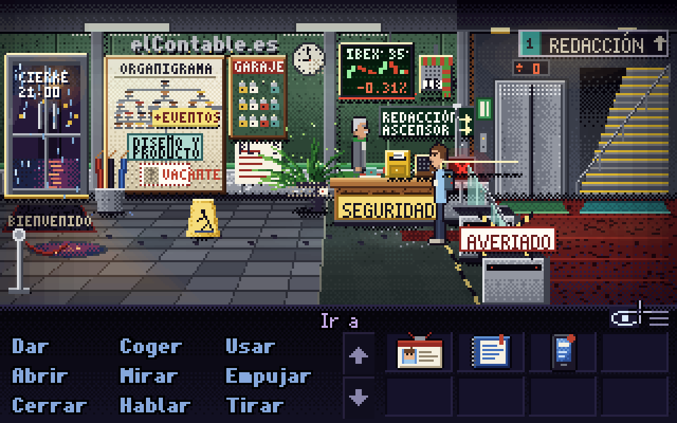 | 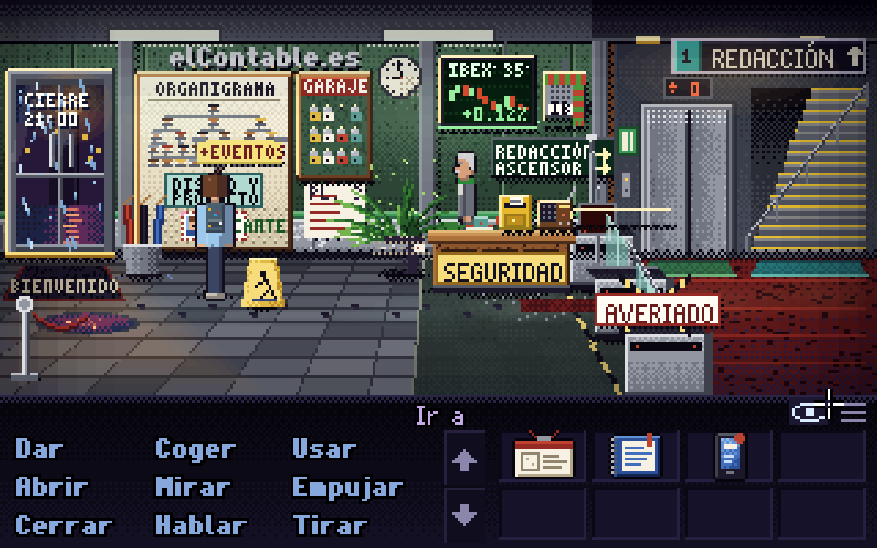 |
| 2. Vestíbulo al tomar el control | 3. «BIENVENIDO, VACANTE» |
| 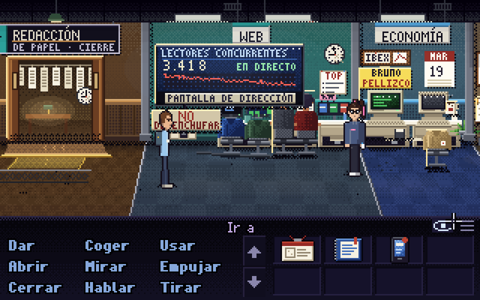 | 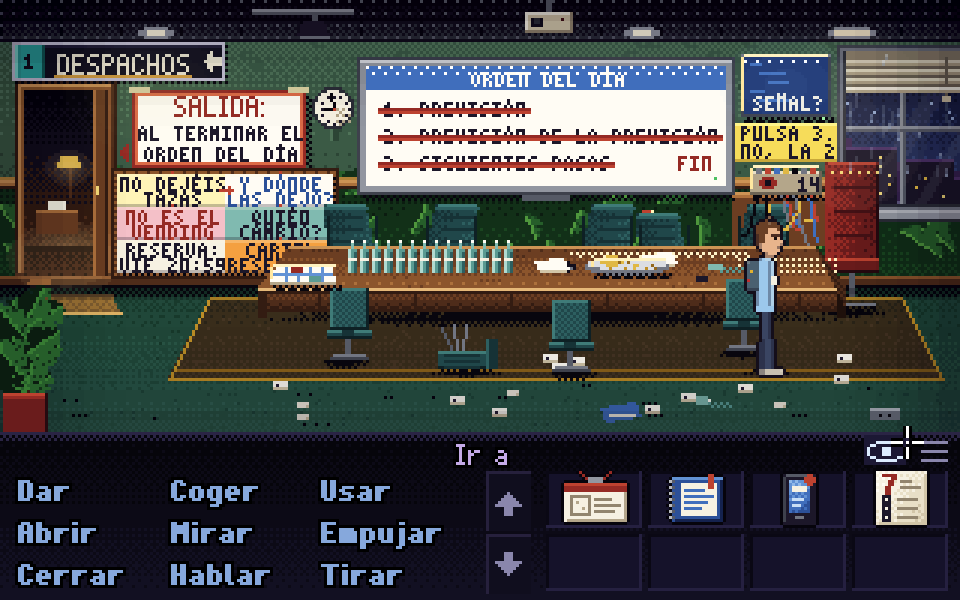 |
| 4. Llegada a la Redacción | 10. La reunión ya ha terminado; nada lo señala |

**Lo que me confundió de verdad:** (1) el móvil marca siempre 20:59 y Bruno dice «Son las 20:59» (`movil.js:25`) cuando el
juego dice que son las 18:30: la primera vez que abrí el móvil pensé que me quedaba un minuto y tuve que deducir que
era un chiste; (2) no saber cuál de los tres objetivos
avanzaba cada acción; (3) en la Redacción, saber dónde estaba «mi sitio» entre 37 cosas clicables.

---

## 3. A. Comedia — 6/10

### 3.1 Densidad y tasa de acierto (muestra aleatoria)

Extraje todas las cadenas de texto de `content/` (sin el arte) con un tokenizador propio: **2.930 líneas, 2.783
únicas** (incluye opciones de diálogo y algún texto de interfaz). Saqué **220 al azar** (semilla fija), descarté 3 que no
eran diálogo y clasifiqué las 216 restantes. Tabla completa en el Apéndice A y en `datos/muestra_lineas.csv`.

| Clase | Líneas | % | Criterio |
|---|---:|---:|---|
| Risa | 11 | **5,1** | Me reí en voz alta o me la apuntaría. |
| Sonrisa | 112 | **51,9** | Ingeniosa, bien construida; no hace reír. |
| Neutra | 63 | 29,2 | Funcional (información, pista, opción) sin intención cómica. |
| Fallida | 11 | 5,1 | Intenta un chiste y no llega (o se explica). |
| Relleno | 19 | 8,8 | No aporta ni chiste ni información («Me lo apunto.», «Nunca mira.»). |

**Lectura:** el 62 % de las líneas intenta un chiste y el 92 % de esos intentos acierta al menos a medias, que es un
oficio notable. Pero solo 1 de cada 12 intentos es una carcajada. Las mejores aventuras de LucasArts no tienen más chistes
por línea; tienen **más situaciones cómicas** (escalada, consecuencia, absurdo físico, personajes que quieren cosas
ridículas con toda su alma). Aquí el humor es casi todo verbal y de una sola línea.

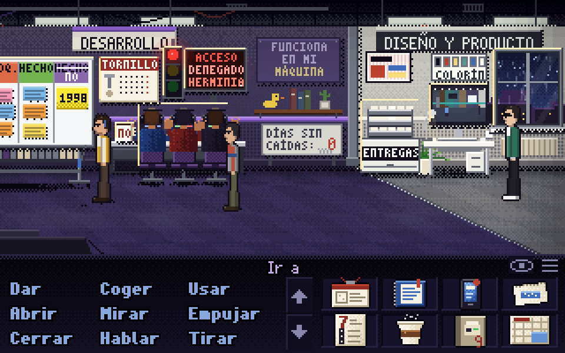

*Captura 6. La zona de Desarrollo (coro de espaldas) y Diseño (Valentín) en la Redacción: el chiste interno ocupa el tramo final de la sala principal.*

### 3.2 Las 20 mejores (y por qué)

1. «Gracias por avisar antes de faltármelo.» — `duelo.js:9`. Réplica perfecta: corta, reversible, de oficio.
2. «No me ha vuelto a dirigir la palabra. Han sido treinta años muy buenos.» — `catacumba.js:217`. Giro de carácter.
3. «Lo leímos todos. Por eso no contestó nadie.» — `duelo.js:8`.
4. «Y yo te leo desde el más absoluto modo avión.» — `duelo.js:15`.
5. «O sea, que no sabéis qué hacer, pero en tabla dinámica.» — `duelo.js:17`.
6. «BIENVENIDO, VACANTE.» / «…Vacante. Bueno. Es un cargo.» — `vestibulo.js:237-240`. Premio de puzle que es chiste.
7. «UN JOVEN DA LAS BUENAS NOCHES A UNA CAFETERA. LA CAFETERA, VIRAL» — `pajarera.js:22`. El mundo te comenta.
8. «BECARIO DETECTADO. LO QUE PASÓ DESPUÉS TE SORPRENDERÁ.» — `pajarera.js:23`, y la revelación de Rubén.
9. «Yo no creo en los tickets, niño. Los tickets creen en mí.» — `administracion.dialogos.js:89`.
10. «La palabra de honor dejó de ser moneda de curso legal con la peseta.» — `administracion.dialogos.js:87`.
11. «Nueve verbos y ni un subjuntivo. Así no se cierra un periódico.» — `catacumba.js:228`. Metahumor que sí funciona: es de Aurora, no del autor.
12. «ESTOY FUERA DE LA OFICINA HASTA QUE EL PAPEL DEJE DE EXISTIR.» + «…Es lo más bonito que me han escrito en veintinueve años.» — `catacumba.js:325, 335`.
13. «En internet una errata se corrige, chaval. En papel se enmarca.» — `catacumba.js:279`.
14. «Hay uno que encaja consigo mismo. Lo dejo así: es feliz.» — `sala_amazonas.js:137`.
15. «Lo cierro. Antes de apagarse, reenvía: «RV: Me han cerrado».» — `ecosistema.js:56`.
16. «Ay, hijo. El papel lo dejé en 2011, que me manchaba el sofá.» — `final.js:141`. Risa y pellizco a la vez.
17. «Donde decía «Por Bruno Pellejo» debía decir «Por Bruno Pellejo». Lamentamos el acierto.» — `final.js:204`.
18. «¿Íñigo? ¿El becario de marzo del 98? ¡Te dejaste la taza!» — `final.js:82`. Paga el pósit de 1998 del kanban.
19. «No me encerró. Me dio una silla y wifi. Yo pensé que era un contrato.» — `cpd.js:185`.
20. «Una anónima y otra con IVA. Me vale.» — `catacumba.js:196`. Resume el puzle de la fuente en siete palabras.

### 3.3 Las 20 peores (y por qué)

1. «En mi juego, el Titulator ya era un becario.» — `pecera.dialogos.js:220`. Autorreferencia del autor dentro del juego; destripa el giro del Acto III.
2. «Eres un sprite muy bien resuelto. El remolino, sobre todo.» — `pecera.dialogos.js:209`. Guiño a otro juego que el personaje no tiene por qué saber; suena a autoelogio.
3. «Diseño soy yo. Lo pone el organigrama.» / «Por fin tengo departamento. Y es el que tenía razón.» — `final.js:182-186`. Rompe el clímax emocional para cerrar un chiste interno.
4. «Errores — Asignado a: Diseño (que no fue).» — `final.js:215`. Mismo chiste, en los créditos.
5. «CORO: ¡Ha sido Diseño!» — `pecera.escenas.js:85` y sus 13 variantes ambientales (`pecera.js:47-61`). Funciona una vez; aparece decenas.
6. «Esto es un puzle, ¿verdad? Lo noto en el aire.» — `administracion.dialogos.js:104`. Guiño sin chiste.
7. «RV: RV: RV: La IA dice que el LCP baja quitando lo más grande!!» — `movil.js:16`. Jerga de producto web: el jugador medio no sabe qué es el LCP.
8. «RV: Mejora tus Core Web Vitals en 5 pasos (40 págs.)» — `movil.js:14`. Ídem.
9. «DEV 1: ¿Quién ha llamado "botón2" a un botón? … DEV 3: No.» — `pecera.js:47`. Chiste de oficina de desarrollo, repetido en bucle.
10. «Dentro hay posos de 2009 y un tornillo de la Ferretería Hermanos Tornillo.» — `office.js:271` (la ferretería sale también en `pecera.js:395`). Nombre-chiste sin chiste.
11. «Empujas uno y Paco te abre cuarenta tickets. Uno por armario.» — `cpd.js:231`. Bruno habla en 1.ª persona en todo el juego; aquí, en 2.ª.
12. «He perdido a un hombre por mirar el reloj. Que está parado.» — `administracion.dialogos.js:190`. No se entiende quién se ha perdido.
13. «Son las 20:59. Llevo ocho meses llegando tarde a algo.» — `movil.js:25`. Contradice la hora del juego (18:30).
14. «Prometo cuidarlo.» — `pecera.dialogos.js:88`. Despedida incoherente: Nemesio acaba de decir que él devuelve el álbum.
15. «Lleva RECHAZADO en la frente. Del revés. Lo he leído igual.» — `administracion.dialogos.js:147`. Imagen confusa.
16. «No. Ya he encerrado a bastante gente hoy. Bueno, a nadie. Pero no.» — `cpd.js:249`. Se desmonta a sí misma.
17. «Dentro, más lanyards. Y debajo, tazas con logo. Es un ecosistema.» — `eventos.js:147`. Remate sin giro.
18. «Si me lo llevo, mañana en la Pecera se nos ven las ojeras de verdad.» — `eventos.js:128`. Usa el nombre interno «Pecera», que el jugador no ha visto en ningún rótulo (la sala se llama «Redacción»).
19. «Para usted es lo mismo, pero con multa.» — `administracion.dialogos.js:105`. Relleno con forma de chiste.
20. La tríada «¿Pósit rosa? El rosa es "emociones". Te ha clasificado como emoción» (`pecera.escenas.js:131`) + «Rosa. Emociones. No te lo tomes como algo personal» (`pajarera.js:312`) + «Rosa, emociones. Azul, excusas» (`pajarera.js:177`). El mismo chiste explicado tres veces.

### 3.4 Fórmulas y muletillas (recuento en el corpus de 2.783 líneas únicas)

| Patrón | Veces | Comentario |
|---|---:|---|
| Líneas de 2+ frases que acaban en remate de ≤ 4 palabras | **990 de 1.896 (52 %)** | El molde de la casa. Es eficaz, pero la mitad del juego suena igual. |
| Remate «… Como X.» (frase que empieza por «Como») | ≥ 54 | «Como la plantilla fija», «Como el Ibex», «Como las goteras», «Como una startup»… |
| «Lo hablamos» | 25 | Muletilla de Gervasio que usan también Íñigo, Maripaz y la confirmación de salir del juego. |
| «cariño» | 35 (21 en `ecosistema.js`) | Maripaz habla casi solo con esa marca. |
| «desde marzo» | 16 | Gag de la reunión eterna; bien en la Sala, sobra fuera. |
| «Diseño» (mención) | 43 | El chiste interno más repetido del juego. |
| «cinco minutos / 5 MIN» | 29 | Pilar, la cuenta atrás, el correo, el flight case, la mesa de sonido, el piloto de la puerta… El chiste es bueno; en Eventos aparece en 6 hotspots de 19. |
| «Una cosita» / «Era solo eso» | 10 / 8 | Evaristo. Funciona como running gag porque tiene progresión (llama, cuelga, vuelve a llamar). |
| «¿Tú eres el nuevo?» | 6 | El mejor running gag: cambia de sentido con Rubén e Íñigo. |
| «Me la/lo apunto» | 9 | Señal funcional del aprendizaje de réplicas; como chiste, relleno. |
| «seis y media / 18:30» | 18 | Justificación de por qué no hay nadie, repetida hasta sonar a excusa del guion. |
| «es lo único / es la única» | 33 | Tic estructural del redactor («Es lo único suyo que sigue fresco»). |
| «Te lo pongo por escrito» | 8 | Apertura de los cuatro duelos: los cuatro rivales empiezan igual. |
| «Es lo más bonito que me han dicho/escrito» | 2 | Teodoro (`catacumba.js:335`) y Nemesio (`pecera.dialogos.js:77`) con minutos de diferencia. |

**Running gags que se pasan de vueltas:** el coro de Desarrollo (13 discusiones + 4 «de fondo», cada 14-24 s mientras
estés en la Redacción, `pecera.js:493-496`), los «5 minutos» de Eventos, «desde marzo» y las 18:30. **Los que
funcionan:** «¿Tú eres el nuevo?», Evaristo y sus comas, los relojes parados en las 20:59 *dentro del edificio*.

### 3.5 Voz cómica por personaje (prueba a ciegas)

- **Prueba humana.** Saqué al azar 30 réplicas de personajes que no son Bruno (de ≥ 25 caracteres, del registro de la
  partida) y las leí sin nombre. Solo **15 de 30** llevan una marca que permite atribuirlas: el prefijo del fax, «RV:»,
  «acreditado», «triplicado/ticket», «chaval», «Cabe». Las otras 15 («Es el récord de la historia del medio», «Lo he
  cruzado con las nóminas. No cuadra con ninguna», «La línea de sucesión acaba de enloquecer», «Ah. Yo, cuatro meses.
  Entonces el nuevo soy yo») podría decirlas cualquiera. Las 30 réplicas, con su hablante real, están en el Apéndice D
  (semilla 99 sobre el registro de la partida).
- **Prueba automática.** Un clasificador de centroides TF-IDF (palabras + trigramas) con validación «dejar uno fuera»
  sobre 269 líneas de 8 hablantes acierta el **42,8 %**, frente a un 41,6 % de acertar siempre «Bruno». Es decir: por el
  vocabulario, los personajes son casi indistinguibles. Aurora y Yoli, que deberían estar en los extremos (pulcritud vs.
  urgencia), aciertan el 17-18 %.
- **Quién sí tiene voz:** Teodoro (por formato: fax en mayúsculas y medidas tipográficas), Begoña (burocracia con
  sellos), Evaristo (precisión obsesiva con progresión), la abuela (cariño que no escucha). **Quién no:** Yoli, Gervasio,
  Íñigo, Nemesio, Paco y Borja comparten el mismo registro seco; Íñigo, el villano, no tiene ni una línea memorable propia:
  sus mejores momentos son réplicas que le *hacen* a él.

### 3.6 Jerga que un no periodista no entiende

LCP, Core Web Vitals, CMS, SEO, Discover, KPI, «descopear», «tiempo de permanencia», «faldón», «cíceros», «cuerpo 9»,
«galeradas», «planillo», «pirámide invertida». Las de periodismo de papel están bien porque el juego las explica con
gracia («Galeradas colgadas como jamones», `catacumba.js`); las de producto digital no se explican y además son las que
sostienen a Tadeo y al coro. «Descopear» es incluso la llave de un puzle del Acto III.

### 3.7 Diálogos: ritmo y opciones

Los árboles son ordenados y cortos, pero **las opciones casi nunca son graciosas por sí mismas**: son preguntas
informativas («¿Qué es esa matriz?», «¿Y tu departamento?», «¿Por qué no se publica lo que hace?»). Las únicas opciones
«descaradas» están en la nota de gasto de Begoña («Mi palabra de honor», «Una foto mental. ¿Se la describo?», «¿Usted
cree en los tickets, Begoña? Pero de verdad.») y es, con diferencia, el mejor árbol del juego: la opción es el
*planteamiento* y la respuesta el *remate*. Ese patrón debería ser la norma. Abundan los árboles de 5-10 preguntas que
terminan en «Me voy.» (Pilar tiene 10), cuya función es enseñar al personaje, no hacerle reír.

### 3.8 Combinaciones absurdas de verbo + objeto

Probé **180 pares** al azar (18 por sala, todos los verbos, objetos de la sala y objetos del inventario), registrando la
respuesta y comparándola con las 45 respuestas por defecto de `game.js:13-21`. Datos en `datos/cobertura_verbos.csv`.

| Verbo | Propias | Por defecto | % propia |
|---|---:|---:|---:|
| Mirar | 20 | 0 | 100 |
| Coger | 19 | 3 | 86 |
| Hablar | 14 | 11 | 56 |
| Usar | 10 | 8 | 56 |
| Dar | 7 | 15 | 32 |
| Empujar | 9 | 16 | 36 |
| Tirar | 4 | 10 | 29 |
| Abrir | 3* | 11 | 21 |
| Cerrar | 4 | 16 | 20 |
| **Total** | **90** | **90** | **50** |

\* Dos de ellas son salidas que cambian de sala sin texto.

Mirar y Coger están cubiertos con mimo; **Abrir, Cerrar, Empujar y Tirar dan la respuesta genérica el 73 % de las veces**
(53 de 73). Las respuestas propias son buenas («Le tiro de la bufanda. Grita «¡fuera de juego!». Lo dejo.»), y las
genéricas también, pero rotan entre 5 por verbo, así que a la sexta prueba se repiten.

### 3.9 El final

El clímax (empujar al Lector Medio) es lógico y visual (capturas 21-22), y el epílogo encadena callbacks que pagan
(Íñigo becario del 98, la plaza de Teodoro, Evaristo «Felicidades… sin adjunto»). El golpe de la abuela es el pico
emocional y cómico del juego. **Pero el juego no termina ahí:** siguen Yoli con el KPI, la infografía, el coro de
Desarrollo y Bruno diciendo «Diseño soy yo… Por fin tengo departamento. Y es el que tenía razón» (captura 24), y la
cuarta pared. El epílogo dura 67 líneas (≈ 3 min de lectura). Recomiendo terminar en la abuela y en la fe de erratas.

| | |
|---|---|
| 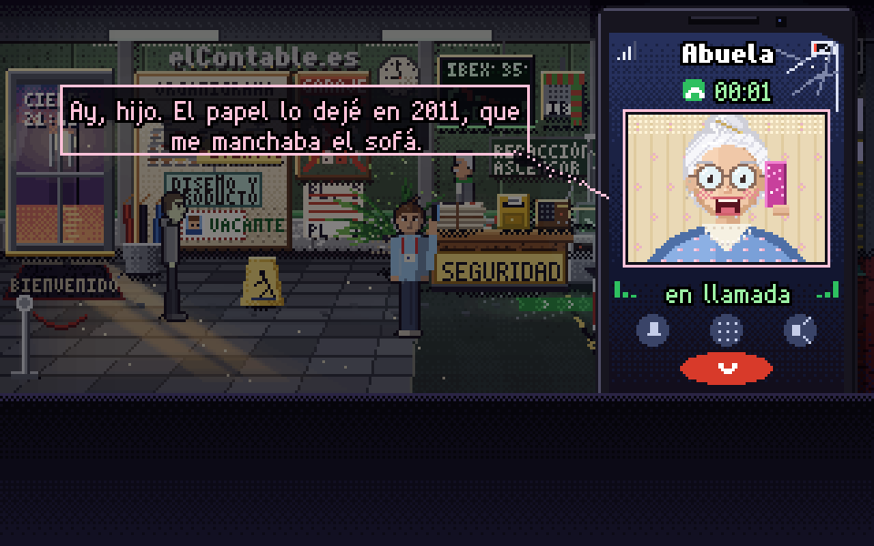 | 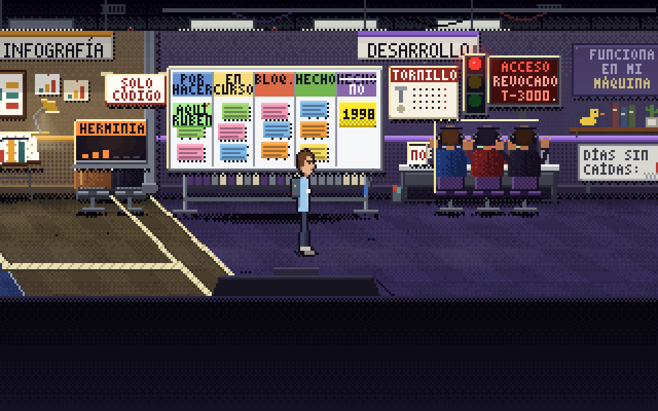 |
| 23. El pico del juego | 24. Lo que viene después: el coro de Desarrollo y «Diseño soy yo» |

---

## 4. B. Diseño de puzles — 6/10

### 4.1 Tabla de puzles principales

| # | Puzle | Solución | ¿Deducible con lo que hay en pantalla? | ¿Gracioso al resolverlo? | Nota |
|---|---|---|---|---|---|
| P1 | Torno | Chicle + tarjeta → organigrama (VACANTE) → torno | Sí: las negativas guían («Necesito algo que pegar. Por ejemplo, mi cara»). | Sí: «BIENVENIDO, VACANTE». | **9** |
| P2 | Café | «Buenas noches» a Gertrudis | Te lo dicen (Celestino). | Sí («NADIE ME SALUDABA DESDE 2019»). | 5 (trivial) |
| P3 | Silla libre | Coger chaqueta de Ramírez → ponérsela al Lector Medio | A medias: Yoli dice «un sitio con más autoridad», el perchero (`pajarera.js:210`) despista. | Sí, y paga en el clímax (el Lector cae con la chaqueta). | 6 |
| P4 | Hueco | «¿Siguientes pasos?» a Gervasio → planillo → Dar a Maripaz → D1 | La pregunta te la dicta Aurora; el planillo no se señala. | La estampida es buena idea; dura 1,8 s y no se ve. | 5 |
| P5 | CMS | Mirar registro de tickets (CPD) → Tirar del enchufe | Sí, pero es un **candado de permiso**: sabes la solución y el juego te la niega hasta leer el ticket («Necesitaría un motivo. Por escrito», `pecera.js:201`). | Sí. | 6 |
| P6 | Fuente | Nota de gasto mala → fotocopia de la nota de Gervasio + copias rechazadas → copias al fax → mensaje de F.P. → dos fuentes a Aurora | Sí, y es lo mejor del juego: el fax «SIN PAPEL» y tú con dos copias inútiles. | Sí: «Una anónima y otra con IVA. Me vale». | **9** |
| P7 | Firma | Preguntar a Paco por el fax → manual (pág. 9) → D2 con Teodoro, remate con el manual | Sí, una vez que Paco atiende (P5). | Sí: la respuesta automática de Teodoro. | 8 |
| P8 | Recorte | Dar la pieza a Begoña (recorte 26 %) → 23 líneas | Sí: cartel del 26 % + «faldón de 23 líneas». | Sí, y es un chiste de oficio. | **9** |
| P9 | Rubén | Tirar del papel continuo del armario 27 | Sí: Titulator «ARMARIO 27», el atún de Evaristo, el RV de Tadeo. Muy bien sembrado. | Sí. | 8 |
| P10 | Baja de Rubén | Álbum de Pilar → oír «descopear» a Borja → Nemesio → pósit → Paco → ticket | Cadena de recados en tres plantas; la llave es una palabra de jerga. | Poco. | 4 |
| P11 | Acta | Gervasio en el Vending → D3 | Te lo dice Gervasio; hay que encontrarlo en otra sala. | Sí («Acuerdos: uno, pedir más café»). | 6 |
| P12 | Clímax | D4 + Empujar al Lector Medio | Sí: lleva tres semanas «asintiendo»; la abuela: «un empujoncito». | Sí. | 8 |

**Recados (fetch):** de los 12, P2, P4, P10 y P11 son esencialmente llevar algo a alguien (33 %). **Repetición
obligatoria:** decir «Buenas noches» a Gertrudis cuatro veces para que suelte tres chismes que son réplicas necesarias
para D1 y D3 (`walk-data.mjs` paso 20). Y el segundo café que da Gertrudis se queda en el inventario hasta los créditos
sin ningún uso (`office.js:62-66`; inventario final de mi partida).

### 4.2 Coste de idas y vueltas

- Recorrido óptimo: **46 pasos, 111 acciones, 41 cambios de sala** (6 en el Acto I, **24 en el II**, 11 en el III).
- Mi partida a ciegas: 17 cambios de sala solo en la primera mitad del Acto II.
- La Redacción es el nudo de todo y mide 1.270 px: Bruno anda a **62 px/s** (medido), unos 19 s de punta a punta y 4-5
  clics porque cada clic solo llega al borde de la pantalla visible. No hay doble clic para salir ni carrera.

### 4.3 Señalización de objetivos

La ficha de la página 7 marca Hueco / Fuente / Firma al mirarla (`items.js:253`) — bien. Pero los sub-objetivos (la silla,
el CMS, Paco, los chismes) no están en ningún sitio, y nada te dice a qué casilla sirve lo que acabas de conseguir. En el
Acto I pasé ~45 acciones en la Redacción sin saber qué perseguir.

### 4.4 La abuela como sistema de pistas

`game.js:43-77`: una lista fija de 19 pistas; se da la **primera cuyo flag no esté puesto**, en un único nivel, y llamar
otra vez repite exactamente la misma (comprobado: cuatro llamadas seguidas → cuatro veces la pista de la silla). Problemas:
(1) no escala de sugerencia a solución; (2) en el Acto II, con tres objetivos paralelos, te da la del primero de la lista
aunque estés en otro; (3) las metáforas de abuela son graciosas pero a veces más crípticas que la propia sala («El que no
contesta, contesta solo. Como el contestador de tu tío.»). La idea (la abuela) es excelente; el sistema es plano.

### 4.5 «Responder a todos»

Jugué los cuatro duelos ganándolos y perdiéndolos una vez (transcripciones en mis registros; capturas 12).

| | D1 Maripaz | D2 Teodoro | D3 Gervasio | D4 Íñigo |
|---|---|---|---|---|
| Asaltos para ganar | 3 | 3 + remate | 3 | 4 + 2 remates |
| Opciones en el menú | 18 | 18 | 19 | 19 |
| Coste de perder | ninguno: reintentar | ninguno | ninguno | ninguno |

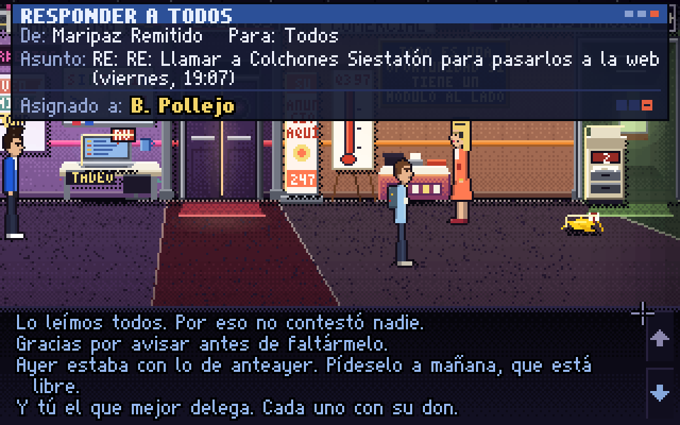

*Captura 12. D1 con Maripaz: el menú está abierto y el ataque («Te escribo desde el más absoluto cariño») ya no se ve; 18 opciones en 5 líneas.*

- **Legible:** la ventana de correo con De/Para/Asunto y el «RE: RE:» que crece es una gran idea visual (captura 12).
- **Ilegible donde importa:** el ataque se dice como globo y desaparece al abrir el menú; mientras eliges, en pantalla
  solo está el asunto. Los puntos son tres cuadraditos de color de 3 px arriba a la derecha.
- **Justo y aprendible:** sí, demasiado. La pareja ataque-réplica es 1:1 y la oíste entera al aprenderla («Maripaz me
  escribió "desde el más absoluto cariño"… Le contesté: "Y yo te leo desde el más absoluto modo avión"»). En el duelo, la
  gracia de la réplica ya está gastada.
- **Corto:** tres intercambios no dan para escalada. El remate con objeto (manual de fax, ticket, acta) es lo mejor del
  sistema.
- **Sin voz propia en el fallo:** las réplicas flojas tienen la misma contestación para todos los rivales («Ya. Como lo del
  trimestre pasado»). Y si eliges una floja con línea propia como tercer fallo, el juego corta antes de decirla
  (`duel.js:120-124`): la de «Eso es cosa de Diseño» no se oyó en ninguna de mis cuatro derrotas.
- **La derrota** dice siempre «RESPUESTA AUTOMÁTICA DE DIRECCIÓN: «Lo que diga Gervasio.»», incluso perdiendo contra Gervasio.

### 4.6 Arbitrarios, triviales o de probar todo

- **Triviales:** P2 (dicho), P4 (dicho por Aurora), P11 (dicho por Gervasio).
- **Candado de permiso:** P5 (sabes lo que hay que hacer y no te deja).
- **De probar todo:** P3 (chaqueta → Lector Medio; la pista ambiental apunta al perchero).
- **Recado largo con llave de jerga:** P10.

### 4.7 Curva y tiempo muerto

Acto I fácil y bien guiado; Acto II largo y plano (tres objetivos, cuatro plantas, el 52 % de las acciones del juego); Acto
III corto y con buen ritmo. El tiempo muerto está en andar por la Redacción y en releer árboles para encontrar la opción
nueva.

---

## 5. C. Historia y estructura — 6/10

- **Premisa:** cristalina en el primer minuto (§2). **Lo que está en juego** se dobla bien a los 2-3 minutos (el Plan Cero
  Papel). Bien.
- **Reloj sin tensión.** Todo el edificio marca 20:59 (`game.js:5`) y nada avanza. Es un buen chiste de ambiente, pero
  anula la cuenta atrás que la intro promete («Tengo hasta las nueve»). Y el móvil también marca 20:59 (captura 11), con
  Bruno diciendo «Son las 20:59» (`movil.js:25`): el jugador cree que se le acaba el tiempo desde el minuto 5.
- **Ritmo por actos (partida óptima, estimación humana):** Acto I ≈ 12 min; Acto II ≈ 21 min; Acto III + epílogo ≈ 17 min
  (lectura medida con la fórmula del motor `core.js:558` + andar medido + 6 s por decisión). Un primer jugador tardará
  entre 2 y 3 horas (mi ratio a ciegas fue ×4,6 en el Acto I).
- **El villano.** Íñigo es un buen *tipo* (la matriz, el pósit rosa) pero no tiene una sola línea memorable propia, y su
  derrota depende de un objeto de cartón. El giro de que fue «el becario de marzo del 98» es estupendo y está escondido en
  un pósit (`pecera.js`, kanban) y en una línea de Celestino en el epílogo: merece una escena.
- **El giro (Rubén = Titulator):** bien sembrado (titulares, atún, armario 27) y satírico sin sermón. Su escenificación es
  pequeña: Rubén se ve diminuto y oscuro dentro del armario (captura 20).
- **Reparto vs. tiempo en pantalla.** En la partida óptima (542 líneas): Bruno 155, Íñigo 43, Aurora 32, Rubén 30, Begoña
  29, Celestino 24, Yoli 22, Evaristo 22, Paco 22, Teodoro 21, Gervasio 20, coro de Desarrollo 33, Gertrudis 12, Maripaz
  12, abuela 11, Nemesio 10, Pilar 7, Tadeo 5, Borja 2; **Leoncio, Anselmo, Valentín, Custodia y Herminia: 0**. Los
  olvidables: Borja, Tadeo, Nemesio (salvo el «descopear»), Leoncio/Herminia, Anselmo.
- **Las incorporaciones «de la casa»** (`GUION_ADENDA.md` §0.2): Evaristo se integra (tiene progresión y paga en el
  epílogo); las plazas de garaje funcionan como fondo y pagan con la plaza de Teodoro; Custodia es divertida pero es un
  segundo sistema de pistas que nadie necesita; Herminia/Leoncio/Anselmo son una subtrama completa (la IA de Infografía
  que Desarrollo no integra) **que no toca la historia principal**; Valentín es una dedicatoria; el coro de Desarrollo es
  la mayor fuente de ruido del juego.
- **Restos de los cambios tardíos** (todos verificados):
  - Libro de estilo: «Novecientas páginas» (`catacumba.js:509`) vs. «página 1 de 412» (`movil.js:30`).
  - Bruno nombra a Valentín al mirar el ascensor antes de conocerlo (`pecera.js:146`), y Valentín repite la línea casi
    literal (`pecera.dialogos.js:223`).
  - «la Pecera» en boca de Bruno (`eventos.js:128`) cuando en pantalla la sala se llama Redacción (los rótulos dicen
    «REDACCIÓN WEB»).
  - El PNJ Nemesio conserva el id `nerea_backlog` (`pecera.js`, `actors.js`): invisible para el jugador, pero delata el
    cambio de nombre.
  - El aviso de «Pellizco» se explica en la intro, el organigrama, Evaristo (dos veces) y el epílogo: queda algo
    sobreexplicado.

---

## 6. D. Interfaz y sensación — 6/10

### 6.1 Verbos y clics

- Acción común (Mirar algo): 2 clics (o 1 con clic derecho). Usar objeto con algo: 3 clics. Dar: 3. Correcto para el género.
- **¿Se ganan su sitio los nueve verbos?** Abrir, Cerrar, Empujar y Tirar responden con la genérica el 73 % de las veces y
  son solución en 3 de 46 pasos (Tirar del enchufe, Tirar del papel continuo, Empujar al Lector). Cerrar no es solución de
  nada. Es la decisión 21 (§10).
- Clic derecho = verbo por defecto y pulsación larga en táctil: bien.

### 6.2 Andar, cámara y salas

62 px/s, sin carrera ni salto de salida con doble clic. Cruzar la Redacción: ≈ 19 s y 4-5 clics. En un juego con 41
cambios de sala en el recorrido óptimo, es el principal tiempo muerto.

### 6.3 Texto

- Duración automática 900 ms + 55 ms/carácter (`core.js:558`), clic para pasar, Esc para saltar escenas, tres velocidades
  en el menú: bien.
- **Superposición:** el coro ambiental habla aunque Bruno esté hablando. Registro real: «DEV 1: Ha llovido y ha bajado el
  tráfico. | bruno: Mi ordenador. De pie no se ve…» (dos globos a la vez; pasos: entrar en la Redacción, esperar 15 s,
  Mirar «mi ordenador»).
- Aviso de aprendizaje («Réplica apuntada en la libreta») y sonido: bien.

### 6.4 Inventario, móvil y «ver objetos»

- Inventario de 8 casillas con flechas; la libreta cuenta «12 de 16» al mirarla: bien.
- El móvil (captura 11) es una buena idea de interfaz: abuela, correo, llamadas. El correo es relleno (6 mensajes, 3 de
  Tadeo).
- «Ver objetos» (H, espacio o el ojo) marca todo con nombre (captura 14); en salas densas las etiquetas se pisan («logo»
  sobre «elContable.es»).
- Coger los bolígrafos de Aurora en el Acto I no produce ningún texto, solo un golpecito animado de Aurora
  (`catacumba.js:522`, `golpecito`); jugando creí que el clic no había funcionado.

### 6.5 Guardar y cargar

Autoguardado al cambiar de sala y 3 ranuras; el chiste del triplicado al guardar es bueno. Comprobado: cargar una partida
guardada **en mitad de un duelo** te devuelve a la sala sin el duelo; mi automatización tuvo que rehacer los pasos
43-46 desde antes del duelo D3. No se pierde nada, pero conviene que el autoguardado no se dispare dentro de un duelo.

### 6.6 Táctil (iPhone horizontal emulado, 844×390, DPR 3)

- El canvas ocupa 624×390 pt: **220 pt de bandas negras** a los lados (26 % del ancho) (captura 13).
- Escala 1,95: filas de verbos de **27 pt** de alto (Apple pide 44), casillas de inventario 66×41 pt.
- **78 de 157 hotspots** (50 %) tienen el lado corto por debajo de 44 pt; los peores, de 20 pt: timbre de la Secretaría
  (14×10 px), mini-cruasanes, piel de plátano, registro de tickets.
- PNJ que se mueven: Maripaz pasea, y en las dos partidas el primer y segundo intento de Dar el planillo fallaron porque
  se había movido entre el clic del verbo y el clic sobre ella. En táctil será peor.

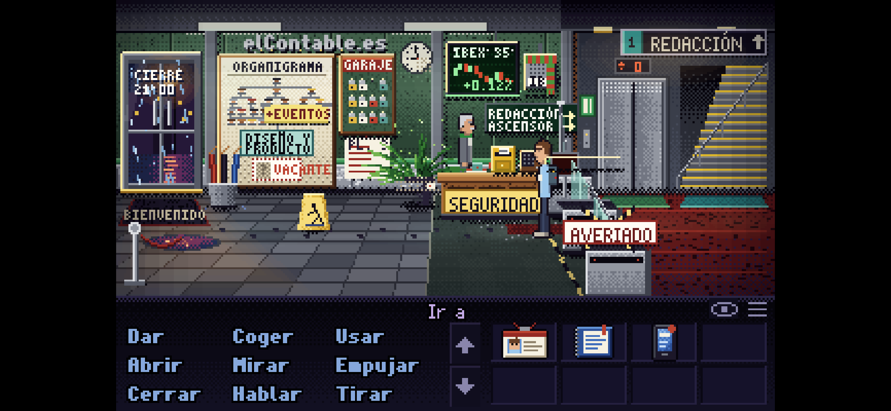

*Captura 13. iPhone horizontal emulado (844×390, DPR 3): bandas negras laterales, verbos de 27 pt.*

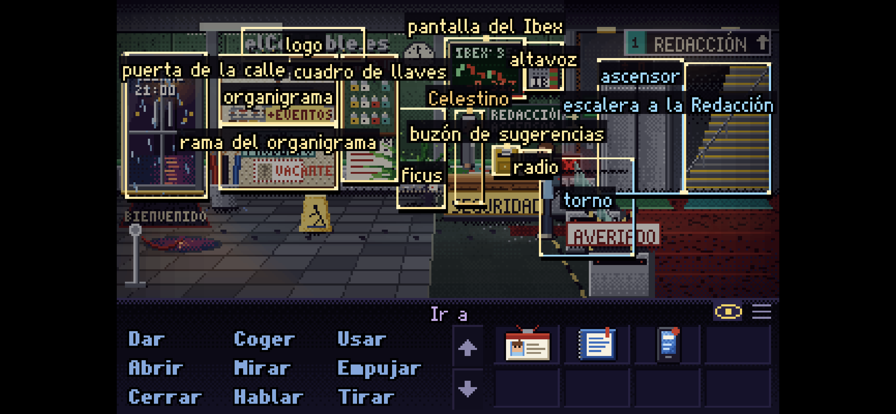

*Captura 14. «Ver objetos»: útil; etiquetas que se pisan en salas densas.*

### 6.7 Primera vez y accesibilidad

- No hay tutorial: la primera indicación («Usa el móvil para llamar a la abuela o leer el correo», captura 7) llega en la
  Redacción de papel. El «Cómo se juega» está en el menú de pausa. Para el público de LucasArts basta; para el de un
  iPhone, no.
- La fuente de píxel se lee bien a 1× y a 1,95×; los globos tienen contorno.
- Señales solo de color: los puntos del duelo (cuadraditos azul/rojo), las casillas de la ficha (marca verde de 3 px).
- **«Dificultad: Normal / Difícil / Cierre en viernes»** en el menú (captura 15) no hace nada (`screens.js:137`:
  «decorative difficulty selector… changes nothing») y nadie te lo dice. Como chiste no se cuenta; como opción engaña.

---

## 7. E. Visual — 8/10

He capturado y mirado las diez salas completas (paneo en las anchas) y los momentos clave.

- **Lo mejor:** el vestíbulo (captura 2) y la Redacción de papel (captura 7) tienen atmósfera, profundidad y chistes
  pintados («NO HABLO ANTES DEL CAFÉ», el reloj parado, los ex-jefes con bigote). Administración (17) cuenta su chiste del
  26 % solo con el cartel. Planta 2 (18) separa Marketing / Eventos / Comercial por color.
- **Legibilidad del texto pintado:** muy buena a 1×; casi todos los rótulos se leen sin zoom.
- **La Redacción** (capturas 4-6) es preciosa por tramos pero, con 37 hotspots en 1.270 px, es la sala más difícil de
  leer: no hay un sitio «de Bruno» claro y el coro de espaldas es el foco visual de la zona de Desarrollo.
- **Sprites:** buen diseño de personaje (siluetas reconocibles), pero animación mínima: andar, hablar y parpadear. Las
  conversaciones son cabezas parlantes de 40 px; casi no hay gestos. Los primeros planos del móvil (captura 23) demuestran
  que el juego sabe hacer planos expresivos: hay que usarlos en más momentos.
- **Momentos clave:** la caída del Lector Medio ahora se ve (capturas 21-22, «ATREZO» en el suelo) — mejora frente al
  informe visual anterior. La revelación de Rubén sigue siendo pequeña y oscura (captura 20).
- **Humor visual:** abundante en el atrezo (pósits, carteles, el «AVERIADO»), escaso en la acción. No hay un solo gag
  físico animado en el camino crítico salvo la caída del Lector.

---

## 8. F. Audio — 6/10 (provisional)

No puedo escuchar. Lo que sí puedo medir en `content/music.js`:

| Pista | BPM | Bucle | Comentario |
|---|---:|---:|---|
| m_pecera (Redacción) | 160 | **24,0 s** | La sala en la que más tiempo pasas; Si un primer jugador pasa ~20 min en ella (estimación), oye el bucle unas 50 veces. |
| m_catacumba | 126 | 22,9 s | La segunda más visitada. |
| m_ecosistema | 128 | 30,0 s | |
| m_duelo | 132 | 29,1 s | Un duelo dura menos que dos vueltas: bien. |
| m_vestibulo / m_final | 76 | 50,5 s | |
| m_creditos | 132 | 58,2 s | |
| resto de salas | 84-112 | 34-46 s | |

- 15 pistas, 4-6 canales cada una, con un leitmotiv común (La-Do-Fa) declarado en la cabecera: estructura sólida.
- Los momentos clave cambian de música (duelo, clímax, final, créditos) y la intro arranca en silencio
  (`vestibulo.js`, `api.music(null, 0)`). Bien.
- 21 efectos distintos; los más usados son papel (18), puerta (17) y pitido (15). «success» suena una vez en todo el juego.
- **Lo que no puedo juzgar:** timbre, mezcla con los globos, si 160 BPM con charles constantes en la Redacción cansa, si el
  volumen por defecto (música 60 %) tapa los efectos. Recomiendo una escucha específica de la Redacción durante 10 minutos
  seguidos.

---

## 9. G. Técnico — 8/10

- **Errores de consola:** cero en todas mis sesiones (≈ 60 arranques, partida completa, cuatro derrotas, móvil).
- **Carga:** título listo en 170 ms (local, sin estrangular), 276 ms con CPU ×4 y 352 ms con CPU ×6; 66 peticiones,
  1,27 MB de JS sin minificar. Fotogramas en la Redacción: p95 16,7 ms con ×1, ×4 y ×6 (máx. 33 ms con ×6). Medido en
  Chromium sin cabeza, no en un iPhone real.
- **Publicación:** el README dice que basta con publicar la raíz del repositorio; eso subiría `tools/shots` (92 MB) y
  `docs` (8,7 MB) al sitio. No se descargan al jugar, pero ocupan y exponen material interno.
- **Errores que encontré (pasos reproducibles):**
  1. *Hora contradictoria:* empezar partida → Usar móvil → Correo → «Eventos: ¡Empezamos en 5 minutos!» → Bruno: «Son las 20:59» (`movil.js:25`), con el reloj del móvil en 20:59 desde el minuto 1.
  2. *Globos superpuestos:* en la Redacción, esperar a una discusión del coro y Mirar «mi ordenador»: dos globos a la vez.
  3. *Clic perdido en PNJ que anda:* planta 2, seleccionar Dar + planillo y hacer clic en Maripaz mientras pasea: el clic cae donde estaba (2 de 3 intentos fallidos en dos partidas).
  4. *Línea perdida en la derrota:* en cualquier duelo, elegir dos flojas y después «Eso es cosa de Diseño»: no se dice su contestación propia ni la del coro (`duel.js:120-124`).
  5. *Objeto muerto:* decir «Buenas noches» a Gertrudis después de dar el café a Aurora → un segundo café que no sirve para nada y llega a los créditos.
  6. *Cargar dentro de un duelo:* guardar durante D4 y cargar → la sala sin duelo; hay que salir y volver a entrar.
  7. *Selector de dificultad sin efecto* (`screens.js:137`).

---

## 10. Los 25 cambios más valiosos (ordenados por impacto/esfuerzo)

### 10.1 Arreglos (no requieren decidir nada)

| # | Problema → evidencia | Recomendación concreta | Impacto | Esfuerzo |
|---|---|---|---|---|
| 1 | El ataque desaparece en el duelo → captura 12, `duel.js:89-96` | Mostrar el ataque como cuerpo del correo dentro de la ventana mientras dura el menú; puntos como texto («2/3») además del color. | Alto: el duelo pasa a leerse. | S |
| 2 | Abuela plana y repetida → 4 llamadas = 4 veces la misma frase (`game.js:43-77`) | Tres niveles por pista (abuela → abuela concreta → Bruno dice la acción) y elegir el objetivo según la última casilla/sala tocada; no repetir texto literal. | Alto: elimina el atasco del Acto II. | M |
| 3 | Andar lento en la Redacción → 62 px/s, 19 s y 4-5 clics | Doble clic en salida = salida inmediata; doble clic en suelo = correr ×2; clic en el borde desplaza la cámara. | Alto | S |
| 4 | Coro de Desarrollo cada 14-24 s y superpuesto → `pecera.js:493-496`, registro de globos dobles | Cada 60-120 s, nunca con un globo bloqueante ni un menú abierto, máximo 3 por visita. | Alto | S |
| 5 | Hora contradictoria → `movil.js:25`, captura 11 | Que el móvil muestre la hora «real» (que avance por hitos: 18:30 → 20:59) y reescribir la línea de Bruno. | Medio: arregla la primera confusión del jugador. | S |
| 6 | PNJ que se mueven → Maripaz, 2/3 clics fallidos | Congelar al PNJ mientras haya un verbo u objeto seleccionado; caja de clic +8 px. | Medio | S |
| 7 | Táctil → 78/157 hotspots < 44 pt; verbos de 27 pt; 220 pt de bandas negras | En móvil horizontal, usar las bandas laterales para verbos (izquierda) e inventario (derecha) y ampliar la zona táctil de cada hotspot con margen invisible. | Alto en iPhone | M |
| 8 | Fin de la reunión invisible → `sala_amazonas.js:256-266` | Una línea de Bruno al quedarse solo («Se han dejado el planillo. Con la página 7 dentro.») y un destello sobre el planillo. | Medio | S |
| 9 | Gertrudis ×4 para tres chismes → paso 20 de la solución | Un «¿Algún chisme más?» en el árbol que suelte los tres seguidos; o un chisme por saludo, pero sin pedir repetir la misma opción. | Medio | S |
| 10 | Segundo café inútil → `office.js:62-66` | No volver a darlo, o darle un uso (Custodia, Teodoro). | Bajo | S |
| 11 | Contradicciones de texto → `catacumba.js:509` vs `movil.js:30`; `cpd.js:231`; `pecera.dialogos.js:88`; `pecera.js:146`; `eventos.js:128`; «Es lo más bonito» ×2 | Corregir las seis (lista en §5). | Medio (pulido) | S |
| 12 | Feedback mudo → coger bolígrafos en el Acto I (`catacumba.js:522`) | Añadir una línea («¡Au! Aurora me corrige la mano. En rojo.»). Revisar otros `golpecito` sin texto. | Bajo | S |
| 13 | Réplica floja perdida en la derrota → `duel.js:120-124` | Decir la contestación del rival antes de cerrar por derrota; variar la línea de derrota por rival. | Bajo | S |
| 14 | Selector de dificultad decorativo → `screens.js:137` | O hacerlo real («Cierre en viernes» = sin abuela, duelos con 4 fallos menos) o que al cambiarlo Bruno diga el chiste («Difícil: igual, pero sin café»). | Bajo | S |
| 15 | Publicación → README; `tools/shots` 92 MB | Publicar desde una carpeta de distribución o excluir `tools/` y `docs/`. Evitar el autoguardado dentro de un duelo. | Bajo | S |

### 10.2 Decisiones de diseño (solo dirección puede tomarlas)

| # | Problema → evidencia | Decisión propuesta | Lo que se gana / lo que se pierde | Esfuerzo |
|---|---|---|---|---|
| 16 | El final se lo lleva Diseño → `final.js:180-186, 215, 218` | Terminar el epílogo en la abuela + Yoli y pasar a la fe de erratas; quitar «Diseño soy yo», «Errores: Diseño (que no fue)» y «Entregado a las 18:29» de los créditos. | Gana: un final limpio y emotivo. Pierde: el guiño interno. | S |
| 17 | Chiste de la casa sobredimensionado → 43 menciones de Diseño, 13 discusiones, Valentín | Reducir el coro a 4 discusiones (una sola sobre Diseño), quitar a Valentín el autoelogio y el destripe («En mi juego, el Titulator ya era un becario»). | Gana: el jugador de fuera deja de sentirse fuera. Pierde: la complicidad con el equipo. | S-M |
| 18 | Reparto inflado → 5 personajes con 0 líneas en el camino crítico | Fusionar Leoncio + Anselmo + Herminia en un solo micro-puzle visible o sacarlos; Custodia o la abuela, no las dos como oráculo; Tadeo solo en el móvil. | Gana: foco y voces más claras. Pierde: unas 300 líneas de texto (las mejores se pueden reasignar). | M |
| 19 | Sonrisa sin carcajada → 5 % risas; 52 % de remates cortos | Pasar de chiste de línea a **chiste de situación** en 5-6 momentos: escalada (la estampida de la reunión como escena de 15 s), consecuencias que vuelven (la cafetera viral se hace viral de verdad en la Redacción), slapstick (el yunque de la nota de gasto, la piel de plátano que alguien pisa). Reescribir 1 de cada 5 remates «… Como X.». | Gana: el salto de 6 a 8 en comedia. Pierde: tiempo de guion y animación. | L |
| 20 | Duelos sin tensión → 3 asaltos, 1:1 literal, sin coste | O hacerlos más largos con ataques en variantes (la misma idea dicha distinto, para que haya que entenderla y no reconocerla) y derrota con consecuencia cómica, o dejar solo dos duelos (Teodoro e Íñigo) y bien hechos. | Gana: el mecanismo-firma brilla. Pierde: horas de diseño y prueba. | M-L |
| 21 | Nueve verbos → Abrir/Cerrar/Empujar/Tirar 73 % genérica | O pasar a 6 verbos (Mirar, Coger, Usar, Dar, Hablar, Empujar/Tirar fusionados en «Mover»), o escribir respuestas propias para el 70 % de los hotspots en esos verbos. | Gana: menos fricción en iPhone / o más chistes. Pierde: la estampa SCUMM clásica / o mucho texto nuevo. | M |
| 22 | Reloj parado → la promesa de «hasta las nueve» no se cumple | Hora que avanza por hitos (fin de cada casilla = +30 min) visible en el móvil, manteniendo los relojes del edificio parados como chiste. | Gana: tensión y orientación. Pierde: nada importante. | S |
| 23 | Redacción de 1.270 px → 37 hotspots, nudo de 24 cambios de sala | Dividir en Redacción (web + mesa de Bruno) y Desarrollo/Diseño como sala aparte, o acortar a 960 px. | Gana: orientación y ritmo. Pierde: el plano largo, que es bonito. | M |
| 24 | Jerga de producto digital → LCP, CWV, «descopear» como llave | Que cada término técnico tenga su traducción-chiste en la misma línea, y cambiar «descopear» por una llave que se entienda («darle de baja»). | Gana: público general. Pierde: guiño para los de dentro. | S |
| 25 | Escenificación plana → cabezas parlantes, Rubén diminuto | Usar el primer plano (como el del móvil) en 4 momentos: Rubén en el armario, Teodoro al teléfono rojo, Íñigo descubierto, la página 7 impresa; dar a cada PNJ principal un gesto propio. | Gana: lo que la gente recuerda y comparte. Pierde: semanas de arte. | M-L |

---

## 11. Galería de capturas citadas

| | | |
|---|---|---|
| 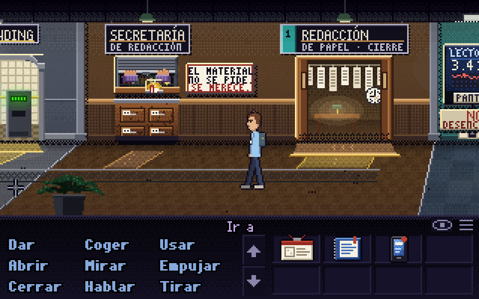 5. Redacción: Secretaría y Papel | 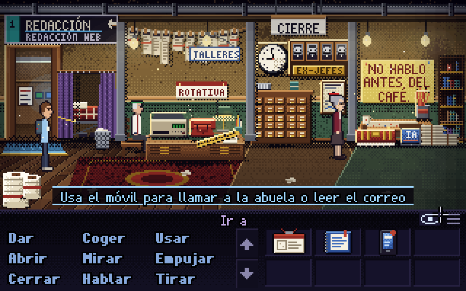 7. Redacción de papel; primer consejo de interfaz | 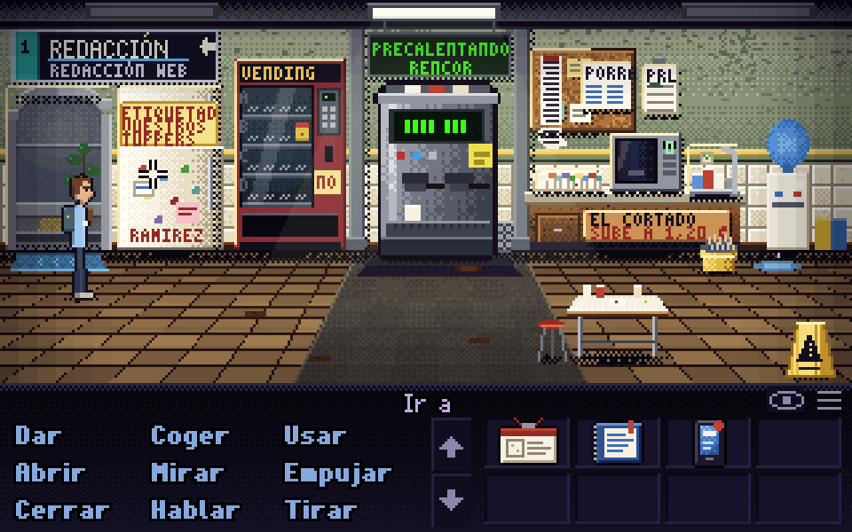 8. Vending |
| 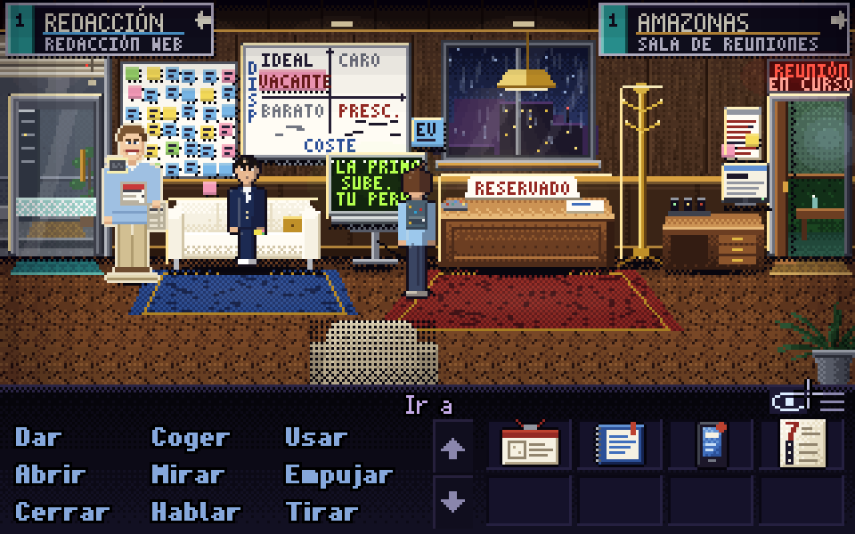 9. Despachos | 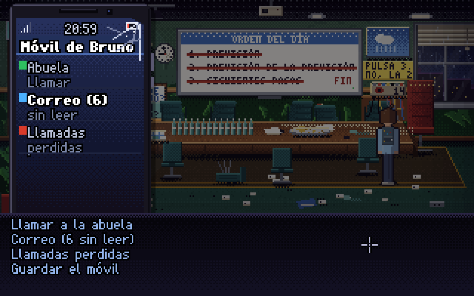 11. Móvil: 20:59 desde el minuto 1 | 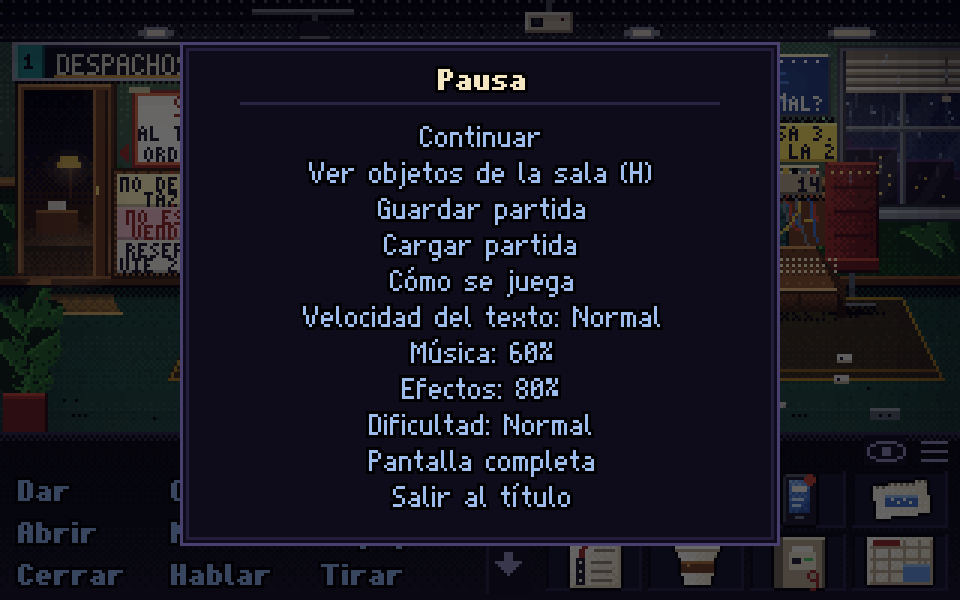 15. Pausa con dificultad decorativa |
| 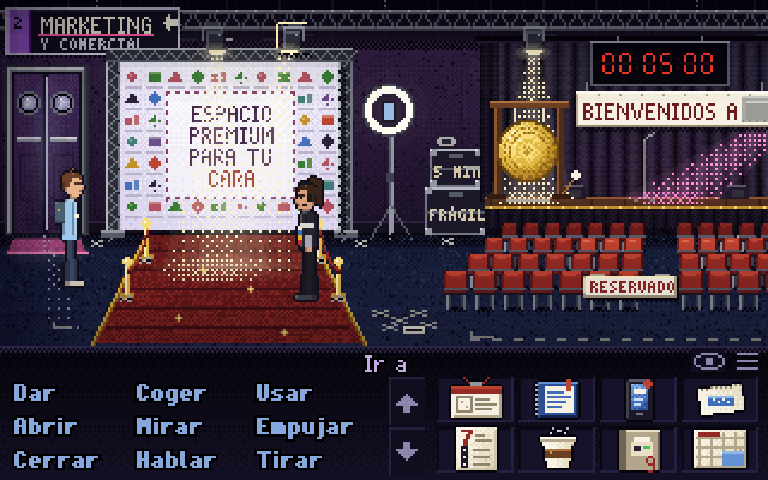 16. Eventos | 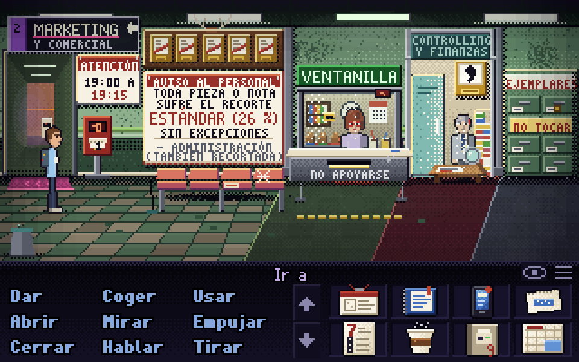 17. Administración | 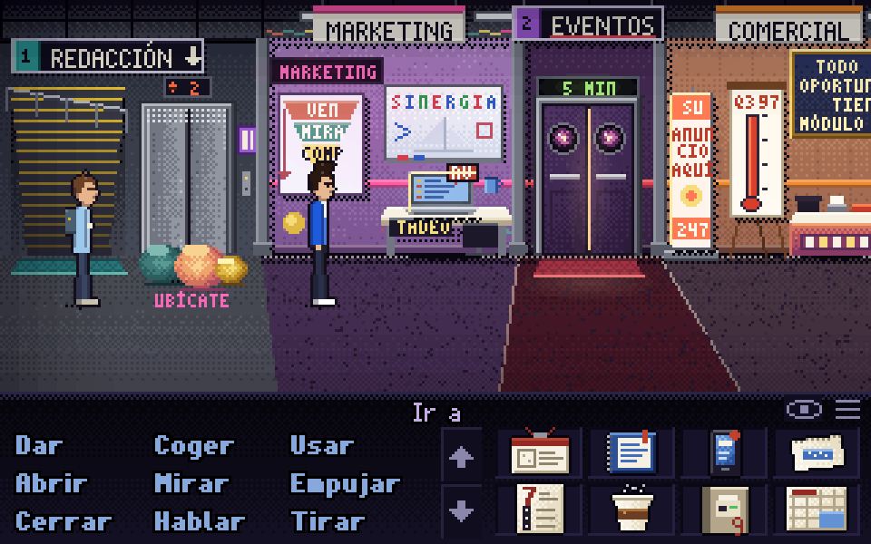 18. Planta 2 |
| 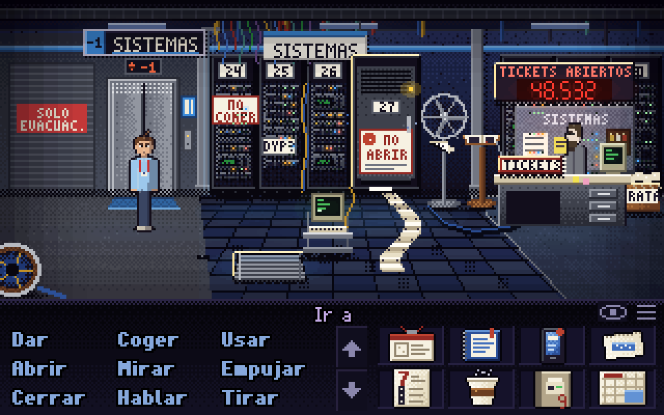 19. CPD | 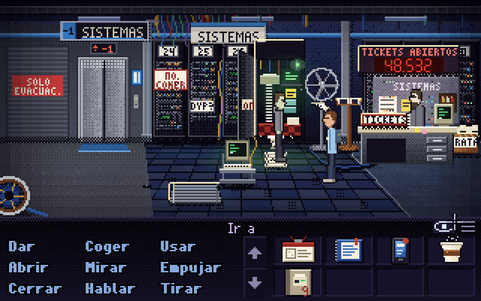 20. Rubén, pequeño y en penumbra | 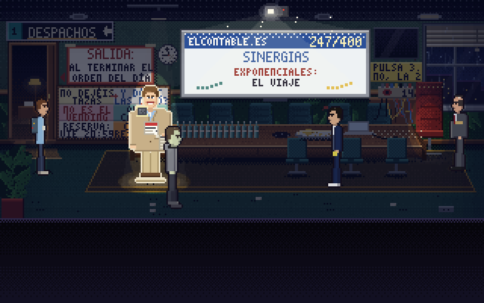 21. Clímax |
| 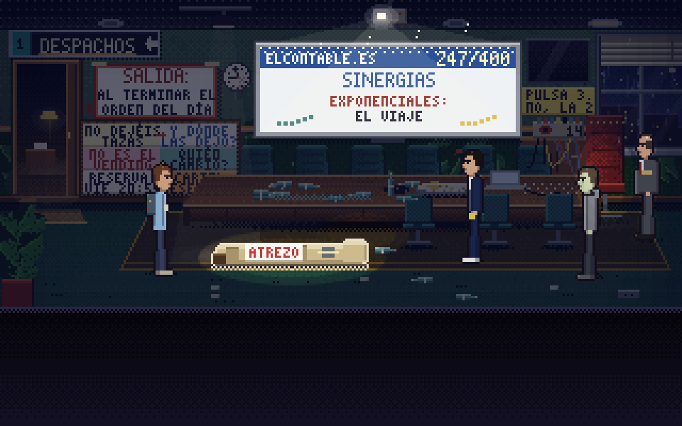 22. El Lector, en el suelo | 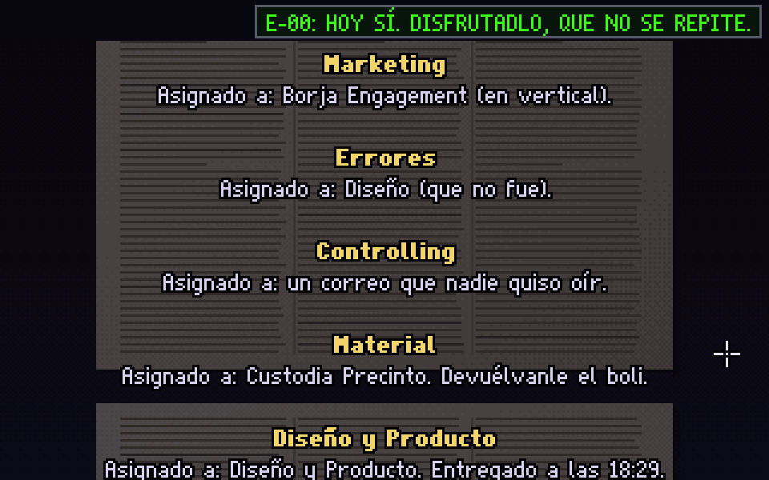 25. Créditos: «Errores: Diseño (que no fue)» | |

## 12. Sobre los documentos del proyecto (leídos después de jugar)

- `GUION_ADENDA.md §0.2` vende el cameo de Valentín como algo que «cierra con elegancia el guiño 4» y define a Diseño
  como «inocente, puntual y con razón». Desde fuera es lo contrario de elegante: es el único departamento al que el juego
  nunca le hace un chiste *a costa de él*, y el que se lleva el último aplauso. Es la definición de autocomplaciente.
- La adenda decide los guiños con un «criterio de tacto» (no ofender) pero no con un criterio de **coste en atención**:
  cada guiño pasa el filtro por sí solo y nadie suma lo que pesan juntos (24 voces, 37 hotspots en una sala).
- `docs/informes/INFORME_AJUSTE_VISUAL.md` acertó en sus diagnósticos de puesta en escena y varios están resueltos (la
  caída del Lector se ve, el amanecer existe, la Redacción ya tiene zonas rotuladas). Pero mide «ajuste al guion», no si
  el guion funciona: por eso no ve que el problema principal es de comedia y de ritmo, no de fidelidad.
- La tabla de pruebas del README (13 herramientas que verifican geometría, contraste, recorridos…) es admirable y explica
  por qué no encontré errores técnicos serios. Ninguna de esas pruebas mide si algo hace gracia ni cuánto se anda.

---

## Apéndice A — Muestra de 216 líneas clasificadas

Semilla 2026 sobre las 2.783 líneas únicas. «Excluida» = texto de interfaz o comentario que el extractor recogió (3).
Versión CSV: `datos/muestra_lineas.csv`.

| n | clase | archivo:línea | texto |
|---|---|---|---|
| 0 | sonrisa | `lib/movil.js:31` | Sin leer desde hace seis años. Ya casi me ha llegado el acceso. |
| 1 | sonrisa | `rooms/ecosistema.js:169` | «TODO ES UNA OPORTUNIDAD SI TIENE UN MÓDULO AL LADO.» |
| 2 | sonrisa | `rooms/pecera.dialogos.js:285` | CULPAS A DISEÑO: 3.112. CON RAZÓN: 0. |
| 3 | neutra | `rooms/pecera.js:41` | Dicen que la plaza de Ramírez sale a subasta. Ya tiene columna en el tablero. |
| 4 | neutra | `rooms/vestibulo.js:139` | En el Vending. Gertrudis. Pero no te lo dará así como así. |
| 5 | sonrisa | `items.js:233` | Echarle azúcar al café de Gertrudis es corregirla. No me atrevo. |
| 6 | sonrisa | `rooms/catacumba.js:473` | Lo empujo un centímetro. Teodoro lo devuelve a su sitio. Exacto. |
| 7 | relleno | `rooms/pecera.secretaria.js:128` | No me preguntó nadie. |
| 8 | sonrisa | `rooms/sala_amazonas.js:110` | Si abro uno, me lo imputan como gasto de representación. |
| 9 | neutra | `rooms/pecera.js:317` | "DESARROLLO · A PARTIR DE AQUÍ, SOLO CÓDIGO PROPIO". |
| 10 | neutra | `rooms/office.js:273` | Pulso el botón del café. Me mira. Así no. Habrá que hablarle. |
| 11 | sonrisa | `rooms/pecera.js:412` | Yoli, audiencias. Le tiembla el párpado al ritmo de la gráfica. |
| 12 | neutra | `rooms/pecera.js:259` | Lo escribo fuera del CMS: ahí dentro vive el Titulator. |
| 13 | fallida | `rooms/pecera.dialogos.js:220` | En mi juego, el Titulator ya era un becario. |
| 14 | relleno | `rooms/pecera.secretaria.js:37` | Está a medias. |
| 15 | neutra | `rooms/pajarera.js:239` | Todos los relojes marcan las 20:59. La sala es de Ramírez. Siempre. |
| 16 | neutra | `rooms/cpd.js:55` | ¿Y qué haces en un armario? |
| 17 | sonrisa | `actors.js:242` | Esto a POR HACER. Esto a BLOQUEADO. Esto a la basura, pero con cariño. |
| 18 | sonrisa | `rooms/sala_amazonas.js:61` | Si la cierro, esto se convierte en una reunión de verdad. No me atrevo. |
| 19 | neutra | `game.js:45` | Y pégala bien, que se cae. Pídele algo que pegue al del mostrador. |
| 20 | sonrisa | `lib/ascensor.js:39` | Le recordamos que lo que se dice en el ascensor no sale. Ni el wifi. |
| 21 | risa | `rooms/ecosistema.dialogos.js:14` | ¿Desde marzo sin confirmar? Eso no es un cliente, es un exnovio. |
| 23 | sonrisa | `rooms/pajarera.js:312` | Rosa. Emociones. No te lo tomes como algo personal: es un pósit. |
| 24 | sonrisa | `actors.js:399` | Plaza 3, sucesión en disputa. Esto no es un garaje. Es una herencia. |
| 25 | neutra | `rooms/pecera.dialogos.js:218` | Y prueba cosas raras. Aquí todo lo raro está probado. |
| 26 | sonrisa | `rooms/vestibulo.js:396` | Celestino no se coge. Viene con el edificio. Como las goteras. |
| 27 | sonrisa | `rooms/ecosistema.js:141` | El roll-up no se toca, cariño. Está contratado hasta 2030. |
| 28 | neutra | `rooms/catacumba.js:369` | En mi página no hay erratas, chaval. Ni en los nombres. |
| 29 | sonrisa | `rooms/office.js:45` | E-52: ESE CAFÉ ESTÁ SACADO DE CONTEXTO. |
| 30 | sonrisa | `rooms/cpd.js:132` | ¿El de Teodoro? Ese fax tiene más años que tú y más paciencia que yo. |
| 31 | sonrisa | `rooms/eventos.js:40` | ¡Flash! Para el álbum. Y para el seguro. |
| 32 | sonrisa | `rooms/eventos.js:122` | Una foto de un álbum de fotos. Eso ya es un archivo. ¡Acreditado! |
| 33 | sonrisa | `rooms/eventos.js:237` | «¿De quién eres?». La silla no contesta. Tiene contrato de confidencialidad. |
| 34 | relleno | `rooms/pecera.js:49` | ¡El navegador no respeta nada! |
| 35 | sonrisa | `rooms/vestibulo.js:42` | Debajo, a lápiz, la línea de sucesión. Como en una monarquía. |
| 36 | sonrisa | `game.js:20` | Lo cierro. No pasa nada. Igual que en las reuniones. |
| 37 | sonrisa | `rooms/eventos.dialogos.js:75` | Una vez sujeté un evento entero. Con dos tiras. |
| 38 | neutra | `game.js:118` | Una cosita. ¿Puede pasarse por mi despacho? Es un segundo. |
| 39 | neutra | `rooms/pecera.js:324` | "ACCESO CONCEDIDO: HERMINIA (DESARROLLO)". Lo de Infografía, tachado. |
| 40 | risa | `rooms/pecera.js:191` | "¿Me lees?" Baja a 3.417. Creo que se ha ido el que me leía. |
| 41 | sonrisa | `rooms/ecosistema.dialogos.js:71` | Encantados. Ahora la web respira. El banner, digo. |
| 42 | sonrisa | `rooms/ecosistema.dialogos.js:29` | ¡Bruno! ¡Justo hablábamos de tu marca personal! |
| 43 | neutra | `rooms/pecera.dialogos.js:25` | Íñigo va a cerrar el papel. |
| 44 | fallida | `rooms/administracion.dialogos.js:147` | Lleva RECHAZADO en la frente. Del revés. Lo he leído igual. |
| 45 | neutra | `rooms/vestibulo.js:122` | Hablar no. Pero oye. Y yo oigo a la planta. |
| 46 | sonrisa | `rooms/pecera.js:452` | ¿El sol también va con ticket? |
| 47 | sonrisa | `rooms/ecosistema.js:113` | Se cierra solo. Es lo único de la planta que no pide feedback. |
| 48 | sonrisa | `duelo.js:36` | Diseño entrega a tiempo. No sé en qué cuadrante ponerlos. |
| 49 | relleno | `rooms/eventos.js:194` | ¡Probando, cambio! Se te oye en Comercial. |
| 50 | neutra | `rooms/eventos.js:171` | Todos los relojes de la casa marcan las 20:59. Este, cinco minutos. |
| 51 | neutra | `rooms/pecera.dialogos.js:47` | Ah. "Baja becario Rubén". Por Hacer. Desde julio. |
| 52 | sonrisa | `rooms/office.js:285` | Si le tiro de la manga, me la delega. |
| 53 | neutra | `game.js:121` | Una cosita. Begoña me manda el triplicado de lo que recorta. |
| 54 | relleno | `rooms/office.js:73` | Me lo apunto. |
| 55 | neutra | `rooms/pecera.secretaria.js:33` | ¿Me deja un boli? |
| 56 | relleno | `rooms/pecera.js:304` | Nadie la ha visto moverse. |
| 57 | neutra | `rooms/pecera.dialogos.js:259` | Vacante soy yo. |
| 58 | neutra | `lib/movil.js:23` | ¡Empezamos en 5 minutos! |
| 59 | sonrisa | `rooms/pajarera.js:122` | OCUPADO hasta 2031. Llamar a esta puerta es pedir una prórroga. |
| 60 | neutra | `rooms/pecera.escenas.js:89` | Os presento al Titulator 3000. Inteligencia artificial de titulares. |
| 61 | sonrisa | `rooms/pecera.secretaria.js:126` | Armario 27. En agosto me pidió un boli por debajo de la puerta. |
| 62 | sonrisa | `rooms/pecera.dialogos.js:220` | Una IA no pone las tildes con tanto cariño. |
| 63 | sonrisa | `rooms/office.js:57` | "Firmar el cierre" suena a que lo cierro yo. |
| 64 | sonrisa | `rooms/pecera.js:91` | "Calendario laboral 2027: todos los puentes (y cómo pedir el lunes)". |
| 65 | risa | `rooms/cpd.js:185` | No me encerró. Me dio una silla y wifi. Yo pensé que era un contrato. |
| 66 | fallida | `rooms/office.js:271` | Dentro hay posos de 2009 y un tornillo de la Ferretería Hermanos Tornillo. |
| 67 | sonrisa | `rooms/pecera.js:359` | Arriba: "Entregado a las 18:29. Todo en la carpeta. Buen fin de semana". |
| 68 | neutra | `rooms/pecera.dialogos.js:159` | ¿Y el Titulator? Ese sí entró. |
| 69 | sonrisa | `rooms/pecera.js:48` | ¡Abrid una incidencia a la lluvia! |
| 70 | relleno | `rooms/pecera.js:56` | ¡Esto es culpa de Dis...! |
| 71 | sonrisa | `duelo.js:39` | ¿Y usted cómo se encuentra? De salud, digo. |
| 72 | sonrisa | `rooms/pecera.js:442` | Rubén mira por la ventana. Espera al sol como quien espera una nómina. |
| 73 | sonrisa | `rooms/catacumba.js:481` | Nada. Las 20:59. Es el minuto más largo de la historia del periodismo. |
| 74 | sonrisa | `rooms/administracion.dialogos.js:71` | Representación. Me represento a mí mismo. |
| 75 | sonrisa | `escenas/final.js:90` | Íñigo. Hay una beca en Mercados. Lo hablamos. |
| 76 | sonrisa | `rooms/pecera.js:71` | Javier, Javi y Javier Ignacio. Será el diseño del anuncio. |
| 77 | relleno | `rooms/vestibulo.js:334` | Celestino lo ha tapado con su bufanda. |
| 78 | sonrisa | `rooms/sala_amazonas.js:115` | ¿Sigue siendo marzo? |
| 79 | sonrisa | `rooms/pajarera.js:177` | Rosa, emociones. Azul, excusas. El azul es el que más se gasta. |
| 80 | neutra | `rooms/pecera.dialogos.js:111` | Porque Anselmo no la integra. Dice que no ha pasado por Desarrollo. |
| 81 | neutra | `rooms/administracion.dialogos.js:156` | Todos los contratos de la casa. Leídos. Hasta la letra pequeña. |
| 82 | relleno | `rooms/pecera.dialogos.js:172` | ¿Cómo? |
| 83 | sonrisa | `rooms/catacumba.js:510` | Ese libro no se mueve. Es lo único que sostiene esta mesa. |
| 84 | neutra | `rooms/administracion.dialogos.js:34` | Quiero presentar una nota de gasto. |
| 85 | risa | `rooms/sala_amazonas.js:137` | Hay uno que encaja consigo mismo. Lo dejo así: es feliz. |
| 86 | neutra | `rooms/pecera.dialogos.js:24` | ¿Quién comenta mis piezas? |
| 87 | sonrisa | `rooms/vestibulo.js:363` | Esas llaves no se tocan. Las custodio yo. Y el garaje me custodia a mí. |
| 88 | sonrisa | `rooms/pecera.dialogos.js:109` | Se fue a las seis y media. Herminia no ficha. |
| 89 | neutra | `rooms/pecera.js:241` | Ramírez: "Quedo a la espera de tus comentarios". |
| 90 | sonrisa | `rooms/cpd.js:126` | Cierra. No, esa no. Esa es un servidor. |
| 91 | sonrisa | `rooms/pecera.js:334` | Las manos están enfadadas. |
| 92 | neutra | `rooms/office.js:130` | Ah, Vacante. El acta de la reunión hay que redactarla. Te lo pongo por escrito. |
| 93 | sonrisa | `rooms/vestibulo.js:329` | Si le tiro de una hoja, me la deja en la mano. Es de plástico, pero digna. |
| 95 | sonrisa | `rooms/pecera.js:261` | Tentador. Pero el teclado de al lado ya lo probó en 2017. |
| 96 | neutra | `rooms/vestibulo.js:138` | ¿Dónde hay café en esta casa? |
| 97 | relleno | `rooms/pecera.dialogos.js:277` | Perdón, Diseño. |
| 98 | sonrisa | `rooms/pecera.dialogos.js:158` | Eso la hace nuestra. |
| 99 | sonrisa | `rooms/pajarera.js:192` | Es de cuero blanco. Si lo toco, le dejo la huella de un sueldo bajo. |
| 100 | risa | `rooms/catacumba.js:279` | En internet una errata se corrige, chaval. En papel se enmarca. |
| 101 | sonrisa | `rooms/ecosistema.dialogos.js:92` | Tadeo confía. Leer es para quien duda. |
| 102 | fallida | `rooms/cpd.js:249` | No. Ya he encerrado a bastante gente hoy. Bueno, a nadie. Pero no. |
| 103 | risa | `actors.js:377` | Esto, en barras. Esto, en tarta. Esto, en tarta pero triste. |
| 104 | neutra | `escenas/climax.js:61` | ¿Auditada por quién? Para Sistemas, tu IA es un becario. Alta: julio. |
| 105 | neutra | `rooms/administracion.dialogos.js:184` | ¿Y no me lo puede decir ahora? |
| 106 | sonrisa | `rooms/vestibulo.js:213` | Si me llevo la «e», se queda en «lContable». Suena a gestoría con prisas. |
| 107 | relleno | `rooms/pecera.secretaria.js:106` | Para que sepa lo que se siente. |
| 108 | neutra | `rooms/pecera.dialogos.js:38` | ¿Qué es ese pósit tan amarillo? |
| 109 | sonrisa | `rooms/pecera.js:70` | A la oferta de «ninja del backend» se han apuntado tres. |
| 110 | sonrisa | `rooms/pecera.dialogos.js:216` | Con una flecha roja. De dos píxeles de grosor. Para que se viera. |
| 111 | fallida | `rooms/eventos.js:147` | Dentro, más lanyards. Y debajo, tazas con logo. Es un ecosistema. |
| 112 | sonrisa | `rooms/catacumba.js:243` | Lo has dicho bien. Me has descolocado. |
| 113 | fallida | `rooms/cpd.js:190` | Mirar el sol. Y preguntar quién gobierna. |
| 114 | neutra | `rooms/pecera.dialogos.js:189` | Si no está en el tablero, no existe. |
| 115 | relleno | `rooms/pecera.dialogos.js:88` | Prometo cuidarlo. |
| 116 | sonrisa | `rooms/pecera.js:32` | Teodoro vive en la Catacumba. Está hasta empadronado. Lo dice el wifi. |
| 117 | sonrisa | `rooms/pecera.dialogos.js:252` | ...Pues la pantalla la eligió Diseño. |
| 118 | sonrisa | `rooms/pajarera.js:198` | Le pregunto quién le escribe los titulares. Parpadea. En mayúsculas. |
| 119 | neutra | `rooms/pecera.js:325` | "ACCESO REVOCADO: TITULATOR 3000". Con fecha de hoy. Y de julio. |
| 120 | sonrisa | `rooms/vestibulo.js:279` | Le pregunto por el Ibex. Me contesta en diferido. |
| 121 | sonrisa | `escenas/climax.js:72` | ...Eso es una alucinación. |
| 123 | sonrisa | `rooms/ecosistema.js:152` | Pone SINERGIA en tres colores. Si la miras fijamente, aparece un velero. |
| 124 | risa | `rooms/pecera.dialogos.js:25` | Si cierra el papel, ¿quién me va a odiar con criterio? |
| 126 | neutra | `rooms/pajarera.js:223` | "OCUPADO – hasta 2031". |
| 127 | sonrisa | `rooms/pecera.js:51` | Tu silla gira. Se ha tocado sola. |
| 128 | neutra | `rooms/cpd.js:186` | ¿Escribiste tú los discursos de Íñigo? |
| 129 | sonrisa | `rooms/pajarera.js:329` | Vacante. Te iba a llamar. Bueno, no. Lo hablamos. |
| 130 | neutra | `rooms/catacumba.js:110` | Veintitrés líneas. Hueco, fuente y firma. |
| 131 | neutra | `rooms/pajarera.js:126` | Tengo el acta. Pero sin lo de Rubén, Íñigo me desapalanca. |
| 132 | sonrisa | `escenas/final.js:219` | Asignado a: Ramírez (viernes, 20:59, recurrente). |
| 133 | sonrisa | `rooms/vestibulo.js:147` | ¿Me preguntas por el Ibex? ¿A mí? ¿En treinta años? |
| 134 | sonrisa | `rooms/cpd.js:232` | Pesan como un servidor. Porque son servidores. |
| 135 | sonrisa | `rooms/eventos.js:202` | Pilar respira en mayúsculas. |
| 136 | sonrisa | `game.js:277` | Tranquilo. Yo también me quedo así en las reuniones. |
| 137 | neutra | `rooms/catacumba.js:220` | Tengo dos fuentes. |
| 138 | sonrisa | `rooms/office.js:206` | Si caliento la ficha, se borran las casillas. Y la ilusión. |
| 139 | relleno | `rooms/administracion.dialogos.js:167` | No dormí en un año. |
| 140 | neutra | `rooms/pajarera.js:312` | ¿De qué color soy yo? |
| 141 | sonrisa | `actors.js:431` | LIMPIEZA AUTOMÁTICA: NADIE ME LIMPIA. |
| 142 | sonrisa | `game.js:124` | Le he mandado la coma a Teodoro. Por fax. Era solo eso. |
| 143 | sonrisa | `actors.js:197` | Soy yo. Joven, prometedor y sin contrato. Como una startup. |
| 144 | neutra | `rooms/pajarera.js:317` | ¿Conoces a Herminia? |
| 145 | neutra | `rooms/pecera.js:472` | Herminia la lee en un segundo. Ya tiene infografía. Papel, web, redes. |
| 146 | sonrisa | `rooms/pecera.js:246` | Bandeja de entrada. Ramírez sigue a la espera de mis comentarios. |
| 147 | neutra | `game.js:52` | ¿Has hecho la cuenta de gastos? Hazla mal. Así te enseñan una bien hecha. |
| 148 | sonrisa | `rooms/sala_amazonas.js:19` | «ENTRADA 2»: el tiempo de ayer. En diferido. |
| 149 | neutra | `rooms/catacumba.js:241` | ¿Ha oído cómo pregunta Custodia? |
| 150 | sonrisa | `rooms/cpd.js:114` | No atiendo. Tengo 312 tickets que dicen «el CMS no va». |
| 151 | sonrisa | `rooms/administracion.dialogos.js:13` | Recorto por abajo, como manda la pirámide invertida. |
| 152 | sonrisa | `rooms/sala_amazonas.js:107` | Catorce botellines por los suelos. Uno sigue en pie. Es de Mercados. |
| 153 | neutra | `escenas/climax.js:300` | Cuatro meses. Nos deben 191.808 euros. Lo he revisado tres veces. |
| 154 | sonrisa | `rooms/cpd.js:245` | Pegatina: «PROPIEDAD DE OPTIMAL BRAINS. NO ABRIR: SE ENFRÍA EL MODELO». |
| 155 | neutra | `rooms/vestibulo.js:324` | La giro. Debajo de una hoja, un micrófono de 1994. |
| 156 | sonrisa | `rooms/vestibulo.js:28` | ¡Ibersideral entra por la banda! ¡Sube un 0,2! ¡Qué técnica! |
| 157 | fallida | `rooms/eventos.js:128` | Si me lo llevo, mañana en la Pecera se nos ven las ojeras de verdad. |
| 158 | neutra | `rooms/administracion.dialogos.js:217` | «Las cantidades se expresan con punto de miles y coma decimal.» |
| 159 | sonrisa | `actors.js:280` | Diecinueve años. Ni un marrón. Ni uno. |
| 160 | relleno | `rooms/ecosistema.js:139` | Me pongo delante del roll-up. |
| 161 | neutra | `rooms/vestibulo.js:285` | El ascensor. Detrás de los tornos, con su moqueta y su logo. |
| 162 | sonrisa | `rooms/pecera.js:483` | ¿Café de Gertrudis? No. Yo bebo del termo. Café propio. |
| 163 | neutra | `rooms/pecera.js:425` | ¿Fotos de eventos? Eso no lo ve nadie. |
| 164 | relleno | `rooms/pecera.dialogos.js:234` | ¿Diseño? |
| 165 | fallida | `rooms/administracion.dialogos.js:104` | Esto es un puzle, ¿verdad? Lo noto en el aire. |
| 166 | neutra | `rooms/pecera.js:242` | Respuesta: "Espera sentado. Si encuentras silla". Me la apunto. |
| 167 | sonrisa | `rooms/catacumba.js:472` | No sé medir en cíceros. En la web medimos en clics y en disgustos. |
| 168 | sonrisa | `rooms/pecera.dialogos.js:123` | Me han anexionado. Pero integrada. Que es lo que quería. Creo. |
| 169 | sonrisa | `rooms/pecera.secretaria.js:42` | Lo suyo es un capricho con prisa. |
| 170 | risa | `rooms/administracion.dialogos.js:87` | La palabra de honor dejó de ser moneda de curso legal con la peseta. |
| 171 | relleno | `rooms/pecera.secretaria.js:117` | ¿Desde 2019? |
| 172 | neutra | `rooms/pecera.escenas.js:81` | Buenas noches, equipo. Íñigo Sinergia, de Optimal Brains & Partners. |
| 173 | sonrisa | `rooms/ecosistema.dialogos.js:48` | ¡Salida de escena! ¡Eso es un cierre de embudo! |
| 174 | sonrisa | `game.js:57` | El que no contesta, contesta solo. Como el contestador de tu tío. |
| 175 | sonrisa | `rooms/office.js:257` | Un pósit: "Servicio técnico: CELESTINO, ext. 0". |
| 176 | sonrisa | `rooms/administracion.js:22` | «Nota de gasto generada por IA (Desarrollo). Motivo: la IA no come». |
| 177 | fallida | `rooms/administracion.dialogos.js:105` | Para usted es lo mismo, pero con multa. |
| 178 | neutra | `rooms/pecera.secretaria.js:34` | ¿Me da una libreta? |
| 179 | relleno | `rooms/ecosistema.js:76` | Muy bonito. Cero euros. |
| 180 | neutra | `rooms/pecera.escenas.js:104` | Sin edición impresa. Sin rotativa. Sin costes. Solo clics. |
| 181 | sonrisa | `rooms/office.js:213` | Un hilo impreso: "RE: RE: RE: ¿De quién es el yogur?". 214 respuestas. |
| 182 | sonrisa | `rooms/eventos.js:306` | ¡Sin fotos sin acreditación! ...Bueno, una. Salgo mejor de perfil. |
| 183 | neutra | `rooms/administracion.dialogos.js:175` | ¿Ha enviado ya el correo? |
| 184 | relleno | `rooms/pecera.js:59` | Nunca mira. |
| 185 | sonrisa | `rooms/catacumba.js:226` | Y Gervasio no ha escrito un acta en su vida. |
| 186 | fallida | `rooms/eventos.js:235` | Antes miro de quién es. Aquí todo tiene dueño. Y acreditación. |
| 187 | neutra | `items.js:274` | Borde perforado. Esto no viene de un fax: viene de una matricial. |
| 188 | sonrisa | `rooms/eventos.js:300` | En la muñeca, un rollo de cinta americana. Por si hay que acreditar algo. |
| 189 | sonrisa | `game.js:18` | Le hablo. No me contesta. Es lo más parecido a una fuente oficial. |
| 190 | neutra | `escenas/final.js:120` | ¿Y si me lo dice ahora? |
| 191 | neutra | `rooms/eventos.js:39` | ¡Acreditado! Empezamos en cinco minutos. |
| 192 | neutra | `rooms/vestibulo.js:135` | ¿Tiene algo para los nervios? |
| 193 | sonrisa | `rooms/eventos.js:97` | Está entornada. Pilar la deja así: «para que fluya el público». |
| 194 | sonrisa | `duelo.js:40` | MÁS SANO QUE LA GOYITA. Y LA GOYITA TIRA. |
| 195 | sonrisa | `duelo.js:39` | Estupendamente. La plaza no se hereda, Vacante. |
| 196 | sonrisa | `rooms/pecera.escenas.js:155` | ¡Estamos ciegos! ¿Hay alguien leyendo? ¿HAY ALGUIEN AHÍ FUERA? |
| 197 | neutra | `rooms/pecera.dialogos.js:152` | Está hecha con IA. En otro departamento. |
| 198 | sonrisa | `rooms/ecosistema.js:229` | Hay que hablarle al lector de tú. Y en vertical. Y con un emoji. |
| 199 | risa | `rooms/ecosistema.js:56` | Lo cierro. Antes de apagarse, reenvía: «RV: Me han cerrado». |
| 200 | sonrisa | `rooms/pajarera.js:313` | Es generativo, autónomo y escalable. Y no pide vacaciones. |
| 201 | sonrisa | `rooms/ecosistema.js:217` | Una piel de plátano junto a la impresora. Pósit: «Para Gervasio (plaza 7)». |
| 202 | sonrisa | `rooms/administracion.dialogos.js:18` | Ni una línea más. Ni un céntimo menos. |
| 203 | neutra | `rooms/pecera.dialogos.js:256` | Diseño y Producto. Se fueron a las seis y media. Menos su director. |
| 204 | sonrisa | `rooms/pecera.js:401` | Ahí fuera hay un mundo real. Bajísimo tiempo de permanencia. |
| 205 | sonrisa | `rooms/sala_amazonas.js:91` | Leo el punto 3 en voz baja. Uno de Mercados se estremece. |
| 206 | fallida | `rooms/administracion.js:131` | Si la abre, se pierde la página. Y la página es lo de menos: la coma. |
| 207 | neutra | `rooms/administracion.dialogos.js:211` | Tengo que ir a cerrar una página. |
| 208 | sonrisa | `rooms/pecera.secretaria.js:51` | Perdonado. Siguiente. |
| 209 | relleno | `rooms/pecera.js:58` | No se lo digas. |
| 210 | risa | `rooms/catacumba.js:325` | ESTOY FUERA DE LA OFICINA HASTA QUE EL PAPEL DEJE DE EXISTIR. |
| 211 | risa | `rooms/pajarera.js:197` | No le hago fotos. Luego me titula: "BECARIO FOTOGRAFÍA UNA IA. LA IA, INCÓMODA". |
| 212 | sonrisa | `rooms/sala_amazonas.js:118` | Tres redactores de Mercados. Aquí desde marzo. Uno tiene barba de comité. |
| 213 | sonrisa | `rooms/eventos.dialogos.js:59` | Así nunca llegamos tarde. Ni a lo que no hay. |
| 214 | neutra | `rooms/pecera.dialogos.js:40` | ¿Por qué un calendario de ferretería? |
| 215 | sonrisa | `rooms/pecera.secretaria.js:117` | Él desayuna despacio. Yo apunto rápido. |
| 216 | neutra | `rooms/catacumba.js:550` | Veintitrés. Cabe. Ahora dame la ficha: sin ficha no hay página. |
| 217 | sonrisa | `rooms/vestibulo.js:393` | Eso, a objetos perdidos. Ahí guardo desde paraguas hasta becarios. |
| 218 | sonrisa | `game.js:15` | Está inventariado. Aquí todo está inventariado menos yo. |
| 219 | sonrisa | `rooms/pecera.js:251` | Ya está escrita. Si la toco más, le salen adjetivos. |

## Apéndice B — Tiempos y cambios de sala del recorrido óptimo (partida con ratón real)

«Segundos bot» = tiempo real de mi automatización pasando los globos a ~0,4 s cada uno (incluye andar y animaciones; no incluye leer). Para la estimación humana sumé la lectura con la fórmula del motor (`core.js:558`) y 6 s por decisión.

| Acto | Pasos | Acciones | Cambios de sala | Líneas bloqueantes | Lectura (min) | Segundos bot | Estimación humana conociendo la solución |
|---|---:|---:|---:|---:|---:|---:|---:|
| I | 1-16 | 26 | 6 | 125 | 7,1 | 188 | ≈ 12 min |
| II | 17-37 | 58 | 24 | 201 | 11,2 | 329 | ≈ 21 min |
| III + epílogo | 38-46 | 27 | 11 | 144 + 48 | 8,0 + 2,3 | 316 | ≈ 17 min |
| **Total** | 46 | **111** | **41** | 518 | 28,6 | 833 | **≈ 50 min** (primera partida: 2-3 h) |

| Paso | Acto | Sala final | Segundos bot | Cambios de sala | Líneas | Acción |
|---:|---:|---|---:|---:|---:|---|
| 1 | 1 | vestibulo | 15.6 | 0 | 20 | (Intro automática, 7.1) |
| 2 | 1 | vestibulo | 4.1 | 0 | 7 | Hablar celestino → «¿Tiene algo para los nervios?» |
| 3 | 1 | vestibulo | 3.4 | 0 | 8 | Hablar celestino → «¿Dónde hay café en esta casa?» |
| 4 | 1 | vestibulo | 3.8 | 0 | 9 | Hablar celestino → «¿Algún cotilleo?» |
| 5 | 1 | vestibulo | 1.2 | 0 | 1 | Usar chicle con tarjeta_becario |
| 6 | 1 | vestibulo | 2.8 | 0 | 1 | Usar tarjeta_becario con organigrama |
| 7 | 1 | vestibulo | 4.2 | 0 | 2 | Usar tarjeta_becario con torno |
| 8 | 1 | pecera | 51.0 | 1 | 30 | (entrar) → escena 7.2 |
| 9 | 1 | pecera | 5.0 | 0 | 4 | Coger chaqueta_ramirez_hotspot |
| 10 | 1 | pajarera | 30.0 | 1 | 18 | Usar chaqueta_ramirez con lector_medio |
| 11 | 1 | pajarera | 5.9 | 0 | 5 | Mirar ordenador_gervasio |
| 12 | 1 | pajarera | 8.4 | 0 | 8 | Mirar pantalla_titulator ×3 |
| 13 | 1 | pecera | 15.8 | 1 | 9 | Mirar ordenador_bruno |
| 14 | 1 | office | 13.5 | 1 | 7 | Hablar gertrudis → «Buenas noches, Gertrudis.» |
| 15 | 1 | office | 2.9 | 0 | 4 | Mirar tablon |
| 16 | 1 | catacumba | 20.7 | 2 | 18 | Dar cafe a aurora_galerada |
| 17 | 2 | catacumba | 3.8 | 0 | 9 | Hablar aurora_galerada → «¿Por qué no se hablan usted y Teodoro?» |
| 18 | 2 | catacumba | 3.8 | 0 | 9 | Hablar aurora_galerada → «¿Cómo convenzo a Teodoro?» |
| 19 | 2 | catacumba | 2.5 | 0 | 5 | Mirar fax_enmarcado |
| 20 | 2 | office | 25.1 | 2 | 27 | Hablar gertrudis → «Buenas noches, Gertrudis.» (×3) |
| 21 | 2 | cpd | 14.6 | 2 | 8 | Mirar registro_tickets |
| 22 | 2 | pecera | 17.2 | 1 | 7 | Tirar enchufe_pantalla |
| 23 | 2 | pecera | 5.8 | 0 | 11 | Hablar yoli_tendencias → «¿Algún hilo bueno esta noche?» |
| 24 | 2 | pecera | 12.2 | 0 | 5 | Hablar nerea_backlog → «¿Qué tal con Yoli?» |
| 25 | 2 | cpd | 36.3 | 1 | 21 | Hablar paco_ticket → «¿Sabes algo del fax de la Catacumba?» |
| 26 | 2 | cpd | 4.1 | 0 | 10 | Hablar paco_ticket → «¿Algún cotilleo del consultor?» |
| 27 | 2 | sala_amazonas | 28.0 | 3 | 8 | Hablar gervasio_acta → «Bueno... ¿y cuáles son los siguientes pasos?» |
| 28 | 2 | sala_amazonas | 3.6 | 0 | 2 | Coger planillo_mesa |
| 29 | 2 | ecosistema | 28.2 | 3 | 25 | Dar planillo a maripaz_remitido → duelo D1 |
| 30 | 2 | administracion | 18.2 | 1 | 35 | Hablar begona_triplicado → nota de gasto (P08) |
| 31 | 2 | catacumba | 23.3 | 3 | 3 | Usar copias_rechazadas con fax |
| 32 | 2 | catacumba | 1.6 | 0 | 4 | Mirar mensaje_fp |
| 33 | 2 | catacumba | 6.4 | 0 | 11 | Dar fotocopia_nota_direccion a aurora_galerada |
| 34 | 2 | pecera | 10.3 | 1 | 3 | Usar ordenador_bruno |
| 35 | 2 | catacumba | 20.3 | 1 | 29 | Hablar teodoro_cuerpodoce → «Quiero firmar en tu página 7.» → duelo D2 |
| 36 | 2 | administracion | 24.1 | 3 | 8 | Dar pieza_opa a begona_triplicado |
| 37 | 2 | catacumba | 39.4 | 3 | 22 | Dar ficha_pagina_7 a teodoro_cuerpodoce → escena 7.3a |
| 38 | 3 | cpd | 36.6 | 2 | 39 | Tirar papel_continuo → escena 7.3 |
| 39 | 3 | cpd | 3.8 | 0 | 9 | Hablar ruben → «¿Escribiste tú los discursos de Íñigo?» |
| 40 | 3 | eventos | 18.0 | 2 | 19 | Hablar pilar_escaleta → «¿Me prestas el álbum?» |
| 41 | 3 | pecera | 38.7 | 2 | 16 | Dar album_eventos a nerea_backlog → «¿Y si... lo descopeamos?» |
| 42 | 3 | cpd | 38.1 | 1 | 15 | Dar posit_baja_ruben a paco_ticket |
| 43 | 3 | office | 23.6 | 2 | 22 | Hablar gervasio_acta → «Necesito el acta de la última reunión.» → duelo D3 |
| 44 | 3 | sala_amazonas | 17.3 | 2 | 11 | Usar puerta_sala → escena 7.4 (entrada) |
| 45 | 3 | sala_amazonas | 19.5 | 0 | 27 | Duelo D4 (Íñigo) |
| 46 | 3 | pecera | 120.7 | 0 | 68 | Empujar lector_medio → 7.4 final + 7.5 |

Escenas medidas (lectura a velocidad normal): intro 20 líneas / 63 s; llegada a la Redacción 21 líneas / 73 s; Aurora y el Acto II 13 líneas / 53 s; revelación de Rubén 27 líneas / 86 s; clímax → fin 67 líneas / 191 s.

## Apéndice C — Cobertura verbo + objeto por sala (180 pares)

| Sala | Propia | Por defecto |
|---|---:|---:|
| vestibulo | 15 | 3 |
| pecera | 7 | 11 |
| office | 9 | 9 |
| catacumba | 7 | 11 |
| pajarera | 7 | 11 |
| sala_amazonas | 8 | 10 |
| ecosistema | 7 | 11 |
| eventos | 6 | 12 |
| administracion | 8 | 10 |
| cpd | 16 | 2 |

(En `pajarera` cuento como propias las dos salidas que cambian de sala sin texto.) Lista completa con cada respuesta en `datos/cobertura_verbos.csv`.

## Apéndice D — Prueba de voz a ciegas (30 réplicas)

| n | Réplica | ¿Lleva marca de voz? | Hablante real |
|---:|---|---|---|
| 0 | Descopear. Es lo más bonito que me han dicho delante del tablero. | no | nerea_backlog |
| 1 | SEGUIREMOS INFORMANDO. Perdón. Se me escapa. | sí | ruben |
| 2 | Cuarenta años en esta ventanilla. He visto un ticket en sánscrito. | sí | begona_triplicado |
| 3 | Toma el manual. Página 9. Lo demás son fotos del fax. Posando. | no | paco_ticket |
| 4 | Una anónima y otra con IVA. Me vale. | sí | aurora_galerada |
| 5 | Bruno Pellejo. Trece con espacios. Cabe. | sí | teodoro |
| 6 | RV: RV: RV: La IA dice que el LCP baja quitando lo más grande!! | sí | tadeo_adjunto |
| 7 | YOLI: "AYER ESTABA CON LO DE ANTEAYER. PÍDESELO A MAÑANA, QUE ESTÁ LIBRE". | sí | gertrudis |
| 8 | En mi página no hay erratas, chaval. Ni en los nombres. | sí | teodoro |
| 9 | ¿El de la cena de Navidad? Está acreditado. Firma aquí. Y aquí. | sí | pilar_escaleta |
| 10 | RV: RV: Cómo instalar una bandeja 2 en una impresora sin bandeja 2. | sí | tadeo_adjunto |
| 11 | Rechazada. Va a la pared. Al lado del ministro. | sí | begona_triplicado |
| 12 | Es el récord de la historia del medio. | no | yoli_tendencias |
| 13 | Gracias. Voy a buscar una ventana. | no | ruben |
| 14 | Rechazadas las tres. El original, para mí. | sí | begona_triplicado |
| 15 | Todos. «No es un despido: es una salida en valor». Mía. | no | ruben |
| 16 | ¡Compártelo! Por cierto: hemos descopeado la ética del Q3. | sí | borja_engagement |
| 17 | Te la fotocopio, para que aprendas. Por las dos caras: yo todo así. | sí | begona_triplicado |
| 18 | ¿El Lector Medio lleva la chaqueta de Ramírez? ¡Que nadie la toque! | no | yoli_tendencias |
| 19 | Y "opa" en minúscula, que ya está en el diccionario. | sí | aurora_galerada |
| 20 | Lo he cruzado con las nóminas. No cuadra con ninguna. | no | evaristo_salvedad |
| 21 | La línea de sucesión acaba de enloquecer. | no | celestino |
| 22 | Ah, Vacante. El acta de la reunión hay que redactarla. Te lo pongo por escrito. | no | gervasio_acta |
| 23 | ¿Desde marzo sin confirmar? Eso no es un cliente, es un exnovio. | no | maripaz_remitido |
| 24 | Ya me han abierto un ticket para saberlo. | no | paco_ticket |
| 25 | Esta tarde lleva trescientos titulares. La redacción humana, cero. | no | inigo_sinergia |
| 26 | A mí lo que me interesa es la economía. Y ahorrar. | sí | lector_medio |
| 27 | Ah. Yo, cuatro meses. Entonces el nuevo soy yo. | no | ruben |
| 28 | Línea dos de su pieza: "a 4,15 euros por acción". | no | evaristo_salvedad |
| 29 | Lleva una coma que me tiene en vela. | no | evaristo_salvedad |

Clasificador automático (centroides TF-IDF, dejar-uno-fuera, 8 hablantes con ≥ 15 líneas, 269 líneas): 42,8 % de acierto frente a 41,6 % de la clase mayoritaria.

## Apéndice E — Objetivos táctiles más pequeños (iPhone horizontal, escala 1,95)

| Sala | Hotspot | px (an×al) | Lado corto en pt |
|---|---|---|---:|
| pecera | timbre | 14×10 | 20 |
| sala_amazonas | mini-cruasanes | 30×10 | 20 |
| ecosistema | piel de plátano | 19×10 | 20 |
| cpd | registro de tickets | 31×10 | 20 |
| catacumba | tipómetro | 28×11 | 21 |
| catacumba | Libro de Estilo | 28×11 | 21 |
| eventos | marcas de cinta | 26×11 | 21 |
| administracion | sellos | 22×11 | 21 |
| administracion | tazas | 20×11 | 21 |
| pecera | semáforo de ruido | 12×34 | 23 |

78 de 157 hotspots visibles (50 %) quedan por debajo de 44 pt en su lado corto.

## Apéndice F — Ficheros de datos

- `datos/muestra_lineas.csv` — la muestra clasificada.
- `datos/cobertura_verbos.csv` — los 180 pares verbo+objeto con su respuesta.
- `datos/tiempos_partida_optima.csv` — tiempos por paso.
- `datos/corpus_lineas.json` — las 2.930 líneas extraídas con archivo y línea.
