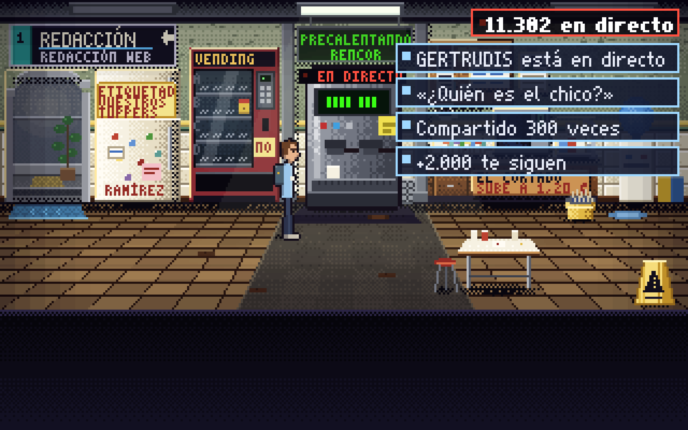
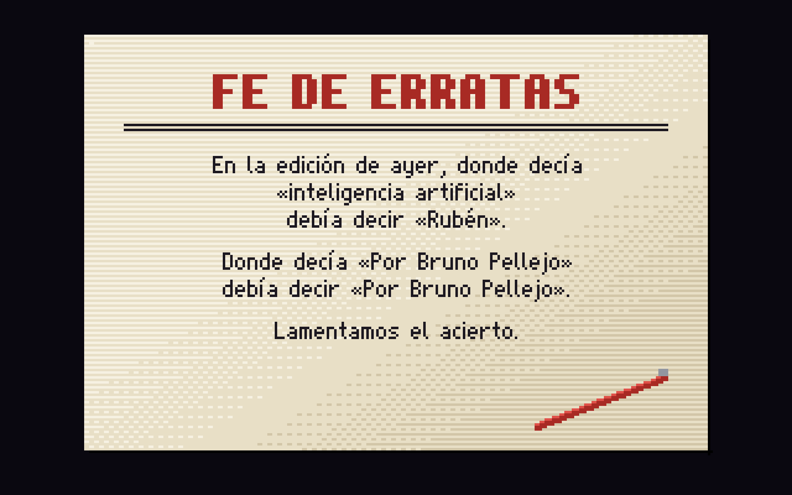
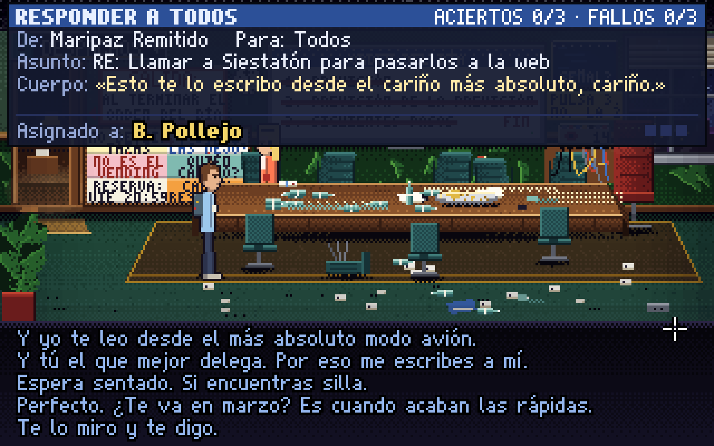
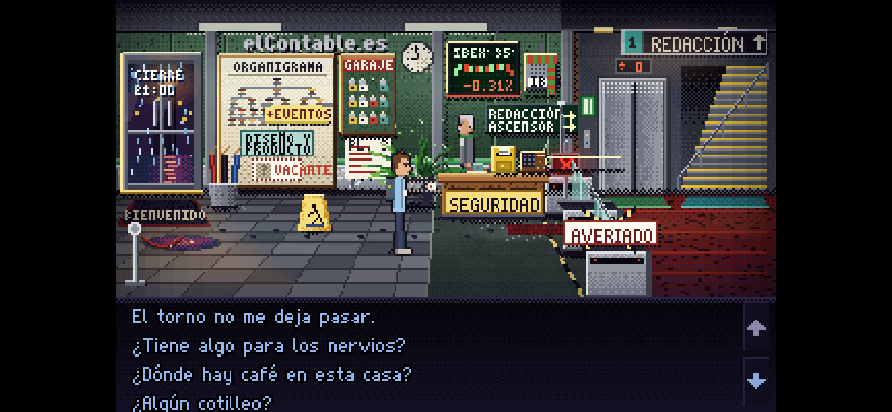
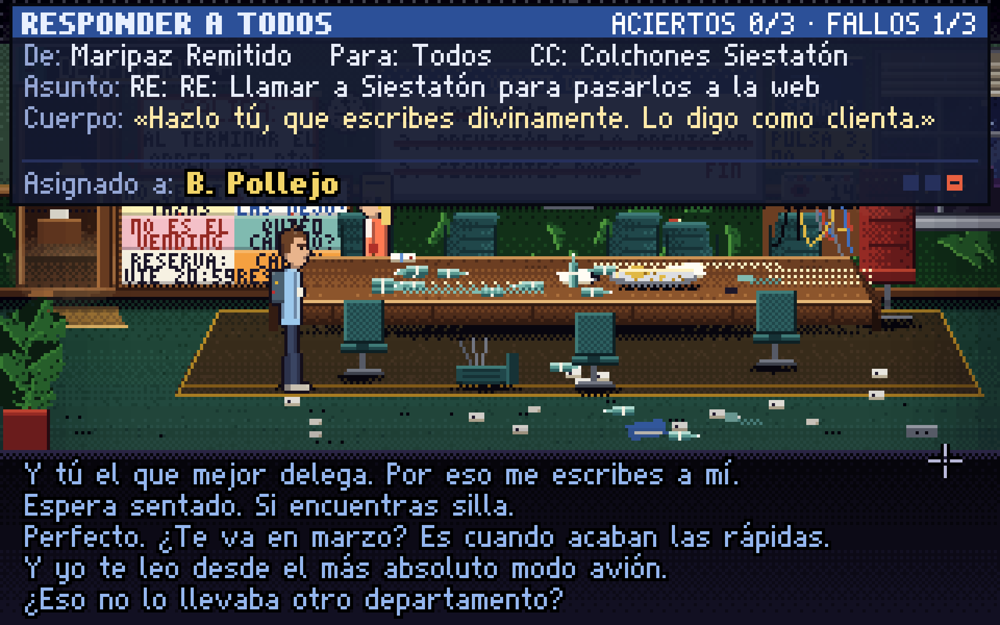
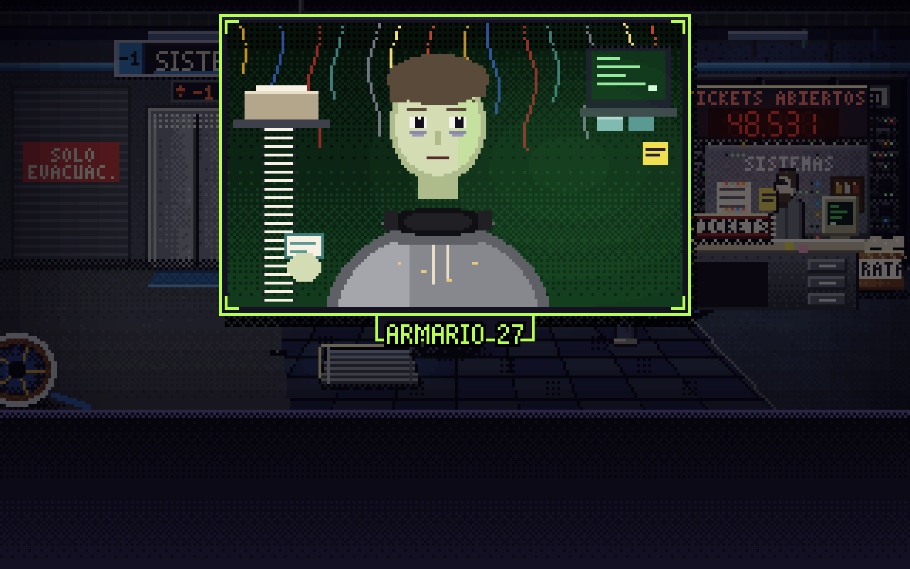
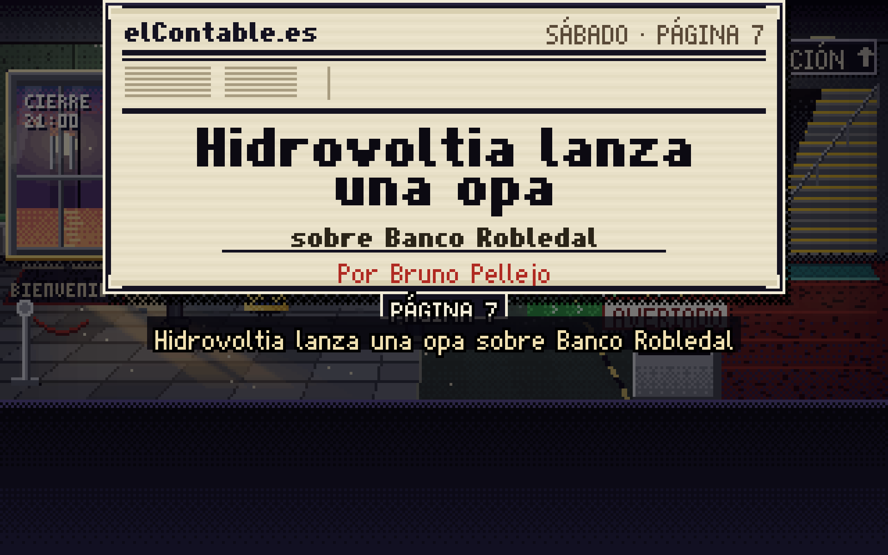
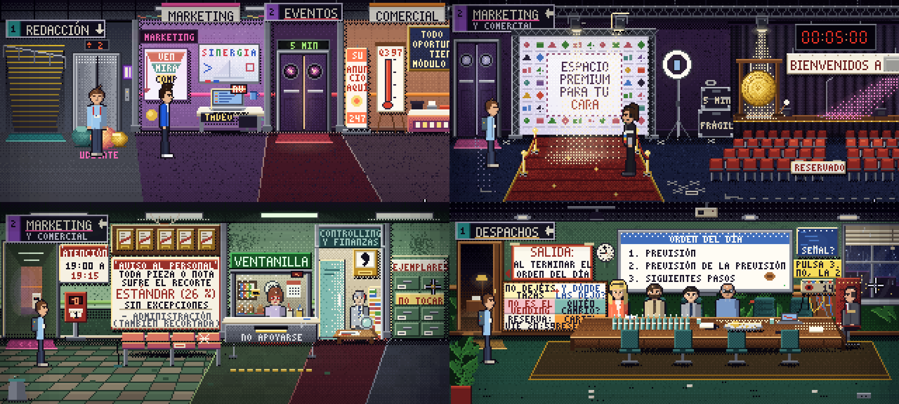
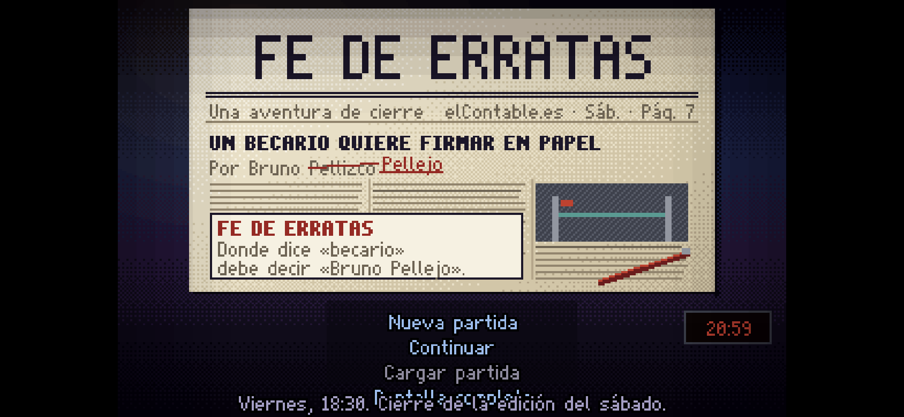
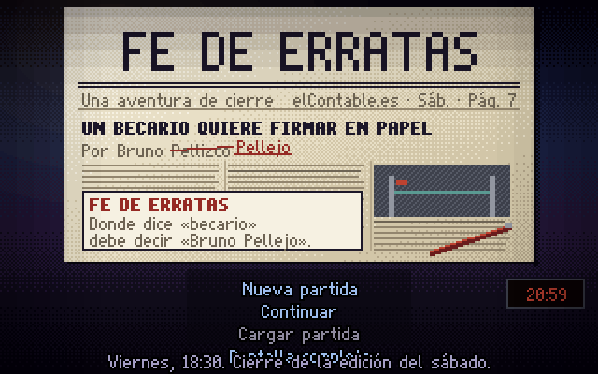

# FE DE ERRATAS — Crítica 2

*Crítica independiente de la versión actual (noviembre de 2026). Escrita por alguien que no ha participado en el
desarrollo. Solo lectura sobre el juego: no se ha tocado código ni contenido.*

**Cómo leer las marcas.** **[J]** = comprobado jugando (Chromium + Playwright, ratón real o API de pruebas, capturas).
**[C]** = inferido leyendo código o contenido, sin haberlo visto en pantalla. Las citas llevan `fichero:línea`
(rutas relativas a `content/`).

**Advertencia de método (honestidad).** La partida «a ciegas» no fue del todo ciega: al abrir las herramientas de
automatización (`tools/walk-data.mjs`) vi de refilón la lista de los 42 pasos antes de jugar. Lo compensé jugando el
Acto I y el arranque del II solo con lo que el juego decía en pantalla y anotando qué pista me llevó a cada solución;
donde mi juicio pueda estar contaminado lo digo. Lo opcional (todos los árboles de diálogo, perder los cuatro duelos,
acciones absurdas, móvil, pistas en tres niveles) sí se exploró a fondo.

---

## 1. Resumen ejecutivo

*FE DE ERRATAS* es una aventura de verbos competente, bonita y con corazón, que **hace sonreír a menudo y reír de
verdad pocas veces**. Su mejor arma no son las frases sino tres o cuatro *situaciones* bien construidas —la cafetera a la
que hay que dar las buenas noches y que se hace viral, el jefe de cierre que solo habla por fax, el «Titulator» que
resulta ser un becario en un armario, la abuela que comenta «abrígate» en todas las noticias— y un final que las cierra
todas con elegancia («Lamentamos el acierto»). Ahí el juego está a la altura del listón LucasArts que se pone.

Lo que lo separa de ese listón es la **densidad y la monotonía del chiste escrito**. El guion tiene una sola forma de
remate que repite cientos de veces (frase corta + contrapunto seco: «Bajó a desayunar en 2019. No ha vuelto.»), una
muletilla temporal omnipresente («desde 2019», «desde marzo», «desde 1997»: más de 80 apariciones) y un humor de
oficina/redacción que funciona para quien ha trabajado en un periódico y se queda en jerga para el resto (tickets,
CMS, faldón, KPI, «descopear»). Muchas líneas *suenan* a chiste sin serlo. Con 33 personajes, la mitad son
caricaturas de una nota (Borja, los tres de Mercados, el coro de Desarrollo, Valentín, Tadeo) que no aportan.

Como juego, es **justo y está bien pistado**: la ficha de la página 7 (hueco/fuente/firma) es un tablero de objetivos
excelente; las pistas de la abuela en tres niveles son lo mejor del diseño; no hay callejones sin salida (el *fuzz* da
OK en 10.000 combinaciones Dar/Usar) y el Acto II admite orden libre. Sus debilidades son la dependencia de elegir
*la opción exacta* en diálogos, bastante ida y vuelta en ascensor durante el Acto II y unos duelos que, por diseño, son
casi imposibles de perder de forma que importe.

Técnicamente está **muy sólido**: 60 fps estables, cero errores de consola en una partida completa, guardado/carga
fiables, móvil en horizontal jugable. Encontré **dos bugs visibles** (el menú del título se solapa con el lema en cuanto
existe una partida guardada; en táctil la 4.ª opción de diálogo sale cortada) y varios fallos de continuidad de texto.

**Veredicto:** un 7 honrado. Está terminado, se deja jugar de principio a fin sin frustración y tiene un final que
emociona. No es todavía un juego que «hace reír» en el sentido de *Monkey Island* o *Day of the Tentacle*: hace
sonreír cada minuto y reír de verdad cada siete u ocho. Para subir de nivel no necesita más contenido, sino **quitar**:
podar un 20-25 % de líneas, romper la plantilla de remate y dejar respirar las situaciones buenas.

| Apartado | Nota |
|---|---|
| Comedia y guion | **6,5** |
| Puzles y diseño de juego | **7,0** |
| Historia y estructura | **7,5** |
| Interfaz y usabilidad | **7,0** |
| Apartado visual | **8,0** |
| Audio (provisional, no oído) | **6,5** |
| Técnica y estabilidad | **8,0** |
| **Global** | **7,0** |

*(Notas puestas y escritas en este fichero antes de abrir la crítica anterior.)*

---

## 2. Cómo se ha jugado

| Sesión | Qué | Cómo |
|---|---|---|
| A. «A ciegas» | Título, intro, Acto I completo, arranque del Acto II, primer duelo perdido | Ratón real sobre el canvas (verbo → objeto, clics para pasar globos), 960×600; solo con información de pantalla |
| B. Completa | Los 42 pasos hasta la tarjeta FE DE ERRATAS y los créditos; volcado de **todo** el texto (`game.log`, ~680 líneas en el camino principal) | Runner de `tools/walk-lib.mjs` + capturas 2× en 15 momentos |
| C. Opcional | Todos los árboles de diálogo de los 18 PNJ con menú; perder los cuatro duelos (dos veces Teodoro y Gervasio); ~410 acciones absurdas Abrir/Cerrar/Empujar/Tirar/Coger en 4 salas; móvil (correo, perdidas, abuela); pistas en sus tres niveles | Saves por hitos y guion de exploración |
| D. Móvil | Viewport iPhone horizontal 844×390, táctil, pulsación larga, menú, vertical | Contexto `isMobile/hasTouch` |
| E. Técnica | Rendimiento por sala, `tools/check.mjs`, `tools/fuzz.mjs`, consola | — |

**Duración estimada [J+C].** El camino principal suma ~680 líneas habladas; con la fórmula del motor (900 ms + 55 ms
por carácter, `engine/core.js:588`) son unos **40-45 minutos solo de texto** a velocidad normal. Un jugador nuevo
que explore tardará, a mi juicio, **2 a 3 horas**. La intro sin saltar dura 70 s [J].

---

## 3. Notas por apartado

### 3.1 Comedia y guion — 6,5

**Lo que funciona [J].** Las *situaciones*. El juego es más gracioso cuanto menos depende de la frase:

- La cafetera Gertrudis: dar las buenas noches dos veces dispara una retransmisión viral, el contador de lectores salta
  de 3.418 a 11.302, Yoli vive el pico en directo («11.290 — 11.284 — ...Ya está. Era un pico. Qué bonito ha sido.») y
  entre los comentarios aparece «abrígate». Es un gag de *sistema*, con consecuencia visible en otra sala. Es el mejor
  momento cómico del juego (`rooms/office.js:55-67`, `rooms/pecera.js` reacción viral). 
- Teodoro, que solo habla por fax aunque lo tengas a dos metros, y su respuesta automática: «ESTOY FUERA DE LA OFICINA
  HASTA QUE EL PAPEL DEJE DE EXISTIR. / PARA CUALQUIER URGENCIA, CONTACTE CON USTED MISMO.» Perder contra él produce
  «VUELVE» en seis folios, letra a letra, y Aurora remata: «Ha perdido usted con dos faltas, criatura. Y en cuerpo 72.»
- El enchufe de la pantalla de métricas: al desenchufarla, el CMS vuelve; Yoli: «¡Ha entrado una pieza!»; al
  enchufarla, se cae. Bruno: «Iba mientras estaba apagada.» (`rooms/pecera.escenas.js:197`). Es humor de causa y efecto,
  y además es la pista del puzle.
- La estampida de la reunión «desde marzo» cuando alguien pregunta por los *siguientes pasos* (Mercados: «¡Yo soy de
  Bolsa y de Mercados! ¡Tengo doble prioridad!»).
- La revelación del Titulator: «BECARIO DETECTADO. LO QUE PASÓ DESPUÉS TE SORPRENDERÁ.» (`rooms/cpd.js:53`) y, en el
  clímax, «Hola. Soy la inversión.» (`escenas/climax.js:74`).
- El arco de la abuela, de la primera llamada («Eso es una bebida, hijo») a «Bruno Pellejo ha respondido: «Abrígate
  tú.»» / «¡Me ha contestado el periódico!» (`escenas/final.js:224`). Es el hilo emocional y está muy bien dosificado.

**Voces que se distinguen [J].** Aurora («criatura», «sufrir con método», `rooms/catacumba.js:373`), Íñigo (jerga de
consultor convertida en crueldad amable: «Yo no recorto personas, Vacante. / Recorto la distancia entre las personas y
la puerta.», `rooms/pajarera.js:450`), Begoña (la burocracia como filosofía: «Las gracias no se pueden sellar.»,
`rooms/administracion.dialogos.js:150`), Gervasio (frases que nunca terminan, «Se constaba.»), Celestino (narrador
de fútbol) y Teodoro (fax en mayúsculas). Son seis voces reconocibles: un logro.

**Lo que no funciona.**

1. **Una sola plantilla de remate.** Casi todo chiste es *dato — giro seco en frase corta*. «Bajó a desayunar en 2019.
   No ha vuelto.» (`rooms/pecera.js:299`); «Es de plástico. Aun así, es la que más tiempo lleva en plantilla.»; «Rojo,
   verde, rojo, verde. Es un semáforo que te debe dinero.» (`rooms/vestibulo.js:320`). Funciona las primeras veinte
   veces; a la hora de juego el oído ya anticipa el remate y deja de reír. LucasArts alternaba absurdo largo, juego de
   palabras, slapstick y réplica; aquí casi todo es réplica.
2. **Muletilla temporal.** Conté en `content/` 24 «2019», 37 «marzo» (20 «desde marzo»), 35 «desde 19xx/20xx», 14
   «seis años». En una sola sala (el Vending) el yogur, las pipas y la cafetera son «de 2019» (`rooms/office.js:55, 231,
   248`), y el sobre de azúcar remata: «Todo aquí es de 2019.» (`rooms/pecera.js:323`). Es un tic de escritura, no un
   *running gag*: no escala ni se paga.
3. **Chistes que no se entienden.** «¿Me preguntas por el Ibex? ¿A mí? ¿En treinta años?» (`rooms/vestibulo.js:190`);
   el cotilleo del ascensor que Bruno completa sin motivo y cierra con «Porque aquí no sale.» (`rooms/vestibulo.js:185`);
   «Celestino, el Ibex. / El Ibex está plano, chaval. Tú no.» (`rooms/vestibulo.js:301`); «Algo importante se nos
   acaba de escapar. Por una coma.» (`escenas/climax.js:352`), que el jugador medio no puede descifrar (ver §6).
4. **Jerga de nicho.** CMS, faldón, KPI, tipómetro, galeradas, matricial, «descopear», tickets (133 apariciones de
   «ticket»). Quien no ha trabajado en una redacción/oficina grande pierde un tercio de las referencias. El juego explica
   algunas (bien: «Descopear. Quitar algo sin que se note.») pero la mayoría no.
5. **Bruno explica sus chistes.** «Me la apunto / Me lo apunto» sale 12 veces; «Lo pongo en el currículum», «Primer
   ascenso en seis años. Hacia fuera, pero ascenso.» (`rooms/pajarera.js:447`), «Liderazgo.» Bruno comenta cada gag
   después de que ocurra; un protagonista de LucasArts *reacciona*, no apostilla.
6. **Reparto inflado.** Borja (Marketing), Mercados 1-3, el coro de Desarrollo, Valentín, Tadeo (solo correos RV),
   Leoncio y Herminia, Anselmo y su cinta: cada uno con su manía y su línea, pero sin peso. El conflicto Desarrollo vs.
   Diseño/Infografía (la cinta de carrocero, «¡Ha sido Diseño!») es un chiste interno de empresa que ocupa media
   Redacción y no conecta con la trama de Bruno.
7. **Redundancias puntuales.** Yoli: «Le contesté: "Y yo te leo desde el más absoluto modo avión". / Le contesté con lo
   del modo avión. Me ha puesto en copia a mi madre.» (`rooms/pecera.dialogos.js:40-41`): la segunda línea repite la
   primera. El correo de Pilar dice «Enviado el 3 de marzo» y Bruno lo vuelve a leer en voz alta (`lib/movil.js:24-25`).
   Yoli intercala el contador en las frases («Me alegro mucho — 3.402 — mucho»): en pantalla parece una errata.

**Frecuencia de risa [J, juicio personal].** En el camino principal anoté **unas 16 carcajadas reales** (lista en §4) y
**una sonrisa por minuto** aproximadamente. En 2-3 horas, eso es una risa cada 7-9 minutos. Para el género y el listón
declarado, la sonrisa está bien y la carcajada se queda corta.

**Dónde se hace largo [J].** La escena 7.2 de Íñigo al entrar en la Redacción (unas 25 líneas seguidas antes de poder
moverse); la exposición de Aurora tras el café (14 líneas, `rooms/catacumba.js` A_MENU); los cuatro chismes encadenados
de Gertrudis; la escena del armario 27 (~35 líneas) y el epílogo (~60 líneas, este bien empleado). El Acto II, con sus
viajes Redacción de papel ↔ Planta 2 ↔ Sistemas, es donde el ritmo cae más.

### 3.2 Puzles y diseño de juego — 7,0

**Bien [J].**
- **La ficha de la página 7** es un tablero de objetivos diegético: hueco, fuente y firma, con notas a lápiz que cambian
  («Al margen, a lápiz: «Arriba no me atiende nadie. El CMS está en coma».»). Mirar la ficha siempre dice qué falta.
- **Pistas de la abuela en tres niveles** (`pistas.js`): primero una metáfora del pueblo («La tele de tu abuelo no iba si
  él la miraba. Apágale algo a alguien.»), luego una dirección («Eso se arregla abajo, donde los cables»), luego la
  solución con Bruno traduciéndola («Sistemas: el registro y la regleta R-3.»). Nunca repite llamada idéntica. Es lo mejor
  del diseño y un modelo de cómo integrar ayudas sin romper el tono.
- **Puzles bien sembrados.** El chicle de Celestino («O para pegar algo») + la foto en el organigrama + «BIENVENIDO,
  VACANTE»; la chaqueta de Ramírez («déjala en un sitio con más autoridad») al Lector Medio; las copias rechazadas como
  papel de fax («tiene la espalda en blanco»); dos fuentes = el fax de F.P. + el reverso de la nota de gasto de Gervasio
  («Una anónima y otra con IVA. Me vale.»). Todos tienen lógica interna y casi todos están anunciados antes.
- **Sin callejones.** `tools/fuzz.mjs` → OK; yo mismo saqué de su sitio el orden (regleta antes de leer el ticket,
  CPD antes de tiempo) sin romper nada.
- **Respuestas por defecto variadas.** En 410 acciones absurdas conté 169 respuestas distintas; ninguna se repite más de
  12 veces. Al nivel de los clásicos.

**Mal.**
- **Mucho puzle es «elige la frase correcta».** Gertrudis («Buenas noches»), la reunión («siguientes pasos»), Begoña
  (concepto/importe/justificante/«enséñeme»), Nemesio («salida en valor»), los cuatro duelos. Funciona porque está
  pistado, pero el juego tiene pocos puzles de *objeto en el mundo* y casi ninguno de manipulación física.
- **Duelos sin riesgo.** El D1 contra Maripaz se puede abrir sin tener la réplica del primer ataque (`correctIndex: -1`)
  y perderlo es gratis; el D4 contra Íñigo, al perderlo, se reinicia en el acto («Se retoma el hilo.») [J]. Es amable, pero
  quita tensión al clímax: no hay forma de sentir que *ganas* el duelo final.
- **Ida y vuelta.** El Acto II obliga a recorrer Redacción de papel ↔ Planta 2 (Begoña) ↔ Redacción ↔ Sistemas varias
  veces; el ascensor es un menú, no hay mapa rápido ni doble clic en el directorio [J].
- **Pequeños baches de lógica.** Pegas la foto de tu tarjeta en el organigrama y luego pasas esa misma tarjeta por el
  torno [J]. El recorte del 26 % (fax, tecla 2) solo se entiende si has hablado antes con Begoña de lo opcional.
- **Subtrama opcional mejor que la principal.** La de Evaristo y la coma de los 48,000 € (versión A del clímax,
  `escenas/climax.js:317-345`: «Cláusula 12: punto de miles y coma decimal. Son 48 euros.») es de lo más ingenioso del
  juego, pero exige elegir «¿De qué trata?» → «Siga» → «Siga, siga» → «No pare» con un personaje cuyo chiste es ser
  pesado, y luego una opción concreta con Aurora. Casi nadie la verá; quien no la vea recibe una frase críptica [C+J].

### 3.3 Historia y estructura — 7,5

Tres actos limpios con rótulo («ACTO II: HUECO, FUENTE, FIRMA», «ACTO III: CIERRE»), una meta clara desde el minuto
uno (firmar en papel antes de las 21:00; prometido a la abuela), un antagonista con plan (Íñigo y el Plan Cero Papel)
y **pagos bien sembrados**: el pósit «Contratar al becario de marzo – 1998» del kanban paga en el epílogo (Íñigo *era*
ese becario: «Yo no fui becario. Fui un perfil junior con mucho recorrido.», `escenas/final.js:95`); la chaqueta de Ramírez
vuelve con Ramírez; «¿Tú eres el nuevo?» de Celestino cierra con «No. Soy Bruno Pellejo.»; la cuenta «abrígate» es la
abuela. El final tiene la mejor línea del juego, la tarjeta: «Donde decía «Por Bruno Pellejo» debía decir «Por Bruno
Pellejo». Lamentamos el acierto.» (`escenas/final.js:254`). 

Debilidades: el Acto III es corto y casi lineal (armario → álbum → Nemesio → acta → clímax); el clímax resuelve por
acumulación de réplicas más que por un giro del jugador (empujar al Lector Medio es buena idea pero llega pistado de sobra);
hay **dos subtramas de «coma»** (la de 4,15 € de la pieza y la de 48,000 € del contrato) que se pisan y confunden; la
exposición se concentra en monólogos (Íñigo en 7.2, Aurora tras el café).

### 3.4 Interfaz y usabilidad — 7,0

**Bien [J].** Nueve verbos clásicos con línea de frase; clic derecho = verbo por defecto; pulsación larga en táctil
(probada: abre Hablar con Celestino); icono de ojo para ver hotspots; menú de pausa completo (velocidad de texto,
volumen, pantalla completa, «Cómo se juega»); 3 ranuras + autoguardado; libreta de réplicas consultable; el duelo como
cliente de correo («RESPONDER A TODOS», asunto que acumula «RE: RE:», CC que crece) es claro y gracioso
. En iPhone horizontal el juego ocupa todo el alto y se juega bien; en vertical
avisa de girar .

**Mal.**
- **Bug del título** (ver §7, B1): con una partida guardada, «Pantalla completa» se monta sobre el lema.
- **4.ª línea de opciones cortada en táctil** (B2).
- **Opciones que no desaparecen** tras elegirlas en unos PNJ (Pilar, Nemesio «¿Por qué gritan tanto ahí detrás?», Íñigo
  «¿Y si en la Reunión de Dirección dicen que no?») y sí en otros: inconsistente.
- **Hotspots decorativos mudos**: el paragüero y el cartel de suelo mojado del Vestíbulo, la mesa alta del Vending o la
  mesa de Teodoro se ven pero no responden (`hotspot: false`, `rooms/vestibulo.js:370-371`). En un juego que premia
  Mirarlo todo, frustra.
- **La Redacción tiene 37 hotspots** en 1270 px. Es un museo; cuesta saber qué importa.
- **Móvil (el teléfono)**: la cabecera del correo sale truncada («Correo - 3 sin le») y los asuntos con «…»
  .

### 3.5 Apartado visual — 8,0

El pixel art procedural es la parte más profesional del juego [J]: paleta coherente por planta (madera y tabaco en
papel, azul frío en Sistemas, violeta en Marketing), iluminación con ambiente, rótulos legibles, planos detalle (armario
27, reverso del Lector Medio, página 7) bien compuestos  .
Contras: los personajes son pequeños respecto a los decorados y en la Sala Amazonas se apelotonan; hay carteles que se
pisan entre sí («NO DEJÉIS TAZAS / Y DÓNDE LAS DEJO» y la hoja de reservas) y mucha letra pequeña en las paredes
; el texto hablado sobre fondos muy cargados (verde LCD de Gertrudis) cuesta algo.
El contador de tickets del arte dice 48.531 y el texto de Paco 48.212 (detalle).

### 3.6 Audio — 6,5 (provisional)

**No lo he oído** (entorno sin salida de audio). Lo que se infiere del código [C]: 15 pistas sintetizadas (una por sala más
duelo, clímax, final y créditos, `music.js`), ~190 llamadas a efectos, el audio arranca tras la primera interacción.
Hay una herramienta `tools/music-check.mjs`. Sin escucharlo no puedo juzgar calidad ni mezcla: la nota es una
posición neutra, no una evaluación.

### 3.7 Técnica y estabilidad — 8,0

[J] 60 fps clavados (media 16,6 ms, p95 16,8 ms) en las salas más cargadas en Chromium headless; **cero errores de consola**
en la partida completa y en todas las sesiones; `check.mjs` OK (3 avisos menores); `fuzz.mjs` OK (guardar/cargar en
cada acto, perder cada duelo, Dar/Usar todo con todo); guardado y carga fiables, incluido cargar un autoguardado al
inicio del clímax (la escena se reproduce desde el principio, correcto). Restan los bugs de §7.

---

## 4. Lo mejor (con citas)

1. **La cafetera viral** — «NADIE ME SALUDABA DESDE 2019.» / «CON TODO LO QUE TENGA PANTALLA. TENGO WIFI Y RENCOR.»
   (`rooms/office.js:55, 67`) → contador a 11.302 → «abrígate comentó». Gag de sistema, con eco en tres salas.
2. **El final y la tarjeta** — «Lamentamos el acierto.» (`escenas/final.js:254`) y la abuela: «¡Ay! ¡Me ha contestado
   el periódico!» Cierra la trama, el tema (papel/web) y la emoción a la vez.
3. **Teodoro y el fax** — «ESTOY FUERA DE LA OFICINA HASTA QUE EL PAPEL DEJE DE EXISTIR.» y el «VUELVE» en seis folios.
4. **Rubén, el Titulator** — «BECARIO DETECTADO. LO QUE PASÓ DESPUÉS TE SORPRENDERÁ.» (`rooms/cpd.js:53`); «No me
   encerró. Me dio una silla y wifi. Yo pensé que era un contrato.»; en el clímax, «Hola. Soy la inversión.»
5. **Las pistas de la abuela** — «En el pueblo, el que no sale en la foto no existe. Ponte en la foto.» (`pistas.js:30`).
6. **Íñigo** — «Recorto la distancia entre las personas y la puerta.» (`rooms/pajarera.js:450`); «Te invento uno:
   «Vacante (histórico)». Enhorabuena.»
7. **Aurora** — «Leo la web todas las noches, para sufrir con método.» (`rooms/catacumba.js:373`); «Una anónima y otra
   con IVA. Me vale.» (`rooms/catacumba.js:334`); «Han sido treinta años muy buenos.» (`rooms/catacumba.js:354`).
8. **Begoña** — «Lo que sea». Lo escribo en letra. En número no cabe.» (`rooms/administracion.dialogos.js:94`); el
   recorte del 26 % aplicado a una pregunta de Bruno («No lo sabremos nunca. Así es más limpio.»).
9. **Nemesio y la columna nueva** — «...Eso no es ni hecho ni muerto. / Es consultoría.» (`rooms/pecera.dialogos.js:220`).
10. **«BIENVENIDO, VACANTE.»** (`rooms/vestibulo.js:292`): el primer puzle termina en chiste y en apodo para todo el juego.

## 5. Lo peor (con citas)

1. **La plantilla de remate única** — cientos de «Dato. Giro.»: «Bajó a desayunar en 2019. No ha vuelto.»
   (`rooms/pecera.js:299`).
2. **La muletilla temporal** — «Todo aquí es de 2019.» (`rooms/pecera.js:323`); «Parado en las 20:59 desde 2019.»
   (`rooms/catacumba.js:651`); «Hay cola desde 2019.» (`rooms/pecera.dialogos.js:58`).
3. **Líneas opacas** — «¿Me preguntas por el Ibex? ¿A mí? ¿En treinta años?» (`rooms/vestibulo.js:190`); «Porque aquí
   no sale.» (`rooms/vestibulo.js:185`); «Algo importante se nos acaba de escapar. Por una coma.» (`escenas/climax.js:352`).
4. **Bruno apostillando** — «Me la apunto» ×12; «Huele a menta y a futuro.» (`rooms/vestibulo.js:254`); «Liderazgo.»
5. **Personajes de relleno** — Borja: «¿Una opa? ¡Qué bonito! ¿Es un evento? ¿Hay croquetas?»
   (`rooms/ecosistema.dialogos.js:37`); el coro: «Con el de al lado. / ¡Con el de al lado no! / ¡Pues ahora sí! / No.»

---

## 6. Análisis por sala y por acto

### Acto I (18:30 → café a Aurora) [J, sesión A]

- **Vestíbulo.** Arranque excelente: intro corta, llamada de la abuela que fija meta y tono, torno que «no te conoce».
  Puzle chicle-foto-torno bien sembrado (Celestino: «O para pegar algo»; abuela: «Ponte en la foto»); tardé ~5 minutos
  de exploración real en resolverlo. Celestino como locutor deportivo es una buena voz, aunque varios de sus diálogos
  son ininteligibles (Ibex, ascensor). Objetos decorativos sin respuesta.
- **Redacción (pecera).** La escena 7.2 presenta a Íñigo, el Titulator y el Plan Cero Papel: buena información, demasiado
  larga. Luego, 37 hotspots y siete PNJ, la mayoría sin función en la trama. La silla de Ramírez y el ordenador de Bruno
  son un buen micro-puzle. Yoli dice «becario sin silla» aunque ya la tengas (continuidad).
- **Vending.** La mejor sala cómica. Gertrudis justifica el viaje. El tablón da una réplica sin esfuerzo.
- **Despachos (pajarera).** Íñigo es el mejor diálogo largo del juego; la matriz 2×2 es un gran decorado-chiste. El
  Titulator con «AYÚDAME ESTOY EN EL ARMARIO 27» siembra el misterio del Acto III a la tercera mirada: bien.
- **Redacción de papel (catacumba).** Atmósfera y personajes (Aurora, Teodoro) de primera. El cartel «NO HABLO ANTES
  DEL CAFÉ» hace el puzle evidente: correcto para un Acto I. El volcado de exposición de Aurora es el bache.

**Dónde me perdí (sesión A).** Solo en un sitio: tras conseguir el café no sabía a quién dárselo hasta entrar en la
Redacción de papel (la abuela lo resolvió: «Los que corrigen siempre están cansados»). En el Acto II, el arranque «el CMS
está en coma» → regleta R-3 está bien encadenado (cinta «NO DESENCHUFAR» con la brida «R-3, SISTEMAS. PACO»), pero
Sistemas solo es accesible en ascensor y no lo había usado: tardé en caer.

### Acto II (hueco, fuente, firma)

- **Sistemas (CPD).** Paco y su contador de tickets: correcto, sin más; el ticket nº 3 («Va a la regleta R-3. Apagarla»)
  es una pista limpia. «Cierra. No, esa no. Esa es un servidor.» funciona.
- **Sala Amazonas.** La estampida es el mejor set-piece del acto. El D1 con Maripaz es el duelo más gracioso (Siestatón:
  «Si ya duerme, no pulse. Le atenderemos en sueños.» al perder).
- **Marketing y Comercial (ecosistema).** Decorado divertido, PNJ (Borja) vacío. Opciones de diálogo que anticipan la opa
  antes de que exista (bug B3).
- **Eventos.** Pilar es una buena caricatura (todo «a cinco minutos de empezar», la silla 113), pero su árbol es largo y
  repetible; la sala es más de lo que pide su función (prestar un álbum en el Acto III).
- **Administración.** Begoña es la tercera mejor voz del juego. Evaristo es un chiste de una nota (llama 6 veces; dos de
  ellas seguidas al entrar en Planta 2 y en Eventos [J]) que esconde la mejor subtrama.
- **Redacción de papel (fax).** El fax que escupe toda la tarde de mensajes atascados («19:12. GOYITA, ¿ME OYES? TÚ
  AGUANTA.») es precioso. El duelo D2 con Teodoro es el más redondo.

### Acto III (cierre)

Armario 27 → álbum de Pilar → «salida en valor» a Nemesio → acta de Gervasio → clímax. Lineal pero con buenos pagos.
El clímax encadena réplicas aprendidas con apariciones (Rubén, Gervasio, Begoña con la factura) y un gesto físico
(empujar al Lector Medio, que resulta ser atrezo de un focus group de 2014). El epílogo en el Vestíbulo cierra todos los
hilos. Es la mejor media hora del juego.

---

## 7. Bugs (con pasos de reproducción)

| # | Gravedad | Descripción | Pasos | Verificado |
|---|---|---|---|---|
| B1 | **Media (primera impresión)** | En el título, al existir una partida guardada aparece «Continuar» y la cuarta opción, «Pantalla completa», se dibuja **encima del lema** «Viernes, 18:30. Cierre de la edición del sábado.»   | 1) Jugar hasta entrar en cualquier sala (autoguardado). 2) Recargar la página. Ocurre en 960×600 y en iPhone 844×390. | [J] |
| B2 | Baja-media | En táctil, el menú de diálogo usa 4 líneas de 14 px desde y=144 (`engine/ui.js:235`); la 4.ª línea queda pegada al borde y **se cortan los descendentes** («¿Algún cotilleo?»).  | Viewport 844×390, `hasTouch`; Hablar con Celestino. | [J] |
| B3 | Baja (continuidad) | Borja ofrece «¿Has leído mi pieza?» y «Esta noche hay una opa.» **antes** de que exista la pieza o se conozca la opa (`rooms/ecosistema.dialogos.js:36-37`, solo `once: true`, sin condición). Destripa la trama del fax de F.P. | Tras el apagón (paso 20), subir a Planta 2 y hablar con Borja. | [J+C] |
| B4 | Baja (continuidad) | Yoli sigue llamando a Bruno «becario sin silla» después de conseguir la silla (`rooms/pecera.js:432`). | Pasos 1-10; hablar con Yoli antes del apagón. | [J] |
| B5 | Baja (texto) | Línea duplicada de Yoli («Le contesté…» dos veces, `rooms/pecera.dialogos.js:40-41`). | Hablar con Yoli → «¿Algún hilo bueno esta noche?». | [J] |
| B6 | Baja (UX) | Opciones que se repiten tras elegirlas en unos PNJ y en otros no (Pilar, Nemesio, Íñigo). | Árboles de Pilar, Nemesio («¿Por qué gritan…?»), Íñigo. | [J] |
| B7 | Cosmético | App de correo del móvil: cabecera truncada «Correo - 3 sin le». | Usar móvil → Correo. | [J] |
| B8 | Cosmético | Dos llamadas de Evaristo casi seguidas al entrar en Planta 2 y en Eventos (Acto III). | Paso 36 → ascensor a Planta 2 → Eventos. | [J] |
| B9 | Cosmético | En la página 7 del epílogo el titular se muestra dos veces (en el plano detalle y como subtítulo del narrador). | Epílogo. | [J] |
| B10 | Cosmético | Contador de tickets: arte 48.531 / texto 48.212. | Sistemas: Mirar contador. | [J] |
| B11 | Diseño | Objetos visibles sin hotspot (paragüero, cartel de suelo mojado; mesa alta del Vending y mesa de Teodoro no se pueden elegir con el ratón). | Vestíbulo/Vending/Redacción de papel: pasar el ratón. | [J+C] |

No encontré bloqueos, cuelgues, errores de consola ni pérdidas de partida.

---

## 8. Comparación con la crítica anterior (`docs/informes/critica/CRITICA_JUEGO.md`, nota 6,5)

*Leída después de escribir todo lo anterior y de poner mis notas.*

### 8.1 Notas lado a lado

| Apartado | Crítica 1 | Crítica 2 | Δ | Comentario |
|---|---:|---:|---:|---|
| Comedia | 6 | 6,5 | +0,5 | Se ha limpiado mucho (fuera la autorreferencia, el chiste de Diseño reducido, el «… Como X.» casi desaparecido) y han aparecido gags de situación (cafetera viral, enchufe). Pero la plantilla de remate y las muletillas siguen. |
| Puzles | 6 | 7 | +1 | Pistas en tres niveles, ficha viva, chismes de Gertrudis en un solo saludo, fin de reunión señalado. Siguen los duelos sin riesgo y la ida y vuelta del Acto II. |
| Historia | 6 | 7,5 | +1,5 | El final ya acaba en la abuela y la tarjeta; el reloj avanza; planos detalle en los momentos clave. Es el área que más ha mejorado. |
| Interfaz | 6 | 7 | +1 | Duelo legible (ataque en el cuerpo del correo, marcador en texto), dificultad falsa eliminada, menú más grande en táctil. Nuevo: bug del título y línea cortada en táctil. |
| Visual | 8 | 8 | = | Igual de bueno; los planos detalle suman, los carteles apelotonados siguen. |
| Audio | 6 (prov.) | 6,5 (prov.) | — | Ninguno de los dos lo oímos; no es comparable. |
| Técnica | 8 | 8 | = | Igual de sólido. |
| **Global** | **6,5** | **7,0** | **+0,5** | |

### 8.2 Resuelto (lo comprobé)

| Señalado en la crítica 1 | Estado hoy | Cómo lo sé |
|---|---|---|
| El ataque del duelo desaparece al abrir el menú; puntos solo por color | **Resuelto**: el ataque queda como «Cuerpo: «…»» en la ventana de correo y el marcador es texto («ACIERTOS 0/3 · FALLOS 1/3») | [J] captura 02 |
| Abuela plana: cuatro llamadas = cuatro veces la misma pista | **Resuelto**: tres niveles, saludo distinto cada vez, nunca idéntica («Te lo digo otra vez, hijo, que no comes.») | [J] §3.2 |
| Hora contradictoria (móvil a 20:59 desde el minuto 1) | **Resuelto**: el móvil marca 18:30 al empezar; en el clímax «mi móvil y los relojes de la casa dicen lo mismo» | [J] captura 10 |
| Fin de la reunión invisible | **Resuelto**: Maripaz se queda y lo dice («Y estoy sentada en el planillo. La página 7 no se mueve sin mí.»), Bruno lo remata | [J] |
| Gertrudis ×4 para tres chismes | **Resuelto**: el segundo saludo suelta los tres seguidos («Cuatro réplicas en un minuto.») | [J] |
| Segundo café inútil | **Resuelto**: «NO HAY MÁS CAFÉ. HAY FAMA.» | [J] |
| Coger los bolis de Aurora sin texto | **Resuelto**: «¿Un boli muerto? ¿Para qué quieres tú un cadáver, criatura?» | [J] |
| Selector de dificultad decorativo | **Resuelto** (eliminado del menú de pausa) | [J] captura de pausa |
| Final que se lleva Diseño («Diseño soy yo», créditos) | **Resuelto**: 0 apariciones; el epílogo termina en la abuela y la fe de erratas | [J+C] |
| Autorreferencias de Valentín («En mi juego…», «sprite muy bien resuelto») | **Resuelto**: 0 apariciones; Valentín ahora es un cameo mudo | [J+C] |
| Remate «… Como X.» (≥ 54) | **Resuelto en la forma**: quedan 2 | [C] recuento |
| Menciones a «Diseño» (43) y coro cada 14-24 s | **Mejorado**: 25 menciones; cuatro discusiones del coro (una sobre Diseño) | [C] `rooms/pecera.js:38` |
| Escenificación plana, Rubén diminuto | **Resuelto**: planos detalle (portátil de Íñigo, Titulator, armario 27, reverso del Lector Medio, página 7) e inserto de Teodoro al teléfono rojo | [J] capturas 03, 05 |
| Jerga de producto (LCP, Core Web Vitals) | **Mejorado**: los RV de Tadeo ya son comprensibles («Cómo hacer que la web cargue en la mitad de tiempo»); «descopear» se traduce en la misma línea | [J] |
| Respuestas por defecto que se repiten a la sexta | **Mejorado**: 169 respuestas distintas en 410 acciones | [J] |
| Andar lento sin doble clic | **Resuelto según README** (doble clic: correr / salir); no lo he medido | [C] |

### 8.3 Sigue igual

- **Sonrisa sí, carcajada no.** Mi estimación (una risa real cada 7-9 minutos, una sonrisa por minuto) es coherente con su
  5 % de risas. La forma del remate ha cambiado («… Como X.» ha desaparecido) pero el molde *dato + giro seco* es el mismo.
- **Reparto inflado** y **Redacción de 1.270 px con 37 hotspots**. Leoncio y Herminia ya tienen líneas en el camino crítico
  (paso 32), lo que mejora su justificación, pero Borja, Mercados, Valentín, Tadeo y el coro siguen siendo de una nota.
- **Duelos sin tensión**: tres asaltos, réplica 1:1 que ya oíste entera, perder no cuesta nada (el D4 incluso se reinicia
  solo).
- **Acto II de ida y vuelta**, con el ascensor como menú.
- **Bandas negras en iPhone** (110 pt por lado en 844×390) y verbos pequeños.
- **Publicación**: `tools/shots` ocupa ahora 97 MB (antes 92) y `docs` 12 MB; publicar la raíz sigue subiéndolos.

### 8.4 Ha empeorado o es nuevo

- **Bug del título** (B1): nuevo, y es lo primero que ve quien vuelve a jugar.
- **Línea cortada en táctil** (B2): efecto secundario de agrandar el menú para el dedo (4 líneas de 14 px).
- **Muletilla temporal**: al podar «Como X.», el peso del remate ha pasado a «desde 2019 / desde marzo / desde 19xx»
  (24 + 20 + 35 apariciones). Se ha cambiado un tic por otro.
- **Dos subtramas de «coma»** que se pisan (la de 4,15 € y la de 48,000 €) y una frase de cierre críptica para quien no
  hizo la opcional («Algo importante se nos acaba de escapar. Por una coma.»).
- **Fallos de continuidad nuevos** (B3-B5): Borja anticipa la opa; Yoli «sin silla»; línea duplicada de Yoli.

### 8.5 En qué discrepo de la crítica anterior

- Le daba a la historia un 6; con el final limpio y los pagos actuales, hoy la veo claramente por encima del resto del
  juego.
- Puntuaba P2 (café) como «trivial» y P4 como «dicho»: estoy de acuerdo en que son fáciles, pero en un Acto I eso es una
  virtud; el problema real está en el Acto II.
- Decía que Íñigo «no tiene una sola línea memorable propia». Hoy sí la tiene («Recorto la distancia entre las personas y
  la puerta.»), y su giro de becario del 98 está mejor escenificado en el epílogo.

---

## 9. Cambios recomendados, priorizados

Impacto: A (alto), M (medio), B (bajo). Esfuerzo: S (horas), M (días), L (semanas).

### 9.1 Imprescindible

| # | Cambio | Por qué | Impacto | Esfuerzo |
|---|---|---|---|---|
| 1 | **Arreglar el solape del título** (B1): subir el bloque de opciones o bajar/ocultar el lema cuando hay 4 opciones | Primera pantalla de todo jugador que vuelve | A | S |
| 2 | **Arreglar la 4.ª línea en táctil** (B2): 3 líneas de 14 px, o 4 de 13 px con el margen recalculado | Se ve cortado en cada diálogo en móvil | M | S |
| 3 | **Pasada de poda de guion (−20/25 %)**: quitar las apostillas de Bruno («Me la apunto», «Liderazgo», «Lo pongo en el currículum») salvo donde informan; cortar exposición de Íñigo (7.2) y de Aurora a la mitad | Ritmo: es lo que más acerca el juego a la carcajada | A | M |
| 4 | **Cuota a la muletilla temporal**: máximo 5-6 «desde [fecha]» en todo el juego, uno por sala como mucho; reescribir el resto con otro mecanismo (exageración, contradicción, acción) | Tic más repetido del guion | A | S-M |
| 5 | **Continuidad**: condicionar las opciones de Borja (B3) a `pieza_escrita`/`vio_borde_perforado`; Yoli «sin silla» (B4); línea duplicada (B5) | Destripes y errores que se ven | M | S |
| 6 | **Aclarar las dos «comas»**: que la versión B del clímax diga algo comprensible (o nada) y que la llamada de los 4,15 € no se confunda con la subtrama de los 48,000 € | Confusión en el clímax | M | S |

### 9.2 Recomendable

| # | Cambio | Por qué | Impacto | Esfuerzo |
|---|---|---|---|---|
| 7 | **Romper la plantilla de remate** en 30-40 líneas clave: opciones de diálogo que sean el planteamiento del chiste (como en Begoña), absurdo largo, escalada, gag físico | La variedad de forma es lo que separa la sonrisa de la risa | A | M |
| 8 | **Dar más visibilidad a la subtrama de Evaristo**: una pista de la abuela o de Begoña hacia «¿De qué trata?», o hacerla parte del camino principal | Contiene el mejor remate del clímax (48,000 € = 48 €) y casi nadie la ve | A | S-M |
| 9 | **Duelos con un mínimo de riesgo**: atacar con variantes de la frase (entender, no reconocer) y que perder el D4 cueste algo cómico (repetir una diapositiva, un recado) | El mecanismo-firma del juego no tiene tensión | M | M |
| 10 | **Reducir ida y vuelta del Acto II**: atajo de ascensor desde el directorio de planta, o permitir el recorte de Begoña también en mano sin bajar | El acto más largo y el que más se arrastra | M | S-M |
| 11 | **Recortar el reparto de una nota**: Mercados de 3 a 1, Borja a un único gag que pague, Tadeo solo en el móvil (ya casi), coro a 2 discusiones | Foco y voces | M | M |
| 12 | **Hotspots decorativos con respuesta de Mirar** (paragüero, cartel de suelo mojado, mesas) | El jugador de aventuras clica todo | B-M | S |
| 13 | **Consistencia de opciones repetibles**: que las ya elegidas se atenúen en todos los PNJ | Usabilidad de los árboles largos (Pilar, Íñigo) | B | S |

### 9.3 Si sobra tiempo

| # | Cambio | Impacto | Esfuerzo |
|---|---|---|---|
| 14 | Aprovechar las bandas laterales del iPhone para verbos/inventario | M (móvil) | M |
| 15 | Truncados del móvil (cabecera «Correo - 3 sin le», asuntos) y el titular duplicado de la página 7 | B | S |
| 16 | Unificar el contador de tickets (arte 48.531 / texto 48.212) y espaciar las llamadas de Evaristo (B8) | B | S |
| 17 | Publicar desde una carpeta de distribución sin `tools/shots` ni `docs` | B | S |
| 18 | Escuchar la música 10 minutos seguidos en la Redacción (la crítica anterior midió bucles de 24 s) | ? | S |

### 9.4 Los diez prioritarios, en una lista

1. Solape del título (B1).
2. Línea cortada en táctil (B2).
3. Poda del 20-25 % del texto, empezando por apostillas de Bruno y exposición.
4. Cuota a «desde 2019 / desde marzo».
5. Continuidad: Borja, Yoli (B3-B5).
6. Aclarar las dos comas y la frase final de la versión B.
7. Romper la plantilla de remate en 30-40 líneas clave.
8. Hacer visible la subtrama de Evaristo.
9. Riesgo mínimo en los duelos.
10. Menos ida y vuelta en el Acto II.

---

## Apéndice — Material de la sesión

- Capturas del informe (2×): `img/01`-`img/13`.
- Volcado completo del texto del camino principal y cola del registro: generado en el directorio temporal de la sesión
  (no se ha añadido al repositorio para no tocar nada más que este informe).
- Herramientas del repositorio ejecutadas en solo lectura: `tools/check.mjs` (OK, 3 avisos) y `tools/fuzz.mjs` (OK, 42
  comprobaciones). No se ejecutaron las que escriben en `tools/shots`.
