# FE DE ERRATAS — Crítica 3

**Encargo:** crítica independiente, exigente y documentada de la versión actual (commit `17a6a96`, ronda «Enmienda E2»:
Maripaz y los anuncios, Anselmo único en Desarrollo, Herminia como IA, Evaristo en la trama, recorte de texto).
**Pregunta del dueño:** ¿esta versión es mejor o peor que la anterior (`9679041`, criticada con un 7,0)?
**Método:** solo lectura. No he tocado `engine/`, `content/` ni `tools/`; no he hecho operaciones de git salvo
`git log`/`git archive` de la versión anterior a un directorio temporal para comparar textos. Etiquetas:
**[J]** = comprobado jugando · **[C]** = inferido leyendo código/contenido · **[T]** = herramienta del repositorio.

---

## 1. Resumen ejecutivo

*Fe de erratas* es hoy **una aventura de verbos terminada, justa, bonita y con un final que emociona y hace reír a la
vez**. Esta ronda la ha mejorado en lo que más pesaba: la muletilla temporal («desde 2019 / desde marzo…») ha pasado de
unas 40 apariciones a 5; la subtrama de don Evaristo y la coma de «48,000» ya no es opcional sino **columna vertebral**
del Acto II y remate del clímax, con una preparación y un pago de manual; Herminia se entiende como IA desde el primer
minuto y la guerra Infografía–Desarrollo tiene arco (cinta → bloqueo → alta como «herramienta» → anexión → revocación); y
los dos bugs visibles de la crítica 2 (solape del título, 4.ª línea táctil cortada) están arreglados.

Jugué a ciegas de principio a fin, sin solución, en unos **110 minutos de juego efectivo** (estimación, ver §2), y lo
terminé usando las pistas de la abuela cuando me atasqué. Me atasqué de verdad **una vez, unos 20 minutos**: el duelo
de Maripaz pedía una réplica que se consigue con *Mirar* (no *Usar*) mi ordenador tras sentarme, y la abuela, en la Sala,
solo me decía «Cotillea, que es gratis». Es el peor momento de diseño del juego y es corregible en una tarde.

Los cambios de esta ronda, uno por uno:
- **Maripaz** funciona como escalada visual (la X del pop-up mide 3 px, luego 1 px, luego no hay X y hay cuenta atrás) y
  tiene el mejor gag físico de la ronda (el adhesivo «SU ANUNCIO AQUÍ» en la mochila, con reacciones de Yoli, Aurora y
  Gervasio). Pero es un personaje de **una sola nota** (todo es anuncio, factura o «cariño», 17 veces).
- **Los anuncios con cuenta atrás no irritan** en la dosis actual: uno de entrada (5 s, una vez) y uno por conversación
  con Maripaz (3 s a partir de la tercera). Sí pesan al **reintentar el duelo**: cada revancha cuesta otro anuncio.
- **Anselmo** tiene voz propia («El modelo es de fuera. El prompt es de dentro.»), pero **no es el único de Desarrollo**:
  el coro de tres espaldas con «DEV 1 / DEV 2 / DEV 3» sigue en pantalla, hablando y culpando a Diseño.
- **El aro de luz de Borja** es un buen sustituto de un personaje ausente (publica lo que dices: «Me ha publicado un
  hola.») y sirve a la trama («descopear»), pero es un chiste con tres variaciones.
- **Don Evaristo y la coma** son lo mejor de la ronda: setup («Eso es un detalle sin importancia» / «Una coma también lo
  era»), segunda opinión de Aurora, «momento oportuno» en el clímax y cuentas correctas (191.808 €).

Lo que sigue lejos del listón LucasArts es **la forma del chiste escrito**: sigue habiendo un molde dominante (frase
seca + giro corto), y ahora se ven otros tics en su lugar («X no se coge. Se Y.» ×21; «Es lo único / la única» ×36;
«primera vez» ×12). El juego **hace sonreír cada minuto y reír de verdad cada 5-6 minutos** en el camino principal; eso
es mejor que la versión anterior (cada 7-9) pero aún no es «desternillante».

**Veredicto: mejor que la anterior. Nota global 7,5 (antes 7,0; la primera crítica, 6,5).** No ha empeorado en nada
importante; lo que el dueño pueda percibir como «peor» viene, creo, de dos cosas reales: más personajes con un único
registro (Maripaz) y una trampa de diseño nueva en el Acto II (§5, §7).

| Apartado | Crítica 1 | Crítica 2 | **Crítica 3** |
|---|---:|---:|---:|
| Comedia y guion | 6 | 6,5 | **7,0** |
| Puzles y diseño | 6 | 7,0 | **7,0** |
| Historia y estructura | 6 | 7,5 | **8,0** |
| Interfaz y usabilidad | 6 | 7,0 | **7,0** |
| Apartado visual | 8 | 8,0 | **8,0** |
| Audio (provisional, no oído) | 6 | 6,5 | **6,5** |
| Técnica y estabilidad | 8 | 8,0 | **8,5** |
| **Global** | **6,5** | **7,0** | **7,5** |

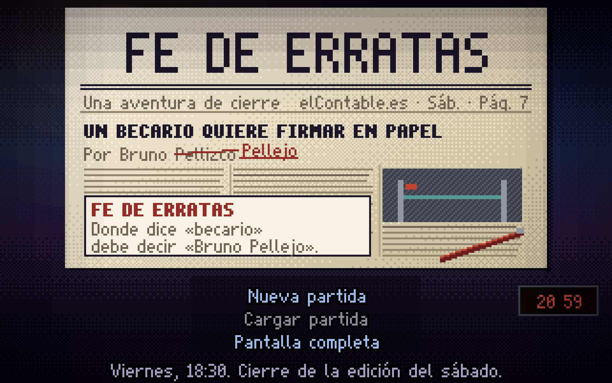

---

## 2. Cómo se ha jugado

| Sesión | Qué | Cómo |
|---|---|---|
| A. A ciegas | Partida completa, título → créditos, sin solución | Chromium/Playwright 960×600, ratón real sobre el canvas (verbo → objeto, clic en opciones, clics para pasar globos, doble clic para correr). Sin abrir `walk-data`, `extras`, `docs/guion2*`. Notas en caliente antes de leer nada. |
| B. Completa | Los 44 pasos + 35 extras (79) hasta la tarjeta y los créditos, con volcado de **todo** el texto (931 líneas) | Copia en un directorio temporal de `tools/extras.mjs` que además vuelca el registro por paso |
| C. Opcional | Todos los árboles de Celestino, Leoncio, Anselmo, coro, Custodia, Gertrudis, Aurora, Teodoro, Íñigo, Gervasio, Maripaz, Begoña, Evaristo, Pilar, Paco, Yoli; **perder** el duelo de Maripaz dos veces y **retirarse** del de Teodoro; Mirar/Usar/Coger absurdos en las 10 salas; móvil (correo, perdidas); pistas de la abuela en los tres niveles | En la partida A y en saves |
| D. Móvil | iPhone en horizontal (750×342 y 844×390), táctil, pulsación larga, menú de diálogo | Contexto `isMobile/hasTouch` |
| E. Técnica | `tools/test-all.mjs` completo (17 pruebas) | [T] |

**Sobre la honestidad de la partida a ciegas.** Fue a ciegas en lo que importa: no leí solución ni documentos de diseño
hasta acabarla, y resolví todos los puzles por ensayo o con las pistas del juego. Tres matices:
1. Para hacer clic usé la API solo como *geometría* (posición en pantalla de un objeto cuyo nombre ya había visto al
   pasar el ratón, posición de una opción de diálogo). Equivale a apuntar bien; no revela nada que no estuviera en
   pantalla.
2. En tres duelos (tercer intento con Maripaz, Gervasio e Íñigo) automaticé la elección con un bucle que leía la réplica
   correcta del estado del juego. En todos los casos tenía la réplica en la libreta y la emparejaba a ojo sin dificultad
   (la correspondencia es casi literal); aun así, lo declaro.
3. El tiempo de «110 minutos» es una **estimación de tiempo de jugador** (mi tiempo real fue mayor por la mecánica de
   control remoto). Lo calculo por número de acciones, globos leídos y desplazamientos.

---

## 3. Notas por apartado

### 3.1 Comedia y guion — 7,0 (antes 6,5)

**Qué ha mejorado.**
- **La muletilla temporal está domada.** «desde [año/marzo/julio]» pasa de ~40 a 5 en las cadenas del juego [C, recuento
  sobre la versión `9679041` y la actual]. Era el tic nº 1 de la crítica 2.
- **La trama de la coma es comedia de situación, no de frase.** Evaristo lo plantea en Administración
  (`content/rooms/administracion.dialogos.js`; [J]: «Lo dije. El consultor me contestó: “Eso es un detalle sin
  importancia”. / Y yo: “Una coma también lo era. Hasta que alguien la firmó”.»), Aurora lo bendice
  (`content/rooms/catacumba.js:286-311`: «Son cuarenta y ocho euros. Y su corbata, lo único bien puntuado de la casa.»),
  y en el clímax Íñigo dice literalmente la frase que dispara la réplica (`content/escenas/climax.js:341-345`). El
  jugador *ve venir* el gag y lo disfruta igual: eso es construcción, no ocurrencia.
- **Varios gags de forma distinta**: corte físico de la frase (Begoña recorta a Bruno: «Pero en la conclusión explico por
  qué la opa es import...» / «Recortado.»), escalada visual (la X del anuncio), gag de interfaz (la respuesta
  automática del fax que «gana» el duelo), contraste emocional (Teodoro: «…ES LO MÁS BONITO QUE ME HAN ESCRITO EN
  VEINTINUEVE AÑOS.»), revelación cómica (Herminia: «origen: Sistemas, armario 27 · consumo: atún»), anti-chiste
  («Un cartel de suelo mojado. El suelo está mojado.»).

**Qué sigue igual.**
- **Molde dominante.** Lo que antes era «… Como X.» y luego «desde 2019» hoy es:
  - «X no se coge. Se Y.»: 21 casos (`pecera.js:309` «Las sillas no se cogen. Se heredan.»; `ecosistema.js:282` «Un puf
    no se coge. Se adopta.»; `catacumba.js:708` «Un fax enmarcado no se coge. Se hereda.»; `sala_amazonas.js:251`
    «Ese planillo no se coge. Se negocia.»; `pajarera.js:313` «No se coge. Se licencia.»…).
  - «Es lo único / la única…»: 36 casos.
  - «primera vez» como golpe emotivo: 12 (`pecera.js:136`, `:186`, `:374`; `ecosistema.js:116`; `climax.js:229`;
    `final.js:154`…). Funciona en el epílogo; antes, se gasta.
  - «Tiene más [estabilidad/autoridad/aguante] que yo»: ~10.
- **Voces por muletilla.** Maripaz «cariño» (17), Aurora «criatura» (13), Teodoro/Celestino «chaval» (18), Evaristo
  «Una cosita… Era solo eso» (7+8), Gervasio «Se… se habla. Lo hablamos». Las mejores (Aurora, Teodoro, Custodia,
  Begoña) además tienen una *manera de pensar*; Maripaz y Pilar solo tienen un tema.
- **Personajes de un chiste:** Mercados 1/2/3 (ni nombre), Valentín (cameo mudo: «Está en la bandeja.»), Pilar (siempre
  a cinco minutos), Tadeo (el portátil que reenvía), el aro de Borja. No molestan, pero tampoco suman risa.
- **Nicho.** Hay chistes que exigen haber trabajado en un medio (CMS, «faldón», «cuerpo 9», «planillo», «matricial»,
  «galeradas», «descopear»). Se ha mejorado traduciendo en la misma línea («El CMS, el programa de publicar…»;
  «Descopear. Quitar algo sin que se note.»), y casi todo el humor de oficina (reuniones, notas de gasto, «responder a
  todos», consultores) es universal.

**Medición de la risa** [J, partida A]. Sonrisa ≈ 1 por minuto de juego. Carcajadas (risa audible en mi caso), por
orden de aparición:
1. Torno: «BIENVENIDO, VACANTE.» / «...Vacante. Bueno. Es un cargo.» (min ~6)
2. Gertrudis viral: «BUENAS NOCHES, PAÍS. ESTO NO LO SABE NADIE.» (min ~20) 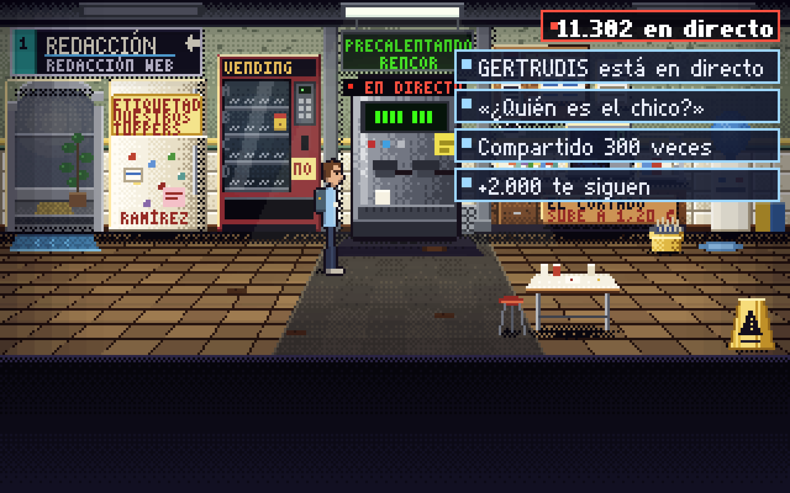
3. Begoña: «Varios.» → «RECHAZADO, en la frente.»; y «Recortado. Lo que venía después era la conclusión.» (min ~55)
4. Siestatón, segunda derrota: «Ahora roncan dos. Están ampliando plantilla.» (min ~80)
5. Recorte de la pieza a media palabra («…import...» / «Recortado.») (min ~70)
6. Rubén: «UN BECARIO VIVE EN UN ARMARIO. EL 4 TE SORPRENDERÁ» / «Mejor.» (min ~95)
7. Paco: «Esta casa da de alta antes a un portátil que a un chaval.» (min ~93)
8. Lector Medio: «...Y ahorrar.» tras la lectura de Evaristo (min ~105)
9. Begoña en el clímax: «Concepto: «IA». ¿Qué es una IA? ¿Un taxi?» (min ~106)
10. «Abrígate tú.» / «...¡Ay! ¡Me ha contestado el periódico!» y «Lamentamos el acierto.» (min ~110)

Diez en ~110 min a ciegas (una cada ~11 min, con el atasco de 20 min dentro); en el camino óptimo (~50-55 min de lectura
y juego) serían una cada 5-6 min. **Dónde se hace largo:** el tramo central del Acto II buscando réplicas (subir y bajar
cuatro plantas preguntando a todo el mundo), y los diálogos de Pilar y Gervasio, donde el chiste es el mismo en cada
opción.

### 3.2 Puzles y diseño de juego — 7,0 (=)

**Bien:** la ficha de la página 7 (hueco/fuente/firma) sigue siendo un tablero de objetivos excelente y se actualiza
con frases útiles; las cadenas tienen lógica interna y *se cruzan con gracia* (las copias rechazadas de Begoña son el
papel del fax; el 26 % que sobra según Herminia es el «recorte estándar» de Begoña; «descopear», oído al móvil de
Borja, libera a Rubén; la chaqueta de Ramírez sobre el Lector Medio, que «asiente», libera la silla). El duelo de
Teodoro se gana con la **respuesta automática** del manual del fax: el mejor remate de puzle del juego.

**Mal:**
- **La trampa Mirar/Usar ordenador** [J]. La réplica R11 («Espera sentado. Si encuentras silla.») solo sale con
  **Mirar** el ordenador *después de sentarse* (`pecera.js:266-273`). *Usar* el ordenador escribe la pieza y no la da.
  Yo me senté, usé el ordenador, escribí la pieza y nunca «miré». Resultado: no podía ganar a Maripaz.
- **Las pistas se quedan cortas justo ahí** [J+C]. En la Sala Amazonas la abuela, nivel 3, dice «Díselo por escrito… Y
  antes apúntate contestaciones, hijo. Cotillea, que es gratis.» (`pistas.js:64-68`) y Bruno, antes del duelo, «Aún no
  tengo con qué contestarle. Debería cotillear más.» (`duelo.js:109`): no dicen **dónde**. La pista que sí lo dice
  («Mira tu ordenador, hijo. Con silla ya se ve.») solo suena en la Redacción (`pistas.js:42-45`, `salas: ['pecera']`).
- **«Mirar a Bruno» se queda atrás** [J+C]. Por la misma razón, Bruno repite «Tengo silla. Ya puedo mirar mi ordenador
  como un adulto.» durante **todo** el Acto II y el III, incluso con la pieza escrita y la rotativa a punto de apagarse.
  En retrospectiva era una pista; en el momento parece un texto viejo. El README promete que «Mirar a Bruno dice lo que
  quiere ahora».
- **Una réplica clave está detrás de un personaje** [J, medido]. El fax enmarcado (réplica R06, la que contesta al
  primer ataque de Teodoro, «¿CONTRASTADO? FUENTES. NÚMERO.») queda detrás de la cabeza de Aurora: el centro del hotspot
  (229,67) es de Aurora; solo el 61 % de su área es clicable. A mí me dio la descripción de Aurora y nunca la conseguí.
  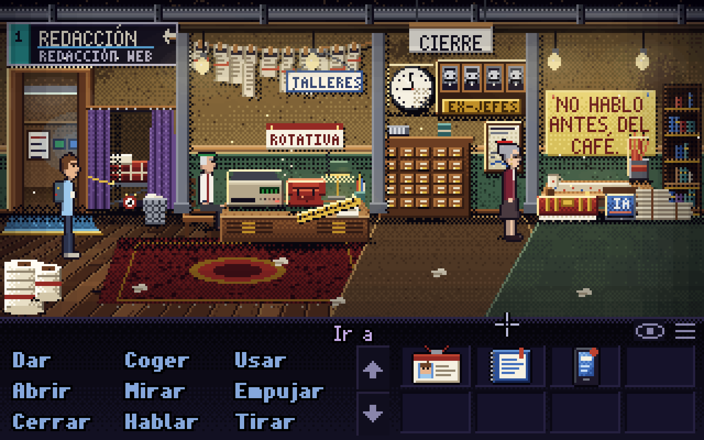
- **Duelos**: siguen siendo emparejamiento casi literal (el ataque «Hazlo tú, que escribes divinamente» contra la réplica
  «Y tú el que mejor delega»), y perder no cuesta nada salvo un anuncio y una llamada graciosa. La novedad buena: la
  derrota escala (Siestatón 1.ª, 2.ª, 3.ª distintas, `sala_amazonas.js:177-195`).
- **Acto II de ida y vuelta**: ascensor y escaleras entre −1, 0, 1 y 2 sin atajos; el directorio de planta no lleva a
  ningún sitio.
- **Puntos de fricción menores**: «rama del organigrama» (donde cuelga la casilla VACANTE) rechaza la tarjeta con una
  respuesta genérica; solo vale «organigrama» [J]. La silla de Ramírez, objetivo explícito del Acto I, no es necesaria
  para pasar al Acto II [J].
- **Tras el clímax** no hay señal de qué hacer (Mirar a Íñigo/Lector no orientan); lo resolví con la abuela («A los que
  nunca dicen nada, hijo, un empujoncito.»).

### 3.3 Historia y estructura — 8,0 (antes 7,5)

La premisa se entiende en un minuto (la abuela y el pueblo esperando el quiosco), los tres actos tienen objetivos
claros y el final es redondo: Íñigo era el becario de marzo del 98 (paga el pósit «Contratar al becario de marzo –
1998»), Teodoro cede la plaza 1, la lectora de 47 minutos que comenta «abrígate» es la abuela, que «el papel lo dejó en
2011», y la tarjeta remata con «Lamentamos el acierto». Sube medio punto porque **Evaristo ya está en la trama** (era el
cambio nº 8 de la crítica 2) y porque la guerra Infografía–Desarrollo ahora tiene principio, nudo y desenlace. Lo que no
sube más: el final de Herminia es enrevesado (anexionada por Desarrollo y, tres líneas después, «alta de usuario: no ·
propietaria: Infografía», `pecera` en el paso 40), y Ramírez, mencionado 39 veces, aparece solo para un «¿Me he perdido
algo?».

### 3.4 Interfaz y usabilidad — 7,0 (=)

**Resuelto:** el título ya no solapa el menú con el lema [J] ; la 4.ª opción táctil se lee
entera [J] (ver `img/20-iphone-horizontal.png`); el correo del móvil lleva cabecera «Correo (5)» sin truncar [J].
**Bien:** verbos grandes y legibles, «ver objetos» con el ojo, doble clic para correr y salir, pulsación larga en táctil
que funciona (Mirar torno) [J], y la ventana de duelo con ataque y marcador en texto.
**Mal:** la salida de los Despachos se llama «cristal de la Redacción» y parece un objeto, no una puerta [J]
(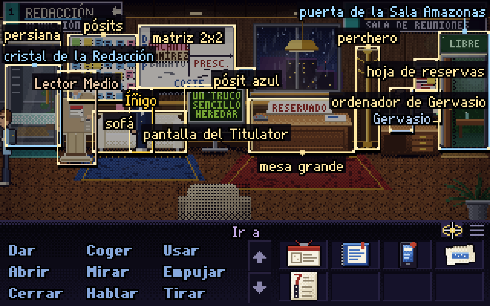); la ventana de duelo tapa la cara del rival (Maripaz queda bajo
la cabecera del correo) [J] 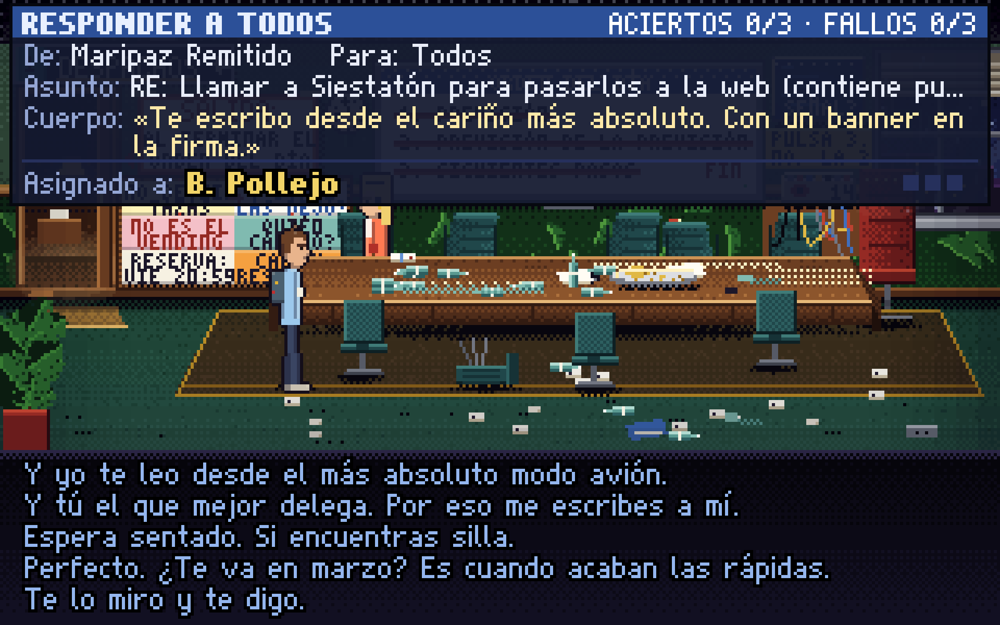; en iPhone siguen las bandas laterales negras [J]; los
globos de texto se superponen a carteles con mucho texto (Sala Amazonas) pero el contorno los mantiene legibles [J].

### 3.5 Apartado visual — 8,0 (=)

Pixel art procedural de mucho oficio: cada planta tiene paleta propia (moqueta morada de Marketing, madera y latón de la
Redacción de papel, azules de Sistemas), los planos detalle (pop-ups, página 7, armario 27, reverso del Lector Medio) dan
escala a los momentos clave, y la tarjeta FE DE ERRATAS es preciosa. Los pop-ups de Maripaz tienen el aspecto exacto de
un *dark pattern* web («¡SÍ, QUIERO!» enorme, «No, gracias» gris). Sprites algo rígidos y salas muy cargadas de
carteles, como antes. 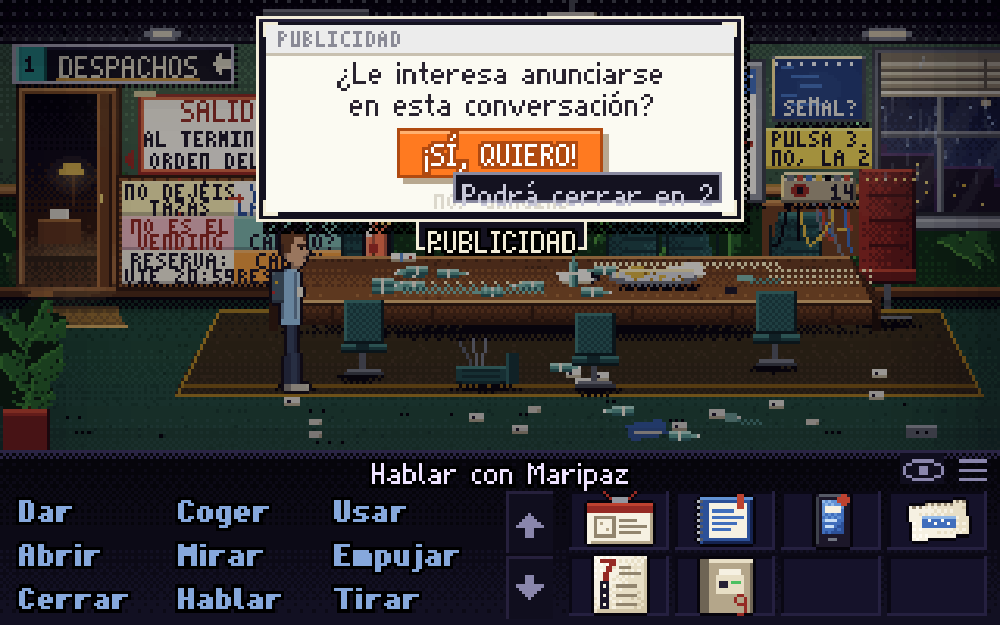 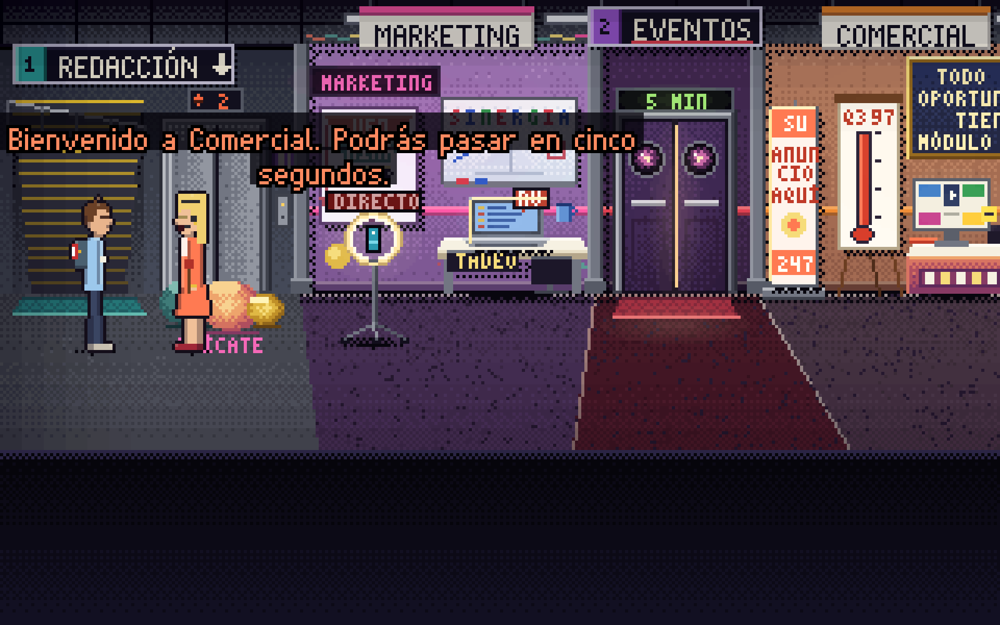

### 3.6 Audio — 6,5 (provisional)

No he podido oírlo (entorno sin salida de sonido). Mantengo la nota de la crítica 2 a título informativo; no es una
valoración.

### 3.7 Técnica y estabilidad — 8,5 (antes 8,0)

`tools/test-all.mjs`: **17/17 pruebas OK** (smoke, motor, fuzz, check, móvil, walkthrough, walkthrough alternativo,
extras, comedia P1-P4, partida con ratón real…) [T]. Cero errores de consola en mis dos partidas completas [J]. Carga y
guardado fiables; el autoguardado recupera la partida tras recargar [J]. Los problemas que quedan son de contenido y
geometría, no de código (§7).

---

## 4. Lo mejor (con citas)

1. **El final.** «Ay, hijo. El papel lo dejé en 2011, que me manchaba el sofá.» → «Bruno Pellejo ha respondido:
   «Abrígate tú.»» → «...¡Ay! ¡Me ha contestado el periódico!» (`content/escenas/final.js:201-217`); tarjeta: «Donde
   decía «Por Bruno Pellejo» debía decir «Por Bruno Pellejo». Lamentamos el acierto.» (`final.js:240-247`).
   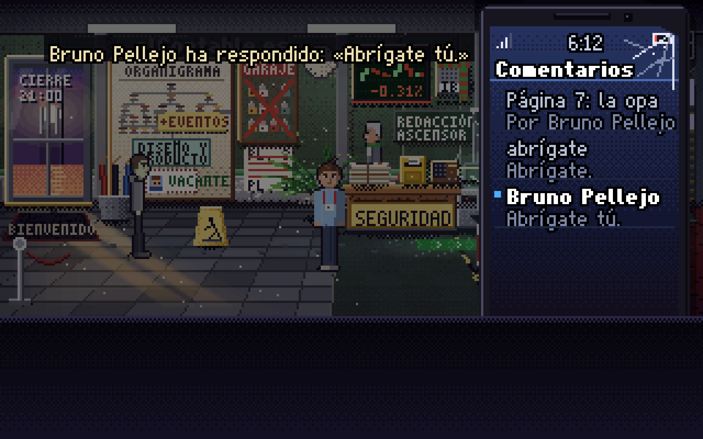 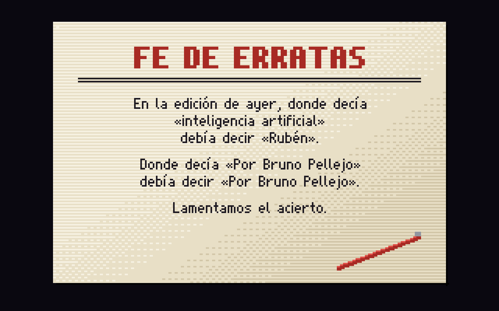
2. **Teodoro y el fax.** El duelo se gana con la respuesta automática («ESTOY FUERA DE LA OFICINA HASTA QUE EL PAPEL DEJE
   DE EXISTIR.») y él contesta «…ES LO MÁS BONITO QUE ME HAN ESCRITO EN VEINTINUEVE AÑOS. … BRUNO PELLEJO. TRECE CON
   ESPACIOS. CABE.» / Bruno: «...Lo ha escrito bien.» (`catacumba.js:79-84`, `:511`). 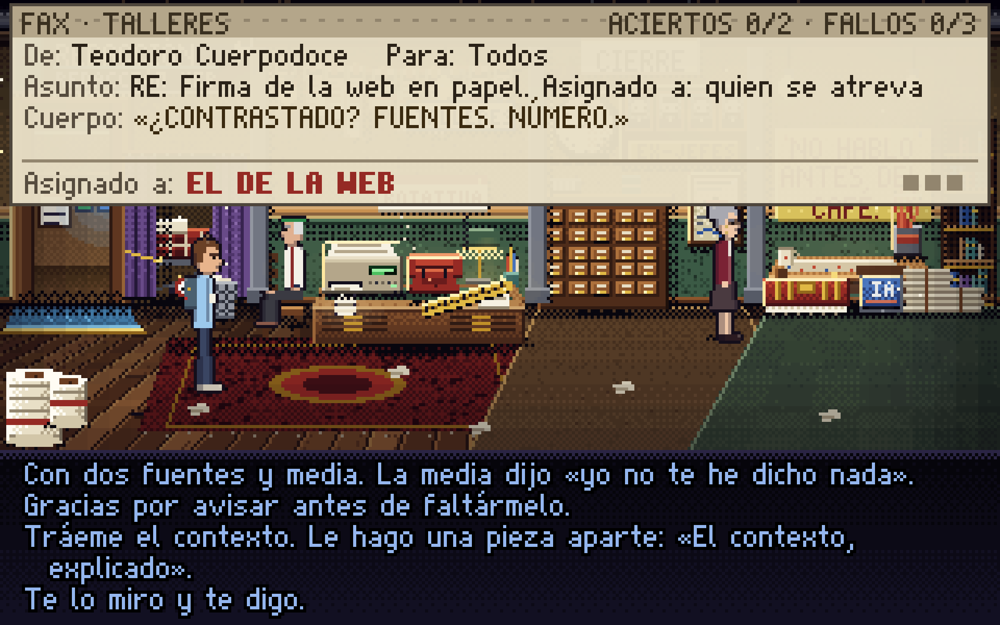
3. **Evaristo y la coma en el clímax.** «Cláusula 12: punto de miles y coma decimal. «48,000» son 48 euros.» / Íñigo:
   «¡Es formato internacional! ¡Lo entiende todo el mundo!» / «Cláusula 13: ley española. Lo oscuro, contra quien lo
   escribe.» / «Nos deben 191.808 euros.» / Lector Medio: «...Y ahorrar.» (`climax.js:338-345`).
4. **Aurora.** «Le contesté dándole las gracias por avisarme. Antes de lo que venía. / No me ha vuelto a dirigir la
   palabra. Han sido treinta años muy buenos.» (`catacumba.js:397-399`); «Leo la web todas las noches, para sufrir con
   método.» (`:418`).
5. **Begoña.** «Begoña, con todo el respeto, yo solo venía a preguntarle si...» / «Recortado. Lo que venía después era
   la conclusión. No la lee nadie.» (`administracion.dialogos.js`); y el mismo recorte, aplicado a la pieza de Bruno a
   media palabra. 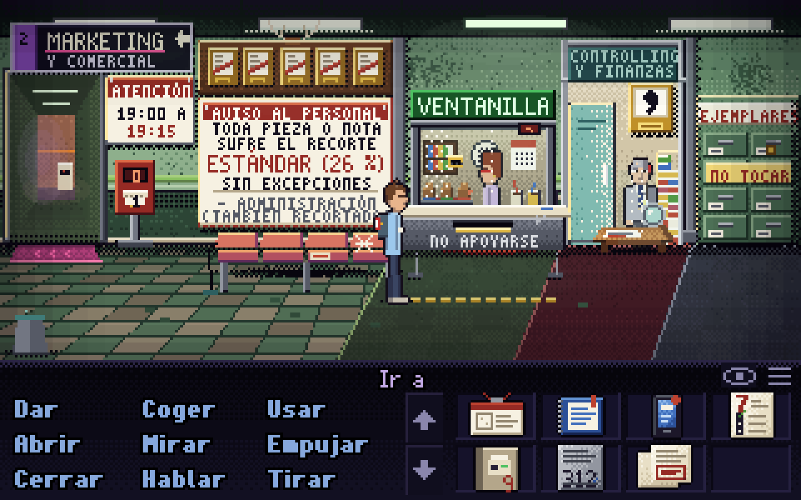
6. **Rubén y el Titulator.** «Rubén: No me encerró. Me dio una silla y wifi. Yo pensé que era un contrato.»; «UN BECARIO
   VIVE EN UN ARMARIO. EL 4 TE SORPRENDERÁ» / «Mejor.» (`cpd.js`). 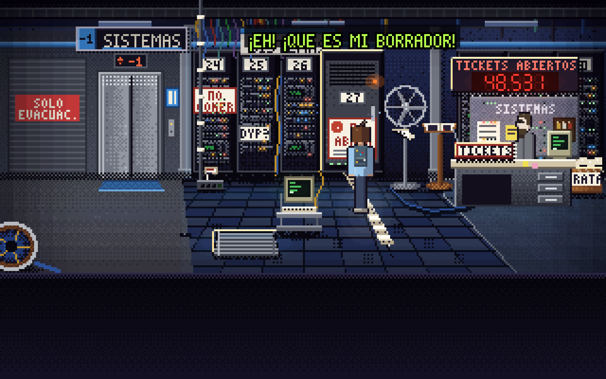
7. **Paco.** «Esta casa da de alta antes a un portátil que a un chaval.» (`cpd.js`); «No escucho. Oigo. Escuchar sería
   abrir un ticket.»
8. **Gertrudis.** «TENGO WIFI Y RENCOR.»; y la despedida: «E-53: SE HA IDO EL PÚBLICO. VUELVO A SER UNA CAFETERA.» /
   «Yo la sigo viendo.» / «LO SÉ. ERES EL ÚNICO. NO SE LO DIGAS A NADIE.» (`office.js`).
9. **Custodia** abre interrogación y cierra con punto: «¿Qué quiere.» — y Aurora lo explica: «Eso no es una pregunta,
   criatura. Es una sentencia.» (`catacumba.js:424-425`).
10. **Maripaz, cuando es situación:** la X que mengua (`sala_amazonas.js:145-164`: «La X mide un píxel.» / «La semana
    pasada medía dos. Optimizamos.» → «Ahora la X es un punto.» / «Un punto muy bien situado.») y el adhesivo en la
    espalda (Yoli: «¿Llevas un banner en la espalda? ...Pues convierte. Me han mirado.»; Aurora: «Llevas un anuncio en
    la espalda, criatura. En esta planta, no.»).

---

## 5. Lo peor (con citas)

1. **La trampa de R11 y las pistas que no dicen dónde** (§3.2). Es el único atasco real y nace de una distinción de verbo
   (Mirar/Usar) sobre el mismo objeto, más una pista que solo suena en otra sala. Lo vivido: 20 minutos dando vueltas.
2. **Molde de chiste.** «Las sillas no se cogen. Se heredan.» (`pecera.js:309`) es bueno; con 21 hermanos («Un puf no se
   coge. Se adopta.», `ecosistema.js:282`; «La ficha no se faxea. Se sella.», `catacumba.js:655`; «No se empuja. Se
   activa.», `ecosistema.js:221`) es una plantilla. Igual con «Es lo único…» (36).
3. **Maripaz de una nota.** Cada línea es anuncio o factura: «Si no lleva logo, no lo cojo. Y si lo lleva, lo cobro.»;
   «A mí no se me coge, cariño. Se me contrata. Por impresiones.»; «Eso en la web se llama «interacción». Te la cobro.»;
   «Si me grabas, te facturo los derechos de imagen.»; «¿Esa cara? Te la patrocino. «Agobio, con Tilas Calmín».»
   (`ecosistema.js`, `sala_amazonas.js`, `duelo.js:91`). «factur*» aparece 28 veces en el texto. A la quinta ya no hay
   sorpresa; le falta una escena donde quiera algo que no sea vender.
4. **Desarrollo no es solo Anselmo.** El coro sigue («CORO: DEV 1: ¡Se ha caído el CMS! / DEV 2: ¡Hay que levantarlo! /
   DEV 1: ¿Cómo? / DEV 2: ...Gritando más alto. / DEV 3: No.», `pecera.js:35-39`), con hotspot, diálogo propio y
   «¡Ha sido Diseño!» al apagar la regleta. Si el objetivo era «Anselmo, único de Desarrollo», no se ha cumplido. Y
   Anselmo repite su mejor línea literal dos veces en la partida («El modelo es de fuera. El prompt es de dentro. / Eso
   lo hace nuestro.», en su árbol y en la escena del ordenador, paso 34).
5. **Líneas sin contexto.** El ambiente de Aurora «Dos exclamaciones de cierre y ninguna de apertura. / Eso no es
   entusiasmo, criatura. Es inglés.» (`catacumba.js:829`) reacciona a los «!!» de Tadeo, pero suena justo después de
   cerrar su diálogo, sin Tadeo a la vista; parece contestar a Bruno [J]. Pilar abre su conversación con un rumor sobre
   Teodoro y «Llevas RECHAZADO en la frente» antes de saludar [J].

---

## 6. Análisis por sala y por acto

### Acto I (18:30 → café a Aurora) — ~20 min a ciegas [J]
- **Vestíbulo** 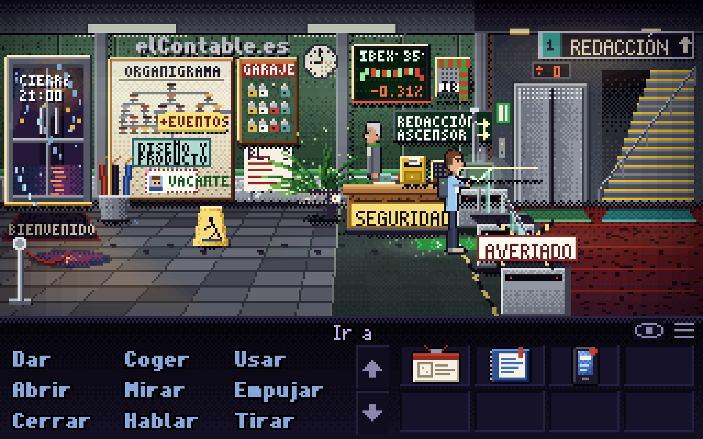. Introducción perfecta (abuela + pueblo). Celestino locutor
  deportivo funciona de principio a fin («La web no tiene pared, chaval.»; en el epílogo «Ya te ve hasta el torno»). El
  puzle del torno es justo; «rama del organigrama» debería aceptar la tarjeta.
- **Redacción** 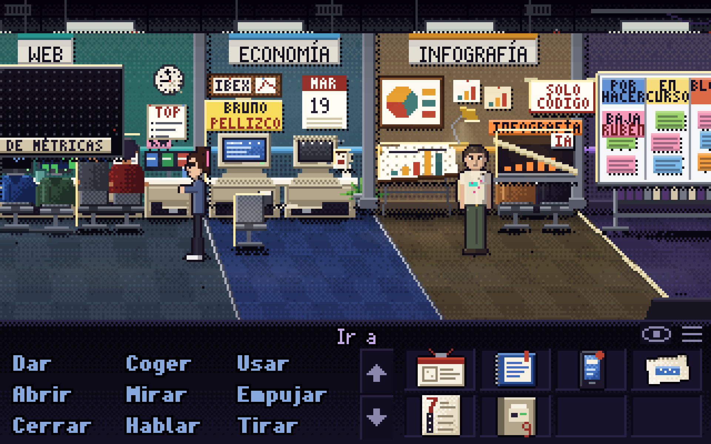. La escena del Titulator presenta a Íñigo, Herminia
  («Aquí ya tenemos una IA. Herminia.» / «Entonces no es una IA. Es un hobby.») y a Anselmo en 12 líneas: clarísimo. La
  sala es larga (1.270 px) y hay que hacer scroll, pero el doble clic lo alivia. Yoli («Bruno, Bruno becario, becario
  sin silla…») tiene un tic de SEO divertido y un momento bonito («Creo que esto es estar tranquila.»).
- **Despachos.** Matriz 2×2 y Lector Medio: buen escenario. Salida mal nombrada.
- **Vending.** Gertrudis es el mejor puzle-gag del acto.
- **Redacción de papel.** La mejor sala del juego, en arte y en texto.

### Acto II (hueco, fuente, firma) — ~70 min a ciegas, el más largo [J]
- **Sala Amazonas**: «¿y cuáles son los siguientes pasos?» → estampida; buen gag de situación, aunque la opción aparece
  al primer intento. Maripaz y su duelo: ver §3.2 y §5.
- **Marketing y Comercial**: sin gente salvo Maripaz tras el duelo; el aro de Borja, el portátil de Tadeo y el anuncio de
  entrada de 5 s (una vez). Bien como paisaje; pocos chistes nuevos («Su portátil, no.» repite el molde de «El móvil
  no.» dos objetos antes).
- **Administración**: Begoña y Evaristo, la mejor pareja nueva. La nota de gasto ramificada es un diálogo-puzle
  ejemplar.
- **Eventos**: Pilar es simpática pero de un chiste; la silla 113 de más es un buen misterio que no se paga en pantalla.
- **Sistemas**: Paco, la regleta R-3 y el armario 27, muy bien sembrados (ticket nº 1, nº 3, contador, rejilla).
- **Dónde se hace largo**: recorrer las cuatro plantas buscando la réplica que falta.

### Acto III (cierre) — ~20 min [J]
Corto, encadenado y con pagos constantes: Herminia descubre que el Titulator «come a las dos y va once veces al baño»,
Evaristo deduce lo de los atunes («Alguien que come y no cobra. Eso es un becario.»), Rubén, el álbum, el acta de
Gervasio (duelo corto con remate de la nota de Hidrovoltia), el clímax a cinco aciertos con tres remates
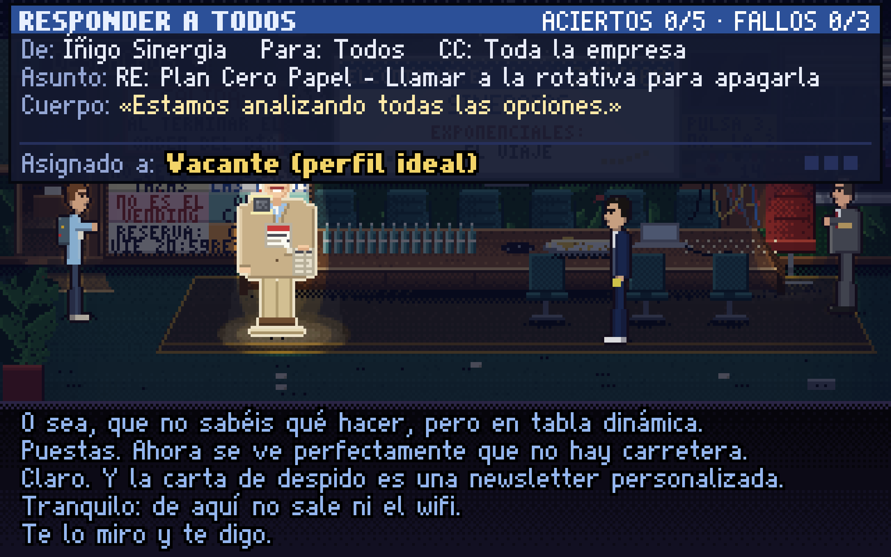 y el empujón al Lector Medio. Es el mejor acto.

---

## 7. Bugs y fallos (con pasos)

| # | Gravedad | Descripción | Pasos | Verif. |
|---|---|---|---|---|
| N1 | **Media (diseño)** | Atasco por R11: solo *Mirar* el ordenador con silla da la réplica que hace falta contra Maripaz; *Usar* no la da y las pistas de la Sala dicen solo «cotillea». | Sentarse (paso 10), *Usar* ordenador (sin Mirar), ir a por Maripaz: «Aún no tengo con qué contestarle». Abuela nivel 3 en la Sala: «Cotillea, que es gratis». | [J+C] |
| N2 | Media | «Mirar a Bruno» devuelve el objetivo pendiente más antiguo: «Tengo silla. Ya puedo mirar mi ordenador como un adulto.» en todo el Acto II y III. | Igual que N1; Mirar a Bruno en el Acto III. | [J+C] |
| N3 | Media (geometría) | El fax enmarcado (réplica R06) está detrás de Aurora: el centro de su hotspot es de Aurora; 66 de 108 puntos de su área llevan al fax. | Redacción de papel, Mirar el marco del fax en su centro → descripción de Aurora. | [J] |
| N4 | Baja | «Usar tarjeta con rama del organigrama» → respuesta genérica; solo «organigrama» funciona, aunque la casilla VACANTE cuelga de la rama. | Vestíbulo tras pegar el chicle. | [J] |
| N5 | Baja (UX) | La salida de los Despachos se llama «cristal de la Redacción». | Despachos, pasar el ratón por la izquierda. | [J] |
| N6 | Baja (texto) | El ambiente de Aurora sobre los «!!» de Tadeo suena tras cerrar su diálogo y parece contestar a Bruno. | Leer un RV de Tadeo; hablar con Aurora en el Acto II y despedirse. | [J+C] |
| N7 | Baja | «[Retirarse del hilo]» cierra el duelo sin ninguna línea (en el registro no aparece «Bruno ha abandonado el hilo.», `duelo.js:117`). | Duelo de Teodoro sin el manual → Retirarse. | [J] |
| N8 | Baja (continuidad) | Tras ganar a Maripaz, Bruno dice «Ficha de la página 7. Sellada por Aurora.» (`sala_amazonas.js:103`) aunque quien firmó fue Teodoro (si se hizo antes el D2). | Ganar D2 antes que D1. | [J] |
| N9 | Baja (texto) | Comillas anidadas iguales en la libreta: «Tráeme el contexto. Le hago una pieza aparte: «El contexto, explicado».» | Mirar la libreta. | [J] |
| N10 | Cosmético | Los titulares del Titulator a veces quedan registrados como dichos por Bruno (fuera de los Despachos). Solo afecta al registro, no lo vi mal en pantalla. | Perder D1; Acto III en Despachos. | [J] |
| N11 | Diseño | El coro de Desarrollo sigue hablando a distancia mientras juegas en el otro extremo de la Redacción. | Recorrer la Redacción. | [J] |

**Bugs de la crítica 2 comprobados:** B1 título — resuelto [J]; B2 4.ª línea táctil — resuelto [J]; B3 Borja anticipa
la opa — desaparece con Borja [C]; B4/B5 Yoli — no reproducidos [J]; B7 cabecera del correo — resuelto [J]; B10
contador de tickets (arte y texto 48.212) — resuelto [J]; B11 paragüero y cartel ya tienen hotspot y texto [J].

---

## 8. Comparación con las críticas anteriores y veredicto

*(Esta sección se escribió después de dejar escritas mis notas y notas provisionales; leí entonces
`critica/CRITICA_JUEGO.md` y `critica2/CRITICA_JUEGO_2.md` y comparé textos con `git archive 9679041`.)*

### 8.1 Notas lado a lado
Ver tabla del §1. Mis notas provisionales a ciegas eran comedia 7,5 / global 7,5; tras contar las fórmulas he bajado
comedia a 7,0.

### 8.2 Resuelto
| Señalado antes | Hoy | Cómo lo sé |
|---|---|---|
| Solape del título (C2-B1) | Resuelto | [J] `img/01` |
| 4.ª línea táctil cortada (C2-B2) | Resuelto | [J] `img/20` |
| Muletilla «desde [fecha]» (>80 en C2; ~40 en cadenas) | **5** | [C] recuento en ambas versiones |
| Subtrama de Evaristo invisible (C2 #8) | En el camino principal y en el clímax | [J] |
| Dos «comas» que se pisan (C2 #6) | Queda una sola (desaparece la de 4,15 €) | [C] |
| Borja anticipa la opa (C2-B3) | Borja sustituido por el aro; ya no destripa | [J+C] |
| Reparto de una nota (C2 #11) | Parcial: fuera Nemesio y Borja como PNJ; Mercados, coro, Valentín, Pilar siguen | [J] |
| Poda de texto (C2 #3, −20/25 %) | Parcial: −5 % de cadenas (3.359 → 3.179), −6 % de bytes | [C] |
| Duelos sin riesgo (C2 #9) | Parcial: la derrota escala y cuesta un anuncio; sigue siendo emparejamiento literal | [J] |

### 8.3 Sigue igual
- Sonrisa constante, carcajada escasa (mejor ratio: ~1 cada 5-6 min en el camino óptimo frente a 7-9).
- Molde de remate seco; las voces se reconocen más por muletilla que por pensamiento (salvo Aurora, Teodoro, Custodia,
  Begoña, Evaristo).
- Acto II de ida y vuelta.
- Bandas negras en iPhone.

### 8.4 Ha empeorado o es nuevo
- **Nuevo atasco (N1/N2)**: con más réplicas en el camino de Maripaz, la que falta es fácil de perder y las pistas no
  apuntan a ella. Es el problema de diseño más serio de esta versión.
- **Nuevas fórmulas**: al quitar «desde 2019», el peso pasa a «X no se coge. Se Y.» y «Es lo único…». La herramienta de
  auditoría de textos cuenta topes de «desde» y «cariño»; no cuenta estas.
- **Maripaz**: añade un personaje de un registro y 28 «factur*». Sus mejores momentos son de situación (X menguante,
  adhesivo); sus peores, frases sueltas sobre cobrar.
- **Coro de Desarrollo**: el objetivo «Anselmo único» no se cumple.

### 8.5 Discrepancias con las críticas anteriores
- La crítica 2 pedía «cuota a la muletilla»; se ha cumplido, pero aviso de que el problema no era la muletilla sino tener
  **una sola forma** de remate. Sin variedad de forma, cada poda solo cambia de tic.
- La crítica 1 se quejaba del humor interno de Diseño; hoy Diseño es un running gag menor y bien dosificado (el coro le
  culpa; Valentín responde «Está en la bandeja», y en la bandeja estaba el aviso de 2017). Ya no es un problema.

### 8.6 ¿Mejor o peor? Respuesta franca
**Mejor.** En historia, en coherencia (Evaristo, Herminia, la coma), en limpieza de tics y en estabilidad. Lo que puede
dar sensación de «peor» al dueño: (1) el atasco N1, que hace el Acto II más largo de lo que era para un jugador real;
(2) Maripaz y sus anuncios, que añaden ruido de un solo color; (3) el coro de Desarrollo, que sigue ahí contra lo
pedido. Ninguna de las tres anula la mejora; las tres se arreglan en días.

---

## 9. Cambios recomendados, priorizados

Impacto A/M/B; esfuerzo S (horas), M (días), L (semanas).

### Imprescindible
| # | Cambio | Impacto | Esfuerzo |
|---|---|---|---|
| 1 | **R11 también con *Usar* ordenador** (o al sentarse), y que la pista nivel 3 de la Sala diga dónde falta cada réplica («Lo de esperar sentado lo tienes en tu ordenador») | A | S |
| 2 | **«Mirar a Bruno»**: no anteponer objetivos secundarios ya superados al objetivo actual; mostrar el objetivo del acto | A | S |
| 3 | **Despejar el fax enmarcado** (moverlo o mover a Aurora) | M | S |
| 4 | **Coro de Desarrollo**: si Anselmo debe ser el único, quitar o mudar el coro (que sean espaldas sin voz) | M | S |

### Recomendable
| # | Cambio | Impacto | Esfuerzo |
|---|---|---|---|
| 5 | **Romper la plantilla** en 30-40 líneas: cuota para «X no se coge. Se Y.» (≤5) y «Es lo único» (≤8), y añadirlas a `tools/text-audit.mjs` | A | M |
| 6 | **Dar a Maripaz un segundo registro**: una escena en la que quiera algo que no sea vender (p. ej., que en el epílogo le guste la página sin anuncio *de verdad* un segundo) y bajar «factur*» a la mitad | M | S-M |
| 7 | **Anuncios**: en las revanchas del duelo, saltar el pop-up de la 3.ª vez en adelante (o hacerlo más corto) | B-M | S |
| 8 | **Atajo del Acto II**: el directorio de cada planta como ascensor rápido | M | S |
| 9 | **Señal tras el clímax** (Gervasio o Celestino: «Ese cartón no se cae solo») | M | S |
| 10 | **Pequeños**: rama del organigrama, salida «puerta de la Redacción», línea al retirarse del hilo, «Sellada por Aurora» condicional, comillas anidadas, ambiente de Aurora solo con Tadeo en contexto | B | S |

### Si sobra tiempo
| # | Cambio | Impacto | Esfuerzo |
|---|---|---|---|
| 11 | Bandas del iPhone con verbos/inventario | M | M |
| 12 | Nombres a los tres de Mercados o dejar uno | B | S |
| 13 | Pagar en pantalla la silla 113 de Eventos | B | S |
| 14 | Escuchar la música en sesión con sonido (no evaluada aquí) | ? | S |

### Los diez prioritarios
1. R11 accesible y pistas que digan dónde (N1).
2. «Mirar a Bruno» con el objetivo actual (N2).
3. Fax enmarcado despejado (N3).
4. Coro de Desarrollo sin voz o fuera.
5. Cuotas a las nuevas fórmulas y auditoría automática.
6. Segundo registro para Maripaz; menos «factur*».
7. Sin pop-up obligatorio en las revanchas.
8. Atajo de desplazamiento en el Acto II.
9. Señal para el empujón final.
10. Lote de arreglos pequeños (N4-N10).

---

## Apéndice

- Capturas del informe (2×, salvo las marcadas «1x», escaladas): `img/`.
- Material de trabajo (volcado del texto de los 79 pasos, recuentos, scripts de captura y control remoto): en el
  directorio temporal de la sesión; no se ha añadido al repositorio.
- Herramientas del repositorio ejecutadas: `tools/test-all.mjs` (17/17 OK). Las capturas de esta crítica se hicieron con
  scripts propios fuera de `tools/` para no escribir en `tools/shots`.
