# FE DE ERRATAS · Propuesta alternativa de dirección de arte: «más detalle y todo más delimitado»

**Para:** dirección de diseño y producto · **Autor:** dirección de producción independiente (no hizo el juego ni la auditoría) · **Fecha:** 13-11-2026
**Base:** `docs/informes/INFORME_AJUSTE_VISUAL.md` (citado como «auditoría», sus problemas como **#n**), biblia (`B§`) y adenda (`A§`).
**Alcance:** es una PROPUESTA. No se ha tocado `engine/`, `content/`, `tools/` ni la documentación existente. Todo vive en `docs/informes/propuesta/`:

- `render.mjs` regenera todas las imágenes (`node docs/informes/propuesta/render.mjs [filtro]`), importando en lectura `engine/draw.js`, `engine/sprites.js`, `content/actors.js` y `lib-oficina.js`: las maquetas usan el aspecto y los personajes reales.
- `arte/sala_amazonas.propuesta.art.js` y `arte/pecera.tramo.propuesta.art.js` son las **dos pruebas pintadas**, escritas con el contrato de `content/rooms/art` (layout, walkboxes, `draw`, `overlay`, `sprites` por estado). Se pueden portar casi tal cual.
- `lib/kit.js` es el kit del sistema de diseño (placas, rótulos, umbrales, puertas, ascensor, escalera, mampara, «canto vivo»). `lib/datos.js` es la distribución propuesta de las 10 salas: de ahí salen las maquetas y las tablas de este documento.
- Las capturas `img/actual-*.png` se tomaron con `tools/shot.mjs --out` (sin modificarlo).

> **En una frase:** la auditoría tiene razón en que fallan la puesta en escena y la delimitación, no el inventario. Esta propuesta conserva todo lo que ya funciona y cambia tres cosas: el **espacio** (zonas con suelo, pared, luz y rótulo propios, y suelo transitable con profundidad), la **escenificación** de los cinco remates y un **sistema común** de señalética y puertas.

---

## 1. Principios de la alternativa

1. **Delimitar el espacio con cuatro capas a la vez.** Cada zona de departamento tiene (a) **suelo propio** (loseta o moqueta de su color, separada por un canto de goma claro en perspectiva), (b) **pared propia** con un **filete de 3 px** del color del departamento a la altura del zócalo alto, (c) una **pilastra** en el cambio de zona y (d) un **rótulo de departamento** colgado del techo y centrado sobre la zona. Las fronteras «de guion» (la cinta de Desarrollo) se dibujan **en el suelo**, encima del cambio de moqueta, para que no se confundan con un reflejo.
2. **Código de color por planta y por departamento.** La planta manda en la señalética (banda de la placa): P−1 azul, P0 verde, P1 verde agua y P2 lila. El departamento manda en suelo, filete y luz: Web verde agua, Economía azul, Infografía naranja, Desarrollo violeta, Diseño blanco, Dirección nogal y latón, Office amarillo, Papel ámbar, Marketing fucsia, Eventos granate, Comercial naranja, Administración verde oliva y Sistemas azul. Se conservan las paletas de sala que la auditoría elogia (§5.2).
3. **Un único lenguaje de umbral.** Toda salida lleva: la **placa de destino** (13 px: banda con el número de planta, nombre del destino y flecha si cambia de planta o de dirección), un **umbral** en el suelo con el color del destino, y un **marco metálico común**. Ascensor y escalera son un kit idéntico en las 4 plantas: el ascensor tiene indicador de planta y botonera, y la escalera, narices de peldaño amarillas. Así se acaban los cinco estilos de puerta (#20).
4. **Profundidad en tres planos.** Hay **fondo** (pared y lo que cuelga de ella), **plano medio** (muebles exentos: mesa de reunión, kanban con ruedas, mesa alta del Office, sofá) y **primer plano** (oclusores laterales que no tapan a nadie). El walkbox deja de ser una franja de y 104-142 y pasa a rodear los muebles (en U, con muescas) para que se pueda estar **detrás de**, **delante de** y **a la cabecera de**. Se añade la **pose sentada** (presidir, el fax, el sofá, la ventanilla).
5. **Interactivo frente a decorado.** Todo lo interactivo tiene **silueta propia y cerrada**, un **mínimo de 12×10 px** (16×12 en móvil) y el **canto vivo**: 1 px de luz cálida en el borde superior izquierdo más 2 px de sombra de contacto. Lo decorado no lleva ese canto y usa menos contraste. Ningún hotspot interactivo se solapa con otro (se resuelven los solapes de §5.4).
6. **Cambios de estado visibles.** Cada cambio de estado con guion altera **al menos dos de estos tres elementos: forma, color y luz**, y ocupa ≥ 30 px² (torno: alas recogidas + LED verde + franja verde en el suelo). Los estados se dibujan por el **estado del objeto**, nunca por un flag que llega al final de la escena (#2).
7. **Escenificar los remates.** El objetivo de cada remate va **iluminado y despejado**. Solo puede tapar algo el plano medio y nunca la cara de nadie. Lo que el guion llama «primer plano» se resuelve con un **plano detalle** (inserto ampliado con marco y rótulo), no con un globo: el clímax con el Lector en la cabecera, contra el ventanal y bajo un foco; el armario 27 que se abre; Teodoro que descuelga el teléfono rojo; el portátil del villano en plano detalle; y el amanecer del epílogo, que cambia la luz.
8. **Legibilidad de los personajes.** Los PNJ que hablan van con cabeza y torso a la vista (≥ 80 %). Los mostradores llegan a la cintura. Bruno habla siempre desde un lado: **separación horizontal ≥ 24 px y nunca delante**. Las cabezas no bajan de 10 px de alto (escala ≥ 0,88 al fondo). Un PNJ oscuro va delante de un fondo claro (y al revés).
9. **Texto pintado.** Los rótulos van en la fuente del juego (caja de 7 px) y los textos secundarios en 3×5 como mínimo, con un máximo de 9 caracteres por línea en 36 px y siempre **enteros sobre su soporte**: si no caben, se agranda el soporte o se acorta el texto. No hay marcas reales («PANTONE» fuera, #10). Las pistas de puzle quedan fuera de la franja de globos (y < 45).
10. **Ergonomía móvil.** Los objetivos táctiles son de 16×12 px de juego como mínimo (≈ 27×20 pt en iPhone). La separación entre hotspots es ≥ 4 px. Las filas de menú pasan de 8-9 px a 14 px. Se añade un modo «ver hotspots», con pulsación larga en zona vacía o con un botón, que dibuja el canto vivo de todos los interactivos durante 1,5 s. En la Pecera ningún hotspot queda a menos de 4 px del borde de cámara.

---

## 2. Mapa del edificio propuesto

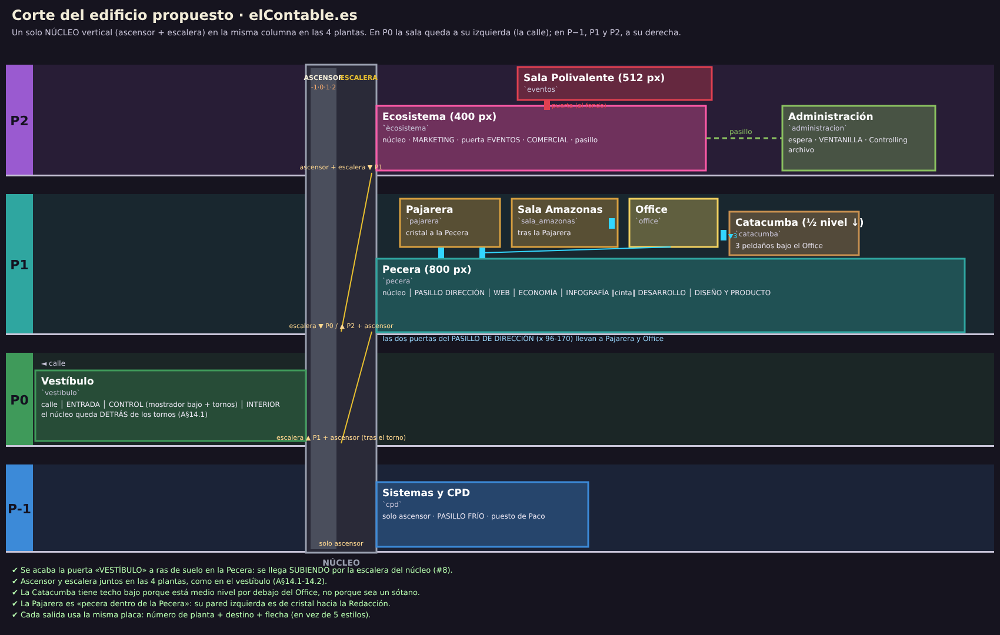

**La clave es un solo núcleo vertical.** El ascensor y la escalera van juntos en la misma columna en las cuatro plantas. En el vestíbulo, el núcleo queda detrás de los tornos (como pide la A§14.1, que ya funciona). En la Pecera, el Ecosistema y el CPD queda en el extremo izquierdo de la sala.

| Contradicción de la auditoría | Solución |
|---|---|
| Se sube por la escalera «REDAC. 1», pero se llega a la Pecera por una puerta acristalada a ras de suelo con el torno detrás (#8) | Desaparece la puerta acristalada. A la Pecera se llega por el **tramo que sube del núcleo** (`pecera_a_vestibulo` = escalera que baja); el ascensor y la escalera a P2 están al lado. |
| La Catacumba (techo bajo, tuberías) parece un sótano | Está **medio nivel por debajo del Office**: la puerta TALLERES tiene 3 peldaños con nariz amarilla (▼ en la placa). Sigue siendo P1. |
| La Pajarera no tiene cristal hacia la Pecera (#16) | La pared izquierda es un **tabique de cristal**: a través se ven las mesas y la pantalla de métricas. |
| «DIRECCIÓN» frente a «Pajarera»; la Sala sin rótulo (#20) | Placas comunes «PAJARERA» y «AMAZONAS». El rótulo «DIRECCIÓN» se reserva para el departamento (filete y rótulo de zona). |
| Ecosistema: tres departamentos en 320 px, salida al pasillo de 14 px | 400 px con scroll: núcleo, MARKETING, puerta de EVENTOS, COMERCIAL y un pasillo visible de 46 px (decisión D3). |

---

## 3. Las dos pruebas pintadas

### 3.1 Sala Amazonas (la peor nota de la auditoría: 5/10, problemas #1 y #11)

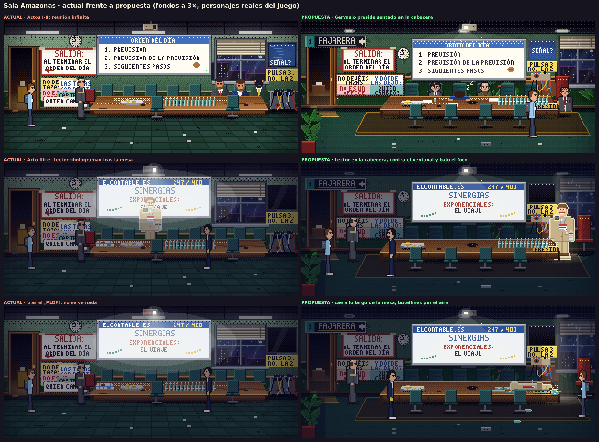

- **Qué cambia:** la mesa se acerca a cámara y cruza la sala. La **cabecera** queda en el extremo derecho, contra el ventanal y bajo un foco cenital. En los Actos I-II **Gervasio preside sentado** en un sillón burdeos, con los figurantes a escala 0,92 enfrente: uno desplomado sobre la mesa («Zzz») y otro con barba. En el Acto III el **Lector Medio está en la cabecera, fuera del haz del proyector**: la penumbra se pinta en el fondo (no encima de los actores) y deja la cabecera iluminada. Al empujarlo **cae a lo largo de la mesa** sobre los 14 botellines.
- **Qué se conserva:** el orden del día y su versión tachada, el cartel SALIDA, la tele con su pegatina, la diapositiva 247/400, el friso de selva y la moqueta verde.
- **Estado «huida»** (problema 11, «sillas desordenadas»):

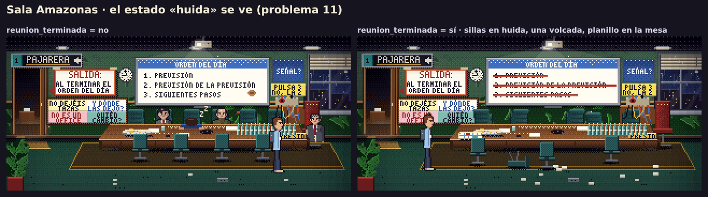

- **Capa de maqueta sobre la prueba** (hotspots, walkbox en U, PNJ, puntos de habla, visión, oclusores):

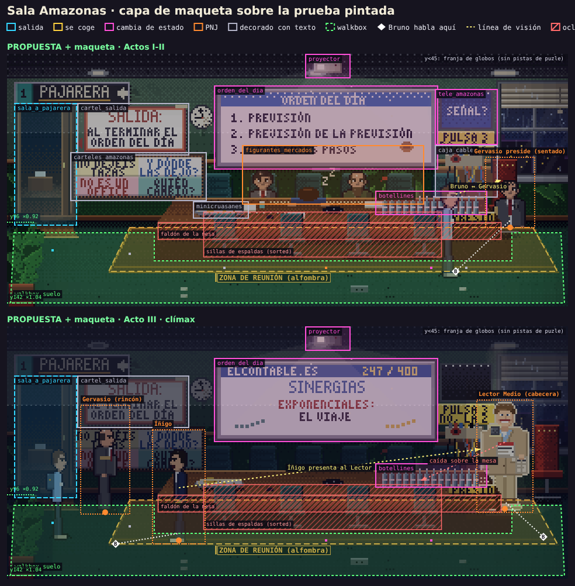

- **Storyboard del clímax (7.4)**. El 4.º cuadro estrena el **plano detalle** que se pide al motor (la pegatina «Atrezo – Focus group 2014»):

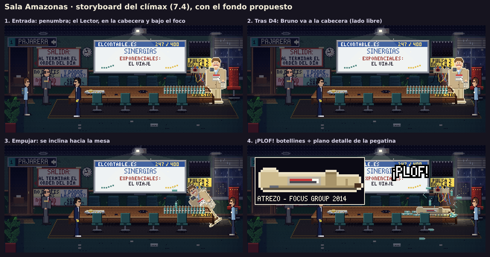

Cuadros sueltos a 3×: [Actos I-II](img/sala-propuesta-a1.png) · [huida](img/sala-propuesta-a2.png) · [Acto III](img/sala-propuesta-a3.png) · [¡PLOF!](img/sala-propuesta-plof.png).

### 3.2 Pecera, tramo x 300-620 (problemas #6, #7, #19 y #20, y la lectura de P04)

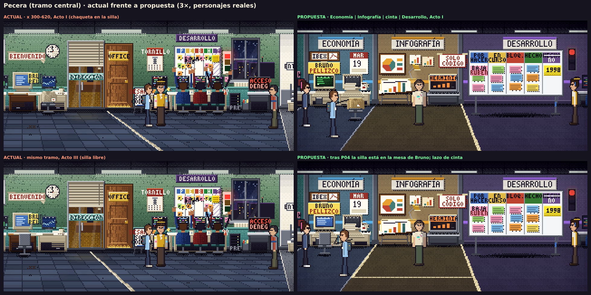

- **Qué cambia:** el tramo que antes era «una línea de mesas» pasa a tener **tres zonas que se leen sin rótulo y además rotuladas**: ECONOMÍA (moqueta azul, pared azul pizarra, la mesa de Bruno **sin silla** con marcas de ruedas en la moqueta, el pósit «BRUNO / PELLIZCO» legible y la silla de Ramírez con chaqueta camel en el plano medio), INFOGRAFÍA (moqueta cálida, flexo, «HERMINIA» entero) y DESARROLLO (moqueta violeta). Entre las dos últimas, la **cinta en el suelo** y el cartel «SOLO CÓDIGO» en la pilastra. El **kanban queda exento**, con ruedas, en el plano medio y 18 px a la izquierda del coro, con las cabeceras en 3×5 (POR HACER, EN CURSO, BLOQ., HECHO y «HECHO» tachado con «NO»), el pósit «BAJA RUBÉN» legible y el «1998» amarillísimo.
- **Acto III / tras P04:** la silla está en la mesa de Bruno, su pantalla pasa a azul (correo) y la cinta hace un lazo alrededor de Infografía.
- **Qué se conserva:** el coro de espaldas con cascos, el semáforo, la luz de noche y las pantallas encendidas.

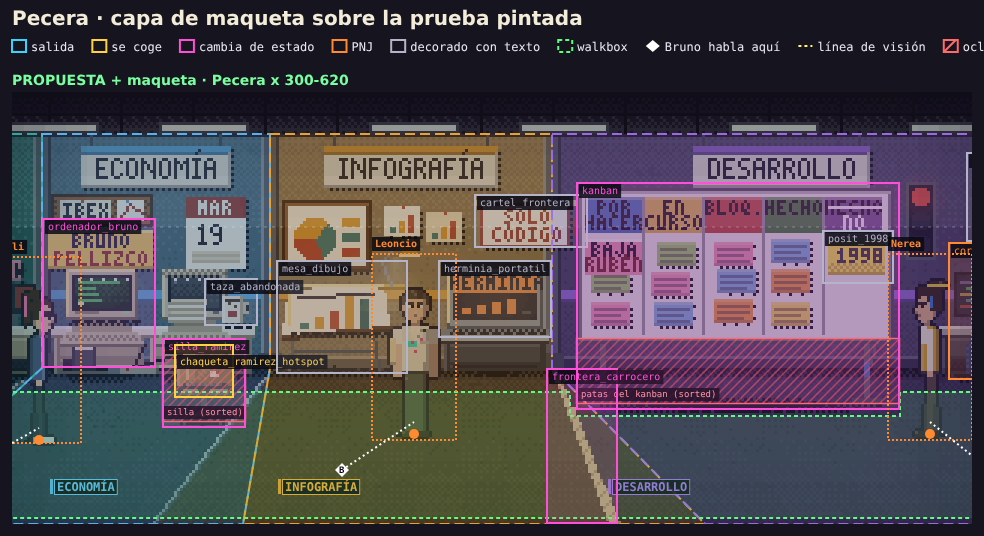

Cuadros a 3×: [Acto I](img/pecera-propuesta-a1.png) · [Acto III](img/pecera-propuesta-a3.png).

**Limitación honesta de la prueba:** de la Pecera solo se ha pintado este tramo de 320 px. El resto (núcleo, pasillo de Dirección, Web y Diseño) está en greybox en su maqueta (§4.2).

---

## 4. Sala por sala

Leyenda de las maquetas (todas a escala real 1×, renderizadas a 3×): **cian** = salida · **amarillo** = se coge · **magenta** = cambia de estado · **naranja** = PNJ (caja del sprite real, pies y etiqueta) · **gris** = decorado con texto · **verde discontinuo** = walkbox · **rombo blanco «B»** = punto desde el que habla Bruno · **línea amarilla** = línea de visión de la escena clave · **trama roja** = oclusor o primer plano. Arriba se marca la franja de globos (y < 45). Las salas en greybox llevan ya el kit real de placas, ascensor y escalera, y los sprites reales.

### 4.1 `vestibulo` — Vestíbulo (auditoría: 7/10)

**Se conserva:** la línea de tornos en diagonal, los walkboxes `entrada` / `paso_torno` / `interior`, el organigrama con VACANTE, el cartel «REDACCIÓN → / ASCENSOR →», el logo de letras metálicas, la moqueta roja interior, la lluvia en la calle y el cuadro de llaves.

**Cambia:**
- **Mostrador bajo** (a la cintura): Celestino se ve de cintura arriba, con la bufanda IBEX y el pinganillo. Bruno le habla desde la izquierda, en [138,122], y ya no lo tapa (#3).
- **Torno:** cambio de estado de tres elementos (alas recogidas, LED verde y franja verde en el carril). El LED pasa a la bancada de atrás y el carril delantero se cruza con cinta y un cartel «AVERIADO» legible (#18).
- **Objetos pequeños con forma propia:** el buzón amarillo en un poste, la radio con antena sobre el mostrador y el altavoz con rejilla y la bufanda colgando (§4.1, dudosos).
- **Señalética:** placa «1 REDACCIÓN ▲» del kit en vez de «REDAC. 1» (#20).
- **Epílogo:** estado «amanecer» del cristal y luz rasante, fardo de periódicos sobre el mostrador y caja de Íñigo (#12). La página 7 va en tipografía de periódico (fuera del top 20).

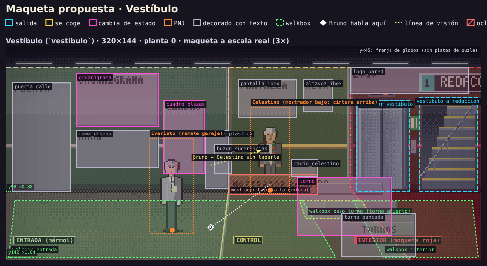

| Hotspot | Tipo | Posición / tamaño propuestos (x, y, an, al) | Variantes a dibujar | Nota |
|---|---|---|---|---|
| `puerta_calle` | decorado | 4, 24, 40, 74 | noche · amanecer (epílogo) | Epílogo: cristal con degradado de amanecer y luz rasante en el mármol (#12). |
| `organigrama` | estado | 47, 18, 56, 36 | sin foto · con foto en VACANTE | La foto pegada se dibuja a 6×8 px con borde blanco: visible a 1× (B§3.1). |
| `rama_diseno` | decorado | 47, 56, 56, 26 | — | Se conserva; pósit «+EVENTOS». |
| `cuadro_plazas` | estado | 106, 36, 28, 50 | normal · tachado | Sin cambios de posición. |
| `planta_plastico` | decorado | 134, 56, 16, 40 | — | Se conserva. |
| `buzon_sugerencias` | decorado | 140, 66, 12, 20 | — | Buzón amarillo sobre poste al inicio del mostrador: forma propia (antes 15×14 indistinguible). |
| `pantalla_ibex` | decorado | 156, 22, 40, 26 | animada | Monitor en brazo de pared sobre el mostrador; LED de borde verde/rojo. |
| `radio_celestino` | decorado | 192, 76, 18, 12 | — | Sobre el mostrador, con antena y dial: 18×12 con silueta propia. |
| `altavoz_ibex` | decorado | 200, 22, 20, 22 | con bufanda | Altavoz de rejilla 16 px + bufanda a rayas verde/roja colgando (antes mancha 15×18). |
| `torno` | estado | 196, 88, 64, 40 | cerrado (alas extendidas, LED rojo) · abierto (alas recogidas, LED verde, franja de suelo verde) | Primera recompensa del juego: cambio de 3 elementos, no un icono de 6 px (#18). LED en la bancada de ATRÁS. |
| `torno_bancada` | decorado | 226, 112, 50, 30 | cinta «FUERA DE SERVICIO» | El carril delantero, cruzado con cinta y un cartel «AVERIADO» legible (antes «NO»). |
| `logo_pared` | decorado | 232, 14, 80, 18 | — | Se conserva. |
| `ascensor_vestibulo` | salida | 236, 36, 36, 62 | kit ascensor, indicador «0» | Kit común (§Sistema). |
| `vestibulo_a_redaccion` | salida | 278, 34, 40, 64 | kit escalera que sube | Placa «1 REDACCIÓN ▲» en vez de «REDAC. 1» (#20). |

**Storyboard del epílogo (7.5):**

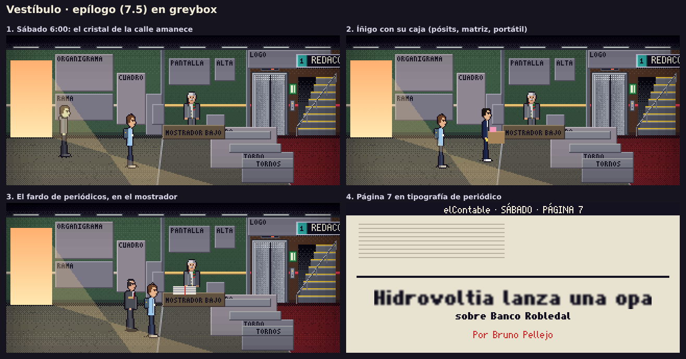

### 4.2 `pecera` — La Pecera (auditoría: 6/10)

**Se conserva:** la pantalla de métricas y su apagado, las sillas con chaqueta de las 18:30, el coro de espaldas, la zona de Diseño y Producto con la bandeja ENTREGAS y el monitor de Valentín con la Pecera en miniatura, la cinta que acaba encerrando a Infografía y Rubén en la ventana en el Acto III.

**Cambia (izquierda → derecha):** NÚCLEO (0-96) · PASILLO DE DIRECCIÓN (96-170: Pajarera y Office cerca de la llegada, que son las salas a las que más se va) · WEB (170-310) · ECONOMÍA (310-386) · INFOGRAFÍA (386-480) · cinta · DESARROLLO (480-680, con el kanban exento) · DISEÑO Y PRODUCTO (680-800, con el ventanal). Es la respuesta a #6, #7, #8, #19 y #20. Se quitan «PANTONE» (#10) y la palabra clave «DANA» (por tacto), así como la pancarta «BIENVENIDO» y la torre «PRE», que el guion no pide. Valentín pasa a estar **sentado** en su puesto.

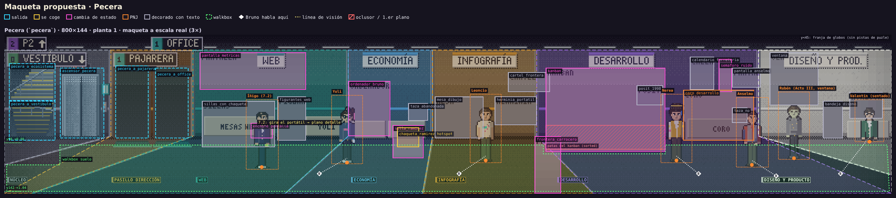

| Hotspot | Tipo | Posición / tamaño propuestos (x, y, an, al) | Variantes a dibujar | Nota |
|---|---|---|---|---|
| `pecera_a_ecosistema` | salida | 4, 26, 42, 34 | kit escalera que sube | Núcleo único (lift + escaleras) a la izquierda: fin de la contradicción vestíbulo/Pecera (#8). |
| `pecera_a_vestibulo` | salida | 4, 60, 42, 36 | kit escalera que baja | Se llega SUBIENDO desde el vestíbulo; adiós a la puerta acristalada con el torno detrás (#8). |
| `ascensor_pecera` | salida | 50, 30, 40, 64 | kit ascensor «1» | Junto a la escalera, como en todas las plantas. |
| `pecera_a_pajarera` | salida | 100, 28, 30, 66 | cristal con persiana; dentro se ve la matriz | Placa «PAJARERA» (no «DIRECCIÓN»), umbral dorado (#20). |
| `pecera_a_office` | salida | 136, 30, 30, 64 | madera | Placa «OFFICE», umbral amarillo. |
| `pantalla_metricas` | estado | 176, 16, 96, 34 | encendida 3.418 · apagada (cms_vivo) | Se conserva el gran cambio de estado; el letrero va en la pared, bajo la pantalla. |
| `enchufe_pantalla` | estado | 222, 80, 20, 14 | enchufado · desenchufado (cable colgando) | Cinta de carrocero EN el zócalo con «NO DESENCHUFAR» a 3×5 (B§3.2). |
| `sillas_con_chaqueta` | decorado | 178, 60, 66, 42 | — | Dos puestos vacíos con chaqueta y pantalla encendida (1.4b). |
| `figurantes_web` | decorado | 246, 56, 26, 40 | animados | Dos de espaldas. |
| `ordenador_bruno` | estado | 310, 42, 38, 50 | texto · correo (silla_libre) | Pósit «BRUNO / PELLIZCO» de 35×13 legible (G1, #19). Sin silla en el Acto I: marcas de ruedas en la moqueta. |
| `silla_ramirez` | estado | 350, 82, 28, 30 | con chaqueta junto a su mesa · arrimada a la de Bruno | Plano medio (pies y 110), chaqueta camel de 15 px: P04 se ve. |
| `chaqueta_ramirez_hotspot` | se coge | 354, 84, 20, 18 | puesta · no | Prioridad sobre la silla; sobre de azúcar asomando. |
| `taza_abandonada` | decorado | 364, 62, 18, 16 | — | Taza 8×9 con costra y mosca (antes 12×11 sin forma). |
| `mesa_dibujo` | decorado | 388, 56, 44, 38 | — | Infografía pasa a ser zona propia, con suelo cálido y flexo. |
| `herminia_portatil` | decorado | 442, 56, 38, 26 | barras animadas | «HERMINIA» entero en la barra de título (antes «HERMINI», #19). |
| `cartel_frontera` | decorado | 454, 34, 38, 18 | — | «SOLO CÓDIGO» pegado en la pilastra de la frontera; entero. |
| `frontera_carrocero` | estado | 478, 92, 24, 52 | Acto I recta · II doble · III lazo a Infografía | Cinta en el SUELO, beige con trama, sobre el cambio de moqueta: ya no parece un reflejo. |
| `kanban` | estado | 488, 30, 108, 76 | pósit BAJA RUBÉN · AQUÍ RUBÉN (posit_descopeado) | EXENTO en el plano medio, 18 px a la izquierda del coro; cabeceras 3×5 legibles (#7). |
| `posit_1998` | decorado | 570, 46, 24, 18 | — | Amarillo saturado con «1998» legible. |
| `calendario_ferreteria` | decorado | 618, 20, 22, 30 | — | Sobre el coro, fuera del alcance de sus manos. |
| `semaforo_ruido` | estado | 644, 22, 12, 30 | rojo · ámbar · verde | Semáforo vertical con carcasa: deja de leerse como muestrario. |
| `coro_desarrollo` | PNJ | 612, 50, 64, 46 | animado | Tres de espaldas en sus mesas; ya no tapan el tablero. |
| `taza_no` | decorado | 656, 66, 14, 14 | — | Taza 10×12 con «NO» en rojo de 3×5. |
| `pantalla_anselmo` | decorado | 656, 30, 26, 18 | DENEGADO · REVOCADO | Pantalla de 32 px: «DENEGADO» cabe (#19). |
| `ventana` | decorado | 690, 16, 44, 48 | noche · amanecer (epílogo) | Ventanal de Diseño; ahí espera Rubén al sol (Acto III). |
| `bandeja_diseno` | decorado | 738, 60, 18, 34 | — | Torre «ENTREGAS». |
| `monitor_valentin` | decorado | 762, 52, 30, 24 | — | La Pecera en miniatura: se conserva tal cual. |

**Storyboard de la escena 7.2 (el portátil se ve en plano detalle, #9):**

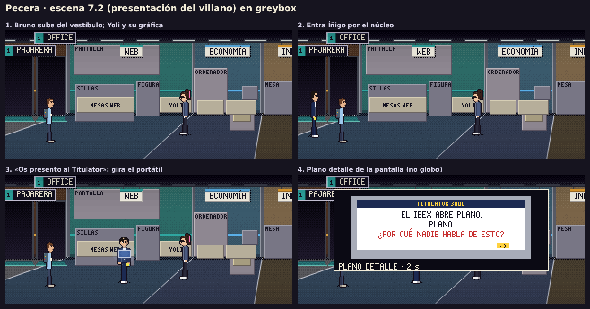

### 4.3 `office` — El Office (auditoría: 7/10)

**Se conserva:** la nevera con su cartel, el tablón (PORRA, PRL), el cartel del cortado, el fregadero y la puerta TALLERES de madera.
**Cambia:**
- **Custodia** pasa a un **ventanuco entre la puerta de la Pecera y Gertrudis**, como pide la B§3.3, con el timbre en el alféizar y manos con dedos (#13).
- **Gertrudis** mide 66 px, más que Bruno, y su LCD dice algo también en reposo («PRECALENTANDO RENCOR»).
- El microondas lleva la **cola de nueve tuppers** visible.
- Una **mesa alta** en el plano medio rompe el suelo vacío (#5).
- **Gervasio, en el Acto III, plantado delante de Gertrudis:** su cabeza queda por debajo del LCD, de modo que se ve la imagen «ella no le sirve».
- La puerta de la Catacumba tiene tres peldaños hacia abajo.

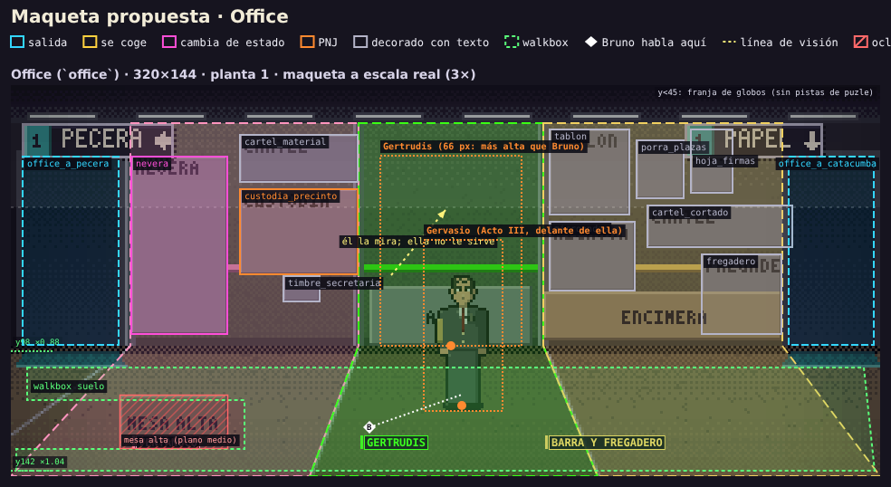

| Hotspot | Tipo | Posición / tamaño propuestos (x, y, an, al) | Variantes a dibujar | Nota |
|---|---|---|---|---|
| `office_a_pecera` | salida | 4, 26, 36, 70 | — | Placa común «PECERA ◄». |
| `nevera` | estado | 44, 26, 36, 66 | cerrada · abierta (yogur RAMÍREZ) | Cartel «ETIQUETAD VUESTROS TUPPERS» se conserva. |
| `cartel_material` | decorado | 84, 18, 44, 18 | — | Encima del ventanuco, no de Gertrudis. |
| `custodia_precinto` | PNJ | 84, 38, 44, 32 | persiana subida · bajada; manos con guantes | Ventanuco ENTRE la puerta y Gertrudis (B§3.3, #13); manos de 6 px con dedos. |
| `timbre_secretaria` | decorado | 100, 70, 14, 10 | — | Timbre de mostrador dorado en el alféizar del ventanuco, con canto vivo. |
| `tablon` | decorado | 198, 16, 30, 32 | — |  |
| `porra_plazas` | decorado | 230, 20, 18, 22 | — |  |
| `hoja_firmas` | decorado | 250, 16, 16, 24 | — | «PRL» legible. |
| `microondas` | decorado | 198, 50, 32, 26 | — | Microondas + COLA DE 9 TUPPERS en fila sobre la encimera (cada uno 5×4 con tapa de color). |
| `cartel_cortado` | decorado | 234, 44, 54, 16 | — | «EL CORTADO / SUBE A 1,20 €» en 2 líneas. |
| `fregadero` | decorado | 254, 62, 30, 30 | — | Tazas de eventos con logos. |
| `office_a_catacumba` | salida | 286, 26, 32, 70 | 3 peldaños hacia abajo | La Catacumba queda a medio nivel bajo: explica el techo bajo sin mentir sobre la planta (Ambigüedad §3.1). |

### 4.4 `catacumba` — La Catacumba (auditoría: 8/10)

**Se conserva:** casi todo. La atmósfera, las galeradas, el camastro tras la cortina, el cambio de estado del fax, el cartel de Aurora y el Libro de Estilo.
**Cambia:**
- **Teodoro sentado frente al fax** (B§3.4).
- El **teléfono rojo tiene el estado «descolgado»**: auricular en su mano y cordón rizado (#4).
- El tipómetro pasa a ser una regla de latón de 26×9 px y el corrector, un frasco de 10×12 px (§5.4).
- El reloj tiene 9 px de radio y marca las 20:59 con claridad.
- La puerta, vista desde dentro, anuncia «OFFICE ▲» (3 peldaños que suben).

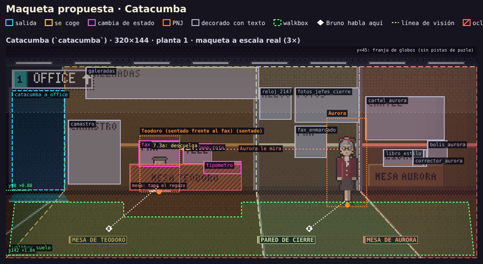

| Hotspot | Tipo | Posición / tamaño propuestos (x, y, an, al) | Variantes a dibujar | Nota |
|---|---|---|---|---|
| `catacumba_a_office` | salida | 4, 30, 36, 68 | 3 peldaños que suben | Desde dentro anuncia el OFFICE (no repite «TALLERES»). |
| `galeradas` | decorado | 54, 14, 118, 22 | — | Se conservan («como jamones»). |
| `camastro` | decorado | 42, 50, 36, 44 | cortina entreabierta | Se conserva. |
| `fax` | estado | 90, 64, 28, 18 | sin papel · con papel | Delante de Teodoro sentado: el hombre pegado a su máquina (B§3.4). |
| `telefono_rojo` | estado | 120, 66, 20, 14 | colgado · DESCOLGADO (auricular en la mano de Teodoro, cordón rizado) | 7.3a: el teléfono se descuelga en pantalla (#4). |
| `tipometro` | estado | 134, 78, 26, 9 | en la mesa · en la mano | Regla de latón de 26×4 con marcas: deja de parecer un peine; ≥ 9 px de alto. |
| `reloj_2147` | decorado | 172, 28, 22, 22 | — | Esfera de 9 px de radio: minutero en el 11 y horaria casi en el 9: «falta un minuto». |
| `fotos_jefes_cierre` | decorado | 196, 28, 44, 24 | — |  |
| `fax_enmarcado` | decorado | 196, 54, 22, 22 | — |  |
| `cartel_aurora` | decorado | 244, 34, 54, 30 | — | Pista de P03: se conserva grande. |
| `libro_estilo` | decorado | 256, 70, 28, 12 | — | Y calzando la pata de la mesa (B§3.4). |
| `bolis_aurora` | decorado | 286, 64, 14, 16 | — |  |
| `corrector_aurora` | decorado | 276, 70, 10, 12 | — | Frasco de corrector de pie (10×12) en vez de una tira de 5 px. |

**Storyboard del inicio del Acto III (7.3a):**

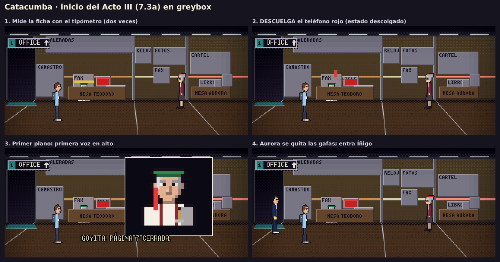

### 4.5 `pajarera` — La Pajarera (auditoría: 7/10)

**Se conserva:** la matriz 2×2 con VACANTE en IDEAL, la puerta de la Sala con su pantallita (EN CURSO / LIBRE / OCUPADO HASTA 2031), la mesa RESERVADO, la hoja de reservas y el póster DISRUPCIÓN.
**Cambia:**
- La pared izquierda pasa a ser de **cristal hacia la Pecera**, con la persiana a media altura.
- **Íñigo, sentado en el sofá** con las piernas cruzadas (#16).
- El **Titulator va en un atril propio**, con una pantalla de 30×18 y 3 líneas en 3×5 en las que «AYÚDAME ESTOY EN EL ARMARIO 27» se lee, y sin solapes.
- El **perchero** es de latón claro, con 4 ganchos.
- **Gervasio, en el Acto II, sentado en su mesa.**

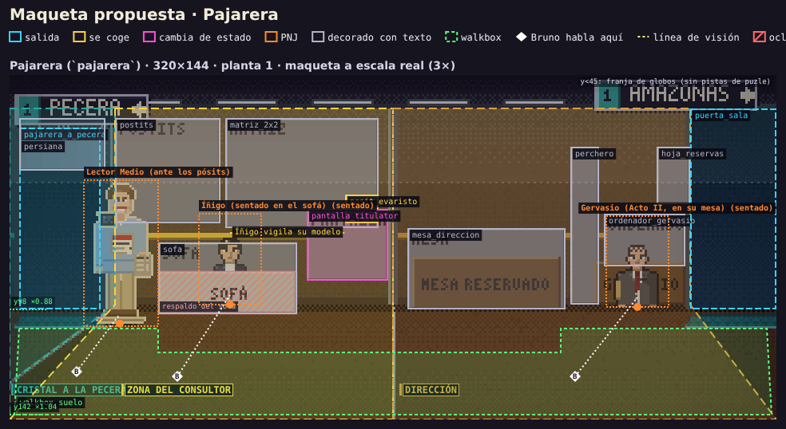

| Hotspot | Tipo | Posición / tamaño propuestos (x, y, an, al) | Variantes a dibujar | Nota |
|---|---|---|---|---|
| `pajarera_a_pecera` | salida | 4, 22, 34, 76 | — | Pared IZQUIERDA de cristal: a través se ve la Pecera (mesas, pantalla de métricas). Es lo que da nombre a la sala (#16). |
| `persiana` | decorado | 4, 18, 36, 22 | a media altura | La persiana va en el cristal hacia la Pecera. |
| `postits` | decorado | 44, 18, 44, 44 | — |  |
| `matriz_2x2` | decorado | 90, 18, 64, 46 | Acto I · con «COSTE» entero | «COSTE» deja de salir cortado (#19). |
| `posit_evaristo` | se coge | 140, 50, 14, 12 | — | Pósit 12×10 con canto vivo, en la esquina de la matriz. |
| `sofa` | decorado | 62, 70, 58, 30 | — | Sofá blanco de frente; Íñigo SENTADO con las piernas cruzadas (#16). |
| `pantalla_titulator` | estado | 124, 56, 34, 30 | rotando titulares · «AYÚDAME ESTOY EN EL ARMARIO 27» | Portátil en atril, pantalla 30×18 con 3 líneas de 3×5: la pista se LEE (G4, #16). Sin solapes. |
| `mesa_direccion` | decorado | 166, 64, 66, 34 | — | RESERVADO, cuenco e informe. |
| `perchero` | decorado | 234, 30, 12, 66 | — | Perchero de latón claro con 4 ganchos, separado del marco de la ventana. |
| `ordenador_gervasio` | decorado | 248, 58, 34, 22 | — | Tres móviles cargando. |
| `puerta_sala` | salida | 284, 14, 36, 84 | EN CURSO · LIBRE · OCUPADO HASTA 2031 | Se conserva (el mejor cambio de estado del juego); placa «AMAZONAS» (#20). |
| `hoja_reservas` | decorado | 270, 30, 14, 24 | Acto III con folio |  |

### 4.6 `sala_amazonas` — Sala Amazonas (auditoría: 5/10)

Ver la prueba pintada (§3.1). La maqueta es la capa sobre el arte propuesto, en el Acto III, con los PNJ de los tres actos.

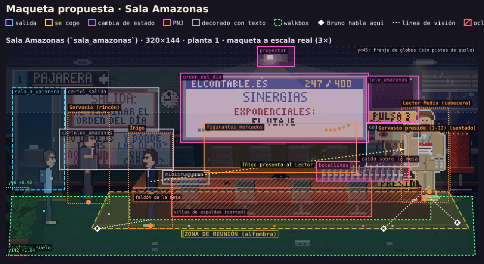

| Hotspot | Tipo | Posición / tamaño propuestos (x, y, an, al) | Variantes a dibujar | Nota |
|---|---|---|---|---|
| `sala_a_pajarera` | salida | 4, 28, 36, 70 | — | Placa «PAJARERA ◄» y umbral dorado (#20). |
| `cartel_salida` | decorado | 40, 28, 64, 30 | — | Se conserva el texto. |
| `carteles_amazonas` | decorado | 36, 56, 78, 28 | — | Tablón 2×2: cuatro hojas legibles que ya no se pisan (#19). |
| `orden_del_dia` | estado | 118, 18, 128, 48 | orden · tachado · diapositiva 247/248 | Pista de P06 intacta; en el Acto III, proyección. |
| `proyector` | estado | 170, 0, 26, 14 | apagado · encendido con haz | El haz va a la pantalla y NO toca la cabecera (#1). |
| `minicruasanes` | decorado | 106, 84, 32, 10 | — | Bandeja con canto vivo. |
| `planillo_mesa` | se coge | 92, 87, 26, 10 | solo con reunion_terminada | En el extremo izquierdo de la mesa, con canto vivo. |
| `botellines` | estado | 210, 78, 64, 14 | en fila · volando/rodando (lector_derribado) | 14 botellines bajo la caída del Lector (B§7.4). |
| `figurantes_mercados` | PNJ | 134, 52, 104, 34 | sentados · uno desplomado sobre la mesa · ausentes | Escala 0,92; barba visible; «Zzz» (#11). |
| `tele_amazonas` | estado | 244, 20, 36, 32 | canales según tele_n · apagada (Acto III) | En brazo de pared, pegatina legible. |
| `caja_cables` | decorado | 244, 52, 36, 30 | — | Sobre una credencia, cables colgando por delante. |

### 4.7 `ecosistema` — El Ecosistema (evaluación propia sobre la versión partida de hoy)

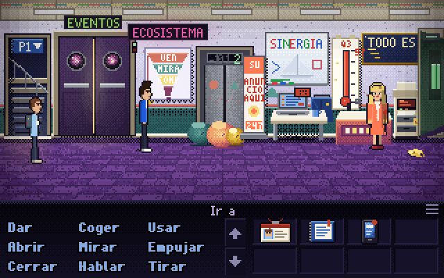 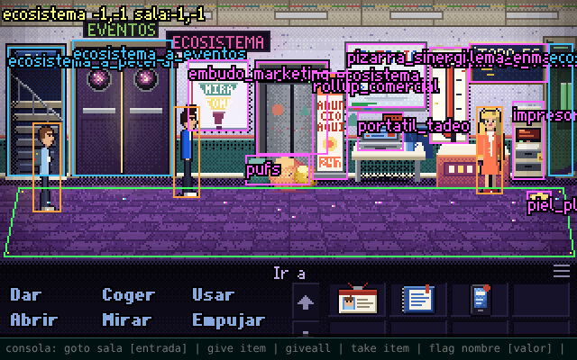

**Evaluación con los criterios de la auditoría: 5/10.** La partición fue un acierto: el photocall y el gong se han ido a Eventos y la puerta de Eventos, con ojos de buey y piloto, es muy buena. Siguen cuatro problemas:
1. Hay **tres departamentos sin frontera en 320 px** (Marketing, la mesa de Tadeo y Comercial), y `embudo_marketing`, `ascensor_ecosistema`, `rollup_comercial`, `pizarra_sinergia` y `portatil_tadeo` se pisan en la banda x 104-236.
2. El lema sale cortado («TODO ES…»), la impresora de la tercera queda cortada por el borde y la salida al pasillo de Administración es una franja de 14 px.
3. La señalética usa tres estilos distintos (placa verde «EVENTOS», neón «ECOSISTEMA» y «P1▼»).
4. La piel de plátano mide 14×8 px y es marrón sobre lila.

Lo positivo: Borja y Maripaz no se tapan, y los pufs delante del ascensor cuentan el gag.

**Propuesta:** 400 px con scroll (D3). Núcleo con ascensor y escalera juntos (los pufs siguen delante, sin tapar la botonera) · MARKETING (embudo, pizarra SINERGIA sobre la mesa vacía de Tadeo y Borja) · puerta de EVENTOS con su umbral granate · COMERCIAL (roll-up, termómetro, lema entero en 4 líneas y Maripaz en su mesa) · PASILLO de 46 px con la impresora dentro, entera.

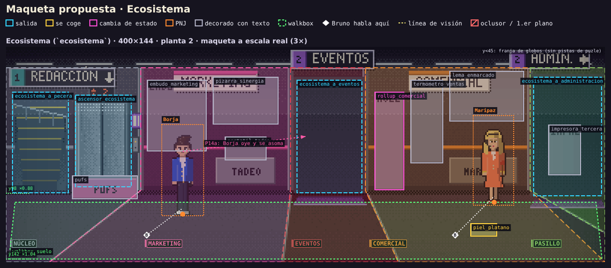

| Hotspot | Tipo | Posición / tamaño propuestos (x, y, an, al) | Variantes a dibujar | Nota |
|---|---|---|---|---|
| `ecosistema_a_pecera` | salida | 4, 30, 38, 68 | kit escalera que baja | En el núcleo, junto al ascensor. |
| `ascensor_ecosistema` | salida | 46, 32, 38, 62 | kit ascensor «2» | Ya no se solapa con embudo ni roll-up. |
| `pufs` | decorado | 44, 86, 44, 16 | — | Siguen delante del ascensor (gag A§14.2), sin tapar su botonera. |
| `embudo_marketing` | decorado | 94, 22, 40, 48 | — |  |
| `pizarra_sinergia` | decorado | 138, 20, 44, 32 | — | Sobre la mesa vacía de Tadeo (B§3.7). |
| `portatil_tadeo` | decorado | 146, 60, 28, 16 | — |  |
| `ecosistema_a_eventos` | salida | 194, 22, 44, 76 | focos por los ojos de buey; piloto «5 MIN» | Puerta con su propia zona de suelo granate (umbral). |
| `rollup_comercial` | estado | 246, 30, 20, 66 | desplegado · enrollado (Empujar) |  |
| `termometro_ventas` | decorado | 270, 22, 22, 56 | — |  |
| `lema_enmarcado` | decorado | 296, 16, 50, 34 | — | Lema entero en 4 líneas de 3×5 (antes «TODO ES…», #19). |
| `piel_platano` | se coge | 310, 118, 18, 9 | — | Piel de 16×8 amarillo saturado con canto vivo (antes 14×8 marrón). |
| `ecosistema_a_administracion` | salida | 352, 20, 46, 80 | pasillo en perspectiva | El pasillo existe: 46 px de boca con la ventanilla al fondo (antes 14 px de borde). |
| `impresora_tercera` | decorado | 362, 52, 22, 34 | ATASCO EN BANDEJA 2 | Dentro del pasillo, entera (antes cortada por el borde). |

### 4.8 `eventos` — La Sala Polivalente (evaluación propia; sala nueva)

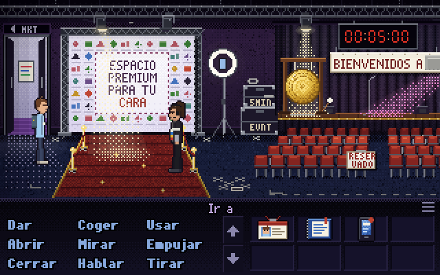 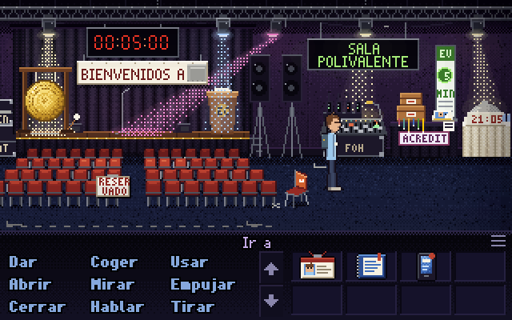
Depuración: [izquierda](img/actual-eventos-0-debug.png) · [derecha](img/actual-eventos-1-debug.png)

**Evaluación: 7/10.** Es la sala que mejor aplica ya lo que pide esta propuesta:
- **profundidad real**, con las filas de sillas como primer plano y un walkbox con muesca alrededor del patio;
- **zonas legibles** por luz (photocall, escenario, técnica y acreditación);
- Pilar delante de su photocall sin que Bruno la tape (habla desde [104,127]);
- la cuenta atrás «00:05:00», que convierte en imagen el tic de Pilar.

Falla en cuatro cosas:
1. El hotspot `focos` mide **444×22 en la franja de globos**.
2. `aro_luz` y `flight_cases` se pisan.
3. La mesa dice «ACREDIT» (texto cortado) y el álbum, que es la pieza de P14a, mide **15×8 px**.
4. La puerta dice «◄ MKT», que no es el nombre de ninguna sala.

**Propuesta:** se toca poco. `focos` se reduce a los dos PAR que parpadean, el álbum pasa a 20×12 con «FOTOS» y canto vivo, la mesa dice «ACREDITACIÓN» entero, se separan el aro y los cases, y la puerta lleva la placa común «ECOSISTEMA ◄». Borja se asoma en el umbral (P14a, A§13.6).

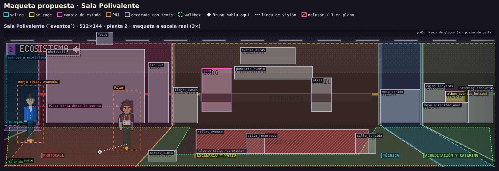

| Hotspot | Tipo | Posición / tamaño propuestos (x, y, an, al) | Variantes a dibujar | Nota |
|---|---|---|---|---|
| `eventos_a_ecosistema` | salida | 2, 26, 34, 72 | — | Placa «ECOSISTEMA ◄» en vez de «◄ MKT» (#20). |
| `photocall` | decorado | 44, 20, 103, 78 | ¡FLASH! | Se conserva. |
| `aro_luz` | decorado | 150, 34, 22, 64 | — | Separado 4 px de los flight cases (antes se pisaban). |
| `flight_cases` | decorado | 176, 60, 26, 38 | — |  |
| `focos` | decorado | 96, 2, 18, 14 | parpadeo | El hotspot pasa de 444×22 en la franja de globos a los dos PAR que parpadean. |
| `gong` | estado | 206, 40, 32, 46 | quieto · vibrando |  |
| `cuenta_atras` | decorado | 246, 18, 58, 18 | 00:05:00 | Se conserva (gag), aunque viva en la franja de globos. |
| `pancarta_evento` | decorado | 240, 38, 82, 14 | — |  |
| `atril` | decorado | 320, 50, 22, 36 | — |  |
| `sillas_evento` | decorado | 200, 104, 180, 26 | — | Las filas en perspectiva ya funcionan como primer plano. |
| `silla_reservado` | decorado | 252, 108, 20, 22 | — |  |
| `silla_torcida` | decorado | 366, 108, 22, 22 | — |  |
| `mesa_sonido` | decorado | 392, 62, 42, 36 | — |  |
| `mesa_acreditaciones` | decorado | 436, 76, 48, 22 | — | Faldón «ACREDITACIÓN» entero (antes «ACREDIT»). |
| `cajas_lanyards` | decorado | 438, 56, 22, 20 | — |  |
| `album_eventos_hotspot` | se coge | 460, 64, 20, 12 | en la mesa · prestado | Álbum de 18×10 con «FOTOS» y canto vivo (antes 15×8). |
| `catering_croquetas` | decorado | 484, 58, 26, 40 | — |  |
| `marcas_cinta` | decorado | 150, 126, 30, 12 | — |  |

### 4.9 `administracion` — Administración (auditoría: 8/10)

**Se conserva:** el cartel del 26 % (pista de P11), el horario 19:00-19:15, el dispensador «0», la pared de notas rechazadas, el despacho acristalado de Controlling y el «NO APOYARSE».
**Cambia:**
- **Begoña, sentada**, con el agujerito a la altura de la boca pero **14 px a su izquierda** (nunca se alinea con él: el gag sustituye a la máscara, #14).
- Tres sellos y tres tazas que se cuentan.
- **Evaristo, sentado dentro de Controlling, leyendo con lupa**; sale a la puerta cuando se le llama (A§3.8).
- La coma enmarcada es una coma (ya no parece un reloj).
- «EJEMPLARES» sale entero.
- El cartel del 26 % recupera la firma «La Dirección (también recortada)».

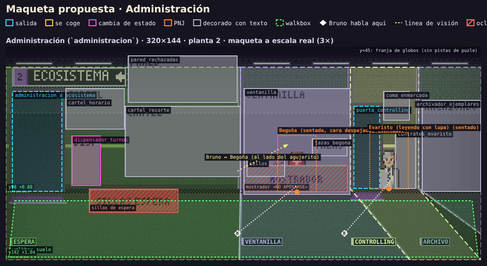

| Hotspot | Tipo | Posición / tamaño propuestos (x, y, an, al) | Variantes a dibujar | Nota |
|---|---|---|---|---|
| `administracion_a_ecosistema` | salida | 4, 30, 34, 68 | — | Placa «ECOSISTEMA ◄». |
| `cartel_horario` | decorado | 40, 28, 40, 28 | — |  |
| `dispensador_turnos` | estado | 44, 60, 20, 34 | 0 · 1 |  |
| `pared_rechazadas` | decorado | 82, 6, 74, 32 | — |  |
| `cartel_recorte` | decorado | 80, 40, 78, 48 | — | Con la firma «— LA DIRECCIÓN (TAMBIÉN RECORTADA)» en 2 líneas (B§3.8). |
| `ventanilla` | decorado | 160, 28, 72, 72 | — | Cabina de cristal: el AGUJERITO va a la altura de la boca pero 14 px a la izquierda de Begoña, que nunca se alinea (#14). |
| `sellos` | decorado | 162, 76, 26, 12 | — | Tres sellos con mango de color en un soporte: «tres» se cuenta. |
| `tazas_begona` | decorado | 206, 62, 24, 12 | — | Tres tazas en una balda dentro de la cabina. |
| `puerta_controlling` | salida | 234, 40, 18, 56 | cerrada · abierta | Puerta del despacho (no es salida de sala: abre el despacho). |
| `coma_enmarcada` | decorado | 254, 30, 18, 20 | — | Una coma negra de 8 px en un marco: ya no parece un reloj. |
| `contratos_evaristo` | decorado | 262, 56, 14, 40 | — |  |
| `archivador_ejemplares` | decorado | 280, 36, 40, 62 | — | Rótulo «EJEMPLARES» en placa de 40 px: entero (#19). |

### 4.10 `cpd` — Sistemas y CPD (auditoría: 6/10)

**Se conserva:** la luz azul, el suelo técnico, los armarios numerados con «DYP?», el contador de tickets (excelente), el cementerio de ratones, el libro de visitas y la rejilla.
**Cambia:**
- **El armario 27 se dibuja por su estado** (cerrado, abierto o vacío) y se abre hacia fuera en cuanto empieza la escena 7.3 (#2).
- **El papel continuo es una tira perforada** que sale por la rendija y serpentea hacia cámara (#17).
- **Paco, sentado**, con la mampara gris «SISTEMAS» y las llaves detrás.
- La cuña del ventilador se ve.
- Placa «-1 SISTEMAS» del kit.

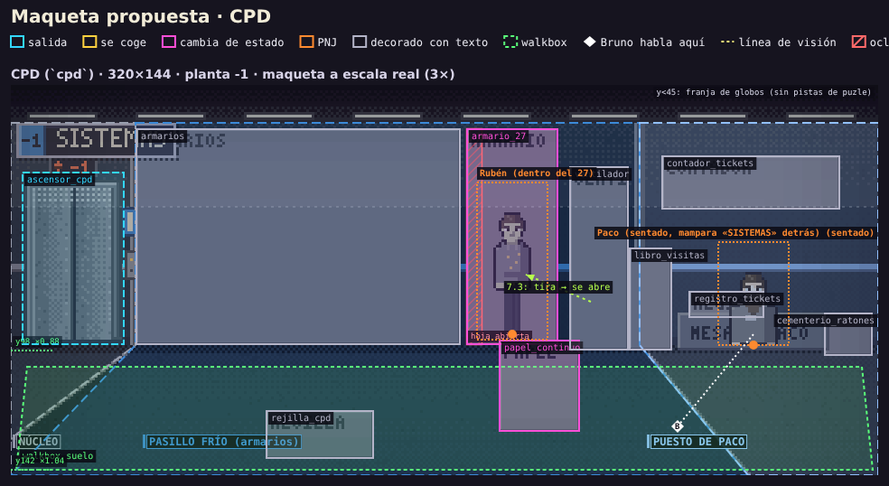

| Hotspot | Tipo | Posición / tamaño propuestos (x, y, an, al) | Variantes a dibujar | Nota |
|---|---|---|---|---|
| `ascensor_cpd` | salida | 4, 32, 38, 64 | kit ascensor «-1» | Placa «-1 SISTEMAS» del kit (antes «SALA FRÍA»). |
| `armarios` | decorado | 46, 16, 120, 80 | — |  |
| `armario_27` | estado | 168, 16, 34, 80 | cerrado · ABIERTO (puerta hacia fuera, Rubén dentro) · vacío | Se dibuja por su ESTADO, no por el flag que llega al final (#2). Charco de luz fría delante. |
| `papel_continuo` | estado | 180, 94, 30, 34 | asoma · tensa (P13) · recogida | TIRA perforada que sale por la rendija y serpentea hasta y 128: el hilo se sigue con la vista (#17). |
| `ventilador` | decorado | 206, 30, 22, 68 | con cuña · sin | Cuña de papel blanco de 8×6 en la rejilla. |
| `libro_visitas` | decorado | 228, 60, 16, 38 | — |  |
| `contador_tickets` | decorado | 240, 26, 66, 20 | sube | Se conserva (gag excelente). |
| `registro_tickets` | decorado | 250, 76, 28, 10 | — |  |
| `cementerio_ratones` | decorado | 300, 84, 18, 16 | — |  |
| `rejilla_cpd` | decorado | 94, 120, 40, 18 | — |  |

**Storyboard de la revelación (7.3):**

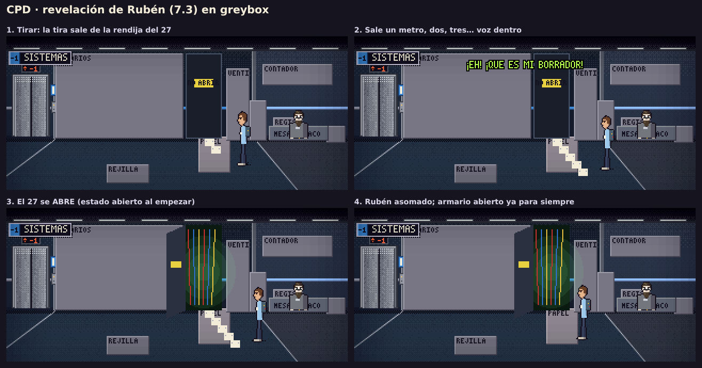

---

## 5. Sistema de diseño

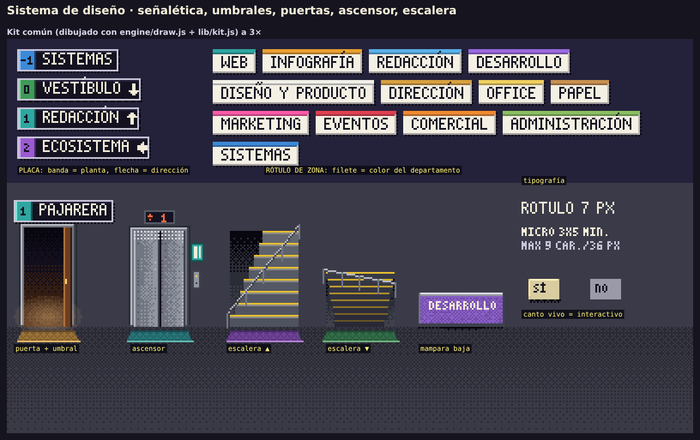

### 5.1 Tipografía de señalética (todo a 1×)

| Uso | Fuente | Tamaño | Reglas |
|---|---|---|---|
| Placa de destino, rótulo de zona, carteles grandes | fuente del juego (`label`) | caja de 7 px, ~5 px por carácter | Mayúsculas. ≤ 12 caracteres en placas. Placa de 13 px de alto, con 4 px de margen. |
| Textos secundarios (pósits, pantallas, etiquetas) | micro 3×5 (`tiny`, lib-oficina) | 4 px por carácter | ≤ 9 caracteres por línea (36 px). Contraste ≥ 4:1 con su soporte. Sin «¿» (la 3×5 no lo tiene): usar la fuente del juego. |
| Titulares de pantalla con función de pista | fuente del juego | 7 px | Nunca en la franja y < 45. Si es un remate: **plano detalle**. |
| Prohibido | — | < 3×5, texto cortado por el borde o por otro objeto, marcas reales | Comprobación automática (§7). |

### 5.2 Kit de puertas, ascensor y escalera

- **Placa de destino** (`kit.placa`): fondo tinta, marco claro de 1 px, banda con el número de planta (P−1 azul, P0 verde, P1 verde agua, P2 lila), destino y flecha (◄ ► ▲ ▼). Va sobre el dintel; si dos puertas están juntas, se apilan a 2 alturas.
- **Umbral** (`kit.umbral`): felpudo en perspectiva de 5-6 px con el color del destino y una franja clara en el borde de pisada.
- **Marco** (`kit.marcoPuerta`): acero de 3 px igual en todas las puertas interiores. La hoja la pinta cada sala (cristal en Dirección, madera en Office y Papel, doble hoja ciruela en Eventos).
- **Ascensor** (`kit.ascensor`): hojas de acero cepillado, indicador LED naranja, botonera, pictograma con el color de la planta e igual en las 4 plantas.
- **Escalera** (`kit.escalera`): narices de peldaño amarillas y barandilla. Sube = tramo ascendente; baja = hueco con narices que se alejan.
- **Mampara baja** (`kit.mampara`): 18-22 px, separa zonas sin tapar torsos.

### 5.3 Materiales por planta

| Planta | Pared | Suelo | Luz |
|---|---|---|---|
| P−1 Sistemas | negro azulado, armarios | suelo técnico gris azul con rejillas | fría azul y LED verde/rojo |
| P0 Vestíbulo | verde institucional / nogal tras los tornos | mármol gastado / moqueta roja | farolas naranjas, fluorescente; **amanecer** en el epílogo |
| P1 Redacción | verde agua, con filete por departamento | loseta de moqueta por zona; linóleo en el pasillo de Dirección; terrazo en el núcleo | fluorescente y glow de pantallas por zona |
| P1 Dirección (Pajarera, Sala) | nogal, cristal; selva en la Sala | parqué / moqueta verde con alfombra de reunión | lámparas cálidas; foco de presidencia |
| P1 Office / Papel | azulejo y crema / ladrillo y madera vieja | baldosa de cocina / tarima con alfombra | fluorescente que parpadea / bombillas ámbar |
| P2 | lila y fucsia (Mkt), granate (Eventos), naranja (Com.), verde oliva (Adm.) | moqueta gruesa lila (más alta que en Redacción) | focos de evento, neón |

### 5.4 Plan de luz por sala

| Sala | Fuente principal | Acento que guía al jugador | Cambio por estado |
|---|---|---|---|
| Vestíbulo | farolas por el cristal + fluorescente | piloto del torno y franja del carril | verde al abrir; amanecer en el epílogo |
| Pecera | fluorescente + glow de pantallas por zona | flexo de Infografía, rojo del semáforo | métricas apagadas (`cms_vivo`); amanecer en la ventana (epílogo) |
| Office | fluorescente que parpadea | LCD verde de Gertrudis | — |
| Catacumba | bombillas ámbar | lámpara de la mesa de Teodoro sobre el fax | pantalla del fax al recibir papel |
| Pajarera | lámparas de nogal | pantalla del Titulator, pantallita de la puerta | la pantallita en sus tres estados |
| Sala Amazonas | downlights | **foco de presidencia** en la cabecera | penumbra en el Acto III (sobre el fondo; los actores, a ×0,22) |
| Ecosistema | neón y fluorescente | ojos de buey de Eventos (luz ciruela) | — |
| Eventos | PAR en truss | photocall y atril | ¡FLASH! al entrar |
| Administración | fluorescente frío | lámpara de la ventanilla | — |
| CPD | luz fría azul | charco de luz delante del 27, contador rojo | 27 abierto: luz verde dentro |

### 5.5 Atrezo y nivel de detalle

| Nivel | Qué | Detalle exigido |
|---|---|---|
| **A · pieza de puzle o remate** | kanban, posit_1998, pósit de Bruno, silla y chaqueta de Ramírez, Lector Medio, botellines, armario 27, papel continuo, fax, teléfono rojo, tipómetro, pantalla del Titulator, torno, organigrama, enchufe, ordenador de Bruno, planillo, álbum | silueta cerrada ≥ 12×10, canto vivo, 2-3 px de luz arriba a la izquierda y 2 px de sombra de contacto, **variantes de estado dibujadas**, texto legible a 1× |
| **B · decorado con texto/gag** | orden del día, carteles, lema, contador, calendario, cartel del 26 %, coma enmarcada | texto entero; 1 px de brillo de soporte; sin canto vivo |
| **C · ambiente** | papeles, cables, plantas, pilastras, migas | 1-2 tonos y sombra de contacto; nunca más contraste que A |
| **Animación** | lluvia, parpadeos (fluorescente, focos PAR, cursor), contador de tickets, barras de Herminia, «ñiiic» del 27 (vibración de 1 px), botellines que tiemblan con la rotativa, chicle de Celestino | 2-4 fotogramas; nada que distraiga en la franja de pistas |

### 5.6 Tabla de puesta en escena de los PNJ

| PNJ | Sala | Posición (pies) | Pose | Bruno habla desde | Detrás (contraste) | Regla que resuelve |
|---|---|---|---|---|---|---|
| Celestino | vestíbulo | 178,97 | de pie tras mostrador bajo | 138,122 (izq.) | pared verde con monitor | #3 |
| Yoli | pecera | 309,116 | de pie entre su mesa y la de Bruno | 284,126 | pared Web | lado libre |
| Leoncio | pecera | 434,114 | de pie entre la mesa de dibujo y Herminia | 410,126 | pared crema | no tapa a Herminia |
| Nerea | pecera | 606,114 | de pie entre el kanban y el coro | 626,126 | pared violeta | #7 |
| Anselmo | pecera | 674,118 | de pie | 696,128 | ventanal | — |
| Valentín | pecera | 780,97 | **sentado** | 754,126 | pared blanca | cameo |
| Rubén (A III) | pecera | 712,112 | de pie, de cara a la ventana | 690,124 | ventanal (amanecer en el epílogo) | B§3.2 |
| Gertrudis | office | 162,96 | máquina de 66 px | 136,110 | azulejo | #13 |
| Gervasio (A III) | office | 166,118 | delante de Gertrudis | 132,126 | Gertrudis (LCD por encima de su cabeza) | B§3.3 |
| Teodoro | catacumba | 104,99 | **sentado frente al fax** | 70,124 | cortina del camastro | #4 |
| Aurora | catacumba | 232,108 | de pie junto a su mesa | 206,124 | cartel «NO HABLO…» | — |
| Íñigo (I-II) | pajarera | 92,96 | **sentado en el sofá** | 70,126 | pósits | #16 |
| Lector Medio | pajarera | 46,104 | expositor | 28,124 | pósits | B§3.5 |
| Gervasio (II) | pajarera | 262,97 | **sentado en su mesa** | 236,126 | pared nogal | — |
| Gervasio (I-II) | sala | 287,99 | **sentado presidiendo** | 256,124 | ventanal | #11 |
| Lector Medio (III) | sala | 284,104 | expositor, en el foco | 306,120 (para empujar) | ventanal nocturno | #1 |
| Íñigo (III) | sala | 98,122 | de pie, presentando | 62,124 | tablón | — |
| Gervasio (III) | sala | 56,106 | de pie en el rincón, bajo «SALIDA» | — | cartel SALIDA | — |
| Borja | ecosistema | 118,112 | de pie | 94,126 | embudo | — |
| Maripaz | ecosistema | 326,104 | de pie junto a su mesa | 300,126 | lema | — |
| Pilar | eventos | 128,124 | de pie en la alfombra | 100,128 | photocall | se conserva |
| Begoña | administración | 196,98 | **sentada** tras el cristal | 156,126 | estantería de la cabina | #14 |
| Evaristo | administración | 258,96 | **sentado** con lupa | 228,126 | cristal de Controlling | A§3.8 |
| Paco | cpd | 274,96 | **sentado** | 246,126 | mampara gris «SISTEMAS» | #17 |
| Rubén (III) | cpd | 185,94 | dentro del 27 abierto | 214,118 | luz verde del armario | #2 |

---

## 6. Plan de implantación

### 6.1 Apoyo de motor necesario (en `engine/`, por el equipo de motor)

| # | Función | Para qué | Coste |
|---|---|---|---|
| M1 | **Pose sentada** (`at: [x, y, dir], sentado: true` → recorte por la cadera + asiento delante; ver `lib/actores.js` `sentado()`) | presidir, fax, sofá, ventanilla, Paco, Valentín | S (1 día) |
| M2 | **Plano detalle** (`api.inserto({ dibujo, rotulo, ms })`: recuadro ampliado sobre la escena, sin pausar el diálogo) | Titulator 7.2, pegatina 7.4, teléfono 7.3a, página 7 | M (2-3 días) |
| M3 | **Tinte o penumbra de actores por sala/estado** (un `overlay` con zonas exentas, ya prototipado en la prueba de la Sala) | Acto III de la Sala, epílogo | S |
| M4 | **Rotación y caída de sprite** en un script (`api.caer(actor, dir, ms)`: 3 fotogramas) o 2 variantes de sprite intermedias | ¡PLOF! | S |
| M5 | **Modo «ver hotspots»** + objetivos táctiles mínimos y filas de menú de 14 px | móvil (#15) | M |
| M6 | (Opcional) prop en mano: auricular, caja, taza | 7.3a, epílogo | S |

Walkboxes cóncavos, capas `sorted`/`front`/`foreground`, `prop: true` y `sprites` por estado **ya existen** (la Sala Polivalente los usa). No hace falta tocar el motor para delimitar zonas.

### 6.2 Fases (por severidad de la auditoría)

| Fase | Salas y entregables | Problemas | Esfuerzo |
|---|---|---|---|
| **0 · Kit** | `lib-kit.js` (portar `lib/kit.js`); placas y umbrales en las 10 salas; quitar «PANTONE» y «DANA» | #10, #20 | 2 días |
| **1 · Remates S1** | `sala_amazonas` (portar la prueba) + M1, M3, M4; `cpd` (armario por estado, tira de papel); `catacumba` (teléfono descolgado, Teodoro sentado); `vestibulo` (mostrador bajo, torno, Celestino) | #1-#4, #11, #17, #18 | Sala 3 d · CPD 2 d · Catacumba 2 d · Vestíbulo 3 d |
| **2 · Pecera** | Núcleo, pasillo de Dirección, zonas, kanban exento, M2 para 7.2 | #6-#9, #19 | 6-8 días (800 px; el tramo pintado ya da 2) |
| **3 · Resto P1** | `office` (Custodia/Gertrudis, mesa alta), `pajarera` (cristal, sofá, Titulator) | #13, #16 | 3 d + 3 d |
| **4 · P2** | `ecosistema` a 400 px, retoques de `eventos`, `administracion` (Begoña, Evaristo) | #14, §4.7-4.8 | 4 d + 1 d + 2 d |
| **5 · Epílogo y móvil** | amanecer (vestíbulo, Pecera), fardo/caja/taza, página 7 tipográfica, M5 | #12, #15 | 4 días |

**Total orientativo:** 45-55 jornadas de arte + 8-10 de motor. El camino crítico es la Pecera.

### 6.3 Riesgos

- **Coordenadas que se mueven = walkthrough roto:** cada `walkTo` nuevo debe seguir dentro del walkbox. Se mitiga pasando `node tools/walkthrough.mjs` y `tools/play-mouse.mjs` al cerrar cada sala.
- **Ids de layout:** la propuesta **no renombra ni quita ningún id** (solo añade props sin hotspot con prefijo `_`, que en el juego irían en `draw`/`foreground`). Si se adopta `ecosistema` a 400 px, cambian `width` y `entries`: hay que coordinarlo con el autor de la lógica.
- **Rendimiento en iPhone:** el pintado por píxel de suelos por zona se cachea (`draw` se pinta una vez). Los overlays de penumbra se limitan a un `fillRect` con recorte.
- **Desequilibrio de estilo** entre salas rehechas y no rehechas durante la transición: por eso la fase 0 (kit) va primero y en todas las salas.
- **Pose sentada sobre el paper doll:** el recorte por la cadera (fila 42 de 64) funciona en vista frontal. De perfil necesita que el mueble tape el regazo; hay que comprobar los dolls «heavy».

### 6.4 Verificación

| Qué | Cómo |
|---|---|
| Ids, walkboxes y `walkTo` válidos | `node tools/check.mjs` → `CHECK: OK`; `node tools/shot.mjs <sala> --debug` |
| El walkthrough sigue funcionando | `node tools/walkthrough.mjs` y `node tools/smoke.mjs` |
| Legibilidad de los PNJ ≥ 80 % y Bruno no los tapa | `node tools/play-mouse.mjs` (ya mide la visibilidad); **añadir** una aserción: con el diálogo abierto, la caja de Bruno no corta la del interlocutor |
| Contraste de textos | `node tools/contrast.mjs` |
| Hotspots ≥ 12×10 (16×12 en táctil) y sin solapes | script nuevo (sugerido) sobre `layout`: tamaño mínimo y solape entre interactivos |
| Texto pintado entero | revisión con `--scale=3` + lista de cadenas de la tabla de cada sala |
| Remates | `node tools/review.mjs --solo=momentos`: los fotogramas de 7.2, 7.3, 7.3a, 7.4 y 7.5 deben mostrar el cambio (armario abierto, auricular en la mano, Lector sobre la mesa, plano detalle) |
| Comparación antes/después | `node docs/informes/propuesta/render.mjs` regenera las láminas de este informe |

---

## 7. Decisiones para la dirección

| # | Decisión | Opciones | Recomendación |
|---|---|---|---|
| **D1** | Geografía: ¿un único núcleo vertical (ascensor + escalera juntos en las 4 plantas, a la izquierda de la Pecera)? | (a) núcleo único · (b) mantener la escalera de la Pecera a la derecha y solo cambiar la puerta acristalada | **(a)**: resuelve #8 de raíz y acerca la Pajarera y el Office a la llegada. |
| **D2** | Orden de zonas de la Pecera | (a) el propuesto (Dirección junto al núcleo; Desarrollo y Diseño al fondo) · (b) mantener las puertas en el centro | **(a)**: menos paseo en los trayectos más repetidos (Office ↔ Catacumba, Pajarera). |
| **D3** | Ecosistema a 400 px con scroll | (a) 400 px · (b) seguir en 320 y quitar la mesa de Tadeo | **(a)**: tres departamentos con frontera; es el mismo patrón que la Pecera y Eventos. |
| **D4** | Pose sentada (motor M1) | (a) sí, para 8 PNJ · (b) no, todos de pie y se ajusta el texto del guion | **(a)**: el guion pide «preside», «sentado frente al fax», «en el sofá»; con 1 día de motor se ganan 4 imágenes clave. |
| **D5** | Plano detalle (M2) para los remates | (a) inserto ampliado · (b) globo de texto como ahora | **(a)**: el portátil del Titulator, la pegatina «Atrezo» y la página 7 son imágenes, no frases. |
| **D6** | La Catacumba, a medio nivel por debajo del Office (3 peldaños) | (a) sí · (b) dejar la ambigüedad | **(a)**: explica el techo bajo sin cambiar la planta. Cuesta 2 líneas de arte. |
| **D7** | Modo «ver hotspots» y objetivos táctiles mínimos | (a) sí, en iPhone y escritorio · (b) solo iPhone | **(a)**: misma lógica en las dos plataformas y prueba más sencilla. |
| **D8** | Alcance del rehecho | (a) fases 0-5 completas · (b) solo fases 0-1 (kit + los cuatro S1) antes del lanzamiento | **(b) si hay fecha cerrada**: arregla los cuatro remates y la señalética con ~15 jornadas; la Pecera, después. |

---

## 8. Lo que esta propuesta no resuelve (nota honesta)

- **Solo dos pruebas pintadas.** La Sala Amazonas está completa. De la Pecera solo se ha pintado el tramo x 300-620; el resto de salas está en **greybox** con el kit y los sprites reales, sin acabado.
- **Las maquetas son planos de intención, no geometría final:** algunas cajas de PNJ y de rótulo se pisan en las láminas y hará falta afinarlas al pintar.
- **La pose sentada y la caída del Lector están simuladas** con un recorte y una rotación del sprite real (`lib/actores.js`). En el juego necesitan M1 y M4. La caída rotada a mano no tiene la calidad de un sprite intermedio dibujado.
- **El amanecer del epílogo** solo se ha bocetado en greybox (cristal y luz rasante). No hay prueba pintada del vestíbulo de día.
- **No se han tocado los menús de diálogo ni de duelo** (16 réplicas, filas de 8-9 px): solo se fijan objetivos (M5). Rediseñarlos es trabajo de UI aparte.
- **El ancho de 400 px del Ecosistema** y el reordenamiento de la Pecera tocan `width` y `entries`, que son del autor de la lógica: hay que acordarlo antes de pintar.
- No se ha oído el audio ni se han visto las animaciones en movimiento: la propuesta de animación (§5.5) es de diseño, no se ha probado.
